<!-- Generated by specarch document techspec from ../spec/specarch.yaml, version 0.7.3-dev, and ../spec/implementation/go/specarch.go.specarch-implementation.yaml, version 0.1.0, and ../spec/implementation/swift/specarch.swift.specarch-implementation.yaml, version 0.1.0; meta-model 0.3. Do not edit this file: change the YAML and generate again. -->

# SpecArch toolchain: technical specification

Version 0.7.3-dev of the specification: 90 requirements, 5 entities, 16 commands, 7 algorithms, 641 tests, 162 decisions, 2 environments and 3 commissioning checks. The chapters follow arc42, and a chapter with nothing in the specification is left out.

**Problems:** 1 warning concerns this document; it is marked by a Problem paragraph at its element, or below when the document shows no element for it. The problems file lists every problem, and specarch validate prints them.

## 1. Introduction and goals

The `specarch` command: it validates SpecArch specifications and makes
documents and code from them. This folder is the specification, with no
language, library or build tool in it; how one stack implements it is in
`implementation/<stack>/`.

Owners: specarch-maintainers.

### Stakeholders

| Stakeholder | Who they are | Concerns |
|---|---|---|
| specification-author | A person or an assistant who writes a specification in SpecArch and keeps it current. | A mistake in a specification is caught before anyone builds on it; A large specification stays navigable |
| implementer | A developer who builds a system from a specification, in one of possibly several stacks. | The design says enough to build from, including how values travel; A change in the design is noticed in every implementation of it |
| reviewer | A person who reviews a specification or the documents made from it before work starts. | Every design element traces to a requirement, and every requirement to a test; The reasoning behind a choice is written next to it |
| operator | A person who installs, releases and runs the built system. | Release, rollback and commissioning are written down and checkable |
| ci-job | The continuous-integration job that checks every change of a project that uses SpecArch. | Every check runs with one command and answers with an exit status |

**Note on specification-author:** From ISO/IEC/IEEE 29148, Systems and software engineering, Life cycle processes, Requirements engineering, 2018, clause 5.2.2: Stakeholders are identified at the start, and their needs are the input to every requirement. <https://www.iso.org/standard/72089.html>

## 2. Constraints

| Constraint | Kind | Statement |
|---|---|---|
| CON-1 | technical | Every keyword that a standard already has is taken from that standard with its meaning; SpecArch adds a keyword only where none exists. |
| CON-2 | technical | The program installs with one command and runs in CI without a network. |
| CON-3 | legal | Every dependency is open source under an OSI-approved licence, pinned, and scanned before it is taken. |
| CON-4 | organisational | The repository is public and holds generic material only; no employer's, client's or product's data enters it. |

**Insight on CON-1:** A reader who knows JSON Schema, OpenAPI or AsyncAPI should not learn a second name for the same thing.

**Note on CON-1:** From JSON Schema, a media type for describing JSON documents, 2020-12: Field keywords such as type, properties, required, enum, format and the limits. <https://json-schema.org/specification>

**Note on CON-1:** From OpenAPI Specification, 3.1.0: Endpoint keywords such as paths, parameters, requestBody and responses. <https://spec.openapis.org/oas/v3.1.0>

### Assumptions

| Assumption | Statement |
|---|---|
| ASSUME-1 | A specification is kept in version control, so its history lives there and in history files, never inside the specification. |
| ASSUME-2 | The people and assistants who write specifications can read YAML and a C-like expression. |

**Insight on ASSUME-1:** Without this the files would need change logs, which the Low IQ Tax principle forbids.

## 3. Context

The interfaces the system offers, as its clients see them.

### Commands

| Command | Summary | Permission | Exit statuses |
|---|---|---|---|
| approve | Record that the documents were read and the specification is approved | public | 0: the approval was recorded; 1: refused; the specification has errors or open questions, the stakeholder is unknown, no document is configured, or a document is not current; 2: usage error, or a file that could not be read or written |
| check | Compare a specification with the dumps of the running code, for a CI gate | public | 0: every difference is one the allowlist names or a report, and every line of the allowlist names a difference and was there at --since; 1: a difference the allowlist does not name, a line of the allowlist that names none, repeats one or was added since --since, or a specification validate reports an error in; 2: usage error; a dump, the specification or the allowlist that could not be read; a dump of no format check reads, or one its reader refuses; a catalogue dump with no implementation file to compare it through, or with one whose tables cannot be written for PostgreSQL; or a revision git does not know |
| decide | Answer an open question with a decision record and take the question out | public | 0: the record is written and the question taken out; 1: refused; the question, the stakeholder or the source is unknown, the specification tracks origin and no source is given, design is not a stage, or the entry cannot be edited as text; or written, while the specification has errors; 2: usage error, or a file that could not be read or written |
| derive | Write a draft test for every derived case no test covers | public | 0: the tests were written, or there was nothing to write; 1: a specification has errors other than the missing tests it writes, or a draft's name is taken by another draft or by a test of another subject; 2: usage error, a path that could not be read or written, or a specification that keeps its tests in the root file |
| diff | Compare two versions of a specification and check the release between them | public | 0: every check passes; 1: a check fails, there is no release record for the new version, or a specification has errors; 2: usage error, or a path that could not be read |
| document | Write a document from a specification | public | 0: written, or with `--check` the output is current; 1: a specification has an error (after its files are written, or with `--check` compared), a marker is wrong, or with `--check` the output differs; 2: usage error, a target this build does not offer, --audience with a value other than external, without --out or for the problems target, no output folder in any specification given (or, for the handover target, no handover in any), the implementation files of one naming different output folders, or a file that could not be read or written |
| extract | Write a specification from existing code or documents | public | 0: the specification was written; 1: the surface could not be read as the source expects: a dump that does not parse or is stale, a dump whose repository is no gitlink of the repository holding it, is not checked out, pins a commit its history does not hold or whose checkout under the path is not the pinned commit's, a code-facts dump another parser version made, whose files are not the tracked files of its folder the reader reads, or, for pages, whose folder does not hold the router's folder, a route table that lists a method and path pair twice, a permission table that lists a grant, a rule or a gate twice, holds a gate with no check, with both a setting and a kind of caller or neither, or skipped for a kind other than client, names a matcher the reader does not know, or holds a rule without one of its four keys, a vocabulary that does not parse, lacks a key, holds one it does not have, gives a number, a duration or a language tag in another form, or lists one word twice in a list or in two lists of one group, a route table given with --routes from another repository or from a commit on another line of history than the permission table's, a router root that gives one route twice or holds no page, a path with changes not committed, untracked files, a shallow clone, a path outside a git repository, a document that is not Markdown, a file that is not an OpenAPI 3.0 or 3.1 document, a file that is not BPMN 2.0 XML or holds no process, a workflow table that does not parse, is stale, lacks a key of the format or holds another, names a step kind other than approval, operation or other, lists a workflow twice or gives a workflow, a step or a form field no name, a gateway table that does not parse, is stale, lacks a key of the format or holds another, gives a row no value or a value twice, or names a gateway or a claim that is no name, or an implementation file that does not parse as YAML; 2: usage error, a source this build does not offer, --implementation given to a source other than go, swift, javascript, dart or pages, --facts given to a source other than pages, --routes given to a source other than permissions, --language, --vocabulary or --given-outside given to a source other than documents, --table given to a source other than workflows, --implementation-out given to a source other than database, go or gateway, or naming a file that exists or whose name does not end in .yaml, a language that is not a BCP 47 tag, a language SpecArch ships no vocabulary for given without --vocabulary, a --language other than the vocabulary's own, more than one permission table, or a path that could not be read or written |
| facts | Write the code-facts dump extract reads of a committed folder | public | 0: the dump was written; 1: the folder could not be read as committed code: it is in no git repository, it has changes not committed or files not tracked, no commit has changed it, the dump file is in a repository that does not hold the code's, or the reader's toolchain failed to build or to run it; 2: usage error, a language this build does not read, a folder that does not exist, a dump file whose folder does not exist or that could not be written, or a submodule folder with a quote or a backslash |
| gaps | List the open questions and what they hold up | public | 0: no must or should question is open and no specification has an error; 1: at least one must or should question is open, or a specification or an estate has an error; 2: usage error, or a path that could not be read |
| generate | Write code or data from a specification | public | 0: written, a draft included, or with `--check` the output is current; 1: a specification has an error, an open question blocks what the target reads or the specification is not approved and `--unapproved` was not given, the plug-in reported an error (what it answered is written or checked), or with `--check` the output differs; 2: usage error, no generator for the target (not built in and no plug-in on PATH), the plug-in failed or answered badly, no output folder in any specification given, or a file that could not be read or written |
| idioms | List the idioms each implementation file uses, and how | public | 0: the idioms were listed; 2: usage error, a path that could not be read, or a specification with errors |
| idioms diff | Print a shipped idiom's parts beside each override's | public | 0: the overrides were printed, or there was none; 2: usage error, an idiom this program does not ship, a path that could not be read, or a specification with errors |
| merge | Merge the partial specifications the readers wrote into one | public | 0: the merged specification was written; 1: a tree could not be merged: it does not track origin, validate reports an error in it, it holds implementation files or records or a test that is not the draft derive writes for it, or it declares a source another tree declares differently, or whose paths changed after the commit a tree read them at; or a vocabulary that is not one this build reads; 2: usage error, fewer than two trees, two vocabularies of one language, or a folder or file that could not be read or written |
| model | Print the specifications as one JSON document, for a program | public | 0: printed; 2: usage error, a path could not be read, or a folder holds no specification, no implementation file and no estate |
| validate | Check specifications and implementation files | public | 0: every input is valid; 1: at least one input has an error; 2: usage error, a path could not be read, or a folder holds no specification, no implementation file and no estate |
| version | Print the program version and the meta-model versions it reads | public | 0: printed |

## 5. Building blocks

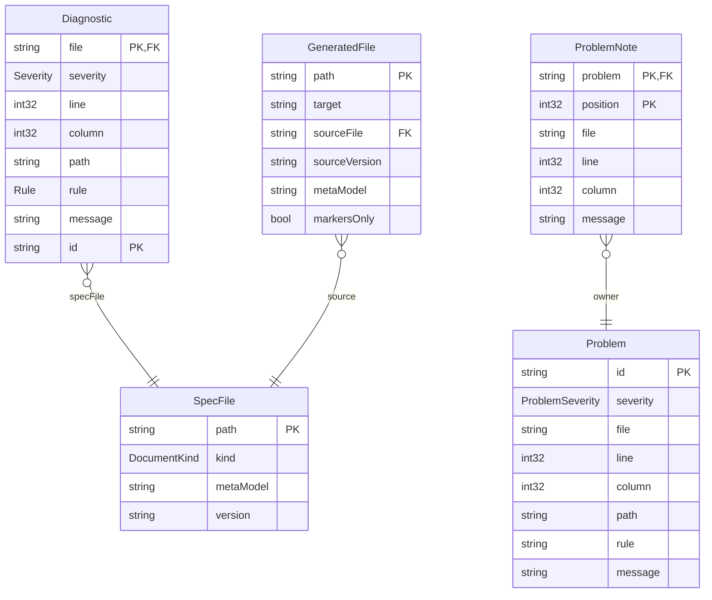

### Diagnostic

One problem found in one file. Printed as one line, the problem line
of ADR-065: `file:line:column: severity: /yaml/path: rule: message [id]`.

| Field | Type | Required | Limits | Description |
|---|---|---|---|---|
| file | string | yes |   | The file's path as given. |
| severity | Severity | yes |   |   |
| line | int32 | yes | at least 1 | Line of the YAML node the problem is at; for an expression, the line inside the expression. |
| column | int32 | yes | at least 1 | From 1, in Unicode characters: for an expression, the column inside the expression; otherwise the column of the node the path names when the problem is on its line (its value, or else its key), and else of the first character on the line that is not a space. |
| path | string | yes |   | JSON pointer to the node, such as `/entities/Loan/relations/member/target`; `/` for the whole file. |
| rule | Rule | yes |   |   |
| message | string | yes | at least 1 character | What is wrong and how to fix it, in one plain sentence. |
| id | string | yes | at least 1 character | `<rule>@<file>#<path>`, the file relative to the specification's folder, or to the file's own folder for a file checked on its own, with `.<tag>` after the rule, eight hex digits of the FNV-1a hash of the message, when one rule reports several diagnostics at one path of one file, and `-2`, `-3` and on after the tag when the message repeats as well. It names what is wrong, not where it is printed, so it stays while lines move (ADR-065). |

Primary key: file, id.

| Relation | Kind | Target | Via | On delete |
|---|---|---|---|---|
| specFile | many-to-one | SpecFile | file | restrict |

| Constraint | Rule | Message |
|---|---|---|
| diagnostic_line_positive | check `line >= 1` | Every diagnostic points at a line. |
| diagnostic_column_positive | check `column >= 1` | Every diagnostic points at a column. |

### GeneratedFile

A file a document or code target wrote. Its header names where it came from.

| Field | Type | Required | Limits | Description |
|---|---|---|---|---|
| path | string | yes |   | Path inside the target's own folder. |
| target | string | yes | at least 1 character | The document or code target that wrote it, such as `techspec` or `openapi`. |
| sourceFile | string | yes |   | The root file of the specification it was made from. |
| sourceVersion | string | yes |   | That specification's `info.version`. |
| metaModel | string | yes |   | The meta-model version of that specification. |
| markersOnly | bool | yes |   | True for a hand-written Markdown document, where only the text between `specarch:generate` markers is rewritten. |

Primary key: path.

| Relation | Kind | Target | Via | On delete |
|---|---|---|---|---|
| source | many-to-one | SpecFile | sourceFile | restrict |

### Problem

One error, warning or open question of a specification, as the
problems file lists it (ADR-065). Printed as one line:
`file:line:column: severity: pointer: rule: message [id]`, followed
by its notes.

| Field | Type | Required | Limits | Description |
|---|---|---|---|---|
| id | string | yes | at least 1 character | A question's own id, such as `Q-4`; for an error or a warning `<rule>@<file>#<pointer>`, the file relative to the specification's folder, with `.<tag>` after the rule, eight hex digits of the FNV-1a hash of the message, when one rule reports several problems at one pointer. |
| severity | ProblemSeverity | yes |   |   |
| file | string | yes |   | The fragment the entry is in, relative to the folder the problems file is in. |
| line | int32 | yes | at least 1 | The line of the entry, from 1. |
| column | int32 | yes | at least 1 | From 1, in Unicode characters: for an expression, the column inside the expression; otherwise the column of the node the pointer names when the problem is on its line, and else of the first character on the line that is not a space. For an error or a warning, the column of its diagnostic. |
| path | string | yes |   | JSON pointer to the entry, such as `/entities/Loan/relations/member/target`; `/` for the whole file. |
| rule | string | yes | at least 1 character | The Rule of an error or a warning, and `open_question` for a question. |
| message | string | yes | at least 1 character | What is wrong and how to fix it, in one plain sentence; for a question, its priority and kind, the question, who decides and how it is answered. |

Primary key: id.

### ProblemNote

A place that helps with a problem, printed after it as
`file:line:column: note: text`: a source the entry or the question
cites, or an entry a question blocks.

| Field | Type | Required | Limits | Description |
|---|---|---|---|---|
| problem | string | yes | at least 1 character | The id of the problem it belongs to. |
| position | int32 | yes | at least 1 | Its place among the problem's notes, from 1. |
| file | string | yes |   | The cited file when the source's url is beside the specification and the clause is `path:line`, otherwise the fragment holding the citation or the blocked entry; relative to the folder the problems file is in. |
| line | int32 | yes | at least 1 |   |
| column | int32 | yes | at least 1 |   |
| message | string | yes | at least 1 character | `source <key>, clause <clause>: <says>` for a citation; `blocks <pointer>` for a blocked entry, with the keys missing there. |

Primary key: problem, position.

| Relation | Kind | Target | Via | On delete |
|---|---|---|---|---|
| owner | many-to-one | Problem | problem | restrict |

### SpecFile

One input given to a command, as the command read it; a specification is one input, whatever the number of files in its tree.

| Field | Type | Required | Limits | Description |
|---|---|---|---|---|
| path | string | yes |   | The path as given on the command line or found under a given folder: a specification's root folder, or an implementation file. |
| kind | DocumentKind | yes |   |   |
| metaModel | string | yes |   | The meta-model version the input declares: `specarch` in a root file, `specarchImplementation` in an implementation file. |
| version | string | yes |   | The input's own `info.version`. |

Primary key: path.

### Enums

| Enum | Value | Meaning |
|---|---|---|
| DocumentKind | specification | a specification, the tree rooted at `specarch.yaml`; its design side is the SpecArch Definition (SDF) |
| DocumentKind | implementation | a SpecArch Implementation File (SIF), `<name>.<stack>.specarch-implementation.yaml`, one stack's implementation of a specification |
| DocumentTarget | techspec | arc42 technical specification in Markdown with generated Mermaid diagrams |
| DocumentTarget | requirements | requirements specification, in the layout of ISO/IEC/IEEE 29148 |
| DocumentTarget | testplan | test plan and test cases, golden and red, traced to requirements |
| DocumentTarget | traceability | the traceability matrix from needs through requirements to design elements, tests and checks |
| DocumentTarget | deployment | deployment guide, from the deployment stage and the implementation's deployments |
| DocumentTarget | commissioning | commissioning test procedure and sign-off sheet |
| DocumentTarget | handover | handover document for the engineers of the customer who runs an environment from the source: what they receive, the responsibilities, how each implementation builds a release and the licences of its dependencies, what the hosts must provide, the settings, the migrations, the release, rollback, backup and restore steps, the monitors, the checks and acceptance tests in that environment and the sign-off sheet (ADR-129) |
| DocumentTarget | questions | the open questions by stage, what each blocks and who decides, and which outputs are ready, drafts or waiting |
| DocumentTarget | problems | problems.txt, every error, warning and open question one line each with its notes, and problems.sarif, the same as a SARIF 2.1.0 log; written for an invalid specification too |
| DocumentTarget | comparison | the old documents against the refined specification: the elements kept from each source by clause, the clarified ones with what they were concluded from, the added or corrected ones with their decision, and the clauses of each source's outline no element cites (ADR-157) |
| DocumentTarget | changes | the change and defect register, open items first, from the records beside the specification |
| DocumentTarget | releases | release notes, newest first, each release's changes and fixes grouped as added, changed, removed and fixed, from the records |
| DocumentTarget | html | index.html, the whole specification as one page that needs no server and makes no request: an overview first, every element under an anchor named by its pointer, the entity diagram, each workflow's BPMN diagram, each generated screen, the traceability matrix, the open questions, and the problems linked both ways with the entries they mark |
| DocumentTarget | manual | user manual, for the people who use the system: the roles a person holds and the pages each opens, the menus, each flow as numbered steps, and each page with how it is reached, who opens it, its fields or columns, its actions, and for each problem it names the message, the condition and the remedy, and each command with its usage line, who runs it, its arguments, options, files and output, and each exit status with its meaning and remedy (ADR-160, ADR-165) |
| DocumentTarget | operations | operations guide, for the people who run the live system: the environments and the hosts each implementation deploys there, a daily checklist of the monitors, jobs and dependencies, each monitor with how it is watched and the response when its objective is missed, the jobs, the channels with their carriers, publishers and consumers, the dependencies with what uses them, the endpoints with their permissions, the settings, and the backup, restore and rollback steps (ADR-160) |
| GeneratorTarget | openapi | OpenAPI 3.1 document |
| GeneratorTarget | sql | forward SQL migrations, new files only |
| GeneratorTarget | ui | page definitions for the target component library |
| GeneratorTarget | tests | one test per design test and per worked example, in the implementation's framework |
| GeneratorTarget | scripts | guarded operational scripts for data changes |
| ProblemSeverity | error | a diagnostic that makes the specification invalid; SARIF kind fail, level error |
| ProblemSeverity | warning | a diagnostic that leaves the specification valid; SARIF kind fail, level warning |
| ProblemSeverity | question | an open question of any priority; SARIF kind open, level none |
| Rule | file_kind | a file given by name is neither `specarch.yaml` nor `*.specarch-implementation.yaml`, is part of a specification that should be checked as a whole, or its root key does not match its name |
| Rule | yaml_syntax | an entry of the file, or the file as a whole, is not well-formed YAML; the entries that parse are still read (ADR-080) |
| Rule | unquoted_date | a date written without quotes, which YAML reads as a timestamp |
| Rule | duplicate_key | a mapping repeats a key, or two files of one specification define the same name |
| Rule | schema | the file breaks the meta-model's JSON Schema |
| Rule | stack_key | a specification carries a key that belongs to one implementation |
| Rule | design_key | an implementation file carries a key that belongs to the specification |
| Rule | ref_type | a `$ref` names an entity or enum the specification does not have |
| Rule | relation_target | a relation's target is not an entity of the specification |
| Rule | relation_via | a relation's `via` is not the field or join entity its kind needs |
| Rule | reference | a reference into another specification (`<dependency>#/<pointer>`) names no dependency, a dependency with no `specification`, stands where it may not (a one-to-many or many-to-many relation, a page that is not a list, a picker or list page whose entity and list are not of one dependency), or, when that specification is given, names an element it does not have, a list that does not list the entity, or a field the entity does not have; or a dependency's `version` is not the given specification's `info.version`; or a requirement's `fulfilledBy` names a requirement the given specification does not have |
| Rule | module | an estate's module is not at its `location`, its specification's `info.version` is not the version the estate lists, its `info.name` is not the key the estate lists it under, or its operations' `calls` reach back to it through the other modules |
| Rule | field | a name that must be a field of an entity is not one (required, primaryKey, unique fields, page columns, fields and filters, an index's fields under its mapping), or indexes are under a mapping that is not an entity's |
| Rule | state_field | the `stateField` is not a field whose type is an enum |
| Rule | state_value | a transition's `from` or `to` is not a value of the state field's enum |
| Rule | trigger | a transition's trigger is not an operation, command, channel message or algorithm |
| Rule | requirement | a `satisfies` or `verifies` link names a requirement that is neither in the specification nor in a declared requirement set |
| Rule | emits | an `emits` entry names a channel or message that does not exist |
| Rule | dependency | a `calls` entry names a dependency that is not declared, a dependency's timeout is zero, or a dependency of kind `database`, `messageBroker` or `fileStore` names a `specification` |
| Rule | channel | a channel's `carriedBy` entry names no declared dependency, or one of kind `database`, `fileStore` or `identityProvider`, which carry no messages |
| Rule | idempotency_key | an `idempotencyKey` names no header parameter of its operation, or sits on a method that RFC 9110 already makes idempotent |
| Rule | validity | a `validity` names a field the entity does not have, one that is not a date or a date-time, or a `from` and an `until` of different formats |
| Rule | session | a session's idle or absolute timeout is zero |
| Rule | guard | a `guard` names an entity that does not exist (its precondition is checked as a check constraint is) |
| Rule | operation | a `source`, `submit` or operation action names an operationId that does not exist |
| Rule | page | a navigate action names a page that does not exist, compactColumns is on a page that is not a list or names a column the list lacks, or a page gives its fields as neither or both of fields and sections, shows a field in two sections, or is a list with sections, or childRows are on a page that is not a form, name a relation twice, or name one the form's entity lacks or one that is not one-to-many |
| Rule | algorithm | an `algorithm` reference names an algorithm that does not exist |
| Rule | decision | a `supersededBy` names a decision that does not exist, or an implementation decision reuses a design decision's ID |
| Rule | enum_value | a `valueDescriptions` key is not a value of its enum |
| Rule | path_parameter | a `{name}` in a path has no path parameter, or a path parameter is not in the path |
| Rule | duplicate_operation | two operations share an operationId |
| Rule | permission_undeclared | an operation, command, page, action or role names a permission that is not declared |
| Rule | permission_ungranted | a declared permission is granted by no role and is not `public` |
| Rule | separation_of_duties | a separation-of-duties set names a permission that is not declared or is `public`, asks for more of its permissions than it holds, or a role grants as many of the set's permissions as its cardinality |
| Rule | implies | a permission implies a name that is not declared, implies `public`, is `public` and implies another, or implies itself through the implications |
| Rule | expression_syntax | a check, a unique constraint's condition or a formula does not parse |
| Rule | expression_name | an expression names a field, input or function that does not exist |
| Rule | expression_type | an expression combines values of types that do not fit |
| Rule | example_input | a worked example's inputs are missing one, name an unknown one, or have the wrong type |
| Rule | example_expected | a worked example's expected value does not have the output's type |
| Rule | example_mismatch | the formula evaluated on a worked example's inputs does not give the expected value |
| Rule | example_error | the formula cannot be evaluated on a worked example's inputs (division by zero, null in arithmetic) |
| Rule | implements | an implementation file's `implements` does not name the root file of its specification at the same version |
| Rule | design_ref | a pointer into the specification does not resolve |
| Rule | unsafe_integer | an int64 or uint64 is carried as a JSON number without bounds inside 2^53 |
| Rule | change_log | a description reads as a change log instead of the current truth (a warning) |
| Rule | test_subject | a test is about an operation, command, page, constraint or transition that does not exist |
| Rule | test_case | a test covers a case its subject does not have, or a red case in a golden test |
| Rule | test_golden_missing | a subject has no golden scenario; an error in a 0.2 file when the design gives the subject's success, which `specarch derive` writes, unless an open must or should question holds the subject up, and a warning otherwise |
| Rule | test_red_missing | a subject has no red scenario and no derived red case (a warning, since there is no case to derive a test from) |
| Rule | test_case_missing | a chosen case derived from the design has no test; a case is chosen when its subject satisfies a requirement with `harm`, when it is a failing dependency, or when users get it wrong often; an error in a 0.2 file unless an open must or should question holds the subject up, and a warning otherwise |
| Rule | suite | an implementation's test suite names a design test or subject that does not exist |
| Rule | test_data | a test's fixture, input or expect names what the design does not have, carries a value of the wrong type, holds a record a check constraint refuses, or says the same thing as a data folder beside it |
| Rule | layout | a file or a section is not where the tree layout puts it; the root file's `stages` and the folders disagree, a test folder has no `test.yaml`, or a folder is not a stage |
| Rule | depends_on | a layout entry's `dependsOn` names no key of the layout, or the entry itself |
| Rule | server | a deployment's server name is used twice, its `runs` names a package or target the file does not have, it runs packages and is not of kind `service`, it names a `dependency` and has a `kind` or `runs`, or its `dependency` is not declared |
| Rule | link | a deployment's link names no named server of the deployment as `from` or `to`, goes from a server to itself, or names a port the target does not listen on |
| Rule | link_missing | as a warning, at a server of a deployment that declares links: its packages implement an operation or a job that calls a dependency, or a gateway that forwards to or calls one, or emits on or consumes from a channel a dependency carries, and no link leads from it to the server that is that dependency; or they implement an entity, or a job that reads or writes one, and no link leads from it to the deployment's database server that runs the `sql` target |
| Rule | need | a requirement's `needs` names a need that does not exist |
| Rule | stakeholder | a need's `stakeholders`, a question's `decidedBy`, a requirement's `ownedBy`, a mapping's `ownedBy` or the handover's `to` names a stakeholder that does not exist |
| Rule | source | a citation names a source that is not declared under `sources` |
| Rule | source_clause | a citation of a source that lists its `clauses` names no clause, or one that is neither a listed clause nor a part of one, such as section 3.3.1 under 3.3 or file.go:14 under file.go (a warning) |
| Rule | environment | a check, an environment's `promotesTo` or an implementation's deployment names an environment that does not exist, or a deployment names none when the specification declares them |
| Rule | setting | an implementation's deployment gives a value to a setting the specification does not declare, or an operation, command or page is enabledBy a name that is not a boolean setting |
| Rule | secret_value | a setting marked secret carries a value, as a default or in a deployment |
| Rule | monitor | an implementation's deployment watches a monitor the specification does not declare |
| Rule | record_name | a record's file name is not its ID, its version, or its date and environment, or it does not sit in the folder of its kind under `records/` |
| Rule | record_ref | a record names a stakeholder, requirement, `#/` pointer, test, environment or monitor the specification does not have, or a change, defect, incident, release or commissioning run that is not a record and not in a declared change-set or defect-set; or a requirement's release is not a planned or released release record |
| Rule | change_applied | an implemented or released change's `adds` or `changes` do not resolve or its `removes` still do, or an open change's `changes` or `removes` do not resolve; an open change whose `adds` already resolve is a warning |
| Rule | change_decision | an approved, implemented or released change has no decision with outcome approved, or a rejected one no decision with outcome rejected |
| Rule | defect_test | a fixed or released defect names no test, or one that neither verifies a requirement the defect violates nor is about an element it violates |
| Rule | defect_duplicate | a duplicate defect names no defect, one that does not exist, or one that is itself a duplicate |
| Rule | incident_link | a resolved incident links to no defect or change and gives no `noChange` reason (a warning) |
| Rule | commissioning_record | a commissioning record's results name a check that does not exist, or its version is not a release's |
| Rule | release_contents | a released release includes a change that is not implemented or released or a defect that is not fixed or released, or a released change or defect and the release it names disagree |
| Rule | release_bump | a released version steps from the previous released version by less than the largest impact of what it includes |
| Rule | release_version | info.version is neither the newest released version nor a later pre-release of a planned release, or a release's specificationVersion is not its version |
| Rule | need_unrefined | no requirement refines a need whose status is not rejected (a warning) |
| Rule | acceptance_missing | a requirement has no acceptance criteria (a warning) |
| Rule | requirement_unsatisfied | the specification has a design and no element of it satisfies a requirement that no other stakeholder owns (`ownedBy`) (a warning) |
| Rule | requirement_unverified | the specification has tests, checks or monitors and none verifies a requirement that no other stakeholder owns (`ownedBy`) (a warning) |
| Rule | question_block | a question's `blocks` entry is neither a stage, a section, nor a pointer to an element of the specification or to one missing key of it, or a question with `names` does not block exactly one key the specification leaves out |
| Rule | question_stage | a question blocks more than one stage, or sits in a file of another stage than the one it blocks |
| Rule | question_answered | an accepted decision answers a question that is still in the specification |
| Rule | origin_citation | an element whose origin is stated cites nothing |
| Rule | origin_reason | an element whose origin is inferred has no why |
| Rule | origin_decision | an element whose origin is decided names no decision, or a decision that does not exist or is not accepted, or is a decision itself; or decidedIn is set without origin decided |
| Rule | origin_missing | the specification tracks origin and an element of a section carries none (a warning) |
| Rule | idiom_unknown | an implementation file's `idioms` key, or an override's `overrides.idiom`, names no shipped idiom and none of the project's, or an override names no file in the idioms folder |
| Rule | idiom_part_unknown | an override names a part the idiom does not have, or defines a part it does not list under `overrides.parts` |
| Rule | idiom_override_reason | an idiom is excluded, or overridden, without `why` |
| Rule | idiom_stack | an override renders a stack that is not the implementation file's: its language, the dialect of one of its targets, the framework of one of its ui targets, or `any` |
| Rule | idiom_version_behind | an override was copied from an older version of the shipped idiom and does not say it stays behind on purpose (a warning) |
| Rule | idiom_contract | an override changes a shipped contract statement, or a field has no row in a type rendering for a stack of the implementation file |
| Rule | sensitivity_exposed | a credential field that is not writeOnly can appear in a response; a personal field can appear in the response of a public operation (a warning) |
| Rule | at_rest | lookup without atRest encrypted, or an encrypted field that is a key or unique without lookup hash |
| Rule | audited | an audited entity declares a field the system sets (createdAt, createdBy, lastModifiedAt, lastModifiedBy), or one with soft deletion declares deleted |
| Rule | list_of | a listOf names an entity or a view the specification does not have, a view that carries rows, or a field the entity does not have, puts an encrypted field in searchable or sortable or in filterable without lookup hash, or has a default page size above its maximum |
| Rule | limits | a rate's time is zero, or its burst is below its requests |
| Rule | problem | a response or a middleware's refusal names a problem type not under errors, or one of another status, or the specification declares errors and a 4xx or 5xx response or a refusal names none |
| Rule | job | a job acts as a role the specification does not have, reads or writes an entity it does not have, or consumes a message no channel declares |
| Rule | gateway | a gateway names a token the specification does not declare or a claim its token does not declare, has no forwards, writes one value twice, forwards to a dependency not declared or of kind database, messageBroker or fileStore, lists a forward's dependency under calls too, or, reading aud, verifies a token marked default or named by an operation; in the umbrella run, a forward whose value is none of the aud values the module its dependency names accepts (ADR-141) |
| Rule | menu | a menu entry opens a page the specification does not have |
| Rule | view | a view reads from an entity the specification does not have, follows a path, counts a relation or carries the rows of a relation that does not lead where it must, repeats a field of its entity, shares an entity's name, or is used where it would be written |
| Rule | flow | a page event is on a page or an action that does not raise it, leads to a page the specification does not have, does not give that page exactly its route parameters from fields of the page's entity, or carries a message that is not a full sentence; a list's action that opens a page does not give that page exactly its route parameters under with, from fields of the page's entity, or another page's action has with; or a flow's actor is not a role or may not open a page or take an action on the way, a step's page does not exist or does not raise its event, or an event leads somewhere other than the next step's page |
| Rule | state | a page's states leave out the empty state a list shows or the filtered empty state its filters can reach, name one it cannot reach, leave a problem type the page can meet without a message and without a default, name a problem type it cannot meet, put a field on a page that is not a form or that the form does not show, or give a message that is not a full sentence |
| Rule | accessibility | once the specification names its accessibility target, a field a page shows has no title, or two actions of a page share a label |
| Rule | theme | a design token has no type, a type SpecArch does not take, or a value not of its type, an alias names no token or one of another type or leads back to itself, a mode gives a token that does not exist, or a pair of colours is translucent or has less contrast than WCAG 2.2 asks of its use |
| Rule | workflow | a workflow's trigger is not an operation or does not answer 202, its subject is not an entity, an approver is not a role or does not grant the approval's permission, an approval's permission is the trigger's, a role grants both the trigger's and an approval's permission while a separation-of-duties set holds the pair, an approval's deadline is zero, an operation step names no operation, an escalation does not name a later approval step, or two steps share a name; a page that submits to a trigger has no event for its 202 answer or no message in it; or an inbox is on a page that is not a list, names no workflow or no approval step of it, or lists another entity than the subject or checks another permission than the step's |
| Rule | picker | a picker is on a page that is not a form, or for a field the form does not show or that no many-to-one relation of its entity holds; its source is not an operationId of the specification, or not an operation whose listOf names the relation's target, or a role that may open the form may not call it; it shows a field the target lacks; or it fills a field the form does not show from a field the target lacks or of another type |
| Rule | action | an action's when is on a form that loads no record, or its reason is on an action that runs no operation or names no property of the operation's request body, one the body does not require, or one that is not a string |
| Rule | form_field | a page's fieldConditions name a field it does not show, make a field read-only on a page that is not a form, or give readOnly and readOnlyWhen together; its checks or enteredTwice are on a page that is not a form or a task, or a check's field or a field entered twice is not one the page shows; or a check's message is not a full sentence |
| Rule | value_object | a relation leads to a schema, a schema is named like an entity or a view, storage is on a field that holds no schema or inside a value or is columns on a list, or a value kept in columns is optional with no required part that is never null or holds a list of schemas, itself or a reference to an entity |
| Rule | wire_name | the specification names its wire names (info.wireNames) and two properties of one object, an entity's, a view's with its entity's, or a body's, a parameter's or a message's, go on the wire under one name; or it names its roles' wire names (info.roleNames) and two roles go on the wire under one name |
| Rule | output_folder | document or generate is given no --out, and no implementation file of a specification names an output folder for the target under targets, so that specification has no such output (a warning, ADR-073, ADR-086) |
| Rule | meta_model_version | the file says `specarch: "0.1"` or `"0.2"`, which are read until 1.0; for 0.1 run `specarch derive`, and for either change the line to "0.3" once nothing an expression can name is called caller (a warning, ADR-055, ADR-094) |
| Rule | audience | an element for everyone (no `audience`) names an element whose audience is internal through a `$ref`, a relation's `target`, a page's `entity` or a requirement's `needs`, so a document for everyone would name what it may not show (ADR-119) |
| Rule | question_opened | a decision names under `opens` a question that is neither open in the specification nor answered by a decision, or one it answers itself (ADR-120) |
| Rule | handover | an environment the customer runs (`runBy: customer`) while the specification has no `handover`, `release` or `rollback`, a `handover` while no environment is run by the customer, or an implementation's deployment of such an environment without `build`, `method` or `infrastructure`; as warnings, such an environment with no commissioning check in it, no monitor in it, or no `backup` and `restore`, and a specification named to document handover with an output folder for it and no `handover`; a must question that blocks the stage or the section holds the problem (ADR-129) |
| Rule | build_task | a deployment's `build` names under `task` or `sbom` a task the implementation file does not have under `tasks` (ADR-129) |
| Rule | request_body_open | as a warning, an operation's request body is an object that names no property and does not say additionalProperties, so what it takes is not written; a must question that blocks the body holds it (ADR-130) |
| Rule | success_response_missing | as a warning, an operation's responses are refusals alone, with no 1xx, 2xx or 3xx response and no default, so what it answers when it succeeds is not written; a must question that blocks the responses holds it (ADR-130) |
| Rule | middleware | an operation names under middlewares a middleware the specification does not declare (ADR-131) |
| Rule | middleware_missing | as a warning, the specification declares its middlewares and an operation names none, not even an empty list; a must question that blocks the operation or its middlewares holds it (ADR-131) |
| Rule | handler_source | as a warning, a handler record of an implementation file no longer matches the code: the source it holds for a function is not what the cited file holds at the function's lines (whether the source moved or changed), the file is not under the folder the code source names, or the record cites no source with a folder (ADR-144) |
| Rule | handshake | an operation names under handshake a handshake the specification does not declare, a handshake's establishedBy names no operation or one that itself travels in a handshake's envelope, or an operation travels in an envelope and streams an upload, whose body is the file and not a JSON body the envelope carries (ADR-145) |
| Rule | stream | an upload stream is on a method other than post or put or its request body is not one media type whose schema is a string of format binary, a download stream's success responses are not each one such media type, or limits.maxResponseBytes is on an operation that streams no download (ADR-146) |
| Rule | caller_property | an expression uses a dot outside caller.<property>, or names a property the caller does not declare, or names the caller where only a role's rows rule may (ADR-095) |
| Rule | rows | a role's rows rule names an entity the specification does not have, names something that is neither a field of that entity nor a property of the caller, or does not give true or false (ADR-095) |
| Rule | reserved_name | a file on meta-model 0.3 names a field, a schema's or a view's property or an algorithm's input caller, which 0.3 reserves for the caller record, since an expression naming it could mean either (ADR-094); a client is named people, nobody or public, or a role grants nobody, the reserved permission of a route closed on purpose (ADR-096, ADR-110) |
| Rule | client | a client's kind is neither application nor service, it names a role the specification does not have, it holds roles with no proof or is a service with no proof, or its softwareVersion is not a range of two Semantic Versioning 2.0.0 versions written >=lower <upper (ADR-096, ADR-106) |
| Rule | client_unused | as a warning, a service with no roles that no operation names in via, so nothing reaches it (ADR-106) |
| Rule | software_version | a client says softwareVersion while no token declares a softwareVersion claim, so the edge has nothing to check the version against (ADR-106) |
| Rule | through | a role's through names a permission the role does not grant, directly or by implies, a client the specification does not declare, or an empty list, or the specification carries no application a caller signed in through: no token declares client_id or tctx and a session carries none (ADR-106, ADR-108) |
| Rule | callers | an operation's or command's callers is empty, is on a route closed with nobody, names what is neither people nor a declared client, lists a name twice, lists a service with no roles, or lists a client none of whose roles grants the permission (ADR-110) |
| Rule | proof | a signedRequest proof names no algorithm, an algorithm RFC 9421 does not register or a covered component that is neither a derived component nor a header field name; a mutualTls, spiffe or wimse proof names an algorithm, covered components or a token; a token proof names no token, an undeclared one or a transaction token, which a workload must not authenticate itself with (ADR-096, ADR-111) |
| Rule | token | a JWT with no signature, an opaque token with one, the algorithm none or one RFC 7518 does not register, two tokens marked default, or none among the tokens no gateway forwards by aud, an operation naming an undeclared token, a check that names what is not a claim or gives no bool, a transaction token that is not a JWT, lacks txn, sub, scope or req_wl, writes aud, or is accepted where a role's through reaches without tctx.application (ADR-097, ADR-111) |
| Rule | claim | a registered claim of the JSON Web Token Claims registry retyped, a claim with an underscore outside the registry, or a claim of a caller property's name with another type (ADR-097, ADR-111) |
| Rule | via | an operation accepting a transaction token or a token declaring act names no via, one accepting neither names it, or via is empty, names an undeclared client, an application, a client twice or a service without a workload-identity proof (ADR-111) |
| Rule | token_audience | an access token some operation accepts declares no aud with const or enum, an audience value with a colon that is not a URI, or a token a gateway forwards by aud declares const or enum on its aud, which the forwards fix (ADR-109, ADR-141) |
| Rule | security_events | a specification with tokens and clients declares no securityEvents, or its store or alarm is not a dependency (ADR-109) |
| Rule | exit_code | a command's remedies names status 0, which needs no remedy, or a status its exitCodes does not list (ADR-165) |
| Severity | error | the file is invalid |
| Severity | warning | printed, but the file stays valid; missing test scenarios, change-log phrases, traceability gaps and elements without origin |

**Note on DocumentTarget:** From ISO/IEC/IEEE 29119-3, Software and systems engineering, Software testing, Part 3, Test documentation, 2021, clause 7.2 and 8.3: A test plan and test case specifications are the test documentation items of a project. <https://www.iso.org/standard/79429.html>

### Components: SpecArch toolchain in Go

The packages of ../spec/implementation/go/specarch.go.specarch-implementation.yaml and which calls which, from its layout's dependsOn, with the libraries it uses apart.

```mermaid
flowchart LR
  package_cmd_specarch["cmd/specarch, implements 19"]
  package_schema["schema"]
  package_idioms["idioms"]
  package_internal_extract["internal/extract"]
  package_internal_facts["internal/facts"]
  package_third_party_typescript_go["third_party/typescript-go"]
  package_readers["readers"]
  package_readers_dart["readers/dart"]
  package_internal_canonical["internal/canonical"]
  package_internal_source["internal/source"]
  package_internal_spec["internal/spec"]
  package_cmd_specarch_gen_sql["cmd/specarch-gen-sql, implements 1"]
  package_internal_gensql["internal/gensql"]
  package_cmd_specarch_gen_sqlc["cmd/specarch-gen-sqlc, implements 1"]
  package_internal_gensqlc["internal/gensqlc"]
  package_cmd_specarch_gen_scripts["cmd/specarch-gen-scripts, implements 1"]
  package_internal_genscripts["internal/genscripts"]
  package_internal_ownership["internal/ownership"]
  package_internal_mark["internal/mark"]
  package_internal_typerows["internal/typerows"]
  package_cmd_specarch_gen_openapi["cmd/specarch-gen-openapi, implements 1"]
  package_internal_genopenapi["internal/genopenapi"]
  package_cmd_specarch_gen_go_dxlib["cmd/specarch-gen-go-dxlib, implements 1"]
  package_cmd_specarch_gen_bpmn["cmd/specarch-gen-bpmn, implements 1"]
  package_internal_genbpmn["internal/genbpmn"]
  package_cmd_specarch_gen_ui["cmd/specarch-gen-ui, implements 1"]
  package_internal_genui["internal/genui"]
  package_cmd_specarch_gen_ui_typescript["cmd/specarch-gen-ui-typescript, implements 1"]
  package_internal_genuits["internal/genuits"]
  package_cmd_specarch_gen_ui_swiftui["cmd/specarch-gen-ui-swiftui, implements 1"]
  package_internal_genswiftui["internal/genswiftui"]
  package_internal_genscreens["internal/genscreens"]
  package_internal_literal["internal/literal"]
  package_internal_gendxlib["internal/gendxlib"]
  package_cmd_specarch_gen_tests_go["cmd/specarch-gen-tests-go, implements 1"]
  package_cmd_specarch_gen_tests_swift["cmd/specarch-gen-tests-swift, implements 1"]
  package_cmd_specarch_gen_tests_dart["cmd/specarch-gen-tests-dart, implements 1"]
  package_internal_gentests["internal/gentests"]
  package_internal_semver["internal/semver"]
  package_internal_diff["internal/diff"]
  package_internal_approval["internal/approval"]
  package_internal_expr["internal/expr"]
  package_internal_generate["internal/generate, implements 1"]
  package_internal_refine["internal/refine"]
  package_internal_problems["internal/problems, implements 3"]
  package_internal_validate["internal/validate, implements 6"]
  package_cmd_specarch --> package_internal_approval
  package_cmd_specarch --> package_internal_canonical
  package_cmd_specarch --> package_internal_diff
  package_cmd_specarch --> package_internal_extract
  package_cmd_specarch --> package_internal_facts
  package_cmd_specarch --> package_internal_genbpmn
  package_cmd_specarch --> package_internal_generate
  package_cmd_specarch --> package_internal_genscreens
  package_cmd_specarch --> package_internal_gensql
  package_cmd_specarch --> package_internal_genui
  package_cmd_specarch --> package_internal_literal
  package_cmd_specarch --> package_internal_mark
  package_cmd_specarch --> package_internal_problems
  package_cmd_specarch --> package_internal_refine
  package_cmd_specarch --> package_internal_semver
  package_cmd_specarch --> package_internal_source
  package_cmd_specarch --> package_internal_spec
  package_cmd_specarch --> package_internal_validate
  package_internal_extract --> package_idioms
  package_internal_extract --> package_internal_expr
  package_internal_extract --> package_internal_facts
  package_internal_extract --> package_internal_gensql
  package_internal_extract --> package_internal_ownership
  package_internal_extract --> package_internal_source
  package_internal_extract --> package_internal_spec
  package_internal_extract --> package_internal_validate
  package_internal_facts --> package_readers
  package_internal_facts --> package_third_party_typescript_go
  package_internal_spec --> package_internal_source
  package_cmd_specarch_gen_sql --> package_internal_gensql
  package_internal_gensql --> package_internal_expr
  package_internal_gensql --> package_internal_mark
  package_internal_gensql --> package_internal_ownership
  package_internal_gensql --> package_internal_typerows
  package_cmd_specarch_gen_sqlc --> package_internal_gensqlc
  package_internal_gensqlc --> package_internal_gensql
  package_internal_gensqlc --> package_internal_mark
  package_internal_gensqlc --> package_internal_ownership
  package_cmd_specarch_gen_scripts --> package_internal_genscripts
  package_internal_genscripts --> package_internal_gensql
  package_internal_genscripts --> package_internal_mark
  package_internal_genscripts --> package_internal_ownership
  package_cmd_specarch_gen_openapi --> package_internal_genopenapi
  package_internal_genopenapi --> package_internal_mark
  package_internal_genopenapi --> package_internal_ownership
  package_cmd_specarch_gen_go_dxlib --> package_internal_gendxlib
  package_cmd_specarch_gen_go_dxlib --> package_internal_genopenapi
  package_cmd_specarch_gen_bpmn --> package_internal_genbpmn
  package_internal_genbpmn --> package_internal_mark
  package_internal_genbpmn --> package_internal_ownership
  package_cmd_specarch_gen_ui --> package_internal_genui
  package_internal_genui --> package_internal_mark
  package_internal_genui --> package_internal_ownership
  package_cmd_specarch_gen_ui_typescript --> package_internal_genuits
  package_internal_genuits --> package_internal_genscreens
  package_internal_genuits --> package_internal_genui
  package_internal_genuits --> package_internal_ownership
  package_cmd_specarch_gen_ui_swiftui --> package_internal_genswiftui
  package_internal_genswiftui --> package_internal_genscreens
  package_internal_genswiftui --> package_internal_genui
  package_internal_genswiftui --> package_internal_ownership
  package_internal_genscreens --> package_internal_expr
  package_internal_genscreens --> package_internal_genui
  package_internal_genscreens --> package_internal_mark
  package_internal_genscreens --> package_internal_ownership
  package_internal_gendxlib --> package_internal_genopenapi
  package_internal_gendxlib --> package_internal_gensql
  package_internal_gendxlib --> package_internal_mark
  package_internal_gendxlib --> package_internal_ownership
  package_cmd_specarch_gen_tests_go --> package_internal_gentests
  package_cmd_specarch_gen_tests_swift --> package_internal_gentests
  package_cmd_specarch_gen_tests_dart --> package_internal_gentests
  package_internal_gentests --> package_internal_mark
  package_internal_diff --> package_internal_semver
  package_internal_diff --> package_internal_source
  package_internal_approval --> package_internal_source
  package_internal_generate --> package_internal_semver
  package_internal_generate --> package_internal_source
  package_internal_generate --> package_internal_spec
  package_internal_generate --> package_internal_validate
  package_internal_refine --> package_internal_source
  package_internal_problems --> package_internal_source
  package_internal_problems --> package_internal_spec
  package_internal_problems --> package_internal_validate
  package_internal_validate --> package_idioms
  package_internal_validate --> package_internal_expr
  package_internal_validate --> package_internal_semver
  package_internal_validate --> package_internal_source
  package_internal_validate --> package_internal_spec
  package_internal_validate --> package_internal_typerows
  package_internal_validate --> package_schema
  subgraph libraries
    library_github_com_santhosh_tekuri_jsonschema_v6["github.com/santhosh-tekuri/jsonschema/v6 v6.0.3"]
    library_golang_org_x_text["golang.org/x/text v0.43.0"]
    library_go_yaml_in_yaml_v3["go.yaml.in/yaml/v3 v3.0.5"]
    library_cel_dev_cel_go["cel.dev/cel-go v0.32.0"]
    library_cel_dev_expr["cel.dev/expr v0.25.3"]
    library_github_com_antlr4_go_antlr_v4["github.com/antlr4-go/antlr/v4 v4.13.1"]
    library_google_golang_org_protobuf["google.golang.org/protobuf v1.36.12"]
    library_google_golang_org_genproto_googleapis_api["google.golang.org/genproto/googleapis/api v0.0.0-20261005182115-fad411399dd8"]
    library_google_golang_org_genproto_googleapis_rpc["google.golang.org/genproto/googleapis/rpc v0.0.0-20261005182115-fad411399dd8"]
    library_golang_org_x_exp["golang.org/x/exp v0.0.0-20261009195045-ca0d7ba23607"]
    library_github_com_microsoft_typescript_go["github.com/microsoft/typescript-go typescript/v7.0.2 (2bd066d87f5bafd315be9f40889d0a60b9e58e0b)"]
    library_github_com_go_json_experiment_json["github.com/go-json-experiment/json v0.0.0-20260623181947-01eb4420fa68"]
    library_github_com_zeebo_xxh3["github.com/zeebo/xxh3 v1.1.0"]
    library_github_com_klauspost_cpuid_v2["github.com/klauspost/cpuid/v2 v2.2.10"]
    library_golang_org_x_sync["golang.org/x/sync v0.24.0"]
    library_golang_org_x_sys["golang.org/x/sys v0.47.0"]
    library_analyzer["analyzer 14.4.0"]
  end
```

## 6. Runtime view

### Command approve

Validates its input first and approves nothing with errors. Then
refuses while a must or should question is open, when `--by` is not a
stakeholder of the specification, when no document target is
configured, and when any configured document on disk is not what the
specification generates now, so that what was read is what is
approved; the questions, problems and comparison targets are the
refinement's own documents and are not among them (ADR-157). Otherwise writes `records/approvals/<version>.yaml` beside
the specification's folder: the record kind, the version, who
approved, the date, the documents that were current, and the digest
of the specification's files (the SHA-256 of every `.yaml` file under
its folder, in byte order of their relative paths, each as its path,
a zero byte, its bytes without its problem marks, and a zero byte).
A later change to any of those files voids the approval, and
`generate` says so; a problem mark, a line that starts with
`# specarch-problem:` (ADR-066), is not a change.

**Insight:** A specification is reviewed in the form its readers use, the documents, and approval must be of exactly what was read; a digest of the files says so where a version number, which does not change while a specification is being written, cannot. The marks are left out of the digest because they record what a run of SpecArch found, not what the author wrote, and `document problems` rewrites them on every run. The record names a role, because a specification is read and copied by more people than a ticket system.

**Note:** From ISO/IEC/IEEE 29148, Systems and software engineering, Life cycle processes, Requirements engineering, 2018, clause 6.3.3.6: Requirements validation is subject to approval by the project authority and the key stakeholders. <https://www.iso.org/standard/72089.html>

**Note:** From ISO/IEC/IEEE 29148, Systems and software engineering, Life cycle processes, Requirements engineering, 2018, clause 3: A baseline is a formally approved version of a configuration item, fixed at a point in time. <https://www.iso.org/standard/72089.html>

| Argument or option | Type | Required | Description |
|---|---|---|---|
| `<paths>` | string, one or more | yes | Folders holding specifications, searched as validate searches them. |
| `--by` | string | yes | The stakeholder who read the documents and approves, by key; a role, never a person. |
| `--date` | date |   | The date of the approval, as YYYY-MM-DD. Today when not given. |

Reads `{paths}`: The specifications and their implementation files; `<output>/<target>.md`: Every configured document, compared with what the specification generates now.

Writes `records/approvals/<version>.yaml`: The approval record, beside the specification's folder; an earlier approval of the same version is replaced.

Standard output: The errors of an invalid specification, and one line per configured document that is missing or differs.

Standard error: A usage message on a usage error, the reason a refusal, and one line naming the record written.

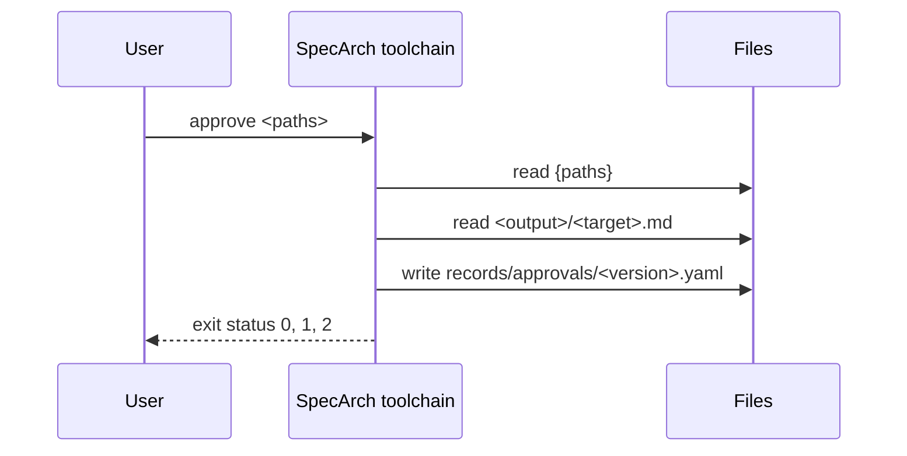

### Command check

Reads one specification and the dumps of its code, each with the
reader `specarch extract` reads it with, after the same checks of the
commit it names, and prints every difference between the two as a
problem at its entry: the gates of `docs/sync-gates.md` in one verb
(ADR-124). The specification must pass validate; one with errors is
refused, as generate refuses it.

A dump is told by the key that names its format: `routeTable` for a
route table, `permissionTable` for a permission table,
`catalogue` for a catalogue dump, and `gatewayTable` for a gateway
table. Each is compared by the merge's own
matching:

- A route table: an operation by its method and path. An operation
  of the specification the router does not serve is
  `operation_not_served` at the operation, and a route the
  specification does not name is `route_not_specified` at the route
  in the dump; the route table writes a path parameter `{name}`
  whatever the router's own syntax, and no other normalisation is
  made, so `{id}` and `{loanId}` are two paths. Where both
  have the operation, a permission that differs, one of them naming
  none among them, is `operation_permission_differs`; an operation
  whose permission is `public` checks none, as the route table prints
  a route open to everyone. Under
  `bindings.http.listRoutes` each list served by GET is served by POST
  at its twin's path as well, with its permission. An operation
  another stakeholder owns is not compared.
- A permission table: a grant by its role and permission, each
  side's grants widened by the permissions they imply, through the
  specification's `implies`, and a role's and a permission's name
  read as the permissions reader reads them (a role in capitals
  under `info.roleNames`, a privilege by the rule of ADR-076); a
  grant of `public` is no grant, as the reader has it. A grant
  of the specification the table does not hold is
  `grant_not_in_code` at the role, and a grant of the table the
  specification does not hold is `grant_not_specified` at the
  grant in the dump. The table's gates are not compared: what a
  caller of each kind may do is the caller context's to design.
- A catalogue dump: a table by its name, a column by its table and
  name, where the specification's tables and columns are the ones
  `specarch generate sql` writes for PostgreSQL through the
  implementation file, every entity's but the ones another
  stakeholder owns. Exact, and so a failure: a table or a column
  only one side has (`table_not_in_database`,
  `table_not_specified`, `column_not_in_database`,
  `column_not_specified`); a column's type, as PostgreSQL spells
  it, so `VARCHAR(10)` is `character varying(10)` and
  `character(10)` differs from it (`column_type_differs`); its
  nullability (`column_nullability_differs`); whether the database
  draws its value by an expression the type-rendering idiom names
  for a generated default (`column_generated_default_differs`);
  the primary key's columns in order (`primary_key_differs`); a
  foreign key by its columns, with the table and the columns it
  refers to and its action on delete (`foreign_key_not_in_database`,
  `foreign_key_not_specified`, `foreign_key_differs`); a unique
  constraint by its columns (`unique_not_in_database`,
  `unique_not_specified`); a check constraint by its name
  (`check_not_in_database`, `check_not_specified`); and a plain
  index the mapping lists, by its name, with its columns in order
  (`index_not_in_database`, `index_differs`). A report, printed as
  a warning and never a failure, after the gates' rule that a gate
  compares only what can be derived exactly: the text of a check
  both sides name, where it differs, since the database rewrites
  it (`check_expression_differs`), and an index the mapping does not
  list, plain or not (`index_not_listed`). A partition is not
  compared, neither as a table the specification does not hold nor
  by its own constraints and indexes: its rows are its table's,
  which is compared, and an index of a partitioned table, which the
  catalogue prints with `ON ONLY`, is a plain index as any other
  (ADR-128).
- A gateway table: the specification's gateway of the table's
  name, in camelCase as `specarch extract gateway` writes it, and
  a forward by its value (ADR-142). A forward of the specification
  the table does not hold is `forward_not_served` at the forward,
  a row of the table the specification does not hold is
  `forward_not_specified` at the row in the dump, every row when
  the specification declares no gateway of that name, a forward
  whose value the table holds and whose dependency differs from
  the row's is `forward_differs` at the forward, and a claim that
  differs is `claim_differs` at the gateway's claim. The row's
  dependency is its name, as `specarch extract gateway` writes it;
  a row with no name gives one made from its value, a guess, so a
  forward that differs by it is a report, a warning that never
  fails, as the extract asks a could question for that name.

Each problem is printed in validate's form, the file, line and
column of the entry, the severity, the pointer, the rule and the
message, and ends with its id in brackets: the rule and what the
difference is about, by the matching (`POST /loans/{loanId}/renew`,
`members.phone_number`, `desk-staff loans.read`), so an id stays the
same when the entry moves to another file. A difference in the dump
only is at the dump file's line of the entry; one about the
specification's entry is at that entry.

The allowlist names the differences a team knows of and has not
settled yet, one id per line, as check prints it between the
brackets; a line that starts with `#` and an empty line are
skipped. A difference the allowlist names is counted and not
printed. A line about a format of dump the run compares that no
failing difference matches, one naming a report among them, since a
report never fails, is `allowlist_stale` at that line, and so is a
line that repeats one above it and a line whose rule is none of
check's; a line about a format the run does not compare is another
run's and is skipped, so one allowlist serves a gate per dump. With
`--since`, the allowlist as the given commit holds it is read from
git, and a line it did not hold is `allowlist_added` at that line,
so the list only shrinks; an allowlist the commit does not hold is
the gate being turned on, which a line says, and no line is added.

**Insight:** A specification that is not compared with its code drifts within months; the readers already read the running code and the merge already matches its elements, so the gate is the comparison with a status, and an allowlist that may only shrink lets a gate be turned on for a service that predates its specification without letting a new difference in.

| Argument or option | Type | Required | Description |
|---|---|---|---|
| `<specification>` | string | yes | The specification folder, with the implementation file the catalogue is compared through. |
| `<dumps>` | string, one or more | yes | The dumps to compare it with, each a route table, a permission table, a catalogue dump or a gateway table, committed beside the code they were made from. |
| `--allowlist` | string |   | The file of the differences the team knows of, one id per line. |
| `--since` | string |   | A git revision, such as the commit a change is made on top of; the allowlist may hold no line the revision's allowlist did not. Only with --allowlist. |

Reads `{specification}`: The specification and its implementation files; `{dumps}`: The dumps, read with their readers at the commit each names; `{allowlist}`: The allowlist, and with --since the allowlist as that revision holds it.

Standard output: One line counting the dumps compared, the differences that fail, the
ones the allowlist names, the reports and the allowlist's lines that
fail; a line when --since names a commit that holds no allowlist;
then one problem line per difference, report and allowlist line, in
the order of their files, lines and ids.

Standard error: A usage message on a usage error, and the reason a dump, the specification or the allowlist could not be read.

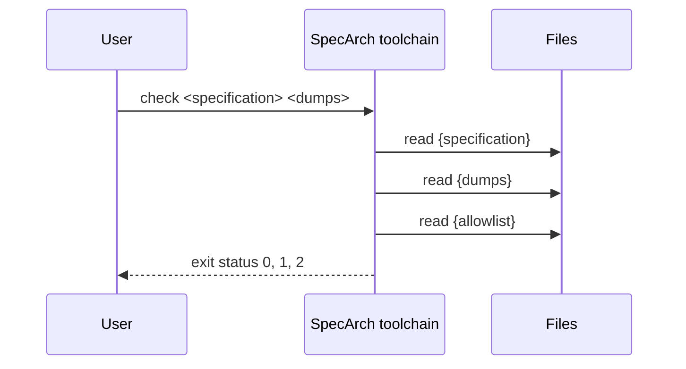

### Command decide

Validates its input first and prints the errors of an invalid
specification, then works on what could be read (ADR-065). Finds the
question by its ID in the merged `questions` section; refuses when
there is none of that ID, naming the open ones, when `--by` is not a
stakeholder of the specification, when `--source` names a source the
root file does not declare, when the specification tracks origin and
`--source` is not given, since the answer must then be citable, and
when `stages` does not list design, where decisions live (ADR-155).

Writes the decision record as `design/decisions/<ID>.yaml`, a file of
its own, under the next ID: `ADR-` and the largest number any
decision carries plus one, at least three digits, `ADR-001` for the
first. The record is accepted, dated `--date` or today, titled with
the question, its context the question with its options, what it
blocked and its Insight, its decision the answer, its consequences
the entries the question blocked, which are to be written from the
answer, `answers` the question's ID and `decidedBy` the stakeholder;
with `--source` it is stated, citing that source with the answer as
what it says.

Takes the question's entry out of the file that holds it by editing
the text, as the marks are written (ADR-066): the lines from the
entry's key to the last line of its value, with the problem marks
above it, and the `questions` key with them when the entry was its
only one; a file left with nothing but blank and comment lines is
removed. An entry not written in block style, whose key does not
start its line, is refused with the line, to be taken out by hand.
The edited text is read again before it is written, and refused
when it does not hold every other entry the file held.

Prints one line per entry the question blocked, so that the agent
writes them: for a pointer, the file and line of the deepest entry
that exists, the pointer, and the keys missing there; for a stage or
a section, its name; each ending with the origin and decision the
entry is to carry. A must question's covering ends with the question,
so the keys it covered are errors until they are written; `validate`
holds the agent to it.

**Insight:** An answered question is a decision with a context, a decision and consequences, and the question leaves the specification because it is no longer true that the thing is unknown; writing both by hand is the step an agent got wrong most often, the record under a taken number or the question left in. The command writes what can be derived and prints what cannot, the entries to write from the answer, rather than guessing at them. The file is edited as text so that the author's own formatting and comments stay, as the marks leave them.

**Note:** From Documenting architecture decisions, 2011: A decision record holds the context, the decision and its consequences; a decision is superseded by a later one rather than edited. <https://cognitect.com/blog/2011/11/15/documenting-architecture-decisions>

| Argument or option | Type | Required | Description |
|---|---|---|---|
| `<question>` | string | yes | The ID of the open question, such as Q-12. |
| `<folder>` | string | yes | The folder holding the specification. |
| `--by` | string | yes | The stakeholder who decided, by key; a role, never a person. |
| `--answer` | string | yes | The answer, as the stakeholder gave it; the record's decision. |
| `--source` | string |   | The key of the source the answer rests on, declared in the root file; an interview for an answer given in words, a document for material provided. Required when the specification tracks origin. |
| `--date` | date |   | The date of the decision, as YYYY-MM-DD. Today when not given. |

Reads `{folder}`: The specification and its implementation files.

Writes `design/decisions/<ID>.yaml`: The decision record, under the next ID; refused when a file of that name exists; `the file that holds the question`: Without the question's entry, and without the questions key when the entry was its only one; removed when nothing but blank and comment lines is left.

Standard output: The errors of an invalid specification, then one line per entry the question blocked, with the file and line, the pointer and the keys missing there.

Standard error: A usage message on a usage error, the reason a refusal, and one line naming the record written, the file the question left and what to do next.

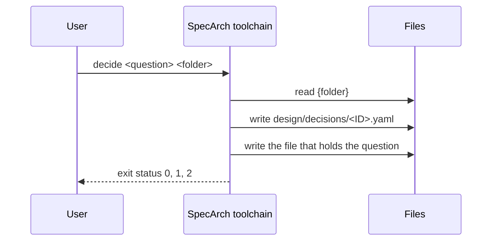

### Command derive

Validates its input first and writes nothing from an invalid
specification. In a 0.2 file the errors for a test it would write
(`test_case_missing`, `test_golden_missing`) are what it is run to
settle, so they do not stop it; any other error does. Then, for every subject without a golden test, writes
its success test, and for every chosen derived case no test covers,
writes a test: a folder `tests/<name>/test.yaml` named as the
validator suggests, with the subject, the scenario, the level,
`covers`, `given`, `when` and `then` as the derivation words them,
`verifies` from what the subject satisfies, `origin: inferred` and a
`why` that says why the case was chosen, and the expected status or
exit, or the caller of a denied case, where the design says them for
certain. The cases read the identity module when it is given in the
same run, in an estate or among the folders given (ADR-171): the
through of its roles that names a permission of the specification,
and the security events and trust domain it declares, so each
refusal's `then` names its event and the event's identifier under
the trust domain.

A test is named after its subject, then its case: `create-loan-succeeds`.
The subject's name is made a valid test name first, kebab-case with
a letter first: small letters and digits, every run of other
characters one hyphen, so requirement `AB-1.2` gives
`ab-1-2-acceptance-1`, and a name that starts with no letter takes
its subject key in front. The draft keeps the subject's own name in
its keys and `verifies`. Where two subjects of one key have
different names that give the same valid name, as `AB-1.2` and
`AB-1_2` do, each after the first in document order takes a suffix,
`-2`, `-3`, until its name is free; derive asks about it on standard
error with `question:`, naming the subject that gave the name first,
and the draft's `why` says it too. When subjects of different kinds give the same name, as page `sign-in`
and operation `signIn` both give `sign-in`, each of them takes its
subject key in front: `page-sign-in-succeeds` and
`operation-sign-in-succeeds`. A draft whose name is still taken, by
another draft or by a test of another subject in the folder of that
name, is not written: derive names it, the subject that took the name
and the reason on standard error, writes the other drafts and exits 1;
a draft a question holds up is left out as before.

What it writes is a draft the author completes, not a generated
output: it has no header and no `--check`, and an existing test
folder is never overwritten. A subject a must or should question
holds up is left out and named on standard error, since a test of a
half-defined element would be a placeholder. A specification that
keeps its tests in the root file is refused: each derived test needs
a folder of its own. Writing tests changes the specification, so an
approval of it no longer holds.

**Insight:** The validator already says which tests a specification implies and gives each one to copy; writing them out is the step that turns the warnings into a test suite the author completes, instead of one the author types out from the warnings. A name takes its subject key only when it is shared, so the names of a specification without a shared one stay short; writing one of two drafts of a name would leave the other unwritten with nothing said, so a name that is still shared is an error at each draft. The missing-test errors of a 0.2 file do not stop it, because a command that refused the errors it exists to settle could never be run on the file that needs it (ADR-055). A name made valid rather than copied, because a folder whose name validate refuses would make the tree derive writes one validate refuses, and every tree a command writes passes validate (ADR-122); a suffix and a question rather than an error, because the two subjects are different and each draft can be written, and the reviewer who reads the question decides whether the name suits.

| Argument or option | Type | Required | Description |
|---|---|---|---|
| `<paths>` | string, one or more | yes | Folders holding specifications, searched as validate searches them. |

Reads `{paths}`: The specifications.

Writes `tests/<name>/test.yaml under each specification's folder`: One draft test per derived case no test covers, each problem in it marked above its entry with a `# specarch-problem:` line (ADR-066); no other file is touched.

Standard output: The errors of an invalid specification, one line each; otherwise the path of each test written, one per line.

Standard error: A usage message on a usage error, the reason on an unreadable path, each test left out, kept or not written with the reason, a question for each test whose name took a suffix, and the count written.

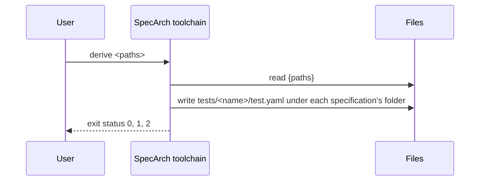

### Command diff

Validates both specifications first and prints the errors of one
that has them; a specification with errors is compared as far as it
can be read, and the command then exits 1 (ADR-065). Then lists
every element added, changed
or removed between them, one line each in pointer order, as
`<impact> <added|changed|removed> <pointer>`, with the change that
decided the impact of a changed element of the public interface
after it. The impact follows Semantic Versioning: an element inside
the system is patch whatever happens to it; on the public interface
an addition is minor, a removal major, and a change the largest of
its changes, a change that cannot be shown safe counting as major.

Then it checks the release of the new version, read from the
records beside the new folder: that its version steps from the old
one by at least the largest impact (version), and that a change
request or defect it includes names every element in the list
(covered). A version that is not a semantic version fails the
version check, naming the version and the folder, and the release
is not checked further. Each failed check is one line starting
`error:`; an
element the records cannot be shown to name because the release
includes an ID kept in a tracker is a line starting `warning:`.

**Insight:** The validator sees one version at a time, so it can check what a release record says but not whether the specification changed the way the record says. Only a comparison of the two versions can tell that a release called minor removed an operation, or that an element changed with no change request behind it.

**Note:** From Semantic Versioning, 2.0.0, clause rules 6 to 8: The patch version steps for fixes that keep the interface, the minor version for additions that keep it, and the major version for changes that break it. <https://semver.org/spec/v2.0.0.html>

| Argument or option | Type | Required | Description |
|---|---|---|---|
| `<old>` | string | yes | The folder of the earlier specification, normally the previous release's tag checked out on its own. |
| `<new>` | string | yes | The folder of the later specification, normally the working tree. |

Reads `{old}`: The earlier specification; `{new}`: The later specification; `records/ beside {new}`: The release record of the new version and the change and defect records it includes.

Standard output: The errors of an invalid specification, one line each, then the change list, then one line per failed check.

Standard error: A usage message on a usage error, and the reason on an unreadable path.

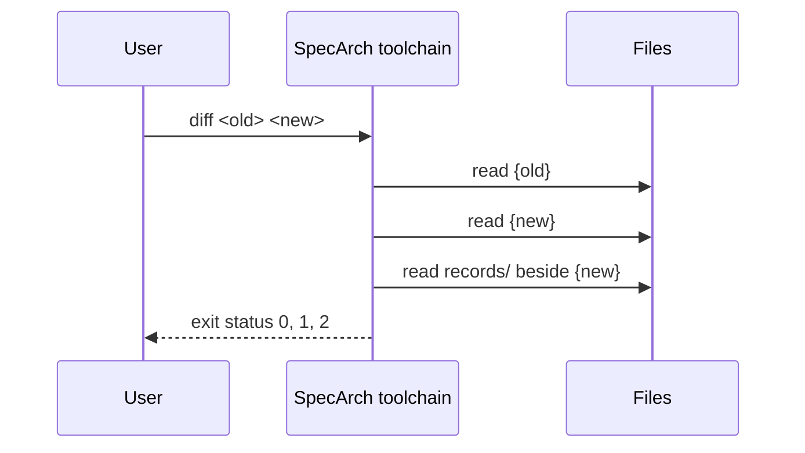

### Command document

Validates its input first and prints the errors of an invalid
specification, then writes its documents all the same, from what
could be read, and exits 1 (ADR-065). Writes the document into the folder the target
owns, and nothing outside it, except the regions between
`specarch:generate` markers in the hand-written `specarch.md` beside
the root file. Every generated file starts with a header naming the
root file, its `info.version`, each implementation file, and the
meta-model version. With `--check` nothing is written: the output is
made in memory and compared with what is on disk. A specification
whose implementation files name no output folder for the target,
with no `--out`, has no such document: it gets a warning at the
targets of its first implementation file and is passed over, and the
others are written or checked (ADR-073).

The techspec target writes `techspec.md`: an arc42 technical
specification of the whole specification, with chapters only for
what it holds. Diagrams are Mermaid: an entity diagram, a state
diagram for each entity with a state field, a sequence diagram for
each operation and command, a flowchart of the pages, a flowchart
of each workflow's steps with each deadline on the edge it takes,
beside the pages that ask for it, its inbox and the messages it
publishes when it ends, and a permissions table. Chapter 2 comes from the constraints and
assumptions, chapter 6 gives each operation what it takes and what
it answers: its parameters, the path's and its own, its own
replacing one of the same name and place, each with where it goes,
its type, whether it is required, its limits and its description;
its request body field by field, a nested field by its path and a
list item's field after []; and each response with its status, its
meaning and its body, the problem document it answers with, and a
body declared in place field by field. A reference to an entity, a
view or a schema links to its heading and one to an enum to the
enums table; when two headings share a name, the later one's link
ends in -1, as a Markdown renderer numbers it. An operation that
takes no parameters, no request body or no response says so, names
the open questions that block what it leaves out, on the operation
or on its path, and writes each below in full with who decides it;
a question that blocks the whole operation or its whole path is
named there too, and written after the responses of an operation
that declares everything. When the design declares handshakes,
chapter 6 lists them first, each with its key agreement, signature,
cipher, establishing operation, lifetime and envelopes, and what a
client does for it in five steps; an operation that names one says
it travels in that envelope, its sequence diagram notes it and marks
the request and the answer sealed, and one that streams a file says
so with the media type and the bound in place of a field table, its
success response reading the file, streamed (ADR-145, ADR-146). Chapter 7 comes from
the deployment and commissioning stages and from each
implementation file, chapter 12 from the glossary, and
chapter 13 from the needs and requirements, with the traceability
matrix of what satisfies and what verifies each requirement, and its
harm once a requirement names one. A marker
names what goes in its region: `erDiagram`, `stateDiagram <Entity>`,
`sequenceDiagram <operationId or command>`, `flowchart pages` or
`permissions`.

Given an estate file, the techspec target also writes `estate.md`,
the estate's module map, into `--out` or else the `docs` folder
beside the estate file, since an estate has no implementation file
to name one: the modules with the version the estate holds each at
and where its specification is, the estate's problems at their
entries, and the references between the modules through their
dependencies as a Mermaid flowchart and a table, a specification a
dependency names that the estate does not list drawn apart. The
modules' own documents are written as when each is named (ADR-113).

The requirements target writes `requirements.md`: the stakeholders,
the needs with the requirements that refine them, and each
requirement with its attributes and acceptance criteria. The
testplan target writes `testplan.md`: the levels, how each
implementation's suites run the tests, and every design test as a
test case, grouped by subject, then each state machine with its
state diagram and its paths from an initial to a terminal state, each
with the tests that walk it, then the derived cases left out: each
case of rank other that no test covers, with its subject and the
reason. The traceability target writes `traceability.md`: needs to
requirements, requirements to what satisfies and verifies them, with
their harm once a requirement names one, and the gaps the validator
warns about.
The deployment target writes `deployment.md`: the environments and
the path a release takes, the settings, each installation of each
implementation with its servers and setting values (a secret only
named), release, rollback and the migrations. The commissioning
target writes `commissioning.md`: the checks by environment in the
order a release reaches them, each step with a Result column, and
the sign-off sheet.

The handover target writes `handover.md` for the engineers of the
customer who runs an environment (`runBy: customer`), who know
nothing of SpecArch (ADR-129): what they receive and how the source
reaches them, what stays whose responsibility, how each
implementation that installs such an environment builds a release
(its toolchain, the build's steps and task, its base images by
digest, how a build is compared with the vendor's, and the task
that writes the software bill of materials), the licences of its
dependencies, what the hosts must provide, every setting with its
type and where a secret's value comes from, and the values the
vendor gives, the migrations in the order they are applied, how a
release is installed (with the tool and files the vendor installs
with) and rolled back, how data is backed up and restored, what is
watched in that environment and how the vendor watches it, the
checks to run after installing, each step with a Result column,
the acceptance tests, and the sign-off sheet. A specification whose
implementation files name an output folder for it but that has no
handover is passed over with a warning of rule handover, as one
with no output folder is.

The questions target writes `questions.md`: the open questions by
stage with what each blocks and who decides, the references into
other specifications that are not resolved, and which outputs are
ready, drafts or waiting; the same text `gaps` prints. Every
specification given in one run is read before any is checked, so a
reference into another one given with it resolves there. When the
specification has errors, it lists them after its summary as
problem lines; a document whose sections hold an error is a draft,
and code generation waits on every error. Every other
document shows an element's origin as an Origin line and the open
questions about it as Open question paragraphs, and starts with a
Draft notice when a must or should question blocks what it reads.
It marks each error and warning with a Problem paragraph,
`**Problem on <name>:** <severity>: <rule>: <message> [<id>]`, at the
deepest element it shows that holds the problem's pointer, and
starts with a Problems notice when the specification has an error
or the document a warning: that the specification is invalid, how
many errors and warnings concern the document (those in the
sections it reads, or at an element it shows), and after it the
Problem paragraph of each one it shows no element for.
In the technical specification, a workflow's trigger, subject, an
approval's permission and deadline and a step's operation that a
question holds open are written as what they are, the question that
holds them, and the name it gives, in the text and in the
flowchart.

The comparison target writes `comparison.md`, the old documents
against the refined specification (ADR-157): the elements stated
by a source, under each source by clause with what it says, as
kept; the inferred elements with what they were concluded from, as
clarified; the decided elements with their decision and its reason,
as corrected when the element cites a source other than an
interview and added otherwise; for every source that lists its
clauses, the clauses no element cites, as dropped, with those only
a question cites named as asked about; then the elements without an
origin. The decisions and the questions are not compared. It is a
refinement document, like questions and problems: never a draft,
not in the outputs table, and not among the documents an approval
is of.

The changes and releases targets are made from the records beside the
specification, and their header names the records folder too. The
changes target writes `changes.md`: the change requests and the
defects, open ones first, each with its status, what it affects or
violates and its decision. The releases target writes `releases.md`:
the releases newest first, each with what it includes grouped as
added, changed, removed and fixed. Neither is ever a draft.

The problems target writes `problems.txt` and `problems.sarif`
(ADR-065), for an invalid specification too. `problems.txt` starts
with a line naming the specification, its version and the counts of
errors, warnings and open questions by priority, and a line naming
the root file it was made from; then one line per problem,
`file:line:column: severity: pointer: rule: message [id]`, sorted by
file, line, column, pointer, rule and id, each followed by its notes,
`file:line:column: note: text`. The problems are validate's errors
and warnings and the open questions; a question is at its entry in
the questions file, its notes are each source it cites and each
entry it blocks, with the keys missing there, and the diagnostics it
covers are not problems of their own. An error's or a warning's
note is each citation of the nearest element above its entry that
cites. Paths are relative to the folder the files are written in.
`problems.sarif` is one SARIF 2.1.0 run of the same problems, in the
same order, with `columnKind` unicodeCodePoints, locations relative
to the base id PROBLEMSDIR, the id as the partial fingerprint
`specarchId/v1`, the pointer as a logical location, the notes as
related locations, a question's fields as properties (the question
as one paragraph, its priority, kind, certainty, decider, options,
blocked entries and Insight), the specification's folder relative
to the log, its title and its version as the run's properties, and
the rules used listed under the tool; the property keys are the
agent queue's interface and stay (ADR-156). A specification that cannot be read at
all, such as one whose root file has no entry that parses, gets its
problems too, and a file that does not parse is read as far as its
entries parse (ADR-080).

The problems target also marks each problem in the YAML files of the
specification that it read, hand-written or not (ADR-066): a comment
line `# specarch-problem: severity: rule: message [id]` above the
line where the entry starts in block style (the key of its pair or
the `-` of its item; for an entry inside a flow collection or a
block scalar, the block-style entry that holds it), with the entry's
indentation, the marks of one entry in the order of the problems
file. A problem about a file as a whole is marked above its first
line that is not blank or a comment. A run takes out every line
that starts with `# specarch-problem:` after its indentation and
writes the marks of the problems it finds, editing the text, so a
fixed problem loses its mark and no other line changes. The
problems files give the lines of the marked files; since a message
can name a line, the marks are written and the specification read
again until the two agree, so a second run writes the same bytes.
With `--check` the marked files are compared like any output.

The html target writes `index.html`: the whole specification as one
page, with its styles, script and diagrams inside it and a
Content-Security-Policy that allows no request, so it opens from the
disk and works offline (ADR-088). It starts with an overview: the
title, version and description, the draft and approval notices, the
count of errors, warnings and open questions, and what each section
holds. Then every section, in life-cycle order: each element of a
section of named elements as a card with its name and its pointer,
each table of named entries as a table with a row per entry, and
every mapping and list item inside with an id. The id of an element
is its pointer in the URI fragment form of RFC 6901, every byte a
fragment cannot hold percent-encoded, so `/paths/~1loans~1{loanId}`
is `/paths/~1loans~1%7BloanId%7D`; a reader links to it with `#` and
the id, and names the element by its pointer, shown beside its name. An element shows its Origin, Insight
and Notes, and a value that names an element links to it. The data
section starts with an SVG diagram of the entities, their fields and
relations; the roles and permissions with which role grants which
permission and, for each separation of duties, the roles never to be
given to one person; the operations with a table of every HTTP
operation and its permission; each workflow with its diagram as
specarch-gen-bpmn draws it; each page with its screen as
specarch-gen-ui writes it, without its scripts, from the first
implementation file whose ui target is for the web in plain
JavaScript, or a line saying why it has none; each requirement with
what satisfies and verifies it, and the traceability matrix after the
tests. The page ends with the problems in the order of the problems
file, each with its line and notes and a link to the deepest element
the page shows that holds its pointer, where a mark links back; an
element an open question blocks says so, with a link to the
question. A search box hides the elements that do not hold the text,
and the page follows the system's light or dark colours, with a
button to switch.

In every document an element's why is an Insight and each citation
a Note (ADR-015), and a document that cites sources ends with them.

An element whose audience is internal is marked in every document:
an Audience paragraph at its own heading or after the table that
holds it, `(internal)` after its name in a traceability row, and
its `audience` key on its card in the html page. With `--audience
external` a document is written for everyone (ADR-119): every
internal element is left out with what is inside it, and so are the
satisfies, verifies and needs entries that name an internal
requirement or need, an implementation file's mapping of an internal
element and its satisfies entries naming an internal requirement,
the open questions whose every pointer is at or under an internal
element, and the errors, warnings and references at one; the summary says how many elements were left out in each
section. It needs `--out`, since the folder the implementation files
name holds the documents with every element, writes no region of
`specarch.md`, and is refused for the problems target, whose files
are for the people who fix the specification.

A requirement another stakeholder owns (`ownedBy`) is held
elsewhere: the traceability target lists it under Requirements held
elsewhere with the stakeholder and the requirement that fulfils it,
and out of the matrix and the gaps; the techspec names it after its
traceability table, the requirements target among its attributes,
and the html page in place of what satisfies and verifies it.

**Insight:** Documents are read by more people than the YAML, so they come first among the targets and are made from the specification rather than kept beside it.

**Note:** From arc42, the template for architecture documentation, 8.2: The twelve chapters of an architecture document, from introduction and goals to glossary. <https://arc42.org/overview>

| Argument or option | Type | Required | Description |
|---|---|---|---|
| `<target>` | DocumentTarget | yes |   |
| `<paths>` | string, one or more | yes | Folders holding specifications, searched as validate searches them. |
| `--out` | string |   | The folder the target owns. Without it, the folder the implementation files' `targets` name for the target, relative to each implementation file; they must agree. |
| `--check` | bool |   | Make the output in memory and fail when the files on disk differ. Writes nothing. |
| `--audience` | string |   | external writes a document for everyone, without the internal elements (ADR-119). Needs --out; not for the problems target. |

Reads `{paths}`: The specifications and their implementation files; `specarch.md`: The hand-written document beside each root file, when there is one; `records/ beside each specification's folder`: The change, defect and release records, for the changes and releases targets; `{out}`: The current output, with `--check`.

Writes `{out}/<target>.md`: The document. Nothing is written with `--check`; `{out}/index.html`: The page, for the html target. Nothing is written with `--check`; `specarch.md`: Only the regions between markers. Nothing is written with `--check`; `{out}/problems.txt`: The problems, for the problems target, written whether or not the specification is valid. Nothing is written with `--check`; `{out}/problems.sarif`: The same problems as a SARIF 2.1.0 log, for the problems target; `{paths}`: For the problems target, the marks of the problems in every YAML file of the specification it read; no other line of a file changes. Nothing is written with `--check`.

Standard output: The errors of an invalid specification and the errors of a
marker, one line each; a warning for each specification with no
output folder for the target, or, for the handover target, with no
handover. With `--check`, one line per file that differs or is
missing.

Standard error: A usage message on a usage error, the reason a file cannot be read or written, for html the reason a workflow diagram or screen preview could not be made, and a one-line count at the end.

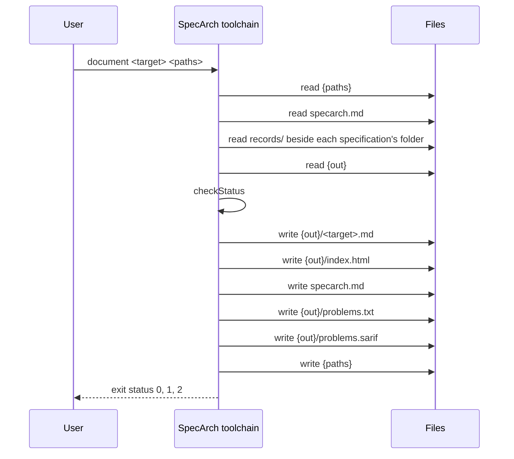

### Command extract

Reads one surface of an existing system and writes the as-built
specification of it into a folder, following the method in
`docs/extraction.md`. The source names the surface. The result is a
partial specification tree, to be merged with the trees of the other
surfaces (`specarch merge`), checked by regenerating and comparing,
then reviewed by hand. The readers are built one at a time, in the
steps of docs/extraction.md, Building extract; a source this build
does not read is answered with status 2. Every source a tree declares
lists as clauses what the tree cites of it: a clause only a question
cites, such as a file the reader set aside, is titled as set aside, so
the outline the validator and `specarch gaps` check against is
complete.

The sources this build reads:

- `outline`: the files under the paths, each a clause of one code
  source, and no elements. It records a surface no reader reads yet,
  such as workflow definitions in a format of a project's own
  before its printer of the workflow table is written, so
  that `specarch gaps` lists every
  file as producing nothing rather than losing it.
- `database`: a PostgreSQL catalogue dump, written by
  `tools/catalogue/dump-catalogue.sh` with the query
  `tools/catalogue/catalogue.sql` against a database with every
  migration applied. Each table becomes an entity of the same name in
  PascalCase, each column a field in camelCase, with its type,
  nullability, default, primary key, foreign keys as relations, and
  unique and check constraints. A check the expression subset can say
  is written as its expression. A json or jsonb column is a field of
  type object, and a should question at the field asks which schema
  it holds, since the catalogue does not say its shape (ADR-077). A
  default the database computes is written as generatedDefault where
  the catalogue's expression is the one the type-rendering idiom
  names for PostgreSQL, on a field of the format it fits; any other
  expression is a could question. A plain index, a btree of plain
  columns with no condition, is physical design: with
  `--implementation-out` it is written under the entity's mapping in
  an implementation fragment, which holds every table's mapping
  (ADR-121); without it, and for any other index, it is a could
  question. A partition is read as the table it is a partition of,
  following partitionOf to the table that is no partition: it gets
  no entity, the table's entity cites it, and one could question at
  the entity lists the partitions with their bounds, since
  partitioning is physical design the meta-model cannot hold
  (ADR-128). What a partition takes from its table, its inherited
  constraints and indexes, is read once, at the table; a constraint
  or an index a partition has of its own, and a column of it that
  differs from the table's, are each a could question citing the
  partition's entry, and a foreign key that references a partition
  is a relation to its table with a could question saying so. An
  index of a partitioned table, which the catalogue prints with
  `ON ONLY`, is a plain index as any other.
- `router`: a route table, written by `tools/routes/dump-routes.sh`
  around the project's own route printer, which builds the router as
  the server does and prints every route it registered: its method,
  its path with each parameter written `{name}`, the one permission
  it checks or null, and its handler. Each route becomes an operation
  under its path, named after its handler, with the path's
  parameters and the permission it checks; a handler that serves a
  GET on a path and a POST on that path with one literal segment
  added serves a list two ways, so the two operations are named
  after it, the POST's with Post added, each cites both routes, one
  must question asks what the two do, and no could question asks
  about their names (ADR-121); every permission checked
  is declared, and a must question asks which role grants it. A route that checks no permission is a must question,
  never written as public.
- `documents`: one Markdown document, as one document source under
  `--source-key` (default the file's name in kebab-case, without its
  extension). Every ATX heading and every paragraph that starts with
  a section number such as `3.1` is a clause, the number its name
  and the heading its title; a heading with clauses under it is
  listed only when it holds text of its own. A sentence that makes a
  commitment (shall, must, will or should; a number followed by what
  it counts; a time of day; once or twice; within, before, after,
  until or no later than) becomes a requirement, stated, citing its
  clause, numbered in the order read under the source key in
  capitals: must, or should for should, accepted, and its kind a
  must question. A commitment whose subject is only it, they, this
  or the like is a must question, never a guess. A table whose first
  column is Field, and whose others are Type, Required, Sensitivity
  or Description, gives the fields of an entity named after its
  section's heading in PascalCase, each in camelCase, with the type
  when it is text, string, date, date-time, timestamp, boolean,
  yes/no or email, and the sensitivity from its column or from the
  one sentence that names the field and calls it personal or a
  credential; the primary key is a must question, and a sensitivity
  the document does not give a should question. A field of any other
  type, any other table and fenced code each print a line. A leading
  column headed with the row-number word (`#` or `No.`) is skipped in
  every table. The words named here are the English vocabulary's
  (`docs/vocabularies.md`): `--language` names a language SpecArch
  ships a vocabulary for, `--vocabulary` a project's file, and the
  reader then reads by its words and writes `language` on the source;
  with neither, English is read and no `language` is written.
  `--given-outside` writes `givenOutside: true` on the source. The
  edition is the commit that last changed the file.
- `openapi`: one OpenAPI 3.0 or 3.1 document, in YAML or JSON, as
  one document source under `--source-key` (default as for
  documents), whose clauses are the JSON pointers of its operations
  and component schemas. Each operation under get, post, put, patch
  or delete becomes an operation under its path, citing its pointer,
  with its operationId, summary, description, parameters, request
  body and responses; a path's own parameters stay on the path. A
  schema is written in the field subset: OpenAPI 3.0's `nullable`
  becomes a type that allows null, its `example` an `examples`
  list, and its boolean `exclusiveMinimum` and `exclusiveMaximum`
  the number form; a schema with properties and no type is an
  object, and one with items an array, as JSON Schema reads those
  keywords; additionalProperties on an object is kept, a schema of
  the values as a field, `{}` as true, and values with no field the
  meta-model holds as true with a line (ADR-125). A component schema of type object with at least one
  property that can be held becomes an entity when an operation's
  201 response answers it or a path with a parameter answers it as
  it is, its primary key a must question, and a reference to it a
  reference to the entity; any other becomes a schema under
  `schemas`, with no question about a key, and a reference to it a
  reference to the schema, inside an entity too, with storage json
  and a line where the design would refuse it in columns (ADR-063,
  ADR-077); one of type string with an enum of snake_case values
  becomes an enum; a reference to any other component schema is
  written in place, and so is a map, an object that names no
  properties and allows other members, which a field holds and an
  entity or a schema does not. A document whose property names are snake_case
  (one has an underscore and none a capital) gives info.wireNames
  snake_case, and each property is written by its camelCase name,
  printed as one line.
  What the meta-model cannot hold prints a line and is left out: the
  methods head, options and trace; a cookie parameter or one given
  by content; a response code range; response headers and links;
  callbacks, servers, tags and external documents; a reference
  outside the document; allOf, oneOf, anyOf, not and
  discriminator; additionalProperties on an entity or a schema, and
  on a type that is not an object; a property name that is
  snake_case in a document whose other names are camelCase, or that
  would not go back on the wire unchanged under info.wireNames; and an
  operationId that is not camelCase, the operation then named by
  its method and path. Every operation outside dxlib's dialect has
  its permission as a must question naming the security the
  document gives, since a security
  scheme is not a permission, and so is an integer or number with no
  width; a missing summary or responses is a must question too. An
  operation that carries `x-dxlib-endpoint-type` is read in dxlib's
  dialect (ADR-076): the one name its `x-dxlib-privileges` lists is
  its permission, when it is lower-case words joined by dots and not
  `public`, and every such permission is declared citing the first
  operation that checks it, its description and the role that grants
  it must questions. A name in dxlib_module's form, words in
  capitals and digits joined by underscores in segments joined by
  dots (`ORDER.CREATE`, `GLOBAL.SET_MAINTENANCE_MODE`, `EVERYTHING`),
  is mapped by the fixed rule of ADR-076: the name in lower case,
  with every underscore a dot; that permission is declared inferred,
  the rule its why, citing the operation. None, more than one, a
  name of another form or one the rule makes into no permission
  name, two names that give one permission, `public` and a value
  that is not a list of names are each a must question on the
  operation's permission, never written as public; a name listed
  twice counts once. The question on an operation with no privilege
  names its middlewares when `x-dxlib-middlewares` lists them. The
  functions `x-dxlib-middlewares` lists, by the names the Go runtime
  gives them, are the operation's middlewares in order, each by its
  function's name in kebab-case, none when the key is absent, since
  dxlib leaves it out for an empty chain (ADR-131); each is declared
  under middlewares citing the first operation that runs it, with one
  must question on what each checks or does, which the Go reader's
  tree answers in the merge. A closure, which the runtime names by
  the function that makes it, or a value that is not a list, is a
  must question on the operation's middlewares. An operation
  without `x-dxlib-endpoint-type` in a document whose dxlib
  operations run middlewares is a must question on its
  middlewares. A
  document every operation of which is in dxlib's dialect is what
  the running service printed (ADR-076), so its source is a code
  source with `reading: printed`, its clauses the operations' and
  component schemas' pointers as for any document. The security such an operation is
  given prints a line, since it is not its permission. Its other
  `x-dxlib-` keys print a line as any extension does, and so does
  `x-dxlib-privileges` on an operation without
  `x-dxlib-endpoint-type`. The
  edition is the commit that last changed the file.
- `permissions`: a permission table, written by
  `tools/permissions/dump-permissions.sh` around the project's own
  permission printer, which reads the grants where the running
  check reads them, such as the tables the seed scripts fill and not
  a policy file the check never loads, and prints every role and
  permission it grants, and every check that runs only when a
  setting is present, by the check's name and the setting's. Each
  role becomes a role granting its permissions in the order of
  their names, citing the permission table, and every permission
  granted is declared. A privilege in dxlib_module's capitals is
  mapped to a permission by the rule of ADR-076, as extract openapi
  maps it, and the permission declared inferred. A grant of
  EVERYTHING, which is never expanded, a name the rule does not map
  and two names that give one permission are each a must question
  blocking the role's permissions, and the role is written with the
  grants it can read. A table that names no role in kebab-case and
  at least one in upper snake case writes its roles on the wire as
  info.roleNames upper_snake says (ADR-099): the tree says so, and
  each such role is read by its kebab-case name, citing the table's
  own. A role whose name is not kebab-case and that the rule does
  not read (an upper snake name beside kebab-case ones, or one that
  would not go back on the wire unchanged) and a grant of public,
  which is open to everyone and granted by no role, print a line
  that says why and are left out, and so is a role left with
  nothing to grant or ask about. Each such check prints a line and
  is a must question blocking the roles, citing the table, since
  while the setting is empty the check lets every request through
  and nothing says so; extract go asks it in the same words, so
  that merge joins the two. A gate may name, in place of the
  setting, `bypassedFor`: the kind of caller the check lets through
  whatever its roles grant, such as a check that returns early for a
  machine-to-machine token, and client, a caller on its own account
  rather than a person's, is the one kind (ADR-114). Each such check
  prints a line and is one must question, asking whether every
  client is meant to reach each operation the check guards, since a
  check skipped for a kind of caller fails open for that kind,
  citing the table's gate. With `--routes` it blocks the permission
  of each operation the check guards, every route that names a
  permission other than public, and every route where the check
  reads rules, with a line counting them; without, it blocks the
  roles. A gate with no check, with both a setting and a kind of
  caller or neither, or with a kind other than client is refused,
  naming the gate. A check that reads a policy of path
  patterns rather than named grants is printed as the table's
  rules (ADR-100), each a role, a pattern, the methods (a list, or
  `*` for every one) and the path matcher that reads the pattern:
  `colon`, where a segment `:name` is one segment, or `brace`, where
  a segment `{name}` is, `*` as the last segment being the rest of
  the path in both. The rules give one permission per distinct
  pattern and method pair, inferred, named by the fixed rule: the
  pattern's literal segments' words in lower case joined by dots,
  then `all` for every method or the method in lower case
  (`/v1/*` with `*` is `v1.all`); pairs that would share a name are
  named with their parameters' words too, and a pair whose name
  still meets another's, or has a word that does not start with a
  letter, prints a line and is left out, as is a rule whose pattern
  has `*` other than as its last segment. A permission implies each
  one its pattern and methods cover with none between them, each
  role is granted the permissions of its rows, and a could question
  offers to rename the inferred names. A rule may name `through`,
  the one client its row holds through, as a grant may (ADR-170):
  the role's permission is written under its through and the client
  declared, with the same questions a grant's through gives, and a
  through that is not kebab-case is refused, naming the rule. Given the route table too,
  with `--routes`, the routes are read as extract router reads them
  and written in the same tree, under one code source read at the
  later of the two tables' commits; each route that checks no
  permission takes the matching permission every other matching one
  implies. A route two permissions reach with neither implying the
  other, and a route no rule reaches, are must questions on its
  permission, and a permission no route reaches prints a line and is
  a could question.
- `pages`: one folder that is a file-system router's root, read
  from its tracked files with no parser (ADR-057, ADR-084). The
  folder's name tells the router: `server` is Nuxt's server
  (Nitro); `pages` is the Pages Router of Next.js or the pages of
  Nuxt, as the nearest tracked `package.json` at or above the
  folder that holds it names `next` or `nuxt` among its
  dependencies; any other name, such as `app`, is the App Router
  of Next.js. When that package names neither or both, or there is
  none, a `pages` folder with `.vue` files is read as Nuxt's and
  any other as Next.js's, and a must question citing the package
  asks which it is. A line names the router and why. In every
  router a page is named after its route in kebab-case, a
  parameter as `by-` and its name, the root's own page `root`, and
  cites its file. In the App Router every folder that holds a page
  file, `page.tsx`, `page.ts`, `page.jsx` or `page.js`, is one
  page, its route the folders from the root down: a folder named
  in parentheses is a route group and adds nothing to the route,
  and a folder named `[name]` is the route parameter `{name}`. Two
  folders that give one route are refused, as the router refuses
  them. What the meta-model cannot hold prints a line and is left
  out: a catch-all segment `[...name]` or `[[...name]]`, an
  optional parameter `[[name]]`, a parallel route `@name`, an
  intercepting route `(.)name`, a page in a private folder
  `_name`, a parameter whose name is not an identifier, any other
  page file such as `page.mdx`, and a route handler on a page's
  route. In the Pages Router every file with the extension `.tsx`,
  `.ts`, `.jsx` or `.js` is one page, `index` its folder's own
  route; `_app` and `_document`, which wrap every page, and the
  error pages `_error`, `404` and `500` print a line, and so does
  a file with any other extension. In Nuxt's pages every file with
  the extension `.vue`, `.tsx`, `.ts`, `.jsx`, `.js` or `.mjs` is
  one page, `index` its folder's own route and a folder in
  parentheses a group; a file beside a folder of the same name
  that holds an index page wraps that folder's pages, a nested
  route, and prints a line. In both, a second file on one route
  prints a line and is left out. A route file serves operations:
  `route.ts` and the like in the App Router, every file under
  `pages/api` in the Pages Router, and in Nuxt's server every file
  with the extension `.ts`, `.js` or `.mjs` under `server/api`,
  served under `/api`, and under `server/routes`, served at the
  root. Its path follows the same rules as a page's route. A file
  whose name ends in a method, `index.get.ts` or
  `[loanId].delete.ts`, is that operation, named by its method and
  path as extract router names one, with its path parameters, and
  what it does and answers, its parameters' values and its
  permission are must questions, never written as public; HEAD,
  OPTIONS, CONNECT and TRACE print a line. Any other route file's
  methods are decided by the handlers it exports, so no operation
  is written for it: a must question citing the file blocks the
  paths and asks for its methods and, for each, what it does,
  answers and checks, until the JavaScript reader reads them.
  Middleware the router runs, found by its place, is a must
  question citing its file on every page's permission and every
  operation's, and on the paths when a route file's methods are
  asked: `middleware.ts`, `middleware.js`, `proxy.ts` or
  `proxy.js` beside an App Router or Pages Router folder, Nuxt's
  global route middleware `middleware/*.global.ts` (or `.js`,
  `.mjs`) beside a Nuxt pages folder, which covers its pages, and
  every file under `server/middleware`, which covers the server's
  operations. A second route file for one method and path prints a
  line and is left out. The files read beside the folder are read at the
  same commit, which names them all. A page whose folder holds
  its schema file, the schema its component library
  renders from, takes its content from it. The file is named
  `page.schema.ts`, or what the implementation file given with
  `--implementation` names under `bindings.ui.schemaFile`, with or
  without `--facts` (ADR-115), and a line names it; a name that is
  not a TypeScript or JavaScript file name, or is one the router
  serves itself (`page`, `route`, `layout`, `loading`, `error`,
  `not-found`, `template` or `default`), prints a line, a must
  question blocking the pages asks for the name, and
  `page.schema.ts` is read meanwhile: the file holds imports,
  comments and one exported object literal, optionally followed by
  `satisfies` and a type, written in the subset of TypeScript that
  is also JSON5 (keys as names or quoted, strings, numbers, true,
  false, null, arrays and objects, trailing commas). Of its keys,
  `kind`, `title`, `entity`, `permission`, `columns`,
  `compactColumns`, `fields`, `sections` and `filters` are read as
  the page keywords of the same name. `source` and `submit` name an
  operation the router's tree or the interface document's declares,
  not this one, so the key is left out and a must question carries
  the name under `names`; `specarch merge` writes it once a tree
  declares that operation. Every other key, a value that is not
  a literal, and a file outside the subset print a line, and what
  they would have given is asked for. An entity a schema names is
  written by name, of type object, with every field a page shows
  as a field known only by name, citing the schemas; its primary key
  and each field's type are a must question. Each page cites its
  page file and its schema; its kind, title, entity and the
  operations it reads or submits, where no schema gives or names
  them, are a must question, and so is the permission it checks, never written
  as public. Every permission a schema names is declared, its
  description and the role that grants it must questions.

  With `--facts`, a code-facts dump that specarch facts javascript
  made of a committed folder that holds the router's folder, and
  that is not stale (ADR-090), the App Router's and the Pages
  Router's files are also read for what their code says, and
  `--implementation` names the project's checks as for javascript.
  A route file's operations are the methods its code serves: in
  the App Router each function or const it exports by a method's
  name, directly, as the handler a call wraps or by an export
  specifier; in the Pages Router each method its default export
  compares `req.method` with or switches on with a literal case,
  where what follows a comparison and a default branch are a must
  question asking for the other methods it serves; a route file
  whose code names no method keeps its question, citing its
  handler. Each cites its file and its export, and its permission
  is the one literal permission a check names, wrapping the
  handler, called in it in the branch of its method, or called in
  a middleware whose matcher surely selects the route; none,
  several and one that is not a literal are must questions. A body
  the handler validates, `request.json()` or `req.body` given to a
  zod, yup or joi schema of a module-level variable, is the
  request body, written as a schema as javascript writes one. A
  server action, a function with `'use server'` in its body or
  exported by a file that starts with it, that a form of a page
  file gives as its `action` is an operation at the page's route,
  method POST, named after the function, with a must question on
  its path, since Next.js posts an action to the page that shows
  it; a second one on one page and a form outside a page file are
  must questions. A middleware file's `config.matcher` of literal
  patterns (`/loans/:path*`, `:name+`, `(.*)` at the end) says
  which routes it covers; its function's call of a named check
  with one literal permission is the permission of every page and
  operation it surely covers that has none; anything else is the
  must question on the pages and operations it may cover, asking
  each one's permission in the place of its own question. A page
  schema is read as the compiler reads it, its object exported by
  default or by a const, a name a const of the files read gives,
  imported or its own, read as that const's value; a value that is
  no literal or const prints a line as before. A page's
  `generateStaticParams` returning literal values prints a line,
  since a page holds no values of its route's parameters, and a
  route file's is named in the question on its parameters' values;
  one built at run time is a should question.

  With `--facts`, Nuxt's folders are read for their code too
  (ADR-091). A page's `definePageMeta` gives its literal title; its
  layout and every key no implementation file maps print a line; the
  middleware it names, a file `middleware/<name>` beside the pages
  folder whose default export calls a named check, and global route
  middleware whose code does, give the page its permission when they
  name one literal permission between them, and a must question
  otherwise, naming each one the reader cannot read. Its template
  gives its fields and columns as javascript reads a Vue template,
  and its title from its one heading where definePageMeta gives none.
  A Nitro route file's operation cites its default export, the
  function `defineEventHandler` is given, with the permission a
  named check called in it gives, the body `readValidatedBody` or a
  validation schema of `readBody` gives, and a must question on a
  parameter `getRouterParam` reads that its path lacks; server
  middleware that calls a named check gives every operation its
  permission, and otherwise asks on each operation no check gives
  one.
- `workflows`: one BPMN 2.0 XML file, read with the standard
  library, whose processes are written as `workflows` in the
  sequential subset of ADR-054, one workflow per process, named
  after the process in kebab-case and ordered by name. The
  process's documentation is the description. Its one start event
  gives the trigger: the operation its message event's
  `operationRef` names, through the file's interface. A user task
  is an approval step, its roles the resources or expressions of
  its potential owners in kebab-case, and an interrupting timer
  with a duration on it the deadline: `refuse` when the timer's
  flow ends the request, `escalate` when it reaches a later user
  task. A reference is read as the child element the BPMN 2.0
  schema writes (`operationRef` in a message event definition,
  `resourceRef` in a potential owner) or as the attribute of that
  name some tools write. An exclusive gateway right after a user
  task, with one flow to an end event, is that approval's refusal;
  when both its flows end the request, the approval is the last
  step and the gateway's default flow is the refusal. A service task is an
  operation step, its operation the one its `operationRef` names.
  Each step is named after its task in camelCase. An operation the
  file names is not declared by it, so the trigger and a step's
  operation are left out and a must question carries the name
  under `names`; `specarch merge` writes it once a tree declares
  that operation. The subject, each approval's permission and
  description, and each role's grants and description are must
  questions, since BPMN has none of them; each potential owner is
  declared as a role by name, citing the task. What the subset
  does not hold prints a line with its file and line and is left
  out: another definition, such as a signal, an element outside
  BPMN's semantic model, such as diagram layout, lanes, a
  performer, a timer that does not interrupt or gives a date or a
  cycle, a duration in weeks, months or years, and a task off the
  path from the start event; an element the path meets that the
  subset does not hold, such as a parallel gateway, a loop or a
  second start event, also ends the steps there with a must
  question on the workflow. Each line names the file's line, and
  the lines come in the file's order.

  With `--table`, the one file is a workflow table, for workflow
  definitions in a format of the project's own (ADR-118), written
  by `tools/workflows/dump-workflows.sh` around the project's own
  printer, which loads the definitions as the engine does: the
  version of the format, the folder the engine loads them from,
  the commit that last changed it, and every workflow as its name,
  the file it is defined in or null, its description or null, its
  trigger (the operation's name or null, and the form's fields,
  each a name and the engine's type), its steps in order (an
  approval with its approvers, deadline, onDeadline and escalateTo,
  an operation step with its operation, or a step of another kind
  with a description) and the messages it emits when it ends.
  Every key is written, null where the format allows it; a table
  with another key or without one, a step of a kind other than
  approval, operation or other, a workflow with no name or listed
  twice, and a step or a form field with no name are refused. Each
  workflow is written as the BPMN reader writes a process, with the
  same questions at the same keys, so that `specarch merge` joins
  the two readings of one workflow: named in kebab-case, a step in
  camelCase, an approver in kebab-case, the trigger's and each
  operation step's operation left out with a must question carrying
  the name under `names`, the subject, each approval's permission
  and each role's grants and description must questions, and an
  escalation the later approval step it names. The workflow cites
  its file, or the folder when the file is null, not under the
  folder or not in the repository. What the subset does not hold
  prints a line naming the clause cited and is asked for or left
  out, in the order of the workflows and their steps: a name
  another workflow or an earlier step takes, an operation name an
  operationId cannot take, a duration in weeks, months or years or
  of zero, an onDeadline that is neither refuse nor escalate, an
  escalation to no later approval, an escalateTo on a step that
  does not escalate, a step of another kind, which ends the steps
  there with a must question on the workflow, the form's fields,
  which are the request body of the trigger's operation that
  another tree declares, and the messages emitted, which name
  channels the table does not declare.

- `gateway`: one gateway table (ADR-142), written by
  `tools/gateways/dump-gateway.sh` around the project's own
  printer, which loads the gateway's table of services as the
  gateway does: the version of the format, the folder the table is
  loaded from, the commit that last changed it, the gateway's name,
  the claim it reads, the environment the addresses were resolved
  in or null, and one row per forward, each the claim's value, the
  project's name for the service or null, the setting its address
  is read from or null, and the address as resolved or null. Every
  key is written, null where the format allows it; a table with
  another key or without one, a row with no value, a value written
  twice, a gateway's name that gives no camelCase name and a claim
  that is no claim's name are refused. The gateway is written
  stated, named in camelCase, citing the table and each row, with
  its claim and a forward per row; its description and its token
  are must questions, the token's asking which token it verifies
  with its format, algorithm and claims, since the table shows a
  lookup and not a verifier, and its refusals a should question.
  Each row's dependency is named by the row's name in camelCase,
  else by the host's first label for a URI value and the value
  itself otherwise, with a could question to rename it; it is of
  kind system, its protocol is the address's scheme, or a should
  question when the row gives no address, and its description and
  timeout are a must question. Two rows naming one dependency are a
  must question at the gateway's forwards, since the table does not
  say whether one service answers both audiences. A row's setting
  is written under configuration by the camelCase rule the Go
  reader uses for an environment variable, no secret, its schema a
  string of format uri and its description the service whose
  address it holds, with a should question to confirm it is no
  secret, must when its name says it may hold a credential. With
  `--implementation-out` and an environment, the fragment holds
  that deployment: a server per service with an address, named in
  kebab-case, with its url and the dependency it is, and the value
  of each setting; with no environment it is not written and a
  line says so.

- `go`: the tracked Go files under the paths, in one repository,
  each read by the standard library's parser by its syntax alone
  (ADR-075), as one code source with `reading: parsed` whose clauses
  are the files read. A test file, and a file in a folder below a
  path read that is named `testdata` or `vendor` or whose name
  starts with a dot or an underscore, is left out, as the go
  command leaves it out of `./...`; a file that
  does not parse is a must question, and the rest are read. The
  module path in `go.mod` resolves a handler in another package of
  the module. In a file that imports dxlib's `api` package
  (ADR-076), each `NewEndPoint` call whose URI is a string literal,
  or literals joined by `+`, and whose method is one or a `net/http`
  constant, outside a loop and a condition of its function, is an
  operation under its path, named as dxlib names it from its URI
  (and its method, when the URI has several), or, when that is not
  camelCase, by its method and path as extract openapi names it,
  with a line; its title is the summary, its description the
  description, the URI's parameters its path parameters, and its
  privileges read as extract openapi reads `x-dxlib-privileges`,
  mapping included. It cites its registration's `path:line`, saying
  its handler, its middlewares and its privileges, and its
  handler's first line, saying the parameters the handler reads and
  the refusals it answers. The handler is read where it is a
  function literal, a function of the same package, or a function
  of another package of the module named through its import; any
  other is a should question. What the call declares is read as
  well (ADR-130): its parameter list, its content type and its
  response possibilities, each a literal, a pointer to one, a name
  assigned one once, or a call to a function of the module whose one
  statement returns one. A parameter is a composite literal with
  `NameId` and `Type`, whatever package declares its type, and a
  response one with `StatusCode`. Each parameter's type is written
  in JSON Schema as dxlib's emitter writes it, with its description,
  bounds, enum, children, items and map values, and the whole goes
  through extract openapi's field writer, so that the operation
  reads as the document dxlib emits reads; the names are snake_case
  on the wire, with info.wireNames, when the declared names are. A
  POST or PUT whose content type is JSON, a form or multipart takes
  the parameters as the fields of its body; one of an octet stream
  or plain text takes that body, and with no content type it takes
  none; the parameters of an upload stream, which dxlib reads from
  the X-Var header, are written as stream.parameters (ADR-162), and
  those of any other such endpoint print a line. A GET or DELETE takes them as query parameters,
  as dxlib reads them; dxlib refuses any other method with 422
  before the handler, so its parameters are not written and a must
  question on the operation asks for them. A declared response is written under its
  status with its description and the object its data template
  gives, the problem the handler answers at that status beside it,
  and its headers print a line. A list, a parameter or a response
  the reader cannot follow is a must question naming the call and
  why, and a parameter it cannot read inside a list is written by
  its name alone with a must question on it. A body that declares
  no parameter is any object, with a must question on its fields,
  unless its handler gives them (ADR-140): a JSON body the
  registration declares no parameter for, and that the handler
  decodes with `json.Unmarshal` of the request's
  `RequestBodyAsBytes` (or a `json.NewDecoder` over it) into a
  variable whose type it declares, is written from that type by
  encoding/json's rules with the field writer of a router's handler
  body, and its fields without omitempty or omitzero are required;
  a check of the variable's
  field in the handler's body itself whose block refuses through
  the request by a statement of its own (an `if` comparing it with
  `""` or `nil`, its length or its value with a literal, or a chain
  of `!=` against strings other than `""`, an `else if` of its chain
  when each branch before it refuses, and a `switch` on it whose
  default refuses) writes required, minLength and maxLength,
  minItems and maxItems, the bounds or an enum; any other check of
  a field that refuses, `!= ""` among them, is a should question at
  its line, and so is a refusing check nested under another
  condition, a case, a loop or a closure that names a field or
  sits under a condition or in a loop over a field that does,
  naming where it sits; a refusal assigned or declared from a
  problem call and then returned refuses as a returned one does. A
  decode into a
  list, into a map that names no field, of `Request.Body`, which
  dxlib has already read to its end, or into a variable of no
  declared type is the must question on the fields, saying which;
  a body decoded twice is a should question. Each
  `WriteResponseAsJSON(status, header, body)` call on the request
  is a response under its status when the registration's responses
  are read: a literal map's keys are its properties, all required,
  each of the type its value gives (a literal, a nested literal
  map, a list of literal maps with one set of keys, a composite
  literal's type, a name the handler declares with its type, or a
  field of one), and dxlib's own status, status_code, reason and
  reason_message keys are not written, as its emitter leaves them
  out of a data template, each left out printing a line, and an
  answer of those keys alone is no body of its own. A status that is not a literal, a body
  that is not a literal map, a key that is not a literal, a value
  of a type the handler does not declare and one status answered
  with bodies of other fields are must questions; a header prints
  a line. Where the registration declares a body or a response
  too, the declaration is written, and a handler that names other
  fields than it is a must question that says the two sources
  disagree.
  The middleware chain is followed as the parameter list is, and
  through a call to a function of the module whose one statement
  returns its variadic parameter, such as `mw(a, b)` (ADR-131): the
  operation lists its middlewares in order by their functions' names
  in kebab-case, an empty list when the chain is nil, and each
  middleware is declared once under middlewares, its function's doc
  comment its description, and each refusal its body answers through
  its request, read as a handler's are, a refusal with its status and
  problem, the problem declared under errors; it cites the function
  and the first registration that runs it. A chain not followed, or
  one with an expression that names no function, is a must question
  on the operation's middlewares, and the operation has none
  written; a middleware the chain runs twice is listed twice; a middleware that is not a function of the module
  found by syntax, such as one outside the module or one a call
  makes, is declared by name with a must question on what it checks
  and refuses; one with no doc comment is a must question on its
  description, a refusal whose status or reason is not a literal a
  should question, and two functions that give one name a must
  question. In the handler, each
  `GetParameterValue...` call on the request with a literal name
  is a parameter read, and one whose name the endpoint's literal
  parameter list does not declare is a must question, since dxlib
  fails it at run time; a name that is not a literal is a should
  question. Each `WriteResponseAndNewErrorf`,
  `WriteResponseAsErrorMessageNotLogged`, `WriteResponseAndLogAsError`
  or `WriteResponseAsError` call with a literal status from 400 to
  599, or a `net/http` constant, is a response of that status; its
  literal reason, in kebab-case, names the problem it answers,
  declared under `errors` with that status, citing the call, its
  title and condition a must question. A reason that is not a
  literal, an empty one, a call with no reason, two reasons at one
  status and one reason at two statuses are each a must question on
  the response's problem, and a status that is not a literal is a
  should question. A registration in a loop or behind a condition,
  one whose URI or method is not a literal, one with another number
  of arguments than dxlib's, and the same method and URI a second
  time are each a must question, and no operation. A WebSocket
  endpoint (`NewWSEndPoint`, or `NewEndPoint` with
  `EndPointTypeWS`), a `RegisterHandler` call, whose operation the
  document the service loads declares, and a method the meta-model
  does not hold print a line. The endpoint type decides the
  operation's transport (ADR-145, ADR-146):
  `EndPointTypeHTTPEndToEndEncryptionV2` names the handshake
  `preKey` on the operation and declares it once under `handshakes`,
  inferred, with X25519, Ed25519 and AES-256-CBC, which the type
  fixes, established by the registration that declares exactly the
  parameters `a0`, `a1` and `a2`, a must question when none or two
  do, and a should question on its lifetime and uses;
  `EndPointTypeHTTPUploadStream` with an octet-stream content type
  is `stream: {direction: upload}`, and with another content type a
  must question on the stream and the body;
  `EndPointTypeHTTPDownloadStream` is `stream: {direction:
  download}` with a 200 response of `application/octet-stream` and
  a binary string, a data template declared for it a should
  question; `EndPointTypeHTTPDownloadStreamV2` is both the
  handshake and the download; the V1 type, which dxlib refuses as
  not implemented, prints a line and is written plain; the V3 and V4
  types travel in the handshake `session` when the module sets that
  type's unpack and pack hooks to functions of the module that open
  and seal dxlib's datablock, followed three calls deep: it is
  declared like `preKey`, citing the hooks, with a could question
  that the type is the implementation file's setting
  `targets.openapi.settings.envelopes` (ADR-163); with any other
  hooks, or none, the V3 and V4 types are must questions on the
  operation's handshake naming what the reader found, as is a type
  that is not one of dxlib's constants, the latter on its stream
  too. Each operation carries a must
  question on whether the running system registers it, which a
  printed tree answers in the merge, and one on its success
  response and what each response means, or on the descriptions
  alone when it declares a success; an operation with no
  privilege, several or one that does not map is asked as in
  extract openapi. A file that imports dxlib's `api` package and
  gives nothing read prints a line.

  Every operation's handler is followed into the code and recorded
  (ADR-144), for dxlib's endpoints and the routers' routes alike:
  where it is a function literal, a function of the same package
  or one of another package of the module, its body is read
  statement by statement into steps, each one kind of thing the
  code does, in plain words, with its lines: an input read from
  the request, a branch with its then and otherwise, a choice with
  its cases, a loop with its body, a database read or write with
  its table (a dxlib table's methods, or database/sql's calls with
  a literal statement), a transaction begun, committed or rolled
  back, a call, an external call over HTTP, a response with its
  status and the problem a refusal names, a return, and a defer, a
  go statement, a panic, a break (of the innermost loop, switch
  or select, or of the statement its label names), a continue, a
  goto or a fallthrough. A call of a function of the module is
  followed to three calls deep and at most forty functions a
  record, a method when the receiver's type is known by syntax, a
  function literal as a function of its own one call deeper, with
  the names of the function it is written in, whether it is
  called where it is written, passed to a call or defined for
  later (`reached`); a call of a local name a literal was
  assigned to is a call of that literal, and the definition
  itself runs nothing; and each function reached is recorded once
  with its name, file, lines, steps and source as it was at the
  commit; a call not followed says why on its step (a function
  value, an interface's method, a method of a value whose type
  syntax does not give, a function outside the module, a fourth
  call deep), any other call into the standard library is no step,
  and a method of a value of a type outside the module is none. One line
  counts the handlers followed, the functions and the calls not
  followed. With --implementation-out, each operation's mapping goes
  into the implementation fragment with the handler as its target
  and the record under handler; a handler not followed gets its
  mapping with the target and why. Given --implementation, the
  file's handler records are compared with the ones read: one line
  counts the handlers unchanged, changed, not recorded and recorded
  for an operation the source does not register, and each changed
  handler lists, per function, its lines now and before and the
  step lines added and removed, marked + and -.

  While a handler is read, its code is checked against the
  operation, and each fault is a should question on the operation
  with its certainty, certain or suspected: a parameter the
  registration declares that no function followed reads; a response
  declared that no function followed and no middleware of the chain
  answers, dxlib's own 400 and 422 on a declared parameter
  excepted; a status answered that the registration does not
  declare; a path that returns, or reaches the end, with no
  response written, a returned error in a dxlib handler counting as
  answered; a result dropped with the blank identifier that is a
  module function's error, or the last of several results of any
  call, and a call statement that drops a module function's error;
  a table written after the response in the same block; a handler
  that writes a table and runs no middleware and checks no
  permission while other operations do; two writes with no
  transaction begun; code after a return or a panic in its block,
  and a constant condition; a handler that does nothing, a TODO,
  FIXME, XXX or HACK note, a panic that says the code is not built,
  and a response of fixed values from a function that reads
  nothing. A fault in a function several handlers reach is one
  question naming every operation that reaches it. A suspicion
  where a call not followed was given the request says so.

  In a file that imports dxlib's `databases/models` package, each
  `NewModelDBTable` call whose name is a literal and whose schema is
  a `NewModelDBSchema` call with a literal name, written there or
  assigned once to the name the call passes, outside a loop and a
  condition, is an entity named as extract database names the
  table, so that the two trees give one entity. Its fields are a
  literal map of `ModelDBField`: each column is a property named in
  camelCase, its type the column type dxlib's data type makes on
  PostgreSQL, written as extract database writes that type, except
  `DataTypeMapStringString`, an object whose additionalProperties is
  a string, which the jsonb column alone does not say, nullable
  unless `IsNotNull` or `IsPrimaryKey` says otherwise, read-only for
  a serial type or `IsAutoIncrement`, and the `IsPrimaryKey` columns
  the primary key. A field's other keys, such as `References`,
  `IsUnique` and `DefaultValue`, are left to the catalogue, with a
  line per table naming them. A data type the meta-model has no type
  for, a type not named as one of dxlib's, and what extract database
  prints a line for print a line; a field built by a function, or a
  column named by something other than a literal, is a should
  question. A call in a loop or behind a condition, one whose schema
  or name is not read, one whose fields are not a literal map, and
  a table with no key are must questions, and each entity carries a
  must question whether the database holds it, which a catalogue
  tree answers in the merge. In a file that imports dxlib's `tables`
  package, `NewDXTableSimple`, `NewDXRawTableSimple`,
  `NewDXTableAuditOnlySimple`, `NewDXTableWithEncryption`,
  `NewDXTable` and `NewDXTableWithView` give the table assigned to a
  name or a field, and their last three arguments its paging list's
  search, order and filter whitelists. An endpoint whose handler is
  that table's `RequestSearchPagingList` or
  `RequestSearchPagingDownload` cites the constructor's line, saying
  the table and its whitelists, in place of a handler's, and prints
  a line, since the meta-model holds no whitelist on an operation;
  whitelists that are not literal lists are a should question.

  In a file that imports a package of dxlib_module, an insert into
  its `Role` or `Privilege` table (`InsertReturningId`, `TxInsert`
  and the other insert methods of a dxlib table) with a literal
  `nameid` seeds a role or a privilege, with the literal
  `description` beside it, and a `RolePrivilege...Insert` call
  grants its last argument, a literal privilege, to its role id,
  when that id is a name the same function assigns once from a role
  insert. Each role a seed grants something is written with the
  permissions it grants, citing the role's insert and every grant,
  mapped by the rule of ADR-076 over every privilege name of the
  source, the endpoints' with the seeds', and each permission is
  declared with the seeded privilege's description. A grant of
  EVERYTHING, a name the rule does not map and two names that give
  one permission are must questions on the role's permissions, as
  extract permissions asks them; a seed in a loop or behind a
  condition, a role id the reader does not trace and a privilege
  that is not a literal are must questions; roles the seeds name in
  upper snake case are read as extract permissions reads them, under
  info.roleNames upper_snake, and a role whose name is not
  kebab-case and that the rule does not read prints a line. Each role carries a must question
  whether the running system grants it what the seeds grant, which
  a permission table answers in the merge, and a role with no
  literal description a must question on it.

  A setting is read where the environment is read by a literal name
  (`os.Getenv`, `os.LookupEnv`, and dxlib's `GetEnvDefaultValue`,
  `GetEnvDefaultValueAsInt` and `GetEnvDefaultValueAsBool`), and
  where dxlib's `NewConfiguration` names, with literals, a tracked
  JSON or YAML file of the paths read: the file is read as data,
  each leaf a setting named after the configuration and the key's
  path, with the call's literal defaults and its sensitive keys.
  Each is written under `configuration`, in the deployment stage,
  by its name in camelCase (`DESK_API_KEY` is `deskApiKey`,
  `storage.page_size` is `storagePageSize`), with the type its
  getter or its value gives and the default its literal or the
  file gives, the file's over the code's, as dxlib merges them;
  `secret: true` where the configuration names the key sensitive.
  What each is for and whether it is a secret is a must question,
  and so is whether a setting whose name says secret, token, key,
  password or credential is a secret, whose default is then not
  written; so are two names that give one camelCase name, two
  types, and the width of a whole number. A name that is not a
  literal, a file that is not tracked, more than one file of that
  name and a file that does not parse are should questions.

  A gate on a setting is found in each middleware an endpoint's
  literal chain names that the reader finds by syntax, as it finds
  a handler: an `if` among the function's own statements whose only
  statement returns `nil`, so letting the request through, when a
  setting read from the environment by a literal name, directly or
  through a name the function assigns once, is empty, or a boolean
  one is false. Each prints a line and is the must question extract
  permissions asks on a gate, in the same words, saying true and
  false in place of present and empty for a boolean setting, citing
  the line, with the check named by the function's name; dxlib's middlewares
  are named in the endpoint, so no implementation file names them.

  Routes are read on net/http's `ServeMux`, chi, gin, echo and
  gorilla/mux (ADR-081). A router is a value one of their calls
  makes (`http.NewServeMux`, `chi.NewRouter`, `gin.New`,
  `echo.New`, `mux.NewRouter`), a parameter or struct field of one
  of their router types, net/http's default mux, or a value of a
  type of the module that has `ServeMux`'s `Handle` or `HandleFunc`
  method, which is read as a `ServeMux`. The walk starts at each
  function no call in the module names or passes as a value,
  follows every call of the module's functions found by syntax,
  binding what it passes to the parameters as far as syntax shows
  it (a router, a literal string, a function literal or a function
  of the module), follows a call of a function literal held in a
  local name or bound to a parameter the same way, in the scope the
  literal is written in, even where a function it was passed to
  calls it, a loop or a condition that function calls it behind
  still holding, and a name declared in a block, a router, a
  string or a literal, holding to the end of that block, so that a
  helper taking a prefix and a function registering routes under
  it is followed through both; takes the router such a call
  returns, of a literal or of a function of the module, as the
  call's value, a literal's return never standing for the return
  of the function it is written in, so that a helper taking a
  prefix and returning the group under it is followed as well;
  walks a literal declared in a block that no call walked at the
  end of that block, the last declared first; counts a
  registration, and writes it or asks about it,
  once for each call, router, arguments and whether it is behind a
  loop or a condition, however often the walk reaches it;
  walks a literal no call names, or passed to a call that never
  calls it, once with nothing bound; and then walks each function
  not reached, and each literal reached with nothing bound, with
  the routers it is given as ones whose place is not known. A
  group, a
  `Route`, a `Mount`, a subrouter under `PathPrefix` and a
  `ServeMux` pattern ending in a slash that hands a router its
  subtree, through `StripPrefix` or not, join their literal prefix
  to the routes under them, with no slash at the end of a joined
  path; one registration reached through two callers gives one
  route. Each route a call registers with a literal method and
  path, outside a loop and a condition of its function, under a
  prefix the reader knows, is an operation: a `ServeMux` pattern
  `METHOD /path`, chi's `Get` and the other method calls and
  `Method`, gin's and echo's `GET` and the others, `Handle`, `Add`
  and `Match` with a literal list, and gorilla/mux's `HandleFunc`,
  `Handle`, `Path` and `HandlerFunc` with `Methods`. A path, a
  method or a prefix written as a package-level constant of a
  string type is the literal it names, of the same package by its
  name where no parameter or statement of the function declares
  that name, or of another package of the module through its
  import, and so is one of literals and constants joined by `+`;
  a method list written as a package-level var is a literal list
  when its value is a composite literal of string literals, string
  constants or `net/http` method constants and no statement of the
  module, in its own package or in another through the import,
  assigns to the name, declares it again, appends to it or takes
  its address, and the question for any other list says what
  stopped the reader: the second assignment and its line, or the
  value that is not a list (ADR-143). Its parameters,
  written `{name}`, `:name` or `{name:pattern}`, are written
  `{name}`, a pattern with a line. It is named as extract router
  names a route, after its handler, and cites its registration and
  its handler's first line. A route for every method, a path,
  method or prefix that is neither a literal nor a constant the
  reader reads, a router given from code
  not followed, a handler handed a subtree that is not a router, a
  registration in a loop or behind a condition and the same method
  and path twice are must questions; a host in a pattern, a route
  matched by more than its method and path, and a method the
  meta-model does not hold print a line. A fallback handler, gin's
  `NoRoute` and `NoMethod`, chi's `NotFound` and `MethodNotAllowed`,
  gorilla/mux's `NotFoundHandler` and `MethodNotAllowedHandler`
  fields, echo's `HTTPErrorHandler` field, on a router a name holds
  or a struct of the module keeps in a field, and a `ServeMux`
  pattern of `/` alone with no method given a handler that is no
  router, is a must question citing the call or the assignment,
  naming the handler and the requests it takes and asking what it
  answers or forwards and by which claim of the token it picks the
  service, counted as a registration, or, in a loop or behind a
  condition, the question every registration there asks; a route
  whose path ends in a rest wildcard or a catch-all, a gorilla/mux
  variable whose pattern can match a slash (`{rest:.*}`) among
  them, is the same must question, naming its prefix and its
  methods, every method for `Any` and `Handle`, and so is
  gorilla/mux's `PathPrefix` given a handler that is no router,
  its other catch-all, naming the prefix and its `Methods`; both
  block gateways, which the gateway table answers in the merge
  (ADR-142), since a fallback is where a gateway lives and where a plain 404 lives
  too, and syntax cannot tell which (ADR-143). A `ServeMux`
  pattern of `/` with no method, or gorilla/mux's `PathPrefix`,
  handing every request to a router of the module mounts that
  router under no prefix, `http.StripPrefix`'s when it wraps the
  router, since both hand the whole path on, and `Methods` or
  another matcher on such a `PathPrefix` is a line, since the
  meta-model holds no match on the mount; a gorilla/mux chain
  that names no path or no handler the reader reads is a must
  question. A file that imports chi, gin, echo or gorilla/mux and
  gives nothing read prints a line. Each operation carries a must question on
  whether the running system registers it, which a route table
  answers in the merge, and one on what it does and answers.

  A handler found by syntax, a function, a method of a value whose
  type the reader knows or a function literal, is read for the path
  parameters it reads with a literal name (`PathValue`,
  `chi.URLParam`, gin's and echo's `Param`, gorilla/mux's `Vars`),
  each one its path does not have a must question and a computed
  name a should question; and for the body it decodes
  (`json.NewDecoder(request.Body).Decode`, gin's `ShouldBindJSON`,
  `BindJSON`, `ShouldBind` and `Bind`, echo's `Bind`) into a
  variable of a struct the module declares or of a struct type
  written in place at the variable, written as the request
  body's object by encoding/json's rules: the `json` tag's name,
  `-` left out, a pointer nullable, a slice an array, `time.Time` a
  date-time, a struct of the module and a struct type written in
  place both an object in place, with `info.wireNames: snake_case`
  when the tagged names are snake_case. A field with no json tag goes on the wire by its Go
  name, which is neither camelCase nor snake_case, and prints a
  line; a map is an object whose additionalProperties is its values'
  schema, whatever its key, since encoding/json writes every key as
  text, and a map of an interface's values is additionalProperties
  true with a should question blocking the values (ADR-125); an
  interface, an embedded struct and a
  type outside the module are should questions, and the width of
  an `int` or a 64-bit integer a must question. The tags of
  go-playground/validator (`validate`, read when the module imports
  it) and of gin (`binding`) give `required`, lengths, items,
  bounds, `oneof` as an enum, the formats `email`, `uuid`, `uri`,
  `hostname`, `ipv4` and `ipv6`, and validator's own patterns for
  `alpha`, `alphanum` and `numeric`; any other rule prints a line.

  A permission is read through the checks the implementation file
  given with `--implementation` names under
  `bindings.http.permissionChecks`, a Go package named by its
  import path, or by its folder from the repository's root where
  no `go.mod` is read: a call of one with a literal
  permission in the argument named wraps a handler (its last
  argument the handler it runs), is among a route's or a group's
  middleware, is applied with `Use` or `With`, or is made in the
  handler. One permission is the operation's, declared citing the
  check that reads it first; none, several, one that is not a
  literal and a check named in part are must questions, and with no
  implementation file each operation's permission is a must
  question. A gate on a setting is found in each named check, in
  its own statements or those of the function it returns: an `if`
  that runs the handler it is given, calls `ServeHTTP` or `Next`,
  or returns `nil`, `true` or that handler, while a setting is
  empty or false, asked as above. A check the implementation file
  names with `bypassedFor: client` lets a client through whatever
  its roles grant, which syntax does not show, since the test of the
  caller's token is written the project's way; it prints a line and
  is the must question extract permissions asks on a bypassed gate,
  in the same words, with the check named by its function's name
  (the method's alone for Type.Method), blocking the permission of
  each operation that calls it and citing the first call (ADR-114).
  Another kind is a must question naming the item, and the check is
  read as skipping no caller.

  A gate that reads no permission is named under
  `bindings.http.clientChecks`, a check that admits only a client,
  and `bindings.http.signatureChecks`, a check that verifies a
  request's signature, each by its package and function, and found
  as a permission check is, and also as middleware named without a
  call; a function named as two kinds of check is a must question and
  read as the first. Each prints a line counting the operations it guards and is
  one must question per check blocking the callers of each of them:
  for a client check which clients call them and whether people do,
  since callers names its clients one by one (ADR-110); for a
  signature check which client signs, with which algorithm and over
  which parts of the request, the client's proof. The reader writes
  no callers and no client, and the permission is read as before. A
  call of golang-jwt's `NewWithClaims` mints a token: one must
  question blocking the tokens lists the keys of the `MapClaims`
  literal it is given, or the one the same function assigns to the
  name it is given, and asks which token it is; claims that are not
  such a literal are named in the question as not read (ADR-154).

  A call of net/http's `Get`, `Head`, `Post`, `PostForm`,
  `NewRequest` or `NewRequestWithContext` with a literal method and
  an absolute URL declares a dependency named after the URL's host
  in camelCase, citing the call, its description and time limit a
  must question; one made in a handler's own body is under the
  operation's `calls`, and one made elsewhere a should question on
  the operations that call it. A URL or a method that is not a
  literal, and a URL with no host, are should questions. A flag the
  flag package declares by a literal name (`String`, `Bool`, `Int`,
  `Int64`, `Uint`, `Uint64`, `Float64` and their `Var` forms) is a
  setting as an environment variable read is, its default the
  flag's.

- `swift`: one code-facts dump of Swift source (ADR-087), written
  by `specarch facts swift`, which runs the Swift reader
  `readers/swift` on the tracked Swift files under a committed
  folder. The reader parses each with SwiftSyntax, the parser the
  Swift toolchain's own tools use, and writes facts, not elements:
  its imports, its type declarations with what they inherit and
  their attributes, their stored and computed properties, enum
  cases with raw values, functions with their parameters, the calls
  of the names its idiom table lists with their literal arguments
  and closures, assignments to `httpMethod` and a JSON coder's
  strategies, and reads of `infoDictionary` and `environment` by
  key, each with its file, line and column. The dump names the
  format (`codeFacts: 1`), the language, the parser's name and
  version, the folder and the commit that last changed it; it is
  refused when another SwiftSyntax version than the one this
  release pins made it, when it lists a file that is not tracked
  under the folder or leaves out one that is, and when it is
  stale. The source is one code source with `reading: parsed`,
  whose clauses are the Swift files and the files read as data;
  every element cites `path:line`. SwiftSyntax has no type checker,
  so a type the source does not write is a question.

  A SwiftUI view, a type that conforms to `View` in a file that
  imports SwiftUI, is a page when a navigation call opens it: the
  view `WindowGroup` shows, a tab of a `TabView`, the destination
  of a `NavigationLink`, `navigationDestination`, `sheet`,
  `fullScreenCover` or `popover`, when the call makes one view of
  the files read and nothing else; any other view is a part of a
  page and no element, and a destination chosen at run time or a
  view outside the files read is a should question at the call.
  A page is named after its view in kebab-case, without the
  suffix `View` or `Screen`, and cites its declaration and the call
  that opens it. Its title is its one literal `navigationTitle`.
  Each way a page opens another is one of its actions, of kind
  `navigate`, its target that page and its label the link's
  literal title or `Text` label, in the order of the source; a
  label the source gives as no literal is a must question. A
  `NavigationLink` with a value opens what the screen's
  `navigationDestination` gives and is counted, not written. Its
  fields are the properties a `TextField`, `SecureField`,
  `TextEditor`, `Toggle`, `Picker`, `DatePicker`, `Stepper` or
  `Slider` is bound to (`$book.title` is the field `title`), in
  the order of the source; its entity is the SwiftData model those
  bindings are properties of, when they are all of one, or, with
  no binding, the one model the view queries with `@Query`. A
  binding to a property of a property prints a line. Each page's
  kind and route, and its title, entity, source, submit and
  columns where the source does not give them, are one must
  question, and its permission another, never written as public,
  since an app's screen checks nothing for the server. Each tab of
  a `TabView` is a menu entry for its page, its title the tab
  item's literal `Label` or `Text`, or the `Tab`'s title; a tab
  whose title is no literal is a must question.

  A class with `@Model` in a file read is a SwiftData model and is
  written as an entity of its name; a struct or class that conforms
  to `Codable`, `Decodable`, `Encodable` or Vapor's `Content` is a
  schema; an enum of `String` that conforms to one of them is an
  enum, its values its raw values, each a snake_case word or
  printed as a line. A type declared inside another prints a line.
  Each stored property is a field by its name, `required` unless
  its type is optional: `String`, `Bool`, `UUID`, `URL` and `Date`
  (a date-time) as their JSON types, the integers of a width below
  64 bits with their bounds, `Double` a double, `Data` a byte
  string on the wire and a binary one stored, an array of one of
  these an array, a dictionary keyed by `String` or an integer an
  object whose additionalProperties is its values' field, as
  `JSONEncoder` writes it, and a model of the files read a reference
  to it.
  An `Int`, `UInt`, `Int64` or `UInt64`, a `Float` and a `Decimal`
  are must questions on their format or type, since the width of a
  word, a 32-bit float and a decimal's precision and scale are not
  the meta-model's types; a `CGFloat` is a double with a should
  question; a `Date` of a schema is a should question unless the
  files read set an ISO 8601 date strategy; a type that is not
  declared as a model in the files read is a must question. A
  property of an entity that holds another model is a relation to
  it, its kind and its key a must question, since SwiftData keeps a
  relation by the model; a schema held by an entity, a static or
  computed property, `@Transient`, a dictionary keyed by another type
  or of `Any`, and a set print a line or are counted. An entity's primary key is a must question,
  naming the properties `@Attribute(.unique)` marks. A schema's
  `CodingKeys` give its wire names: one that is the property's
  snake_case form gives `info.wireNames: snake_case`, as a JSON
  coder's `convertToSnakeCase` or `convertFromSnakeCase` strategy
  does, and any other prints a line; a property its `CodingKeys`
  leave out prints a line. A Core Data model, the current version's
  `contents` of an `.xcdatamodeld` that `.xccurrentversion` names,
  is read as data: each entity is an entity, each attribute a field
  by the type its `attributeType` names, nullable when optional,
  with its default, and each relationship a relation whose kind and
  key are a must question; the primary key is a must question,
  naming the uniqueness constraints; a transient attribute prints a
  line, and an attribute type with no field type is a must
  question.

  Routes are read in a file that imports Vapor. A builder is a
  parameter of type `Application`, at the root, a `RoutesBuilder`
  given to a `RouteCollection`'s `boot`, under every path a
  `register(collection:)` call of the files read registers that
  collection, and the value `grouped` makes from a builder, or the
  parameter of the closure `group` is given, under the literal
  segments it adds, with the middleware values it is given. A call
  of `get`, `post`, `put`, `patch`, `delete` or `on` with a handler
  (`use:` or a closure) on a builder, with literal segments outside
  a loop and a condition, is an operation; `:name` is the
  parameter `{name}`, and `*` and `**` print a line. It is named
  after its handler as extract router names a route, cites its
  registration and its handler, and carries the must questions
  extract go asks of a parsed route: what it does and answers, its
  parameters' values, and whether the running system registers it.
  A builder the reader does not follow, a segment that is not a
  literal, and a registration in a loop or behind a condition are
  must questions, and so is one method and path registered twice.
  The handler's `req.parameters.get` with a name its path lacks is
  a must question; its `req.content.decode` of a model of the files
  read is the request body. A permission is read through the
  checks the implementation file given with `--implementation`
  names, as for go: a middleware value of a group, made by the
  check's function, whose argument named is a literal permission
  name, is the permission of the routes under the group, declared
  citing them; Swift imports modules, not files, so the check is
  matched by its function's name. None, several and one that is not
  a literal are must questions. The gates the implementation file
  names under `clientChecks`, `signatureChecks`, `applicationChecks`,
  `callerChecks`, `audienceChecks` and `eventWriters` are middleware
  of a group too, matched the same way, their names a string or an
  array literal; a gate is never read as a permission check, and
  each is written and asked as extract go does (ADR-154, ADR-159,
  ADR-169).

  Calls to another system are read from `URLRequest(url:)`, its
  method the literal its `httpMethod` is given in the same function
  or GET, Foundation's default, and from URLSession's `data`,
  `dataTask`, `download` and `upload` methods given a URL: a
  `URL(string:)` call with a literal, or a name the same function,
  or a property of the same type, gives one. A string interpolating
  one name into a whole path segment is the parameter `{name}`,
  with a should question naming it. Each declares a dependency
  named after the host in camelCase, as extract go names one, its
  description and time limit a must question; a URL that is not
  built from literal parts, has no host, or a method that is not a
  literal is a should question.

  A setting is read where the code reads Info.plist
  (`Bundle.main.object(forInfoDictionaryKey:)` or
  `infoDictionary[...]`) or the environment
  (`ProcessInfo.processInfo.environment[...]`, Vapor's
  `Environment.get`) by a literal key, and from every tracked
  `Info.plist` under the folder, read as data, whose own keys are
  settings too; a value `$(NAME)` takes the one value the folder's
  `.xcconfig` files give `NAME`, and several values are a should
  question. Each is written under `configuration` as extract go
  writes one, with the type and the default Info.plist gives, and
  the same must questions on what it is for, whether it is a
  secret, its type when nothing read gives it, and an integer's
  width; one Info.plist sets and no code reads by a literal name is
  a should question. The keys the system reads to describe the
  bundle (`CF`, `NS`, `UI`, `LS` and the like), an entitlements
  file's keys and the build settings Info.plist does not take
  print a line per file, and a property list that is not XML prints
  a line.

  A file that imports SwiftUI, SwiftData or Vapor and gives nothing
  read prints a line, and so does each file with syntax SwiftSyntax
  could not read, which is also a should question.

- `javascript`: one code-facts dump of JavaScript and TypeScript
  source (ADR-089, ADR-116), written by `specarch facts javascript`,
  which runs the JavaScript reader inside the binary on the
  tracked `.ts`, `.tsx`, `.mts`, `.cts`, `.js`, `.jsx`, `.mjs` and
  `.cjs` files under a committed folder and its `tsconfig.json` and
  `jsconfig.json` files. The reader builds one program of them with
  the TypeScript compiler 7.0.2, its own Go source copied into
  third_party/typescript-go, over those files and
  the library TypeScript ships and nothing else, so no
  `node_modules` and no package's types are read. It writes facts,
  not elements: imports with the file each resolves to, each
  configuration file's `checkJs`, interfaces, type aliases, classes,
  enums and JSDoc `@typedef`s with their members' types as the source
  states them, functions with their parameters' types and whether
  each comes from TypeScript's syntax or a JSDoc comment, variables,
  the calls whose name the idiom table lists or whose callee an
  import names, JSX elements of the libraries it knows and of a
  heading, a form, its controls and a link, and reads of
  `process.env`, `import.meta.env` and a handler's request, each
  with its file, line and column, a name with the declaration among
  the files read that the compiler's checker resolves it to. The
  dump is refused when another compiler version made it, when it
  lists a file that is not tracked under the folder or leaves out
  one that is, and when it is stale. The source is one code source
  with `reading: parsed`; every element cites `path:line`.

  Routes are read on Express and Fastify. An application is the
  value `express()` or Fastify's factory gives, at the root; an
  Express router (`Router()`, `express.Router()`) is under every
  `use` of the files read given it, after the literal prefix that
  `use` gives, with the middleware between; a function `register`
  is given is a Fastify plugin, its first parameter an instance under
  the literal `prefix` of its options; `route('/path')` adds its
  path. A call of `get`, `post`, `put`, `patch`, `delete`, `options`,
  `head` or `all` with a literal path and a handler on one of these,
  outside a loop and a condition, and Fastify's `route` with a
  literal method and url, is an operation; `:name` is the parameter
  `{name}`, and a wildcard, an optional parameter, a pattern and
  `all` print a line. It is named after its handler's name as extract
  router names a route, or by its method and path, and cites its
  registration, every mount above it and its handler, with the must
  questions extract go asks of a parsed route. A router the reader
  does not follow, such as one a function is given, a path that is
  not a literal, a registration in a loop or behind a condition, and
  one method and path registered twice are must questions, and so is
  a parameter the handler reads that its path lacks. The permission
  is read through the checks the implementation file given with
  `--implementation` names, by the function's name and its module:
  the `package` is a package's name as an import names it, or the
  path of the file that declares the check from the folder read,
  without its extension. A check's call with a literal permission,
  as middleware of the route, of a mount above it, of an earlier
  `use` on the same router or of Fastify's `onRequest`,
  `preValidation` or `preHandler`, or called in the handler, is the
  operation's; none, several and one that is not a literal are must
  questions. The gates the implementation file names under
  `clientChecks`, `signatureChecks`, `applicationChecks`,
  `callerChecks`, `audienceChecks` and `eventWriters` are found in
  the same places, called or, as middleware, named without a call,
  their names a string, a const or an array literal, a gate passed
  on a mount or an earlier `use` cited where it is made; a gate is never read as a permission
  check, and each is written and asked as extract go does (ADR-154,
  ADR-159, ADR-169).

  A request body is, in this order: the validation schema the
  handler applies to its body (`parse`, `safeParse`, `validate`,
  `validateSync` or `cast` of `req.body`); the JSON Schema of
  Fastify's `schema.body`, a literal object or a variable holding
  one; the type the handler declares, Express's `Request`'s third
  type argument or Fastify's generic `Body`, when it is a type of the
  files read or a validation schema's inferred type; or, with none of
  these, the fields the handler reads of `req.body`, written as a
  schema named after the operation whose fields are known by name
  only, their types and which are required a must question. A body
  used whole is a must question. The reply type a handler declares,
  `Request`'s second type argument, `Response`'s or Fastify's `Reply`,
  is written as a schema and named in the question on the
  responses, whose status codes the type does not give. A module
  level variable holding an object schema of zod, yup or joi is a
  schema, and one holding an enum of strings an enum, named after the
  variable without `Schema`; each property's chain gives its type,
  format, bounds, enum, default and whether it is required, by each
  library's own rule (zod's properties are required unless optional,
  yup's and joi's only when required); zod's record() keyed by
  string() is a map, an object whose additionalProperties is the
  values' field, of any() or unknown() additionalProperties true
  with a should question on the values; a nested object, a union, a
  record keyed otherwise and the like print a line, and a refinement, a pattern, a
  coercion and a call the reader does not know are should questions.
  A declared type is a schema with each member a field by its type:
  `string`, `boolean`, a `Date` as a date-time, a union of string
  literals as an enum, `T[]` as an array, a type of the files read
  as a reference, `null` in a union as nullable and an optional
  member or `undefined` as not required; `number` is a number whose
  width is one must question for every number the reader writes, a
  type from a package and `any` are must questions, and a record or
  a map prints a line. A JSDoc type in a JavaScript file is read as
  stated only where the nearest `tsconfig.json` or `jsconfig.json`
  turns `checkJs` on, since only then does the compiler check the
  code against it; otherwise the handler's comment is quoted in a
  should question and the body falls to the fields read.

  Screens are React Router's: the routes `createBrowserRouter`,
  `createHashRouter`, `createMemoryRouter` or `useRoutes` is given
  as a literal list, and `<Route>` elements, a child's path joined to
  its parent's. A route with a path that shows a component of the
  files read, as `element` or `Component`, is a page named after the
  component in kebab-case without `Page`, `Screen`, `View` or
  `Route`, and by its route too when the component shows several,
  with the route as its route; a layout route is no page. Its title
  is its one heading, a literal or `t()` with a literal key the
  default locale's catalogue holds; its fields are the names
  react-hook-form's `register`, Formik's `Field`, `getFieldProps` and
  `useField` bind, in the order of the source; each `Link` or
  `NavLink` with a literal `to`, or a template whose values fill
  whole segments, that a route read matches, and each `navigate()`
  of `useNavigate`, is a navigate action, its label the link's text
  in the default locale. Its kind, its title where none is known,
  entity, source, submit and columns are one must question, its
  permission another, and a label that is not known one more. A
  component outside the files read, a route declared twice and one
  in a loop or behind a condition are must questions; a lazy route,
  a field named by a value that is not a literal and a link to a
  path no route serves are should questions. Message catalogues are
  `messages/<locale>.json`, `locales/<locale>.json` and
  `locales/<locale>/<namespace>.json` under the folder, read as data,
  nested keys joined by dots; the default locale is the one a
  literal `lng`, `fallbackLng` or `defaultLocale` names, or the only
  one, and several with none named are a should question. Each
  catalogue of another locale prints a line, since the meta-model
  holds one language.

  Calls to another system are `fetch` with a literal method in its
  options or GET, axios and its methods, and the methods of an
  instance `axios.create` makes with its `baseURL`, given a URL that
  is a literal, a const of the files read, or a template whose
  values are such consts or fill one whole path segment each, as the
  parameter `{name}` with a should question naming it. Each declares
  a dependency named after the host in camelCase, as extract go
  names one, its description and time limit a must question; a URL
  that is not built from such parts, a method that is not a literal
  and a URL with no host are should questions, since a path of this
  system's own is joined to its operation only once a question can
  carry a method and a path. A setting is read where the code reads
  `process.env` or `import.meta.env` by a literal name, by a member
  or by destructuring: its type is a number or an integer when
  `Number`, `parseFloat` or `parseInt` is given it, a boolean when it
  is compared with `'true'` or `'false'`, and else the type of a
  literal default `??` or `||` gives it, which is its default; it is
  written under `configuration` with the questions extract go asks
  of a setting, and a number's width is a must question. A read by
  a computed name, a `require` or dynamic `import()` of a computed
  module, and an export under a computed name are should questions.
  A file that imports a library the reader knows and gives nothing
  read prints a line, and so does each file with syntax the compiler
  could not read, which is also a should question.

  Vue single-file components (`.vue`) are read too (ADR-091): the
  reader splits each as Vue 3's `@vue/compiler-sfc` does, with its
  own Vue reader, gives the compiler its `<script>` and `<script setup>`
  blocks as one file in which every other character is a space, so
  every fact keeps the `.vue` file's own line and column, resolves an
  import of a `.vue` file to that script, and writes each element of
  its template that is a component, a heading, a form, a control or
  a link, with its attributes, its directives' expressions by their
  syntax, its literal text and the component it is in. The dump then
  names the template parser and its version, and is refused when
  another reader or another version of it split the files, or when
  it lists a `.vue` file and names none. The routes vue-router's `createRouter` is given in a literal
  list are pages when their component is a `.vue` file the dump read,
  imported or loaded by `import()`, named after the file in
  kebab-case without `Page`, `Screen` or `View`, with their route,
  their template's one heading as their title, and their fields and
  columns as below; the permission is the one literal permission the
  checks the implementation file names give through `beforeEach` and
  the route's `beforeEnter`, and none or several are a must question.
  A template's fields are what `v-model` binds on an `input`,
  `select` or `textarea`, and on a component the implementation
  file maps under `bindings.ui.components` (`package`, `component`,
  `binds` a field or a column, and `nameProperty` when a property
  names the field instead of `v-model`); a mapped component is
  matched by its tag and, when its file imports it, by the module,
  and one used with no import by its name, since the framework or a
  global registration gives it. A column is named by a column
  component's name property. A component no mapping names that
  `v-model` binds, and a name property given by a value, are should
  questions. `$fetch` and `useFetch` are clients as `fetch` is.

- `dart`: one code-facts dump of Dart source (ADR-092), written by
  `specarch facts dart`, which runs the Dart reader
  `readers/dart` on the tracked Dart files under a committed folder.
  The reader parses each with the analyzer package 14.4.0, pinned
  exactly with `pubspec.lock` committed, through `parseString`,
  which gives syntax without resolving a package, so no pub cache is
  read; it writes facts, not elements: imports, classes with their
  annotations, fields, constructors and methods with their
  parameters, enums, calls and instance creations with their
  arguments written as values, comparisons of a request's method and
  the branch a call is in, and reads of `Platform.environment`. The
  dump is refused when another analyzer version made it, when its
  files are not the folder's tracked Dart files, and when it is
  stale. The source is one code source with `reading: parsed`; a
  file a code generator wrote (`.g.dart`, `.freezed.dart`) prints a
  line and is not read, since its input is.

  go_router's `GoRouter(routes:)` gives pages: each `GoRoute` with a
  literal path, nested paths joined, whose `builder` or
  `pageBuilder` returns one widget of the files read, named after
  the widget in kebab-case without `Screen`, `Page` or `View`; a
  `ShellRoute`'s routes are read through it, and each branch of a
  `StatefulShellRoute` is a menu entry for its first page, its title
  a must question. `MaterialApp`'s `home` and literal `routes` are
  pages too, and a widget `Navigator.push` opens with a
  `MaterialPageRoute` and no route is a page whose route is asked. A
  page's title is its `AppBar`'s literal `Text`, read in the widget
  and its `State`; its fields are what a `TextFormField` or another
  form field saves in `onSaved` (`(v) => draft.title = v`) or names
  with `name:`; a field with only a controller and a validator the
  reader does not read are should questions, and an empty test or a
  length check prints a line, since a page's field holds no rule.
  Each `go`, `push` and `Navigator.push` that opens a page read is a
  navigate action, its label a must question. A `redirect`, on the
  router or a route, is code, and is named in the question on the
  permission of every page it covers; a path that is not a literal,
  a widget outside the files read and a route declared twice are
  must questions, a wildcard and a parameter with a pattern a line.

  A class with `@JsonSerializable` is a schema of its instance
  fields, and one with `@freezed` a schema of its factory's
  parameters; each is a field by its Dart type (`String`, `bool`,
  `double`, `DateTime` as a date-time, `Uri`, `List<T>`, a model or
  an enum of the files read), nullable for `T?`, required unless
  nullable or given a default, with the default `@Default` or a
  field's initial value gives; an `int`'s width is one must question
  with every other number's, and a `num`, `dynamic` and a type
  outside the files read are must questions; a `Map` keyed by
  `String` or `int` is an object whose additionalProperties is its
  values' field, one of `dynamic` or `Object` values or with no type
  arguments additionalProperties true with a should question on the
  values, and a map keyed otherwise and a set a line.
  `FieldRename.snake` and a `@JsonKey(name:)` that is the field's
  snake_case form give `info.wireNames: snake_case`, and any other
  name prints a line; a field `@JsonKey` leaves out of JSON prints a
  line. An enum a model holds is an enum, its values the
  `@JsonValue` strings or its names, each a snake_case word or a
  line.

  Server routes are shelf_router's `get`, `post`, `put`, `patch`,
  `delete`, `head`, `options` and `all` on a `Router` a variable
  holds, through a cascade or not, under every `mount` of the files
  read, with a literal path, `<name>` the parameter `{name}`; and
  dart_frog's `routes/` folder, read as a file-system router, each
  file's `onRequest` serving the methods it compares the request's
  method with, `HttpMethod.get` and the like, what a default branch
  serves a must question, and a file that compares none asked for its
  methods. A route is named after its handler or by its method and
  path, with the must questions extract go asks of a parsed route;
  its permission is the one literal permission a check the
  implementation file names gives, wrapping its handler, called in
  it in the branch of its method, or called in a dart_frog
  `_middleware.dart` above it; none, several and one that is not a
  literal are must questions, naming a middleware that calls no
  check. The gates the implementation file names under
  `clientChecks`, `signatureChecks`, `applicationChecks`,
  `callerChecks`, `audienceChecks` and `eventWriters` are found in
  the same places, wrappers nested one in another followed to the
  handler, their names a string or a list literal; a gate is never
  read as a permission check, and each is written and asked as
  extract go does (ADR-154, ADR-159, ADR-169). Calls to another system are retrofit's `@GET` and the like
  under a `@RestApi` with its `baseUrl`, and dio's and http's `get`,
  `post`, `put`, `patch` and `delete` given a literal URL,
  `Uri.parse` of one, `Uri.https` or an interpolation of one value
  per segment; each declares a dependency named after the host, and
  a URL with no host or built from other parts is a should question.
  A setting is read where `String`, `int` or `bool.fromEnvironment`
  or `Platform.environment` names it by a literal, with its type and
  its `defaultValue`, and written as extract javascript writes one.

Every reader follows these rules:

- The tree's root tracks origin. The code readers declare one code
  source for the repository read, under `--source-key` (default
  `code`), whose
  `edition` is the full hash of the commit read and whose `url` is
  the repository's folder relative to `--out`. Clauses are paths from
  the repository's root. Its `reading` says how it was read:
  `printed` for router, database and permissions, which read a list
  the running system printed, and `parsed` for go, swift, javascript and dart,
  which read the source itself (ADR-075).
- Every element is `origin: stated` and cites where it was read.
  What the surface does not say is a question, never a value: a
  constraint's message, which no catalogue holds, a check the
  expression subset cannot say, and an operation's summary and
  responses, a path parameter's values and a permission's
  description, which no route table holds, and a role's
  description, which no permission table holds. A tree with a question also declares
  the stakeholder `system-owner`, inferred, for the question to name.
- A question's pointer resolves in the tree the reader writes: the
  reader asks at the place an element would have had and may then
  leave the element out, so as the tree is written each pointer
  is cut to the deepest element the tree has and at most one
  missing key under it, the one the question is about, or to its
  section when the element itself is not written; two blocks of
  one question cut to one pointer are one. The tree `merge`
  writes is written the same way. A tree a reader writes passes
  `validate` on its own, with no error, since `merge` checks each
  tree before it merges it.
- What a reader cannot hold, which it prints a line for, is also a
  could question in the tree, so that it is a problem like any
  other and reaches the problems file (ADR-065): a decision for
  `system-owner`, its question the line's text, blocking the
  element it is about, or the section it would be in when no such
  element is written. It cites where the source says it: as
  `path:line` when the reader knows the line, a BPMN file's element
  or a page schema's key, so that the problems file places its note
  on that line of the source; otherwise by the clause the reader
  cites its elements by, a table, a route, a role, a section of a
  document, an operation or a component schema. Where a must
  question of the reader already asks for it ("asked for instead"),
  no could question is written, since both would ask one thing. The
  could questions are numbered after the reader's own, in the order
  of the lines.
- The commit read is the newest of the commits that last changed each
  path read, so a commit elsewhere leaves the output as it was. Git
  runs in the repository holding the path, a submodule's own when the
  path is in one. Only tracked files are read. A path with changes
  not committed, or with files that are neither tracked nor ignored,
  is refused, and so is a shallow clone.
- A dump made from code names the commit and the path it was made
  from, and is itself committed. That commit is its edition; a dump
  whose commit is not the last change to that path is refused as
  stale.
- A dump committed outside the code's repository names, as
  `repository`, the folder of the code's repository from the root
  of the repository holding the dump; that folder must be a gitlink
  there, and the commit the gitlink records is the reference
  (ADR-098). The path is then from the code's repository's root, and
  the dump is stale unless its commit is the last change to the
  path at the reference; the refusal names the dump's commit, that
  last change and the reference. The code's checkout must be a full
  clone with nothing uncommitted under the path and hold the
  reference's files there. A folder that is no gitlink, one not
  checked out and a reference the code's history does not hold are
  refused. The edition and the `url` are the code's repository's,
  so the output equals that of the dump committed beside the code,
  byte for byte. A dump without `repository` is read as one
  committed beside the code. Every dump script writes it by itself
  when the dump file is in another repository than the code's.
- The same sources at the same commit give byte-identical output:
  objects are written in the order of their names, and nothing
  depends on the date, the clock, the working folder or the user's
  git configuration.
- A file whose text says it is generated from another source and must
  not be edited is reported, so that the other source is read too.
- The tree says `specarch: "0.2"` and carries the tests `specarch
  derive` writes for it: each draft whose subject no open must or
  should question holds up and whose name is free goes under
  `tests/<name>/test.yaml`, and `tests` is listed among the stages
  when one is written. A draft is derived from what the reader read
  and nothing else, so its given, when and then are the
  derivation's words for a reviewer to complete; a subject a question
  holds up gets none, and the validator warns for it until the
  question is answered (ADR-055).

**Insight:** Existing systems enter SpecArch by extraction, so the verb exists from the start; it is built one reader at a time for the first real project that needs it, and every reader keeps the same rules so that the merge can trust their trees.

| Argument or option | Type | Required | Description |
|---|---|---|---|
| `<source>` | string | yes | The surface to read: `outline`, `database`, `router`, `documents`, `openapi`, `permissions`, `pages`, `workflows`, `go`, `swift`, `javascript` or `dart`. |
| `<paths>` | string, one or more | yes | What to read it from: for outline, files or folders in one repository; for database, one catalogue dump; for router, one route table; for documents, one Markdown file; for openapi, one OpenAPI document; for permissions, one permission table; for pages, one file-system router's root folder, such as app, pages or server; for workflows, one BPMN 2.0 XML file, or with --table one workflow table; for gateway, one gateway table; for go, files or folders of Go source in one repository; for swift, javascript and dart, one code-facts dump. |
| `--out` | string | yes | The folder the specification is written into; it becomes the specification's root folder. |
| `--implementation` | string |   | For go, swift, javascript and dart, and for pages with --facts, an implementation file whose `bindings.http.permissionChecks` name the project's permission checks, which the reader reads routes' permissions through, and whose `clientChecks`, `signatureChecks`, `applicationChecks`, `callerChecks`, `audienceChecks` and `eventWriters` name its gates; for pages, with or without --facts, its `bindings.ui.schemaFile` names the file a page's schema is read from. |
| `--facts` | string |   | For pages, a code-facts dump of JavaScript and TypeScript, made by specarch facts javascript of a folder that holds the router's folder, through which the Next.js files' code is read. |
| `--routes` | string |   | For permissions, a route table of the same repository, made by tools/routes/dump-routes.sh, whose routes are written with the permission the permission table's rules give each. |
| `--language` | string |   | For documents, the language the document is written in, as a BCP 47 tag; the vocabulary SpecArch ships for it is read, or with --vocabulary the file's language must be this one. |
| `--vocabulary` | string |   | For documents, a vocabulary file (docs/vocabularies.md) whose words the document is read by, for a language SpecArch ships none for or a project's own words. |
| `--given-outside` | bool |   | For documents, marks the source givenOutside, a document the system's owners gave to parties outside, so that merge gives its promises their priority. |
| `--implementation-out` | string |   | For database, go and gateway, a new YAML file the reader writes what it knows of the implementation into, an implementation fragment that is not a whole implementation file. For gateway, the deployment of the environment the table's addresses were resolved in, with a server per forwarded service and the value of each setting (ADR-142). For database, each entity's table as its target and its plain indexes, each citing the catalogue (ADR-121). For go, each operation's handler as its target and, under handler, the record of what it does, function by function with its steps and its source at the commit read (ADR-144). The mappings go into an implementation file of the specification under mappings. |
| `--table` | bool |   | For workflows, read the file as a workflow table (ADR-118) that tools/workflows/dump-workflows.sh wrote around the project's printer, for definitions in a format of the project's own, in place of BPMN 2.0 XML. |
| `--source-key` | string |   | The key of the source in the written tree; code for the code readers, and the file's name in kebab-case for documents and openapi, when it is not given. |

Reads `{paths}`: The surface being read.

Writes `{implementation-out}`: For database and go with --implementation-out, the implementation fragment, its first lines a comment naming the dump or the paths and the commit read, and the source its mappings cite; `{out}/`: The as-built specification tree, with the draft tests derive writes for it under tests/, each problem validate finds in it and each open question marked above its entry with a `# specarch-problem:` line, as document problems marks a fragment (ADR-066).

Standard output: One line naming the commit read and the paths it was the last change
to; one line per count, saying what was counted and how; one line per
object the specification could not hold, naming it, saying why and
naming the question that asks about it; for documents with a
vocabulary named, one line naming its language and file; one line naming a dialect
the reader reads, or a document read as what the running system
printed; one line per file that imports a library the reader knows
and gives nothing it reads; one line per gate on a setting, naming
the check and the setting, and per check skipped for a kind of
caller, naming the check and the kind, with, given the routes, one
counting the operations it guards; for permissions with rules, one line
counting the permissions and implications the rules give, one per
set of patterns whose names meet, and with --routes one naming the
route table's commit and one per rule no route reaches; for
database with --implementation-out, one line counting the mappings
and indexes written into the fragment; for go, one line counting the
handlers followed, the functions reached and the calls not followed,
with --implementation-out one counting the handler records written,
and with --implementation one counting the handlers unchanged,
changed, not recorded and recorded for an operation the source does
not register, then per changed handler its functions' lines and
step lines added and removed and per record of a gone operation one
line (ADR-144); for go, swift, javascript, dart and
pages with --facts, one line naming the checks the implementation file
names; for pages given an implementation file that names a page's
schema file, one line naming it; for pages with --facts, one line naming the dump, one per
middleware file saying what it covers and checks, and one counting
the server actions; one line per file that says it is
generated from another source; and the derivation's lines: one
counting the draft tests written, one per subject whose drafts an
open question holds up, naming the questions, and one per draft not
written because its name is taken.

Standard error: A usage message on a usage error, and the reason a source could not be read.

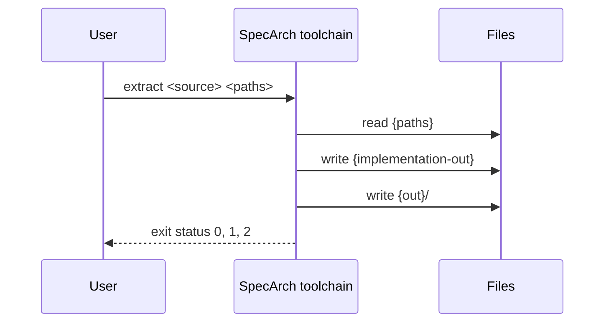

### Command facts

Reads a committed folder of code with the reader of its language and
writes the code-facts dump that specarch extract of that language
reads (docs/reading-code.md, ADR-116): the version of the format,
the reader's name and version, the folder's path from its
repository's root, the commit that last changed it, every tracked
file the reader reads with the number of its syntax errors, and
every fact the reader gives. It is what tools/code-facts/dump-*.sh
run in a checkout, so a team with the installed binary and no
checkout makes the same dump.

The folder is read in its git repository, run without the user's or
the system's configuration; a folder with changes not committed or
files neither tracked nor ignored is refused, naming them, and so is
one no commit has changed, since no commit would name what the facts
were read from. A dump file in another repository than the code's,
one holding the code's as a submodule, names that submodule's folder
as its repository, so extract reads the code at the commit the
gitlink pins; a dump file in a repository that does not hold the
code's is refused.

javascript reads the tracked JavaScript, TypeScript and Vue files
and the tsconfig.json and jsconfig.json files under the folder, not
the .d.ts files, with the TypeScript compiler inside this binary
(third_party/typescript-go) and its Vue reader, and reads no file
outside them: no node_modules, no Node. swift and dart read the
tracked .swift or .dart files with the reader of readers/swift or
readers/dart, which this binary holds with the lock file that pins
every dependency: it is written once into the user's cache
(`$XDG_CACHE_HOME/specarch/readers/<language>-<hash>`, else the
operating system's cache folder), named by a hash of its files, and
built there with the language's toolchain (swift build, or dart pub
get --enforce-lockfile), whose progress is printed on standard
error. Nothing is written into the folder read.

**Insight:** A team that installs the binary has no checkout of this repository, so the readers come with the binary; the JavaScript reader is the TypeScript compiler's own Go source inside it, and the Swift and Dart readers, which need their own toolchains, are built from the pinned files it carries.

| Argument or option | Type | Required | Description |
|---|---|---|---|
| `<language>` | string | yes | The reader to run. |
| `<folder>` | string | yes | The committed folder to read. |
| `<dump>` | string | yes | The dump file to write, in an existing folder. |

Reads `{folder}`: The tracked files of the folder's language, at the commit that last changed it.

Writes `{dump}`: The code-facts dump, whose header names the reader's version; specarch extract refuses a dump another version made.

Standard output: One line naming the dump written, the folder, the commit and the repository, and the submodule read through when the dump file is in another repository.

Standard error: A usage message on a usage error; the reason a folder or a dump file was refused, with git's own message; and for swift and dart, each step of writing and building the reader in the cache, with the toolchain's output.

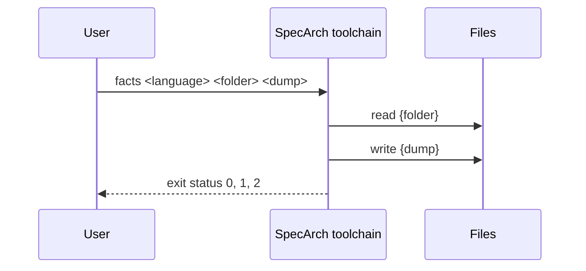

### Command gaps

Validates its input first, prints the problems of each estate
given, one line each as validate prints them, since no module's
document holds them (ADR-113), and prints the open questions document
of a specification with errors too (ADR-065), the text
`document questions` writes, from its title: the counts by
priority, the decisions each stakeholder must take and the material
each must provide, a material question counted only as the second,
the elements by origin when the specification tracks it,
the errors, one problem line each, when it has any, the decision
questions of what could be read grouped by stage in
life-cycle order and within a stage by priority then ID, then the
material questions in a group of their own, Material to provide, in
the same order (ADR-120), each with
who decides, or for material whom it is needed from, what it blocks (and for a blocked element, which keys
are missing there), the name it gives for the key it blocks with
the file and line of the element that leaves the key out, its
options, the decision that opened it when one did, with the
questions that decision answered, and so on back along the chain,
its Insight and Notes; then the references into other
specifications that are not resolved, each with where it stands,
the specification and version it names, and what it waits on (the
specification not given, or the must question that blocks the
element there); then, when
a source lists its clauses, the coverage: per such source, the
elements each clause produced, how many clauses produced nothing,
and the citations outside the listed clauses; then the outputs, one row per document target and per code target the
implementation files name, each ready, a draft (the questions and
the errors that concern it) or waiting (the errors, the questions,
and the approval that is missing or void), the questions given per
stage as how many and the first three by priority then ID.

**Insight:** The owner and the agent run validate after every edit, so validate counts the open questions and lists none; this verb is the list, with what each question holds up, so that the next decision is always in view. The same text is the document, because the people who decide read documents, not terminals.

**Note:** From ISO/IEC/IEEE 29148, Systems and software engineering, Life cycle processes, Requirements engineering, 2018, clause 6.6.3: The closure of to-be-determined and to-be-resolved items against plan is a measure of the requirements work. <https://www.iso.org/standard/72089.html>

| Argument or option | Type | Required | Description |
|---|---|---|---|
| `<paths>` | string, one or more | yes | Folders holding specifications, searched as validate searches them. |

Reads `{paths}`: The specifications and their implementation files; `records/approvals/<version>.yaml`: The approval of the specification's version, beside its folder, when there is one.

Standard output: The problems of each estate given, then the open questions document of each specification, with its errors listed in it.

Standard error: A usage message on a usage error, and the reason on an unreadable path.

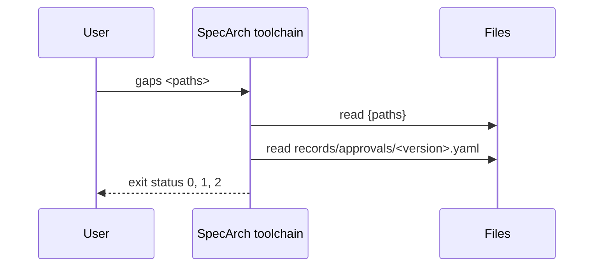

### Command generate

Validates its input first and writes nothing from an invalid
specification. Without `--out`, passes over a specification whose
implementation files name no output folder for the target, with a
warning of rule output_folder at their targets, as document does
(ADR-073), and exits 2 when every specification given is passed
over. Then refuses, with status 1, while a must or should question
blocks a section the target reads: the sections the implementation
file names under `targets.<target>.reads`, or every section when it
names none. Then refuses, with status 1, when
`records/approvals/<version>.yaml` is missing or its digest is not the
digest of the specification's files now. `--unapproved` lets the run
through both refusals and makes the output a draft: every file says
it is one, naming the questions that block what the target reads and
the approval's state, and a draft exits 0 (ADR-066, ADR-086). Then
writes the target into the folder it owns, and nothing outside it.
With `--check` nothing is written: the output is made in memory and
compared with what is on disk. A generated file, one whose text has
the line that starts the generated header, is compared byte for
byte. A file with no such line was built by hand: it matches when it
equals what the target writes without the header, the draft notice
and the problem marks, and a match is named in a line of its own and
not counted as differing. A file the plug-in marks as an object
literal is, when it differs, read on both sides in the subset of
TypeScript that is also JSON5 (ADR-093) and compared by value: the
imports, the exported constant's name, the type it satisfies and the
literal. A hand-built one with equal values matches; for any other,
each differing value is printed below the file's line, by its path
in the literal, with the value on disk and the one generated; any
other file built by hand that differs names its first differing
line, both ways. A file
on disk outside the subset is not comparable, named with its line
and what was found there, and counts as differing.

A target this program does not build in is produced by a plug-in found
on PATH. For each implementation file that names the target under
`targets` (every implementation file when none does), the plug-in is
`specarch-gen-<target>-<stack>` when there is one, where the stack is
first the target's `framework` in lower case, given under
`targets.<target>.framework` or the platform's default when the
target names a platform and no framework (plain-javascript on web,
swiftui on iphone), then the file's `stack.language.name` in lower
case with a dash for a space, and `specarch-gen-<target>` otherwise;
none found is status 2. A framework is a stack of the file, as a
dialect is, so one language may have a plug-in per framework. Files
that find the same plug-in and name the same output folder run it
together, a file that names none joining the others of its plug-in,
and each run writes into the folder its files name, so `--out` is
refused when the files reach more than one plug-in or folder. The program runs each plug-in once per
specification with a request on its standard input, as JSON:
`specarch` (the meta-model version), `target`, `root` (the root file's
path), `specification` (the merged, validated specification as plain
values), `implementations` (each implementation file as `file`,
`content`, the target's `settings` from it, and `idioms`, the idioms
it uses, each with its `name`, `version`, how it applies (`as`:
shipped, overridden, project or excluded), the `content` of the idiom
that applies and the project's `override`) and `output` (the folder
the files are for), and `existing`, the text files already in that
folder by their path in it, so a plug-in that adds files, such as a
migration beside a snapshot, knows what is there without reading the
disk; `draft`, the notice every file of a draft carries, from
"Draft:" to "this file is not the approved output", or empty for the
approved output; and `problems`, the specification's warnings and
open questions in the order of its problems file, each with its
`id`, `severity`, `rule`, `message`, the `pointer` into the merged
specification it is marked at (empty for a problem outside it, such
as in an implementation file) and, for a question, what it
`blocks`, so the output marks each one at the entry it shows for it
(docs/diagnostics.md); and `check`, true when the run only compares,
so a plug-in that refuses to write over a file built by hand answers
its files for the comparison. The plug-in answers on its standard output,
as JSON, with `files` (each a `path` relative to the output folder,
its `content`, and `comparison: object-literal` for a file that is
one object literal of data, which `--check` compares by value) and `diagnostics` (each with the validator's fields:
file, line, severity, path, rule, message, and a column when it
knows one), and exits 0. The program places each diagnostic at its
entry: one at the root file, whose path leads to an entry of the
merged specification, is put at the fragment, line and column that
entry was read from; a column not given is derived as validate
derives it; and the id is made as validate makes it. It prints the
diagnostics in validate's line, refuses a path outside the output folder,
and writes or checks the files itself. When the plug-in answers
with diagnostics, the program runs it once more with them added to
`problems`, each with its id and `target: true`, so the files mark
the target's own problems as well; it writes what that run answers.
A plug-in that cannot express an entry answers the rest of its
output with that entry marked, and an error makes the run exit 1
after the files are written or checked; a plug-in that can write
nothing answers no file (ADR-086). A plug-in that exits with
another status, or answers with something else, fails the run with
status 2; its standard error is passed through.

An element whose mapping in the implementation file names a
stakeholder under `ownedBy` is owned by that stakeholder: a plug-in
that builds code or data writes nothing for it or for anything under
its pointer, and an element that refers to it still refers to it; the
tests target, which checks rather than builds, keeps it (ADR-046). The gate does not look
at the mark, so a question that blocks an owned element still holds
the target up.

**Insight:** One program with verbs, and generators as plug-ins found on PATH, is the pattern of protoc, git and kubectl: one name to learn and install, one parser, one diagnostic format and one version shared by every target, and new targets added without changing the program. Letting the program write the files, as protoc does, keeps `--check` and the rule "only into its folder" true for every plug-in without each one having to implement them.

**Note:** From Protocol buffers compiler plug-in protocol, plugin.proto, 2024: A plug-in reads a CodeGeneratorRequest from standard input and writes a CodeGeneratorResponse to standard output; the file names it answers are relative to the output directory, and protoc writes them. <https://github.com/protocolbuffers/protobuf/blob/main/src/google/protobuf/compiler/plugin.proto>

| Argument or option | Type | Required | Description |
|---|---|---|---|
| `<target>` | string | yes | A code or data target, built in or offered by a plug-in; kebab-case. |
| `<paths>` | string, one or more | yes | Folders holding specifications, searched as validate searches them. |
| `--out` | string |   | The folder the target owns. Without it, the folder the implementation files' `targets` name for the target, relative to each implementation file; they must agree. |
| `--check` | bool |   | Make the output in memory and fail when the files on disk differ. Writes nothing. |
| `--unapproved` | bool |   | Write a draft from a specification that is not approved yet, because no approval record covers its files as they are or an open must or should question blocks what the target reads. The refusal is the default; with this, every file says it is a draft and why. |

Reads `{paths}`: The specifications and their implementation files; `records/approvals/<version>.yaml`: The approval of the specification's version, beside its folder; `{out}`: The current output, with `--check`; `specarch-gen-{target} on PATH`: The plug-in for a target that is not built in.

Writes `{out}/`: The files the target produces, as the plug-in answers them. Nothing is written with `--check`.

Standard output: The diagnostics of an invalid specification, the output_folder
warning of each specification passed over, and the diagnostics the
plug-in answers with, one line each. With `--check`, one line per
file that differs, is missing or is not comparable, each differing
value of an object literal on an indented line below it, and for
any other file built by hand its first differing line, and one line
per file built by hand that matches.

Standard error: A usage message on a usage error, the reason a plug-in was not found or failed (its path and exit status, or the start of an answer that is not JSON), each file the plug-in is not given because it cannot be read and why, one line per step when a run takes more than one plug-in or output folder (N of M), the plug-in's own standard error, and a one-line count at the end.

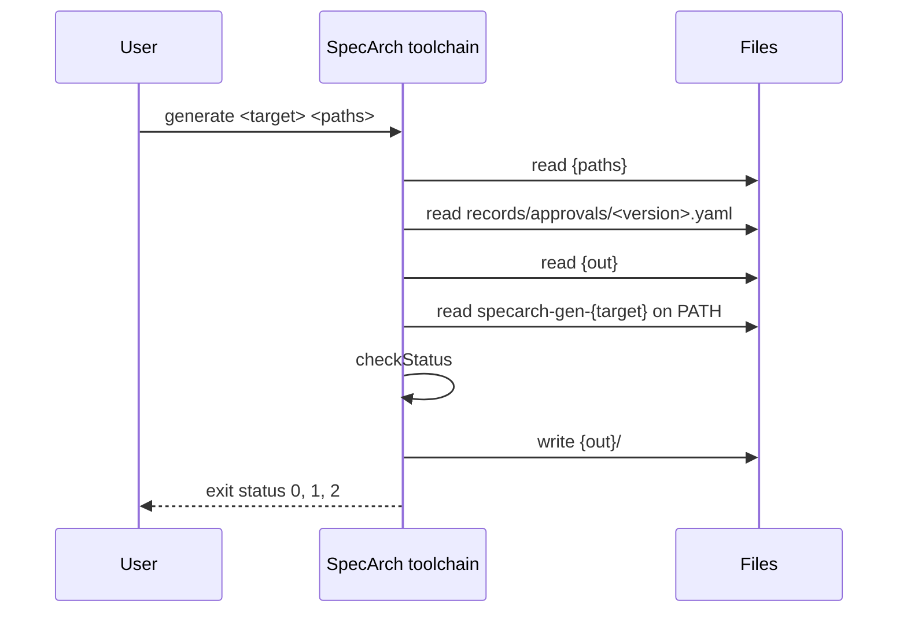

### Command idioms

Validates its input first and prints nothing but the errors from a
specification that has them. Then prints, for every implementation
file of every specification, its path and one line per idiom: every
shipped idiom and every one of the project's own that applies to the
file, by its stacks and by the keywords the specification uses, with
its version and how it applies: shipped, overridden (by which file,
copied from which version, replacing which parts), the project's own,
or excluded; an override's or an exclusion's reason follows.

**Insight:** The shipped idioms apply without a word in the implementation file, so a reader needs one place that says which ones do, and where the project deviates.

| Argument or option | Type | Required | Description |
|---|---|---|---|
| `<paths>` | string, one or more | yes | Folders holding specifications, searched as validate searches them. |

Reads `{paths}`: The specifications, their implementation files, and the idioms folder beside each.

Standard output: The errors of an invalid specification, one line each; otherwise each implementation file's path and its idioms, one per line.

Standard error: A usage message on a usage error, and the reason on an unreadable path.

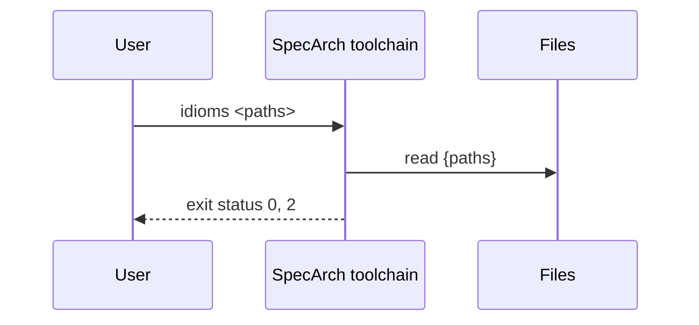

### Command idioms diff

Validates its input first, as idioms does. Then, for every
implementation file that overrides the named idiom, prints the
override's file, the version it was copied from and the version this
program ships, and for each part it replaces and each stack the
override renders, the shipped rendering and then the override's, as
YAML. With no override of the idiom, it says so.

**Insight:** An override records the version it was copied from, and the validator warns when a newer one ships; this is how the project sees what changed before it moves.

| Argument or option | Type | Required | Description |
|---|---|---|---|
| `<idiom>` | string | yes | The name of a shipped idiom. |
| `<paths>` | string, one or more | yes | Folders holding specifications, searched as validate searches them. |

Reads `{paths}`: The specifications, their implementation files, and the idioms folder beside each.

Standard output: The errors of an invalid specification, one line each; otherwise each override with the shipped and the overriding renderings of what it replaces.

Standard error: A usage message on a usage error, the reason on an unreadable path, and that the idiom is not shipped.

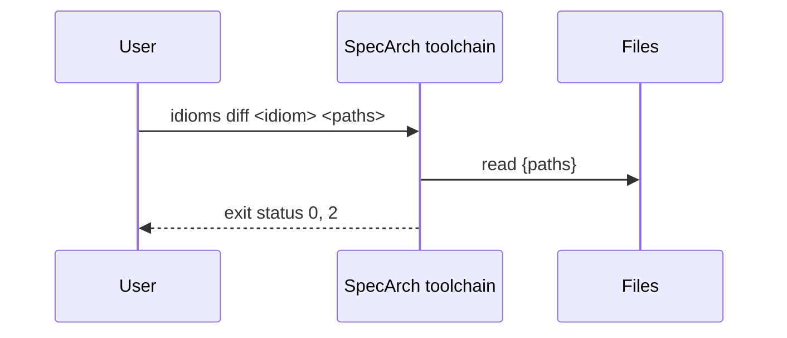

### Command merge

Reads two or more partial specification trees, each written by
`specarch extract` or by hand from documents, and writes one
specification that holds every element of them, following
`docs/from-sources.md`, section 3.2. Each tree is checked on its own
first: a tree that does not track origin, that validate reports an
error in, that holds implementation files or records, or that holds
a test other than the drafts specarch derive writes for that tree is
refused. A test is one of those drafts when its name and values are
those of the draft derive writes for the tree without its tests; the
problem marks above its entries do not count. The drafts are left
out, since they are derived from one tree alone, and the derivation
runs again into the merged specification, as extract runs it
(ADR-055).

- The same element in two trees (an entry of a section by its name,
  an operation by its path and method, a field by its entity and
  name) becomes one element with the citations of both. A key only
  one tree writes is kept. A key the trees give different values is
  left out, and a must question cites both and blocks it. A
  field's `type` is kept instead, since a field is not read without
  one (ADR-122): the union of the types where they differ only in
  whether null is allowed, else the first tree's type, with the
  other trees' keys that go with their types (a format, a width, a
  pattern, the values, a default or an example, the items, the
  properties) left out with them; the question says what was kept and names each key left
  out, and a line names the type kept. A role's `permissions` are
  joined grant by grant once every tree is in, on the permissions
  the trees declare (ADR-127): a tree's list says nothing of a
  permission the tree does not declare, so the merged list is the
  first tree's, then what each later tree adds, with every tree's
  citation, and a line names the trees whose grants add up. A
  permission one tree grants that another tree, which has the
  role, declares and does not grant is a disagreement: the list is
  left out, and the must question names each such permission with
  the trees that grant it and the trees that withhold it, and
  blocks, as well, each permission the lists name that no merged
  role grants, itself or through a permission it implies. A role a
  printed and a parsed tree both give is compared below instead.
  The merged specification always passes validate. An
  entity's `required` is compared field by field: a field only one
  tree has keeps what that tree says, and a field both have that
  one requires and the other does not is left out of `required`,
  with a must question on that field that blocks the entity's
  `required`.
- A position where one tree refers to a named schema, entity or
  enum and another writes the shape in place is settled once every
  tree is in (ADR-117). The named shape and the one written in place
  are compared on what both say: the keys that say what a value is,
  `required` and `enum` as sets, the items, and each property both
  list, through a property that is a reference on one side. Where
  nothing both say differs, the reference is kept and a line names
  the trees that refer and the trees that write; where a key both
  give differs, the key is left out and the must question above
  names each difference; where only the properties listed differ,
  the reference is kept and a should question at the position names
  the properties each side lists and the other does not. A tree's
  question at that position is answered by the trees that refer;
  one below it follows the reference to the named entry, or moves
  up to the position where the key is left out. An entity's field
  left out so leaves the entity's `required` list too.
- A name one tree gives to a schema and another to an entity or a
  view, or one to a view and another to an entity, is kept in both
  entries, each as its trees give it, since a schema, an entity and
  a view are one namespace and the merge does not know whether the
  shape is the record (ADR-132). One must question per such schema
  or view asks whether the name is one element or two, with an
  option that makes it the entity or the view it is named like,
  where what refers to the one refers to the other, and an option
  that gives it another name; its why names the trees that give the
  name each way, it cites both entries, and it blocks the schema or
  the view, where the validator reports the error it holds while
  the question is open. A line names the question.
- An entity's field holding a schema in columns is written out as
  `specarch generate sql` writes it, every part's column and the
  check that an optional value is wholly absent or has its required
  parts, and compared with the code side's fields (ADR-077). Where
  every part's column is there with the type, width and nullability
  its part gives it, every check of the entity naming one of them is
  such a presence check, and every presence check the field writes
  is there, the columns, their place in `required` and those checks
  are left out, the field is the code's too, and a line names them;
  a key only the column gives is written into the part, and a part
  that refers to an enum or a schema is compared on its nullability
  only. A tree's question on a column or a check read back so, or on
  a JSON column read as a schema, is left out with a line. Where only
  some parts have a column, a column differs from its part, another
  check names one, a presence check is missing, or the field is held
  as json and has columns, nothing is joined and a must
  question at the field names each difference. A field one tree
  gives as a schema and another as an object is that schema with
  storage json. Where no tree has a field holding a schema, and an
  entity's code-side fields are every part's column of a schema
  under one prefix, a should question at those fields asks whether
  they are one value, a field named after the prefix, or fields of
  their own.
- An element is stated when a tree states it; it is inferred only
  when every tree that has it infers it.
- A tree whose sources are all code is on the code side; any other
  tree is on the documents side. Where both sides are merged, an
  element of a design section that only one side has is compared
  with the other side when that side has elements in the same
  section, or, for a field, the same entity. Only the code has it:
  it is written inferred, with a why that starts "Undocumented, from
  code." and names where, and a question asks the owner to confirm
  it; a field, which holds no origin of its own, is written as the
  code has it, and only the question says so. Only the documents have it: it is written as they state it,
  and a question in `implementation/questions.yaml`, blocking
  `implementation`, starts "Not built yet." and cites the documents
  and the code that was read. Either question is must when the
  element concerns security (a role, a permission, an operation, or
  an entity or field that is personal or a credential) or when a
  source it cites is marked `givenOutside`; otherwise it is should.
- A requirement of the documents side whose statement gives one
  number of days, such as "The loan period is 21 days.", is compared
  with the check constraints of the code side that move a date by
  exactly one number of whole days. When exactly one such check has
  every word of the statement's subject in its name (the words
  before is, are, shall, must, will or should, without the, a, an,
  of, each and every), the check satisfies the requirement. The
  words, the number words and the units of whole days, such as
  days and weeks, are the vocabulary's of the language of the
  source the requirement cites first (`docs/vocabularies.md`):
  English when the source names none, the one SpecArch ships for
  it, or the one given with `--vocabulary`; a language with none is
  said once and its requirements are not compared. When the
  numbers differ, the requirement's statement is left out and one
  must question cites both and blocks it; the check keeps the
  expression the code runs. No match, or more than one, changes
  nothing (ADR-048).
- A code source says how it was read: `reading: printed` for a list
  the running system printed, such as a route table or the document
  dxlib emits, `reading: parsed` for source read by a parser
  (ADR-075). A tree whose code sources all say the same reading
  has it. Where a printed and a parsed tree both have operations,
  an operation only the parsed tree declares keeps what it states,
  and a must question that starts "Declared, not
  registered:" cites the line that declares it and names the
  printed trees, since the running system does not list it: the
  code is never reached, or only under a setting, or the printer
  misses it. An operation only the printed trees have keeps its
  citations, and a could question that starts "Registered by code
  the reader does not follow:" cites them. Entities and roles are
  compared the same way where a printed and a parsed tree both have
  them: an entity only the source declares is a must question that
  starts "Declared, not in the database:", one only the catalogue
  holds a could question that starts "In the database, declared
  nowhere the reader follows:"; a role only a seed grants is a must
  question that starts "Seeded, not granted:", one only the
  permission table holds a could question that starts "Granted,
  seeded nowhere the reader follows:". A role both give grants what
  the printed trees grant, since that is what the check reads, with
  every tree's citation and no disagreement asked on its list; a
  grant only a seed makes is a must question that starts "Seeded,
  not granted:" blocking the role's permissions and the permission,
  and one only the table holds a could question that starts
  "Granted, seeded nowhere the reader follows:".
- A tree whose roles grant permissions says how its roles go on the
  wire: with info.roleNames when its reader found them in upper
  snake case, and without it when it found them as named. Where two
  such trees say different things, the merge leaves info.roleNames
  out and asks one must question blocking roles, naming each way
  and the trees that say it (ADR-112). A tree with no role that
  grants a permission says nothing of it. info.wireNames is taken
  from the tree that names it, as before: a tree whose reader saw
  no wire leaves it out without saying the names go as written.
- Every reader asks about a check that lets every request through
  while a setting is empty in the same words, "The check <check>
  runs only when the setting <setting> is present." (or "is true."
  for a boolean setting). Where a printed
  and a parsed tree both ask about one check, by its name, the merge
  asks it once with every tree's citation, and names both settings
  when they differ. One only the parsed tree asks, where a printed
  tree holds roles, is a must question that adds that the
  permission table does not declare the gate; one only the printed
  tree asks, where a parsed tree holds operations, keeps its
  question and adds a could question that starts "Declared, not
  found:", since the check's code is outside the middlewares the
  parser reads.
- Every reader asks about a check skipped for one kind of caller in
  the same words, "The check <check> is skipped for every
  <kind>:" (ADR-114). The merge asks it once per check and kind,
  blocking the permission of every operation any tree says the
  check guards, with every tree's citation, and never leaves it out
  as answered: a tree that gives an operation's permission does not
  say whether that kind of caller is meant to reach it.
- A parsed tree's must question that blocks one of its own
  operations, entities or roles and nothing else asks whether the
  running system registers it, holds it or grants it. A printed
  tree that gives the element answers it, and it is left out with a
  line naming that tree; where printed trees have elements of that
  section and not this one, it is left out too, and the question of
  the row above asks it with what they printed.
- Sources of the same key are one source when they are the same in
  everything but their clauses, which are joined, and their
  reading: the merged source keeps a reading every tree gives it
  and says none when one tree read it printed and another parsed. Code sources that
  differ only in their edition are one repository read at different
  commits: the merged edition is the newest of them, which each
  other is an ancestor of, and every path a tree read must be
  unchanged from the commit it was read at up to it. Sources of the
  same key that differ otherwise are refused.
- Where both sides have operations, a documents-side source none of
  whose operations' paths the code side has, such as an OpenAPI file
  left from a template, is reported as a placeholder, with the
  number of its paths; its operations are compared as any other
  (ADR-049).
- A question of a tree whose every blocked key another tree gives
  is left out, since that tree answers it and the element cites
  both; a question that blocks a stage, an element or a key no tree
  gives is kept (ADR-049). An element the asking tree writes only by
  name, as an empty mapping, is one it does not give, so a tree that
  gives it with content answers the question, such as a field a page
  shows whose type the database gives (ADR-057).
- A question whose every block is the section `gateways`, the
  question a code reader asks at a fallback handler or a catch-all
  route, is left out as answered when another tree declares a
  gateway for it, as the tree `specarch extract gateway` writes
  from a gateway table does: that tree says what the handler
  forwards and by which claim, and the line names the trees and the
  gateway (ADR-142, ADR-143). Each gateway answers one such question
  over the whole merge, never one of its own tree, since one gateway
  table describes one gateway in front of one tree: first the
  questions at a fallback handler in every tree, then those at a
  catch-all route, which may as well be a file server, in every
  tree, each pass over the trees in the order given and in each
  tree in the order it asks them, so a catch-all question never
  takes a gateway from another tree's fallback question. A question no gateway is left for stays
  open, with a line that says so, rather than being answered by a
  gateway that has nothing to do with it.
- A map one tree writes open, `additionalProperties: true`, with a
  question of that tree blocking that key, and another tree writes
  with a value type, takes the value type with no disagreement, in
  whichever order the trees are given: the open map is unknown, not
  a claim. The asking tree's question is left out as answered, with
  a line naming the trees that give the type. A tree that writes
  the map open and asks nothing says its values may be anything,
  and two value types are two claims: either is a disagreement, as
  `false` against `true` or a type is (ADR-126).
- A question of a tree that names, under `names`, the operation a
  key it blocks refers to, such as a workflow's trigger or a step's
  operation, or a page's source or submit, is left out as joined
  when another tree declares an operation of that name: the name is
  written at the key, where the design schema puts it, and the line
  names the trees that declare it. A name no tree declares keeps
  its question.
- A question of a tree whose every blocked key a question kept
  before it blocks, with the same priority, is left out, since both
  ask the same thing, such as a permission's description that the
  router and the permissions reader each ask for (ADR-050). A
  could question is never left out so: it holds nothing, and two
  at one entry are two things a reader could not hold there.
- Where the code side has operations, a permission a role grants
  and no operation, command or page checks is reported with the
  roles that grant it, since a grant nothing checks is either left
  from code that was removed or guards something the routes do not
  show (ADR-050).
- The questions of the trees are numbered again, Q-1 upward, in the
  order the trees are given, and the merge's own questions follow.
  Every element keeps the file its first tree wrote it in.
- The same trees in the same order give byte-identical output.

**Insight:** The readers write one tree per surface so that each is checked on its own; the comparison between surfaces, and between the documents and the code, is made once, here, where a disagreement becomes a question rather than a choice.

| Argument or option | Type | Required | Description |
|---|---|---|---|
| `<trees>` | string, one or more | yes | The partial specification trees to merge, each a folder holding specarch.yaml, in the order their questions are numbered. |
| `--out` | string | yes | The folder the merged specification is written into; it becomes the specification's root folder. |
| `--vocabulary` | list of string |   | A vocabulary file (docs/vocabularies.md) for a language SpecArch ships none for, by which the requirements of the sources in that language are compared with the code's checks; repeated, one per language. |

Reads `{trees}`: The partial specification trees.

Writes `{out}/`: The merged specification, each problem validate finds in it and each open question marked above its entry with a `# specarch-problem:` line, as document problems marks a fragment (ADR-066); the marks of the trees read are not carried over.

Standard output: One line per tree naming its title, its side, its reading where it
has one, and what it holds; one line per
source joined from several trees, naming the edition taken; one line
per role whose grants several trees add up, naming the trees; one line
counting the elements written and those found in more than one
tree; one line per position where a reference and a shape written
in place meet, saying whether the reference is kept or the key left
out; one line per source whose language has no vocabulary, saying
its requirements' days are not compared; one line per field read back from its columns, and one per
question that what was read back answers; one line per requirement joined to a check that gives the
same number of days; one line per question of a tree that another
tree answers or a question kept before it asks, and per parsed
tree's question on whether the running system registers an
operation, holds a table or grants a role that a printed tree
answers or the merge asks again; one line per gate question joined
or asked again, and per question on a bypassed check joined; one
line per
question whose name is joined to the operation another tree
declares; one line per
placeholder source; one line per permission granted and checked by
nothing; one line per
question the merge asked, naming what it blocks and why; and the
lines of the derivation, as extract prints them.

Standard error: A usage message on a usage error, and the reason a tree could not be merged.

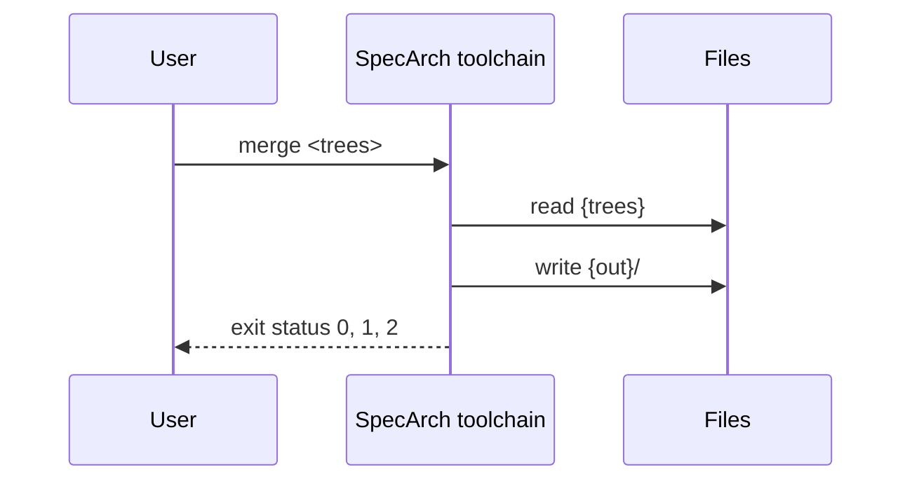

### Command model

Reads the specifications, implementation files and estates found
under the paths given, as validate finds them, and prints one JSON
document in RFC 8785's canonical form: object members sorted by
their names as UTF-16 code units, no whitespace, every number as
ECMAScript prints a double, then a newline. It is how an editor or
another program reads a specification as specarch reads it, without
a loader of its own, and both builds print the same bytes.

The document holds `specarchModel`, the version of its shape, `0.1`;
`program`, the program version; `specifications`, one per root file,
sorted by it; `implementations`, the implementation files outside
any specification; and `estates`, each estate file with its modules.

A specification has its `root` file, its `name` and `version` from
`info` and its `metaModel` from `specarch`, each null when the file
gives none; the merged `document` as plain values, what the schema
validates; `positions`, which maps the JSON pointer of every node,
`/` for the whole document as the problems file writes it, to the
`file`, `line` and `column` where it starts: its key in a mapping, or
the item in a list; `references`, every reference that resolves to an
element of the specification, in document order, each with `from`,
the pointer of the entry that refers, `to`, the pointer of the element,
and `through`, the keyword that made it; `problems`, the problems
found while reading it, such as a folder that is not a stage, a
section in the wrong stage or a file that does not parse, in the
problems file's form (`file`, `line`, `column`, `severity`, `path`,
`rule`, `message`, `id`); and `implementations`, each implementation
file inside it.

The references are made by `$ref`, when it is a pointer into the
specification; by `satisfies`, `verifies` and `decidedIn` wherever
they stand; and by the keywords that name an element by its name
where the meta-model puts them: a relation's `target`, a guard's or a
list's `entity`, a page's `entity`, a job's or a command's `reads` and
`writes`, a workflow's `subject` and a test's `entity` name an entity
or a view; `permission` on an operation, a command, a page, a page's
action and a workflow's step, and a role's `permissions`, name a
permission; a job's `role`, an approval's `approvers`, a client's
`roles` and a signer's `role` name a role; `emits` on an operation, a
job and a workflow, and a job trigger's `consumes`, name a channel's
message; `calls` names a dependency; a menu's or a flow step's `page`
and a test's `page` name a page; a workflow's `trigger`, a workflow
step's `operation` and a test's `operation` name an operation by its
operationId; and `callers`, `token`, `handshake`, `middlewares`, and a
test's `command`, `job`, `workflow`, `flow` and `requirement` name the
element of their section. A reference that does not resolve is a
problem of validate and is not listed; nor is a reference into
another specification.

An implementation file has its `file`, its `stack`, its `document`,
its `positions`, its `references`, the design pointers under
`implements` and a mapping's `design` that resolve in the
specification it is in, and its `problems`, what of its YAML does
not parse. An estate's module has its `name`, its `location` and
`version` as the estate writes them, and `specification`, the root
file of the specification read for it, or null.

The validator's errors and warnings are not in the document: the
problems file and its SARIF form are their one list. A specification
that does not validate is printed all the same, with every problem
found while reading it.

**Insight:** An editor shows a specification as specarch reads it only when it reads it through specarch; a second loader in another language would drift from the first.

| Argument or option | Type | Required | Description |
|---|---|---|---|
| `<paths>` | string, one or more | yes | Folders and files, as validate takes them. |

Reads `{paths}`: Root files, the files under their stage folders, implementation files and estates; `each estate's modules, at their location`: The specification of every module an estate lists, read with the estate.

Standard output: One JSON document in RFC 8785's canonical form, then a newline.

Standard error: A usage message on a usage error, and the reason on a path that could not be read.

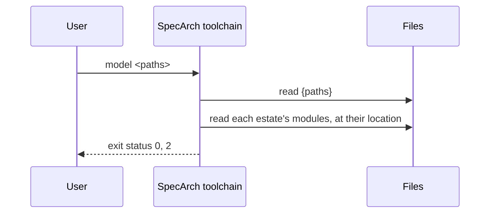

### Command validate

Checks every specification found under the paths given: a folder that
holds `specarch.yaml` is one specification, read as a whole, including
the implementation files under its `implementation/` folder; nothing
under it is searched further, so a test folder's data files are never
read as specifications. An implementation file outside any
specification is checked on its own against the specification its
`implements` names. A file given by name must be a root file or an
implementation file; a fragment of a tree is refused with the folder
to run on instead. The records in the `records/` folder beside a
specification's folder are checked with it.

Every specification is checked against the meta-model and against the
rules JSON Schema cannot express. It reports every problem in every
file, not only the first.

Every specification found is read before any is checked, so that a
reference into another specification (`<dependency>#/<pointer>`,
through a dependency with `specification` and `version`) resolves in
the one whose `info.name` the dependency names, when it is given in
the same run: its element is checked as a local one is, and the
dependency's version against that specification's `info.version`.
A reference whose specification is not given, or whose element is
blocked there by a must question, is not an error: it is counted as
unresolved, and `gaps` lists it (ADR-112).

An estate file, `specarch-estate.yaml`, found under a folder or
named, lists the modules' specifications by their `info.name` with
the folder each is in and the version the estate holds; it brings
each module's specification into the run, read once however often
it is named, so every reference between them resolves. Each module
is checked against its entry, as `module` at the module: its folder
holds a specification, whose `info.name` is the key and whose
`info.version` is the version listed, and its operations' and jobs'
`calls` do not come back to it through the other modules' (ADR-113).

| Argument or option | Type | Required | Description |
|---|---|---|---|
| `<paths>` | string, one or more | yes | Folders and files. A folder is searched for specifications, for implementation files outside one, and for estate files. |

Reads `{paths}`: Root files, the files under their stage folders, and implementation files; `records/ beside each specification's folder`: The change, defect, release, incident, commissioning and approval records of that specification; `the specification named in each standalone implementation file's `implements``: Read to resolve that file's references; `each estate's modules, at their location`: The specification of every module an estate lists, read with the estate.

Standard output: One line per diagnostic, `file:line:column: severity: /yaml/path: rule: message [id]`, sorted by file, then line, column, path, rule, message and id.

Standard error: A usage message on a usage error, the reason on an unreadable path, and a one-line count at the end, with the number of open questions and of unresolved references when there are any.

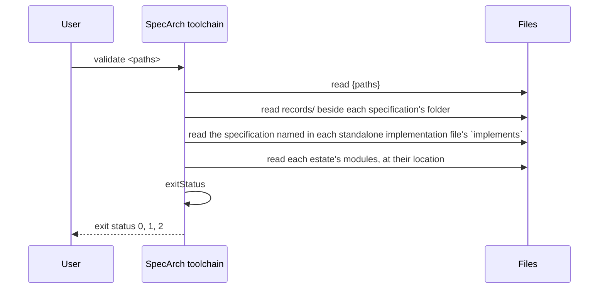

### Command version

**Insight:** One version answers which SpecArch made a file; every generated file's header names it.

Standard output: The program version, then one line for specifications and one for implementation files. Each line names the meta-model version a file is written in and, when there are any, the earlier versions still read until 1.0, each with a warning that the file is on an earlier version: `specifications: meta-model 0.3, and 0.2 and 0.1 until 1.0, with a warning`. The versions come from the schema the build embeds, the `specarch` enum of the specification schema and the `specarchImplementation` value of the implementation schema, the last being the current one, so the line cannot name a version the validator does not read.

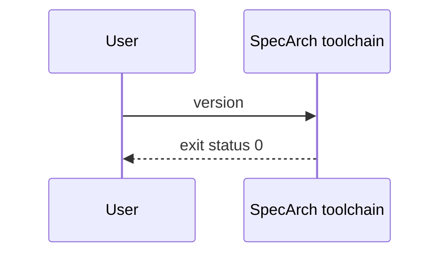

## 7. Deployment and implementation

### Environments

| Environment | Purpose | Promotes to |
|---|---|---|
| developer-machine | The machine of a person who writes specifications; the program is installed from source with one command. | ci-runner |
| ci-runner | The continuous-integration runner of a project that uses SpecArch; it builds the program from the pinned version in that project's workflow. |   |

### Release

A release is a tagged commit of this repository; nothing is uploaded anywhere, since every user builds the program from source.

**Note:** From ISO/IEC/IEEE 12207, Systems and software engineering, Software life cycle processes, 2017, clause 6.4.10: The transition process establishes the capability to provide the service in its operational environment. <https://www.iso.org/standard/63712.html>

| Step | Action | Check |
|---|---|---|
| 1. Check the tree | Run the implementation's build, test, validate and document --check tasks on the commit to release. | Every task exits 0. |
| 2. Point the editor hints | An editor hint names the newest tag that serves the schema it points at. When a schema changed since the last tag, point every hint, and the schema line extract writes, at the tag about to be made, in a commit before it; when no schema changed, the hints stay at the tag they name. | The schemas at the tag every hint names are the same files as on the commit to release. |
| 3. Tag the commit | Tag the commit with the program version, as the version command prints it. | The tag's name equals the output of specarch version. |
| 4. Announce | Write the release in the history file of the day, with the tag. | The history file names the tag. |

### Rollback

A user who hits a problem in a release installs the previous tag; the tags of every release stay.

| Step | Action | Check |
|---|---|---|
| 1. Install the previous tag | Install the program from the previous release tag with the implementation's install task. | specarch version prints the previous version. |
| 2. Record the problem | Add a BUG-NNN entry naming the release and the problem to BUG_OUTSTANDING.md, and note the rollback in the history file. | The entry is in BUG_OUTSTANDING.md and the history file names it. |

### Commissioning checks

Run on the installed system before it is handed over. The results of each run are records kept outside the specification.

#### installs-and-answers (smoke, in developer-machine)

The program installs from the release tag on a clean machine and answers.

| Step | Action | Check |
|---|---|---|
| 1. Install | Install the program from the release tag with one command, on a machine that has never had it. | The command exits 0. |
| 2. Run version | Run specarch version. | It prints the program version and the meta-model versions it reads, and exits 0. |

#### checks-the-examples (end-to-end, in developer-machine)

The installed program validates the example and this specification, and reproduces their committed documents.

| Step | Action | Check |
|---|---|---|
| 1. Validate | Run specarch validate on spec and examples of the release tag. | It exits 0 with no error. |
| 2. Compare the documents | Run specarch document techspec --check on spec and examples. | It exits 0 and names no file. |

#### no-network (security, in ci-runner)

The installed program needs no network.

**Note:** From IEC 62381, Automation systems in the process industry, Factory acceptance test (FAT), site acceptance test (SAT) and site integration test (SIT), 2024: A site acceptance test is run on the installed system in its real environment before it is accepted.

| Step | Action | Check |
|---|---|---|
| 1. Run offline | Run specarch validate on the example with the network switched off. | It exits 0; nothing waits on a connection. |

### Sign-off

The system is accepted when:

- Every check above passed on the release tag, and the record of the run is committed.
- The history file of the day names the tag.

Signed by: specarch-maintainers.

### Monitors

What is watched on the live system, and the objective each must meet.

| Monitor | Environment | Measures | Objective | Verifies |
|---|---|---|---|---|
| main-stays-green | ci-runner | The continuous-integration run on every change to main, both the Go and the Swift job. | Every run on main passes both jobs; a failed run is fixed or reverted before the next change lands. | SA-1, SA-7 |

**Insight on main-stays-green:** The documents and both builds are only trusted while CI keeps them current, so a red run on main is the one thing that must never stay.

### Implementation: SpecArch toolchain in Go

From the implementation file version 0.1.0.

The Go implementation of the specification in `spec/`: one static binary,
`specarch`, installed with `go install ./cmd/specarch`.

Stack: language Go 1.27; toolchain go 1.27.2; platforms darwin/arm64, darwin/amd64, linux/amd64, linux/arm64, windows/amd64.

#### Libraries

| Library | Version | Licence | Purpose |
|---|---|---|---|
| github.com/santhosh-tekuri/jsonschema/v6 | v6.0.3 | Apache-2.0 | JSON Schema 2020-12 validation against the schemas in `schema/`; the same library the repository's pinned `jv` check used. |
| golang.org/x/text | v0.43.0 | BSD-3-Clause | Message printing for the schema library. Pinned above 0.39.0, which fixes GO-2026-5970. |
| go.yaml.in/yaml/v3 | v3.0.5 | MIT AND Apache-2.0 | YAML parsing into a node tree, which keeps the line of every value for diagnostics. |
| cel.dev/cel-go | v0.32.0 | Apache-2.0 | The CEL parser; only its parser is used. |
| cel.dev/expr | v0.25.3 | Apache-2.0 | CEL's expression tree types, needed by the parser. |
| github.com/antlr4-go/antlr/v4 | v4.13.1 | BSD-3-Clause | The parser runtime the CEL grammar is generated for. |
| google.golang.org/protobuf | v1.36.12 | BSD-3-Clause | Needed by the CEL parser's tree types. |
| google.golang.org/genproto/googleapis/api | v0.0.0-20261005182115-fad411399dd8 | Apache-2.0 | Needed by the CEL parser's tree types. |
| google.golang.org/genproto/googleapis/rpc | v0.0.0-20261005182115-fad411399dd8 | Apache-2.0 | Needed by the CEL parser's tree types. |
| golang.org/x/exp | v0.0.0-20261009195045-ca0d7ba23607 | BSD-3-Clause | Needed by the CEL parser. |
| github.com/microsoft/typescript-go | typescript/v7.0.2 (2bd066d87f5bafd315be9f40889d0a60b9e58e0b) | Apache-2.0 | The TypeScript compiler in Go: its parser, binder, checker, program and the bundled lib.d.ts files, which the JavaScript reader of specarch facts reads source with (ADR-116). Upstream keeps them under internal/ with no public Go API, so the packages needed are copied into third_party/typescript-go by tools/typescript-go/pull.sh, with LICENSE, NOTICE.txt and UPSTREAM naming the tag and commit. SBOM scan on 2026-10-14: syft 1.54.1, grype 0.120.1, osv-scanner 2.6.0 and govulncheck 1.8.0 found no vulnerability. |
| github.com/go-json-experiment/json | v0.0.0-20260623181947-01eb4420fa68 | BSD-3-Clause | JSON for the TypeScript compiler's configuration files and diagnostics, at the version typescript-go v7.0.2 pins. SBOM scan on 2026-10-14: syft 1.54.1, grype 0.120.1, osv-scanner 2.6.0 and govulncheck 1.8.0 found no vulnerability. |
| github.com/zeebo/xxh3 | v1.1.0 | BSD-2-Clause | The hash the TypeScript compiler keys its caches by, at the version typescript-go v7.0.2 pins. SBOM scan on 2026-10-14: syft 1.54.1, grype 0.120.1, osv-scanner 2.6.0 and govulncheck 1.8.0 found no vulnerability. |
| github.com/klauspost/cpuid/v2 | v2.2.10 | MIT | Needed by xxh3 to choose its instructions. SBOM scan on 2026-10-14: syft 1.54.1, grype 0.120.1, osv-scanner 2.6.0 and govulncheck 1.8.0 found no vulnerability. |
| golang.org/x/sync | v0.24.0 | BSD-3-Clause | Wait groups for the TypeScript compiler's parallel work; typescript-go v7.0.2 pins v0.21.0, and the newer release the module graph already holds is taken. SBOM scan on 2026-10-14: syft 1.54.1, grype 0.120.1, osv-scanner 2.6.0 and govulncheck 1.8.0 found no vulnerability. |
| golang.org/x/sys | v0.47.0 | BSD-3-Clause | The operating system's file system for the TypeScript compiler; typescript-go v7.0.2 pins v0.46.0, and the newer release the module graph already holds is taken. SBOM scan on 2026-10-14: syft 1.54.1, grype 0.120.1, osv-scanner 2.6.0 and govulncheck 1.8.0 found no vulnerability. |
| analyzer | 14.4.0 | BSD-3-Clause | Parses Dart source with parseString in the Dart reader of specarch extract, readers/dart (ADR-092); not linked into specarch. Pinned exactly in readers/dart/pubspec.yaml, with its tree in pubspec.lock: _fe_analyzer_shared 108.0.0, async 2.13.1, collection 1.19.1, convert 3.1.2, crypto 3.0.7, file 7.0.1, glob 2.2.0, meta 1.19.0, package_config 3.0.0, path 1.9.1, pub_semver 2.2.1, source_span 1.10.2, string_scanner 1.4.1, term_glyph 1.2.2, typed_data 1.4.0 and watcher 1.2.1 (BSD-3-Clause), and yaml 3.1.4 (MIT). The Go build refuses a dump another version made. SBOM scan on 2026-10-09: syft 1.54.0, grype 0.120.0 and osv-scanner 2.6.0 found no vulnerability. |

#### Layout

| Path | Holds | Implements |
|---|---|---|
| cmd/specarch | The command line. Argument handling, finding the specifications under folders, running plug-ins, printing the diagnostics and the exit status. | #/commands/validate, #/commands/gaps, #/commands/document, #/commands/decide, #/commands/approve, #/commands/generate, #/commands/extract, #/commands/merge, #/commands/diff, #/commands/check, #/commands/derive, #/commands/idioms, #/commands/idioms diff, #/commands/model, #/commands/version, #/entities/SpecFile, #/entities/GeneratedFile, #/algorithms/exitStatus, #/algorithms/checkStatus |
| schema | The JSON Schemas, embedded into the binary from the files editors use. |   |
| idioms | The shipped idioms, one folder per concern, embedded into the binary; a release fixes the set. |   |
| internal/extract | The readers of specarch extract: the commit read (git, run with no user or system configuration), the outline, database, router, documents, OpenAPI, permissions, pages and workflows readers, the Go reader on the standard library's go/parser with dxlib's registration calls and the rule that maps dxlib_module's privilege names, the Swift reader of a code-facts dump with the property lists, build settings and Core Data models it reads as data, the JavaScript and TypeScript reader of a code-facts dump with the message catalogues it reads as data, the Dart reader of a code-facts dump, the subset of TypeScript a page schema is read in, the subset of BPMN 2.0 a workflow is read in, the workflow table read into the same workflows (ADR-118), the check of a dump against the commit it names, the translation of SQL checks into the expression subset, and the tree writer; and the merge of their trees, with the newest commit of a repository read at several found by git's ancestry, a requirement that gives a number of days joined to the one check that names it, a question another tree answers, by giving a key or an element the asking tree gives only by name, or a question kept before it asks left out, the name a question gives written at the key it blocks once another tree declares it, a placeholder source reported, a permission granted and checked by nothing reported, and an operation a printed and a parsed tree do not both give asked about; and specarch check's comparison of a route table, a permission table and a catalogue dump with a specification, each difference with its rule and subject (ADR-124). |   |
| internal/facts | specarch facts: the git checks of a committed folder, its tracked files and the repository key of a dump in another repository; the JavaScript and TypeScript reader on the TypeScript compiler of third_party/typescript-go, which builds one program over the files it is given, a .vue file's script blocks among them, and writes the facts specarch extract javascript reads as a code-facts dump (ADR-089, ADR-116); the Vue reader, which splits a single-file component into its blocks and parses its template as Vue 3's compiler-sfc does; and the Swift and Dart readers written from the binary into the user's cache, built there and run. |   |
| third_party/typescript-go | The Go source of the TypeScript compiler, typescript-go at the tag UPSTREAM names: the packages its program and checker need, copied out of internal/ by tools/typescript-go/pull.sh with their import paths rewritten and nothing else changed, with upstream's LICENSE and NOTICE.txt (Apache-2.0). |   |
| readers | The embedded files of the Swift and Dart readers (readers/embed.go), which specarch facts writes into the user's cache. |   |
| readers/dart | The Dart reader of specarch extract, a Dart package with one program, bin/code_facts_dart.dart: it parses Dart source with the analyzer's parseString and writes the facts specarch extract dart reads as a code-facts dump (ADR-092). specarch facts dart builds it in the user's cache and runs it on the tracked Dart files of a committed folder. |   |
| internal/canonical | Writes a JSON value in RFC 8785's canonical form, the bytes specarch model prints and the Swift build prints the same. |   |
| internal/source | Reads a YAML file into a node tree and a plain value, with the line of every node; finds unquoted dates and duplicate keys. |   |
| internal/spec | Reads a specification from disk, the root file and the stage folders, and merges it into one document in which every node remembers its file; reports the layout problems. |   |
| cmd/specarch-gen-sql | The plug-in behind generate sql. Reads the request on standard input, answers the migration and the snapshot on standard output, and never touches the disk. | #/commands/generate |
| internal/gensql | The SQL migrations in four dialects, each column through the type-rendering idiom, with check expressions translated per dialect, the views after the tables, and a snapshot of the schema; an entity or view another stakeholder owns gets no statement, and the snapshot lists it as owned. Schema answers the tables and columns it writes, with their keys, constraints and listed indexes, for the queries generator, the scripts generator and specarch check, and Condition writes an expression over an entity's fields, such as a guard's precondition, as a check constraint is written. |   |
| cmd/specarch-gen-sqlc | The plug-in behind generate sqlc. Reads the request on standard input, answers the query files on standard output, and never touches the disk. | #/commands/generate |
| internal/gensqlc | The sqlc queries the design derives, in PostgreSQL, one file per table: an insert per operation that posts an entity, a read, a replacement or an amendment by a key of one field, and a page of a list with its filters, search and sorts and the list's total, against the tables internal/gensql writes; every other query is written by hand beside them, and a file written by hand is compared, never overwritten (ADR-123). |   |
| cmd/specarch-gen-scripts | The plug-in behind generate scripts. Reads the request on standard input, answers the script files on standard output, and never touches the disk. | #/commands/generate |
| internal/genscripts | The guarded operational scripts the design derives, one script per guarded operation or command, for psql on PostgreSQL or for the mariadb client on MariaDB (ADR-167), as the target's dialect says, whose change a transition it triggers, a PUT of the entity by its key, a DELETE by its key or the guard's writes says (ADR-168): each refuses an unset variable by name, reports a record already changed, counts and locks the records the change would write and refuses unless their number is the guard's recordsChanged, makes the change under the same condition, checks the count it wrote and commits only with apply true; every other guarded change is a warning at its guard, left to be written by hand, against the tables internal/gensql writes, with the precondition written as a check constraint is (ADR-158). |   |
| internal/ownership | Reads the ownedBy marks of an implementation file's mappings, which every generator that builds code or data follows by leaving the owned elements out. |   |
| internal/mark | The rule every generator plug-in places the request's problems by, at the deepest entry its output shows, a question at what it blocks and a target's own problem where the whole output is marked, and the mark's text each target writes in its comment form. |   |
| internal/typerows | Matches a field to a row of a type rendering, for the validator and the generators alike. |   |
| cmd/specarch-gen-openapi | The plug-in behind generate openapi. Reads the request on standard input, answers the OpenAPI document on standard output, and never touches the disk. | #/commands/generate |
| internal/genopenapi | The OpenAPI 3.1 document in the standard dialect, the design field for field, with the problem catalogue and lists paged through the paginated-list idiom; and in the dxlib dialect, what dxlib's reader binds. |   |
| cmd/specarch-gen-go-dxlib | The plug-in behind generate go-dxlib. Reads the request on standard input, answers the Go file on standard output, and never touches the disk. | #/commands/generate |
| cmd/specarch-gen-bpmn | The plug-in behind generate bpmn. Reads the request on standard input, answers each workflow's BPMN file and SVG on standard output, and never touches the disk. | #/commands/generate |
| internal/genbpmn | Each workflow as a BPMN 2.0 process in the subset extract workflows reads, with BPMN DI laid out by a fixed rule, the same diagram as SVG, and the problems marked as XML comments before their elements. |   |
| cmd/specarch-gen-ui | The plug-in behind generate ui. Reads the request on standard input, answers the screens on standard output, and never touches the disk. | #/commands/generate |
| internal/genui | The list, view, form and task pages for the web in plain JavaScript, the navigation between them in pages.js with the menu on every page, the confirmation that asks for a reason in ask.js, the events they raise, and the theme as CSS custom properties; a form's fields are native controls in its HTML and form.js adds the checks, conditions, pickers, values, rows and what follows a success; view.js, form.js, ask.js and the functions of pages.js are files under runtime/, written as they are. |   |
| cmd/specarch-gen-ui-typescript | The plug-in behind generate ui for an implementation file in TypeScript. Reads the request on standard input, answers the screens on standard output, and never touches the disk. | #/commands/generate |
| internal/genuits | The task, list and form pages and the views for the web on Next.js and Carbon, read through internal/genscreens, with child rows, actions that run an operation after a confirmation and its reason, forms that start an approval and inboxes, each a schema of data and a thin page.tsx, a client file that hands on the hooks a project writes, the guard and the menu from one decision, the derived tests, the components that read the schemas, the strings in every language the settings name with the check that each key has an entry, the server routes that forward the operations the pages call with the session's token, and the theme over Carbon's through the design-tokens idiom, drawn through the ui-components idiom's names. |   |
| cmd/specarch-gen-ui-swiftui | The plug-in behind generate ui for a ui target of platform iphone in an implementation file in Swift. Reads the request on standard input, answers the screens on standard output, and never touches the disk. | #/commands/generate |
| internal/genswiftui | The task, list and form pages and the views for the iPhone in SwiftUI, read through internal/genscreens, with child rows, actions that run an operation after a confirmation and its reason, forms that start an approval and inboxes, lookups and value objects: each a schema of data, one Swift literal typed by its component's schema type, and a thin view behind the guard, a form's hooks read from a type the project writes; the derived tests in Swift Testing; the components that read the schemas on SwiftUI alone, the routes as one enum the app's navigation stack follows, the application with the session and the menu, the strings in every language the settings name, and the theme through the design-tokens idiom, written into a Swift package the project writes the Package.swift of. |   |
| internal/genscreens | The screens both UI generators that write a page as data read, keyed by the ui-components idiom's names for the generator's framework, the project's override first: the task, list and form pages and the views with their routes, hooks and permission, the session the target's settings name, the menu, the translations the settings name, the theme's colours through the design-tokens idiom, the problems each reports, the draft notice and the problem marks, and the refusal of a file in the output folder the plug-in did not write; a generator gives its profile, its name, platform, framework and language, and writes the pages in its stack's files. |   |
| internal/literal | Reads a TypeScript file holding one object literal of data in the subset of TypeScript that is also JSON5, refusing anything else with its line, and compares two such files by value, for generate --check on screens built by hand (ADR-093). |   |
| internal/gendxlib | The Go file of a service on dxlib, its tables, handlers, seeds and tasks, read from the design through the dxlib dialect's names and types. |   |
| cmd/specarch-gen-tests-go | The plug-in behind generate tests for a Go implementation file. Reads the request on standard input, answers the Go test file on standard output, and never touches the disk. | #/commands/generate |
| cmd/specarch-gen-tests-swift | The plug-in behind generate tests for a Swift implementation file. Reads the request on standard input, answers the Swift Testing file on standard output, and never touches the disk. | #/commands/generate |
| cmd/specarch-gen-tests-dart | The plug-in behind generate tests for a Dart implementation file, a Flutter app's included. Reads the request on standard input, answers the Dart library and test file on standard output, and never touches the disk. | #/commands/generate |
| internal/gentests | The tests a specification implies, as the three test plug-ins write them. The specification is read once into a model of tests and worked examples, and written in Go, in Swift for Swift Testing, or in Dart for package:test or flutter_test, each with the Harness the project implements beside it; design tests become tests through it, worked examples unit tests of the algorithm's mapping. |   |
| internal/semver | Semantic Versioning 2.0.0 versions, their precedence, and the step one needs from another, with the step before 1.0.0; the release rules and diff measure a release with it. |   |
| internal/diff | Compares two merged specifications element by element, finds the public interface, and classifies each difference by the version step it needs. |   |
| internal/approval | The approval record beside a specification, its digest of the specification's files, and where a version's approval stands against the files now. |   |
| internal/expr | The expression subset. Parses with the cel-go parser, refuses what is outside the subset, type-checks with CEL's strict rules, and evaluates with exact integers and decimals. |   |
| internal/generate | The document targets. techspec writes the arc42 document and its Mermaid diagrams and rewrites the regions between markers in hand-written Markdown; requirements, testplan, traceability, deployment and commissioning write the other documents; questions writes the open questions and what they hold up, the text gaps prints; comparison writes the old documents against the refined specification from origin, citations and decisions (ADR-157); html writes the whole specification as one page, with the entity diagram as SVG and the workflows and screens made in memory with internal/genbpmn and internal/genui. Every one renders why as an Insight, each citation as a Note, an element's origin as an Origin line and the open questions about it as Open question paragraphs, and marks an internal element; ForEveryone cuts the specification to what a document for everyone shows, counting what it left out. | #/algorithms/markersWellFormed |
| internal/refine | specarch decide: the next decision ID, the decision record written for a question, and the question's entry taken out of its file as text, with the problem marks above it and the questions key when it was the only one (ADR-155). |   |
| internal/problems | The problems of a specification, valid or not, gathered from validate's diagnostics and the open questions into one list with ids, columns and notes, written as problems.txt and as a SARIF 2.1.0 log, and marked above their entries in the YAML files of the specification. | #/entities/Problem, #/entities/ProblemNote, #/enums/ProblemSeverity |
| internal/validate | Schema validation with plain messages, the interface boundary, cross-references across the tree, fail-closed access, concrete integers, expressions, worked examples, tests and their derived cases with the rank of each and the cases left out, the life-cycle links and traceability warnings with the requirements another stakeholder owns exempt, the audience of what an element for everyone names, the open questions and what they cover, origin, implementation references, the records beside the specification, and the positions, resolved references and layout problems specarch model prints. | #/entities/Diagnostic, #/enums/Rule, #/enums/Severity, #/algorithms/referenceResolves, #/algorithms/permissionGranted, #/algorithms/workedExampleHolds |

#### Mappings

| Design object | Implemented by | Notes |
|---|---|---|
| #/entities/Diagnostic | validate.Diagnostic | A struct; `String()` prints the one-line form. |
| #/entities/SpecFile | main.input | A root folder, an implementation file or a file given by name; the versions are read where they are checked. |
| #/enums/Rule | validate.Rule | A string type with one constant per value; validate.Rules lists them, and a test checks they equal the design's enum. |
| #/enums/Severity | validate.Severity |   |
| #/entities/Problem | problems.Problem | A struct; `String()` prints the problem line, and its notes follow it. |
| #/entities/ProblemNote | problems.Note | A struct inside its problem, in order; `String()` prints the note line. |
| #/enums/ProblemSeverity | problems.Severity |   |
| #/commands/validate | main.runValidate |   |
| #/commands/model | main.runModel |   |
| #/commands/gaps | main.runGaps | Prints generate.Questions, the text the questions document target writes. |
| #/commands/decide | main.runDecide | Writes the record and edits the questions file through the refine package; the entries it prints come from validate.Locate and the keys the question covered. |
| #/commands/approve | main.runApprove | Writes the record through the approval package after checking the documents with generate.Document. |
| #/commands/version | main.runVersion |   |
| #/commands/document | main.runDocument |   |
| #/commands/generate | main.runGenerate | Refuses through main.gate while a question blocks what the target reads or the approval is missing or void; then runs the plug-in with main.runPlugin; the request and answer are the pluginRequest and pluginResponse structs. |
| #/commands/extract | main.runExtract | Runs the reader of the source, extract.Outline, extract.Database, extract.Router or extract.Documents, after extract.Open has named the commit read and refused what no commit names; extract.Tree writes the tree from ordered YAML nodes. |
| #/commands/merge | main.runMerge | Loads each tree with spec.Load and refuses one validate.CheckSpec reports an error in; extract.Merge joins the sources, the elements and the questions, and extract.Tree writes the result. |
| #/commands/derive | main.runDerive | Writes validate.Drafts, the drafts of the cases the warnings name. |
| #/commands/idioms | main.runIdioms | Prints validate.IdiomUses, the idioms each implementation file resolves to. |
| #/commands/idioms diff | main.runIdiomsDiff |   |
| #/commands/diff | main.runDiff | Lists diff.Compare's changes, then checks the release record beside the new folder. |
| #/commands/check | main.runCheck | Tells each dump by its format with extract.DumpFormat and compares it with extract.CheckRoutes, extract.CheckGrants or extract.CheckCatalogue, the last against gensql.Schema's tables for PostgreSQL; reads the allowlist, and with --since the allowlist at that revision through git. |
| #/enums/DocumentTarget | main.documentTargets |   |
| #/enums/GeneratorTarget | main.builtGenerators | Empty; every target is a plug-in. |
| #/entities/GeneratedFile | main.planned | A path and the content a target wants there; --check compares it with the disk. |
| #/algorithms/checkStatus | main.checkPlan |   |
| #/algorithms/markersWellFormed | generate.RewriteMarkers |   |
| #/algorithms/exitStatus | the end of main.runValidate |   |
| #/algorithms/workedExampleHolds | validate.checker.checkExample |   |
| #/algorithms/permissionGranted | validate.checker.checkAccess |   |
| #/algorithms/referenceResolves | the validate.checker.check... methods for each kind of reference |   |

#### Bindings

cli: standard library. Hand-written argument handling over `os.Args`; three commands do not justify a CLI library.

#### Targets

| Target | Output folder | Settings |
|---|---|---|
| techspec | ../../../docs |   |
| requirements | ../../../docs |   |
| testplan | ../../../docs |   |
| traceability | ../../../docs |   |
| deployment | ../../../docs |   |
| commissioning | ../../../docs |   |
| questions | ../../../docs |   |
| problems | ../../../docs |   |
| changes | ../../../docs |   |
| releases | ../../../docs |   |
| manual | ../../../docs |   |

#### Tasks

| Task | Command | In CI |
|---|---|---|
| build | `go build ./...` | yes |
| test | `go test ./...` | yes |
| vet | `go vet ./...` | yes |
| vulncheck | `go run golang.org/x/vuln/cmd/govulncheck@v1.8.0 ./...` | yes |
| validate-specs | `go run ./cmd/specarch validate spec examples` | yes |
| documents-current | `for target in techspec requirements testplan traceability deployment commissioning handover questions; do go run ./cmd/specarch document $target --check spec examples \|\| exit 1; done` | yes |
| install | `go install ./cmd/specarch` |   |
| sbom | `syft dir:. -o syft-json=sbom.json && grype sbom:sbom.json && osv-scanner scan source -r .` |   |

#### Testing

Framework: go test. Run: `go test ./...`.

Fixtures: The conformance suite is the tests stage of the specification, `spec/tests/`; each test folder holds the design test, the case's arguments and output in `case.yaml`, the input files and the expected output. The Go tests read it and add none of their own.

Stand-ins: None. Every test runs the real program on real files.

| Suite | Level | Runs | Command |
|---|---|---|---|
| conformance | system | every design test of command validate, command gaps, command document, command decide, command approve, command generate, command extract, command merge, command idioms, command idioms diff, command version | `go test ./cmd/specarch` |
| shipped-idioms | unit | tests of this implementation only | `go test ./internal/validate` |
| generated-sql | unit | tests of this implementation only | `go test ./internal/gensql` |
| generated-openapi | unit | tests of this implementation only | `go test ./internal/genopenapi` |
| generated-ui | unit | tests of this implementation only | `go test ./internal/genui` |
| generated-go-dxlib | unit | tests of this implementation only | `go test ./internal/gendxlib` |
| generated-tests | unit | tests of this implementation only | `go test ./internal/gentests` |
| generated-screens | unit | tests of this implementation only | `go test ./internal/genuits` |
| expressions | unit | tests of this implementation only | `go test ./internal/expr` |
| object-literals | unit | tests of this implementation only | `go test ./internal/literal` |

#### Idioms

How this implementation does each recurring concern: the idioms SpecArch ships apply unless the file excludes or overrides one, and an override replaces only the parts it names (docs/idioms.md).

| Idiom | Version | Applies as | Parts the project replaces |
|---|---|---|---|
| audit-fields | 1.1.0 | shipped |   |
| authorization-check | 1.0.0 | shipped |   |
| error-response | 1.1.0 | shipped |   |
| identifiers | 1.1.0 | shipped |   |
| migrations | 1.0.0 | shipped |   |
| type-rendering | 1.4.0 | shipped |   |

#### Implementation decisions

##### ADR-101: Go, one static binary

Status: accepted, 2026-10-07.

Context: The validator must be installable by anyone with one command and run in CI without a runtime.

Decision: Go. `go install` builds it from source; the binary has no runtime dependency.

Consequences: The schema library is a Go module. Document targets are Go too, in the same binary; code targets are plug-ins in any language.

##### ADR-102: santhosh-tekuri/jsonschema as the schema library

Status: accepted, 2026-10-07.

Context: `jv`, the command of this library, is a common way to check a file
against the schemas alone. Using the same library means a file passes
the schema check in both.

Decision: Use `github.com/santhosh-tekuri/jsonschema/v6` with format assertion
on, and require `golang.org/x/text` v0.43.0 so GO-2026-5970 (fixed in
0.39.0) is not in the build.

Consequences: The same files pass as with `jv`. The schemas are embedded and registered under their `$id`, so validation needs no network.

##### ADR-103: The CEL parser from cel-go, with SpecArch's own checker and evaluator

Status: accepted, 2026-10-07.

Context: The design fixes expressions as a subset of CEL with exact numbers.
A parser of SpecArch's own could drift from CEL's syntax without
anyone noticing. CEL's own evaluator works in binary floating point
and would get money wrong.

Decision: Parse with the parser of `cel.dev/cel-go`, so every accepted
expression is real CEL syntax. Walk the tree it returns and refuse
every node outside the subset. Type-check and evaluate with code of
our own, using `math/big.Rat` for every number; a number literal's
exact text is read back from the source, not from the parser's
float.

Consequences: The parser brings ANTLR, protobuf and their support modules into the
build; each is listed under libraries with its licence and scanned.
Parser errors are rewritten into one plain sentence.

##### ADR-104: The YAML node tree, not decoding into structs

Status: accepted, 2026-10-07.

Context: Every diagnostic needs the line of the value it is about.

Decision: Parse with `go.yaml.in/yaml/v3` into `yaml.Node`, keep the tree for
lines, and convert it to plain values by tag for the schema check.
It is the maintained successor of the archived `gopkg.in/yaml.v3`.

Consequences: Rules walk the node tree directly. A date without quotes is caught by its tag before the schema check.

### Implementation: SpecArch toolchain in Swift

From the implementation file version 0.1.0.

A second implementation of the specification in `spec/`, for macOS,
built from the same specification as the Go one. It offers the validate
and version commands and passes the same conformance cases; the
documents, the generators, gaps, decide, approve, diff, derive and idioms are built in Go only.

Stack: language Swift 6.0; toolchain Swift Package Manager 6.0; platforms darwin/arm64, darwin/amd64.

#### Libraries

| Library | Version | Licence | Purpose |
|---|---|---|---|
| github.com/jpsim/Yams | 6.2.2 | MIT | YAML parsing, with the libyaml C library bundled inside it. Pinned in Package.swift and Package.resolved. |
| github.com/swiftlang/swift-syntax | 604.0.0 | Apache-2.0 | Parsing Swift source in the Swift reader of specarch extract, readers/swift, which writes the code-facts dump the Go build reads (ADR-087); not linked into the validator. Pinned exactly in readers/swift/Package.swift and Package.resolved, and the Go build refuses a dump another version made. SBOM scan on 2026-10-09: syft 1.54.0, grype 0.120.0 and osv-scanner 2.6.0 found no vulnerability. |

#### Layout

| Path | Holds | Implements |
|---|---|---|
| swift/Package.swift | The package. One library, one executable, one test target. |   |
| swift/Sources/specarch | The executable; it passes the arguments to the library and exits with its status. |   |
| swift/Sources/SpecArchKit | Everything else. Reading YAML, reading a specification tree into one document, the JSON Schema evaluator and its messages, the specification and implementation checks, the expression subset, tests and their derived cases with the rank of each, the life-cycle links, the open questions and origin, the records beside the specification, the model of specarch model in RFC 8785's canonical form, and the commands. | #/commands/validate, #/commands/model, #/commands/version, #/entities/Diagnostic, #/entities/SpecFile, #/enums/Rule, #/enums/Severity, #/algorithms/exitStatus, #/algorithms/referenceResolves, #/algorithms/permissionGranted, #/algorithms/workedExampleHolds |
| swift/embed-schemas.sh | Writes the schemas of schema/ into the library as Swift source; a test fails when they differ. |   |
| readers/swift | The Swift reader of specarch extract, a package of its own with one executable, code-facts-swift: it parses Swift source with SwiftSyntax and writes the facts specarch extract swift reads as a code-facts dump (ADR-087). specarch facts swift builds it in the user's cache and runs it on the tracked Swift files of a committed folder. |   |

#### Mappings

| Design object | Implemented by | Notes |
|---|---|---|
| #/entities/Diagnostic | SpecArchKit.Diagnostic | A struct; its description is the one-line form. |
| #/entities/SpecFile | SpecArchKit.Input | A root folder, an implementation file or a file given by name; SpecArchKit.Spec reads a root folder into one merged document. |
| #/enums/Rule | SpecArchKit.Rule | A String enum with one case per value; a test checks they equal the design's enum. |
| #/enums/Severity | SpecArchKit.Severity |   |
| #/commands/validate | SpecArchKit.runValidate |   |
| #/commands/model | SpecArchKit.runModel |   |
| #/commands/version | SpecArchKit.run |   |
| #/commands/document | SpecArchKit.run | Exits 2: this build offers no document target. |
| #/commands/gaps | SpecArchKit.run | Exits 2: the report is a document, built in Go only; the rules about questions are in this build. |
| #/commands/decide | SpecArchKit.run | Exits 2: the record is written and the question taken out by the Go build only. |
| #/commands/approve | SpecArchKit.run | Exits 2: the record is written by the Go build only. |
| #/commands/generate | SpecArchKit.run | Exits 2: this build runs no generator. |
| #/commands/extract | SpecArchKit.run | Exits 2: the readers are built in Go only. |
| #/commands/derive | SpecArchKit.run | Exits 2: writing tests is built in Go only; the derivation it writes is in this build. |
| #/commands/idioms | SpecArchKit.run | Exits 2: listing the idioms is built in Go only; the idiom checks are in this build. |
| #/commands/idioms diff | SpecArchKit.run | Exits 2, as idioms does. |
| #/commands/diff | SpecArchKit.run | Exits 2: the comparison of two versions is built in Go only; the release rules are in this build. |
| #/commands/check | SpecArchKit.run | Exits 2: the comparison with the code's dumps is built in Go only, on the readers and the SQL generator's tables. |
| #/algorithms/exitStatus | the end of SpecArchKit.runValidate |   |
| #/algorithms/workedExampleHolds | SpecArchKit.Checker.checkExample |   |
| #/algorithms/permissionGranted | SpecArchKit.Checker.checkAccess |   |

#### Bindings

cli: standard library. Hand-written argument handling over CommandLine.arguments, as in the Go build.

#### Tasks

| Task | Command | In CI |
|---|---|---|
| build | `swift build -c release --package-path swift` | yes |
| test | `swift test --package-path swift` | yes |
| validate-specs | `swift/.build/release/specarch validate spec examples` | yes |
| embed-schemas | `swift/embed-schemas.sh` |   |
| sbom | `syft dir:swift -o syft-json=sbom.json && grype sbom:sbom.json && osv-scanner scan source -r swift` |   |

#### Testing

Framework: Swift Testing. Run: `swift test --package-path swift`.

Fixtures: The conformance suite, the tests stage of the specification, `spec/tests/`; the Swift tests read it and add none of their own.

Stand-ins: None. Every test runs the real program on real files.

| Suite | Level | Runs | Command |
|---|---|---|---|
| conformance | system | every design test of command validate, command version | `swift test --package-path swift --filter ConformanceTests` |
| expressions | unit | tests of this implementation only | `swift test --package-path swift --filter ExprTests` |

#### Idioms

How this implementation does each recurring concern: the idioms SpecArch ships apply unless the file excludes or overrides one, and an override replaces only the parts it names (docs/idioms.md).

| Idiom | Version | Applies as | Parts the project replaces |
|---|---|---|---|
| audit-fields | 1.1.0 | shipped |   |
| error-response | 1.1.0 | shipped |   |
| identifiers | 1.1.0 | shipped |   |
| type-rendering | 1.4.0 | shipped |   |

#### Implementation decisions

##### ADR-201: Swift and the Swift Package Manager, for macOS

Status: accepted, 2026-10-07.

Context: The design should be implementable in a second language with nothing changed but the implementation file.

Decision: Swift 6 with the Swift Package Manager; Foundation and the standard library wherever they do the job.

Consequences: The macOS build needs no Go toolchain. It offers validate and version; generate exits 2 until a Swift generator is wanted.

##### ADR-202: Yams for YAML, with SpecArch's own tag resolution

Status: accepted, 2026-10-07.

Context: Yams wraps libyaml and keeps every node's line, counted from 1, with a
block scalar's line on its indicator, as yaml.v3 does. It leaves plain
scalars untagged, and it refuses a repeated key outright, reporting
only where the mapping starts.

Decision: Parse with Yams and resolve plain scalars by YAML 1.2's core schema
(null, bool, int, float, timestamp), with yaml.v3's reading of one
form: a plain decimal integer that fits neither Int64 nor UInt64 is
read as a float. The core schema puts no width on an int, so a
forty-digit value is an int there; yaml.v3 has no integer that wide
and reads it as a float, and the Go build reads through yaml.v3, so
the Swift build reads it the same way, and a value of that form
where the schema asks for a string is a number in both builds, with
the type error at its line. A 0x, 0o or 0b form past 64 bits is
text in both builds. When Yams refuses
a repeated key, rename every later repeat in the text, keeping all
lines in place, and parse again, so each repeat is reported on its own
line with its path. The repeat keeps its own name in the node tree and
is left out of the plain value, as yaml.v3 does, so merging the files
of a specification sees what the Go build sees. Report a YAML error's
line by the rule yaml.v3 uses: the line its context starts, or the
problem's line when the context is on the first line; a scanner error
on that line, a parser error on the line before, corrected for the
unclosed-block messages.

Consequences: Diagnostics agree line for line with the Go build. For a few broken
files libyaml's newer version inside Yams explains the error
differently from yaml.v3 (an unclosed quote is one); the line and the
rule may then differ. A key repeated inside a flow mapping, such as
`{ a: 1, a: 2 }`, is refused as yaml_syntax at the mapping, where the
Go build reports duplicate_key for the repeat and checks the rest.
A plain decimal integer past 64 bits is a number, not a string, so
an unquoted all-digit commit or id is reported where the schema
asks for a string; the conformance case validate-unquoted-commit
shows it. A decimal so wide that a Double holds no finite value for
it is text in both builds, tagged !!int here and !!str by yaml.v3,
as the 0x, 0o and 0b forms past 64 bits are.

##### ADR-203: A JSON Schema evaluator for exactly the keywords the schemas use

Status: accepted, 2026-10-07.

Context: No Swift JSON Schema library reports errors in the shape the
diagnostics need, and the messages must be the same sentences as the
Go build's.

Decision: A small evaluator in SpecArchKit for the keywords of the two schemas.
Loading a schema with any other keyword fails, and a test loads both,
so a schema change cannot be ignored without anyone noticing. Regular
expressions run on ICU through NSRegularExpression, not RE2; the
schemas' patterns mean the same in both.

Consequences: The schemas stay the single definition. A new keyword in a schema is a failing test until the evaluator implements it.

##### ADR-204: A hand-written parser for the CEL subset, with CEL's positions

Status: accepted, 2026-10-07.

Context: There is no CEL parser for Swift, and error columns must match the Go build's, which come from cel-go.

Decision: A recursive-descent parser of the subset with CEL's precedence. It
places an identifier at its first character, an operator at the
operator and a call at its opening bracket, as cel-go does, and
refuses what is outside the subset with the same sentences.

Consequences: No dependency. A test pins the columns of each kind of node.

##### ADR-205: Foundation Decimal for every exact number

Status: accepted, 2026-10-07.

Context: The design asks for exact decimal and integer arithmetic. Swift has no arbitrary-precision number in its standard library.

Decision: Int, uint and decimal values are Foundation Decimal, exact to 38 significant digits, with range checks for int and uint as in the Go build.

Consequences: Results agree with the Go build, which uses unbounded rationals,
wherever a value has 38 digits or fewer. The design does not yet bound
a decimal's precision; that is reported as a finding.

## 8. Cross-cutting concepts

### Permissions

Access is fail-closed: every operation, command and page names the one permission it needs, and only the roles below grant one.

| Permission | public |
|---|---|
| public | everyone |

### Algorithm checkStatus

The status of `generate --check` and `document --check`.

Inputs: `invalidInput` (bool), `differingFiles` (int32). Output: int32.

Formula:

    invalidInput || differingFiles > 0 ? 1 : 0

| Worked example | Inputs | Expected | Note |
|---|---|---|---|
| output is current | invalidInput false, differingFiles 0 | 0 |   |
| a diagram was edited by hand | invalidInput false, differingFiles 1 | 1 |   |
| the spec does not validate | invalidInput true, differingFiles 0 | 1 |   |

Pseudocode:

```text
invalidInput = validate(paths) has errors
if invalidInput and the command is generate:
    return 1
wanted = generate(target, paths) in memory, for document from
         what could be read of an invalid specification too
differing = files in wanted whose bytes differ from disk,
            plus files on disk in the target's folder not in wanted
print each differing path
return 1 if invalidInput or differing else 0
```

### Algorithm exitStatus

The status of a whole `validate` run. A usage or read error outranks
diagnostics, because a run that could not read its input has not
checked it.

Inputs: `usageError` (bool), `ioError` (bool), `errors` (int32). Output: int32.

Formula:

    usageError || ioError ? 2 : (errors > 0 ? 1 : 0)

| Worked example | Inputs | Expected | Note |
|---|---|---|---|
| every file valid | usageError false, ioError false, errors 0 | 0 |   |
| three problems | usageError false, ioError false, errors 3 | 1 |   |
| no arguments | usageError true, ioError false, errors 0 | 2 |   |
| one file unreadable, another invalid | usageError false, ioError true, errors 2 | 2 |   |

Pseudocode:

```text
function exitStatus(usageError, ioError, errors):
    if usageError or ioError:
        return 2
    if errors > 0:
        return 1
    return 0
```

### Algorithm markersWellFormed

A hand-written Markdown document is rewritten only between its markers:
`<!-- specarch:generate <what> -->` and `<!-- specarch:end -->`. Every
begin has its end before the next begin, so regions never nest.

Inputs: `begins` (int32), `ends` (int32), `nested` (int32). Output: bool.

Formula:

    begins == ends && nested == 0

| Worked example | Inputs | Expected | Note |
|---|---|---|---|
| two diagrams | begins 2, ends 2, nested 0 | true |   |
| an end deleted by hand | begins 2, ends 1, nested 1 | false |   |

Pseudocode:

```text
open = none
for each line l of the document:
    if l is a begin marker:
        if open: error "marker inside an open region"
        open = l
    else if l is an end marker:
        if not open: error "end without begin"
        replace the lines between open and l with generate(open.what)
        open = none
if open: error "begin without end"
if open.what names an object that no longer exists: error, never an empty block
```

### Algorithm permissionGranted

Fail-closed access. A permission an operation, command, page, action or
role names must be declared. A declared permission must be granted by
at least one role, unless it is `public`. An operation with no
permission at all is already a schema error.

Inputs: `declared` (bool), `name` (string), `grantingRoles` (int32). Output: bool.

Formula:

    declared && (name == "public" || grantingRoles >= 1)

| Worked example | Inputs | Expected | Note |
|---|---|---|---|
| granted by the librarian role | declared true, name loans.create, grantingRoles 1 | true |   |
| public needs no role | declared true, name public, grantingRoles 0 | true |   |
| declared but nobody holds it | declared true, name loans.export, grantingRoles 0 | false | Nobody could ever call an operation guarded by it. |
| used but never declared | declared false, name loans.delete, grantingRoles 0 | false |   |

Pseudocode:

```text
for each use u of a permission (operation, command, page, action, role):
    if u.name not in permissions:
        report permission_undeclared at u
for each declared permission p other than "public":
    if no role lists p:
        report permission_ungranted at p
```

### Algorithm referenceResolves

Every cross-reference check is the same question: of the objects of the
kind the reference names, in the same file, how many carry that name?
Exactly one resolves. None is a dangling reference. Two can only
happen for operationIds, which are not map keys, and is reported as a
duplicate.

Inputs: `definitions` (int32). Output: bool.

Formula:

    definitions == 1

| Worked example | Inputs | Expected | Note |
|---|---|---|---|
| relation target exists | definitions 1 | true |   |
| relation target misspelt | definitions 0 | false | `target: Lone` in a file with an entity `Loan`. |
| operationId used twice | definitions 2 | false |   |

Pseudocode:

```text
for each reference r in the file, in document order:
    candidates = objects of kind(r) in the file whose name is r.name
    if count(candidates) == 0:
        report r.rule at r: "<name> is not a <kind> of this file"
    # duplicates are reported once, at the second definition
for each operationId seen more than once:
    report duplicate_operation at the second and later uses
```

### Algorithm separationOfDuties

Static separation of duty, after ANSI INCITS 359. A set names two or
more declared permissions, none of them `public`, and a cardinality
from 2 to the number of permissions it names, 2 when left out. A role
passes a set when it grants fewer of the set's permissions than the
cardinality. One person holding two roles that each grant part of a
set is data, not design; the techspec lists those combinations of
roles instead.

Inputs: `grantedOfSet` (int32), `cardinality` (int32). Output: bool.

Formula:

    grantedOfSet < cardinality

| Worked example | Inputs | Expected | Note |
|---|---|---|---|
| the librarian lends but does not write off | grantedOfSet 1, cardinality 2 | true |   |
| a role that both lends and writes off | grantedOfSet 2, cardinality 2 | false | Whoever lends a copy could write its loss off. |
| two of three where any two are safe together | grantedOfSet 2, cardinality 3 | true |   |

Pseudocode:

```text
for each set s in separationOfDuties:
    for each permission p named by s:
        if p not in permissions:
            report separation_of_duties at p
        else if p is "public":
            report separation_of_duties at p
    if s.cardinality > count of distinct permissions named by s:
        report separation_of_duties at s.cardinality
    for each role r:
        if count of s's permissions r grants >= s.cardinality:
            report separation_of_duties at r
```

### Algorithm workedExampleHolds

A worked example holds when the formula, evaluated on the example's
inputs with exact decimal arithmetic, gives the expected value. The
type checker has already made sure a decimal result has no more places
than the output's scale, so the comparison is exact and by value:
"3.50" equals "3.5". Where the design wants rounding, the formula says
so with round(x, places), which rounds half away from zero.

Inputs: `computed` (decimal(38, 6)), `expected` (decimal(38, 6)). Output: bool.

Formula:

    computed == expected

| Worked example | Inputs | Expected | Note |
|---|---|---|---|
| same value, written with a trailing zero | computed 3.5, expected 3.50 | true |   |
| the example forgot the cap | computed 25.00, expected 45.00 | false | A wrong example fails validation instead of becoming a wrong test. |

Pseudocode:

```text
for each algorithm a, for each example e in a.examples:
    check e.inputs has exactly the names of a.inputs, each of its type
    check e.expected has the type of a.output
    values = e.inputs read by their declared types: int, uint and
             decimal as exact numbers, dates and timestamps as instants
    result = evaluate(a.formula, values)     # error -> example_error
    if result != e.expected:                  # by value: 3.5 == 3.50
        report example_mismatch: "gives <result>, expected <expected>"
```

## 9. Architecture decisions

### ADR-001: Two kinds of file, design and implementation

Status: accepted, 2026-10-07.

Context: A design written next to its language, libraries and build commands
turns into a description of one implementation, and a second stack
cannot reuse it. Stack details in the design also make every library
upgrade look like a design change.

Decision: A specification (the SpecArch Definition, SDF: `specarch.yaml` and its
stage folders) holds the design: what the system is and does,
including its interfaces as a client sees them.
A SpecArch Implementation File (`<name>.<stack>.specarch-implementation.yaml`)
holds one stack's implementation: language, toolchain, libraries,
layout, mappings, generator settings, tasks, deployments and the
decisions that depend on the stack. It names the specification and
version it implements and has no keyword that adds design.

Consequences: One design can have several implementations. Generators read the
definition for design and the implementation for target choices. The
validator checks both kinds and that an implementation's references
resolve in its definition.

### ADR-002: The interface boundary between the two kinds

Status: accepted, 2026-10-07.

Context: The same interface has a contract and a build, and they change for different reasons.

Decision: Whatever a client of an interface must know is design: the kind of
interface (HTTP, messaging, command line), operations, paths,
parameters, bodies, responses and status codes, channels and messages,
commands, arguments, options and exit codes, and the permission each
needs. Whatever only the builders or operators of one implementation
need is implementation: code-generator settings, framework binding,
the CLI library, servers, hosts, ports and environments. A standalone
OpenAPI or AsyncAPI document is generated from the definition, never
kept by hand beside it.

Consequences: The definition schema refuses stack-specific extension keys and the
implementation schema has no design keywords; the validator reports
both with their own rule.

### ADR-003: The validator applies the published JSON Schema first, then its own rules

Status: accepted, 2026-10-07.

Context: A second definition of the language inside the validator would drift from the schema editors use.

Decision: The JSON Schema in `schema/` is the one definition of each file's
shape. The validator applies it unchanged, then runs the checks a
schema cannot express: cross-references, expressions, worked examples,
fail-closed access, the interface boundary and implementation
references.

Consequences: A file an editor accepts and the validator refuses is always a cross-reference or semantic problem, never a shape problem.

**Insight:** Two definitions of one shape, one in the schema and one in the validator, would drift; applying the published schema unchanged keeps one.

**Note:** From JSON Schema, a media type for describing JSON documents, 2020-12: A schema describes the shape of a document, and any conforming validator gives the same answer for it. <https://json-schema.org/specification>

### ADR-004: Expressions are a small subset of CEL, with CEL's strict types

Status: accepted, 2026-10-07.

Context: A check or a formula kept as free text cannot be told apart from a
typo. A grammar of SpecArch's own would be one more thing to learn.
CEL keeps int, uint and double apart and never converts between them
by itself; its authors did that because an implicit conversion is
where precision is lost without anyone noticing.

Decision: Checks and formulas are written in a small subset of CEL with CEL's
type rules: no implicit conversion, every conversion written, and a
lossy one only after the rounding is written. SpecArch adds three
types CEL lacks: decimal (CEL serves protocol buffers, which have no
decimal, and money needs one), date and enum values. It is stricter
than CEL in one place: numbers of different types are not compared
without a conversion, so every operator follows one rule.

Consequences: A reader who knows C, Java or JavaScript reads the expressions. A
formula's result has exactly its declared type, and a worked example
is checked to the last digit. Generators translate a parsed
expression, and a construct the target cannot express is an error
at its entry (ADR-086).

**Insight:** CEL keeps int, uint and double apart and never converts between them by itself because an implicit conversion is where precision is lost without anyone noticing; a subset of a real language is one less grammar to learn and cannot drift from it.

**Note:** From Common Expression Language, language definition, 2024: CEL has no implicit numeric conversion: int, uint and double are distinct types and arithmetic on mixed types is an error. <https://github.com/google/cel-spec/blob/master/doc/langdef.md>

### ADR-005: Report every problem, one line each, with a stable rule name

Status: accepted, 2026-10-07.

Context: A validator that stops at the first error makes a large file take as many runs as it has errors.

Decision: All problems in all files are reported, one per line, in the form
`file:line:column: severity: /yaml/path: rule: message [id]`, the
problem line of ADR-065, sorted. The severity
is error or warning; only errors make a file invalid. The rule is a value of
the `Rule` enum. Status 0 means valid, 1 invalid, 2 a usage or read
error.

Consequences: Editors and CI can parse the output. Tests assert the exact lines.

**Insight:** A reader fixes a file in one pass when every problem is on the screen at once, and a stable rule name is what a test and a reader look up.

### ADR-006: Commands are part of meta-model 0.1

Status: accepted, 2026-10-07.

Context: SpecArch's own specification is a command-line tool, and the
meta-model could describe HTTP and events but not a command line.

Decision: `commands` is added to 0.1 as an additive keyword: summary, permission,
arguments, options, files read and written, standard output and error,
exit codes and the algorithm a command runs. Other non-HTTP interfaces
(gRPC, file exchange, Bluetooth or serial, a menu-bar UI) stay 0.2
items.

Consequences: Existing files stay valid. The validator checks a command's permission and algorithm like an operation's.

### ADR-007: File names say which kind of file they are

Status: superseded, 2026-10-07, superseded by ADR-010.

Context: Two kinds of file sit side by side in one folder. A name that hides
the kind makes every reader open the file to find out.

Decision: A design file is `<name>.specarch-design.yaml`, explained by
`<name>.specarch-design.md`. An implementation file is
`<name>.<stack>.specarch-implementation.yaml`, explained, when it needs
it, by `<name>.<stack>.specarch-implementation.md`. The root key matches
the kind: `specarch` in a design file, `specarchImplementation` in an
implementation file.

Consequences: The validator picks the schema from the name and refuses a file whose
name and root key disagree, or whose name is neither.

### ADR-008: The Low IQ Tax principle governs the language and its tools

Status: accepted, 2026-10-07.

Context: Every reader of a specification has finite attention, and a tool that makes them think about it spends that attention on the wrong thing.

Decision: `docs/principles.md` is binding: full-word keys, one way to say one
thing, no placeholders, ambiguity is an error, few modes, summary
first. Validator messages say what is wrong, where, and how to fix it,
in one plain sentence.

Consequences: A keyword, option or message that needs explaining is a defect to fix, not documentation to add.

**Insight:** Attention is the scarce resource of every reader, tired, new or six months later; a format that spends it on itself leaves less for the system.

### ADR-009: Types are concrete, and the design says how they travel

Status: accepted, 2026-10-07.

Context: Implementations differ in exactly the places an abstract type hides:
a JavaScript number is a 64-bit float, so an int64 above 2^53 loses
digits, and a string of digits is easily read as a number. JSON Schema
separates `type` (the JSON value) from `format` (what it means), and
OpenAPI uses `format` for widths such as int32 and int64, so a client
knows the range before it parses a value.

Decision: Every field has a concrete type: an integer names int32, int64 or
uint64, a number names double, a decimal names precision and scale.
`type` is how the value travels in JSON and `format` what it is. An
int64 or uint64 that can pass 2^53 travels as a string; one sent as a
JSON number must be bounded inside 2^53.

Consequences: Every implementation reads the same range and representation from the
design. The validator refuses an unbounded int64 carried as a JSON
number.

**Note:** From ECMA-262, ECMAScript language specification, the Number type, 2025: The Number type is a double-precision 64-bit IEEE 754 value, so an integer above 2^53 cannot be held exactly. <https://tc39.es/ecma262/#sec-ecmascript-language-types-number-type>

**Note:** From JSON Schema, a media type for describing JSON documents, 2020-12: type names the JSON value; format names what the value is. <https://json-schema.org/specification>

**Note:** From OpenAPI Specification, 3.1.0: format int32 and int64 name the width of an integer, so a client knows the range before parsing. <https://spec.openapis.org/oas/v3.1.0>

### ADR-010: A specification is a folder tree with one root file, specarch.yaml

Status: accepted, 2026-10-07.

Context: One file for a whole system grows past what a reader can navigate,
and the stages of the life cycle (requirements, design, tests,
deployment, commissioning) each have their own readers and their own
pace of change. Tools need one fixed name to find a project's root,
as `go.mod`, `Cargo.toml` and `package.json` give theirs.

Decision: A specification is one folder. Its root file is `specarch.yaml`,
which names the system, its version, the stages it keeps as folders
(`stages`) and the sources it cites. Each listed stage is a folder of
that name beside the root: `requirements/`, `design/`,
`implementation/<stack>/`, `tests/<scenario>/`, `deployment/`,
`commissioning/`. A file under a stage folder holds only that
stage's sections, and a sub-folder named after a section holds only
that section; the convention is one sub-folder per section and one
object per file where that helps the reader. Each test is a folder
holding `test.yaml` and its own data files, which the validator never
reads. A stage that is not listed has no folder, and its sections,
if any, are written in the root file, so a tiny specification is one
file. The hand-written explanation is `specarch.md` beside the root.
The validator merges the tree into one document, so every name is
unique within its section across the specification, and a reference
is the plain key it always was: `target: Loan`,
`$ref: "#/entities/Loan"`, `satisfies: [SA-1]`. No reference names
a file. A diagnostic names the file and line of the node, and the
YAML path in the merged document.

Consequences: `specarch validate` finds a specification by its root file and reads
nothing under it that the layout does not name. A single-file
specification is a root file with no `stages`. Implementation files
keep their suffix, because several stacks sit side by side under
`implementation/`. The techspec and the other documents are one file
per target, `<target>.md`, in the folder the implementation file
names, since one specification is one document.

**Insight:** The folder names say what is inside, so a reader walks to a thing instead of searching a file; the root file's `stages` list is the specification's own claim of what it covers, and a folder that is not listed, or a listed stage without a folder, is caught instead of silently skipped. References stay plain keys because a file path in a reference would break every time an object moved between files, and the point of the tree is to let files be reorganised. Golden and red stay a mark inside each test rather than two folders, because a test moved between folders could then disagree with its content, and tests group by subject, not by outcome. There is one root form, not a separate single-file kind, because two ways to write the same specification would be two things to learn and to support.

**Note:** From The go command, Go documentation, 1.26: The go command finds a module by walking up to the directory that holds go.mod; one fixed file name marks the root. <https://go.dev/doc/>

### ADR-011: The specification covers the whole life cycle, one stage at a time

Status: accepted, 2026-10-07.

Context: Meta-model 0.1 described a design and its tests, and pointed at
requirements kept somewhere else. A system also has stakeholders
and needs before its requirements, and a release, a rollback and an
acceptance on the real installation after its tests. Each of those
has an established standard that says what to write down, and
projects that skip them find out at handover.

Decision: Six stages, in life-cycle order, each a folder and a set of
sections. Requirements: `stakeholders`, `needs`, `requirements`
(statement, kind, priority, status, acceptance criteria,
verification method, the needs it refines), `glossary`,
`assumptions`, `constraints`. Design: the sections 0.1 had. Tests:
the design tests, each with a level, system or acceptance; unit and
integration suites stay in the implementation file. Deployment:
`environments` (what each is for and which one a release goes to
next), `configuration` (each setting with its type and whether it is
a secret; a secret's value is never in a specification), `release`
and `rollback` as steps with a check each, and `migrations`.
Commissioning: `checks` on the installed system (smoke, end-to-end,
performance, security, data), each in a named environment with its
steps, and `signoff` with the acceptance criteria and the roles that
sign. The results of a commissioning run are records, not design:
they live outside the specification, one file per run under
`records/commissioning/` beside the specification's folder, as
`docs/conventions.md` describes. Nothing is mandatory except what a
stage the specification keeps needs: a project starts with
requirements alone and adds stages as it reaches them. Design
elements name the requirements they satisfy; tests and checks name
the ones they verify; a requirement names the needs it refines. Once
a later stage exists, the validator warns for every requirement
nothing satisfies or verifies, every need nothing refines, and every
requirement without acceptance criteria.

Consequences: The techspec gains chapters 2, 7, 12 and 13 from the new stages,
with the traceability matrix. The documentor makes one document per
stage from the same tree. The validator has rules for the new links
(need, stakeholder, environment, setting), for secrets
(secret_value), and the four traceability warnings.

**Insight:** The stages are those of ISO/IEC/IEEE 12207's technical processes, so a reader who knows the standard knows the folders, and each section's fields are the attributes the standard for that stage asks for: 29148 for requirements, 29119 for tests, 12207's transition and validation processes for deployment and commissioning, and the site acceptance test of IEC 62381 for the checks. Traceability is warned, not refused, because a specification is written in order and the gaps are its to-do list. Records are kept out of the specification because a result is a fact about one run, not about the design, and a design file that changed on every run would be a change log. Stakeholders and signers are roles, not people, so the specification holds no personal data.

**Note:** From ISO/IEC/IEEE 12207, Systems and software engineering, Software life cycle processes, 2017, clause 6.4: The technical processes, from stakeholder needs and requirements definition (6.4.2) to verification (6.4.9), transition (6.4.10) and validation (6.4.11). <https://www.iso.org/standard/63712.html>

**Note:** From ISO/IEC/IEEE 29148, Systems and software engineering, Life cycle processes, Requirements engineering, 2018, clause 5.2.8: Each requirement carries attributes such as identification, priority, source and rationale. <https://www.iso.org/standard/72089.html>

**Note:** From ISO/IEC/IEEE 29148, Systems and software engineering, Life cycle processes, Requirements engineering, 2018, clause 6.3: Stakeholder needs are gathered and defined before they are transformed into requirements. <https://www.iso.org/standard/72089.html>

**Note:** From ISO/IEC/IEEE 29119-1, Software and systems engineering, Software testing, Part 1, General concepts, 2022: Test levels are unit, integration, system and acceptance.

**Note:** From ISO/IEC/IEEE 29119-3, Software and systems engineering, Software testing, Part 3, Test documentation, 2021, clause 8.9: Actual results and the test result are recorded per execution, apart from the test case specification. <https://www.iso.org/standard/79429.html>

**Note:** From IEC 62381, Automation systems in the process industry, Factory acceptance test (FAT), site acceptance test (SAT) and site integration test (SIT), 2024: A site acceptance test is run on the installed system in its real environment, and acceptance is signed after it.

**Note:** From MIL-STD-961E, Defense and program-unique specifications format and content, 2003, with change 3 of 2020: A requirement is verified by inspection, analysis, demonstration or test.

**Note:** From MoSCoW prioritisation, in the DSDM Agile Project Framework handbook, 2014: Must, should and could rank what a release cannot do without, what is expected, and what is wanted when it costs little. <https://www.agilebusiness.org/dsdm-project-framework/moscow-prioritisation.html>

**Note:** From arc42, the template for architecture documentation, 8.2: Section 2 of an architecture document is the constraints, section 7 the deployment view and section 12 the glossary. <https://arc42.org/overview>

### ADR-012: Every element may say why, and cite its sources

Status: accepted, 2026-10-07.

Context: A reader of a specification, and the documents made from it, wants
to know why an element is the way it is and which standard,
regulation, document or interview asked for it. Decision records
carry a context and consequences but no named rationale, and
nothing else carried one at all.

Decision: Two optional fields on every element at every stage, the same
everywhere: `why`, the rationale in plain words, and `cites`, a list
of citations. A citation names a source by key, the clause where
relevant, and what the source says that applies here (`says`). The
sources themselves are declared once, under `sources` in the root
file, with their kind (standard, regulation, document, interview,
system or an external requirement set), title, edition, author and
URL. The validator refuses a citation of a source that is not
declared. A decision keeps its context, decision and consequences
and gains `why` like everything else: the context is what was true
and at stake, `why` the reasoning that led from it to the decision.
The documentor renders `why` as an Insight block and each citation
as a Note block.

Consequences: Design, deployment, commissioning and implementation elements all
take `why` and `cites`; the schema allows them wherever an element
has a description. An external requirement set is a source of kind
requirement-set, declared with its prefix, and a link into it resolves
through that prefix.

**Insight:** Two fields rather than one, because a conclusion and a quotation are different things and are read differently: a reader can skip every Insight and still read the document, or read only the Notes to see what the standards require. Sources are a registry rather than written inline in each citation, because a standard cited twenty times would otherwise carry its title and edition twenty times and drift between them, and the index of sources at the end of a document needs one entry per source. `says` rather than `requires`, because an interview or a book does not require; it says.

**Note:** From ISO/IEC/IEEE 29148, Systems and software engineering, Life cycle processes, Requirements engineering, 2018, clause 5.2.8: Rationale and source are attributes a requirement should carry. <https://www.iso.org/standard/72089.html>

**Note:** From Documenting architecture decisions, 2011: A decision record states the context, the decision and the consequences. <https://cognitect.com/blog/2011/11/15/documenting-architecture-decisions>

### ADR-013: One binary, specarch, with verbs named by direction, and generator plug-ins on PATH

Status: accepted, 2026-10-07.

Context: The toolchain grows: a validator, a document writer with many
targets, code generators, and an extractor that works the other way.
Separate programs (a spec2doc, a doc2spec, a spec2code) would each
carry a parser, a diagnostic format and a version of their own, and
drift apart.

Decision: One program, `specarch`, with verbs named by direction: `validate`
checks; `document <target>` goes from the specification to a
document; `generate <target>` goes from the specification to code,
SQL, OpenAPI, UI or tests; `extract <source>` goes from existing
code or documents to a specification (designed now, built when the
first real project needs it); `version` says which SpecArch this is.
A code target the program does not build in is produced by the
executable `specarch-gen-<target>` found on PATH, the pattern of
`protoc-gen-*`, `git-*` and `kubectl-*`. The program validates the
specification, passes it to the plug-in on its standard input as
JSON, and takes the files to write back on the plug-in's standard
output; the program writes them, compares them with `--check`, and
refuses a path outside the target's folder.

Consequences: The techspec target moves from `generate` to `document`. `generate`
has no built-in target until a real project needs one; every target
is a plug-in. The implementation file names the folder of each
document and code target under `targets`.

**Insight:** One name to learn and install; `specarch help` lists everything; one parser, one validator, one diagnostic format and one version shared by every verb, so a file's header can say which SpecArch made it and the answer is one number. Verbs named by direction read as what they do. Plug-ins on PATH let anyone add a target in any language without changing the program, and the protoc protocol, in which the plug-in never touches the disk, keeps the rules that every target must follow (only its folder, `--check`) in one place instead of in every plug-in.

**Note:** From Protocol buffers compiler plug-in protocol, plugin.proto, 2024: A plug-in reads a CodeGeneratorRequest from standard input and writes a CodeGeneratorResponse to standard output; protoc writes the files. <https://github.com/protocolbuffers/protobuf/blob/main/src/google/protobuf/compiler/plugin.proto>

**Note:** From The go command, Go documentation, 1.26: The go command is one binary whose subcommands share one module loader and one way of printing problems. <https://go.dev/doc/>

### ADR-014: Design elements satisfy requirements, tests and checks verify them

Status: accepted, 2026-10-07.

Context: With requirements inside the specification, `requirements` is the
section that holds them. The same word on every element, as the list
of requirements it serves, would mean two things at two levels, and
a reader would have to look at the indentation to tell which.

Decision: A design or deployment element names the requirements it meets under
`satisfies`; a test or a commissioning check names the ones it shows
to be met under `verifies`; a requirement names the needs it comes
from under `needs`. The IDs are those of the `requirements` section,
or of an external requirement set declared under `sources` with its
prefix.

Consequences: The validator checks both links and derives the traceability
warnings from them. The techspec's matrix has one column for each.

**Insight:** Satisfy and verify are the names of these two relations in requirements engineering and in SysML, so a reader who knows them pays nothing, and the two words make the two columns of the traceability matrix, satisfied by and verified by, say themselves.

**Note:** From ISO/IEC/IEEE 29148, Systems and software engineering, Life cycle processes, Requirements engineering, 2018, clause 6.5.2: Requirements activities in verification trace each requirement to the verification that shows it is met. <https://www.iso.org/standard/72089.html>

### ADR-015: Insights and Notes are labelled paragraphs, after the table for an element shown as a row

Status: accepted, 2026-10-07.

Context: A document shows an element either under a heading of its own (an
entity, an operation, a requirement in the requirements
specification, a decision) or as one row of a table (a stakeholder,
a need, a setting, a step). A table cell cannot hold a paragraph,
and an Insight or a Note can be several sentences long.

Decision: An Insight is one paragraph that starts with `Insight:` in bold; a
Note is one paragraph that starts with `Note:` in bold and reads
"From <title>, <edition>, clause <clause>: <what it says>", followed
by the source's URL when it has one. Under an element's own heading
they follow its description, the Insight first. For elements shown
as rows, they follow the table, each labelled with the row's name
(`Insight on LIB-5:`). Every document that cites a source ends with
a Sources table of exactly the sources its Notes name. The
traceability matrix names elements by ID only and carries no
Insights; they are in the documents that describe the elements.

Consequences: A decision's why is its Insight, so decisions no longer have a Why
paragraph of their own. Documents grow where the specification
explains itself, and stay as they were where it does not.

**Insight:** A bold label and no other mark is the least a reader has to learn: plain Markdown, readable as text, with no symbol to decode, and the same in every document. Placing a row's Insight after the table keeps the table scannable and still puts the reasoning one glance away, named by the same key the row shows.

### ADR-016: The first documents are the ones the specification already holds

Status: accepted, 2026-10-07.

Context: DocumentTarget names eight documents. The specification holds the
whole of what five of them need: the requirements stage, the tests,
the traceability links, the deployment stage with the
implementation's installations, and the commissioning stage. The
user manual and the operations guide need task-by-task instructions
and operational procedures that no section holds yet.

Decision: techspec, requirements, testplan, traceability, deployment and
commissioning are built; manual and operations wait until the
specification can say what they need. Each document is one file,
<target>.md, in the folder the implementation file's targets name
for it; SpecArch's own and the example's go into their docs/
folder, beside the hand-written documents, whose names they do not
share.

Consequences: `specarch document manual` and `operations` answer with status 2.
CI runs --check for every built target.

**Insight:** A document made from data the specification does not have would be a template with blanks, which is a document someone writes by hand anyway. The five built now pay off at once: they are what a project hands over at each stage, and they cannot drift from the specification because CI checks them.

**Note:** From ISO/IEC/IEEE 29148, Systems and software engineering, Life cycle processes, Requirements engineering, 2018: A requirements specification presents the stakeholders, their needs and the requirements with their attributes. <https://www.iso.org/standard/72089.html>

**Note:** From ISO/IEC/IEEE 29119-3, Software and systems engineering, Software testing, Part 3, Test documentation, 2021, clause 7.2 and 8.3: A test plan and test case specifications are the test documentation items of a project. <https://www.iso.org/standard/79429.html>

### ADR-017: An open question is the one licence for an incomplete element

Status: accepted, 2026-10-07.

Context: A specification built from an old document or from code cannot say
everything at once, and must not invent what the source does not say.
The Low IQ Tax principle forbids placeholders, and a missing required
key is a schema error. The owner asked for a partial mode in which
incomplete elements are allowed and reported instead of failing.

Decision: A section `questions`, which every stage folder may hold, names what
is not known: the question, its kind (decision or material), its
priority (must, should, could), what it blocks (a stage, a section,
or a pointer to an element or to one key of it), who decides, and
the options when the answer is a choice. A required key missing at or
under a pointer a must question blocks is covered, as are the warnings
about that element and the idiom checks on it: a pointer to an element,
written out in part or only by name as an empty mapping, covers what
is missing at or under it, and a pointer to a key that is not there
covers that key alone. Covered too are a permission no role grants when the question
blocks that permission, since the grant is written in a role and not
under the permission, a response that names no problem while
problem types are declared when the question blocks its problem,
since the problem is the key missing, and a schema or a view named
like an entity, or a schema like a view, when the question blocks
that schema or view, since merge writes both from trees that each
pass on their own and asks whether they are one element (ADR-132);
nothing else is. A missing key is never taken
as the cause of another error at the same element, so an error the
question does not cover is still reported beside it. validate counts
the open questions and lists none; `gaps` and the document
`questions` list them with what they hold up. A question is written in the folder of
the stage it blocks and is removed when answered; the decision that
answered it names it under `answers`, and the validator refuses an
accepted decision that answers a question still present.

Consequences: There is no partial-mode switch: a specification with open questions
is partial, one without is complete. `questions` is the one section
allowed in every stage folder, and in a file directly under `tests/`
or `implementation/`, whose other entries are folders. Seven rules
join the Rule enum. The questions are reported on standard error by
validate only as a count.

**Insight:** A placeholder looks like data; a question says it is not data, and says who turns it into data and what waits. Covering only what a question names keeps the rule "nothing half-defined is accepted as defined": the element is accepted as open, not as defined, and generation refuses it. One section in every stage folder, rather than a root-only list, keeps what changes often (questions come and go) apart from the root file, which rarely changes, and puts each question beside what it is about.

**Note:** From ISO/IEC/IEEE 29148, Systems and software engineering, Life cycle processes, Requirements engineering, 2018, clause 5.2.6: A complete set of requirements holds no to-be-defined, to-be-specified or to-be-resolved clause; resolving them is iterative, within a time set by risk and dependency. <https://www.iso.org/standard/72089.html>

**Note:** From IEEE Std 830-1998, IEEE Recommended Practice for Software Requirements Specifications, 1998, clause 4.3.3: A to-be-determined item is accompanied by why it is open, what must be done to close it, who is responsible and by when.

### ADR-018: Every element may say how it is known, with a declared trigger for the warning

Status: accepted, 2026-10-07.

Context: A specification extracted from sources must mark every element by how
it is known: the source says it, it was inferred, or it is missing.
Every element already carries `why` and `cites`.

Decision: `origin` on every element that may carry `why` and `cites`, in the
specification and in implementation files, with three values. stated
requires at least one citation; inferred requires `why`; decided
requires `decidedIn`, an accepted decision. Missing is not a value:
the open question is the missing mark. A specification that tracks
origin says so once, with `info.tracksOrigin: true`; then every named
element of a section without `origin` is a warning.

Consequences: The documents show an Origin line before an element's Insight and
Notes. The traceability of an extracted specification back to its
source is the citations the stated elements already carry; no second
way to cite is added.

**Insight:** The citation is the provenance: "from the old design document, section 4.2" is both the Note a reader wants and the proof the element was stated. The trigger for the warning is declared rather than inferred from the presence of one `origin`, so that marking one element never turns a quiet specification into hundreds of warnings.

### ADR-019: Code is generated only from a specification approved through its documents

Status: accepted, 2026-10-07.

Context: The owner reviews a specification by reading the documents made from
it, and wants code generated only from what was read and approved.
The version does not change while a specification is being written,
so it cannot say what was approved.

Decision: `specarch approve --by <stakeholder>` writes
`records/approvals/<version>.yaml` beside the specification's folder,
with the role, the date, the documents that were current, and the
SHA-256 digest of the specification's files, after checking that the
specification has no error and no must or should question, and that
every configured document on disk is what the specification
generates now. `specarch generate` refuses while a must or should
question blocks a section the target reads, and without an approval
whose digest is the digest of the files now, unless `--unapproved` is
given. The sections a code target reads are declared in the
implementation file under `targets.<name>.reads`; a target that
declares none reads every section.

Consequences: Any edit to a specification file voids its approval, and the owner
approves again after reading again. The documents are never refused:
they are how a partial specification is reviewed. The record is a
record, not specification, and will sit under the record schema of
the maintenance design when that is built.

**Insight:** Approval is of exactly what was read, and a digest of the files says so where a version cannot. Documents reads are fixed in the program; a plug-in's are not known to it, so the person who installed the plug-in declares them, and the default is the conservative one.

**Note:** From ISO/IEC/IEEE 29148, Systems and software engineering, Life cycle processes, Requirements engineering, 2018, clause 6.3.3.6: Requirements validation is subject to approval by the project authority and the key stakeholders. <https://www.iso.org/standard/72089.html>

**Note:** From ISO/IEC/IEEE 29148, Systems and software engineering, Life cycle processes, Requirements engineering, 2018, clause 3: A baseline is a formally approved version of a configuration item, fixed at a point in time. <https://www.iso.org/standard/72089.html>

### ADR-020: Derived test cases are chosen by the harm of a requirement and by how often users make the mistake

Status: accepted, 2026-10-08.

Context: The validator derives a red case from every limit, format,
permission, relation, state and response of a design, and a golden
case from every boundary. On a real design that is far more cases
than a project writes tests for, and a warning for each one buries
the few that matter.

Decision: A requirement may name its `harm`: data-loss, money, security,
safety, privacy or availability. A subject (an operation, command,
page, constraint or transition) is critical when a requirement it
satisfies, through its own `satisfies`, names a harm. Every derived
case has a kind with a default frequency (frequent, occasional or
rare) from a fixed table, and a field may replace the frequency of
every case about it with `mistakes: frequent` or `mistakes: rare`.
A case is critical when its subject is critical or it is a failing
dependency, frequent when its frequency is frequent, and other
otherwise. The validator warns about the critical and frequent cases
no test covers; the test plan lists the others, uncovered, as left
out, with the reason.

Consequences: A design gets fewer warnings, each about a case worth writing, and
the left-out cases stay in sight in the test plan. Marking one
requirement with a harm brings back every case of the elements that
satisfy it. The rank says nothing of a case a test already covers.

**Insight:** `priority: must` says whether a release may go without a requirement, not what its failure costs: a must requirement on the colour of a button has no harm, and a could requirement on a backup can lose data, so harm is a separate attribute. Privacy and availability stand beside the four harms first asked for because a regulator and an operations team ask about them in the same breath. The frequency override sits on a field only, because a mistake is made in a field; a subject's frequency would not be about users. A failing dependency is critical whatever the subject, because it is the case nobody exercises by hand. A subject takes the harm of what it satisfies itself, not of the entity that holds it, so marking one constraint does not mark every transition of the entity.

**Note:** From ISO/IEC/IEEE 29119-1, Software and systems engineering, Software testing, Part 1, General concepts, 2022, clause 4.2.3: The requirements and the risks of the item under test are the basis of the test strategy.

**Note:** From ISO/IEC/IEEE 29119-4, Software and systems engineering, Software testing, Part 4, Test techniques, 2021, clause 5.4.1: Error guessing designs test cases from knowledge of the mistakes that are commonly made.

### ADR-021: The waiting red paths get five concepts, each the smallest a test can be derived from

Status: accepted, 2026-10-08.

Context: Five red paths every reviewer asks for could not be derived, because
the meta-model had no word for what they rest on: a dependency that
is down or slow, a request sent twice, a record past its date, a
session past its limit, and two writers on one record. Each was a
test written by hand or forgotten.

Decision: `dependencies` is a design section of external systems, each with a
`timeout`, and an operation lists the ones it `calls`. An operation
on a method that RFC 9110 does not make idempotent may name an
`idempotencyKey`, a header parameter of its own. An entity may name
the fields that bound its `validity`, `from` and `until`. A
specification may declare its `session`, with an `idleTimeout` and an
`absoluteTimeout`. An operation or a command may carry a `guard`:
the entity it writes, a `precondition` over that entity's fields,
and the exact `recordsChanged`. Every duration is an ISO 8601
duration in days, hours, minutes and seconds, never zero. Each
concept has one rule and its derived cases; the failing, slow and
concurrent cases are critical on their own.

Consequences: A specification can say the five things in its own words, and the
validator asks for their tests. A guard's postcondition is not a
derived case, since a test cannot set it up from outside; it waits
for the emitted script. The meta-model stays at 0.1, as it did for
harm, mistakes and the structured test data; the keywords are
additions no existing file breaks on.

**Insight:** The limit sits on the dependency and not on the call site, so one system has one limit wherever it is called. The idempotency key is refused on GET, PUT and DELETE because RFC 9110 already makes them idempotent, and saying it twice would be two ways to say one thing. Validity sits on the entity because a record is current or not as a whole. The session's two timeouts are the ones the OWASP cheat sheet asks for, and one of them is enough to declare a session. A guard joins the precondition and the record count because both are checked with the change itself, which is what refuses the second writer. A duration leaves out weeks, months and years because their length depends on the calendar, and a limit must mean the same every day; both validator builds check the one narrow form, where the general duration format of JSON Schema is asserted by one build's library and not the other's.

**Note:** From RFC 9110, HTTP Semantics, 2022, clause 9.2.2: Idempotent methods are distinguished because the request can be repeated automatically if a communication failure occurs before any response is received. <https://www.rfc-editor.org/rfc/rfc9110>

**Note:** From The Idempotency-Key HTTP Header Field, an Internet-Draft of the IETF HTTP API working group: If the Idempotency-Key request header is used with a request payload that differs from the first request's, the server should reject the request. <https://datatracker.ietf.org/doc/draft-ietf-httpapi-idempotency-key-header/>

**Note:** From OWASP Session Management Cheat Sheet: All sessions should implement an idle timeout and an absolute timeout. <https://cheatsheetseries.owasp.org/cheatsheets/Session_Management_Cheat_Sheet.html>

### ADR-022: A specification built from documents and code cites both, by section and by file and line

Status: accepted, 2026-10-08.

Context: An existing system usually has prose documents and code, and the two
rarely agree everywhere. An agent writing its specification has to
say for every element where it came from, mark what only the code
has and what only the documents have, and never choose silently
where they disagree. The meta-model had origin and questions, but
no kind of source for code, no outline of a source to find what it
left unread, and no origin on an implementation file's mappings,
where the as-built facts of the code go.

Decision: A source may be of kind `code`: the source code of a system, read at
one commit, named as its `edition`; a citation of it names a file
and line, or a package and function, as its `clause`. A source may
list its `clauses`, each with a `title`: the numbered sections of a
document, or the files and folders of code. A mapping of an
implementation file may carry `why`, `cites`, `origin` and
`decidedIn`, as libraries, bindings and targets already do.
`specarch gaps` adds a Coverage section: per source with clauses,
the elements each clause produced, the clauses that produced
nothing, and the citations that fall outside the outline. A
citation falls under the longest listed clause it equals or starts
with, followed by a dot, a colon, a slash or a space, so that
`4.2` falls under `4` and `lending/routes.go:17` under
`lending/routes.go` or `lending`.

Consequences: The four cases of two sources are said with what exists. Where
both agree, one element cites both. Where they disagree, a question
cites both and the element waits for it. What only the code has is
an element with origin inferred, a why that starts "Undocumented,
from code", and a should question for the owner to confirm. What
only the documents have is stated from them, and a should question
in the implementation stage says it is not built yet.
`docs/from-sources.md` is the procedure. A citation outside the
outline is a line in gaps and not yet a validator rule; the rule
waits until a real project shows whether outlines stay complete.

**Insight:** A source of kind `system` is a running system that was observed, which code is not: code is read, at a commit, and its citation is a line that anyone can open. Undocumented and not built are not new origins, because they are not new ways of knowing: the first is a conclusion from the code, which is what inferred means, and the second is a fact the documents state about something the code lacks; both are things the owner must confirm, which is what a should question is. One way to say each thing keeps the agent from choosing between two.

### ADR-023: Idioms are shipped files, applied by default, overridden part by part with the reason

Status: accepted, 2026-10-08.

Context: docs/idioms.md designs idioms, and the owner confirmed its decisions:
an override may add contract statements but not weaken one; lists on
engines without arrays are JSON text with the reason; a UUID is
native where the engine has it and 36-character text elsewhere; a
duration is an interval where the engine has one and ISO 8601 text
elsewhere; an enum column is text with a check constraint. Building
it left seven points open that both validator builds must settle
the same way.

Decision: The shipped idioms are files under idioms/, embedded in both builds.
An implementation file's stacks are its language, from its file name,
the dialect of each target that has one, and the framework of each
ui target; a target named sql without a dialect is postgresql, and a
ui target without a framework has plain-javascript on platform web
and swiftui on platform iphone. An idiom applies when it renders one
of those stacks and the specification uses a keyword it reads, unless
the file excludes it. A type row matches a field on its JSON type with
null dropped, its format, whether it is an enum, its maxLength and its
precision; the first row that matches renders it, and a row without a
format matches only a format no row of the rendering names, so a
decimal never falls through to plain text. Words in braces in a row's
render are filled from the field by a generator. An idiom file
declares the sources it cites. An override stays behind on purpose
only with staysBehind: true. An override may add contract statements;
one it repeats must be identical in statement and check. The checks on
an override are reported in the override's file, a missing row at the
stack's node in the implementation file: the stack key for the
language, the target's dialect for a SQL dialect.

Consequences: An implementation file says nothing to get the shipped idioms, and a
reviewer sees each deviation where it is made. The type rendering's
rows are checked for every entity field now; specarch-gen-sql renders
through them when it is built. The cases an idiom's tests imply do
not yet join the derived cases.

**Insight:** Matching on the field's own keys, not on a type the validator infers, keeps the two builds equal without a shared library. A format that a row names is a type of its own on that stack (a decimal, a date, a UUID), so letting the general text row take it would hide the one thing the check is for. Placeholders are forbidden in data, but a render pattern is a function of the field, filled by a generator and never left in output. staysBehind is a key rather than a phrase in why, because prose cannot be checked.

### ADR-024: Sensitivity, encryption at rest, audit fields and soft delete are design, and their mechanics are idioms

Status: accepted, 2026-10-08.

Context: The dxlib study found four facts about stored data that a client or a
tester needs and that the design could not say: which fields are
personal or secret, which are encrypted, who changed a record and
when, and whether a delete can be undone.

Decision: A field may carry sensitivity (public, internal, personal or
credential), atRest: encrypted, and with it lookup: hash. An entity
may carry audited: true and deletion: soft. The validator refuses a
credential field a response can carry unless it is writeOnly, warns
for a personal field in a public operation's response, refuses lookup
without encryption and an encrypted key or unique field without
lookup hash, and refuses an audited or softly deleted entity that
declares the fields the system sets. A read of a softly deleted entity
gets two derived cases, deleted record not listed and deleted record
read.

Consequences: The audit fields, createdAt, createdBy, lastModifiedAt and
lastModifiedBy, and the deleted flag are not declared by the entity:
the audit-fields and soft-delete idioms give their columns, and the
techspec shows them. A test cannot yet name them in a fixture. The
masking per sensitivity, the engine function of an encrypted column
and its key are the pii-in-logs and encrypted-column idioms, not
built yet. The meta-model stays at 0.1; the keywords are additions no
existing file breaks on.

**Insight:** Declaring the audit fields and also marking the entity audited would be two ways to say one thing, so the keyword wins and the fields are implied. A credential arrives in a request body by design, so only responses are checked; writeOnly is JSON Schema's own word for a value that is sent and never returned. An encrypted value cannot be compared in storage, so it can be a key or unique only through a hash of it.

### ADR-025: A list's whitelists, an operation's limits and the problem catalogue are design

Status: accepted, 2026-10-08.

Context: The dxlib study found that every list in the services it serves has
one shape, that its endpoints carry a request size ceiling and a rate
limit, and that every refusal has one body; none of it could be said
in a specification, so a client and a tester had to learn it from the
code.

Decision: An operation may carry listOf, naming the entity, the fields a search
matches (searchable), the fields a filter may name (filterable) and the
fields to sort by (sortable), and a pageSize with a maximum and a
default. It may carry limits: maxRequestBytes, and a rate of requests
per a duration with a burst. The design may declare errors, a
catalogue of RFC 9457 problem types keyed by name, each with its
status, title and condition, and a response names one under problem;
once the catalogue exists, every 4xx and 5xx response names one, of
its own status. An encrypted field is never searched or sorted by, and
is filtered by only through its hash. A list derives page beyond last,
page size above the maximum, and a sort and a filter outside the
lists; limits derive request too large and rate exceeded.

Consequences: The parameter names and the answer's envelope of a list are the
paginated-list idiom, which now has its keyword; the OpenAPI target
expands listOf through it when it is built, and a test of a list
therefore carries no input for the paging parameters yet. The runtime
side of limits is the rate-limit idiom. The problem catalogue is
optional, so a specification without one is not refused; the meta-model
stays at 0.1.

**Insight:** A request outside the whitelists is refused rather than ignored, since an ignored filter answers rows the caller did not ask for. RFC 9457 is taken over a shape of SpecArch's own because a problem carries a type a client can branch on without parsing a message, and every HTTP client library reads it. A rate is a duration in the form the timeouts use, never zero, since a rate over no time allows nothing.

**Note:** From RFC 9457, Problem Details for HTTP APIs, 2023, clause 3: A problem details object carries a type URI that identifies the problem type, a short human-readable title, and the HTTP status code. <https://www.rfc-editor.org/rfc/rfc9457>

### ADR-026: Jobs are design and a subject of tests; menus are a tree of pages

Status: accepted, 2026-10-08.

Context: The dxlib study found background work that runs once or on a loop, a
queue drained with retries and a dead-letter state, and menus that
place pages in a tree. The design had no word for either, so a job's
tests and a page's place were left to the code.

Decision: jobs is a design section. A job has a description, a trigger that is
exactly one of schedule (five cron fields, in UTC), every (a duration)
or consumes (a channel and message), the role it acts as, the
entities it reads and writes, the dependencies it calls, the messages
it emits, and retries with a limit and what follows the last try,
deadLetter or discard. A test may name a job as its subject. A job
gets the cases runs twice, which is critical on its own, dependency
fails and dependency times out for each dependency it calls, and an
item fails every try when it retries. menus is a design section: a
tree of entries, each a title with a page or with entries of its own.

Consequences: A job's dependency cases reuse the calls and dependencies of item
024, and runs twice is the job's side of what idempotencyKey is for
an operation; neither keyword is defined again. A job acts as a role,
so what it may do is the role's permissions; whether its writes stay
inside them is not checked yet. A cron expression is checked for its
five fields and nothing more, since checking its values would need a
library in both builds. A menu entry is shown to who may open its
page, which the techspec says and nothing needs to check. The
meta-model stays at 0.1.

**Insight:** A trigger is one of three, because a job that both runs hourly and consumes a queue is two jobs. Runs twice is critical on its own as a concurrent write is: a scheduler that fires twice, or a message delivered twice, is what happens in production and never by hand.

### ADR-027: The OpenAPI document in the standard dialect, and idioms in the plug-in request

Status: accepted, 2026-10-08.

Context: Plain Go services get their server interface from a standard OpenAPI
generator in strict mode, so the OpenAPI document is where the design
reaches the code. The document has to say everything a client needs
that SpecArch adds to OpenAPI, the refusals and the paging among
them, and a plug-in must render through the idioms that apply without
reading the project's files.

Decision: specarch-gen-openapi writes openapi.yaml, OpenAPI 3.1.0. Paths,
parameters, bodies and responses are the design's as they are; an
entity or an enum is a schema under components, and a field that
names one by $ref keeps beside it the keywords any field carries,
since OpenAPI 3.1's schemas are JSON Schema 2020-12, where a $ref
applies beside other keywords. A view's path that may have no value
and ends in a $ref is written as that $ref, which takes no type
beside it to add null to, with a warning at the path. SpecArch's own field
and operation keywords become x-specarch- extensions (permission,
limits, emits, satisfies, precision, scale, sensitivity, atRest,
lookup); rationale and test hints (why, cites, origin, mistakes,
guard, calls, algorithm) are not interface and are left out. A
response that names a problem type answers application/problem+json
with RFC 9457's problem schema and names the type in
x-specarch-problem; the catalogue is x-specarch-problems under
components. A list takes the names of the paginated-list idiom that
applies: as query parameters on a GET, as properties of the request
body on another method, and its answer is wrapped in the idiom's
envelope with totals bounded to 2^53 - 1. The security scheme is the
one the target's settings give under securityScheme; without it the
document has none, and each operation still names its permission. An
audited entity's schema carries the four audit fields as read-only.
Each implementation file in a plug-in's request carries its idioms
with their content and the override.

Consequences: A plug-in renders through an override without touching the disk. The
standard dialect is the absence of a dialect on the openapi target;
the dxlib dialect is ADR-031's. The document is not checked
against an OpenAPI validator yet, which would be a new dependency;
the test parses it back and checks its parts. Server code is the
standard generator's.

**Insight:** A made-up URI for a problem type would be a placeholder, so a type without its own URI is named, not invented; RFC 9457 reserves only about:blank. The security scheme is the implementation's choice, so no default is guessed. The idiom's names are read from the request, never written into the plug-in, or an override would change nothing.

**Note:** From RFC 9457, Problem Details for HTTP APIs, 2023, clause 3.1.1: The type member is a URI reference that identifies the problem type; when it is not present its value is assumed to be about:blank. <https://www.rfc-editor.org/rfc/rfc9457>

### ADR-028: An idiom's statement says what checks it today, or that it is guidance

Status: accepted, 2026-10-08.

Context: The first set of idioms, written from dxlib, holds statements of three
kinds: some a rule of the validator or a derived case already checks,
some only a generator that does not exist yet can check, and some no
tool can check from the design.

Decision: A statement is marked schema only when a validator rule checks it
(sensitivity_exposed, secret_value, problem, idiom_contract), test
only when a derived case covers it, document when a generator's
--check covers it, and guidance otherwise. A document statement about
a table's columns waits for specarch-gen-sql and says so in
docs/idioms.md. The health endpoint is guidance, since which
operation answers a health check cannot be told from the design.
Money in Go is decimal.Decimal from github.com/shopspring/decimal,
read from and written to its JSON string, never through a float, and
a request field that may be left out is a plain Go type with a
presence flag, not a pointer.

Consequences: The shipped set is fifteen idioms, each with a Go rendering; Swift and
Dart renderings come with the first project on each stack.
type-rendering moves to 1.1.0 for its Go money rendering, so an
override copied from 1.0.0 is warned about.

**Insight:** A statement marked checked that nothing checks is the "written but not enforced" state the README refuses; marking it for what it is keeps the reader from trusting a gate that is not there.

### ADR-029: SQL migrations through the type-rendering rows, named by rule, with a snapshot beside them

Status: accepted, 2026-10-08.

Context: The design is one schema and the engines are four. The type-rendering
idiom says how each holds each field; a generator has to turn that
into migrations that are never edited once applied, so it needs to
know what the last migration built without reading the disk.

Decision: specarch-gen-sql writes NNNN_expand.sql and snapshot.yaml into the
sql target's folder, in the target's dialect. Every column type is
the render of the first type-rendering row that matches the field,
and a row's check becomes a check constraint; the defaults are the
dialect's literals from the idiom. A table is the entity's name in
snake case, or the table a mapping names; a column is the field's
name in snake case; the constraints are pk_<table>, ck_<table>_<column>
for a row's check, fk_<table>_<column>, and a declared constraint
keeps its own name. A field that is not required or may be null is
nullable, any other NOT NULL, and DEFAULT is written before NOT NULL.
An audited entity gains the audit-fields columns, a softly deleted one
the soft-delete column, an encrypted field the encrypted-column
ciphertext type and, with lookup hash, a hash column that its keys and
unique constraints use. A check expression is translated per dialect;
one SQL is not given for fails generation. A key or unique text column
needs a maxLength of at most 255. On SQL Server a unique constraint
over a nullable column is a filtered unique index; Oracle writes no
ON DELETE for restrict and SQL Server writes NO ACTION. Each plug-in
request carries the files already in the output folder.

Consequences: The first run writes the whole schema; a run on an unchanged schema
answers only the snapshot, so generate --check passes; a changed
schema gets the next migrations, as ADR-030 decides. The type-rendering idiom's SQL rows carry type text only, with
a check beside, and the column names of the audit, soft-delete,
identifier and encryption idioms sit under any. Identifiers are not
quoted, so a name that is a reserved word of an engine is not caught
yet. Indexes from a mapping's settings are not written yet.

**Insight:** Names derived by rule let the database gate derive the same names without a mapping table. A key over unbounded text is the failure a DBA meets on the second engine, so it is refused on all four. The snapshot keeps only what the schema is made from, so a changed description is not a schema change.

### ADR-030: The next migration is an expand file, and a contract file only when allowed

Status: accepted, 2026-10-08.

Context: Once a migration has run on a database it is history, and the schema
keeps changing. The generator has to write each change as new files,
keep what can lose data apart from what cannot, and know where its
own judgement ends.

Decision: specarch-gen-sql compares the snapshot of the last migration with the
schema now. A new table, a new nullable column or one with a default,
a new or changed constraint, a new foreign key, a wider text column
or more precision at the same scale, a new enum value and a NOT NULL
column made nullable go into NNNN_expand.sql; dropping a constraint or
a foreign key goes there too, since it cannot fail on the data. A
dropped table or column, a narrower column, a removed enum value and a
nullable column made NOT NULL go into the next NNNN_contract.sql, and
only when the sql target's settings say destructive: true; without it
each is reported. A changed type, key, default or table name, a new
required column without a default, an entity becoming audited, and a
new dialect are refused with what to do by hand. Each dialect writes
its own ALTER statements.

Consequences: The earlier migrations are never written again. destructive is meant
for the one run that writes a contract file, then taken out, so the
next change cannot drop data unasked. A rename reads as a drop and an
add, so it is written as two releases, as docs/generators.md says.

**Insight:** Splitting the files by whether they can lose data is the expand and contract pattern: the expand file can run while the old code still reads the table, and the contract file only after the code moved on. A setting rather than a flag, because the plug-in protocol carries settings and no flags.

### ADR-031: The dxlib dialect is a stack, and its document says only what dxlib enforces

Status: accepted, 2026-10-08.

Context: A service on dxlib binds its handlers to an OpenAPI document at start,
and dxlib's reader refuses whatever its server would not enforce. Two
things in a design do not fit as they are: dxlib routes by the URI
alone, so a path holds one method, and its validator applies few of
JSON Schema's bounds, so a maxLength or a pattern is refused.

Decision: The openapi target takes dialect: dxlib, a value of the dialect key,
and so a stack of the implementation file, which is how the idioms'
dxlib renderings are found. In that dialect every operation is a POST
at /<operationId> with every parameter, path, query and body, in one
JSON body: dxlib's own command convention. Every name on the wire, a
parameter's or a field's, is written in snake_case, since dxlib's
standard operations take a parameter's name as its column's. A field keeps only what
dxlib's validator applies, carries its dxlib type in x-dxlib-type, and
lists every other constraint in x-specarch-unenforced, which the
reader skips as it skips any extension not its own. dxlib's reader
takes nothing but extensions beside a $ref, so a field that is a
$ref carries its constraints as unenforced and SpecArch's keywords as
extensions; a description beside it is left out with a warning at
the field, and a type, enum, items, properties or required beside
it, whose loss would change what the value may be, is an error at
the field. dxlib reads a
parameter sent as null and one left out as one case, not given, so a
field that may be null takes dxlib's nullable type where its base has
one (nullable-string, nullable-int32, nullable-int64) and is never
required, with a warning where the design requires it; the
specification's default or branch says what not given means. A sensitive text
field is a protected string. Permissions become x-dxlib-privileges,
and a public operation has none, which dxlib reads as no privilege
check. No security scheme is written, since the reader refuses one it
cannot enforce. A refusal answers dxlib's error body, named by its
problem type, and a list takes the dxlib names and envelope of the
paginated-list idiom. A response that is a bare list is refused, since
dxlib answers an object.

Consequences: The document dxlib binds is not the design's paths: the route-table
gate compares dxlib's document with dxlib's registrations, which agree
by construction. The unenforced constraints are the go-dxlib
generator's to check in the handler, until dxlib's validator enforces
JSON Schema's bounds, which is dxlib's item. dxlib carries money as
NUMERIC(23,4), at least as wide as a design's decimal of that size.
Two implementation files of one stack that name one target with
different outputs are run as one group and refused; a second dialect
for the same service needs a second specification folder or the
grouping to change.

**Insight:** A uniform POST is dxlib's own convention, needs no path parameters read by a middleware, and avoids the boolean query parameter dxlib cannot read. snake_case names let the standard list, create and read operations work on the request as it arrives. Listing what is not enforced, instead of dropping it, keeps the document from promising less than the design asks and the server from claiming more than it does.

### ADR-032: specarch-gen-go-dxlib writes one file of glue and leaves the bodies to the service

Status: accepted, 2026-10-08.

Context: A service on dxlib registers a handler per operationId, reads each
parameter through a typed getter, and keeps a table object per
entity. Most of that follows from the design and the dxlib document;
the business logic of an operation does not. The schema itself is
already written by specarch-gen-sql.

Decision: The go-dxlib target writes one file, specarch_dxlib.go, in the package
its settings name, for the database its settings name; a target
without databaseNameId is refused. The file holds a table per entity,
Register binding every handler, and per operation a request struct
with a Has flag per field, a reader using dxlib's getters that takes
the field's design default when the value is not given (left out or
null, which dxlib reads alike), a check of
every constraint the dxlib dialect lists as unenforced, and the
handler. A list runs the table's paging list after checking the page
size, a create inserts the given fields with a new identifier and the
audit fields and answers the stored row, and a read by identifier
answers the row or a not-found refusal. Any other operation calls
body<Operation>, which the service writes. Permissions, roles and the
menu are data for the service to seed; a job that repeats at an
interval is a task calling job<Name>, which the service writes. No
entity model types and no schema are written; the only types beside
the request structs are those of the value objects a request carries
(ADR-078).

Consequences: A missing body or job function is a compile error in the service,
which is where it is noticed. Encryption keys, scheduled and consuming
jobs, and the seeding itself stay the service's, and the generator
warns where a design asks for them. A constraint the generator cannot
check in Go is reported as a warning.

**Insight:** Generated glue beside hand-written bodies keeps regeneration safe: the file is replaced whole and never edited. specarch-gen-sql already owns the schema, so writing it here would give two sources for one table.

### ADR-033: A view is an entity's row with fields read through its relations and counts added, and is never written

Status: accepted, 2026-10-08.

Context: Every list page shows a row of one entity with names and counts
joined onto it: a loan with its member's name and its book's title, a
member with the number of loans open. JSON Schema, OpenAPI and
AsyncAPI have no word for such a read model. SQL has one, the view of
ISO/IEC 9075, a named query; the standard lets a view be updated only
when it reads one table without grouping, so a view that joins or
counts is read-only there, and the engines differ in what else they
allow to be written through one. dxlib reads a table's lists, reads by
identifier, counts and its deleted filter all through the table's list
view when one is set.

Decision: views is a SpecArch keyword, after the SQL view. A view, named like
an entity, reads from one entity (from) and holds one row per record
of it, carrying every field of that entity, its audit and deleted
fields included, and the properties it adds. A property is either a
path, relations separated by dots ending in a field, where every
relation is many-to-one or one-to-one, or a count of a one-to-many or
many-to-many relation of the entity. A property declares no type: a
path has its field's type, and a count is a 64-bit integer. A path
through a relation that has no record is null; a count leaves out
softly deleted records. A property may not repeat a field of the
entity, and a view may not share an entity's name. A view is never
written: it may be the item of a response and the subject of a list,
whose whitelists then name the view's fields, and it is refused under
a request body. A view has no derived tests of its own; the list that
reads it is the subject.

Consequences: A list over a view gives a client the joined names and counts as
fields it may filter and sort by, and a generator writes the view
from the relations, so the join follows them. Carrying the entity's
fields keeps its key, so a read by identifier and the deleted filter
work through the view, as dxlib needs; dxlib reads a table through one
list view, so every list of an entity names the same view, or none
does. In SQL a view's column list is fixed when it is created, and
PostgreSQL refuses to change the type of a column a view reads, so a
migration that changes a view, an entity it reads or an enum of a
field it reads drops the view first and creates it again last, in the
expand migration and again around a contract one. A view holds no
rows, so dropping it loses nothing and belongs with the steps that
only add; on an engine whose DDL does not run in a transaction the
view is missing while the migration runs. A path reads a related
record even when it is softly deleted, so a deleted member's name
still shows on a loan, while a count leaves deleted records out. An
added field may not take the name of an audit, deleted or hash
column, and a path may not end in a field that is only written. A
view of many rows per record, or one joined over a to-many relation,
cannot be said; it waits for a real specification that needs one.

**Insight:** Paths only through relations that lead to one record keep one row per record, which is what a list pages through; a to-many hop would repeat the record. A null for a missing related record, as a left join gives, keeps the record listed rather than dropping it. Keeping a view unwritten avoids the standard's and each engine's rules for updatable views, which differ, and a write has one place to go, the entity. A 64-bit count cannot overflow on any table an engine holds. Leaving softly deleted records out of a count follows the soft-delete idiom: a deleted record is not listed.

### ADR-034: A page's events say where each leads, after the navigation flows of IFML

Status: accepted, 2026-10-08.

Context: A page says what it shows and what a person can do on it, but only an
action of kind navigate says where it leads. Where a form goes once it
is submitted, what selecting a row of a list opens, and what follows
an operation run from a page are decided by whoever builds the screen,
so screens of one application drift apart and a reviewer sees the flow
only once it runs. OMG's Interaction Flow Modeling Language (IFML 1.0,
2015) is the standard for this part of a front end: view containers
and components raise events, and each event follows a navigation flow
to a target, carrying parameters. It came from fifteen years of
generating web front ends from models (WebML) and keeps events and
flows, not layout. WCAG 2.2, criterion 4.1.3, asks that a status
message reach a person without moving focus.

Decision: A form's onSubmitted, a list's onSelect and an operation action's then
are page events. Each may navigate to a page, giving under with
exactly that page's route parameters, each from a field of the page's
entity (the record submitted, selected or acted on), and may carry a
message, a status message in a full sentence. An event on a page or an
action that does not raise it, a page that does not exist, a route
parameter missing or not the target's, a field the entity lacks and a
message that is not a full sentence are refused (flow). IFML's concepts are taken and its diagram notation
is not: the events are written on the page that raises them. The
techspec's screen-flow diagram draws every event. A flow, under
flows, is a task a person does across pages: its actor, a role that
must be allowed to open every page on the way and take every action a
step names, and its steps, each a
page and the event on it (select, submitted, or an action by its
label) that leads to the next step's page; it is drawn as its steps
and is a test subject. This decision is D3 of docs/ui-design.md and
the owner confirmed it.

Consequences: A reviewer reads where each step leads from the page itself and sees
it drawn, and a generator writes the navigation instead of guessing
it. A failed submission stays on its page; what it shows there is the
page's failed state, a decision of its own. A flow is checked against
the events, so a renamed action or a changed navigation that breaks a
task is caught where the task is written down, and an acceptance test
walks it.

**Insight:** Writing an event on the page that raises it keeps one place for it, as an action already is. Taking the route parameters from the entity's fields makes each navigation checkable: a target page cannot be opened without the parameter its route needs, and a misspelt field is caught before a screen is built. A message rather than a free callback keeps the design free of a stack's notification component, which the generator chooses.

### ADR-035: A page names what it shows when empty or failed, from a fixed set of states

Status: accepted, 2026-10-08.

Context: A page that reads or submits something is loading, showing its
content, empty, or failed, and what it says in each is decided by
whoever builds it, so one screen says "Error" and the next explains
what happened and what to do. ISO 9241-110:2020 asks that a system be
self-descriptive and robust against use errors, and WCAG 2.2 asks
that an error be identified in text (3.3.1), with a suggestion when
one is known (3.3.3). The problem types a page can meet are already
in the catalogue under errors, named by the responses of the
operations it calls. Statecharts would let each page declare its own
machine, but a page's states are few and the same on every page.

Decision: A page may declare states: empty for a list, filteredEmpty for a list
with filters, and failed, keyed by each problem type the page's
operations can answer (the one it reads or submits and those its
actions run), or default for every problem type not named. Each
state is a message, a full sentence; a failed state of a form may
name the field the problem is about. Loading and submitting have no
text and are drawn by the stack. A page without states is valid and
shows what its stack shows. Once a page declares states they must be
complete: a list has empty, a list with filters has filteredEmpty and
only it, every problem type has a message or there is a default, and
no other problem type is named (state). Each state is a derived case
of the page. This decision is D2 of docs/ui-design.md and the owner
confirmed it.

Consequences: An owner reads every message a person can meet, in the techspec,
before a screen exists, and a new problem type on an operation is
caught on every page that calls it. Retrying a failed read and
clearing filters are offered by the generator, the same way on every
page, rather than declared per page.

**Insight:** Named states rather than a machine per page keep the design short and the checks exact: there are no transitions to get wrong. Keying the failed states by problem type ties each message to a condition the design already states, so the message cannot drift from the cause. Leaving states optional keeps every existing specification valid, and requiring them complete once present means a reader never meets a half-defined page.

### ADR-036: A list says which columns a compact screen keeps, and the stack says what compact is

Status: accepted, 2026-10-08.

Context: A list of loans with six columns fits a desktop window and not a
phone. Which columns to keep is a design decision, since it says
what matters most to the person; how small compact is, and whether
the kept columns become a stacked row, is the platform's. Apple's
Human Interface Guidelines name two size classes, compact and
regular; Material Design 3 names window size classes compact, medium
and expanded, at 600 and 840 density independent pixels. Both agree
on compact.

Decision: A list may name compactColumns, the columns a compact screen keeps,
in order; each must be one of the list's columns, and only a list
has them (page). SpecArch names one class, compact; its size in
points or pixels and the layout of a compact row are the stack's,
defaulting to the platform's. This decision is D5 of
docs/ui-design.md and the owner confirmed it.

Consequences: A phone screen shows what the analyst chose rather than what fits,
and a reviewer sees it beside the full columns in the techspec. A
form or a view, whose fields are read in order anyway, needs no
compact variant.

**Insight:** Naming one class keeps the design from negotiating with each platform's breakpoints, which differ and change; compact is the one class both platforms define the same way, and the only one where something has to be left out.

### ADR-037: A specification names its accessibility target, WCAG 2.2 at a level, and the design is checked against it

Status: accepted, 2026-10-08.

Context: WCAG 2.2 (W3C Recommendation, October 2023) is the conformance
target of nearly every accessibility law and procurement rule, as
testable success criteria at levels A, AA and AAA; AA is what laws
ask for. Some criteria are decided by the design rather than the
build: every input has a label (3.3.2), labels describe their purpose
(2.4.6), every control has a name of its own (4.1.2), errors are
identified in text (3.3.1), status messages are announced (4.1.3).
A specification can check those before a screen exists. Without a
label, a page can only show a field's name.

Decision: accessibility names the target once, with its standard (WCAG 2.2)
and its level (A, AA or AAA). With it, the validator checks that every
field a page shows or filters by has a title, JSON Schema's own
keyword, used as its label, and that no two actions of a page share a
label (accessibility). Without it, neither is checked; a theme's
contrast is checked either way. The techspec lists the criteria of
the level that the design settles or leaves to the generator, and who
meets each; every other criterion of the level is a person's to check
at commissioning. This decision is D6 of docs/ui-design.md and the
owner confirmed it.

Consequences: A specification that claims a level shows, criterion by criterion,
what is settled in the design and what is left to the build and to a
person at commissioning. Contrast and colour join the checked
criteria once a theme declares its colours.

**Insight:** Checking only when a target is named keeps specifications without a user interface, or written before this keyword, free of warnings they cannot act on. JSON Schema's title is the standard place for a human-readable name of a value, so a label needs no keyword of SpecArch's and reaches the OpenAPI document as it is. A field's name made readable would be a guess, and a guess is not a label.

### ADR-038: The theme is design tokens in the W3C Design Tokens format, and its pairs of colours are checked for contrast

Status: accepted, 2026-10-08.

Context: The visual design of an application is a set of named values,
colours, spaces, fonts and durations, that a design tool and several
code bases all need. The W3C Design Tokens Community Group's Format
Module (2025.10, the first stable version) is the format design tools
and token build tools read: a tree of groups and tokens, each token a
$type and a $value, aliases written {group.token}, and a colour an
object of a colour space, components and an optional alpha and hex.
WCAG 2.2 sets a floor on the contrast of text (1.4.3: 4.5:1, 3:1 for
large text; 1.4.6 at AAA: 7:1 and 4.5:1) and of the parts of a
control (1.4.11: 3:1), computed from the relative luminance of 8-bit
sRGB values.

Decision: theme, one object in the design, holds tokens in the format, its $
keys kept, $extensions and $deprecated among them, which SpecArch keeps
and does not read, and an alias without a type taking the type of the
token it names, as the format says; modes, each giving tokens by path another value, the
tokens' own values being the default; and pairs, each a text colour,
a background colour and its use (text, largeText or control). The
types taken are color, dimension, fontFamily, fontWeight, duration
and number, a colour is in the srgb space, and a number is written in
decimals. The validator checks
every token's type and value, every alias, every mode, and the
contrast of every pair in every mode against the floor of its use, at
AAA when the accessibility target is AAA and at AA otherwise, since
WCAG asks no contrast at level A; a
translucent pair is refused, since its contrast depends on what lies
beneath (theme). The techspec lists the tokens per mode and each
pair's contrast. This decision is D7 of docs/ui-design.md and the
owner confirmed it.

Consequences: A contrast that fails is caught when the colour is chosen, in every
mode, rather than by a person with a tool after the screens exist,
and the techspec shows the owner the ratios. A token file a design
tool exports can be pasted in, as long as its colours are srgb.
Typography, shadows, borders and gradients wait for a real
specification that needs them.

**Insight:** Taking the format as it is costs a designer nothing new, and keeps the theme readable by the tools that already build tokens into CSS, asset catalogues and resources. srgb only, because WCAG's luminance is defined on sRGB and a contrast computed from another space would be a conversion SpecArch would have to choose. Numbers in decimals only, because YAML readers differ on hexadecimal, octal and separated digits, and the two validator builds must read the same value. Components are read as 8-bit values, as WCAG's formula expects, and the luminance of each is a fixed table, so both validator builds compute the same ratio.

### ADR-039: A form or a view groups its fields in titled sections, whose order is the focus order

Status: accepted, 2026-10-08.

Context: A form or a view with more than a handful of fields groups them: a
member's identity apart from their membership. Which fields belong
together, and in what order a person reads them, is a design decision;
where the groups sit on a screen is the stack's. WCAG 2.2 asks that
focus move in an order that keeps meaning (2.4.3) and that headings
describe what they head (2.4.6).

Decision: A form or a view gives its fields once: as fields, a flat list, or as
sections, each a title and its fields, in reading order, which is the
focus order. Neither, both, a field in two sections, a field the
entity lacks and sections on a list are refused (page, field). A page
says nothing of columns, widths or positions. This decision is D4 of
docs/ui-design.md and the owner confirmed it.

Consequences: An owner reviews the grouping and the order of every form and view in
the techspec, and a generator draws a heading per section. Every
check that reads a page's fields reads them from either form, so a
page can move from fields to sections without anything else changing.

**Insight:** Keeping fields for a short page and sections for a grouped one, with exactly one allowed, keeps one way to say each thing on a page while leaving every existing page valid. The check is the validator's rather than the schema's, because the schema's message for a choice of two cannot name what is wrong here.

### ADR-040: The first UI generator writes list pages for the web in plain JavaScript, and was accepted against a screen written by hand in the example

Status: accepted, 2026-10-08.

Context: The owner picked plain JavaScript for the web as the first UI
generator (D9 of docs/ui-design.md). docs/generators.md accepts a
UI emitter only once it reproduces a screen built by hand in a
real project, because a generator nobody checked against a real
screen was once found unused beside the screens people wrote
instead. No plain JavaScript project exists yet among the projects
SpecArch serves. The roadmap sets the web's rules: native ES
modules, no package install, no bundler, no build step, and one
small event bus whose event names are declared once.

Decision: specarch-gen-ui writes, for a ui target of platform web in
plain-javascript, each list page as an HTML page and an ES module,
events.js with every event of the screens, and theme.css from the
theme. The reference screen, the library lending example's loans
list, was written by hand and committed alone before the
generator, and the generator reproduces it apart from its header;
the first real plain JavaScript project repeats that test against
its own first screen before the generator is used there. The
target's settings give the page language and which tokens play
which part (text, background, accent, danger, border, space,
font), since that mapping is the stack's. A list filters by its
operation's query parameters or by the fields its listOf makes
filterable, through the idiom's filter name; a list whose path
takes a parameter, one that does not page, and a service whose API
is in the dxlib dialect are refused, and an action whose operation
takes a request body is left out. The tokens are written as CSS
directly; a token-rendering idiom arrives with a second stack that
needs one. Forms, views, navigation and modes other than dark are
reported and left out of this version.

Consequences: The check shows the generator reproduces a screen; written by the
same hand a commit before it, the screen does not show how a real
project builds its screens, which is why the first real project
repeats the check. A list in the design is a working screen with
one run, and its states and messages are the ones the owner
reviewed. Two things the generator found were fixed in the
example: a list filtering by a field its operation did not take,
and a list page reading an operation that did not page. A plug-in
receives objects with their keys sorted, so the custom properties
of theme.css are in the order of their names, not the order the
theme file writes them. Beyond its header, the generated example
first differed from the hand-built one there and in events.js,
which also declares the members list's events; the review that
followed made the screen sturdier (stale answers, a page past the
last, focus, names of row buttons), so the generated loans list
has moved on from the reference since, as the history records.

**Insight:** Lists first, because they carry most of what the design keywords say: columns, compact columns, filters, every state, actions with confirmations and messages, and the theme. Writing the reference by hand in the example, and saying so, keeps the rule's purpose, a generator checked against a real screen, while no real project exists; the commit that holds the screen alone is the evidence.

### ADR-041: The Swift and Dart test plug-ins write the Go plug-in's tests through a harness of the same shape, for Swift Testing and for package:test or flutter_test

Status: accepted, 2026-10-08.

Context: Step 7 of docs/test-generation.md: the tests target for Swift and
for Flutter. The Go plug-in writes one file of tests through a
Harness the project implements. generate finds a plug-in by the
implementation file's language, so a Flutter app, whose language
is Dart, is served by specarch-gen-tests-dart. docs/generators.md
accepts a target against a real project's hand-written test, and
no Swift or Flutter project among those SpecArch serves has one
yet.

Decision: Both plug-ins read the specification into the same model as the Go
plug-in, so the three write the same tests, calls and checks, and
differ only in the language. Swift: one file,
SpecArchDesignTests.swift, in Swift Testing, with its types and
checks in a caseless enum SpecArch and the project's
makeHarness(); a check records an issue at the line that called
it and the test goes on, as Go's t.Errorf does. Dart: two files,
specarch_design.dart with the types, the Harness and the checks,
and specarch_design_test.dart with the tests, which imports the
project's specarch_harness.dart for newHarness and the bodies; a
check fails the test where it stands. The harness methods are
asynchronous and may throw, in both. The implementation file's
testing framework picks the import: Swift Testing for Swift, and
package:test or flutter_test for Dart, package:test when the file
names none; any other is refused by name. Decimals and numbers are
compared exactly, whatever their length, with the standard library
only: the whole text must be a number, and both are brought to one
form, digits and a power of ten, before they are compared.

Consequences: A project on either stack gets the same tests as a Go project from
one specification, and writes one harness. The generated Dart files
are not in dart format's layout, so a project that checks its
format leaves them out, as it does any generated file. A project
on XCTest cannot use the Swift plug-in until it adds Swift Testing,
which runs beside XCTest in one test target. Until the first real
project on each stack writes a test by hand that the generated one
must match, the acceptance is the library lending example's tests
built in Swift and analyzed in Dart beside a harness that does
nothing, as for Go.

**Insight:** Swift Testing over XCTest: it is the framework Swift 6 ships on every platform it runs on, its #expect and Issue.record take the caller's source location as a default argument, which gives a helper the same failure line t.Helper gives in Go, and a test is a plain function, so a test with a body written by hand is a call like any other. XCTest needs a class per suite, SpecArch's own Swift build already tests with Swift Testing, and supporting both would be two ways to say one thing. A namespace keeps Value, Record, Response and Harness from colliding with the project's own types, which live in the same test target; Go has its own package for that, and Dart has an import prefix. Dart's test runners look only at files ending in _test.dart, and every Dart file is its own library, so the types the project's harness needs go in a library of their own that both import, rather than in the test file. package:test and flutter_test export the same test, group and fail, so they differ only in the import, and flutter_test is needed for a widget test's binding. Asynchronous harness methods, because a harness on either stack talks to a server, a database or a widget tree; in Swift a synchronous method satisfies an asynchronous requirement, and in Dart an async body that awaits nothing does, so a harness that needs none of it loses nothing. The standard library alone for decimals, because a decimal package would be a dependency, with its licence and scan, that every project using the plug-in has to take.

### ADR-042: extract is built one reader at a time, each writing a partial specification at a named commit, and the readers' trees are merged into one

Status: accepted, 2026-10-08.

Context: The first real project to need specarch extract has arrived: a
production service with an HTTP router, a Postgres database under
migrations, a web interface on a file-system router and a large set
of drifted design documents. docs/extraction.md asks for a reader
per surface; docs/from-sources.md is the procedure the readers
replace. The project asked for seven readers and a merge.

Decision: extract is built in the steps of docs/extraction.md, Building
extract. Each reader reads one surface into a partial specification
tree that tracks origin; a code source's edition is the newest of
the commits that last changed each path read, and a path with
changes not committed, untracked files or a shallow history is
refused. The output is byte-identical for the same sources at the
same commit. Standard output adds the commit read and every count
with how it was counted to the lines for what the meta-model could
not hold. The trees of several readers are merged into one
specification by a verb of its own, specarch merge, by the rules of
docs/from-sources.md, section 3.2, except that a question about an
element only one source has is must when the element concerns
security or the source was given to parties outside, and should
otherwise. The database is read from a catalogue dump and the
router from the route table it prints, each naming the commit it
was made from. A source no reader reads yet is recorded by its
outline, so it shows as not read. An element another team owns is
marked on its mapping, one element at a time, so it is compared but
not generated. The usage text marks extract designed, not built,
until the first reader is built.

Consequences: Each reader can be built, checked and released on its own, and the
merge is written once for all of them. A reader whose output the
meta-model cannot hold yet, such as workflow definitions, waits for
the meta-model rather than writing prose.

**Insight:** One tree per reader keeps each reader small and testable on its own sources, and keeps the comparison between sources in one place, the merge, where a disagreement becomes a question. The commit that last changed the path, rather than the repository's head, because a citation is only true for the content it was read from, and a commit elsewhere in the repository does not change that content; a head commit would make every committed extraction stale on each unrelated commit. Uncommitted changes are refused because no commit names them, so a citation to them could never be checked again. Byte-identical output, because extraction is rerun to see what changed, and a difference that is not a change in the sources hides the one that is. The database first and the router next, because the meta-model holds their output as it is, and the merge needs two code readers to be tested against. A dump rather than a connection, because a connection string is not a path, puts credentials on the command line and needs a database driver, while a dump can be kept with its commit and read again offline. A route table the running router prints, because only routes actually registered appear in it. merge as a verb of its own, because its input is specifications, and each source's tree can be checked before they meet. must for security and for what was promised outside, because an undocumented route is how an open endpoint is usually found, and a broken promise outside is not the project's alone to accept. The ownership mark per element, because one file often holds a single part another team owns. Marking the verb in the usage text, because a reader of the help plans around what it lists.

### ADR-043: The database reader names entities after their tables, carries a bigint as text, and asks for what a catalogue cannot hold

Status: accepted, 2026-10-08.

Context: The first reader of specarch extract reads a PostgreSQL catalogue
dump into entities. A catalogue says less than a design does in some
places (no message for a constraint, no reason for a table without a
key) and more in others (indexes, CHAR padding, defaults that are
expressions), and its names are the database's, not the design's.

Decision: Each table becomes the entity of its own name in PascalCase (loans is
Loans; a table outside the public schema gets its schema in front),
never singularised, and each column the field of its name in
camelCase. A bigint is a string with format int64; a smallint an
int32 bounded to its range; CHAR(n) a string of at most n characters,
with a line saying the padding is not held. A primary key, a foreign
key to a primary key (a relation named after the target table, via
the column) and a unique key are written as such; a check is written
as an expression when the subset can say it and the validator's own
checker accepts it, a check that is a list of allowed values becomes
the field's enum, and any other check is written by kind with a must
question for its expression. Every constraint's message, which no
catalogue holds, and a missing primary key are must questions,
decided by the stakeholder system-owner, which the tree declares as
inferred for the reviewer to rename. Every entity cites the
migrations folder and its table, and the folder is the source's one
clause. The source is keyed code unless --source-key says otherwise,
titled the code repository, with its url the repository's folder as
seen from the tree.

Consequences: Generating SQL from the extracted tree gives back the table names,
since a PascalCase name in snake case is the table's own. The merge
matches a document's Loan to the catalogue's Loans by its mapping or
by asking, not by a rule that turns plurals into singulars. A tree
from a large database carries one question per table with
constraints, which is the record of what the catalogue does not say.

**Insight:** A singular form is a guess, and it breaks on names English does not inflect by rule; the table's own name is what the catalogue states, and the plan's check (regenerate and compare) passes with it. A bigint as text, because an integer carried in JSON needs bounds inside 2^53, and the catalogue states no such bound; inventing one would be a value the source does not say. A must question for each message, because the schema requires one and the catalogue has none, and a question is the one licence for a required key to be missing. The expression is checked by the validator's own checker before it is written, so a check that reads well in SQL but means something else in the subset, a date plus a number, is asked about instead of written wrong. The stakeholder system-owner, because a question names who decides, and a reader cannot know the role.

### ADR-044: The router reader reads a route table in a format SpecArch defines, printed by the project's own router, and asks for everything a route table does not say

Status: accepted, 2026-10-08.

Context: The second reader of specarch extract reads the endpoints. The
authoritative source is the router the running system builds, not
the files that declare routes, since a route registered in a loop,
behind a setting or by a library shows only once the router is
built. Routers differ in how they write a path parameter (:id,
{id}, <id>), in where the permission check sits (a middleware, a
wrapper, a field of the route) and in whether they register HEAD and
OPTIONS by themselves, so SpecArch cannot read them all, while every
project can print its own.

Decision: SpecArch defines the route table, a JSON object holding the version
of the format (routeTable: 1), the path of the folder the router is
built from, the commit that last changed it, and every registered
route as an object of exactly four keys: method, in capitals; path,
starting with /, each parameter written {name}; permission, the one
permission the route checks, or null when it checks none; and
handler, the name of the function that answers it. A key missing or
a key more is refused, and so is a method and path pair listed
twice. The project prints the routes with a printer of its own;
tools/routes/dump-routes.sh runs it in the router's folder, refuses
a folder with changes not committed, and adds the version, the path
and the commit. The dump is committed beside the code and is stale,
as a catalogue dump is, once that folder changes.
Each held route becomes one operation under its path, in the order
of the paths and then get, post, put, patch, delete, named after its
handler with the first letter in lower case; a handler serving more
than one route, or a name that cannot be an operationId, gives each
of its operations the method and the path's words instead, with a
line. A path's parameters are written once on the path, in: path and
required, and one must question asks the values they take. Every
permission a route checks is declared, citing the routes that check
it, one must question asks what each allows, and one more which role
grants each, since a route table names no roles. Each operation has
a must question for its summary and responses, and one more for its
permission when the route checks none or checks a name the
meta-model cannot hold. HEAD, OPTIONS and any other method, and a
path whose segment is neither a fixed word nor one whole parameter,
such as a wildcard, are left out with a line.

Consequences: A project adds a printer once, usually a flag of its server or a
small program beside it that builds the router as the server does;
the lending desk's is cmd/routetable. A route that checks more than
one permission has no form in the route table, as an operation has
one permission; its printer stops on it rather than choosing one. A
change anywhere in the router's folder makes the dump stale, so the
printer is run again after each change, as the catalogue is after
each migration.

**Insight:** A table the router prints, because only routes actually registered appear in it (ADR-042), and a printer of the project's own, because it knows its router's path syntax and where its permission check sits, which SpecArch would otherwise have to guess per library. JSON, as the catalogue dump is, so any language can print it with its standard library. {name} for a parameter, because it is the path templating of OpenAPI that the meta-model's paths follow, so the path is written as printed. null for no permission, and the key required, because a route that checks none and a printer that forgot to say are different facts, and an open endpoint is the one a reader must not miss; for the same reason such a route is a must question and is never written as public. Exactly four keys, because a key the reader did not know would be dropped without a word. HEAD and OPTIONS left out, because a path item holds the five methods the meta-model generates, and most routers answer HEAD as GET without a body (RFC 9110, 9.3.2) and OPTIONS by themselves. The handler's name, because it is what the code calls the operation; the method and path when it is shared, because an operationId names one operation (OpenAPI 3.1, 4.8.10). The router's folder as the path the dump is made from, rather than one file, because a router is built from the folder's code, and a change to any of it can change the routes.

### ADR-045: specarch merge joins the readers' trees element by element, asks wherever they disagree, and compares the documents with the code only where the code was read

Status: accepted, 2026-10-08.

Context: ADR-042 has each reader write a tree of its own and a verb of its
own merge them, by the table of docs/from-sources.md, section 3.2,
with must for security and for what was given outside. The readers
of one repository read different paths and so name different
commits: the database tree names the commit that last changed the
migrations, the router tree the one that last changed the router's
folder, and both declare the same code source. The table compares
documents with code, while most trees merged are code of different
surfaces, each holding what the others do not.

Decision: A tree is checked before it is merged: it tracks origin, validate
reports no error in it, and it holds no tests, implementation files
or records, which the readers do not write. Elements are matched by
their name in their section, an operation by its path and method, a
field by its entity and name, and an entry of a list of named
objects, such as a path's parameters, by its name. Citations are
joined; a key only one tree writes is kept; a key with different
values is left out, and one must question per key cites the
element in every tree that gives it and offers each value; a
field's type is kept instead, with the question saying which, and
the question on a role's grants blocks the permissions the lists
leave ungranted (ADR-122). An
entity's required list is compared field by field, so a field one
tree does not have is no disagreement, and a field both have that
only one requires is left out of the list with a must question on
it. The
origin taken is decided over stated over inferred. A tree is on the
code side when every source it declares is code, and on the
documents side otherwise. The table's rows for an element only one
side has apply to the design sections, decisions apart, and only
when the other side has elements in the same section, or for a
field when it has the same entity; two trees on one side never ask
about an element only one of them has. A source gets the key
givenOutside: true when the system's owners gave it to parties
outside. Sources of one key are joined when they agree in all but
their clauses; code sources that differ in their edition too are
joined at the newest edition, which every other is an ancestor of,
once every clause path of each tree is found unchanged from that
tree's edition up to it; anything else is refused. The trees'
questions are numbered again in the order the trees are given, and
each element stays in the file its first tree wrote it in.

Consequences: The database and router trees of a repository merge with no
question of their own, since neither speaks of the other's
sections. A documents tree that speaks of operations makes every
route it does not mention a must question, which is how an open
endpoint is found. A document's entity the database does not have
asks whether it is built only when a database tree is merged, so a
manual merged with the routes alone does not claim every table is
missing. The order of the trees changes the questions' numbers and
which file holds an element, never what is merged.

**Insight:** Comparing only where the other side was read, because a reader reads one surface, and an element missing from a tree that never looked for it says nothing about the system; asking there would bury the real gaps under ones that are not. The side from the sources a tree declares, because that is what says whether a tree was read from code, and a tree written by hand from documents declares documents. The newest edition, because it is the commit rule of every reader, the newest of the commits that last changed each path read, applied to the paths of all the trees; the check that each path is unchanged up to it, because a citation is only true for the content it was read from, and git's ancestry is what says one commit includes another. A question per key, because the owner answers one fact at a time, and the key left out, because writing either value would be choosing between the sources (docs/from-sources.md, 3.2); a field's type is the one key the tree is not read without, and ADR-122 says how it is kept without choosing. A boolean named for what happened to the source, given outside, rather than a kind, because a manual and an interface can both be published, and the rule asks only whether someone outside holds the project to it. Numbering in the order given, because the order is the one input a reviewer chooses and can repeat.

### ADR-046: An element another stakeholder owns is marked on its mapping with ownedBy; generators leave it out and everything that checks still reads it

Status: accepted, 2026-10-08.

Context: A specification extracted from a running system describes all of it,
and some of it is built by others: a table another team keeps in the
same database, a route another service answers behind the same
gateway. The project needs the element in its specification, since
its own elements refer to it and its sources cite it, but must not
generate it. One implementation file often maps elements of both
kinds, so a mark per file or per stage is too coarse.

Decision: A mapping of the implementation file takes the optional key ownedBy,
naming a stakeholder of the specification. The element at the
mapping's pointer, and everything under it, is then owned by that
stakeholder. Validate reports an ownedBy that names no stakeholder of
the specification, under the rule stakeholder, in both builds. Every
shipped generator that writes code or data leaves an owned element
out: sql writes no table or view for it and no statement of a later
migration about it; openapi, in both dialects, writes no schema for
an owned entity, enum or view and no operation for an owned
operation, and leaves out a path whose every operation is owned;
go-dxlib writes no handler for an owned operation and no task for an
owned job; ui writes no page for an owned page. An element that
refers to an owned one still refers to it: a foreign key to an owned
table is written, a schema reference to an owned entity stays though
the document then has no schema of that name, and go-dxlib keeps the
table handle of an owned entity, which is how the project's code
reads the table. The tests target keeps owned elements, since a test
checks the running system rather than building it. The sql snapshot
keeps an owned entity's shape and lists it under owned, so handing a
table over writes no drop, and taking one back starts from the shape
last described. Validate, diff, gaps and the generation gate do not
look at the mark; the technical specification shows it beside the
mapping, so a reader sees who owns the element.

Consequences: An OpenAPI document of a project that refers to an owned entity has a
reference that resolves only once the owner's schema is joined to it;
the project points its tooling at both documents, or writes the
reference's target into its own components by hand in a file that is
not generated. A question that blocks an owned element still holds
generation up, because the gate reads the sections a target reads,
not who owns what in them. A plug-in outside SpecArch reads the mark
from the implementation file's content in its request and follows the
same rule.

**Insight:** The mapping, because ownership is a fact about how one project builds the design, not about the design: two projects implementing the same specification can split it differently, and docs/principles.md keeps stack and project choices out of the design files. Per element, because the parts another team owns are rarely a whole file or a whole section. A stakeholder by name, so that the owner is someone the specification already knows and a misspelling is an error rather than a new owner. The references kept, because the owned element exists in the running system; leaving a foreign key out would let the database accept rows that point at nothing, which is what the key protects against. The checks unchanged, because the project still depends on the element: a disagreement about it, or an open question on it, matters as much as on any element the project builds.

### ADR-047: A date moves by whole days written as an ISO 8601 duration, date + duration("P14D")

Status: accepted, 2026-10-09.

Context: A due date fourteen days after the loan date is a common rule, and
databases hold it as a check: PostgreSQL writes it due_on = loaned_on
+ 14, since it adds a number of days to a date. The expression subset
had no date arithmetic, so a reader of such a check could only turn
it into a question. CEL adds a duration to a timestamp, but has no
date type, and its duration() reads a protocol buffers duration, a
fixed number of seconds written as "336h", with no unit for a day.

Decision: duration(x) takes a quoted ISO 8601 duration in days, hours, minutes
and seconds, the form every other duration in SpecArch is written
in, and gives a duration. A date plus or minus duration("P<n>D")
gives a date, the date first, and the duration written in place in
whole days. A bare number added to a date is refused with the form
to write, and so is a duration with hours, minutes or seconds, one
in weeks, months or years, and one written before the date.
Generators write the days the way each engine keeps a date:
date + n on PostgreSQL and Oracle, DATEADD on SQL Server, + INTERVAL
n DAY on MariaDB. The database reader translates PostgreSQL's date
plus a whole number into this form.

Consequences: The lending desk's check on the loan period becomes an expression,
dueOn == loanedOn + duration("P14D"), and leaves only its message as
a question. A duration field cannot move a date; a rule that needs
one waits for a request that shows it.

**Insight:** A bare number names no unit, and CEL refuses to mix types without a written conversion so that a reader never has to guess one; date + 14 would be the one place the subset guessed. A date has no time of day, so moving it by hours would need a rounding nobody wrote, and a week, month or year has a length that depends on the calendar, which the durations of the meta-model leave out for the same reason. The ISO 8601 form rather than CEL's "336h", because the meta-model writes every other duration that way and one way to say a thing is the rule; CEL's form has no day, since CEL has no date. The date first, so that one rule reads every such expression. Only in place, so that validate can tell the duration is whole days before any value is known. PostgreSQL and Oracle get a number rather than an interval, since adding an interval to a date gives a timestamp there.

**Note:** From Common Expression Language, language definition, 2024: timestamp + duration gives a timestamp; duration(string) reads a duration such as "1h30m", in hours, minutes, seconds and smaller units. <https://github.com/google/cel-spec/blob/master/doc/langdef.md>

### ADR-048: extract documents reads a Markdown document's outline, its commitment sentences as requirements and its tables of fields, and merge joins a number of days to the one check that names it

Status: accepted, 2026-10-09.

Context: Step 6 of docs/extraction.md, Building extract, reads the documents:
the outline as clauses, a sentence that makes a commitment as an
element citing its clause, and a field's sensitivity from a table
or a sentence, so that a manual merged with the code shows where
they disagree. The lending desk's manual gives a loan period of 21
days; the database checks 14. The manual's sentence is a
requirement and the database's rule a check on an entity, and the
merge matches elements by name within one section, so the two never
met.

Decision: extract documents reads one Markdown file into one document source,
at the commit that last changed it. Its headings and numbered
paragraphs are the clauses, a parent listed only when it holds text
of its own. A sentence with a modal of obligation, a number followed
by what it counts, a time of day, once or twice, or a time limit
becomes a requirement with the sentence as its statement, must
unless it says should, accepted, citing its clause; its kind is a
must question, and a commitment whose subject is a pronoun is a
question. A table headed Field and any of Type, Required,
Sensitivity and Description gives an entity named after its
section's heading; its primary key is a question, and so is a
sensitivity neither a column nor a sentence gives. The owner chose
the link to the code: merge compares a documents-side requirement
that gives one number of days with the code-side check constraints
that move a date by one number of whole days, and when exactly one
has every word of the statement's subject in its name, the check
satisfies the requirement; different numbers leave the statement
out with one must question citing both.

Consequences: The lending desk's manual merged with its database and router
trees gives the loan period as one must question citing the
manual's clause 3.3 and the loans table. A disagreement in any other
unit, or about a rule the code holds in a function rather than a
check, is not found by the merge and stays for the reviewer.

**Insight:** A Markdown reader needs no dependency: headings, paragraphs, lists, tables and fences are read line by line, while PDF and slide decks wait for a reader that passes the dependency rules. The commit of the file as its edition, for the same reason as the code readers': a citation is only true of the text it was read from. A parent heading is listed only with text of its own, since docs/from-sources.md lists the leaves of an outline and a parent beside its children would show as producing nothing. The sentence as written is the statement, since rewriting it would be a guess; the kind is asked, since a document says what is committed and not how to classify it, and a must question is the one that covers a missing required key. A pronoun subject is asked about because the element it names is in another sentence. The entity takes its section's heading in PascalCase because the database reader names a table that way, so a manual's Members meet the code's Members. The link by days and by the words of the subject in a check's name, because the merge matches by name everywhere else and a check's name is the code's own name for the rule; the comparison is narrow, a number of days on both sides and exactly one candidate, so a wrong pairing can only cost a question and never set a value. The check keeps its expression because it is what the system runs, and a question is about one stage, so it blocks the requirement's statement.

### ADR-049: extract openapi reads an OpenAPI document as a document source, and merge takes the answer one tree gives to another's question and reports a placeholder

Status: accepted, 2026-10-09.

Context: Step 7 of docs/extraction.md, Building extract, reads an OpenAPI
3.0 or 3.1 document: its operations, parameters, request and
response schemas. Where it and the router disagree, the merge asks;
a document none of whose paths the router serves is reported as a
placeholder, since a service template often ships a sample file
that is never served. The router reader asks what each operation
does and answers, and what values its path parameters take, which an
OpenAPI document says; the document cannot say which permission an
operation checks, which the router names. The merge copied every
tree's questions, so a question one tree asked stayed open after
another tree gave the key.

Decision: extract openapi reads one OpenAPI document, YAML or JSON, into one
document source at the commit that last changed it, its clauses
the JSON pointers of its operations and component schemas.
Operations under get, post, put, patch and delete, their
parameters, request bodies and responses are written in the
meta-model's terms, with schemas in the field subset; a component
schema of type object is an entity when an operation creates it or
a path with a parameter answers it, otherwise a schema (ADR-060),
and a string enum of snake_case values an enum. What the meta-model cannot hold prints a line and
is left out. An operation's permission is always a must question,
and so is an integer or number with no width. merge leaves out a
tree's question when another tree gives every key it blocks, and
reports a documents-side source whose operations share no path with
the code side as a placeholder; its operations are still compared,
each a not-built question.

Consequences: The lending desk's OpenAPI document merged with its router tree
gives the summaries, responses and parameter values the router
could not, takes the permissions from the router, and asks one
question about the path the router does not serve.

**Insight:** A document source, because an OpenAPI file is written by people about the system and can drift from it, as the manual can, and the merge compares the documents side with the code side; read as code, a path the router does not serve would join the specification unasked. No OpenAPI library, because the reader takes a subset of the format that yaml/v3, already a dependency, parses in both notations, and a library would add a dependency to check every release for this subset alone. OpenAPI 3.0's nullable, example and boolean exclusive bounds are rewritten in the 3.1 form, which is JSON Schema's and the meta-model's, since they say the same thing. A schema with properties and no type is written as an object, and one with items as an array, because JSON Schema applies those keywords only to that type, so the type is read from the document and not guessed. A component schema is an entity only when one of its properties can be held, since an entity needs a property, and a reference to one that is not is written in place rather than left pointing at nothing. A security scheme is not a permission: it says how a caller proves who it is, and scopes are a scheme's own, so the permission is asked, never derived, and never written as public, for the reason the router reader gives. An integer with no width is asked because the meta-model refuses one, and choosing int32 or int64 for the document would be a guess. A property whose name is not camelCase is left out rather than renamed, because a renamed property would generate a document that differs from the contract clients use; a document that names every property in snake_case is read with info.wireNames (ADR-062), which gives each name back. A question another tree answers is left out because the element then cites the tree that gives the key, which is the row "agree" of docs/from-sources.md, section 3.2, and an open question beside the value would ask what the specification already states. The placeholder is reported and not dropped, because the plan gives the refusal to the route-table gate, and a reviewer needs the not-built questions to tell a placeholder from a contract the code has not caught up with.

### ADR-050: extract permissions reads a permission table the project's own printer writes, with the checks it declares a setting switches off, and merge reports a grant nothing checks

Status: accepted, 2026-10-09.

Context: Step 8 of docs/extraction.md, Building extract, reads roles and the
permissions each grants from the tables and seed scripts the
running check reads, and reports a check that runs only when a
setting is present, so that it lets every request through while
the setting is empty. In one system the authorisation library's
adapter was a stub and the real grants lived in tables seed scripts
filled; a reader of the policy file would have written a model that
does not exist. The grants are data, while whether a check reads a
setting is in code, and the meta-model has no element for such a
check. The router reader and this reader each declare the
permissions they meet, each asking for their descriptions.

Decision: extract permissions reads a permission table in a format SpecArch
defines, as it does the route table: a JSON object with the version
of the format, the folder the check is built from, the commit that
last changed it, every grant as a role and a permission, and every
gate as the name of a check and of the setting it needs.
tools/permissions/dump-permissions.sh runs the project's own
printer in that committed folder and adds the version, the path and
the commit. Each role becomes a role, each permission granted a
permission, citing the table; their descriptions are must
questions. Each gate prints a line and is a must question blocking
the roles. merge leaves out a question whose every blocked key a
question kept before it blocks with the same priority, and, where
the code side has operations, prints a line for each permission a
role grants that no operation, command or page checks.

Consequences: The lending desk's roles move from a Go map to a roles table filled
by a seed script, read by its check with lending/grants.sql, which
its printer runs against a disposable database. A project whose
check is switched off by an empty setting says so in its printer,
and a check that is not declared is not found: a reviewer still
reads the check before trusting the table.

**Insight:** A table the project prints, and not a reader of seed SQL or of the check's code, because only the project knows where its running check reads the grants: tables filled by seeds, a migration, a configuration file or a service, in any language, and a printer that runs the check's own query reads exactly that, as the route printer builds the router as the server does. The gates are declared by the printer for the same reason; a reader of the code would see one language's way of writing a guard and miss the others, and the owner chose a declaration the project keeps beside its check over a reader that knows one language. A gate is a must question and not a value, because the meta-model has no element for a check a setting switches off, and a check that fails open is a security question: whether an empty setting is ever meant to let everyone through is the owner's to say. It blocks the roles, which grant nothing while it is off. The same question asked by two readers is asked once, because two open questions on one key make the owner answer twice and can be answered differently. A grant nothing checks is reported by the merge, because only the merge sees the roles and the operations together; it is a line and not a question, since such a grant lets no one do anything the code does, but it is either left over from code that was removed or guards something the routes do not show, and a reviewer should look.

### ADR-051: A second web generator writes Next.js and Carbon screens from a TypeScript implementation file, drawing each page through a ui-components idiom a project overrides

Status: accepted, 2026-10-09.

Context: A project whose web screens are built by hand on the Next.js app
router and IBM's Carbon design system asked SpecArch to generate
them, so that a generated screen is the same as one built by hand.
Its own screens are drawn by a component library of its own, which
cannot be named here. The one UI generator writes plain JavaScript
and refuses any other framework (ADR-040). docs/ui-design.md keeps
components out of the design and names a ui-components idiom for
them, but the idiom schema has no such concern, and an idiom's
stacks are only a file's language and its SQL dialects. Several
keywords the screens need (a page with no entity, a lookup, child
rows, a rule across fields, an action offered by the row's state, a
confirmation with a reason, an approval) are not in the design yet.

Decision: The web front end on Next.js and Carbon is built by a plug-in of
its own, specarch-gen-ui-typescript, for a ui target of platform
web and framework nextjs-carbon in an implementation file whose
language is TypeScript; specarch-gen-ui stays as it is. Per page it
writes a schema file that holds data only, one object literal typed
with satisfies, and a page.tsx that builds the schema with the
translator, hands it to the component and maps the page's events to
routes. A behaviour data cannot say is a hook the schema imports
from a file the generator never writes, so an unwritten hook fails
tsc. Per application it writes the menu and the route guard from
one permission, the strings, the server routes and the theme. What
draws each page kind and field type is the ui-components idiom, a
new concern, whose shipped rendering is plain Carbon and which a
project overrides to render through its own library. The design
keywords the screens lack are meta-model 0.2's; this generator is
built in the steps of docs/ui-nextjs-carbon.md, each waiting for the
0.2 step it needs. It writes no package.json, lock file or
configuration, and its output is byte-identical for the same input.

Consequences: The example's web application builds with public packages only,
and a second build through a stub of a fictional library shows the
override at work, so no project's names enter this repository. A
project whose schema shape the idiom's names cannot say installs a
plug-in of its own ahead of the shipped one, which the plug-in
lookup already allows. The front end's implementation file is a
deliverable of its own, so one specification drives a front end and
a service, and ownedBy in that file leaves out what the front end
does not build. The owner settled Q1 to Q10 of the document on
2026-10-09 as recommended: a ui target's framework is a stack of
its file, so the idiom renders nextjs-carbon; the event bus is the
plain JavaScript stack's only; the sign-in and second-factor screens
are built by hand in the library lending example first, and the
generator reproduces them; a project's own library is recorded as
LicenseRef-<name>, third-party libraries stay OSI-approved; names
stays a flat map, and a shape it cannot say is a project's own
plug-in ahead of the shipped one; the library lending example gains
sign-in and second-factor operations; the password rules are the
request schema's keywords; a server route pages a list only when
the ui target's settings name the operation; a hand-built page is
compared as a value in the object-literal subset of TypeScript that
is also JSON5; sharp is removed by a pnpm override, caniuse-lite
(CC-BY-4.0) and language-subtag-registry (CC0-1.0) are accepted as
data read at build time, the braces advisory GHSA-vfj7-8cjw-p6xm is
accepted for the lint only until 2027-04-09, and install scripts
stay off.

**Insight:** A plug-in of its own, because the two web stacks share only what the design says, and a second framework inside the plain JavaScript generator would be a second generator in one file. The framework, not the language, decides the components, so it is the stack the idiom renders, as a SQL dialect is. An idiom for the components, because the mechanism already ships, lists and overrides parts with their reasons, and keeps the project's library out of SpecArch. Data in the schema file and logic in a hand-written hook, because the generator must never touch a hand-written file, and the compiler is the cheapest check that every hook exists. The menu and the guard from one permission, because a menu entry that opens a page its reader is refused is reported as a broken feature, and two places that read one keyword cannot drift apart. The design keywords in 0.2 and not here, because a design keyword is checked by the validator in both builds, which is meta-model work.

### ADR-052: Meta-model 0.2 is built in twelve steps of additions, and the version moves only with the last, which turns a missing test into an error

Status: accepted, 2026-10-09.

Context: Extracting real systems and the first request for generated screens
found what meta-model 0.1 cannot say: permissions one holder must
never have together, approval workflows, pages not about an entity,
the page elements of a back-office screen, data passed around but
not stored, a unique rule with a condition, an element served only
behind a setting, a requirement's target release, and wire names
that are not camelCase. The roadmap also listed missing test
scenarios as errors, and candidates whose need was not yet shown.

Decision: docs/meta-model-0.2.md is the plan. Steps 1 to 10 add separation of
duties, task pages, workflows, maker-checker on a page, the page
elements, child rows, value objects, the smaller keywords, a name on
the wire as one rule per specification (info.wireNames) and a schema
per fragment file, each an addition to the one
design schema that a 0.1 file may use. Step 11 makes a derived case
no test covers an error in a file that says 0.2 and moves every tree
in the repository to 0.2. Step 12 is the workflows reader of
specarch extract. Left out of 0.2: row-level permissions, gates by
client identity, and token formats, which wait for 0.3 and a caller
that an expression can name; a fixed expression grammar; golden
tests of unbuilt commands, already settled; interfaces beyond HTTP,
messaging and the command line; sets and lists in expressions; seed
data per profile; and more than one deliverable per specification.
The guard is built and stays as it is; its postcondition belongs to
the guarded scripts generator. 0.2 says what a page can hold, and a
UI generator how a stack draws it.

Consequences: Every new keyword can be used as soon as its step lands, by the
examples and by the extracted trees, without a version change.
The repository's trees are migrated once, in step 11, after every
keyword has brought its derived cases. A UI generator step that
needs a new page word waits for the 0.2 step that gives it, and is
named against it.

**Insight:** A keyword added to the meta-model has never moved the version: views, jobs, guards and the UI keywords were additions no existing file breaks on, as ADR-021, ADR-024 and ADR-026 recorded. Semantic Versioning says a version changes for what breaks its users, and only the missing-test rule makes a valid file invalid, so it alone moves the version, and it goes last so that the migration runs once over every derived case. A candidate is taken only when a real system or a real request asked for it, which is the roadmap's rule for the meta-model; the caller concepts are left together because each needs the same new thing in the expression language, and designing it three times would give three ways to name the caller. The fixed grammar is left out because the table of the subset and the conformance cases both builds pass already fix it, and a grammar beside them would be a second definition. The boundary between the meta-model and the UI generators keeps a stack's drawing out of the design, which is the split of docs/conventions.md, The interface boundary.

### ADR-053: Separation of duties is a set of permissions with a cardinality, after the static separation of duty of ANSI RBAC, and the validator checks it against each role

Status: accepted, 2026-10-09.

Context: A system that lets one person both start and approve a change, or
lend and write off the same loss, has no control against fraud or
error. Extraction found such rules written only in prose. A
specification grants permissions through roles; which person holds
which role is data the specification does not hold.

Decision: separationOfDuties holds named sets, each with a description, two or
more declared permissions, none of them public, and a cardinality, 2
when left out and never below 2: no holder may reach that many of
the set. The validator refuses a role that grants cardinality or
more of a set (separation_of_duties). The technical specification
lists, for every set, the combinations of roles that together reach
it, as roles never to be given to one person. A workflow's approval
uses the same sets: when the trigger's permission and the approval's
are in one set, no role may grant both.

Consequences: A role that breaks a set is refused before anything is generated.
One person holding two roles that each grant part of a set is not
caught by the validator; the techspec's list is what a reviewer of
role assignments checks it against, and a role-assignment check at
run time is the system's.

**Insight:** ANSI INCITS 359, the RBAC standard, states static separation of duty as a set and a number n of at least 2: no user is assigned n or more of the set. It is stated over roles there, because RBAC assigns roles to users; a SpecArch specification declares permissions and the roles that grant them, and the conflict is between duties, so the set is of permissions and the check is per role. The cardinality is kept, rather than always two, because a set of three duties of which any two are safe together is a different rule from one where every pair conflicts, and the standard keeps it for that reason. public is refused in a set because everyone holds it, so the set could never be kept. The cross-role combinations are listed and not checked because the assignment of roles to people is run-time data; listing them puts the rule where an assignment is reviewed.

### ADR-054: A request that finishes after people approve it is a workflow, its own object named workflows, with a sequential subset of BPMN 2.0 and a four-eyes rule on every approval

Status: accepted, 2026-10-09.

Context: Administrative changes in a real system ran as approval workflows in
an external engine: an approval assigned to a role, a deadline, then
a call back into the service. The roadmap named this a workflow
binding of trigger, form schema and steps, under the name flows; but
flows already names a person's navigation across pages (ADR-034). A
requirement such as "the approver of an access change is not the
person who asked for it" could not be checked against anything.

Decision: workflows holds named workflows, each with a trigger operation that
answers 202, a subject entity that holds the request while it waits,
and steps in order. An approval step names its approver roles, the
permission it checks, a deadline and what the deadline does (refuse,
or escalate to a later approval); an operation step names the
operation called once every approval before it has passed. The
trigger's request body is the workflow's form. The person who made a
request never approves it, on every approval step, with no switch.
The validator checks the references, the 202 answer, that each
approval's roles grant its permission, that the trigger's permission
is not the approval's, and the separation-of-duties sets (workflow).
The derived cases are the approved path, a refusal at each approval,
each deadline passing, the requester approving their own request
(critical) and an approval by someone without its permission.

Consequences: A workflow is a test subject and a diagram in the technical
specification, and the workflows reader of specarch extract has an
object to write. Parallel approvals, a number out of a pool and loops
are written with a question until a real workflow asks for them.

**Insight:** A name of its own, because renaming the built flows would break every file that uses them, and one word for two things is the ambiguity the Low IQ Tax forbids. BPMN 2.0 is the standard for these processes and the format external engines read, so its meanings are taken: an approval is a user task with its potential owners, an operation step a service task, a deadline a timer on the user task; only the sequential subset is taken, because every real workflow read so far is one, and the reader of step 12 maps BPMN's elements onto it one to one. The trigger's body is the form, because a second schema for the same request would be two ways to say it. 202 is required because RFC 9110 gives it the meaning "accepted for processing, not completed", which is what a page must tell the person. The four-eyes rule has no switch and needs no expression over the caller, so it does not wait for 0.3; whether the requester and the approver are the same person is known only when the workflow runs, so it is a derived critical test rather than a validator check.

### ADR-055: Meta-model 0.2 turns a derived case no test covers into an error, except where an open question holds up its subject, and reads 0.1 files with warnings until 1.0

Status: accepted, 2026-10-09.

Context: In 0.1 the validator warns for every derived case no test covers,
and specarch derive writes the missing tests as drafts, leaving out
a subject that an open must or should question holds up. The roadmap
planned making the warning an error once real specifications showed
the derivation is right. Trees written by specarch extract carry
warnings of this kind, and a specification written outside this
repository against 0.1 has hundreds of requirements.

Decision: In a file that says specarch "0.2", a derived case no test covers is
an error. A subject held up by an open must or should question keeps
a warning, since what its test would check is not decided and derive
does not write it. A file that says "0.1" keeps the warnings and gets
one warning that 0.1 is read until 1.0. specarch extract and merge
write 0.2 trees and run the derivation into them. The design schema
is published as specarch-design-0.2, accepting both versions.

Consequences: A 0.2 specification cannot leave a derived case untested by
accident; it writes the test or a question. Specifications written
against 0.1 keep validating as they did and see the warning, until
their owners migrate them by running derive and changing the line.

**Insight:** An error only where the file says 0.2, because the version line is the file's promise of which rules it is written against, and Semantic Versioning keeps an existing user's file valid unless it asks for the change. The exception for a held-up subject follows SA-28: derive never writes a test for one, so an error there would ask for a test nobody can write until the question is answered. Extract runs the derivation because its done lines ask for no errors on its output, and the drafts are what a reviewer edits rather than a list of warnings to type up by hand.

### ADR-056: A page not about an entity is a task page that submits to an operation, and the elements of a back-office form are page keywords in the design

Status: accepted, 2026-10-09.

Context: Sign-in, a second factor, a password reset and an e-mail
confirmation show no record of an entity, and pages require one. A
request for generated back-office screens listed what every screen
does that the design cannot say: lookup fields, row actions that
depend on the row, a confirmation with a reason, fields read-only or
hidden by mode, checks across fields, child rows, and a write that
waits for approval.

Decision: A page of kind task has no entity and no source; it submits to an
operation, its fields are properties of that operation's request
body and include every required one, and onSubmitted is keyed by the
success status it acts on, each declared by the operation, with the
route parameters of the page it leads to taken from the body of that
response. A problem the operation answers is shown under the page's
failed states. A flow's step that submits a task page leads on when
any of its answers leads to the next step's page. Its derived cases
are one golden case per success the operation answers and one red
case per problem type. The
other elements are page keywords: a lookup on a field held through a
relation, when on an action as an expression over the row, a
confirmation with a named reason property, a field's mode and
condition, checks across a form's fields and a field entered twice
to confirm it, child rows of a relation, and a page that submits to a
workflow's trigger acting on its 202 answer, with an inbox list for
an approval step. Each comes with its validator rule and derived
cases, in steps 2 and 4 to 6 of docs/meta-model-0.2.md.

Consequences: Screens a generator writes can carry these elements from the
specification, and each is tested from it. A UI generator renders
them in its own components and waits for the 0.2 step that gives it
the word it needs.

**Insight:** A kind of its own rather than an optional entity on a form, because a form loads and writes a record of its entity and a task page does neither, and a page with an optional entity would mean two things. The fields come from the request body so that the validation the person sees is the one the server applies, written once. onSubmitted by status, because a sign-in leads to a different page when a second factor is due, and the operation's declared responses are the only list of answers a page can rely on. Only successes are keyed there, because a problem's message already has its place under failed, and a second place would be two ways to say one thing. A flow step goes on when any answer leads on, because which answer comes is the server's and a flow is one path a person takes through them. The other elements are design and not stack because each states behaviour a tester can check (what is offered, what is refused, what is sent), the test of docs/ui-design.md for what belongs in a specification.

### ADR-057: extract pages reads a file-system router's folders from git and a page's schema file in the subset of TypeScript that is also JSON5, and merge takes an element given only by name as not given

Status: accepted, 2026-10-09.

Context: Step 9 of docs/extraction.md, Building extract, reads a web
application's pages from a file-system router tree such as a
Next.js app folder: one page per folder that holds a page file,
with dynamic segments as parameters and route groups recognised,
and a page's content from the schema file its component library
renders from, where it has one. The owner asked for both the tree
and the schema files. The tree is the router: Next.js builds its
routes from the folders and nothing else, so no printer is needed
as it is for a router built in code. The schema file is the one
ADR-051 has the TypeScript generator write beside each page,
page.schema.ts, one object literal typed with satisfies. A page in
meta-model 0.1 needs a kind, a title, an entity and a permission,
and the fields it shows must be fields of its entity; a field with
no type is not valid unless a must question blocks it whole, so a
question about a field's type cannot be answered by another tree
under the rule of ADR-049, which counts only keys the asking tree
leaves out.

Decision: extract pages reads one folder, the router's root, from the files
git tracks under it, at the commit that last changed it. A folder
with page.tsx, page.ts, page.jsx or page.js is a page; a folder in
parentheses is a route group and adds nothing to the route; [name]
is the parameter {name}. The page is named after its route in
kebab-case, a parameter as by- and its name, the root's page root.
Two folders giving one route are refused. Catch-all segments,
parallel and intercepting routes, private folders, other page files
and route handlers print a line and are left out. page.schema.ts is
read in the subset of TypeScript that is also JSON5: imports,
comments and one exported object literal, with satisfies and a type
after it allowed; its keys kind, title, entity, permission,
columns, compactColumns, fields, sections and filters are taken as
the page keywords of those names, source and submit are named in
the question that asks for them, and everything else prints a line.
An entity a schema names is written by name with the fields pages
show, each an empty mapping, and a must question blocks its primary
key and each field. What no schema gives, and the permission of
every page, is a must question, and so are each permission's
description and the role that grants it, except public, the
meta-model's own word for open to everyone, which is declared as
that. A schema whose kind is task gives a task page, with no entity;
an entity it names is left out with a line. merge takes an element the asking
tree writes only as an empty mapping as one it does not give, so a
tree that gives it with content answers the question.

Consequences: The lending desk gains a small app folder beside its code, with a
route group, a dynamic segment and one page with a schema file, so
that its route table and catalogue, which name the code folder, do
not go stale. A schema whose component library names its keys
otherwise is read as giving none of them and prints a line per key.

**Insight:** The folders from git, not a printed table, because in a file-system router the tracked folders are the route table: nothing registers a route in code, so a reader of the tree reads exactly what is served, and git's list of tracked files gives the same order on every machine. Two folders giving one route are refused because Next.js refuses to build such a tree; the surface is broken, not partly unread. A catch-all segment is left out as the router reader leaves a wildcard out, since an OpenAPI path template, and a page's route, hold one whole parameter per segment. The schema file in the subset that is also JSON5, because that is the form ADR-051's generator writes and its comparison of hand-built screens reads, so a generated page and an extracted one are read the same way, and JSON5 is a published grammar whose values are exactly JSON's, so no TypeScript compiler, and no dependency, is needed to read it; a file outside it is reported and its content asked for, never guessed from code. The design's own keywords as the keys read, because they are the only names SpecArch knows without the ui-components idiom that would map a library's names, and a key read under a wrong name is worse than one asked for. source and submit are only named in a question because the operations they name are the router's and this tree holds none, and a reference to an operation the tree does not hold is an error. The entity by name with empty fields, because a page's fields must be its entity's, and the meta-model's way to write an element known only by name is an empty mapping blocked by a must question (docs/conventions.md, Open questions). The permission is always asked when no schema names it, because the folders do not say who may open a page, and a page open to everyone is the screen counterpart of an open endpoint. Merge treats an empty mapping as not given because that is what it means: the tree knew the name and nothing else, and the tree that gives the content, such as the database's types, answers what was asked.

### ADR-058: A page's elements are maps keyed by the field they are about beside its fields, a picker goes through a many-to-one relation, and a page is its own mode

Status: accepted, 2026-10-09.

Context: Back-office screens need a field picked from another entity's
records, row actions offered only in some states, a confirmation
that asks for a reason, fields read-only or hidden by mode or by a
condition, rules across a form's fields, and a field typed twice.
A page lists its fields as names, which every check, the techspec
and the UI generator read as names. The word lookup already names
how an encrypted field is found by a hash of it.

Decision: A form names its pickers under pickers, keyed by the field: the
list operation it reads (source), the fields of the record it shows
and the fields of the form it fills from the record. The record's
entity is the target of the many-to-one relation whose via is the
field, and the source must be an operation whose listOf names it.
An action may give when, an expression over the record it acts on,
and an operation's action with confirm may give reason, a string
property its request body requires. A form or a view names
fieldConditions keyed by field: readOnly, readOnlyWhen and
hiddenWhen. A form names checks, keyed in kebab case, each an
expression over the fields it shows with a message, and enteredTwice.
There is no mode keyword: a form without source creates, a form with
one edits, and a view shows, so a field hidden in one mode is a field
that page does not list, and one read-only in it is readOnly there.

Consequences: fields, columns and sections stay lists of names, and every reader
of them is unchanged. Each element has its rule (picker, action,
form_field, and the expression rules) and its derived cases: a
picker that finds nothing, an action its when withholds, a missing
reason, a check broken in each way it can be, and a field entered
twice differently. The UI generators read the same keys for every
stack.

**Insight:** Maps keyed by the field, as a page's failed states are keyed by problem type, add what a field needs without a second way to list fields: a list item that may be a name or an object would be two ways to say one thing. The picker goes through the relation because the relation already says which entity the key points at; naming the entity again on the page could disagree with it. Its source must declare listOf because a picker pages and searches a list, which is what listOf promises, and an operation answering a bare array of the entity promises neither. pickers rather than lookups, because one word for two things is the ambiguity the Low IQ Tax forbids. The expressions use the subset already fixed for checks, as CEL is chosen for the reasons under Expressions in docs/conventions.md, and must give true or false, never null, so a missing value never offers or hides by accident. A mode keyword is left out because SpecArch's pages are each one mode already, and a list of modes on a field would be a second way to say which page shows it.

### ADR-060: Data passed around but not stored is a schema under schemas, after OpenAPI's components.schemas, with no key and no table, and an entity may not relate to one

Status: accepted, 2026-10-09.

Context: Step 7 of docs/meta-model-0.2.md. A diagnostic, a request summary or
a token's claims as a body is passed around and never stored, and
has no identity. Meta-model 0.1 can name an object only as an
entity, which needs a primary key and becomes a table, so such data
was written as an entity with a made-up key. The SQL generator gave
it a table nobody uses, and a reader could not tell it from a
stored record. Inline objects carry it once, but not when two
operations or a message share it.

Decision: schemas holds named object schemas keyed by PascalCase name, each
with type object, properties and required, and the rationale keys
every element has; it has no primaryKey, relations, constraints,
states, validity, audit or deletion. A request body, a response, a
message's payload and another schema's property may refer to one
as '#/schemas/Name'. A relation whose target is a schema is
refused (value_object), and so is a schema named like an entity or a
view, since all three become schemas of one interface. An entity's
field may hold a schema, stored as ADR-063 says. A derived case reads a request body's
required properties through a schema as it does through an entity.
specarch generate sql writes nothing for a schema; specarch generate
openapi writes it under components.schemas. specarch extract openapi
writes a component schema of type object as an entity only when the
document treats it as a resource: an operation's 201 response
answers it, or a path with a parameter answers it as it is. Every
other one is a schema, with no question about its key, and inside
an entity a reference to one is written in place.

Consequences: Data with a made-up key can be rewritten as a schema without a
version change, since schemas is an addition to the 0.1 design
schema. A value held in a stored record is a field of the entity
that holds the schema (ADR-063).

**Insight:** The name schemas, and the shape of an object schema, are OpenAPI's: components.schemas is where an OpenAPI document keeps the named shapes its operations share, and JSON Schema's properties and required are the field subset every entity already uses, so a schema reads as the component it becomes and a generator writes it unchanged. OpenAPI puts stored and unstored shapes in one namespace, and so does the generated document, which is why a schema may not share an entity's or a view's name. OpenAPI does not say what is stored; that is the design's, and keeping a schema apart from an entity is what lets generate sql leave it out and a reader see that it has no identity. An entity may not relate to a schema because a relation is a foreign key to a record, and a schema has no record to point at; a field may hold one, since the value is then a part of the entity's record and stored with it. Keeping the rule narrow costs nothing: a schema may still refer to an entity, as a response carrying a record does. OpenAPI never says which fields identify a record, so the reader takes what the document does say: 201 Created means the request created a resource (RFC 9110, 15.3.2), and a path parameter that selects what a response answers names one record of it; a component the document creates or addresses that way has an identity, and its key is asked for. A component the document only passes, such as a refusal's body, has none to ask for, so asking for a key would invite the made-up key this decision removes. The owner chose this rule over writing every component as a schema and letting merge turn it into an entity, which would move every extracted tree and merge's join.

### ADR-061: A unique constraint may hold only where a condition does, an element may be switched on by a boolean setting, and a requirement may name its release

Status: accepted, 2026-10-09.

Context: Step 8 of docs/meta-model-0.2.md takes three smaller keywords that
extracted systems needed: a unique rule that applies only to some
records (one open loan per copy, one active account per address), an
operation, command or page served only behind a setting, and a
requirement's target release, so that a scope split into a first and a
later release is written in the requirements. The plan fixed the
words; the SQL each engine can hold, what a switch may be, and how a
release is checked were left to the step.

Decision: A unique constraint may carry where, an expression in the subset over
the entity's fields giving true or false, checked as a check is
(expression_syntax, expression_name, expression_type); a where on a
check constraint is refused by the schema. generate sql writes it as a
partial unique index on PostgreSQL and a filtered unique index on SQL
Server, there only when the condition is fields compared with values
joined with &&, a boolean field alone or negated counting as the field
compared with 1 or 0; it refuses it on Oracle and MariaDB, and on SQL
Server for any other condition. A changed condition drops the index
and writes it again. Its derived cases are duplicate <constraint>
where the condition holds and the golden duplicate outside the
condition. enabledBy on an operation, a command or a page names a
setting of configuration whose schema is type boolean; anything else
is refused (setting), and a valid one derives disabled by <setting>,
red and frequent. A requirement's release is a version major.minor.patch
for which records/releases/ holds a release that is planned or
released; a missing or withdrawn one is refused (record_ref). The
test plan then groups the requirements by release, oldest first, each
with the tests that verify it, and the requirements with none last.

Consequences: A rule that applies to some records is written once and reaches the
two engines that can hold it; a specification meant for Oracle or
MariaDB keeps it as a question or as a check the code runs. A switched
element is tested off as well as on. A release's scope is listed in
the test plan. No new rule name is added: each check reports under the
rule of what it checks.

**Insight:** Neither ISO SQL nor JSON Schema names a conditional unique rule, because ISO SQL leaves indexes to the engines; PostgreSQL's partial index and SQL Server's filtered index are the two that hold one, so the keyword is SpecArch's and takes their WHERE. SQL Server's filter accepts only columns compared with constants, IN lists and IS NULL, joined by AND, because the optimiser must prove a query's predicate implies the filter; a condition outside it would be refused by the engine at migration time, so the generator refuses it first, with the form to write. Oracle has no partial index, and its usual stand-in, a function-based index over CASE expressions, is a different index the design does not describe; MariaDB has none. Writing a plain unique constraint there would refuse records the design allows, so the generator refuses rather than drops or widens the rule, as it does for a check SQL is not given for. A where on a check is refused because the check's own expression already says when it applies, and two places for one condition is the ambiguity the Low IQ Tax forbids. A switch is boolean because a switch has two positions; a setting of another type would need a comparison, which is an expression the keyword does not hold. disabled by <setting> is frequent because an element still served with its switch off is the defect the keyword exists to prevent. A requirement's release names a version, as a change or a defect does, and the validator reads the release records for it as it already does for info.version (release_version); the version has no pre-release tag because a requirement is meant for a release, not for a build on the way to it, and a withdrawn release will never ship what is meant for it.

### ADR-062: A specification names how its properties go on the wire with one rule, info.wireNames snake_case, which the validator, extract openapi, merge and generate openapi all apply through one function

Status: accepted, 2026-10-09.

Context: Step 9 of docs/meta-model-0.2.md. A property's name must be
camelCase, and an API whose JSON names its properties in snake_case
could not be specified without renaming its contract: extract
openapi left every such property out, and a specification that
renamed them would generate a document that differs from the one
every client calls. The plan settles one rule per specification,
info.wireNames: snake_case, and leaves open the mapping itself, which
names it covers, how a reader tells a snake_case document, and what
merge does with it.

Decision: info.wireNames takes one value, snake_case; left out, every name goes
on the wire as written. Under it every property of every entity,
view, body, parameter schema and message payload, at any depth, goes
on the wire by one mapping: a capital starts a word after a
lower-case letter or a digit, and so does the last capital of a run
of capitals that a lower-case letter follows, and every letter is
written in lower case. loanedOn is loaned_on, address1Line is
address1_line, userID and userId are both user_id, HTTPServer is
http_server. The required lists, the four audit fields, the fields a
list filters and sorts by, and the names the paginated-list idiom
gives its parameters and its envelope's fields go on the wire by the
same mapping. A parameter's own name is not mapped. The mapping is
one function in each build (internal/wirename, and WireNames.swift),
and the dxlib dialect's names come from it too.
The validator refuses two properties of one object that go on the
wire under one name, as wire_name, reported at the second: an
entity's, a nested object's or an array's items', a body's, a
parameter schema's and a payload's, and a view's added field against
its entity's.
extract openapi takes a document as snake_case when one property name
at least has an underscore and none has a capital. It then writes
info.wireNames snake_case and every property, and every required
list, by the camelCase name read from it, and leaves out with a line
a name the mapping would not give back (line_2 is read as line2,
which goes on the wire as line2). In a document that mixes the two,
a snake_case name is left out with a line that says so. merge writes
the rule when a tree names it. generate openapi in the standard
dialect writes every name it maps by the rule.

Consequences: The lending desk's OpenAPI document names its properties in
snake_case, extracts with no line about a name, and its tree and the
merged specification carry info.wireNames snake_case. The hand-written
lending desk specification carries it too, and generate openapi
writes the document's names back. A path parameter of a snake_case
API keeps the name the code gives it.

**Insight:** One rule rather than a name per property, because an API names its properties one way throughout, and a name per property would be a second way to say the same thing on every field (the plan's reason). One value only, since no source has shown another convention, and camelCase named explicitly would be a second way to say what leaving the key out says. The mapping splits words where Ruby on Rails' underscore does for a camelCase name, so an acronym stays one word (SSLError is ssl_error there, userID is user_id here); the dxlib dialect already wrote its columns by this function, so the two agree on every name. The mapping is not one to one: userID and userId meet. A collision would make two fields one key in the JSON object, and JSON leaves a repeated name's meaning to the parser (RFC 8259, section 4), so the validator refuses it rather than let a generator pick one. A parameter's name is a free string in the meta-model, written as it is on the wire already; mapping it too would make a path template differ from the parameter it names, and the router reader writes the template as the code serves it. The idiom's names are mapped because they are a body's properties and a query's parameters that the idiom writes in camelCase to stay stack-neutral; an override that names them in snake_case comes through unchanged, since the mapping leaves a lower-case name alone. A reader that renamed a property whose name does not come back the same would generate a contract that differs from the document it read, the reason the reader left names out before; the round trip is that reason applied to each name. A mixed document is read as camelCase because a camelCase name of two words has no snake_case reading, while a snake_case one can only be left out. Only a reader of an interface document knows how names go on the wire; a database, a router or a page names fields its own way, so merge takes the rule from the tree that states it, and no tree can state another. JSON Schema and OpenAPI place no rule on a property's name, so none of their rules is relaxed here; the camelCase rule is SpecArch's own, for the names generators derive from a field, and it stays.

### ADR-063: An entity's field may hold a schema, kept in columns of the entity's row named after the field and the part, or as one JSON value with storage json, and a list of schemas only as JSON

Status: accepted, 2026-10-09.

Context: A value object is a schema (ADR-060). A member's address, a loan's fee as an amount and a
currency, and a list of a member's phone numbers are values with no
identity that a record holds. Written as loose fields of the entity
their parts lose that they belong together, and written as an entity
each needs a made-up key, which ADR-060 removes. A field that holds
one needs a rule for how it is stored. The ways to store one are known: flattened into
columns of the owner's table, one JSON column, or a table of its own
keyed by the owner.

Decision: An entity's field may refer to a schema, '#/schemas/Address', or
hold a list of them, an array whose items refer to one. Its storage
keyword says how the value is kept in the entity's row: columns, the
default for one value, gives each part a column named after the path
to it (address_street, address_location_latitude); json gives the
whole value one column of the dialect's JSON type, the type-rendering
idiom's object row, and is the only storage for a list. In columns a
required part's column is NOT NULL only where every value above it
is required, and an optional value gets a check that it is either
wholly absent, every column null, or has every required part. A
schema kept in columns may not hold a list of schemas, itself
through any depth, or a reference to an entity, and an optional one
must have a required part that is never null, directly or through a
required schema part; each is refused as value_object at
the entity's field, and so is storage anywhere but on an entity's
own field holding a schema, and columns on a list. Inside a value
kept in columns, a schema part is flattened in its turn; there is no
depth limit other than a cycle. A key or a unique constraint over a
field kept in columns is refused by specarch generate sql, and so is
a part whose column another field of the entity or another value's
part has, and a view's field whose path ends in a value kept in
columns. In the interface
the field is a reference to the schema's component whatever its
storage, since storage is not interface.

Consequences: A schema part added later is a column added by the next migration,
since specarch generate sql writes the parts out before it renders
or compares a table. For the same reason a part removed from a
schema, or a field moved from columns to json, is a dropped column,
which the differ writes only as a destructive contract step; moving
the data over is a migration written by hand. The database reader cannot tell a value object
from columns that share a prefix or from a JSON column; reading them
back is merge's, with the tree that names the schema. A required
part a value can lack is a derived case, and go-dxlib reads, checks
and stores a value as its storage says (ADR-078); a form draws a
value as a nested section and a list as a repeating group (ADR-079).

**Insight:** This is how the two ORMs that model a value object say it. Jakarta Persistence's @Embeddable class is stored in the columns of the owning entity's table (Jakarta Persistence 3.1, section 2.5), and a collection of them in a collection table keyed by the owner (@ElementCollection and @CollectionTable). EF Core's complex types, which it recommends over owned types for a value object because they have no hidden key, are stored in the container's table with columns named Navigation_Property, prefixed by the full path when nested, or with ToJson in one JSON column; an optional one must have a required property, because EF needs a column that is never null to tell a null value from one whose parts are all null; and a collection of them is JSON only, never a table of its own. The reason both default to the owner's row is that a value object has no life apart from its owner: it is read and written with the row, needs no join, and in columns each part keeps its own type, width, NOT NULL and check, which the engine enforces and can index. JSON is for a shape that holds a list or is read whole, at the cost of the engine checking only that the text is JSON; the generated service checks the parts against the schema, as it does a request body. A list in a table of its own needs a key for each row, the owner's key and a position, which is an identity, and a value with an identity is what an entity says; so a list that must be queried or constrained row by row is an entity related to its owner, and a list of values is JSON, as EF Core decided. The default is columns, chosen per field with one keyword, rather than only one way, because both ways are in use and the choice is the design's: it decides what the engine can check. The absence rule is EF Core's for the same reason, and the check makes the engine hold it, since a row with an address's city and no street would otherwise be stored. A cycle has no fixed set of columns, and a reference to an entity inside a value is a relation, which a value cannot hold in columns (EF Core's complex types have no navigations); both stay possible as JSON or as a relation of the entity. A column name is the path in snake case, after EF Core's convention and the same function that names every other column, so a reader of the table sees which value a column belongs to.

### ADR-064: A task page checks rules across the request fields it shows, with the keys a form uses

Status: accepted, 2026-10-09.

Context: A task page shows properties of the request body it sends rather
than fields of an entity. Setting a first password or resetting one
sends the password and its confirmation, and the page must say
that the two differ before anything is sent, as a form says that a
due date comes before the lending date.

Decision: A task page may give checks and enteredTwice, as a form does. Their
expressions name the properties of the submit operation's request
body that the page shows, typed as the body declares them, and a
check's field and each field entered twice is one of those. The
rule is form_field, the messages are a form's, and the derived
cases are a form's: a check broken in each way it can be, and a
field entered twice differently. pickers and fieldConditions stay a
form's (and a view's): a task loads no record, so there is nothing
to pick from a relation or to make read-only by the record's state.

Consequences: The same keys mean the same on both kinds of page, so the techspec
lists them alike and a UI generator that renders checks reads one
shape. A task whose submit is missing, names no operation or names
one that takes no request body has no fields to name; its checks are
still read, each expression parsed and each message checked, and
the error at submit stands for what the expressions name.

**Insight:** A second set of keys for a task would be two ways to say one thing, which the Low IQ Tax forbids. The expressions name the body's properties because those are what the page shows and sends; there is no entity to name. A confirmation the operation takes is checked on the page as well as by the service, since a check on the page is what tells a person which field to correct before they lose what they typed; enteredTwice is the way to ask twice for a field the operation does not take twice.

### ADR-065: Every problem is one record, listed in one problems file with its SARIF form, and marked at the entry in every file SpecArch writes

Status: accepted, 2026-10-09.

Context: SpecArch is a compiler for specifications (docs/principles.md): it
reads every definition and lists every problem where the author can
find and fix it. The problems are spread today. validate prints
errors and warnings, one line each with file, line, pointer and
rule but no column and no id; open questions are listed by gaps and
the questions document; the diagnostics a question covers are
hidden behind it; extract's lines on what it could not hold go only
to standard output; documents mark an element's open questions with
an Open question paragraph, and code marks nothing. document and
gaps refuse an invalid specification, so the list of problems is
not written when it is needed most. The editor's Problems panel
reads validate's line and takes its last colon before the severity
as the line number.

Decision: A problem is one record (the Problem entity) with a severity
(error, warning or question), the file, line and column of the
entry, its JSON pointer, a rule, a message that says how to fix it,
a stable id, and notes at its sources and at the entries a question
blocks. Errors and warnings are validate's diagnostics; questions
are the open questions, with the diagnostics they cover as notes.
A question's id is its own; an error's or a warning's is
rule@file#pointer, file relative to the specification's folder,
and where one rule reports several problems at one pointer, each
has after the rule a tag of eight hex digits hashed from its
message, so fixing one leaves the others' ids as they are. Lines and columns count from 1, a column in Unicode
characters.

specarch document problems writes problems.txt, one line per
problem in the GNU form file:line:column: severity: pointer: rule:
message [id], each followed by its note lines, sorted by file and
line, after two lines naming the file and the counts; and
problems.sarif, the same problems as a SARIF 2.1.0 log. It writes
both for an invalid specification too, then exits 1. So does every
other document, from what could be read, and gaps lists the errors
with the questions; diff compares what could be read of both
versions. Each exits 1 then.

Every file SpecArch writes marks each entry a problem touches with
the problem's line in its own comment form, above the entry
(docs/diagnostics.md, section 5). Marks are written from the run's
problems in the order of the problems file, and a run that writes a
file writes its marks again, so a fixed problem loses its mark. In
a YAML file only lines starting with "# specarch-problem:" are
SpecArch's, and they are edited as text; the problems are read from
the marked files, so their lines are the lines on disk.

The pieces that exist are joined rather than duplicated: the Open
question paragraph and the Draft notice are a document's marks,
with a Problem paragraph at the element for an error or a warning
and a Problems notice beside the Draft notice,
extract's lines on what it could not hold become could questions in
its tree, and problems.sarif takes the place of the planned gaps
--json. The steps are in docs/diagnostics.md, section 6.

Consequences: One file lists everything to fix or decide, and an editor or a CI
log reader can jump through it as through a compiler's output. The
SARIF log feeds the agent queue and any SARIF viewer without a
format of SpecArch's own. A problem can be found from any output by
its id. validate keeps printing its current line until the editor
accepts a column and the severities question and note (step 2);
then validate prints the new line in both builds (step 3), and
every validate case is recorded again. Until step 3, a column that
is not at the node the pointer names is the first character of the
line rather than the column inside an expression. Writing marks
into the files an author edits, and marking generated code while
the approval gate refuses it, are ADR-066.

**Insight:** People fix a specification as they fix code: from a compiler's list, one place at a time. The GNU line is the form GCC, Clang, the Go tools, editors and CI already parse, and keeping validate's order after the severity keeps the editor's parser close to what it is. SARIF 2.1.0 is the OASIS standard for analysis results; it already says how a result names its rule, how a result is recognised in the next run although its line moved (partial fingerprints, which the id fills), and how a tool says that it could not decide for lack of information (kind open, level none), which is what an open question is. Columns count Unicode characters because both YAML parsers do, and the log says so with columnKind rather than leaving SARIF's default of UTF-16 units to mislead. No SARIF fix is written, because a SARIF fix is an exact edit and the message is advice. The id is readable rather than a hash, since every part of it is a word the reader knows (the Low IQ Tax, rule 1), and it does not hold the line, which moves with every edit above it. The message is not split into a message and a fix: every rule already writes how to fix it in its message, and a second field would be a second place to say one thing.

**Note:** From Static Analysis Results Interchange Format (SARIF) Version 2.1.0, 2020, clause result.kind, result.level, result.partialFingerprints, run.columnKind: A result's kind says whether it is a failure, with open for a result the tool lacked the information to decide; a result whose kind is not fail has level none; partialFingerprints identify a result across runs; a run's columnKind says how columns are counted, UTF-16 code units by default. <https://docs.oasis-open.org/sarif/sarif/v2.1.0/sarif-v2.1.0.html>

**Note:** From GNU Coding Standards, clause Formatting Error Messages: Error messages from compilers should look like sourcefile:lineno:column: message, with line and column numbers starting from 1. <https://www.gnu.org/prep/standards/>

### ADR-066: Problem marks go into every fragment of a specification when document problems runs, and generated code may be written as a marked draft beside the approval gate

Status: accepted, 2026-10-09.

Context: ADR-065 marks every entry a problem touches in every file SpecArch
writes. Two kinds of file are not plainly outputs. The fragments an
author writes by hand are the author's: validate only reads them,
and an editor may hold unsaved changes to one. Generated code,
SQL, OpenAPI, tests and UI are not written today while a must or
should question blocks what they read, or while the version has no
approval (ADR-017, ADR-019), so they have nothing to carry a mark
while those problems stand.

Decision: Fragments: specarch document problems writes the marks into every
YAML file of the specification it read, hand-written or not, on
every run, with no option to turn it off. The trees extract and
merge write are marked when they are written, and so are the draft
tests derive writes; no command but document problems edits a file
the author wrote. validate stays read-only and never writes a mark.
A mark is a comment line that starts with "# specarch-problem:",
above the line where the entry starts in block style, with the
entry's indentation: the problem's line from the severity on, with
its stable id, and without the pointer. A run takes every such line
out and writes the marks of the problems it finds, as text, so a
fixed problem loses its mark and no other line of the file changes.
A mark is never part of what is approved: the approval digest leaves
the mark lines out.

Generated code: the approval gate stays for real output. Generated
code, SQL, OpenAPI, tests and UI from a specification that is
approved and whose blocking questions are answered carry the marks
of the problems that remain. While a must or should question blocks
what a target reads, or the version has no approval, generate may
instead write a draft: every gap is marked at its entry, the draft
says it is a draft in every file and where it is written, and it is
never taken for the approved output. An error in the specification
still stops generation; ADR-086 says what a target does with an
entry it cannot express.

Consequences: An author who runs document problems sees each problem above its
entry in the file they edit, and the next run removes the marks of
what they fixed. An editor that holds a fragment open reloads it
after the run. A file a run marks is checked with --check like any
output, so a stale mark fails CI. Writing a mark never voids an
approval. Code that reaches production comes only from an approved
specification; a draft shows the shape of the code and every gap in
it while the questions are still being answered. The draft is built
in step 7 of docs/diagnostics.md.

**Insight:** The owner asked for the marks in the fragments themselves, and a comment line is the one change to a YAML file that leaves its meaning, its formatting and its other comments as they were. A single command that writes them into hand-written files, rather than validate, keeps the check after every save free of writes, and a command without a switch is one mode fewer. The approval gate exists so that what reaches production was read and accepted by a person; a draft keeps that, because it says what it is in every file and is never what approval names, while letting the author see the code and its gaps before the questions are settled, as a compiler shows every problem rather than stopping at the first.

### ADR-067: The TypeScript generator writes task pages first, each a schema of data a component reads, its checks as rules in that data, and returnTo handed on until sign-in is done

Status: accepted, 2026-10-09.

Context: Step 2 of docs/ui-nextjs-carbon.md writes the sign-in task forms on
Next.js and Carbon (ADR-051). A task page's checks are expressions,
but its schema file holds data only and a page that renders on the
server hands the browser only what can be serialised. sign-in leads
on to the second factor or, when it is done, back to the page that
asked for it, and the design says neither which page asked nor how
a message reaches the next page. The example's reference screens
were written by hand first and committed alone (ADR-040's rule).

Decision: specarch-gen-ui-typescript writes, per task page, page.schema.ts
and page.tsx at the page's route under app/, {param} becoming
[param]; once per application the components under screens/ and
every text in strings.ts. A check becomes a rule in the data, a
nested array of an operator and its operands (field, value, !,
size, the comparisons, && and ||), which the components evaluate;
any other operator or function is refused at the check, never
dropped. Texts are string keys, page by page and the screens' own,
and page.tsx hands the component the texts its schema names. A page
reads returnTo from its query; an event to another task page hands
it on, an event to any other page goes to it in place of its own
when the browser, resolving it against the page's origin, reads it
as the same origin, and then only to its path, query and fragment;
one with a tab, a line break or a backslash is ignored. A message is kept in the session's
storage for the page an event leads to, and the Notice the layout
shows announces it there. A field of type string with format
email or password, or none, is all a task page shows in this
version; other fields, fields given in sections or entered twice,
actions, enabledBy, a permission other than public, and a success
the operation answers with no event are refused, never dropped. The
default failed state is the message for any refusal the page names
none for. The
service is called directly at NEXT_PUBLIC_API_URL until step 6
brings the server routes. The schema is laid out as prettier lays
out an object literal at a width of 140, so a generated file reads
as one written by hand.

Consequences: The example's sign-in and second-factor screens were reproduced
apart from the header, and strings.ts differs from the reference
only by the password reset's texts, which the reference did not
hold; the reset page is generated with them, and the application
builds with tsc, its lint and next build. A check the browser cannot
evaluate stops generation until it is rewritten or left to the
server. The guard that sends a person to sign-in with returnTo comes
with the lists in step 3, so until then returnTo is given only by a
link.

**Insight:** A rule as data keeps the schema file data, comparable as a value (Q9), and serialisable from the server to the browser, where a function is neither; the few operators a form needs are a small evaluator, and refusing the rest keeps every check either in the browser or reported. returnTo in the query, rather than a cookie, keeps the pages stateless and visible in the address, and resolving it as the browser will, rather than looking at its first characters, stops an open redirect: the URL parser drops tabs and line breaks, so "/<tab>/host" passes a prefix check and leaves the site. The session's storage carries a message across a navigation without a server or a query parameter a person could forge.

### ADR-068: Lists, the menu and the guard read one decision from the session an operation answers, and a second front end of one stack is an implementation file with its own output

Status: accepted, 2026-10-09.

Context: Step 3 of docs/ui-nextjs-carbon.md writes the lists, the menu and
the route guard on Next.js and Carbon, and builds the example's
lists through a project's own library as well as on plain Carbon.
The guard and the menu need to know who is signed in and which
permissions they hold, which the design does not say. The plug-in
lookup ran one plug-in once for every implementation file that found
it, so two TypeScript files with their own outputs could not both be
generated, and specarch idioms read an override in the idioms
folder as the own idiom of every file in that folder, even one that
does not name it. A mapping could not point at a menu.

Decision: The ui target's settings name, under session, the operation that
answers who is signed in, the boolean and the list of permissions in
its answer, and the page that signs in. The screens read it once;
the guard and the menu ask one function, so a menu entry shows
exactly when its page opens. The guard makes the page only when it
opens, so a refused page calls no operation; someone signed out goes
to sign in with returnTo. Each list that needs a permission, and the
menu, gets a derived test run by node's test runner on the same
function. A list is read by the service a page at a time, through
the paginated-list idiom's names, sorted, searched and filtered
there. A row action's when becomes a rule as a task's check does,
and its reason is the only body it sends. A part of the idiom may
name import, the package its component and schema type come from,
and its other names fall back to the shipped part's, key by key.
generate runs a plug-in once per output folder its files name, so a
second front end of one stack is a second implementation file with
its own output; an override in the idioms folder belongs only to
the file that names it; and a mapping may name a menu or an entry of
one. The soft-delete toggle is not written: the standard wire names
have no parameter that asks for deleted records. A menu entry that
is a group inside a group, or that opens a page whose route takes a
parameter, is an error at the entry, since the side navigation
draws one level of groups and a menu has no record to fill the
parameter from. A menu entry whose page this version does not
write is left out with a warning at the entry, so the menu never
links to a page that is not there; an entry for a page another
stakeholder owns stays. An inbox is left out with a warning at the
page, as the approver's inbox is step 5,
and onSubmitted or pickers on a list with a warning at the keyword.

Consequences: The example's lists are written on plain Carbon in
web-nextjs/carbon and through the stub of @acme/screens in
web-nextjs/acme, a pnpm workspace with one lock file, and CI builds
and tests both. The example's getSession answers a signed-out
caller too. A service that answers 401 to the session's
operation for a signed-out caller is read as one that cannot say,
and the guard shows the failed state. The menu's groups and entries
come in the order of their names, as a plug-in receives them.

**Insight:** A permission the client cannot read cannot be enforced before the page calls its operation, and asking the service is the only answer that cannot drift from what the service enforces; naming the operation is a stack choice, so it is a setting rather than a design keyword. One function for the guard and the menu is the point of the request: a menu that showed what a page then refused was found broken by hand. Testing that function per page is the test the request asks for without a browser in CI. A run per output folder keeps one implementation file per deliverable, which the plug-in lookup already intended.

### ADR-069: Forms and views read the page elements as rules over the record, and a hook is wired by a client file the generator writes beside one it never writes

Status: accepted, 2026-10-09.

Context: Step 4 of docs/ui-nextjs-carbon.md writes the forms and the views on
Next.js and Carbon, with the pickers, field conditions, checks and
fields entered twice of the design's page elements, the layout of a
form's sections, and the hooks of fields the ui target names. The
plan named a lookup field and fields read-only or hidden by mode; the
design says pickers and fieldConditions, and a page is one mode
already. A hook is a function, and page.tsx is a server component,
which cannot hand a function to the client component that draws the
form.

Decision: A form's field is drawn by the part of its property's type and
format, or by the lookup part when the page picks it; its required
is the request body's, and a field the body does not take is shown
only read-only. readOnly, readOnlyWhen, hiddenWhen and the checks
become the rules task pages already evaluate, over the record: the
loaded record's fields with the form's own typed over them, an empty
field null. A hidden field is neither checked nor sent. A picker
reads its source a page at a time and searches through the service
when listOf names searchable fields; otherwise it offers one page,
with a warning at the picker. How a form's sections sit, on one page,
as tabs or as steps, is settings.layouts, as ui-design.md leaves it
to the stack. The fields settings.hooks names are marked in the
schema, and page.client.tsx, a client file the generator writes,
imports their hooks from page.hooks.ts, which the project writes,
and hands them to the component; page.tsx draws that file. A form
with child rows, or one whose submit starts an approval, is left out
with a warning: both are step 5. A view's actions that run an
operation are refused for now, as are rules that order a decimal.

Consequences: The schema stays one object literal of data, which step 7 compares as
JSON5. The ui-components idiom is 1.3.0: the form and view parts name
their keys, and each field part names readOnlyWhen, hiddenWhen, hook
and twice. The example's Loan gains lentOn, nullable for the loans
recorded before it, its due day becomes the desk's to set, and its
constraint compares the two; the loan form checks the same, starts
lentOn with a hook, and picks the member and the book. Members are
searchable by card number and name, so the member picker searches
through the service.

**Insight:** A rule written once in the design and read the same by the service and the browser cannot drift; typing the values as the service has them is what makes a number or a check box compare as the server does. A decimal ordered in the browser would compare as text or as a float, either of which can disagree with the server, so it is the server's. Keeping the hook out of the schema keeps the schema data and comparable; a hook file the generator never writes cannot be overwritten, and an import of it fails tsc when it is missing.

### ADR-070: A view may carry the rows of a one-to-many relation, and a view with rows is read one record at a time

Status: accepted, 2026-10-09.

Context: A form that loads a record and edits the records of its one-to-many
relation as child rows, with the loaded rows locked, needs the
record's answer to carry those rows. A view could add only fields
read through relations to one record and counts, so the answer had
no way to say it carried them: the library's getMember said "one
member with their loans" and answered a bare member. JSON Schema's
own way, a $ref with properties beside it, is valid in OpenAPI 3.1
but would be a second way to say a read model next to views, and
every generator would have to merge the two.

Decision: A view property may be rows, a one-to-many relation of the view's
entity; the view then carries that relation's records as a list of
its target, empty when there are none, softly deleted records left
out. Rows of a relation that is missing or not one-to-many are
refused (view); a many-to-many relation's rows are records of its
join entity and are carried through the entity's one-to-many
relation to it. A list over a view with rows is refused (list_of).
generate openapi writes the rows as a read-only array of the
target's schema, and generate sql writes no column for them, and no
SQL view for a view that adds only rows.

Consequences: An operation that reads one record answers a view with rows, and a
form that edits child rows loads them from it; the library's
getMember answers MemberWithLoans. The rows are every record of the
relation that is not softly deleted; a view cannot yet say which of
them, such as only the open loans, which waits for a real
specification that needs it. The service reads the rows through the
relation's key, as it reads the related table anywhere else.

**Insight:** A view is already the one place for a record read with what its relations bring, so rows go there rather than into a second form of response schema. A list is paged one row per record, and rows would make each row a record and a list of records, which neither the paging nor a SQL view can hold, so a view with rows is read by identifier only. A SQL view holds one row of plain columns per record, and nesting the rows in it would need each engine's own JSON aggregate, with names and types the interface does not otherwise use; the related table already holds them.

### ADR-071: Child rows are sent in the body's array of the relation's name, loaded rows are read from a view's rows and never sent, and a view's operation actions share the list's confirmation

Status: accepted, 2026-10-09.

Context: Step 5 of docs/ui-nextjs-carbon.md writes child rows, a confirmation
that requires a reason, a request that waits for approval and an
approver's inbox on Next.js and Carbon. The design's child rows name
a relation, its fields, a maximum and whether loaded rows are locked;
they do not say where the rows go in the request, nor where loaded
rows come from. A confirmation with a reason was written for a list's
row actions in step 3; a view refused actions that run an operation.
A workflow's trigger answers 202, and its end is announced on a
channel the browser has no transport for.

Decision: A form's child rows are sent as the array property of its request
body named for the relation, each row with the fields the array's
items take; a row field the items do not take is shown on the loaded
rows only, and a property the items require must be shown. A form
that loads its record reads its loaded rows from the property of the
view its source answers that adds rows of the relation (ADR-070),
shows them read-only in a table and sends only the rows added, so its
child rows must lock the loaded rows; a form that could change them
is refused until a body can say which row changed. The added rows are
drawn inline, each with its fields' parts and a button that removes
it, checked by their keywords; their count is at least the body's
minItems and, with the loaded ones, at most the maximum. A view's
action that runs an operation is read as a list's row action is,
with the record in place of the row, and drawn as a button that asks
the same confirmation, through one Confirm component both use; a
success reads the record again. A form whose submit is a workflow's
trigger is drawn like any other, its event marked with status 202 as
the page's pending state, and an inbox is drawn as a list, its row
actions the approver's operations. The ui-components idiom is 1.4.0:
form-page names rows, view-page names operations.

Consequences: The library lending example lends copies as rows under a member's
loans, deactivates a member from the view with a reason, asks for a
fee waiver that waits, and has the desk supervisor approve or refuse
it, with a reason, from the inbox through two operations of its own.
Rows in a dialog are not written; the rows are inline, which the plan
left to the stack. The page that asked for an approval does not
follow it to its end, since the end is a channel message no browser
reads; the pending message says who answers and when.

**Insight:** The array named for the relation is the one place the request can say rows without a mapping keyword, and the validator already ties the rows to the relation; the items' own properties say which fields are sent, as a form's body says which fields are. Loaded rows that are never sent keep a request that adds rows from repeating or overwriting the rows already kept, which locking says. One confirmation component keeps the list and the view asking the same thing the same way, and the reason required before it is sent.

### ADR-072: A value of the wrong type is named by its type in JSON Schema's instance data model, so every number is a number

Status: accepted, 2026-10-09.

Context: A schema message names the type of the value it found and the types
the schema expects: "this is a number, but a string is expected
here". The Go build named every number a number; the Swift build
named a number with no fractional part, such as 1 or 1.0, an
integer. The two builds must print the same output, so one of the
names had to go.

Decision: The value is named by its type in JSON Schema's instance data model:
null, a boolean, an object, an array, a number or a string. Every
number is a number, however it is written. The types expected are
named as the schema names them, so a schema that asks for an integer
still says an integer is expected.

Consequences: 1, 1.0 and 1.5 where a string is expected all read "this is a
number, but a string is expected here" in both builds. 1.5 where an
integer is expected reads "this is a number, but an integer is
expected here".

**Insight:** JSON Schema gives an instance one of six primitive types, and integer is not one of them; integer is a value of the type keyword that matches any number with a zero fractional part. It is a test the schema applies to a number, not a type the number has. The same standard makes 1 and 1.0 the same value, so a name that depended on how the number was written would name one value two ways. Where the schema accepts an integer or a number, a number with no fractional part raises no type message at all, so the found side only ever names a number where neither is expected, and a number is what the reader needs to hear there.

**Note:** From JSON Schema, a media type for describing JSON documents, 2020-12, clause Core 4.2.1: An instance has one of six primitive types: null, boolean, object, array, number and string. <https://json-schema.org/specification>

**Note:** From JSON Schema, a media type for describing JSON documents, 2020-12, clause Core 4.2.2: Two numbers are equal when their mathematical values are equal, so 1 and 1.0 are the same value. <https://json-schema.org/specification>

**Note:** From JSON Schema, a media type for describing JSON documents, 2020-12, clause Validation 6.1.1: The type keyword's value integer matches any number with a zero fractional part. <https://json-schema.org/specification>

### ADR-073: A specification that names no output folder for a document has no such document, and is passed over with a warning

Status: accepted, 2026-10-09.

Context: document takes several folders, and the checks run each document
target over SpecArch's own specification and every example at once.
An example need not configure every document: one written from
sources configures only the documents an owner reads while
questions are open. document stopped with exit 2 at the first
specification whose implementation files named no output folder for
the target, so one such example ended the run for every other
specification, and the loop that runs the targets in turn stopped
there with them.

Decision: Without `--out`, a specification whose implementation files name no
output folder for the target is passed over: document prints a
warning of rule output_folder, in validate's line, at the targets of
the first implementation file that has them (or at that file, or at
the root file when it has none) saying it has no such document, and
writes or checks the others. When every specification given is
passed over, nothing was made and document exits 2 as before. Two
implementation files of one specification that name different
output folders still stop it with exit 2.

Consequences: `document <target> --check spec examples` runs through for every
target, warns for the lending desk at testplan, deployment and
commissioning, and CI runs that loop as CONTRIBUTING.md gives it.
The problems target follows the same rule, and so does generate
(ADR-086).

**Insight:** The targets an implementation file names are how a specification says which documents it has, so one that names none for a target has chosen not to have it; that is not an error in it, and it is no reason to stop the documents of the others. SpecArch reads what it is given and puts each problem at the entry rather than refusing the run (docs/principles.md), so the missing folder is a warning at the targets where a folder would be named. A run in which every specification is passed over has made nothing at all, and exit 0 there would read as a check that passed; it stays an error. Two folders that disagree leave the output's place ambiguous, which is an error, not a choice.

### ADR-074: Server routes forward each called operation with the session's token, the strings hold every translation the settings name, and the theme reaches Carbon's tokens through the design-tokens idiom

Status: accepted, 2026-10-09.

Context: Step 6 of docs/ui-nextjs-carbon.md puts the application's own server
between the browser and the service, shows the screens in a second
language chosen per person, and gives Carbon the specification's
theme. The design says none of it: which operations the pages call
is in the pages, where the session's token lives and whether a
server stands in front of the service are how one stack is built,
the second language's texts are not the specification's, and the
theme names its own tokens, not Carbon's. The question Q8 answered
that a route pages a list only when the ui target's settings name it.
A plug-in reads no disk; it is handed the files already in its output
folder.

Decision: With settings.server, every path a page calls gets a route.ts under
the path settings.server.routes names, such as /api, with a handler
per method a page calls; an operation the TypeScript file marks
ownedBy gets none. A handler forwards the request to the service at
the environment variable settings.server.service names, read on the
server only, so a NEXT_PUBLIC_ variable is refused: the method, the
body, the accept, content-type and idempotency headers, and the
value of the cookie settings.server.token names as the header it
names, after its scheme; no cookie of the browser is sent. It answers
the service's status, body, type, location and Set-Cookie, so a
service that opens a session sets its cookie on the application's
origin and every later route carries it as the token. A GET named
under settings.server.pages, whose answer is an array and which has
no listOf, is read whole and answered a page at a time in the
paginated-list idiom's envelope, with the page size and maximum the
settings give; a size above the maximum is refused, never cut down.
The screens call the routes through application.ts, or the service
at NEXT_PUBLIC_API_URL without settings.server. settings.translations
lists the languages besides settings.language, each read from
strings.<language>.json in the output folder, a file the project
writes; a key the screens use with no entry, an entry with no text
and one that drops a placeholder are errors, and an entry no screen
uses is a warning. strings.ts holds every language, typed so each
translation has every key, and the pages read the language from a
cookie the LanguageChoice component sets for a year. The theme is
theme.scss: Carbon's light theme in :root and its dark theme under
prefers-color-scheme: dark, each merged with the colours of the parts
settings.tokens maps to the theme's tokens, through the new
design-tokens idiom, whose part names which Carbon token each part
takes. ui-components is 1.5.0, with a language-choice part.

Consequences: The library lending example's Carbon application forwards to the
service at SERVICE_URL through sixteen routes, shows every screen in
English and Indonesian, and lays its theme over Carbon's in both
modes; the @acme/screens application calls the service directly and
has one language. A derived test runs the forwarding and the paging
against a stub of fetch. Carbon's component tokens, such as a
button's, and every hover and active shade keep Carbon's values; the
theme's spacing and fonts are left out with a warning, as are modes
other than dark. A service whose cookie names a Domain other than the
application's is not kept by the browser, so it sets its session
cookie without one.

**Insight:** A route per called operation is what the hand-built applications repeat file by file, and the operations are already in the pages, so the generator can write them and leave out what another team owns. Carrying the token from a cookie the browser cannot read to a header the service checks keeps the token out of the page's script, which is why a server stands in front of the service at all; reading the service's address from a variable Next.js would ship to the browser would undo that. A translation is the project's text, so it lives in the project's file, and a key without an entry is an error because a missing one shows the first language in its place without anyone seeing it. Laying the colours over Carbon's own themes keeps every token the specification does not name at Carbon's value, checked for contrast by Carbon, while the ones it names are the ones its pairs check.

### ADR-075: Source code is read by a parser of its own language for what no running system prints, every guess is a question at its file and line, and a parsed tree merges with a printed one as a second citation

Status: accepted, 2026-10-09.

Context: The readers of extract read what the running system produces or
holds: a catalogue dump, a route table and a permission table its
own printers write, an OpenAPI document, a file-system router's
folders, Markdown and BPMN. ADR-044 and ADR-050 chose a printer the
project keeps over a reader of Go, because only the running router
shows a route registered in a loop, behind a setting or by a
library, and only the running check knows where its grants are
read. The owner asks for readers of source code itself, per
language: Go, Swift, JavaScript and TypeScript, and Dart with
Flutter, and the frameworks on them (Next.js, Nuxt and Vue). Much
of what a system is lives only in its source: where an operation
is declared, the parameters a handler reads and the problems it
answers, the screens of a phone or desktop application and how one
leads to the next, the calls a client makes, the settings the code
reads. No printer can say these, since none of them is a table the
running system holds. A parser reads syntax, and syntax is not
behaviour: a path built from a variable, a route registered in a
loop, a check behind a helper and a type from a package not read
are each a guess. docs/reading-code.md sets out, per language and
surface, what is read from source and what stays with a printer.

Decision: A surface the running system can print stays with its printer: the
routes it registers, the grants its check reads, the tables after
every migration. A parsed reader adds to it, and is the source
only where nothing can print the surface: declarations' places,
handler bodies, screens and navigation, client calls, settings
read, models declared in code. Where a project has no printer yet,
a parsed reader's routes and grants are written, and each carries a
must question asking whether the running system registers or
grants it, which a printed tree answers in the merge.

Each language is read by its own parser, never by a grammar of
SpecArch's: Go by go/parser from the standard library, inside
specarch; Swift by SwiftSyntax, TypeScript and JavaScript by the
TypeScript compiler, Vue single-file components by
@vue/compiler-sfc, and Dart by the analyzer package, each in a
small program in that language kept in this repository under
readers/, pinned with its lockfile, its licence and SBOM scan
recorded. Such a program writes a code-facts dump, a JSON object in
a format SpecArch defines: the version of the format, the language,
the parser's name and version, the folder read, the commit that last
changed it, and every fact as its kind, its file, line and column,
and its literal values, sorted by file, line and column. Like a
route table it is run in a committed folder by a script that
refuses changes not committed, it is committed beside the code, it
is stale once that folder changes, and a dump from another parser
version than the release pins is refused. The specarch extract
verb, in Go, turns facts into elements, so the rules below are kept
in one place.

A reader reads only the tracked files of the folder at the commit,
never a module cache, node_modules or a package cache, so a type, a
constant or a function declared outside them is not known, and what
it would give is a question. A fact is written only where the
syntax says it as a literal, or through a call the reader's table of
idioms for that library knows; anything else the reader meets on a
surface it reads (a path, a method, a permission or a destination
computed, a registration in a loop or behind a condition, a call
through a helper the table does not know, a spread, a dynamic
import) is written as a question at that file and line: must when it
concerns a route, a permission, a role, a gate on a setting, an
entity's key or a personal or credential field, should otherwise.
Every element of a parsed tree is origin stated and cites its
declaration as the clause path:line under the code source, whose
outline lists the files read, so the problems file places each
note on that line. A file of a library the reader knows that
produces nothing on a surface prints a line, so it shows in the
coverage.

A code source written by a reader says how it was read:
reading: printed for a dump the running system made, such as a route
table, a permission table, a catalogue dump or an OpenAPI document
dxlib emitted, reading: parsed for a parsed reader, a key of a code
source in the 0.1 design schema that no other kind of source takes. specarch merge joins an element both give into one element
with both citations, and leaves a key they give different values out
with a must question citing both, as it does now. Between a printed
and a parsed tree of one surface it also writes: an element only the
parsed tree has, a must question (declared at path:line, not in the
running system: code that is never reached, or reached only under a
setting); an element only the printed tree has, a could question
citing the dump (registered by code the reader does not follow). A
question of the parsed tree that asks whether the running system
has an element is left out once the printed tree gives it. A parsed
reader asks that question as a must question blocking the element
alone, the one shape merge reads as it. These rows compare
operations, entities and roles; a role both trees give grants what
the printed tree grants, since that is what the check reads, and a
grant only one side makes is asked the same way. A gate on a
setting is asked by every reader in the same words, so merge joins
a printed and a parsed tree's gate on one check into one question
with both citations, asks a gate only the source has as a must
question saying the printer does not declare it, and adds a could
question to a gate only the printer declares. The other surfaces
join these rows with their readers' steps. A source two trees read, one
printed and one parsed, is merged with no reading, since it was
read both ways.

Consequences: Every language after Go adds a program under readers/ in its own
language, with its own lockfile and scan, and a script under tools/
to run it; the project runs it after each change, as it runs its
route printer. The code-facts format grows one kind of fact at a
time with the steps of docs/extraction.md, each kind with its
conformance cases. A project that keeps nothing but source can be
extracted at all, at the cost of a must question on each route and
grant until a printer answers it. The design schema holds reading on
a code source, checked in both validator builds by the schema they
share.

**Insight:** A printer stays first because ADR-044 and ADR-050 still hold: a parser sees one way of writing a registration and misses a loop, a library and a setting, and the owner chose the printer for exactly that. The parsed reader is added, not substituted, and the merge turns every place they differ into a question rather than letting one quietly win, which is the compiler principle of docs/principles.md applied to two readings of one system. The language's own parser, because it is the one its compiler and tools use, so it accepts what the language accepts and nothing else; a grammar of SpecArch's, or a generic one such as tree-sitter, lags the language and differs from it at the edges, and a difference there is a fact read wrong without a word. tree-sitter was weighed and left: its grammars are separate projects that follow each language at their own pace, its Go bindings need cgo, which ends specarch's single static binary and its cross builds, and it gives no types, which the TypeScript compiler does for a project's own declarations. None of SwiftSyntax, the TypeScript compiler or the Dart analyzer can be embedded in a Go program, so each runs in its own toolchain, which a project in that language has already. A committed dump rather than running that toolchain inside extract, because every printed source of extract is a committed dump with a commit and a staleness check already built and tested, CI then needs no Node, Swift or Dart, and a changed fact shows in review as a diff. The parser's version in the dump and a pinned version, because the same file can parse differently under two versions, and byte-identical output (SA-44) holds only for one. Refusing such a dump whole, as a stale dump is refused, is not a definition left unread: the dump is not the definition but a reading of it, made again in one command, and facts from an unknown parser would be values no one can trace. Tracked files only, because the existing rule says only what a commit names is read, and a module cache or node_modules is not in any commit: its content depends on the machine. A literal or a known idiom only, because anything else is a guess, and a guess written as a value is the confident, wrong model docs/extraction.md warns about; a question at the file and line costs the owner one answer and is never wrong. path:line as the clause, because a citation's clause falls under the longest outline clause it starts with followed by a colon, so the file stays the outline entry and gaps still counts per file, and a citation without the commit and the line goes stale while still looking precise (SA-44). The key reading on the source, because merge has to know which tree saw the running system: a route only the parsed tree has is either dead or switched by a setting, and a route only the printed tree has is one the parser missed, and the two call for different questions.

### ADR-076: A dxlib service's endpoints and privileges are read from the OpenAPI document dxlib emits, and the Go reader reads from its source only what dxlib cannot emit

Status: accepted, 2026-10-09.

Context: Most of the owner's Go services are built on dxlib and dxlib_module
(docs/dxlib-lessons.md). dxlib already writes, from what a service
registers at start, an OpenAPI 3.1 document in its own dialect
(OpenAPIAsJSON, api/OPENAPI.md in dxlib): every endpoint by method
and URI, its parameters with their dxlib types, its responses, and
in extensions its endpoint type, its privileges, its rate-limit
group and its content-length ceiling, with WebSocket endpoints in a
document-level extension. extract openapi reads that document today
and reports every x-dxlib- key as a thing it cannot hold, so each
operation's permission is a must question although the document
names it. dxlib_module grants privileges to roles through tables its
seed calls fill, and checks an endpoint's privileges against a
member's effective privileges: holding any one of them is enough,
an endpoint with none lets every caller its middleware lets through,
and the privilege EVERYTHING stands for all. The middleware chain,
which decides whether a caller must sign in at all, is code; the
document names each operation's middlewares by their function names
in x-dxlib-middlewares, and not what they check.

Decision: For a dxlib service the emitted document is the printer of the
endpoints: the project writes it with dxlib's own emitter after
every Define hook has run, commits it beside the code with the
commit it was made from, and extract openapi reads it. A document
every operation of which is in dxlib's dialect is what the running
service printed, so its source is a code source with reading:
printed (ADR-075), and merge compares it with the Go reader's tree
as it compares a route table. An operation
whose x-dxlib-endpoint-type is present is read in dxlib's dialect:
one name in x-dxlib-privileges is the operation's permission, stated,
citing the operation's pointer, and declared; none, or the key
absent, is a must question saying that the operation checks no
privilege and is open to every caller its middleware admits; two or
more is a must question naming them, since dxlib lets a caller
holding any one through and an operation has one permission. A
name in dxlib_module's form, words in capitals and digits joined by
underscores in segments joined by dots, such as ORDER.CREATE,
GLOBAL.SET_MAINTENANCE_MODE and EVERYTHING, maps to a permission
name by one fixed rule: the name in lower case, with every
underscore a dot, so GLOBAL.SET_MAINTENANCE_MODE is
global.set.maintenance.mode and EVERYTHING is everything. The
permission is written at the operation, and declared with origin
inferred, the rule its why, citing the operation. A name of another
form, one the rule makes into no permission name (a segment that
starts with a digit after an underscore) or into public, two names
of one document that give one permission (REPORT_RUN and
REPORT.RUN), the name public, which dxlib grants like any other
privilege, and a value that is not a list are each a must question
too. The other x-dxlib- keys keep their lines, and so does the WebSocket
extension, since the meta-model has no socket. The roles come from
a permission table that a printer in dxlib_module writes from the
tables its check reads (ADR-050); a grant of EVERYTHING is printed
as it is and is a must question, never expanded: an endpoint that
requires EVERYTHING checks the permission everything, which only a
role granted EVERYTHING holds, while a role granted EVERYTHING
holds every permission, which no list of grants can say. The Go
reader
(ADR-075) reads from source only what dxlib cannot emit: where each
endpoint is registered, the handler's name and the middleware chain,
the parameters a handler reads with dxlib's getters, the problems it
answers, the list endpoints' search, filter and order whitelists,
the tables and fields the handler touches, the role and privilege
seeds, and the configuration keys read.

Consequences: On a service on dxlib_module most operations' privileges are mapped
by the rule, each permission inferred and citing the operation that
names it; an owner who wants another name answers by renaming the
permission, and the code keeps its own. The permission table reader
of ADR-050 and the Go reader of dxlib_module's seeds apply the same
rule, so a mapped permission meets the role that grants it in the
merge, and a grant of EVERYTHING is a must question in both. The
Go reader finds a gate on a setting in the middlewares an
endpoint's own chain names, since dxlib names them at the
registration, so a dxlib service needs no key in its
implementation file to name its check; a router without such a
chain names it there (docs/extraction.md, step 15). The security an operation in this dialect is given, such as
the mutualTLS dxlib writes under its mtls mode, prints a line, since
it says how a caller proves who it is and not what it may do. A
service on DXApp writes each API's document under
DXLIB_OPENAPI_DUMP; any other needs one small program that runs its
Define hooks and writes the document, as api/OPENAPI.md section 6
describes, such as cmd/openapi of the notice board example. A
service needs one printer for its permission table, until
dxlib_module offers it. The dxlib and dxlib_module changes that
would help are listed in docs/reading-code.md, Go on dxlib, for
those repositories' own queues.

**Insight:** dxlib's emitter is a printer in the sense of ADR-044: it runs the service's own Define hooks, so an endpoint registered in a loop, by a module or under a setting is in it, and only what is registered is. It already exists, its round trip is tested in dxlib, and its dialect is the one specarch's own dxlib generator writes, so reading it back closes the loop with no new format. x-dxlib-privileges is read only beside x-dxlib-endpoint-type, because an x- key means what its own tools define (OpenAPI 3.1, 4.9), and only that key says the document is dxlib's. More than one privilege is a question and not the first one, because dxlib's any-of check and the meta-model's one permission differ, and choosing would write a check the code does not make. No privilege is a must question and never public, as for the route table (ADR-044), because the open endpoint is the one a reader must not miss, and whether a caller must sign in is decided by middlewares, which are code even where the document names them. A fixed rule maps dxlib_module's names, as the owner decided, because the same question on every operation of a service hides the one that matters among dozens; the rule keeps every segment and every word, so the name the code checks reads back from the permission, and the permission is inferred and not stated, since the rule is SpecArch's and not the code's. Two names that give one permission are asked, because dxlib checks them as two privileges, and one permission would hold for a caller the code refuses. A grant of EVERYTHING is asked about and not expanded, because expanding it would write grants that change whenever a permission is added, which no role table holds. A document wholly in dxlib's dialect is read as printed, because its emitter lists what the service registers, so an operation the Go reader finds and the document lacks is one the running service does not serve, which a documents-side reading would ask as not yet built. The rest is read from source because nothing at run time lists it: a handler body is code, and only a parser sees which getters it calls.

### ADR-077: Merge reads a value object back from the columns generate sql would write for it, or from a JSON column, only where a tree names the field, and asks where none does

Status: accepted, 2026-10-09.

Context: An entity's field holding a schema is kept in columns named after
the path to each part, or in one JSON column (ADR-063). A database
read from its catalogue shows only columns: address_street,
address_city and address_postcode, or one jsonb column. The
catalogue cannot say that three columns are one value or what shape
a JSON column holds; an interface document or a manual can, since
it names the field and its schema. The readers each read one
surface, and the merge compares them (ADR-045), so the merge is
where the columns meet the field.

Decision: extract database writes a json or jsonb column as a field of type
object, which holds any JSON value, and asks a should question at
the field: which schema it holds. extract openapi writes an entity's
property that refers to a component schema written under schemas as
a reference to that schema, and an array of them as a list of it;
where the design would refuse it in columns (ADR-063), it writes
storage json, the one storage the design allows it, and prints a
line.

merge then reads each entity field holding a schema in columns
back: it writes the field out as specarch generate sql does, every
part's column by the same naming and the check that an optional
value is wholly absent or has its required parts, and compares
that with the fields of the code side. Where every part's column is
there, each with the type, width and nullability the part gives it,
every check of the entity that names one of those columns is such a
presence check, and every presence check the field writes is there,
the columns are the field: they are left out
of the entity's fields, its required list and its checks, the
field cites the code too, and a line names them. A key the part
does not give and its column does is written into the part; a part
that refers to an enum or a schema is compared on its nullability
only, since the reference says the rest. Where
only some parts have a column, or a column disagrees with its part,
another check names one, or a presence check is missing, nothing is
joined, and a must question
at the field names each difference. A field held as json whose
columns the code side has is asked about the same way.

A field one tree gives as a schema and another as an object is the
same field kept as JSON: it is written as the schema with storage
json, and the object's question is answered by the tree that gives
the schema. Where no tree names the field, and the code side's
fields of an entity are every part's column of a schema under one
prefix, merge joins nothing and asks a should question at those
fields: are they one value, a field named after the prefix holding
the schema, or fields of their own.

Consequences: A database whose value is spread over columns that do not follow
the naming generate sql uses, such as street and city with no
prefix, is never read as a value; its fields stay fields. The
lending desk's interface names Member and its database Members, so
no tree gives Members an address: the merge asks whether its three
address columns are one value. A JSON column read alone keeps its
question until the owner names the schema.

**Insight:** Reading back by writing out is how a compiler checks a round trip: the merge never has a second rule for naming a column or for the presence check, so what generate sql writes from a field the merge reads as that field, and nothing else. A JSON column holds any JSON value; JSON Schema's object type is the closest the field subset has, and the shape is a question rather than a guess, since only a document or the code that writes it can say it. Columns that share a prefix are often not one value: created_at and created_by, a shipping_ and a billing_ address, or columns added one at a time. Matching them against a schema some tree holds finds the likely value, and the likely value is still the owner's to confirm, so where no tree names the field the merge asks, and where a tree does but the columns differ, the difference is a must question as any other disagreement between the trees is. The OpenAPI reader wrote a schema inside an entity in place while an entity could not hold one; ADR-063 lets it, and writing the reference keeps the one schema the interface names, which is what lets the merge find its columns.

### ADR-078: A required part of a value is a derived case, test values carry their parts, go-dxlib reads a value into a struct and stores it as its storage says, and a name over the dialect's limit is refused

Status: accepted, 2026-10-09.

Context: An entity's field may hold a value object, kept in the columns of
its parts or as JSON (ADR-063). A request body that holds one can
leave out a required part of it as easily as a required field of its
own, and nothing derived a case for it. The test generators wrote an
object as JSON text with no type for its parts, and gave an object
whose field they did not know the type string. go-dxlib read a value
as a JSON map and inserted it under the field's own name, a column
generate sql never writes. A column named after the path to a part,
and a check named after its table and column, can be longer than an
engine takes.

Decision: For every request body field that holds a schema, or a list of them,
the validator derives a red case missing <field>.<part> for each
required part of the schema, and through every schema part at any
depth (missing address.location.latitude), frequent as a missing
field is, unless the part's mistakes key says otherwise. A list's
case is about an item of it. A cycle ends where a schema repeats.

The test generators write an object as a value of kind object with
its parts, and a list as a value of kind list with its items, each
typed by the schema the field refers to, or as written where the
field is not known; the value's text stays its JSON. A value got is
the value wanted when it holds every part wanted, as a record holds
a field, and a list when its items are the items wanted in order.

go-dxlib writes a Go struct for each schema a request carries, named
after the schema, each part a pointer that is nil when the part is
not given, a part holding a schema its struct and a list a slice. A
parameter holding a value is read into a pointer to the struct, and
a list into a slice, by decoding what dxlib reads; a value that does
not decode is refused as an invalid parameter, and one without a
required part as dxlib refuses a missing parameter, naming the
part's path. A create writes a value kept in columns into the column
of each part, named by the same path generate sql names it by, and a
value kept as JSON, or a list, as its JSON text. A create and a read
answer the stored row with the columns of each value gathered back
into it, a value whose columns are all null left out, and each JSON
text read; dxlib's paging list writes its answer itself, so a list
of an entity holding a value is warned about.

generate sql refuses every name a table is written with, the
table's, its columns', and its constraints', indexes' and foreign
keys', that is longer than the dialect takes: 63 bytes on
PostgreSQL, 64 characters on MariaDB, 128 characters on SQL Server
and 128 bytes on Oracle, at the field a column comes from or at the
entity.

Consequences: An operation whose body holds a value with required parts gets a
case per part, so a design that covers its body fields covers its
parts too, or marks them with mistakes. A harness written for text
only must read an object's parts and a list's items. A list of an
entity holding a value answers its stored row until the service
shapes it; the read and the create do not. A view reading a value's
parts is still refused (ADR-063); a form's nested section and
repeating group are ADR-079's.

**Insight:** A missing part is the same mistake as a missing field one level down, and the service refuses it the same way, so it is derived and ranked the same way; the derived case names the path the refusal names. Typed parts let a harness build the value the service receives and compare a decimal part as a decimal, which JSON text cannot; holding the parts wanted rather than equal text lets a response carry parts a test does not name, as a record does. A pointer per part is how Go's encoding/json tells a part left out from one given as its zero value, which the required check needs; a struct gives the service the value's shape where a map gives only keys. The columns are named by the path, as generate sql writes them out, so what the handler inserts is what the migration created, and the answer is gathered back because the interface gives the value, not its columns. The limits are the engines' own: PostgreSQL keeps at most NAMEDATALEN-1 bytes of an identifier and cuts the rest with a notice, so two long names sharing their first 63 bytes become one and a later migration names a different object; MariaDB takes 64 characters for a table, column, index or constraint name; SQL Server's identifiers are sysname, 128 characters; Oracle takes 128 bytes from Database 12.2, with the compatible setting at 12.2 or above, as every release still supported, 19c onwards, has; 30 bytes before that. The other engines refuse the statement at run time, after the migration is written; refusing it at generation names the field instead.

### ADR-079: A form draws a field holding a value as a nested section of its parts and a list of values as a repeating group, and a view shows their parts

Status: accepted, 2026-10-09.

Context: An entity's field may hold a schema, or a list of them (ADR-063),
and a request body that takes it takes the value whole, a JSON
object or an array of them, refusing one without a required part
(ADR-078). specarch-gen-ui-typescript draws a form's fields of type
string, integer, number and boolean only, so a form could not show a
member's address or their phone numbers, and a view showed such a
value as text with no parts.

Decision: On a form, a field holding a schema is drawn by the value-field
part: a FormGroup under the field's title holding a field for each
part of the schema, each drawn by the part its own type and format
take, a part holding a schema a nested section in its turn and a
part holding a list a repeating group. A field holding a list of
schemas is drawn by the value-list-field part: a repeating group
under the field's title, an item per value with the schema's parts
and a button that removes it, and a button that adds one, starting
with as many items as the body's minItems and offering no more than
its maxItems. A part's label is its title, its keywords check it as
a field's do, and its text key is the page's field key with the
path to the part. The parts come in the order of their names, the
order every generator writes a schema's parts in, since a plug-in
is handed the specification as maps.

A required value has its required parts required. An optional value
is left out of the request while none of its parts is given; once
one is, its required parts are required, the rule the presence check
holds in the database (ADR-063) and the service refuses (ADR-078).
A list is sent as an array of its items, each with the parts given,
empty when the person removed every item, at least minItems and at
most maxItems of them. A form that loads its record starts each part
from the record's value and each list from its items.
readOnly, readOnlyWhen and hiddenWhen on the field hold for the
whole value; a rule reads the value whole, and a check over one of
its parts cannot be written, since the expression language has no
field access.

A hook or enteredTwice on a field holding a value, a value among a
child row's fields, a value in a list's column, a schema met again
inside itself, and a part of a type or format no field part draws
are refused at their entry, naming the path to the part; a picker on
one is refused by the validator already, since no relation holds a
value.

A view shows a value's parts as a list of label and value under the
field's label, and a list of values as a table of its items with a
column per part, a value inside an item shown as its parts' values
in order.

Consequences: An address's parts show as city, postcode and street until a page
can name the order of a value's parts. A check across a value's
parts runs on the server only, in the service's own check of the
body. The ui-components idiom gains the
value-field and value-list-field parts, so an override written for
an earlier version names its version again.

**Insight:** A value object is one value with parts, so it is drawn as one group, as Carbon groups related controls in a FormGroup with a legend, and a list of them as the repeating group a person adds to and removes from, as child rows already are, without the loaded rows being locked, since an item has no identity to keep. The optional value's rule is the presence check's, so the form never sends what the service would refuse with missing address.street, and never refuses what the database would take: a value with no part given is no value. Name order is the one order the plug-in's input keeps; writing it down, rather than guessing a better one, keeps every generator's order the same until the design can say one. A value has no key a picker could hold, and a hook gives one text where a value has many. A cell shows one text, so a list's column cannot hold a value, and a schema that holds itself, which only JSON can keep, has no last section to draw.

### ADR-080: A file that does not parse keeps every entry that parses, holds a broken entry by its name, and reports nothing else of it

Status: accepted, 2026-10-09.

Context: A YAML parser stops at the first syntax error and returns nothing of
the file. A fragment with one broken line lost every entry it held,
and each reference to one of them was reported again: an entities
file with one unclosed bracket in a constraint gave eleven errors,
ten of them about the entity it no longer held. An implementation
file that did not parse named no output folder, so document problems
asked for --out exactly when the problems were needed. This goes
against the first principle of docs/principles.md: a definition is
never left unread because something in it is wrong.

Decision: When a file does not parse, every SpecArch file is read entry by
entry by its indentation. An entry is parsed together with the keys
above it and the entries kept before it, every other line read as a
comment, so each value keeps its line and column. An entry that
parses is kept. One that does not is read entry by entry in its turn
when it is a key whose value is on the lines below; otherwise it is
held: kept by its name with no value, its line cut after the key, so
whatever refers to it still finds it. A key at the top of a file, a
section or a root file's own key, is left out instead, since nothing
refers to it by name and an empty section would stand for the
section in every other file. A line indented with a tab is left out
on its own, since no YAML parser reads it.

Each entry that does not parse is a yaml_syntax error at the line
the parser gives and at the entry's pointer, its message saying that
the other entries are read and this one is held or left out until it
parses. Nothing else is reported at a held or left-out entry, inside
it, or of it as missing in its own file; a layout problem is still
reported, since it says what was not read. When no entry can be told
apart from the error, as when the file's only key is the one whose
line is broken, the file is read as nothing, as before, with one
error at its first broken line.

An implementation file is read the same way, so its targets name
their output folders, and document problems writes the problems
file without --out.

Consequences: One broken line costs one entry, not the file: the eleven errors of
the broken constraint are two. What reads inside a held entry from
elsewhere is still reported, such as a test that covers a case of a
held constraint, since the check cannot tell it from a real gap. A
line indented with a tab is reported at the file, and its key may
be reported missing. A broken flow collection that runs across
lines with less indentation than its key is held or left out whole.

**Insight:** YAML lets a processor recover from a syntax error by ignoring part of the input as long as it reports the error (YAML 1.2.2, 3.3.1), and the reason to reject an ill-formed stream is that a parser guessing what was meant could read a value as something else. That cannot happen here: an entry is kept only when it parses on its own lines, every other line is read as a comment rather than rewritten, a broken entry is read as no value at all, and every entry not read is an error at its line. Indentation is how a block of YAML says where an entry ends, so it is the one boundary both builds can find without a parser of their own. Holding the name rather than leaving the entry out is what stops the cascade: a reference to a constraint or a field needs its name, and a check of its value is what the syntax error already reports.

**Note:** From YAML Ain't Markup Language (YAML) version 1.2, 1.2.2, clause 3.3.1 Well-Formed Streams and Identified Aliases: A YAML processor should reject ill-formed streams; it may recover from syntax errors, possibly by ignoring certain parts of the input, but it must provide a mechanism for reporting such errors. <https://yaml.org/spec/1.2.2/>

### ADR-081: Go on net/http and the common routers is read by following the routers a module makes, and a permission through the checks its implementation file names

Status: accepted, 2026-10-09.

Context: Step 15 of docs/extraction.md reads Go services that are not on
dxlib: net/http's ServeMux and the routers most Go services use,
chi, gin, echo and gorilla/mux. Unlike dxlib's NewEndPoint, none of
them names a route's permission at the registration: each project
writes its own check, as a wrapper around a handler, as middleware
on a route or a group, or as a call in the handler, and syntax
cannot tell a check from any other call. A router is also rarely
used where it is made: it is passed to functions that register on
it, grouped under prefixes, mounted on another, or kept in a field.
ServeMux, unlike the other four, cannot list its routes, so a
project that wants a route table hands its registration function a
recorder of its own. The ADR-075 rules hold: a fact only from a
literal or a known idiom, every guess a question at its line.

Decision: The reader follows router values by syntax. A router is what a
library's constructor makes, a parameter or a struct field of a
router type, net/http's default mux, or a value of a type of the
module that has ServeMux's Handle or HandleFunc method, which is
read as a ServeMux, so a project's registration function may take
an interface its printer's recorder implements. The walk starts at
each function no call in the module names, follows calls of the
module's functions and methods with the routers they pass, on a
value whose type the reader knows (made as a literal, by new, or
returned by a function or method of the module, alone or with an
error), and walks every
function not reached with the routers it is given as routers whose
place is not known. A group, a Route, a Mount, a subrouter and a
ServeMux subtree handed to a router join their literal prefix; any
other prefix is a must question on the routes under it.

The project's permission check is named once, in the
implementation file, under bindings.http.permissionChecks: the
package it is declared in, its name (a function, or a type and a
method), and the argument, from 1, that carries the permission.
The key belongs to the binding, since a check is how the project
binds its HTTP interface, and it names the check in the words of
the source's own language, so the readers of JavaScript and Swift
take the same key. extract go reads the file given with
--implementation. A call of a named check with a literal
permission on a route's way, wrapping its handler, among its or
its group's middleware, applied with Use or With, or made in its
handler, gives the operation that permission; a gate on a setting
is looked for in the named check's own statements and in the
function it returns.

A handler is read for the path parameters it reads, the JSON body
it decodes into a struct of the module, by encoding/json's rules,
and the go-playground/validator rules on that struct's tags that
the meta-model has keywords for. A call of net/http's client with
a literal method and absolute URL declares a dependency named
after the host. A flag declared by a literal name is a setting.

Consequences: A ServeMux service that wants its routes merged keeps a recorder
in its route printer, as the lending desk does; a chi, gin or echo
service prints its routes with the router's own walk. A project's
implementation file names its check before extract reads
permissions, and without it every operation's permission is a
must question. Responses a handler writes, and models with a table
name (GORM, sqlc), are not read in this step; the catalogue stays
the source of the data model.

**Insight:** Following router values, rather than matching a method name on any receiver, keeps a call such as a cache's Get from being read as a route: only a value the reader saw made, given or declared as a router registers one. Reading a type of the module with ServeMux's Handle method as a ServeMux is what lets a ServeMux service keep a route table at all, since ServeMux lists nothing, and the recorder pattern is how such a service prints one; it is the method set ServeMux itself has, so it is no guess. A function no call names is where a program's routing starts, as main or a handler factory; walking the rest last, with routers of unknown place, means a registration is never dropped, only asked about. A check named by the project, because syntax cannot tell a permission check from any call that takes a string, and guessing by a name such as Require would write a permission the code does not check; ADR-076 noted that a router without dxlib's chain names its check this way. Naming the argument, because checks differ in where the permission goes (Require(permission, handler), Allowed(request, permission)), and a rule of the reader's own about it would be ambiguity. encoding/json's rules for the body, since they are what the handler accepts: a field with no tag goes on the wire by its Go name, which is neither camelCase nor snake_case, so it is left out with a line rather than renamed. A 64-bit integer is a must question, as the validator's unsafe_integer rule and extract openapi ask it, since encoding/json writes it as a number. Only validator rules whose meaning a keyword holds exactly are written: min and max count characters as minLength and maxLength do; dive, cross-field rules and the like have no keyword and print a line.

### ADR-082: A list's action that opens a page whose route takes a parameter is a row action, its parameters under with from the row

Status: accepted, 2026-10-09.

Context: A list could open a page whose route takes a parameter only from its
onSelect, the one page a row's first column links to. Its actions of
kind navigate were the toolbar's buttons, and a toolbar holds no row
to fill a route from, so the generator refused an action to such a
page. The library lending example's fee-waiver form, at
/loans/{loanId}/fee-waiver, was reachable by its URL only, since the
loans list's rows already open nothing and the form needs a loan.

Decision: An action of kind navigate takes with, the route parameters of the
page it opens, each from a field of the record it is on, as a page
event's with does (ADR-034's pageEvent). On a list, the page the
action opens decides where it is drawn: one whose route takes a
parameter is offered on each row, while its when holds for the row
and its permission is held, its route filled from the row's fields
its with names; one whose route takes none stays a button of the
toolbar. The validator checks with as it checks an event's: exactly
the parameters the page's route takes, each from a field of the
page's entity, a parameter missing or not the page's and a field the
entity lacks each an error at the action (flow). with on the action
of a page that is not a list is an error at its with (flow): a view
fills its actions' routes from the record's fields of their names or
its own route. On Next.js and Carbon the row's menu holds both kinds
of row action in the order the page gives them, an action that
opens a page as a link; the ui-components idiom is 1.7.0.

Consequences: The loans list offers "Ask to waive the fee" on a returned loan's
row and opens the fee-waiver form for that loan, on plain Carbon and
through the example's override. A row's action that opens a page
after a confirmation is refused by specarch-gen-ui-typescript, which
asks none before it opens a page. A view's actions keep binding by
field name; moving them to with is open.

**Insight:** with already says, for onSelect and then, which field of the record fills which route parameter, and the validator already checks it; reusing it keeps one way to say a binding. Deciding toolbar or row by the target's route, not by whether with is written, leaves no second reading: a page whose route takes a parameter can only be opened from a record, and a page that takes none needs no row, so a with there names a parameter the page does not have and is an error. Requiring with on a list, where the row's fields are rarely named as the route's parameters (id against loanId), keeps the binding written instead of guessed, and a missing one surfaces at the action instead of as a link to a wrong page.

### ADR-083: A result is shown early and traced to its elements, and a remark from acceptance comes back as a change request that becomes a decision, a question or a rejection

Status: proposed, 2026-10-09.

Context: People never write a complete specification. Some of it is left
out, some is wrong in a way nobody sees until the system is in
front of them, and the people who will use it attend the user
acceptance test rather than the requirements meetings, and ask
there for changes. SpecArch reads an incomplete specification and
marks its problems, but its path ends at code: documents are the
only result shown before approval, nothing generated names the
element it came from, and the change and defect records have no
acceptance phase, no build, no observed and expected, and no way
to say whether the specification was silent, wrong or right with
the need changed.

Decision: The loop is designed in docs/acceptance.md and reuses what exists.
A result is shown early: documents are written for an incomplete
specification, the marked draft of the owner's option B for ADR-066
is the build a tester runs, and every generated file names the specification's version
and digest. Every generated output carries the JSON pointer of the
element it came from, and the problem ids when marked; an
environment with trace true shows it to the tester and sends it in
an answer header, and no other environment shows it. A remark is a
change or defect record with phase acceptance, the build it is
against, where it was seen, what was observed and expected, and for
a change its cause: omitted, wrong or changed. Its analysis ends in
a decision that names the change request under answers, with the
elements it changes carrying origin decided; in an open question
the change names; or in a rejection. The changes document shows
what an open change reaches before it is made, and the approval
stays whole: it records the commit it was made at, and diff
against that commit shows the approver what changed and which
record covers it, its version check skipped when both sides have
the same version.

Consequences: The record schema, both validator builds, the generators, the
changes and releases documents and the deployment stage gain what
docs/acceptance.md lists, in the steps it numbers. A decision may
name a change request, the one link from the specification to a
record. Until the marked draft is built, a preview before approval
still needs --unapproved.

**Insight:** A specification that compiles can still be the wrong one, and only the people who use the system find out, by looking at it. A remark that cannot name the element it is about is applied by guesswork, and one applied to the generated code instead of the specification is overwritten by the next generation. The JSON pointer is the id the records, the problems and diff already use, so a tester's remark lands where the analyst works without a second id scheme. A pointer names the inside of the system, so it is shown only where a tester needs it. The cause keeps apart what measures the requirements work (omitted and wrong) from what is normal change, and a defect stays measured against the specification, so triage still has a reference. Approval stays of exactly what was read, as ADR-019 says; diff makes reading again cheap without approving part of a specification. Points for the owner are listed in the last section of docs/acceptance.md.

**Note:** From ISO/IEC/IEEE 12207, Systems and software engineering, Software life cycle processes, 2017, clause 6.4.11: The validation process provides objective evidence that the system fulfils its intended use in its intended operational environment. <https://www.iso.org/standard/63712.html>

**Note:** From ISO/IEC/IEEE 29148, Systems and software engineering, Life cycle processes, Requirements engineering, 2018, clause 5.2.6: A complete set of requirements holds no to-be-defined, to-be-specified or to-be-resolved clause; resolving them is iterative, within a time set by risk and dependency. <https://www.iso.org/standard/72089.html>

### ADR-084: extract pages reads the Pages Router of Next.js, Nuxt's pages and server, route files and middleware by their place, and asks for every method and check their content decides

Status: accepted, 2026-10-09.

Context: Step 16 of docs/extraction.md extends the pages reader of ADR-057
to the file-system routers that need no parser: Next.js's pages
folder and its api folder, the App Router's route files, the
middleware Next.js runs, and Nuxt's pages and server folders. Each
gives a route by a file's place, and each leaves something to the
file's content: which methods a route file's handlers take, and
which routes a middleware covers and what it checks. The content
waits for the JavaScript reader (steps 18 to 20). Next.js and Nuxt
both serve pages from a folder named pages, by different rules. In
meta-model 0.1 an operation is a method and a path, and a path
item must hold at least one operation.

Decision: extract pages reads one folder, the router's root, and tells
the router by the folder's name: server is Nuxt's server, pages is
Next.js's or Nuxt's as the nearest tracked package.json at or above
the folder that holds it names next or nuxt among its dependencies,
and any other name is the App Router. When the package does not
name exactly one, .vue files make the folder Nuxt's, and a must
question citing the package asks. The files the router runs from
beside the folder are read by their place and at the same commit:
middleware.ts, middleware.js, proxy.ts and proxy.js beside an App
Router or Pages Router folder, and middleware/*.global.* beside a
Nuxt pages folder; server/middleware is inside the server folder.
A page is one file in the Pages Router and in Nuxt, index its
folder's route. A route file whose name ends in a method, as Nuxt's
server writes [id].get.ts, is that operation; any other route file
is a must question citing the file and blocking the paths, asking
for its methods and what each does, answers and checks. Each
middleware file is a must question citing it on every page's and
every operation's permission, and on the paths when a route file's
methods are asked. What the meta-model cannot hold prints a line
with a could question, as in ADR-057: catch-all and optional
segments, _app, _document and the error pages, a parent page that
wraps a nested route, a file with an extension the router serves
only by configuration, HEAD and the other methods the meta-model
lacks, a second file on one route, and a route handler on a page's
route.

Consequences: A front end on Next.js or Nuxt yields its pages and its server
routes' paths with git alone, and every method, middleware and
framework guess is a must question at its file until the
JavaScript reader reads the content. A Nuxt project is read in two
runs, its pages folder and its server folder, merged like any two
trees. A pages tree now may write design/paths.yaml, and a tree of
a server folder writes no pages.

**Insight:** The compiler principle decides the shape. A route file whose methods are unknown cannot be a path item, which needs a method, and writing GET for it would be a guess; so it is a must question at the file, in the paths section, which keeps the file in the specification and its problem in the problems file until the JavaScript reader or the owner answers. The schema was not widened to hold a path with no operation: an operation is what every generator, test and merge row is keyed on, and a path with none would be a placeholder. A middleware file runs before every route it covers and may check who is signed in, which is how a page's permission is often given, so its presence blocks every permission it may give rather than being left as a note; never assuming public is ADR-057's rule. It also serves a specification that is never complete: a front end's pages and paths show from git alone, before any parser, so a result is there to look at early, and since every guess is a question at its file, a change someone asks for on seeing it is an answer to that question, not a rewrite of the tree. The folder's name tells the router because the frameworks fix those names: Next.js serves only from app and pages, and Nuxt's server only from server. A folder named pages is ambiguous, and the package's own dependency list is the one place a project says which framework it runs; ambiguity is an error, so a guess is asked, never silent. Where several files of a project matter, the reader reads them at one commit, so the citations name one state. Each router's rules are its own documentation's. Next.js serves a page from .tsx, .ts, .jsx and .js by default (pageExtensions) and refuses a page and a route handler on one segment, so a route file there is left out with a line; it runs middleware.ts from the folder that holds app or pages, and from version 16 names the same file proxy.ts, so both names are read. Nuxt nests a page under a file of its folder's name, which wraps the folder's pages and is no page of its own; its server routes take the method from the file name's last part. The registration question of ADR-075 is not asked: the folders are the router, as ADR-057 found, so no printer exists to compare with and the tree sets no reading.

### ADR-085: generate bpmn writes each workflow as a BPMN 2.0 process with its diagram and an SVG of it, in the subset extract workflows reads back, and every plug-in is told whether its output is a draft and where each problem is

Status: accepted, 2026-10-09.

Context: extract workflows reads BPMN 2.0 into workflows (ADR-054), but no
command wrote a workflow back out, so a workflow could be drawn only
as the technical specification's Mermaid chart, which no BPMN
modeller or engine opens. docs/diagnostics.md defined the mark a
BPMN file carries, for the first command that writes one. A plug-in
was told nothing of the specification's problems or of a missing
approval, so no generated file could mark a problem at its entry or
say it is a draft.

Decision: specarch-gen-bpmn writes, for each workflow, <workflow>.bpmn and
<workflow>.svg in the target's folder. The process is the workflow
in the subset extract reads: a start event whose message event names
the trigger's operation, a user task per approval with a potential
owner per role, an interrupting timer with the deadline whose flow
ends the request or reaches the approval it escalates to, an
exclusive gateway after each approval whose default flow is the
refusal, a service task per operation step naming its operation, and
one end event for the approved request and one for every refusal.
The operations are on the file's interface, the roles are its
resources. BPMN DI lays the steps out on one row, left to right, with
fixed sizes, the timers on their tasks' bottom edges and the
refusals on a line below; the SVG draws the same coordinates. A
header comment names the root file and versions, and a second says
what the file holds and that the subject, the permissions, the
events and the requirements stay in the specification. The plug-in
request carries draft and problems for every plug-in; the BPMN file
and the SVG mark each warning and open question before the element
it concerns, and say they are a draft when draft is true. extract
reads the schema's element form of operationRef and resourceRef
beside the attribute form, and a gateway whose two flows both end
the request by its default flow.

Consequences: A workflow opens in a BPMN modeller and an engine, and a change made
there can be read back with extract workflows and merged. The
subject, each approval's permission, emits, satisfies and why are
not in the file: BPMN has no element for them, so a round trip
brings them back as the questions extract already asks, and merge
with the specification's own tree fills them. The draft and
problems fields are there for every plug-in; the others do not
read them yet. An owned workflow is left out, as every plug-in that
builds data leaves out what another stakeholder owns.

**Insight:** BPMN 2.0 is the standard the meta-model takes the workflow's meaning from, so the file is that meaning written in its own notation, with nothing invented beside it. The references are written as the schema writes them, child elements, because a file a modeller validates against the schema must pass; extract keeps reading the attribute form because files in the wild carry it. The refusal is the gateway's default flow because an exclusive gateway whose other flow has a condition needs a default to be complete, and the default is the one way left to tell the two ends apart when the last step is an approval. BPMN DI is included because without it a modeller shows an empty canvas; the layout is fixed so the output is byte-identical and a change to the workflow is a readable change to the file. The SVG is drawn by SpecArch rather than by a modeller so documents get it without a browser or a dependency. No extension namespace carries the subject or the permissions, so the file stays plain BPMN and a tool needs nothing of SpecArch's to read it; that is an open choice for the owner.

**Note:** From Business Process Model and Notation (BPMN), Version 2.0, with its XML schemas, 2011, clause Semantic.xsd, tResourceRole and tMessageEventDefinition: resourceRef in a resource role, and operationRef in a message event definition, are child elements of type QName, not attributes. <https://www.omg.org/spec/BPMN/2.0/>

**Note:** From Business Process Model and Notation (BPMN), Version 2.0, with its XML schemas, 2011, clause Semantic.xsd, tExclusiveGateway: An exclusive gateway names its default sequence flow in its default attribute. <https://www.omg.org/spec/BPMN/2.0/>

**Note:** From Business Process Model and Notation (BPMN), Version 2.0, with its XML schemas, 2011, clause 12: BPMN Diagram Interchange gives each element its shape's bounds and each sequence flow its waypoints. <https://www.omg.org/spec/BPMN/2.0/>

### ADR-086: Generated code, SQL, OpenAPI, tests and UI carry every problem at its entry, a draft is written while questions are open or approval is missing, and an entry a target cannot express is marked while the rest is written

Status: accepted, 2026-10-09.

Context: ADR-066 (option B) lets generate write a marked draft beside the
approval gate, and ADR-065 marks every entry a problem touches in
every file SpecArch writes; until this decision only the BPMN target
wrote marks or a draft notice (ADR-085). The gate refused every
target while a must or should question blocked what it reads, with
no way past it, and --unapproved passed only the missing approval.
A target that could not express one entry, such as a column name
too long for the engine, failed the whole generation and wrote
nothing (docs/generators.md, rule 4; ADR-004; ADR-029), so one gap
hid the rest of the output. generate stopped with exit 2 at a
specification that named no output folder for the target, while
document passes it over with a warning (ADR-073).

Decision: Draft: --unapproved lets a run through both gates, the open
questions that block what the target reads and the missing
approval. A specification with such a question cannot be approved
(specarch approve refuses it, and an answer changes the files the
approval covers), so both are the one case of output from a
specification that is not yet approved, and one switch says it.
specarch writes the plug-in request's draft as the notice every
file carries: "Draft:", the questions that block what the target
reads and the approval's state, and "this file is not the approved
output". It is empty for the approved output. A draft exits 0, as a
document with a Draft notice does, since the run was asked for.

Marks: every plug-in marks the request's problems by one rule
(internal/mark): a warning at the deepest entry the output shows
that holds its pointer, a question at each entry it blocks, and a
question that blocks a whole section the output shows under the
file's header. A problem at an entry the output leaves out, such as
one another stakeholder owns, is not marked; the problems file
lists it. Each target writes the mark in its own comment form
(docs/diagnostics.md, section 5). OpenAPI carries them as
x-specarch-marks, a list of id, severity, rule and message on the
object, and the notice as x-specarch-draft on info:
x-specarch-problems already names the problem catalogue on
components. A file with many entries marks each at its declaration;
a page or a workflow written as a file of its own carries its marks
under the header; the marks of the output as a whole stand in the
file that stands for it (application.ts, events.js, the migration,
the document).

A target's own problems: when a plug-in reports diagnostics,
specarch places them and gives them their ids as it does for
validate, prints them, and runs the plug-in once more with them
among the problems, marked as the target's own, so the files mark
them with the same ids; a target's problem that no entry holds,
such as one about its settings, is marked where the output's whole
is. A plug-in that reports an error still answers what it can
write: the entry it cannot express is left out or written as far as
it can be, and marked. specarch writes or checks those files and
exits 1. Where nothing can be written, such as a test framework the
plug-in does not write for, the plug-in answers no file.

SQL is the exception to writing the rest: a migration is written
once and applied in order, and the snapshot beside it records what
the migrations built, so a migration with an entry left out would
be applied and recorded as complete, and fixing the specification
afterwards could not bring the entry back. specarch-gen-sql answers
no migration while it has an error. For the same reason a
migration a draft wrote keeps its notice, and an approved run over
a folder that holds one is an error: the approved schema starts in
a new folder.

Output folder: without --out, generate passes over a specification
whose implementation files name no output folder for the target,
with the output_folder warning document prints (ADR-073), and runs
the others; when every specification is passed over it exits 2.

Consequences: generate --unapproved on a specification with open questions writes
a draft of every target, each file saying so; without the switch
the gate refuses as before. Every generated file carries the marks
of the problems that remain, so a stale mark fails --check like any
output. A plug-in that reports a diagnostic runs twice. The cases
that recorded a refusal for an inexpressible entry now record the
marked output and exit 1, except SQL's. draft is text in the
request, so a plug-in that read it as true or false is rebuilt; one
that ignores problems still works, without marks. A build's
on-screen draft label is the trace step of docs/acceptance.md, not
this one. The guard on migrations knows a draft by its notice, so a
migration written by --unapproved before the notice existed is not
recognised, and a draft run over a folder of approved migrations is
not refused: nothing in a migration tells an approved one from an
earlier draft. An approved run whose target reports an error writes
the files without the entry it cannot express, over the previous
output, and exits 1.

**Insight:** A compiler shows every problem rather than the first (docs/principles.md): a draft lets the people who answer the questions see the code and every gap in it, and a target that writes all it can, with the one entry it cannot write marked there, shows what else is ready and keeps the error in view. The approval gate exists so that what reaches production was read and accepted by a person; the draft keeps that, because it is asked for by name, says what it is in every file, and SQL, the one output that cannot be taken back once applied, refuses to build on it. The rule that places a mark is shared so every target puts a problem at the same entry, and running the plug-in again rather than having it mark its own diagnostics keeps the ids where they are made, in specarch. A specification that names no folder for a target has chosen not to have that output, as for a document.

### ADR-087: extract swift reads a code-facts dump that SwiftSyntax wrote, and turns its facts into screens, models, routes, clients and settings in Go

Status: accepted, 2026-10-09.

Context: Step 17 of docs/extraction.md reads Swift, the first language
read by a parser that does not run inside specarch (ADR-075). Swift
is read by SwiftSyntax, a Swift package, while specarch is one Go
binary with no cgo. ADR-075 settles that a small program under
readers/ runs the language's own parser and writes a committed
code-facts dump, and that the rules of extract live in Go. What the
dump holds, how its version is held to the release, and how the
SwiftUI, SwiftData, Codable, Core Data, Vapor and Foundation idioms
fit meta-model 0.1 were open. SwiftSyntax has no type checker;
swiftc -dump-ast needs a full build and prints no stable format.
In meta-model 0.1 a page needs a kind, a title, a route and a
permission, a flow needs an actor and an event on every step whose
action the page declares, an integer needs a width and a 64-bit
one sent as a JSON number is refused unless bounded or carried as
a string, a menu entry carries no citation, and an entity never
refers to a schema.

Decision: The dump is a JSON object: codeFacts 1, the language, the parser's
name and version, the folder's path from the repository's root,
the commit that last changed it, the files read with the places
the parser could not read, and every fact as its kind, file, line,
column and literal values, sorted by file, line and column. The
facts are syntax, not elements: imports, type declarations with
what they inherit and their attributes, properties, enum cases,
functions with their parameters, the calls whose name the idiom
table lists with their arguments and closures written as values
(a literal, an interpolated string by its parts, a name, a type,
a binding, a call, a closure by its statements), a few assignments
and dictionary reads. readers/swift pins swift-syntax exactly
(604.0.0, Apache-2.0) with Package.resolved committed;
tools/code-facts/dump-swift.sh refuses a folder with changes not
committed, lists its tracked Swift files and runs the reader. specarch
pins the same version and refuses a dump another one made, one
whose files are not the folder's tracked Swift files, and a stale
one, as openDump refuses any dump. Property lists, build
configuration files and Core Data models are data, read in Go from
the same commit.

In Go, a view a navigation call opens is a page, cited at its
declaration and the call; each way a page opens another is a
navigate action of the page; each tab is a menu entry. A SwiftData
model is an entity, a Codable type a schema, a Codable enum of
strings an enum, a Core Data entity an entity. Vapor's builders are
followed from an Application parameter, a RouteCollection's boot
under its registrations, and grouped and group with literal
segments; a permission is read through the checks an
implementation file names, as for Go (ADR-081). URLRequest and
URLSession calls with a URL built from literal parts declare
dependencies by host. Settings come from the code's reads of
Info.plist and the environment by literal key and from Info.plist
itself, its build-setting values from the .xcconfig files. Every
guess is a question at its file and line, as the reader table of
extract.yaml lists.

Consequences: An iPhone or Mac app and a Vapor service are read from a committed
dump; CI reads the dump and needs no Swift. Running the reader
needs the Swift toolchain, and a SwiftSyntax upgrade is a release
that makes every dump again. A client call is a dependency by
host; joining a screen's call to the operation it calls, by method
and path, needs a question that names a method and path, which
meta-model 0.1's names (an operation's name) cannot carry, so it
waits for a later step.

**Insight:** The dump keeps one place for the rules. Writing elements in Swift would split extract's rules across two languages and two releases; facts of syntax are stable as long as the parser is, and pinning its version is what makes a dump repeatable: a newer SwiftSyntax may read the same source into other nodes. The dump is committed beside the code so that CI and a reader of the specification need no Swift toolchain, and it is stale once the folder changes, as a route table is. The idiom table lives in the reader because a dump of every call of a real app would be most of its source again; a name added to the table is a new reader release, and the parser version check holds the two together. A navigation call says which screen opens which, and the meta-model's navigate action (label, kind, target) says exactly that. A flow, the other element that links pages, is a task a person does across pages, with an actor and an event on every step that its page declares; the code gives neither, so each would be a must question on a guessed task, and the validator refuses a step whose event a question blocks. The action keeps the definition readable: the page shows its ways out, and a label the code does not give is one must question. A flow is written by someone who knows the task, from the actions. A screen has no route of its own in an app, so its route is in the must question with its kind; writing /book-list would be a guess. The title is the one literal navigationTitle because that is what the screen shows. The entity is read only where the bindings or a @Query name one SwiftData model, the one place the syntax ties a screen to a model; a draft struct a form binds is a schema and not an entity, so the page keeps its fields and asks for the entity. Swift's Int is as wide as the platform's word (64 bits on every 64-bit Apple platform, 32 on arm64_32), and the conventions require a concrete width; a 64-bit integer as a JSON number loses digits above 2^53 in JavaScript, which is why the validator refuses one unbounded. Writing int64 would hide both, so the format is a must question. A Float is 32 bits and the meta-model's numbers are doubles, a Decimal has no precision or scale, and Codable writes a Date as seconds since 2001 unless the coder is given a strategy: each is a question rather than a convenient type. A SwiftData or Core Data relation holds the related object, not a key, so its kind and key are asked; the primary key is asked because both frameworks identify a record by an identifier no property declares. Vapor follows the shape of extract go's routers (ADR-081): a builder is followed from where the framework hands it over, a group's literal segments are joined, and what the reader cannot place is a must question, never a route at a guessed path. Swift imports modules rather than files, so a check is matched by its function's name and the package names the module for the reader. Info.plist holds the values an app reads through Bundle, and the xcconfig files fill its build-setting references; the keys the system reads to describe the bundle and the entitlements are not settings the app reads, so they print a line and stay out. Every surface that is read fast gives a result early: an app's screens, menus and models show from one dump with no build and no simulator, and since each guess is a question at its line, a change someone asks for on seeing them is an answer to that question.

### ADR-088: document html writes the whole specification as one HTML page that needs no server and makes no request, with every element under an id that is its pointer and every problem linked both ways with its entry

Status: accepted, 2026-10-09.

Context: The documents are Markdown, one per stage, read in a repository
viewer that draws their Mermaid diagrams. A reviewer or a tester at
the user acceptance test (docs/acceptance.md) wants to see the whole
specification at once, search it, and name the element a remark is
about, often without the repository or a network. The entity
diagram was only Mermaid, which needs a script from elsewhere to
draw; the workflows' SVG and the screens existed only as generated
files in other folders.

Decision: A document target html writes index.html: one page with its styles,
its script and its diagrams inside it. An overview comes first:
what the specification is, its draft and approval notices, the count
of its problems and what each section holds. Every section follows
in life-cycle order; a section of named elements shows each as a
card, a section whose entries are short mappings as a table, and
every mapping and list item inside a definition gets an id. The id
is the element's pointer in the URI fragment form of RFC 6901, so a
link is the page's address, `#` and the pointer. Values that name an
element link to it. The entity diagram is SVG drawn by SpecArch in a
grid with a box per entity and a line per relation; each workflow is
the SVG specarch-gen-bpmn draws, shown as an image so its styles and
ids stay its own; each list page is the screen specarch-gen-ui
writes, without its scripts, in a sandboxed frame. Both are made in
memory with the plug-ins' own logic, not by running a plug-in, so
the page needs nothing on PATH. Problems are listed as the problems
file lists them, each linked to the deepest element the page shows
that holds its pointer, where a mark links back; an element an open
question blocks links to the question. The page carries a
Content-Security-Policy that allows inline styles and script, data
images and nothing else. Its colours follow the system's light or
dark setting, with a button to switch; a search box hides what does
not hold the text. An invalid specification is written from what
could be read, with its errors marked, as every document is.

Consequences: A reviewer opens one file from the disk, a mail or a build artefact,
and sees everything the documents show and the problems where they
are; a tester names an element by the pointer beside it, the same
pointer the problems file, the marks and a change request use. The
page is large for a big specification, a third of a megabyte for the
library example, and grows with it; splitting it into a page per
section is a change for when someone asks. A page with a form, a
view or a task has no screen until specarch-gen-ui writes those
kinds, and says so. The page is generated like any document and kept
current with --check; it is not published anywhere.

**Insight:** One self-contained file is what opens everywhere: a page that loads its parts from the disk with a script is refused by browsers for file URLs, and one that loads them from a server needs that server. The id is the pointer because the pointer is already how SpecArch names an element, in the problems file, the SARIF log, the marks and a question's blocks, so one name serves every output. RFC 6901 gives a pointer's form inside a URI fragment, with the characters a fragment may not hold percent-encoded, because RFC 3986 allows only some characters there and a link that breaks the rule is resolved differently by different browsers; following it keeps every link the same everywhere. The HTML standard forbids white space in an id, which the same encoding takes care of. The Content-Security-Policy is what makes no request a guarantee rather than a habit: CSP blocks any fetch the page does not declare, so a text in the specification that reached the page as markup could still not load anything. The workflow's SVG is an image because an SVG inline shares the page's styles and ids, and its own would collide with the page's.

**Note:** From RFC 6901, JavaScript Object Notation (JSON) Pointer, 2013, clause 6: A JSON Pointer can be represented in a URI fragment identifier by encoding it into octets using UTF-8, while percent-encoding those characters not allowed by the fragment rule in RFC 3986. <https://www.rfc-editor.org/rfc/rfc6901>

**Note:** From RFC 3986, Uniform Resource Identifier (URI): Generic Syntax, 2005, clause 3.5: A fragment is made of pchar, slash and question mark; other characters must be percent-encoded. <https://www.rfc-editor.org/rfc/rfc3986>

**Note:** From HTML Living Standard, clause 3.2.6, the id attribute: The value must be unique amongst all the IDs in the element's tree and must contain at least one character. The value must not contain any ASCII whitespace. <https://html.spec.whatwg.org/>

**Note:** From Content Security Policy Level 3, clause 6.1.3, default-src: default-src serves as a fallback for the other fetch directives. <https://www.w3.org/TR/CSP3/>

### ADR-089: extract javascript reads a code-facts dump that the TypeScript compiler 6.0.3 wrote over the tracked files alone, and turns its facts into routes, bodies, schemas, screens, clients and settings in Go, reading JSDoc types only under checkJs

Status: accepted, 2026-10-09.

Context: Step 18 of docs/extraction.md reads JavaScript and TypeScript,
the second language read through a code-facts dump (ADR-075,
ADR-087). docs/reading-code.md chose the TypeScript compiler for
its type checker and because every TypeScript tool parses with it.
Open were the release to pin, how a program is built when no
package is installed, what the dump holds so that Vue (step 20)
can join it, how the idioms of Express, Fastify, zod, yup, joi,
React Router, react-hook-form, Formik, fetch, axios and the message
catalogues fit meta-model 0.1, and what plain JavaScript loses.
The 7.x releases of the compiler are a native port: the npm
package ships one binary per platform and exposes only entry
points named unstable. The 6.0 line is the last whose compiler API
(createProgram, the checker) is the stable one and whose package
has no dependency. In JavaScript files the compiler takes types
from JSDoc comments whether or not checkJs is on; only with checkJs
does it report where the code disagrees with them.

Decision: readers/javascript is a Node program that pins typescript 6.0.3
exactly with package-lock.json committed; specarch pins the same
version and refuses a dump another one made. The dump keeps the
format of ADR-087 (codeFacts 1) with the language javascript. The
program is built over the files dump-javascript.sh lists, the
tracked sources and configuration files of a committed folder,
with a compiler host that reads those files and the library
TypeScript ships and refuses every other read, so node_modules is
never read and a package's names are known only by the import
that names them. The options are fixed (allowJs, strict, bundler
resolution, JSX preserved) with the module paths of the
configuration nearest the folder's root, so the same files give
the same facts on every machine. The facts are syntax with what
the checker resolves: a name carries the import that binds it and
the declaration among the files read, a parameter the function it
belongs to; types are written as the source states them, from
TypeScript's syntax or a JSDoc comment, with which one it was.

In Go, Express applications and routers and Fastify instances and
plugins are followed from where they are made, through use and
register, with literal prefixes; the permission is read through the
checks the implementation file names, matched by function and by
module (a package's name, or the declaring file's path from the
folder without its extension). A body comes from a validation
schema the handler applies, Fastify's JSON Schema, the declared
request type, or the fields the handler reads, in that order. zod,
yup and joi object schemas of module-level variables are schemas
named after the variable. React Router's routes are pages with
their route; headings, form-library bindings and links give the
title, fields and navigate actions, text from the default locale's
catalogue. A JSDoc type is read as stated only under checkJs, and
is otherwise a should question quoting the comment.

Consequences: An Express, Fastify or React project is read from a committed dump;
CI needs no Node. Running the reader needs Node and installs the
compiler once with npm ci. A compiler upgrade is a release that
makes every dump again. A client call to this system's own path is
a should question until a question can name a method and a path;
the implementation file names only permission checks, so a
project's client wrapper, its component library's inputs and plain
pages a file name gives wait for a key of their own. ORM models
(Prisma, TypeORM, Sequelize), Next.js file content (step 19) and Vue
(step 20) are read in later steps; Vue's script joins this program.

**Insight:** Pinning 6.0.3 keeps the reader on an API that is documented and stable, and on a package with no dependency, so the SBOM is one package and nothing is fetched per platform; 7.x would tie the dump to an interface its authors mark unstable. A newer compiler may parse the same code into other nodes, so the version is held to the release as SwiftSyntax's is. Reading the tracked files alone is ADR-075's rule, and a host that refuses other reads enforces it instead of trusting the folder to hold no node_modules. It costs every type a package declares, so the idiom table keys on an import's module and name, which syntax gives, and not on the checker's types, which would be any. Fixed options keep the facts from depending on a configuration a package holds; checkJs is still read from each configuration file, since it decides how a JSDoc type is taken. The order of a body's sources follows what is checked at run time: a validation schema is applied to every request in both languages, so it is stated in both, and a JavaScript service with zod reads the same as its TypeScript twin. A declared type is a promise the compiler holds the code to, so it comes next. Fields read by name are what is left in plain JavaScript; writing them with no type keeps the definition readable and the types are one question. A JSDoc comment under checkJs is held to the code just as a TypeScript annotation is; without checkJs nothing holds it, and a comment that no longer says what the code does would be a confident wrong value, which the compiler principle forbids, so it is quoted and asked. A JavaScript number has no width, as an OpenAPI number with no format has none, so its width is asked, once for every number of the design and once for each setting, never guessed as a double. zod's properties are required unless optional and yup's and joi's only when required, because that is what each library checks. The router of React Router is what makes a component a screen, and a route is a page's route as the pages reader writes one; a link's text in the default locale is the label a person reads. Every surface is read from one dump with no build, no install and no browser, so a result shows early, and each guess is a question at its line, so a change someone asks for on seeing a screen or an operation is an answer to that question.

### ADR-090: extract pages reads the Next.js files' code through the JavaScript reader's code-facts dump, given with --facts, so the router's folders stay the routes and the code answers what the folders cannot

Status: accepted, 2026-10-09.

Context: Step 19 of docs/extraction.md reads the content of the Next.js
files the pages reader (ADR-084) reads by their place: a route
file's methods, server actions, middleware's matcher and checks,
generateStaticParams, and page.schema.ts beyond its JSON5 subset.
The pages reader asks a must question for each of these "until the
JavaScript reader reads it". The JavaScript reader (ADR-089) reads
a code-facts dump, and Express routes, not file-system routes. Two
shapes were open: extract javascript learning the folders as
routes, writing a second tree that merge would join with the pages
tree, or extract pages reading the dump for its files' content and
writing one tree. merge joins operations by method and path, but
it does not know that an operation in one tree answers the pages
tree's question on a route file's methods, which blocks the whole
paths section. Next.js gives a server action no route of its own:
it posts the action to the page that shows the form, naming the
action in a header.

Decision: extract pages takes --facts, a dump of a committed folder that
holds the router's folder, and with it --implementation. The
folders still give the pages and the route files, as before; the
dump gives the methods a route file's code serves (exports by a
method's name, or the req.method an API route compares or switches
on), the permission a named check gives a handler, the branch of
its method or a middleware whose literal matcher surely selects
the route, the body a validation schema checks, an operation per
server action a page's form gives as its action at the page's
route with a must question on that path, and the page schema as
the compiler reads it with its consts resolved. Without --facts the
reader is what it was. The dump's reader and the pages reader ask
their questions in one list under one numbering.

Consequences: A Next.js site is read by extract pages by its folders alone, as
before, or with its dump for the content. Nuxt's
server routes and Vue files are read with the Vue reader (step
20). A server action's body, given as FormData, is not read; a
form's fields on a page are read by javascript's React reader, not
here.

**Insight:** One tree keeps each question where its answer is: the route file's question on its methods is answered by the same reader that asked it, so it is left out when the code says the methods and kept, citing the handler, when it does not. A second tree would leave the question open beside the operations that answer it until merge learned the rule, and would need the folder rules twice, in two readers that could drift. The folders stay the source of the routes because the router reads them; the code is read only for what a folder cannot say, which keeps the dump's role the same as for javascript: facts of syntax, rules in Go. A server action has no route, and writing it with none is not possible in an operation; posting to the page that shows the form is what Next.js does, so that path is written with a must question, never as a silent fact. A middleware check is applied only to the routes its matcher surely selects, since a page's parameter may or may not take a matcher's literal segment; those it may select are asked, in one question that also asks each one's permission, since merge keeps one of two questions on the same key. What follows an if on req.method, and a switch's default branch, run for every other method, so those methods are asked rather than read as absent. A page holds no values of its route's parameters, so generateStaticParams' values print a line on a page and go into the question on a route file's parameters. The dump is read fast, with no build, so the operations, checks and bodies show early, and every guess is a question at its line.

### ADR-091: Vue single-file components are split by @vue/compiler-sfc in the JavaScript reader, keeping each line where it is, and a project's UI library components are mapped under bindings.ui.components

Status: accepted, 2026-10-09.

Context: Step 20 of docs/extraction.md reads Vue and Nuxt: vue-router's and
Nuxt's pages, layouts, route middleware and definePageMeta, Nitro
handlers, v-model fields, and a mapped component library such as
PrimeVue. A .vue file holds a template and script blocks in one
file; the TypeScript compiler reads none of it. A component of a
UI library binds a field through v-model or a property of its own
(PrimeVue's Column names a column by field), and nothing in the
syntax tells a library's input from any other component; the
implementation file had no key that says which components bind
what, and steps 18 and 19 left that key out. Nuxt makes
definePageMeta, defineEventHandler, readBody and the like global,
with no import.

Decision: readers/javascript pins @vue/compiler-sfc 3.5.43 exactly and splits
each tracked .vue file with it. Its <script> and <script setup>
blocks are given to the one TypeScript program as a file in which
every other character is a space and every line break is kept, so
a fact's line and column are the .vue file's own, and an import of
a .vue file resolves to that script. The template's elements that
are components, a heading, a form, a control or a link are written
as facts with their attributes, their directives' expressions by
their syntax, their text and the component they are in. The dump
names the template parser and its version; specarch refuses
another version, and a dump that lists a .vue file and names none.
The implementation file gains bindings.ui.components: each a
component's package, its name, whether it binds a field or a
column, and the property that names the field when that is not
v-model. extract javascript reads vue-router's routes as pages;
extract pages with --facts reads Nuxt's pages, route middleware and
Nitro handlers as it reads Next.js's (ADR-090). Nuxt's globals are
matched by their names.

Consequences: A Vue or Nuxt project is read from a committed dump; making the
dump needs Node and installs the Vue compiler with npm ci, and a
Vue compiler upgrade remakes every dump that holds a .vue file.
Dumps with no .vue file read as before. The same key can map a
React library's components; this step reads it in Vue templates
only. definePageMeta's keys other than title, layout and middleware
print a line until a key maps a project's own metadata, such as a
permission.

**Insight:** @vue/compiler-sfc is the parser Vue's own tools split a component with, so it accepts what Vue accepts; its parts are MIT, BSD and ISC, and its SBOM scan is clean. Keeping every character's position lets the facts cite the .vue file a person opens, with no source map to carry, and lets the checker resolve the script's imports and types as it does any file. Template expressions are written by their syntax only, since the checker does not see the template; a name there is not resolved, and what it would give is a question. A component binds a field only where the project says so: guessing from a tag's name (anything with v-model) would write fields for a date picker and a tag cloud alike. The key names the component and what it binds once for every screen, as permissionChecks names a check once for every route, and it is checked by both validators. A component used with no import is matched by its name because Nuxt and a global registration supply it without one, and the implementation file is the project's own statement of which components those are. Nuxt injects its helpers with no import, so a name is all the syntax gives; a project that shadows one is read wrongly, which a test of the result shows. Middleware that a page runs gives it a permission only when every one the page runs is read and they name one permission between them; several, or one unread, are asked, since a page checks one permission and an unread middleware may check another. Every screen and route is read from one dump with no build and no browser, so a result shows early and each guess is a question at its line.

### ADR-092: extract dart reads a code-facts dump the analyzer package's parseString wrote, resolving no package, and turns its facts into screens, models, routes, clients and settings in Go

Status: accepted, 2026-10-09.

Context: Step 21 of docs/extraction.md reads Dart and Flutter, the last
language of the plan. The analyzer package is the parser of the
Dart SDK's own tools. A resolved unit needs pub get and the pub
cache, which no commit holds; parseString gives syntax alone.
Flutter declares screens through go_router, MaterialApp and
Navigator, forms through form fields and their callbacks, models
through json_serializable's and freezed's annotations on classes a
code generator reads, clients through retrofit's annotations, dio
and http, and servers through shelf_router and dart_frog's routes
folder. In Dart 3 a switch case may be a pattern.

Decision: readers/dart is a Dart package that pins analyzer 14.4.0 exactly
with pubspec.lock committed, and writes the code-facts dump of
ADR-075 with the language dart: imports, classes with their
annotations, fields, constructors and methods with their
parameters, enums with their values' annotations, calls and
instance creations with their arguments as values (a closure by its
parameters and what it returns, an assignment by its target), the
comparisons of a request's method and the branch of one a call is
in, and reads of Platform.environment. specarch pins the same
version and refuses a dump another one made. A file a code
generator wrote is listed and not read. In Go, the screens,
models, routes, clients and settings are read as extract.yaml
lists; the implementation file's permissionChecks names a Dart check
by the path of its file from the folder read, without .dart.

Consequences: A Flutter app or a Dart server is read from a committed dump; making
the dump needs the Dart SDK and fetches the analyzer once. An
analyzer upgrade remakes every Dart dump. Flavour files and the
configuration a --dart-define-from-file gives are not read yet;
joining a client's call to its operation by method and path waits,
as for every reader.

**Insight:** parseString needs nothing but the file, so the dump is made from a commit with no pub get, and a package's types are known only by the names the code writes, which is what the idiom table keys on. Pinning the analyzer holds the facts to one parser, as SwiftSyntax and the TypeScript compiler are held; its tree is BSD-3-Clause and MIT and its SBOM scan is clean. A model is read from the class the generator reads, not the generator's output, because the output is generated and says so; the annotations are the statement. A field a form saves is named by the property its onSaved assigns, the one place the syntax ties a control to a model; a controller names a variable, not a property, so it is asked. A validator's empty or length test is a rule a page's field cannot hold, so it is a line for the entity's field, not a page key. A redirect is code, and only its question names it, since syntax cannot say whom it lets through. dart_frog's folder is its router, read like the other file-system routers, and its handler's comparisons say which methods it serves; what a default branch serves is asked. A check called in a switch case gives only that case's method its permission, which the branch of each call records. Every surface is read from one dump with no build, no device and no emulator, so a result shows early, and every guess is a question at its line.

### ADR-093: generate --check compares a page's schema built by hand as a value in the object-literal subset, and a file built by hand without the generated header

Status: accepted, 2026-10-11.

Context: generate --check compares every file byte for byte. A project that
brings screens built by hand wants to know, page by page, whether
the generated schema and page match its own, and to see the
difference without the noise of formatting (Q9 of
docs/ui-nextjs-carbon.md). A file built by hand never carries the
header, draft notice or problem marks every generated file starts
with, so a byte comparison can never find it equal.

Decision: A plug-in marks, in its answer, each file that is one object
literal of data with comparison: object-literal; the Next.js
generator marks every page.schema.ts. When such a file on disk
differs, both sides are read in the subset of TypeScript that is
also JSON5: line and block comments, import statements, one
export const holding an object literal, optionally followed by
satisfies and a type name; inside it objects, arrays, strings in
double or single quotes, numbers, true, false and null, keys bare or
quoted, trailing commas allowed. They are compared by value: the
imports, the constant's name, the type it satisfies and the
literal. A difference is printed one line per value, by its path in
the literal. Anything else, such as an identifier, a function or a
template string, makes the file not comparable, named with its
line, never equal. A file on disk with no line that starts the
generated header is built by hand: it matches when it equals what
the target writes without its header, draft notice and problem
marks, or, for an object literal, when the values are equal; a match
prints a line and is not counted as differing. A generated file is
compared byte for byte as before, and its value difference is
printed below the line that says it differs.

Consequences: A project points --out at its folder of hand-built pages and reads,
file by file, which match and which values differ; a page it has
not built is reported missing, as any missing file is. Reformatting
a generated file is still reported, since generated output is
byte-identical by rule. A plug-in that marks no file keeps the byte
comparison everywhere, so the plain JavaScript generator and every
other target are unchanged.

**Insight:** JSON5 is the subset because it is the part of ECMAScript object literals that is plain data, with a specification of its own, so a value comparison has a definition both sides can be held to; a parser of all TypeScript would have to decide what an expression is worth, which is not data. Refusing what lies outside the subset keeps ambiguity an error (docs/principles.md): a file that cannot be read as data is never declared equal. The plug-in says which files are data, not their names, so specarch knows no stack's file layout. The header decides between a generated file and one built by hand, because it is the one thing every generated file has and no file written by hand does; dropping it only for files without it keeps the check that generated output is current exactly as strict.

**Note:** From The JSON5 Data Interchange Format, 1.0.0: JSON5 extends JSON with the object-literal syntax of ECMAScript 5.1: unquoted keys, single-quoted strings, trailing commas and comments. <https://spec.json5.org/>

### ADR-094: Meta-model 0.3 is built around the caller in five steps, and the version moves with the first, which reserves the name caller

Status: accepted, 2026-10-13.

Context: Specifying a running identity service from its sources found three
things the meta-model cannot say: a route open only to named
machine clients or closed to everyone, a signed request as a gate,
and the claims and lifetimes of the tokens the service issues. The
library example carries a fourth in words, in its member role's
why: a member sees only loans whose memberId is their own. 0.2 left
all four out together because each needs the caller as something
an expression can name (ADR-052).

Decision: docs/meta-model-0.3.md is the plan. The caller is one declared
record, and a role's rows rule, machine clients with a proof and
the gates callers and nobody, and token formats are built on it in
five steps: the caller and rows in both validator builds, row
security in generate sql, clients and gates, tokens, then the
readers. Step 1 reserves the name caller wherever an expression's
names come from, which refuses a 0.2 file that has a field,
property or input of that name once it says 0.3, so the version
moves with step 1 and the trees in this repository move with it; a
file that stays on 0.2 is read with the meta_model_version warning
until 1.0. Every later keyword is an addition. Left out of 0.3:
seed data per profile, which two extractions and merge compare;
data held in a cache and tables kept but unused, which are the
implementation file's; more than one deliverable per
specification, which is a second implementation file; the roles or
the client in an expression; a route both people and clients call;
a shorthand for a tenant scope; and rows rules on a view's own
fields.

Consequences: A rule that names the caller can be written as soon as step 1
lands, and the library's member rule moves from a why into the
role. The migration of this repository's trees is one version line
per root file, since none has a field named caller. A 0.2 file
keeps validating with one warning. The three concepts share one
name and one expression form, so a generator that learns to render
caller.<property> once renders it for rows, token checks and
whatever comes after.

**Insight:** Semantic Versioning moves a version for what breaks its users, and the reserved name is the only change here that makes a valid file invalid, as the missing-test rule was in 0.2. It comes first rather than last because every other step writes caller.<property>, and a step that adds an expression form no file may yet use would be building on a version that does not exist. The migration is cheap enough to run first: a version line, not a derived test per subject. The concepts stay together for the reason ADR-052 gave: designing the caller three times would give three ways to name it. Each candidate left out is left out with the reason the plan records, and each is taken only when a real system asks, which is the roadmap's rule for the meta-model.

### ADR-095: The caller is a declared record, caller.<property> is the one field access an expression may use, and a role's rows rule limits an entity's rows after PostgreSQL's row security policies, with a record outside the rows not found

Status: accepted, 2026-10-13.

Context: A member sees only their own loans, and a tenant's staff see only
their organisation's records. The meta-model names the permission a
caller must hold and the roles that grant it, and nothing about the
caller beyond that, so the rule could only be written in words. The
expression subset refuses field access with a dot, lists and
macros, so that every name in a rule is a column of the one record
the rule is about (docs/conventions.md, Expressions).

Decision: caller is an object of the design stage with the properties of a
value object. In an expression, caller.<property> names one of
them, checked against the declared properties and typed as a field;
a dot anywhere else, an undeclared property, and a field, property
or input named caller are refused. A nullable property compares as
false when it is null. A role's rows maps an entity to one bool
expression over the entity's fields and the caller; a holder reads
and changes only the rows it holds for, an entity with no rule is
reached whole, and a caller with several roles reaches the union.
A list shows only the rows, a read by key outside them answers not
found, a write that would leave them is refused, and a job acting
as the role sees the rows only; each is a derived case. generate
sql writes a policy per rule on PostgreSQL and marks the entry on
an engine without row security; generate openapi is unchanged. The
roles a caller holds and the client they come through are not
properties.

Consequences: The library's member rule is a rule the validator checks and the
techspec's matrix shows, and its derived cases are tests. A tenant
scope is the rule written on each entity that carries the
organisation's key. How the caller's values reach the query is the
implementation file's. A rule comparing a property the caller may
lack needs no null test to be fail-closed.

**Insight:** CEL has field access because its values are messages, and SpecArch refused it so that a generator renders every name without a join and the validator types every name against a declared field. The caller is one more declared record, so caller.<property> keeps both guarantees, and CEL's own form is taken rather than a prefix on flat names, which would be a second naming idiom. The rule sits on the role because it says who reaches which rows, as PostgreSQL's CREATE POLICY is granted TO a role, and its permissive policies, combined with OR, are the one widely used model for several roles on one table; the permission stays what may be done. Not found rather than forbidden for a record outside the rows, because answering forbidden tells the caller the record exists, which the OWASP Authorization Cheat Sheet and the object-level authorisation failure of the OWASP API Security Top 10 warn against. The engine without row security gets a mark and not a silent drop, because a rule dropped is a rule the specification claims and the schema does not keep. Roles and clients stay out of expressions because no rule needs them and taking them would bring sets into the language.

**Note:** From Common Expression Language, language definition, 2024: Field selection with a dot reads a field of a message or a key of a map. <https://github.com/google/cel-spec/blob/master/doc/langdef.md>

**Note:** From PostgreSQL documentation, Row Security Policies and CREATE POLICY, 17: A policy is granted to roles, permissive policies on one table are combined with OR, USING filters the rows read and WITH CHECK refuses rows a change would create or leave outside the policy. <https://www.postgresql.org/docs/17/ddl-rowsecurity.html>

**Note:** From OWASP Authorization Cheat Sheet: Deny by default, enforce authorisation on every record a caller names, and do not reveal through the answer whether a record the caller may not reach exists. <https://cheatsheetseries.owasp.org/cheatsheets/Authorization_Cheat_Sheet.html>

### ADR-096: Machine callers are clients that hold roles with a proof per request after RFC 9421, an operation says callers clients, and nobody is a reserved permission for a route closed on purpose

Status: accepted, 2026-10-13.

Context: An identity service serves routes open only to named machine
clients by client identity, routes that also require a signed
request header, and a route deliberately closed to everyone. Each
had to be written as a permission with prose, which loses the
default-deny caller list and the signature, and the closed route
needed a placeholder role because a permission no role grants is a
fail-closed error.

Decision: clients is an object of the design stage keyed by kebab-case name:
a program that calls the system, with the roles it holds and a
proof, how it proves its identity on each request: signedRequest
with an algorithm RFC 9421 registers and the covered components it
signs, mutualTls, or a token format. An operation or command may
say callers clients, which refuses every person's session and
admits only a declared client holding a granting role; left out,
it admits people and refuses clients. The validator refuses a
callers clients operation whose permission no client's role grants,
a proof with an unregistered algorithm or a covered component that
is not a request part, and a client naming an undeclared role. The
permission nobody is reserved beside public: a route with it is
served and refuses every caller, no role is asked to grant it, and
nobody with enabledBy is an error. Derived cases: refused for a
signed-in person, refused with a bad signature, refused for every
caller.

Consequences: A machine route's caller list is the clients whose roles grant its
permission, read from the specification, and the signature it
needs is on the client. A route closed by intent and a permission
forgotten in the roles are told apart by the word, so the
fail-closed error keeps its meaning. A route both people and
clients call is two operations with one handler. The key a client
signs with is a secret and is never in a specification.

**Insight:** A client holds roles rather than being named on the operation so that what may be done is said once, through permissions, and the fail-closed rule stays one rule; the default-deny list the handoff asked for is then the clients holding a granting role, with callers clients keeping people out. RFC 9421 is taken for the signed request because it is the published form of signing named parts of an HTTP message, with a registry of algorithms and the covered-component names, so a specification does not invent a signature scheme; the algorithm is design because the client cannot sign without knowing it, the interface boundary's test. A closed route is written with a reserved permission rather than a switch on the operation because public already says the open end of the same scale, and a second keyword would be a second way to say who may call. It stays served, in the OpenAPI document and the techspec, because a client that still calls it should get the declared problem document and not a 404 that looks like a wrong path.

**Note:** From RFC 9421, HTTP Message Signatures, 2024: A signature covers named components of an HTTP message, such as @method, @path and a header field, using an algorithm from the HTTP Signature Algorithms registry. <https://www.rfc-editor.org/rfc/rfc9421>

### ADR-097: Tokens are declared formats with a lifetime, a signature algorithm, claims as properties under the one wire-name rule, and checks over the claims, after RFC 7519, RFC 7518 and RFC 8725, and a claim fills the caller property of its name

Status: accepted, 2026-10-13.

Context: An identity service issues access, refresh, step-up, delegated and
machine tokens, each with its own claims and lifetime, and the
claims were only in prose, so a requirement such as the actor
claim never equals the subject could not be checked against the
binding. The caller's properties need a declared source.

Decision: tokens is an object of the design stage keyed by camelCase name.
Each has a format, jwt or opaque; a lifetime; for a JWT a
signature naming an algorithm of RFC 7518, with none refused;
claims as JSON Schema properties, camelCase like every property
and on the wire as info.wireNames says, the registered claims of
RFC 7519 written as the RFC names them and carrying its types
without being retyped; and checks, bool expressions over the
claims, each a derived red case wherever the token is accepted. A
claim fills the caller property of the same name, null when the
token carried has no such claim; a claim and a caller property of
one name and different types are refused. Exactly one token is the
default, which every operation accepts unless it names another
with token; an operation naming an undeclared token, two defaults
and a check over an undeclared claim are refused. Every operation
accepting a token derives denied with expired <token>. generate
openapi writes the bearer scheme the default token gives. A
specification with a session and no tokens writes none of this,
and the session fills the caller's properties at sign-in.

Consequences: A claim's rule is checked where the token is accepted, and the
caller's properties have a declared origin per token without a
mapping between the two. Refresh, step-up and machine tokens are
formats like any other, told apart by lifetime, claims and the
operations that accept them; a token exchange is an operation
whose response is the token. The signing key is a secret and is
never in a specification.

**Insight:** RFC 7519 defines the claims and their meanings, and its registered names are single lower-case words, so the one wire-name rule of info.wireNames (ADR-062), covers a token as it covers every body: a name per claim would be the second way to say a wire name that 0.2 refused. RFC 7518 names the algorithms and RFC 8725 says a verifier must refuse none and pin what it accepts, so none is refused at validation rather than left to each verifier. The algorithm is design and not stack because the verifier is often another service, the interface boundary's test. A claim fills the property of its name rather than through a mapping, because a mapping would be a second place to name the same fact and most claims are the property. One default token rather than a token on every operation, because a service accepts one token nearly everywhere and the exceptions are what is worth writing. The expired case follows the session's, so that a specification with tokens and one with a session derive the same shape of red case.

**Note:** From RFC 7519, JSON Web Token (JWT), 2015: A JWT carries claims as a JSON object; the registered claim names iss, sub, aud, exp, nbf, iat and jti have defined meanings and types. <https://www.rfc-editor.org/rfc/rfc7519>

**Note:** From RFC 8725, JSON Web Token Best Current Practices, 2020: Verifiers must reject the none algorithm and must only accept the algorithms they are configured for. <https://www.rfc-editor.org/rfc/rfc8725>

### ADR-098: A dump committed outside the code's repository names the code's repository as a gitlink of its own, and is read at the commit that gitlink records

Status: accepted, 2026-10-14.

Context: Every dump reader checks that the dump is committed in the code's
repository, beside the path it was made from, so that its commit
is a real edition and a stale dump is refused. A team that may
only read the code of an estate of modules cannot commit there;
the dumps it makes would live on a local branch, an edition that
exists on one machine only. Point 1 of docs/estate.md asks for the
dump to be committed in the team's own repository instead.

Decision: Every dump format (catalogue, route table, permission table and
the three code-facts dumps) takes an optional key, repository: the
folder of the code's repository from the root of the repository
holding the dump, a slash-separated path with no . or .. part. It
must be a gitlink there (mode 160000 in git ls-tree HEAD), and the
commit the gitlink records is the reference. The dump's path is
then from the code's repository's root, and its commit must be the
last change to that path at the reference (git log -1 <reference>
-- <path>), or the dump is stale and the refusal names the dump's
commit, that last change and the reference. The code's checkout
must be a full clone with nothing uncommitted under the path, and
its files under the path must be the reference's (the same tree
object), or it is refused with the git submodule update that
checks the reference out. A folder that is a plain folder or file
and no gitlink, a gitlink that is not checked out and a reference
the code's history does not hold are refused with that reason,
before anything is read. The code source's edition is the dump's
commit and its url the code's repository, as for a dump committed
beside the code; no commit of the dump's own repository appears in
the tree. A dump without repository is read as before. Every dump
script writes the key by itself when the dump file's repository is
not the code's, and refuses a dump file in a repository that does
not hold the code's.

Consequences: An extracting team commits its dumps in its own repository, which
holds each module as a submodule, and a change on the code side
reaches the specification by moving the gitlink and running the
script again, without a change request to the code's owners. Two
machines at the same commit of the outer repository read the same
files and write the same bytes, and the output equals the output
of the same dump committed beside the code. A code checkout moved
ahead without touching the path reads as before; one that changed
the path is refused rather than read at the wrong commit.

**Insight:** A gitlink is git's own record of which commit of another repository a repository uses, committed with the rest of it, so it pins the code's commit as firmly as committing the dump beside the code does. A plain checkout in the folder would pin nothing: what was read would depend on where that checkout stood on the machine. The reference is the gitlink and not the checkout's HEAD for the same reason, and the readers keep reading the checkout's files only because the check makes them the reference's: refusing a checkout that differs under the path is cheaper and clearer than a second way of reading files out of git objects in every reader. The key is optional and changes nothing for a dump without it, so no 0.2 dump or specification breaks, and a problem with it is a refusal naming the dump and its reason, as every other dump check is.

### ADR-099: A specification names how its roles go on the wire with one rule, info.roleNames upper_snake, which the validator, the two readers of grants and the generators apply through one function

Status: accepted, 2026-10-14.

Context: Point 4 of docs/estate.md, build item 2. A role's name is kebab-case
in a specification, and the token's roles claim and the permission
table of the systems the estate holds write it in upper snake case
(DESK_SUPERVISOR). extract permissions and extract go left out every
grant whose role is not kebab-case, so a module whose roles are all
upper snake came out with no role at all. A property had the same
split, settled by info.wireNames (ADR-062).

Decision: info.roleNames takes one value, upper_snake; left out, every role
goes on the wire as written. Under it every role goes on the wire as
its kebab-case name with each hyphen an underscore and each letter in
upper case: desk-supervisor is DESK_SUPERVISOR, level-2-clerk is
LEVEL_2_CLERK. The mapping is one function in each build
(internal/wirename's Role, and roleWireName in WireNames.swift).
The validator refuses two roles that go on the wire under one name,
as wire_name, the rule that already holds for properties, reported
at the second in the order the roles are written.
extract permissions and extract go read a source's roles in upper
snake case when the source names no role in kebab-case and at least
one in upper snake case (capitals, digits and underscores, a capital
first). The tree then says info.roleNames upper_snake, each such
role is written by its kebab-case name, and every citation keeps the
source's own name. A name the mapping would not give back (two
underscores in a row, an underscore last) prints a line and is a
could question, left out as before, and so is a name in another
form. A source that names roles both ways is read as before: its
kebab-case roles are read, and each upper snake one prints a line
that says the source names its roles both ways. merge writes the
rule when a tree names it.
generate go-dxlib writes each role's name id in the wire form, since
dxlib_module's role table holds the name the token carries, and says
so in the comment above the roles. The techspec's Permissions
section says how a role goes on the wire and lists each role with its
wire name. The OpenAPI document and the UI's session carry no role:
an operation names the permission it needs, and the session the
permissions its holder has, so neither writes a role's wire form.

Consequences: A module whose permission table and seeds write DESK_SUPERVISOR is
extracted with its roles, info.roleNames upper_snake, and no line for
them. A table with kebab-case roles, the lending desk's among them,
extracts byte for byte as before. A specification that names its
roles in upper snake case keeps its roles' names in kebab-case, and
its generated dxlib seed and techspec show the wire form.

**Insight:** One rule rather than a name per role, for the reason of ADR-062: a system names its roles one way throughout, and a wire name on every role would be a second way to say the same thing on each. One value only, since no source has shown another convention, and kebab-case named explicitly would be a second way to say what leaving the key out says. The mapping is one to one on kebab-case names, so two valid roles never meet; the rule matters for a name the schema refuses, such as desk_staff beside desk-staff, which the validator still reads, and would give the token one role where the specification holds two. A roles claim holds each role as a string (RFC 9068, section 2.2.3.1, after SCIM's roles attribute), and a check compares the strings, so two roles meeting on the wire are one role to every check, and the validator refuses it rather than let a generator pick one. The error is reported at the second role, as a property's is, so it is not hidden as an echo of the schema error at a name the schema refused when that name comes first; when the refused name comes second, its schema error is the one shown, and renaming it settles both. A reader reads the upper snake form only when no role of the source is kebab-case, because a source that writes both has no one rule that gives back every name; reading it as kebab-case keeps today's result for the roles it already read, and a line says why the others are left out. The round trip is the reason ADR-062 gives for properties: a reader that renamed a role whose name does not come back the same would generate a seed or a token check that differs from the source it read. Only a reader of grants (the permission table, a seed) sees roles as the wire writes them; a workflow file or a document names roles its own way, so merge takes the rule from the tree that states it. The token claims of meta-model 0.3 carry roles in this form too, since a claim is a property under the one rule (ADR-097); no claim is written by this build. Compiler test: a role the rule cannot map is still a line and a question, never dropped, and a collision is an error at the role. Acceptance test: one key in info answers it for a whole system.

### ADR-100: A permission may imply others, every check of what a role grants counts the implications, and extract permissions reads a policy of path patterns into permissions named by a fixed rule

Status: accepted, 2026-10-14.

Context: Point 5 of docs/estate.md, build item 3, and the owner's decision 1
there. Some systems check a policy of rows, each a role, a path
pattern and a method or `*`, matched by the library's path matcher,
and name no permission anywhere. A printer that made names by a rule
of its own had to grant a role with a `*` row two names, since
nothing said that one permission covers another. A permission
computed from a pattern was declined in the plan: rows overlap by
design, so one operation would have several permissions, and a
pattern would reach a route added later without anyone writing it,
which is the fail-open that fail-closed access refuses.

Decision: A permission may list `implies`: the permissions a holder of it
holds too, transitively. The validator refuses, as `implies` at the
entry, a name that is not declared, `public` implied (everyone holds
it already) or implying (it would give the implied permission to
everyone), and a permission that implies itself through the
implications, reported at every permission on the cycle with the
way round, the shortest one, following each list in its order. Every
check of what a role grants counts what its permissions imply: the
grants check, separation of duties, workflow approvals, a picker's
list, a flow's pages, the role chosen for a derived "denied without"
case, and merge's line for a permission no operation checks. The
techspec's matrix and the site's write "through" and the permission
a role holds an implied one by, and the techspec lists what each
permission implies when one does; generate go-dxlib writes a role's
privileges with the ones they imply after them, since the check
reads each privilege by its name.
The permission table gains `rules`, beside `grants` and `gates`, and
a table without it reads as before. A rule is a role, a pattern, the
methods (a list of methods in capitals, or `*`) and the matcher:
`colon`, where a segment `:name` is one segment, or `brace`, where a
segment `{name}` is; in both `*` as the whole last segment is the
rest of the path after the slash before it, slashes included. The
rules give one permission per distinct pattern and method pair, the
parameters' names aside, named by the fixed rule: the literal
segments' words in lower case joined by dots, then `all` for `*` or
the method in lower case; `/v1/*` with `*` is `v1.all`, and
`/v1/items/{id}` with `DELETE` is `v1.items.delete`. Pairs that
would share a name are each named with their parameters' words too
(and `any` for the rest of the path); a pair whose name still meets
another's, or has a word that does not start with a letter, prints a
line and is a could question, left out, and so is a rule with `*`
anywhere but as the last segment. A permission implies each one its
pattern covers by the matcher's rule, with its methods including the
other's, and the implications written are the fewest that give
them all. Each role is granted the permissions of its rows. Every
such permission is inferred, with a could question offering to
rename them all.
With `--routes`, extract permissions reads the route table too and
writes its routes as extract router does, under the same code
source, read at the later of the two tables' commits. A route that
checks no permission takes the matching permission that every other
matching one implies; a route two match with neither implying the
other is a must question at its permission naming the narrowest
matches, and so is a route no rule reaches, asking whether it is
closed on purpose. A permission no route reaches prints a line and
is a could question.

Consequences: A system that checks pattern rows is extracted with its roles,
permissions and implications and each route's one permission, and
the questions a reviewer answers are only the ambiguous, closed and
dead ones and the names. A specification with no implies validates,
documents and generates byte for byte as before, the lending desk's
among them. A tree from extract permissions --routes stands in for
extract router on such a system, so the two are not both run on one
route table.

**Insight:** implies is design, not implementation, because the client depends on it: a holder of v1.all calls a read without being told of v1.get, which is the interface boundary's test. Implications rather than one permission per route (decision 1): the matrix stays one a person reads, with few permissions whose names mean something, and a route added under a pattern changes no permission. RBAC's role hierarchy (ANSI INCITS 359) orders roles, not permissions; ordering permissions is the one thing the policy's overlapping rows say, so it is put where they say it. Every check counts implied permissions because a check that counted only the listed ones would pass a role that reaches two separated permissions through one, which is the fail-open the checks exist to refuse. Cycles are refused because a cycle makes two names one permission, which is one thing said two ways. public is refused on either side for the same reason as in separation of duties: everyone holds it, so implying it says nothing, and public implying another would open that one to everyone without anyone writing public on it. The naming rule is fixed so that two runs and two people give the same name, and it keeps the plan's rule unchanged where no names meet; the list and read-one pair every API has (`/v1/items` and `/v1/items/{id}` with GET) would meet under it, so the parameters' words are what tells them apart, which the plan did not settle. The matchers read `*` only as the last segment because both libraries the plan names do, and a rule written another way is a line, not a guess. A pattern covers another by inclusion of the paths each matches, the one relation that is the same whichever matcher wrote either; a rule that reaches only part of a route's paths does not reach it, since the route's caller would be refused for some values. The route's permission is the one every other match implies, so that the most specific rule wins only where the others agree it is narrower; anything else is an ambiguity, and an ambiguity is a question at the operation, never a pick. --routes writes the routes in the permissions tree, rather than a second tree joined by merge, because a question at the operation needs the operation, and the two tables are one surface for such a system: it names no permission in its routes. Compiler test: an ambiguous route, a closed route, a dead rule, a name that cannot be made and a pattern the matchers do not read are each a question, never dropped and never guessed. Acceptance test: a reviewer reads the matrix with the implications marked and sees in one table what each role reaches.

### ADR-105: The words a document is read by are a vocabulary, a data file per language, English shipped; a source names its language, and the small points of the documents reader go with it

Status: accepted, 2026-10-14.

Context: Point 3 of docs/estate.md, build item 4, and the documents half of
point 10. extract documents found a commitment by English modal
words and read a table of fields only under English headers; the
yes words of a Required column, the sensitivity words, the types and
merge's days were English too, all of it in the code. A document in
another language gave its outline and nothing else, each table a
could line. Two small points went with it: a leading row-number
column made a table unreadable, and a document given to the
customer needed givenOutside written on its source by hand.

Decision: A vocabulary is a YAML file, `<tag>.specarch-vocabulary.yaml`
(docs/vocabularies.md), holding for one language: the commitment
words by priority (must, should), the frequency, time-limit,
pronoun, linking-verb and leading words, the number words with
their values, the units with the ISO 8601 duration each stands for,
the separators of a time of day, the table headers (field, type,
required, sensitivity, description and the row-number header), the
yes words, the sensitivity words of each sensitivity and the type
words of each type the reader writes. SpecArch ships the English
file, embedded in the binary, and reads it when nothing is named;
a project's file lives in its specification repository. Every key
is written, a list may be empty. The file is checked when read: a
key missing or unknown, a number, a duration or a tag in another
form, a word twice in a list, and a word in two lists of one group
(commitments, headers, sensitivities, types) are refused with the
file and the line, exit 1. Words in different groups may meet:
required is both a header and a yes word in English, and means one
thing in each place.
extract documents takes `--language <tag>` (a vocabulary SpecArch
ships) or `--vocabulary <file>`, or both naming one language, and
then prints a line naming the vocabulary and writes `language` on
the source; a tag with no shipped vocabulary and no file is refused
with the keys to write, exit 2. With neither, English is read and
no `language` is written, so the English tree is the one written
before, byte for byte. `language` on a source is a BCP 47 tag: the
language subtag and the subtags after it, by the schema's pattern.
A leading column headed with the row-number word is skipped in
every table, and `--given-outside` writes `givenOutside: true` on
the source.
merge reads a requirement's number of days by the vocabulary of the
language of the source it cites first: English when the source
names none, the shipped one, or one given with `--vocabulary`
(repeated, one per language). A unit counts when its duration is
whole days, so weeks count and hours do not. A language with no
vocabulary is said once per source, and its requirements are not
compared.

Consequences: A document in another language is read as fully as one in English
once its vocabulary exists, and the second-language conformance
case gives the same counts, priorities, fields, sensitivities and
questions as the English handbook. Which languages SpecArch ships
beyond English is decided when a project first supplies one. merge
joins a requirement in another language with a check only where the
check's name holds the subject's words, so in practice where the
code is named in that language. The questions and lines SpecArch
writes stay in English.

**Insight:** The words are data because they are what a project changes: a wrong or missing word is one line in a file, changed without a release, which is the acceptance test. They are a file per language, and the language is on the source, because the language is a fact about the document, so it is design, and a reader of the tree has to know which words were applied to read what was found and what was not. BCP 47 is the tag every platform and the HTTP Content-Language header use; the tag here is a lookup key, so the pattern catches a typo such as english and does not check the registry, which would tie the schema to a list that grows. A word in two lists of one group is refused because it would mean both, and the reader would pick one by the order it happened to check them, which is ambiguity, an error; groups are where a word has to mean one thing, and a whole-file rule would refuse English itself. Types are in the vocabulary though the plan's list did not name them, since a table in another language writes its types in that language, and without them every field would be a could line. Units are in it because merge reads them: a key nothing reads would be a placeholder. A vocabulary is checked by the reader in Go and has no JSON Schema, so that one definition says what a vocabulary is; the validator does not read vocabularies, so the Swift build is untouched beyond the schema's new key. The matchers write a word's edges out rather than use RE2's `\b`, which knows only ASCII letters and so never matches before or after a word such as prüfen. The English run was kept byte-identical by making the English file say exactly what the code said, so a change to English is a change to the file, seen in its diff. Compiler test: a table whose headers no vocabulary matches still prints its could line and keeps the outline; the vocabulary widens what is read and refuses nothing of the document. Only the vocabulary, a tool input, is refused, at its file and line.

### ADR-106: A client is keyed by its software_id with a kind, its client_id is a deployment value, and its version is checked once at the edge against a declared claim, after RFC 7591

Status: accepted, 2026-10-14.

Context: docs/caller-context.md, the owner's decision 1. A role may hold a
permission only through one application, and an estate wants to
refuse an application whose version is too old. The design as first
proposed named a client by a key of its own and said nothing of its
version. The owner asked for the standard's names: RFC 7591
registers a client with client_id, software_id, software_version
and a software_statement, and a hop that refuses an old version
needs a value to check and a place to check it, since no claim of a
token names the version.

Decision: clients is keyed by the software_id of RFC 7591: the name the
publisher gives the software, the same across its versions, in
kebab-case like every key; through, via and callers name it. The
client_id is issued by the authorisation server per registration and
differs per environment, so it is a deployment value of the
implementation file (deployments.<environment>.clients.<name>.clientId),
never a design key. Each client says its kind, application (where a
person signs in) or service (a program that calls on its own account
or carries a person's call); a kind outside the two is refused
(client). A client may say softwareVersion, the versions it is
admitted at: a lower bound included and an upper bound excluded,
each a Semantic Versioning 2.0.0 version, written ">=1.2.0 <2.0.0";
and softwareStatement true when the version is the publisher's,
asserted in the signed statement of RFC 7591, section 2.3, which the
issuer verified at registration.
The version is checked once, at the edge: the hop that accepts the
client's own request, a person's access token or the client's own
proof. It is read from the claim softwareVersion of that token,
which the issuer fills from the registration; a specification with
a softwareVersion on any client whose edge token declares no such
claim is refused (software_version). No later hop checks it: a
Txn-Token carries no version, and the chain of ADR-111 binds every
later hop to the edge that did. A refusal is 403 with the problem
type the design declares for it, never 426. With softwareStatement
the techspec marks the check as security; without it the version is
self-asserted (RFC 7591, section 5) and the check is marked
compatibility. A native application whose installs run different
versions registers each instance, the per-instance registration RFC
8252, section 8.4, names RFC 7591 for; a browser application has the
version it was deployed at, and its registration is updated when
that changes. Derived red case at the edge, for every client with
softwareVersion: refused with a version outside the admitted range,
with the security event of ADR-109.

Consequences: A client's name in a specification is the one that survives a
re-registration and an environment, and the per-environment
identifier sits with the other deployment values. Which hop checks
the version is written, and a reader of the core's code expects no
version check there. An estate that wants the version trusted
registers its applications with a software statement; one that
does not is told, in the techspec, that the check is for
compatibility.

**Insight:** software_id rather than client_id as the key, because RFC 7591 makes client_id the server's issue per registration, so a design keyed by it would change at every environment and re-registration, and software_id "SHOULD remain the same across multiple updates or versions of the same piece of software": a name that is the software's is the name a grant is written against. The version is checked at the edge and nowhere else because a claim is the only thing a hop can check, no claim of a Txn-Token carries the version, and a check whose input is not on the wire would be pretending; the alternative, every hop checking a version the client reports in a request header, lost because a header the client writes is self-asserted at every hop and could never be the trusted form, where the registration is where the standard puts the version and RFC 7591 itself draws the line the owner drew: a software statement's claims may be trusted, everything else "MUST treat all client metadata as self-asserted". A range of versions rather than a list, because an estate admits "this version and later, before the next major" and a list would be rewritten at every release; Semantic Versioning gives the order RFC 7591's string equality does not. 403 and not 426 because RFC 9110 reserves 426 for a server that "refuses to perform the request using the current protocol", and an application's version is not the protocol; 403 is the server that "understood the request but refuses to fulfill it", with the problem document saying why. Compiler test: a version range that does not parse, a client with a version and no claim to check it against, and a kind outside the two are each an error at the client, and the client stays read with its roles and proof. Acceptance test: the techspec's client table shows each client's admitted versions and whether the check is security or compatibility, one line per client.

**Note:** From RFC 7591, OAuth 2.0 Dynamic Client Registration Protocol, 2015: software_id SHOULD remain the same across multiple updates or versions of the same piece of software; client_id is issued by the authorization server; apart from a software statement's claims, the server MUST treat all client metadata as self-asserted. <https://www.rfc-editor.org/rfc/rfc7591>

**Note:** From RFC 8252, OAuth 2.0 for Native Apps, 2017: Except when using a mechanism like Dynamic Client Registration to provision per-instance secrets, native apps are classified as public clients. <https://www.rfc-editor.org/rfc/rfc8252>

**Note:** From RFC 9110, HTTP Semantics, 2022: 403 Forbidden: the server understood the request but refuses to fulfill it. 426 Upgrade Required: the server refuses to perform the request using the current protocol. <https://www.rfc-editor.org/rfc/rfc9110>

**Note:** From Semantic Versioning, 2.0.0: Versions are ordered by major, minor and patch, so a range with a lower and an upper bound is well defined. <https://semver.org/spec/v2.0.0.html>

### ADR-107: Clients, roles and the trust domain live in an identity module the other modules reference, every hop's route has its own permission, and permissions, clients and roles are reference targets

Status: accepted, 2026-10-14.

Context: docs/caller-context.md, the owner's decision 2, with the estate's
decision 2 (docs/estate.md). A role's grant through one application
names a permission of the service that enforces it, and a call
passes through services in several modules, each with a
specification of its own. The owner's first answer put the clients
and the roles in the umbrella; the umbrella lists and pins the
modules and holds nothing of their design (docs/estate.md, section
2), so they needed a module of their own. The first design also
checked the permission at the last hop only, with the earlier hops
forwarding.

Decision: One module of the estate is the identity module: a specification
like any other, holding trustDomain (the URI that names the trust
domain), clients and roles, and the exchange operation that issues
the estate's tokens. Every other module declares it as a dependency
with specification and version, and names its clients and roles by
reference, identity#/clients/<name> and identity#/roles/<name>, in
through, via and callers; a role's permissions and through name
each permission in the module that enforces it, core#/permissions/<name>.
The reference targets of the estate's decision 2 widen by three:
#/permissions/<name>, #/clients/<name> and #/roles/<name>. The
umbrella still lists and pins, nothing more.
Every hop's route has a permission of its own, so a call through
the front ends' backend, the middleware and the core checks three
permissions, one in each module; a route with none is the schema
error it is today. A module validated alone counts a permission
granted only by a referenced role as an unresolved reference in its
summary line, beside the open questions; the umbrella run resolves
every reference and refuses a permission no role grants and a
through, via or callers naming a client or a role the identity
module does not hold (reference), at the entry.

Consequences: An estate has one place where its clients and roles are written and
one trust domain, and the modules that enforce permissions keep
them. A module alone validates with its grants as gaps, which is
what one team needs; the estate's consistency is checked in the
umbrella run. A route that forwarded a call without a permission of
its own is now an error, which is the fail-closed rule applied at
every hop.

**Insight:** A module rather than the umbrella, because the estate's decision 2 made the umbrella a list of modules with their versions and nothing copied into it, and a clients object in it would be the one exception, with a second place for a thing the modules reference; an identity service is a module of the estate already, with the exchange operation ADR-097 gives it, so its specification is where the clients and the roles belong. A permission per hop rather than one at the last, because a hop with no permission admits every caller that reaches it, which is the fail-open SA-5 refuses, and because the front ends' backend and the middleware are services with routes of their own that the reader extracts like any. The references take the estate's form rather than a copy of the role into each module, because a copy is a second place to say one thing. Compiler test: a reference the validator cannot resolve alone is a counted gap and the module is still read; a reference the umbrella run cannot resolve is an error at the entry. Acceptance test: the identity module's techspec shows the one client table and the one matrix for the estate, and each module's techspec shows which of its permissions each referenced role reaches.

### ADR-108: Inside a trust domain the application is checked at every hop in a Transaction Token's tctx, a call crossing a domain follows identity chaining, and the confused-deputy cases take their Txn-Token forms

Status: accepted, 2026-10-14.

Context: docs/caller-context.md, the owner's decisions 3 and 6. The design
as first proposed checked the application only where the person's
own token is accepted, because after a token exchange RFC 8693
makes client_id the service that requested the token and no
standard claim carries the application on; later hops were to
trust the first through the chain of act claims. The owner wants
the application checked at every hop, with the Transaction Tokens
draft of the OAuth working group, and the two confused-deputy
cases derived at every operation for people once a service exists.

Decision: Inside a trust domain a call on a person's behalf carries one
Transaction Token (draft-ietf-oauth-transaction-tokens, cited as a
draft) from the edge to the last hop. The edge, the hop that
accepted the person's own access token, requests it from the
identity module's exchange operation with the token type
urn:ietf:params:oauth:token-type:txn_token, and the issuer writes
the application's software_id into tctx under the name
application: tctx is the claim the draft makes immutable through
the call chain, so the value every hop reads is the one the edge
had. A role's through is checked at every hop naming the
permission: against client_id on an access token, against
tctx.application on a Txn-Token. The token's sub is the person,
req_wl the edge workload, txn the transaction's identifier, aud the
trust domain (ADR-109), and scope, which the draft requires, holds
the permission the edge operation checked, in that module's wire
form; each later hop checks that scope is the permission of an edge
operation whose chain, derived by ADR-111, reaches it.
A call that leaves the trust domain follows OAuth identity chaining
(draft-ietf-oauth-identity-chaining, cited as a draft): the hop at
the boundary obtains a JWT authorisation grant from its own issuer
and presents it to the other domain's issuer for an access token
of that domain, which may carry act as RFC 8693 registers it; a
Txn-Token is never presented outside its domain. act nested inside
a domain is not used.
The confused-deputy cases are derived at every operation for people
once any service is declared, whether or not via is written, each
a security event of ADR-109: refused for a service's own token (a
hop calls on with its own proof or machine token and no
Txn-Token, and the person is lost with their rows, roles and
through); and refused for a person's token requested by a service
with no actor, which on an access token is client_id naming a
service with no act, and on a Txn-Token takes two forms, req_wl
naming a workload that is not an edge, and txn differing from the
one the hop received, since a hop passes the token on unmodified
and never mints a transaction of its own.

Consequences: Every hop checks the application and the person with one token
and no exchange per hop, and the core's techspec says what it
checks the application against. The identity module holds the
transaction token service, and its exchange operation's response
is the Txn-Token. An estate with two trust domains writes the
boundary hop's outbound call as identity chaining and its inbound
token as an access token with act. The draft's claim names are
taken at version 11 and are revisited when it is published.

**Insight:** Every hop rather than the edge only, because the owner's rule is that no hop trusts another for the application, and the first design's reason for stopping at the edge, that no standard claim carries the application on, no longer holds once a Txn-Token's tctx does: the draft exists for "context that remains immutable throughout the Call Chain", which is exactly this fact. The application rides in tctx and not in rctx, because the draft calls only tctx immutable and makes rctx the issuer's environmental context, and under a name the design fixes, application, because the draft defines no member for it and two issuers naming it two ways would be two ways to say one thing. scope holds the edge's permission because the draft requires scope, says it captures the transaction's purpose as narrowly as possible, and the permission the person was admitted for is the narrowest purpose the specification names; a token minted to read invoices is then refused at a delete. Identity chaining at a boundary rather than act nesting, because the draft defers crossing a domain to that draft and says a Txn-Token is accepted only inside the domain its aud names; act nesting inside a domain lost because one Txn-Token per transaction is the draft's design and a chain of exchanges per hop would mint a token per hop with no immutable context. The deputy cases take Txn-Token forms because the first design keyed them on client_id and act, which a Txn-Token lacks; req_wl and txn are what it has, and the draft's rule that a hop passes the token on unmodified is what a differing txn breaks. Compiler test: a Txn-Token declared without tctx.application where a through exists is an error at the token and the token is still read. Acceptance test: "only from the administration application" is one line on the role and holds at every hop, and the call diagram draws one token across the domain.

**Note:** From Transaction Tokens, an Internet-Draft of the IETF OAuth working group (draft-ietf-oauth-transaction-tokens-11), 11, 30 July 2026: tctx holds values that remain immutable throughout the Call Chain; aud identifies the Trust Domain and a Txn-Token MUST NOT be accepted outside it; scope, sub, req_wl, txn, iat and exp are REQUIRED; a workload passes the Txn-Token on unmodified; for cross-domain access implementers SHOULD use OAuth Identity and Authorization Chaining Across Domains. <https://datatracker.ietf.org/doc/draft-ietf-oauth-transaction-tokens/>

**Note:** From OAuth Identity and Authorization Chaining Across Domains, an Internet-Draft of the IETF OAuth working group (draft-ietf-oauth-identity-chaining-17), 17, 19 July 2026: A JWT authorization grant, obtained through an intra-domain OAuth 2.0 Token Exchange, facilitates the cross-domain acquisition of an access token; the same protocol is used every time a trust domain boundary is crossed. <https://datatracker.ietf.org/doc/draft-ietf-oauth-identity-chaining/>

**Note:** From RFC 8693, OAuth 2.0 Token Exchange, 2020: The act claim provides a means within a JWT to express that delegation has occurred; client_id carries the client identifier of the OAuth 2.0 client that requested the token. <https://www.rfc-editor.org/rfc/rfc8693>

### ADR-109: The audience rule is per token kind, and every refusal of a caller derives a security event with a fixed name and severity, written to a declared append-only store with an alarm channel, after RFC 8417 and ASVS V16

Status: accepted, 2026-10-14.

Context: docs/caller-context.md, the owner's decision 4. The design as first
proposed required aud with const or enum on every accepted token
and, in the umbrella, refused two modules accepting one aud value.
A Transaction Token's aud names the trust domain, one value for
every hop in it, so that rule would refuse every Txn-Token domain.
The owner also wants every refusal of a caller logged to a separate
append-only store in a standard form, with severities and an alarm
channel, and first asked that the validator refuse a refusal with
no event declared.

Decision: A token accepted without a fixed audience is an error
(token_audience), and what fixed means is per token kind: an
access token declares aud with const or enum naming the service
that accepts it, as RFC 9068, section 4, and RFC 7519, section
4.1.3, require; a Txn-Token (tokenType txn_token, ADR-111)
declares no aud, since its audience is the identity module's
trustDomain by the draft's rule, and aud written on one is refused
as a second way to say it. The estate's check that two modules do
not accept one aud value runs over access tokens only. A Txn-Token
captured at one hop and replayed at another is refused not by its
audience but by the workload identity of the immediate caller,
which via binds to the caller's proof (ADR-111).
Every refusal of a caller derives a security event with the case:
nobody writes one per case, and a refusal with no event cannot
exist. The event has a fixed name per rule, the identifier URI
<trustDomain>/events/<rule>, and a fixed severity:
a token for another audience, high; an immediate caller not listed
in via, high; the confused deputy in each form, high; a caller not
in callers, medium; an application not in through, medium; a
version outside the admitted range, medium with a software
statement and low without; an expired token, low. The identity
module declares securityEvents with store, the dependency that is
the separate append-only store every module writes to, and alarm,
the dependency that is the alarm channel; an estate with a client
and no securityEvents is refused (security_events). An event is a
Security Event Token (RFC 8417): events keyed by the identifier
URI, jti, iat, toe, txn always, and in the event the rule, the
severity, the operation, the client, sub, req_wl, the jti of the
refused token and the SHA-256 of it; never the token. An event
of severity high, or a repeat of any event for one client within
a window, goes to the alarm channel too; the count and the window
are deployment values of the implementation file. The validator
derives the event beside the red case; the techspec lists the
events with their severities under a Security events heading.

Consequences: A Txn-Token domain validates, and the replay the audience check
refuses for access tokens is refused for Txn-Tokens by the caller's
identity, which the design says in so many words. Every refusal
of this design and of ADR-096 and ADR-097 is logged in one form,
with one transaction identifier across the chain, to a store the
specification names, and a reviewer reads the list of events in
the techspec without reading the code. A project logs the token
itself nowhere.

**Insight:** Per token kind rather than one rule, because the draft says a Txn-Token's aud "MUST identify the Trust Domain" and the first design's rule, right for access tokens, would have made every Txn-Token domain an error; the alternative, exempting Txn-Tokens from the audience rule altogether, lost because a token with no audience at all is the replay the rule exists to refuse, and the trust domain is an audience, checked at every hop. Events derived rather than declared, because the first form, "the validator errors when a refusal has no event declared", cannot hold for the derived cases nobody writes, and a case that someone could forget to log is the gap ASVS V16 exists to close: 16.3.2 wants failed authorisation attempts logged, every one. A fixed name per rule and a fixed table of severities, because two projects then log one refusal under one name at one severity, and a severity written per case would be a placeholder nobody fills; the identifier is a URI under the trust domain because RFC 8417 makes each event's member name a URI. The SET format because it is the published form of a security event as a JWT with txn, which the Txn-Token draft takes from the same RFC, so one identifier joins the refusal to the transaction it refused. jti and a hash and never the token, because the draft's security considerations say complete Txn-Tokens must not be logged verbatim and ASVS 16.2.5 allows a session token only hashed or masked. The author declares only the store and the channel because those are what the estate must provide, the interface boundary's test: operators depend on the store existing and on where an alarm arrives; the count and the window are tuning, per deployment. "alarm" is the owner's word. Compiler test: a refusal whose event the project does not write is a derived red case that fails, never a silent gap, and a missing securityEvents is one error at the identity module with every token still read. Acceptance test: the techspec's event table is the list a security reviewer asks for, one line per rule.

**Note:** From Transaction Tokens, an Internet-Draft of the IETF OAuth working group (draft-ietf-oauth-transaction-tokens-11), 11, 30 July 2026: aud MUST identify the Trust Domain; complete Txn-Tokens MUST NOT be logged verbatim, log a hash or the payload without the signature. <https://datatracker.ietf.org/doc/draft-ietf-oauth-transaction-tokens/>

**Note:** From RFC 8417, Security Event Token (SET), 2018: A SET is a JWT; the events claim's member names are URIs identifying the event statements; txn is a unique transaction identifier used to correlate related JWTs. <https://www.rfc-editor.org/rfc/rfc8417>

**Note:** From OWASP Application Security Verification Standard, chapter V16, Security Logging and Error Handling, 5.0.0: 16.3.2: failed authorization attempts are logged. 16.2.1: each log entry includes when, where, who and what. 16.2.5: session tokens are logged only hashed or masked. 16.4.2 and 16.4.3: logs cannot be modified and go to a logically separate system. <https://github.com/OWASP/ASVS/blob/master/5.0/en/0x25-V16-Security-Logging-and-Error-Handling.md>

**Note:** From RFC 9068, JSON Web Token (JWT) Profile for OAuth 2.0 Access Tokens, 2021: The resource server MUST validate that the aud claim contains a resource indicator value corresponding to an identifier the resource server expects for itself, and MUST reject the token otherwise. <https://www.rfc-editor.org/rfc/rfc9068>

### ADR-110: callers is an explicit subset, people is a reserved caller like nobody is a reserved permission, and a service listed with no granting role is an error

Status: accepted, 2026-10-14.

Context: docs/caller-context.md, the owner's decision 5, and the estate's
question 3. A route both people and a service call, the reporting
service reading the list people read, was left out of meta-model
0.3 (two operations with one handler), and the design as first
proposed recommended callers all, reported in the techspec as every
client with a granting role. ADR-096 has callers clients for a
machine route and nothing for people, who are admitted when it is
left out.

Decision: callers is a list, the explicit subset of who may call: people,
the reserved word for anyone signed in, and clients by name
(identity#/clients/reporting). Left out, it is [people], as
today. Which people is the roles' business, never callers'. The
validator refuses, as callers at the entry, an empty list, a name
that is neither people nor a declared client, a client twice, a
service with no roles (it only carries a person's call and never
calls on its own account), and a client none of whose roles grants
the operation's permission, directly or by implies. ADR-096's
callers clients is written [reporting], naming the clients. There
is no all. A client listed with a granting role is admitted on
its own account, and the derived cases of ADR-096 follow: refused
for a signed-in person where people is absent, refused for every
caller not listed.

Consequences: A route people and one service share is one operation that says
so, and the OpenAPI document keeps one path. A client not listed
is refused whatever its roles grant, and a client listed must hold
a role that grants the permission, so the list and the matrix
agree by construction. A route meant for machines names them.

**Insight:** A subset rather than all, because all would admit a client added later with a granting role without anyone writing it on the operation, the fail-open the estate declined pattern permissions for; the list is as long as the callers and no longer. people reserved rather than a flag beside the list, because nobody is a reserved word on the same scale already (ADR-096) and a flag would be a second way to say who may call. A listed service with no granting role is an error rather than a warning, because a name on an operation that no grant backs is a list and a matrix saying two things, and the fail-closed rule is one rule. Compiler test: a wrong name in callers is an error at the operation and the operation stays read with its permission. Acceptance test: the techspec's matrix row for the service shows the operation beside the roles that reach it, which the policy rows never showed.

### ADR-111: A token says its kind with tokenType, via on each operation names its immediate callers and is required wherever a Txn-Token or an act token is accepted, the validator derives the chain by induction, and every service in a chain proves a workload identity

Status: accepted, 2026-10-14.

Context: docs/caller-context.md, the owner's decision 7. The design as
first proposed put via on the token as the default, listing whole
chains in call order, with via on an operation to narrow, and
accepted every chain the issuer signed when both were left out. A
Transaction Token records no chain, only req_wl, the workload that
requested it, so the last hop cannot verify a whole chain from the
token; the first design keyed the rule on act, which a Txn-Token
lacks; and the services it named declared no proof, where the
draft says a workload must not authenticate itself with a
Txn-Token.

Decision: A token declares tokenType: access_token, the default when left
out, or txn_token, the suffix of the OAuth token type identifier.
A txn_token has format jwt, is carried in the Txn-Token header and
never in Authorization, which generate openapi writes as an apiKey
scheme in that header for every operation accepting it, and
declares the claims of ADR-108.
via is written on an operation only: the list of the clients that
may be its immediate caller on a person's behalf, each a service.
It is required on every operation whose accepted token is a
txn_token or declares act, and missing there is the error via;
on an operation accepting neither it is refused, and so are an
empty list, a client not declared, an application, a client twice
and a client without a workload-identity proof. There is no
default on the token and no "left out means every chain the
issuer signed". The validator derives the chain by induction
across the estate: for each client in an operation's via, the
operation of that client's module that calls this one (the calls
of its dependency) must either accept a txn_token with a via of
its own or be the edge, accepting an access token; a hop whose
via does not name the caller that calls it, or a caller with no
via where one is required, is a gap, the error via at that hop.
The middleware's delete lists the front ends' backend, the core's
lists the middleware, and the chain is the induction.
Every client a via names declares a proof of a workload-identity
kind: mutualTls (RFC 8705), spiffe (an X.509 or JWT SVID carrying
the SPIFFE ID) or wimse (the Workload Identity Token of the WIMSE
drafts, bound to a key the workload proves it holds); a token
proof there is refused, and a proof of kind token naming a
txn_token is refused anywhere (proof). via binds to that proof:
the hop checks that the immediate caller's workload identity is
the one the implementation file's deployments map for the named
client, and the Txn-Token's req_wl is the edge, not the caller.
Derived red case at every operation with via: refused with a
caller not listed in via, which the test gives as the edge calling
the last hop directly; each refusal is the security event of
ADR-109.

Consequences: Each hop's specification says who may call it and what the caller
proves, and the estate's chain is checked once, in the umbrella
run, from those local facts. A service forgotten in a chain is an
error at the hop that would admit it, not a token the issuer
signed. A specification declares which header a token rides in by
its kind, and the OpenAPI document shows it. The identity module's
exchange operation issues a txn_token for a call inside the
domain and an access token with act for one that leaves it.

**Insight:** The immediate caller rather than a whole chain, because the draft keeps the call chain out of the token (only req_wl names a workload) so the last hop has nothing to verify a chain against, while its immediate caller's workload identity is something it can check; the chain then holds by induction, each hop vouching for the one before, and the validator is where the induction is checked, since it reads every module. On the operation only, not the token, because a token is minted once for the whole domain and accepted at every hop, so a via on it would say one thing for every hop where each hop's caller differs; the first design's token-level default lost with it. No "every chain the issuer signed" default, because an issuer's may_act policy is a second place for the rule and a hop would admit a chain nobody wrote, the fail-open the estate declined pattern permissions for. The rule keys on tokenType and act rather than act alone, because a Txn-Token has no act and via would otherwise not be required at the hops the owner wants it on; tokenType is the token's own word for what it is, taken from the OAuth token type identifiers so that the exchange request and the specification say it one way. The Txn-Token header because the draft says the Authorization header MUST NOT be used, workloads use it for other purposes. Proof is mandatory on a chain's services because the draft says a workload MUST NOT use a Txn-Token to authenticate itself, so a hop with no proof has nothing a via could bind to; the three kinds are the published forms of a workload's identity, and an estate that has none is told so at the client rather than at the first breach. Compiler test: a missing via, a gap in the chain and a service with no proof are each an error at the entry and the operation stays read with its permission. Acceptance test: via is one line per operation that reads as the call is drawn, and the techspec's call diagram draws the chain the induction found with the token on each arrow.

**Note:** From Transaction Tokens, an Internet-Draft of the IETF OAuth working group (draft-ietf-oauth-transaction-tokens-11), 11, 30 July 2026: A Txn-Token is carried in the Txn-Token header, one per request; the Authorization header MUST NOT be used; a workload MUST NOT use a transaction token to authenticate itself to another workload; the token type is urn:ietf:params:oauth:token-type:txn_token; req_wl identifies the workload that requested the Txn-Token. <https://datatracker.ietf.org/doc/draft-ietf-oauth-transaction-tokens/>

**Note:** From RFC 8705, OAuth 2.0 Mutual-TLS Client Authentication and Certificate-Bound Access Tokens, 2020: An authorization server binds an access token to the client certificate presented over mutual TLS, so that only the holder of the private key can use it. <https://www.rfc-editor.org/rfc/rfc8705>

**Note:** From The SPIFFE Standards, the SPIFFE ID and the SPIFFE Verifiable Identity Document (SVID) as an X.509 certificate or a JWT: A SPIFFE ID is a structured string, represented as a URI, which serves as the name of an entity; an SVID is a document which carries the SPIFFE ID itself, as an X.509 certificate or a JWT. <https://github.com/spiffe/spiffe/tree/main/standards>

**Note:** From WIMSE Workload Credentials, an Internet-Draft of the IETF WIMSE working group (draft-ietf-wimse-workload-creds-02), 02, 2 July 2026: A Workload Identity Token carries the workload identifier as sub and a cnf claim with the workload's public key; the workload must prove possession of the matching private key, so it is not a bearer token. <https://datatracker.ietf.org/doc/draft-ietf-wimse-workload-creds/>

### ADR-112: A specification names an element of another through a dependency as <dependency>#/<pointer>, resolved when that specification is given in the same run and counted as unresolved otherwise; and merge asks when two trees disagree on how roles go on the wire

Status: accepted, 2026-10-14.

Context: Point 2 of docs/estate.md, build item 5, and the owner's decision 2
there: a reference is <dependency>#/<pointer> through dependencies,
in $ref's own URI form. An estate of modules owned by different teams
is specified one module at a time, and a module keeps another's
customer number, picks from another's list and calls another's
operations; $ref reached only the same specification, and calls
named a system, not an element of it. The plan named a dependency's
specification as the key the umbrella lists it under, which is build
item 6, while this item has to resolve two specifications given
together without one. The dispatcher added the open point of
ADR-099: merge took info.roleNames from whichever tree stated it and
asked nothing when another tree read its roles as named.

Decision: info gains name, the specification's name in kebab case. A
dependency gains specification, another specification's info.name,
and version, the info.version its references were written against,
each only with the other. A reference is the dependency's name, #,
and a JSON pointer into that specification; it stands in a field's
$ref (an entity, enum, view or schema), a many-to-one or one-to-one
relation's target and a list page's entity (an entity), and a
picker's source, a list page's source and an entry of calls (an
operation, as #/paths/<path>/<method> with the path's slashes
written ~1). A bare calls entry names the system, as before, and is
not a reference.
validate, gaps, document and generate read every specification they
are given before checking any. Given the specification alone, the
validator refuses, as reference at the entry, a name that is not a
dependency, a dependency with no specification, a one-to-many or
many-to-many relation to another specification's entity, another
specification's list on a page that is not a list, and a page or
picker whose entity and list are not of one dependency; every other
reference is counted in the summary line as unresolved, listed in
gaps and the questions document with where it stands, and the
specification validates with no error for it. Given the specification
the dependency names in the same run, each reference resolves there:
an element it does not have, a list that does not list the entity it
is read for, a column, filter, shown or filled field the entity does
not have, and a dependency whose version is not the other's
info.version are reference errors at the entry; a reference to an
element a must question blocks there waits on that question, named in
gaps. Two specifications given under one name make every reference to
the name an error.
Generators read one specification. generate sql writes the column a
relation to another specification's entity keeps, typed as its own
via field, with no foreign key and a comment naming the
specification, version and dependency, and a later migration adds or
drops no foreign key for it. A field typed by another specification's
element is refused as reference at the field by every code target
that would write it (sql only for entities and views), and the UI
targets refuse a list page or picker reading another specification's
list; the idiom contract does not ask a row for such a field. The
techspec names each reference with the specification and version.
merge leaves info.roleNames out and asks one must question blocking
roles when two trees whose roles grant permissions differ: one says
upper_snake and another says nothing of it. info.wireNames is taken
as before.

Consequences: A module validates alone, with its references counted and listed,
and is checked against another by naming both. A specification with
no reference validates, documents and generates byte for byte as
before. Until estate generation, a module whose fields are typed by
another's schema gets no OpenAPI document or Go code for them; its
SQL and documents are written.

**Insight:** The name is on the specification, not only in the umbrella, because two modules given to one run have to find each other without an umbrella, and a folder's name is not the module's (a module's specification sits in a folder named spec); the umbrella's key is then checked equal to info.name, so it is one name said once and checked where it is repeated, as version is. The pointer form is JSON Schema's own (a $ref is a URI reference, RFC 3986 section 4.1, whose fragment is a JSON pointer, RFC 6901), which the rule for new keywords asks for, with the dependency's name standing for the document: a dependency already is the other system and carries its time limit, so the reference adds no second registry. An operation is named by its path and method rather than its operationId because a pointer is a path into the document, and an operationId is a name the other team may change without moving the operation. Only to-one relations may cross, because their key is a field this module keeps; a one-to-many relation's via is in the other module's table and a many-to-many's join is in neither, so neither could be checked or generated across two databases. A page of another module's records is a list because a form or view loads and writes one record through this module's own operations. An unresolved reference is a counted gap and not an error by the compiler test: one module alone is readable and validates, and the error comes only where the other specification contradicts it, at the entry. A reference to a blocked element waits on the question rather than resolving, so the answer there is what unblocks it here. Generators refuse at the entry rather than guess: a column typed by a schema this run has not read would be a type made up, and inlining the schema needs the other specification, which arrives with generation over the estate (build item 6). The SQL column needs no foreign key across databases, which is the design the plan asked for. roleNames: a tree whose roles grant permissions was read from where a permission check reads them, so its silence on roleNames says the roles go on the wire as named; two such trees that differ are a disagreement, and a disagreement is a question, never a pick. A tree's silence on wireNames does not say the names go as written, since most readers (the database, documents, a router) never see a body, so it stays as it was. Acceptance test: a module is shown on its own, with its references listed as gaps, and two modules' consistency is checked by giving both in one run, before the umbrella exists.

### ADR-113: An estate is the file specarch-estate.yaml that lists each module's specification by its info.name with its folder and the version held, brings every module into the run, and checks each against its entry as module

Status: accepted, 2026-10-14.

Context: Point 2 of docs/estate.md, build item 6: an estate of modules owned
by different teams is specified one module at a time (ADR-112), and
its consistency is to be checked where the estate is, in an umbrella
repository that holds the modules as submodules and commits to none
of them. ADR-112 resolves the references between two specifications
named in one run; nothing listed which specifications make up the
estate, pinned the version of each, or checked that the name a
dependency gives is the module's.

Decision: An estate is a file of its own kind, specarch-estate.yaml, with
specarchEstate 0.1, info (title, version, description) and modules:
each keyed by its specification's info.name in kebab case, with its
location, the folder that holds its specarch.yaml relative to the
estate file, and the version the estate holds. It has no stages and
holds nothing of a module.
validate, gaps, document, generate and the other verbs that read
specifications take an estate as a file named or found under a
folder, and read each module whose folder holds a specification as
if it were named, once however often it is reached, so references
between modules resolve as ADR-112 says. The estate is an input of
validate's count. Each module is checked against its entry with the
rule module: a folder that does not exist or holds no specarch.yaml
at its location; a specification with no info.name, or one that is
not the key, at the module; an info.version that is not the version
listed at its version; and a module whose operations' or jobs' calls
come back to it through the modules their dependencies name, at each
module on the cycle, with the shortest such cycle from the smallest
name on it. The estate's problems are printed by validate, by gaps
before the modules' documents, and by document, and make the status
1; an estate has no problems file of its own.
document techspec given an estate also writes estate.md, the module
map, into --out or else docs beside the estate file: the modules with
the version held and a link to each specification, the estate's
problems, and each dependency that names a specification as an edge
of a flowchart and a row of a table, a specification the estate does
not list drawn apart.

Consequences: validate, gaps and document on an umbrella folder read every module
in one run and resolve every reference between them. A module alone
validates as before. A specification with no estate validates,
documents and generates byte for byte as before. Generators still
read one specification at a time, each module of an estate given on
its own; writing another module's schema inline waits.

**Insight:** A file of its own kind, rather than a specification with a modules section, because an estate has no stages, requirements or design of its own, and a specification that held none would be one with every stage empty; the fixed name lets a folder search find it as it finds specarch.yaml. The key is the module's info.name, so the name is said in the module and checked where it is repeated, as ADR-112 does for a dependency's specification; the version listed is checked the same way, so moving a module to a new version is a change to the estate file a reviewer sees. The estate lists and pins and copies nothing, so each team's specification stays the one truth of its module and the estate cannot drift from it. A cycle of calls is an error because each call in it waits on the next, so one slow module makes every module on the cycle give up at its time limit; a cycle through a dependency named but not called, such as one module keeping another's key, is not one. It is reported at every module on it, since any of their owners may break it, with one cycle chosen the same way in both builds. An estate's problems are about its listing, not about any module, so they go in no module's problems file and are printed wherever the estate is read; by the compiler test the estate is still read, every module that is there is checked, and a module that is not found is an error at its entry, never a run refused. The module map goes to docs beside the estate file because the estate has no implementation file to name an output folder (ADR-073), and the umbrella is where the estate's reader looks. Acceptance test: the estate is shown as one map of the modules and their references, made from the specifications as they stand, and a module moved to a new version is checked against the others in one run before the estate's version changes.

### ADR-114: A check skipped for one kind of caller is a gate with bypassedFor client in the permission table and on a permission check's binding, asked as one must question blocking the permission of every operation the check guards, and joined by merge

Status: accepted, 2026-10-14.

Context: Point 6 of docs/estate.md, build item 7: an estate's role check
skips a machine-to-machine token entirely, so any service token
passes every route the check guards. The permission table's gates
(ADR-050) say only that a setting switches a check off, so a check
switched off by the kind of caller was read as one that holds every
caller to its roles, and nothing asked about it. The owner decided
on 2026-10-14 (decision 3 of docs/estate.md) that a route both
people and clients call is not given a keyword of its own in this
build and that the gate's question is the record. The caller
context designed the same day (docs/caller-context.md, ADR-110)
answers that row of meta-model 0.3 with callers, the explicit list
of who may call an operation, people and clients by name, with no
all; this build keeps decision 3's gate and leaves callers to the
caller context's own items.

Decision: A gate of the permission table names, in place of setting,
bypassedFor: the kind of caller the check lets through whatever its
roles grant. client, meta-model 0.3's word for a caller on its own
account rather than a person's, is the one kind. A gate with both a
setting and a kind, neither, no check or another kind is refused,
naming the gate, and one listed twice is refused as a setting gate
is. extract permissions prints a line for each and asks one must
question per check, decided by the system owner and citing the
table's gate: "The check C is skipped for every client: a client
passes it whatever its roles grant. Is every client meant to reach
each operation the check guards, or which ones are, and should the
check hold the others to their roles' grants?". Given the route
table with --routes, it blocks the permission of each operation the
check guards: each route that names a permission other than public,
and, where the check reads a policy of rules (ADR-100), every route,
since the policy decides each one; a line counts them. Without the
route table, or where the check guards no route, it blocks the
roles.
The implementation file's bindings.http.permissionChecks item takes
bypassedFor: client too, in the implementation schema, so both
validator builds read it. extract go asks the same question, in the
same words, with the check named by its function's name, the
method's alone for Type.Method as a gate on a setting names it,
blocking the permission of each operation that calls the check and
citing the first call. merge asks the question once per check and
kind, blocking every operation any tree says the check guards, with
every tree's citation, and never leaves it out as answered.

Consequences: A permission table without bypassedFor reads as before, and so does
an implementation file without it; the counting line of extract
permissions names a kind of caller beside a setting. The setting
gate still blocks the roles. A printed tree and a parsed one that
disagree on which operations the check guards are joined into their
union; asking about the difference waits for a case that needs it.

**Insight:** A gate of its own form, beside the setting gate, because it is the same fact of the same check, a condition under which the check fails open, and the printer that declares one declares the other; a second list would be a second way to say it. The value is the caller kind rather than a token type or a header, because that is what the answer is about and what meta-model 0.3 names; client alone, because the other kind, people, is what the check is for, and a check skipped for people is a check that does nothing, which is not a gate but a missing check. Asked at every guarded operation rather than once at the roles, because the compiler test puts a problem at the entry it concerns: the operations are where a reviewer sees that a client reaches them unchecked, and the techspec marks each. One question per check, not one per operation, because it is one decision the owners make about one check, and a question per route would be twenty answers to one question. A route the check does not guard (one that names no permission or names public) is not blocked, since a client reaches it as anyone does. In extract go the skip is declared, not found: a test of the caller's kind is a comparison of a header, a claim or a token's prefix, written the project's way, and the setting gate's shape (an early return while a setting is empty) has no counterpart that syntax recognises without guessing. The implementation file already names the project's checks, so the person who names a check says there that it skips clients; it is a fact of the stack, not of the design. merge never leaves the question out as answered because ADR-049's rule (a question whose blocked keys another tree gives is answered) would drop it whenever the other tree gives the permissions, and giving a permission says nothing of who may skip it. The answer, where the owners say a client is meant to reach an operation, is the client named in that operation's callers once the caller context is built (docs/caller-context.md, ADR-110), which the validator refuses unless one of the client's roles grants the permission; where they say it is not, the check is to change. Until then the question is the record, which needs no keyword in a 0.2 tree. Acceptance test: the bypass shows at each operation of the first techspec made from the readers, so an owner looking at a route sees that every client reaches it, and the change asked for is one line, in the callers of that operation or in the check.

### ADR-115: The name of a page's schema file is the ui binding's schemaFile in the implementation file, page.schema.ts when left out, read by extract pages and written by the TypeScript UI generator

Status: accepted, 2026-10-14.

Context: Point 7 of docs/estate.md, first half of build item 8: an admin
application keeps the schema its component library renders a page
from in _schema.ts beside page.tsx, a private file by the App
Router's rule, where extract pages reads page.schema.ts (ADR-057)
and specarch-gen-ui-typescript writes it (ADR-067). The name is the
project's convention, so a project with another one got pages with
no content from the reader and schemas it does not use from the
generator.

Decision: The ui binding of an implementation file takes schemaFile, the name
of the file beside a page's file that holds its schema. The
implementation schema holds it to a TypeScript or JavaScript file
name with no folder, and not one the App Router serves itself
(page, route, layout, loading, error, not-found, template or
default), so both validator builds report another value at its
entry. extract pages takes --implementation with or without
--facts, prints a line naming the schema file the binding gives,
and reads each page's schema from the file of that name; a name the
reader cannot take prints a line, is asked for in a must question
blocking the pages, and page.schema.ts is read meanwhile.
specarch-gen-ui-typescript writes each page's schema under that
name and imports it from there in the page and its derived tests.
Left out, the name is page.schema.ts, as before.

Consequences: An implementation file without schemaFile reads and generates as
before, byte for byte. The Pages Router and Nuxt readers keep no
schema file of their own.

**Insight:** One key in the implementation file, because the name is a fact of the stack and not of the design, and one key read by both the reader and the generator, so a project that has the one convention gets both halves from it and the two cannot disagree. The ui binding, beside components, because both say how the project's component library is used. The router's own file names are refused because a schema file of that name would be served as a page, a route or a layout, and the reader would read the same file twice. A name the reader cannot take is asked for, not refused, by the compiler test: the router's folder is still read, every page is written, and the question stands at the pages until the name is corrected. Acceptance test: the first techspec made from such an application shows each page's content, read from the file the team keeps it in, and the generator's output lands in the files the team already reviews.

### ADR-116: specarch facts writes the code-facts dumps from the installed binary; the JavaScript reader is inside it on typescript-go copied into third_party at a pinned tag, with a Vue reader of its own, and the Swift and Dart readers are carried by it and built in a per-user cache

Status: accepted, 2026-10-14.

Context: Point 7 of docs/estate.md, second half of build item 8: the code-facts
dumps of JavaScript, Swift and Dart were made by scripts of a SpecArch
checkout, the JavaScript one by a Node program on the TypeScript
compiler 6.0.3 and @vue/compiler-sfc installed with npm ci, and a team
that installs the binary has no checkout. TypeScript 7 ships its
compiler written in Go, github.com/microsoft/typescript-go
(Apache-2.0); its parser, binder, checker and program are under
internal/, which Go lets no other module import, and it offers no
public Go API, only a JSON-RPC API to its own binary. The JavaScript
reader resolves names with the checker, so it needs the program and
the checker, not the parser alone. The owner decided on 2026-10-14
to copy the needed Go source at a pinned release tag rather than run
the tsgo binary beside specarch, and to write a Go reader of the Vue
parts the facts use, falling back to a Node helper for Vue only if
it could not match the existing dumps.

Decision: specarch facts <language> <folder> <dump> writes the dump the
scripts wrote, with the same checks of a committed folder, the same
file list and the same repository key; tools/code-facts/dump-*.sh
build specarch from the checkout and call it.
javascript runs a reader inside the binary, internal/facts, a port
of the Node reader onto typescript-go: the packages the program and
the checker need (44, with the bundled lib.d.ts files) are copied
into third_party/typescript-go by tools/typescript-go/pull.sh at the
tag typescript/v7.0.2, out of internal/ with their import paths
rewritten and nothing else changed, with upstream's LICENSE,
NOTICE.txt and UPSTREAM naming the tag and its commit. The script is
how a later tag is pulled in, followed by the modules upstream's
go.mod pins, their scan, and every JavaScript dump made again and
compared. Its dumps name TypeScript 7.0.2, which specarch extract
reads. A .vue file is split by the reader's own Vue reader, which
reads a component as Vue 3's compiler-sfc parses it, and the dump
names it as the SpecArch Vue reader, version 1, which extract reads
in place of @vue/compiler-sfc 3.5.43. The Node reader is removed.
swift and dart run readers/swift and readers/dart, which the binary
embeds with Package.resolved or pubspec.lock: they are written once
into the user's cache ($XDG_CACHE_HOME, else the operating system's
cache folder, under specarch/readers/<language>-<hash of the files>)
and built there with swift build or dart pub get --enforce-lockfile.

Consequences: The binary grows from about 19 MB to about 40 MB, most of it the
compiler and the bundled library files. go.mod gains
go-json-experiment/json, zeebo/xxh3 (with klauspost/cpuid), and
x/sync and x/sys at the versions the graph already held. A dump of
JavaScript made before names TypeScript 6.0.3 and is refused until
it is made again. The Swift and Dart readers still need their
toolchains, and their first run builds them.

**Insight:** The compiler's own Go source, because the reader's facts are the checker's answers, and only the checker gives them as TypeScript gives them; a resolver of our own would be a second resolver to keep right. Copied rather than run as a second binary, because one binary is what a team installs and pins, and a subprocess API is one more version to keep in step. Copied whole per package and never edited, so pulling a tag is mechanical and every difference in a dump after it is the compiler's, seen in the dumps' diff. Swift and Dart keep their helpers because no Go parser of either is faithful to SwiftSyntax or the analyzer; they are pinned by their lock files and a cache named by a hash, so a binary never runs another binary's reader. The port was checked against the Node reader before it was removed: every JavaScript, TypeScript and Vue file committed under spec/tests and examples, about 15,000 facts, gave the same dump from both, and the 14 committed JavaScript dumps were made again identical below the parser line. TypeScript 7 answered one thing differently: a name imported from a CommonJS module that exports it as module.exports = { allow } resolves to the shorthand property, where 6.0.3 resolved it to the function; the reader follows such a property to its value's declaration, so the dump keeps the place the value is declared. The Vue reader gave the same facts on every .vue file there, so the Node helper for Vue was not needed. Acceptance test: the first techspec of a module comes from a dump the team makes with the binary it installed, with nothing else to install for JavaScript, and a dump made again after a change is the same as before wherever the source did not change.

### ADR-117: merge keeps a reference where the shape written in place agrees with the named one, leaves the key out where a key both give differs, and asks about properties only one side lists

Status: accepted, 2026-10-14.

Context: An OpenAPI document names a request body's schema by reference,
`{$ref: '#/schemas/CreateThingRequest'}`, and writes the schema once
under its components; the code's handler decodes the body into a
struct, which the Go reader writes in place, `{type: object,
properties: {...}, required: [...]}`. ADR-045 joins two trees key
by key: a key only one tree gives is kept, and a key both give with
different values is left out with a must question. The two forms
share no key, so both were kept, and the merged tree held `$ref`
beside `type`, which the design schema refuses as two forms of one
field. Each tree validated on its own, and the merged one did not,
in either order; the same held at every position where two schema
mappings meet: a response, a parameter, an array's items, a
property. A reader that asked a question below the position, the
width of an `int64` or the shape of a map, blocked a pointer that
no longer existed once one form was taken.

Decision: A position where exactly one tree gives `$ref` and another gives a
shape in place (a `type`, `properties` or `items`) is not joined key
by key. It is kept as it was first given while the trees are read,
and settled once every tree is in, when the merged entries hold the
reference's target under schemas, entities or enums. The named shape
and each shape written in place are compared on what both say: the
keys that say what a value is (type, format, the widths and bounds,
pattern, enum as a set), `required` as a set, the items, and each
property both list, down through a property that is itself a
reference on one side and a shape on the other. A key only one side
gives says nothing.
Where nothing both say differs, the reference is kept, the one name
for the shape, and a line names the trees that refer and the trees
that write; the element above carries every tree's citation as
before. Where a key both give differs, the key is left out and the
must question of ADR-045 asks which is right, its why naming each
difference (the property, and what each side says). Where nothing
both say differs and the sides list different properties, the
reference is kept and one should question at the position names
the properties each lists and the other does not; nothing is
written into the named shape and nothing is dropped unsaid.
A question a tree asked at the position where the reference is kept
is answered by the trees that refer, since the named shape is the
shape. A question asked below the position follows the reference:
its pointer is written under the named entry, where the rules of
ADR-049 and ADR-050 take it from there, so a width the document's
schema gives answers it and one it does not give stays asked, at
the property it is about. Where the key is left out, a question
below it moves up to the position, the one missing key the must
question blocks. A field of an entity left out so leaves the
entity's required list too, which may only name the fields the
entity has.
An entity's field one tree gives as an object with nothing more and
another as a schema is not such a position: it is the schema kept
as JSON (ADR-077).

Consequences: A merged specification whose trees refer and write in place
validates on its own, and gaps reads it. Two trees that both write a
shape in place, or both refer, merge as before. A key only the
document gives (a maximum length, a pattern) stays with the named
schema, and a key only the code gives at a property both list (a
nullable type where the document states none) is a disagreement,
asked as any other. Where the trees give the same position three
ways, the trees that write in place are each compared with the
named shape.

**Insight:** The reference rather than the shape in place, because the design says a shape once and names it everywhere else (docs/principles.md, one way to say one thing); writing the shape out where the code has it would say the same thing twice and let the two drift. Comparing only what both say, because that is ADR-045's rule for every other key, and a struct cannot state a maximum length or a pattern that a document states; a key only one side gives was never a disagreement. Properties only one side lists as a should question rather than a union or a silence, because writing the code's extra property into the named schema would say every operation that refers to it takes that property, which the merge does not know, and leaving it out would hide a difference between the document and the code, which is what the merge is for; should rather than must, because the shapes do not contradict each other and the reader decides whether the document or the code is to change. Settling the position after every tree is in rather than as the trees are read, because the named entry may come from a tree merged later, or from a section merged after the one that refers to it, and the comparison needs the whole entry. Moving a question below the position to the named entry, because the validator holds every question to a pointer the tree has (BUG-010), and the question is about the property, which now lives under its name; collapsing it to the position where the key is left out, for the same rule. Acceptance test: the first merge of a service's OpenAPI document with its Go source validates with no error, and an owner reading the techspec sees one schema per request body, cited from both, and a question wherever the struct and the schema disagree; the change asked for is one line at the property named, in the document or in the code.

### ADR-118: Workflow definitions in a format of a project's own are read through a workflow table the project's printer writes, read by extract workflows --table into the workflows the BPMN reader writes, with the same questions at the same keys

Status: accepted, 2026-10-14.

Context: Point 8 of docs/estate.md, build item 9: an estate's workflow
engine keeps its definitions in JSON of its own (a flow per action,
a trigger, a binding and a form schema, in many files), and the
same files sit in two folders of which the seeding script loads
one. Only extract outline took them, so gaps listed the folder as
unread. A documented plug-in reader was asked for, or a neutral
format a project's printer writes. The owner decided on 2026-10-14
(decision 5 of docs/estate.md) that a standard workflow format gets
a reader of its own, as BPMN 2.0 has (ADR-054), and a format of a
project's own gets a table its printer writes.

Decision: SpecArch defines the workflow table, as it does the route table
(ADR-044) and the permission table (ADR-050): a JSON object with
workflowTable 1, the path of the folder the engine loads its
definitions from, the commit that last changed it, repository when
the dump is in another repository (ADR-098), and workflows, each
with name, file (the file it is defined in, or null), description
(or null), trigger (operation, a name or null, and form, a list of
fields each with a name and the engine's type), steps in order, and
emits (the messages it publishes when it ends, channel/Message). A
step has a name and a kind: approval with approvers, deadline,
onDeadline and escalateTo; operation with operation; other with a
description. Every key is written, null where the format allows
it, and no other key is; a table that breaks this, a workflow with
no name or listed twice, and a step or a form field with no name
are refused, naming the workflow and the step.
tools/workflows/dump-workflows.sh runs the project's printer in a
committed folder and wraps what it prints with the version, the
path and the commit, as dump-routes.sh does.
extract workflows --table reads it with the BPMN reader's rules and
questions at the same keys: the workflow named in kebab-case, a step
in camelCase, an approver as a role in kebab-case citing the
workflow's file, the trigger's and each operation step's operation
left out with a must question naming it under names, and the
subject, each approval's permission and each role's grants and
description must questions. A value the subset does not hold prints
a line and is asked for or left out, as the BPMN reader does with
an element; a step of kind other ends the steps there with a must
question on the workflow. The form's fields and the messages
emitted each print a line and are a could question, since the 0.2
workflow holds neither: the form is the request body of the
trigger's operation, which another tree declares, and emits names
messages of channels, which the table does not declare and the
validator checks. The workflow cites its file, or the folder when
the file is null, outside the folder or not in the repository.

Consequences: extract workflows reads a BPMN 2.0 XML file as before; --table is
refused for any other source. A project writes its printer, a
command that loads the definitions as the engine does and prints
the list of workflows. A plug-in reader protocol waits until a
format appears that a printer cannot flatten into the sequential
subset.

**Insight:** A table the project prints rather than a reader of the project's format, because the readers' test keeps extract's rules in one place: a plug-in that writes elements would be a second place for them, and a format of one project is not a standard whose rules SpecArch can learn once. The printer loads the definitions as the engine does, so the two-folders question is answered by construction: the folder the engine does not load is never read, and the commit names what was loaded. The same questions at the same keys as the BPMN reader, because merge leaves out a question another tree asks at the same key, so the two readings of one workflow merge into one workflow with both citations and each question once, and a disagreement between them is a must question at the key, as for any two trees. The keys of a step are the 0.2 workflow step's own (approvers, deadline, onDeadline, escalateTo, operation), one word for one meaning. Every key written and null allowed, as the route table writes a permission null, because a key left out is ambiguous between a printer that cannot say and one that forgot; null says the first, and the reader asks for it. Kind other, rather than refusing a step the subset does not hold, because the compiler test keeps an incomplete definition readable: the steps before it are written, and the rest is a must question at the workflow. The form and the messages are kept as could questions rather than written in a key of the reader's own, because the 0.2 workflow has no key for either and a tree a reader writes validates on its own; a reviewer who reads the question writes the request body or the channel where the specification holds them. Acceptance test: the first techspec of a module whose workflows are in its own format shows each workflow with its steps, approvers and deadlines, merged with the routes' tree, and a change a reviewer asks for in a workflow is a change to its definition, printed again.

### ADR-119: An element says it is internal with audience, document --audience external leaves it out and counts it, and a requirement another stakeholder's component fulfils carries ownedBy and fulfilledBy

Status: accepted, 2026-10-14.

Context: Point 9 of docs/estate.md, build item 10. An estate's specification
holds what its team writes for itself beside what it promises the
customer: a note from inside the team, a requirement written as a
proposal below the promises. Today an extension key and a rule read
by people keep such an element out of the customer's documents, and
nothing checks it. A promise in the customer's documents that
another component keeps has no form either: written as a
requirement, the validator asks what here satisfies and verifies
it; left out, its trace is lost. The owner decided on 2026-10-14
(decision 7 of docs/estate.md) that such a requirement carries
ownedBy, the word SpecArch already has for what someone else builds
(ADR-046), rather than a status value.

Decision: audience, a SpecArch keyword with the one value internal, may be
written on every element named by a key: an entry of a section of
named elements, the session, release, rollback and sign-off, an
operation, an entity's relation or unique constraint, and a
channel's message; left out, the element is for everyone. An
element inside an internal one is internal with it.
The validator, in both builds, reports the error audience where an
element for everyone names an internal element of the
specification at one of four places: a $ref, a relation's target,
a page's entity and a requirement's needs. Other names an element
gives (the permission an operation requires, a role a workflow
names, a satisfies or verifies entry) are not checked.
specarch document --audience external writes a document for
everyone: every internal element is left out with what is inside
it, and so are the satisfies, verifies and needs entries that name
an internal requirement or need, an implementation file's mappings
of an internal element and its satisfies entries naming an internal
requirement, the open questions whose every pointer is at or under
an internal element, and the errors,
warnings and waiting references at one; the summary says how many
elements it left out in each section. It needs --out, writes no
region of specarch.md, and is refused for the problems target.
Without the flag every document holds every element and marks the
internal ones.
A requirement may carry ownedBy, a stakeholder of the
specification, and beside it fulfilledBy,
<dependency>#/requirements/<id>, the requirement of another
specification that fulfils it. The validator checks ownedBy as it
checks a mapping's, resolves fulfilledBy as any reference into
another specification (ADR-112), and warns neither
requirement_unsatisfied nor requirement_unverified for it; it still
warns acceptance_missing. The traceability document lists such a
requirement under Requirements held elsewhere and out of its gaps.

Consequences: The schema gains audience on 36 element definitions and ownedBy and
fulfilledBy on a requirement, with fulfilledBy requiring ownedBy;
the fragment schemas and the Swift build's embedded schemas follow.
The rule enum gains audience. The origin table of
docs/conventions.md gains audience and fulfilledBy, and ownedBy
names both its uses. An element of another specification is not
checked for its audience; that waits on the caller context
(docs/caller-context.md), which designs who may see what across
specifications.

**Insight:** One key with one value, because left out already says everyone: a second value would be a second way to say it. The four places the check reads are the names that make one element part of another's definition, so the external document could not show the element for everyone without the internal one; a satisfies or verifies entry only traces, and the external document drops the entry with the requirement, so an element for everyone may still satisfy an internal proposal. The compiler test holds: an element that breaks the rule is read and marked at the name, never left unread, and a document for everyone leaves out only what the specification says is internal, counting it, so the reader knows the document is not the whole. --out is required with --audience external because both documents are kept, and the folder the implementation files name is the full one's; writing the external one there would make --check of the full one fail. The problems target is refused because the problems file marks the YAML files themselves, which are the team's. ownedBy rather than a status value, as decision 7 says: status keeps the life cycle of ISO/IEC/IEEE 29148 (proposed, accepted, rejected, retired), and who fulfils a requirement is another fact. acceptance_missing stays, since the other component's promise is still accepted by its criteria. fulfilledBy is a reference so the umbrella checks it when the other specification is given, and gaps counts it while it is not. Acceptance test: the first document a customer reads is written from the same specification as the team's, with the internal part left out and counted, and a change a customer asks for in a promise another component keeps names the stakeholder who keeps it.

### ADR-120: Material questions form a group of their own in gaps and the questions document, a decision names under opens the questions it raised, and the outputs table counts the questions per stage

Status: accepted, 2026-10-14.

Context: Point 9 of docs/estate.md, build item 11. An estate's specification
read from its sources holds many open questions, and three things
made the list hard to act on. A question of kind material asks a
stakeholder to send a document, a file or a record, yet gaps and
the questions document put it among the decisions, under "Decided
by", and nothing said how many decisions each stakeholder must
take. A decision that answered a question only in part wrote the
open half in prose or as a new question with nothing tying the two,
so a reader of the new question could not see where it came from.
And the outputs table named every question that holds an output
up in one cell, which a specification with dozens of questions
makes unreadable. The fourth part of the build item, the warning
for a citation whose clause falls under none of its source's listed
clauses, shipped in 0.6.2 as source_clause (both builds, the case
validate-source-clause), so it is not added again under another
name.

Decision: gaps and the questions document list the decision questions by
stage as before and the questions of kind material after them, in
a section of their own, Material to provide, in the same order,
each with Needed from in place of Decided by. The summary gains one
sentence: the decisions each stakeholder must take and the material
each must provide, a material question counted only as the second.
A decision may name under opens, a SpecArch keyword, the questions
it raised, by ID. The validator, in both builds, reports
question_opened, an error at the entry, for a question that is
neither open in the specification nor named under answers by any
decision, with the nearest open question suggested, and for one the
decision answers itself. It checks every decision, whatever its
status. A question a decision opened shows Opened by: the decision
with its title and the questions it answered, then for each of
those that a decision opened in turn, that decision, back along the
chain.
The outputs table gives the questions that hold each output up per
stage, in the order of the stages: how many, and the first three by
priority then ID, the rest counted as "and N more".

Consequences: The schema gains opens on a decision; the fragment schemas and the
Swift build's embedded schemas follow, and the rule enum gains
question_opened. Every gaps output and questions document changes
in its outputs table and gains the summary sentence; one with a
material question gains the section. The Open question paragraph
that other documents write at an element, and the html site's mark,
still say Decided by for a material question, and the draft notice
of each document still names every question; both are left as they
are, since point 9 asks for the change in gaps and the questions
document only.

**Insight:** A material question is answered by sending something, not by choosing, and the person who sends it is often not the one who decides; listed among the decisions it asks the wrong thing, and counted with them it overstates what a stakeholder must decide. Its blocks line stays, since what it holds up is what makes it urgent. Leaving it out of the stage sections keeps each question in the document once. opens is the inverse of answers, so the convention of answering in part is kept and made visible without a new meaning: the open half is a question like any other. An opened question that is answered later leaves the specification, so the check accepts an ID a decision answers, as answers itself does, rather than refusing the record of an older decision. A decision that answers and opens the same question says two contrary things at one ID, which is the ambiguity the principles make an error. Every status is checked because a stale ID is stale in a proposal too. Three identifiers per stage keep a cell one line wide; the stage section above lists every question, so nothing is lost, and the first by priority are the ones a reader acts on first. The stage comes first because a stage's questions go to the people who own that stage. The compiler test holds: nothing is refused that was read before, and a wrong opens entry is read and marked at the entry. The acceptance test holds: a change request arriving as a document is a material question its sender sees in a group addressed to them, and a reviewer's partial answer keeps its open half traced.

### ADR-121: A field may say generatedDefault, an entity's mapping lists its table's plain indexes, the database reader writes them into an implementation fragment, and a list served two ways is two operations named after one handler

Status: accepted, 2026-10-14.

Context: Point 10 of docs/estate.md, build item 12. Three things a database
or a router of an estate says, and the specification could not, were
a could question at every table or route read from the sources. A
column default the database computes, gen_random_uuid() or
CURRENT_TIMESTAMP, is no value, so default could not hold it. A plain
index had no word, and docs/sync-gates.md already put it in the
implementation file as physical design. And the standard list
contract of the estate serves each list by GET on its path and by
POST on that path with a literal segment added, so one handler
served two routes and the router reader named both by method and
path with a could question each. The owner decided (decision 6 of
docs/estate.md) that a reader may write an implementation fragment.

Decision: A field gains generatedDefault, a SpecArch keyword with a closed set
every stack shares: identifier, a new random UUID, on a field of
format uuid, and currentTime, the instant the record is written, on
a field of format date-time. The schema refuses it beside default and
on a field of another format, so both builds refuse it alike. The
type-rendering idiom, version 1.3.0, names each dialect's expression
in its defaults part, which held an unused now and holds currentTime
in its place: gen_random_uuid() and CURRENT_TIMESTAMP on PostgreSQL,
NEWID() and SYSDATETIMEOFFSET() on SQL Server, (UUID()) and
CURRENT_TIMESTAMP on MariaDB, SYSTIMESTAMP on Oracle, which has no
identifier. generate sql writes the expression as the column's
default and refuses a dialect that names none at the field; the
snapshot keeps it, and a change of it is refused as a change of
default is. extract database writes generatedDefault where the
catalogue's default is the expression the idiom names for PostgreSQL
on a field of the format it fits; any other expression stays a could
question, which now names the expressions the idiom names.

An entity's mapping in an implementation file lists under indexes
the plain indexes of its table, each its fields in order and, when
the database names it otherwise, its name; the derived name is
ix_<table>_<columns>. The validator refuses, as field in both builds,
a field the entity lacks and indexes under a mapping that is not an
entity's. generate sql writes each as CREATE INDEX after its table,
keeps them in the snapshot only when there are any, and a next
migration drops an index removed or changed and creates one added,
both in the expand file. extract database, given
--implementation-out and a new file's name, writes there an
implementation fragment: a file holding only mappings, every table's
as its target and its plain btree indexes, each citing the
catalogue. Without the option, a plain index is a could question
that names it; an index of an expression, with a condition, an order
or another method, and a unique index without a constraint, stay
could questions.

extract router reads a handler that serves exactly a GET on a path
and a POST on that path with one literal segment added as one list
served two ways: the GET is named after the handler, the POST after
it with Post added, each cites both routes, one must question asks
what the two do, and no could question asks about their names. The
http binding of an implementation file may say under listRoutes,
with postSegment, that every list is served so; generate openapi
then writes the POST twin of each list operation served by GET,
named after it with Post added, its list's parameters in a JSON body
and the same paged answer, and refuses a twin the specification also
declares. The dxlib dialect, which serves every operation as one
POST, refuses listRoutes.

Consequences: The design schema gains generatedDefault, the implementation schema
indexes on a mapping and listRoutes on a binding; the fragment
schemas and the Swift build's embedded schemas and idioms follow.
type-rendering moves to 1.3.0, so every generated migration header
and snapshot names it, and the library lending example's snapshot
is written again with no new migration. extract database gains
--implementation-out. The go, swift, javascript and dart readers
still name a handler that serves two routes by method and path with
a could question; they take the twin when a project that needs it
comes. The database gate, still to be built, compares a generated
default and a plain index exactly.

**Insight:** A generated default is the database's and the stacks share the two that matter, so a closed set names them once and the idiom, which already holds each dialect's literals, says how each writes them; an open expression would be stack-specific text in the design, and the list stays closed as estate.md asks. Oracle's SYS_GUID gives 16 raw bytes that are no version 4 UUID and do not fit the VARCHAR2(36 CHAR) a uuid is on Oracle, so the idiom leaves it out and the generator says so at the field, which is the compiler test: read, never dropped, marked where it is. now was in the defaults part and read by nothing; one word for one meaning keeps currentTime only. Changing a part moves the idiom's version, so every snapshot and every migration header written from now names 1.3.0. An index is physical design, as docs/sync-gates.md says and SQL's own standard agrees by leaving indexes out of ISO SQL, so it goes in the implementation file and not the design; its fields are the design's names, so a rename is caught by the validator. Its name is kept only when it differs from the derived one, so the database gate can compare names exactly. Creating and dropping an index loses no data, so neither needs destructive: true. The fragment holds only mappings because a catalogue does not say the stack's language, which a whole implementation file requires, and writing a guess would invent what the source does not say. It is written to a new file only, so a fragment edited by hand is never written over. The twin keeps HTTP's own model, two operations, and only takes the noise away; the names follow the single-route rule for the GET, so a design that names its list after its handler meets the reader's tree, and the POST's name is what generate openapi derives, so the two meet in merge. The convention is HTTP's, so it is the implementation file's binding, not the design's. The compiler test holds: nothing read before is refused, and what the meta-model still cannot hold is a could question at its entry. The acceptance test holds: an index or a generated key asked for at a review is one line in the implementation file or one keyword on a field, and the questions an owner reads from an estate are fewer and each one real.

### ADR-122: Every tree a command writes passes validate; merge keeps a type where the trees give a field different types and blocks the permissions a role's disputed grants leave ungranted, and derive names a draft from its subject made a valid name

Status: accepted, 2026-10-14.

Context: ADR-045 leaves out a key the trees give different values and asks
a must question that blocks the key. The validator covers a
required key missing at a pointer a must question blocks, so a
merged tree with such a key left out passes validate, except in
two cases. A field with neither `$ref` nor `type` fails the design
schema's one-of between the two forms of a field, and the error
names `$ref`, which the question on `type` does not block; so two
databases that give one column as `boolean` and as
`[boolean, "null"]`, one a replica of the other, merged into a
field with a default and no type, and validate, gaps and document
refused the merged tree. A role's grants left out as a disputed
list can leave a permission no role grants, which the validator
reports at the permission, where no question blocks it. derive
named a requirement's acceptance drafts from the requirement's ID
as written, lower-cased, and an ID may hold a dot or an
underscore, so a requirement `AB-1.2` gave the folder
`tests/ab-1.2-acceptance-1`, which validate refuses as a test name
that is not kebab-case.

Decision: A field's `type` the trees give differently is kept with one value
rather than left out, under the same must question. Where the
types differ only in whether null is allowed, the union is kept,
the types every tree lists and `"null"`. Otherwise the first
tree's type is kept, and each key of another tree that goes with
its type (a format, a width or a bound, a pattern, the values, a
default or an example, the items, the properties) that the first
tree does not give is left out with that type, and a tree that
gives the kept type keeps its keys. The question's why says what the sources say,
what the merge keeps and why, and names each key left out with a
type; the merge's output names the type kept at the question.
The must question on a role's `permissions` left out blocks, as
well as the list, each permission the lists name that no merged
role grants, itself or through a permission it implies, among the
permissions the merged specification declares, and its why says
so.
Every tree merge writes passes validate with no error: where
leaving a key out would leave an entry the schema cannot read, one
valid form is kept and the question says which; where a key left
out leaves an error elsewhere, the question blocks that place too.
derive makes each subject's name a valid test name before it names
a draft from it: small letters and digits, every run of other
characters one hyphen, none at either end, and the subject key in
front of a name that starts with no letter; the draft keeps the
subject's own name in its keys and `verifies`. Where two subjects
of one key have different names that give the same valid name,
each after the first in document order takes a suffix, `-2`, `-3`,
and derive asks about it on standard error and in the draft's
`why`. The validator suggests the same names, in both builds.
One rule holds for every command that writes a tree, the readers
of extract, merge, derive, and approve: what it writes passes
validate with no error, the problems it found asked as questions
at the nearest element rather than written as an entry validate
refuses. The conformance suite validates the tree of every case of
those commands that exits 0.

Consequences: A merged specification whose trees disagree on a field's type
validates on its own, and gaps and the documents read it with the
type kept until the question is answered. Where the first tree's
type is kept, a format or width only another tree gave is in the
question and not in the tree. Where the types differ only in
null, the tree says the column may be null until the owner says
which service is wrong. A permission a disputed grants list leaves
ungranted is blocked by the question on the list, and the
validator reports it once the list is answered and it is still
granted by nobody. A requirement whose ID holds a dot gets drafts
validate accepts, under a name that is not its ID. A case of
extract, merge, derive or approve whose tree does not validate
fails the suite.

**Insight:** A type kept rather than left out, because a field without one is not a field to the schema, the generators or a reader of the techspec, and SpecArch reads an incomplete definition rather than refusing it (docs/principles.md): the problem is marked at the entry, by the must question that blocks the type, and nothing is dropped. The union where only null differs, because a nullable column and a non-null one agree on the type and differ on one more value, and the union allows what either allows, so no tree is contradicted while the question is open. The first tree's type otherwise, because the order of the trees is the one input the reviewer chooses and can repeat (ADR-045), and the question says in words that it is not a choice between the sources; the keys that go with the other type leave with it, because a format of one type is refused on another, and leaving them out unsaid would hide what that tree says, so the question names them. A field's type alone and not every required key, because every other key left out is covered by the question that blocks it, and keeping a value the design does not need would choose between the sources where the merge has no reason to. The ungranted permissions blocked by the question on the grants, because the grant is what is missing and it is written in the role, not under the permission; the validator holds that a question on the permission itself is the one place that can say the grant is not known (BUG-011), and the merge is where the grant was left out, so it is the merge that says so. A union of the grants would widen a role while the question is open, which ADR-045 refuses for anything that concerns security. A name made valid rather than copied, because a folder name validate refuses makes the whole tree one validate refuses, and the ID is still cited in the draft's keys, so nothing of it is lost; a suffix and a question rather than an error where two names meet, because the subjects differ and both drafts can be written, and the reviewer decides whether the name suits. Every output of a tree-writing command validated in the suite, because the three cases were found by users, each after a release, each a different command writing a tree validate refused, and one check over every case catches the next before it ships. Acceptance test: two database trees that differ on a column's nullability merge into a tree validate accepts with no error, the column read with the union type and one must question on it; an owner reading the techspec sees the column with both citations and the question, and the change asked for is one line in the migration of the service that is wrong.

### ADR-123: specarch-gen-sqlc writes the sqlc queries the design derives, in PostgreSQL, one file per table, against the tables specarch-gen-sql writes, and leaves every other query to be written by hand beside them

Status: accepted, 2026-10-14.

Context: Point 11 of docs/estate.md, build item 13. A service on sqlc writes
its queries by hand in SQL files, and sqlc derives typed Go from
them; the query is the reviewed input, which is rule 5 of
docs/generators.md. Most of those queries are the same few shapes of
every entity: insert a record, read, replace or amend one by its
key, and a page of a list with its filters, search and sort. The
design already says each of them by keyword (a request body that
names an entity, a path parameter that is the key, listOf with its
whitelists), so they can be written from it, and every other query
stays the project's own. The plan was to check the generator
against a real project's first hand-written query file; none exists
yet, and the owner chose to build it now against a file written by
hand for the lending desk, with the check against a real project's
file still owed (docs/generators.md, Adding a target).

Decision: The target is sqlc, the plug-in specarch-gen-sqlc. It writes
PostgreSQL only: another dialect is an error at the target, naming
the engine sqlc would read it with. It reads the tables and columns
through specarch-gen-sql's own model (gensql.Schema), so a query
never names a column the migrations do not create, and writes one
file per table, named after the table, holding that table's
queries in the order of the paths, each named after its operation
in PascalCase, as sqlc names the Go method. It derives a query by
keyword only:
- a POST whose request body is an entity, on a path with no
  parameter: an insert of every column but the ones the database
  draws (generatedDefault) and the soft-delete flag, the audit
  columns among them, answering the record (:one, RETURNING);
- a GET that answers an entity, a PUT or a PATCH whose request body
  is one, on a path with one parameter, of an entity whose key is
  one field: a read or a change by the key, a softly deleted
  record left out. A change sets every column a caller may set,
  not the key, a readOnly field, a generated one or the creation's
  audit columns, and sets the change's audit columns; a PATCH keeps
  a column the request leaves out (coalesce of a nullable argument);
- an operation with listOf on an entity, on a path with no
  parameter: the page (:many) and its total (<Operation>Total,
  :one), under the same conditions. Each query parameter that names
  a field of the entity, by its name or its wire name, and each
  filterable field is an equality filter, optional unless the
  parameter is required; the searchable fields are matched
  case-insensitively by position() of the lowered text; the
  sortable fields are a pair of CASE terms each, ascending under the
  field's wire name and descending under it after a minus sign,
  then the key, so a page is stable; the page is LIMIT and OFFSET
  from the arguments page_size and page_offset.
A list of a view, a list under a path parameter, a list with a query
parameter that names no field held in one column, a list whose
filter, search or sort field is held in more than one column, and a
read or change of an entity whose key is not one field are warnings
at the operation, and their queries are left to be written by hand.
An entity another stakeholder owns gets no query. A DELETE and every
other operation derive nothing and are not reported: they are the
queries sqlc's rule leaves to the project. A file in the output
folder that the plug-in did not write is refused without --check
and compared with it, after the generators' rule for files built by
hand. tools/sqlc/compile-queries.sh runs sqlc vet, version 1.31.1 at
a pinned digest, on a folder of queries against a folder of
migrations in a disposable container.

Consequences: The implementation file's dialect setting describes the sqlc target;
the schemas and the Swift build's embedded schemas follow. The
library lending example names the sqlc target and checks in its
queries; CI compares them and compiles them under sqlc. The lending
desk's queries, written by hand under sources/code/queries with a
sqlc.yaml, are compared with generate --check, which differs only
where the members table has no phone number column while Q-6 is
open, and compile against the desk's migrations; the desk's route
and permission dumps and its code edition move to the commit that
added them. The byte comparison of a file written by hand is
exact, so a real project's file that lists the columns in another
order differs at that line; the real project's first file decides
whether --check needs a comparison that reads the queries, and the
check against it is still owed. MariaDB, a DELETE, a list under a
path parameter and a read by a key of several fields are not
written yet.

**Insight:** Keywords only, because the rules for a specification say one way to say one thing: a request body that names an entity says the record is written whole, a key of one field in the path says which record, and listOf says the whitelists. A GET answering an array with no listOf, or a POST whose body is a shape of its own, says no more than that the operation exists; guessing its query from the route would put a meaning in the specification nobody wrote, so those stay the project's, as sqlc's rule has it. The model of gensql, because two derivations of a table's columns would drift, and the queries must compile against what the migrations create. sqlc's own conventions decide the rest: the query names are the Go methods, a nullable argument (sqlc.narg) with a cast is how sqlc types an optional filter, and sqlc builds no SQL at run time, so an optional filter is "the argument is null or the column equals it" and a sort is a CASE term per direction, each of one column's type, since a single CASE over columns of different types does not type-check. Text is matched by position() rather than LIKE, so a percent sign or an underscore in what a user types is matched as itself, as the paginated-list idiom's free-text search means. The key after the sorts makes the order total, without which PostgreSQL may give one record on two pages. LIMIT and OFFSET follow the idiom's page from 1 and page size; the caller passes the offset, so the arithmetic is in one place. PostgreSQL only, because sqlc's engines are PostgreSQL, MySQL and SQLite; MariaDB would be the second, when a project needs it, and SQL Server and Oracle have no engine. A warning rather than an error for a list left to be written by hand, because listOf is expressible, the query is the project's to write, and the rest of the output is ready; the warning keeps it from being silent. sqlc vet rather than compile, because sqlc compile and generate with no gen block exit 0 with a column that does not exist; vet with no rules of its own type-checks every query as generate does. The compiler test holds: nothing is refused that was read before, and every query left to be written by hand is a warning at its operation. The acceptance test holds: a change request that changes a field changes the queries the next run writes, and generate --check against the queries written by hand names the first line that differs.

### ADR-124: specarch check compares a specification with the dumps of its code by the merge's matching, the database through the tables generate sql writes, fails on a difference an allowlist does not name, and lets the allowlist only shrink

Status: accepted, 2026-10-14.

Context: Point 12 of docs/estate.md, build item 14. docs/sync-gates.md
designs three comparisons a CI job runs on every change: the spec
against the route table, against the database, and the generated
output against the generator. The third is generate --check. The
readers already read the route table, the permission table and the
catalogue, and merge already matches the elements of two trees,
but nothing exits 1 on a difference, and a service that predates
its specification cannot pass on the first day, so the gate needs
an allowlist of the known differences that may only shrink.

Decision: A verb, specarch check <specification> <dump>..., with --allowlist
<file> and --since <revision>. The specification must pass
validate. Each dump is told by the key that names its format
(routeTable, permissionTable, catalogue) and read with the reader
of specarch extract, after the same checks of the commit it names.
It is compared by the merge's matching:
- a route table, an operation by its method and path, and the
  permission each checks; the list twins bindings.http.listRoutes
  names are the specification's routes too, and an operation another
  stakeholder owns is not compared;
- a permission table, a grant by its role and permission, each
  side widened through the specification's implies, the names read
  as the permissions reader reads them; the gates are not compared;
- a catalogue dump, a table by its name and a column by its table
  and name, where the specification's side is the tables generate
  sql writes for PostgreSQL through the implementation file
  (gensql.Schema), not the database reader's entities.
Exact, and an error: an operation, route, grant, table or column
only one side has; a permission that differs; a column's type as
PostgreSQL's format_type spells it, its nullability and whether a
generated default draws it; the primary key; a foreign key, a
unique constraint by its columns, a check constraint by its name;
a plain index the mapping lists. A report, a warning: the text of
a check both name, and an index the mapping does not list.
Every problem is printed in validate's form at its entry, the
specification's or the dump's line, and its id is the rule and the
subject by the matching (POST /loans, members.phone_number,
desk-staff loans.read). The allowlist holds ids, one per line, and
# comments; an allowed difference is counted, not printed. A line
that names no failing difference of a format the run compares, or
repeats one, or names no rule, is allowlist_stale, and a line about
a format the run does not compare is skipped; with --since, a line the allowlist at that
revision did not hold is allowlist_added, and an allowlist the
revision does not hold is the gate turned on. Status 1 on any
error, 2 on what could not be read, 0 otherwise.

Consequences: docs/sync-gates.md names the verb for gates 1 and 2 and for the
grants. The lending desk's CI runs specarch check on its route
table, permission table and catalogue with an allowlist of what it
knows, fifteen lines, each with why it stays open: the renewal Q-4
leaves unbuilt, the phone number of Q-6, the open member route of
Q-7, the loan period's check of Q-1, the books table of Q-8, the
write-off routes and the supervisor's grants the specification does
not hold yet, the roles tables, the CHAR card numbers and the
address check's two names. MySQL, SQL Server and Oracle catalogues,
a view, an enum type, a unique constraint with a condition and a
column default other than a generated one are not compared yet.

**Insight:** The database is compared against gensql.Schema, because the database reader names an entity after its table (Members) and a field after its column, where the specification has Member and a value object held in three columns, and because it reads a CHAR column as a string of that width, which hides the very difference the gate is for. docs/sync-gates.md asks for names derived by the rules the migration emitter uses, so the two sides meet without a mapping table; the emitter's own model is those rules, and its tables are the ones the specification's migrations would create. The readers stay the way a dump is read, so a stale dump or one of an unknown commit is refused exactly as extract refuses it. Types are compared as PostgreSQL's format_type spells them, since the catalogue prints that spelling and the idiom writes the short one; only the spelling is normalised, never a width or a kind. The exact comparisons are the ones an extractor produces exactly, the reports the ones the database rewrites (a check's text) or no mapping holds, after the rule of docs/sync-gates.md that a gate that reports noise is switched off. A unique constraint is matched by its columns, since the database and the emitter name it each their own way, and a check by its name, which is all both keep. The id names the difference and not its place, as validate's ids do (ADR-065): an allowlist that broke when an entry moved to another file would be rewritten, not shrunk. A stale line fails, because a difference settled and still allowed would let the same difference come back unseen; --since makes a line added fail, the rule docs/sync-gates.md states, from what git holds, so no second file keeps the old list. A grant is widened by implies on both sides, because a table that grants the implied permission as well means what the specification means. The gates of a permission table are left out, since what a kind of caller may do is the caller context's (ADR-110). check is a verb on the readers and the generators' model, which are built in Go only; the Swift build exits 2 for it, as for extract. The compiler test holds: check reads what it is given and never refuses a specification for a difference, which is a problem at its entry, and a dump it cannot read is refused naming why. The acceptance test holds: a change request taken into the specification shows in the next run as a difference at the entry changed until the code follows.

### ADR-125: A map is JSON Schema's additionalProperties on an object, a field or a boolean, read from every reader's map shapes and written by every generator, with patternProperties and propertyNames left out

Status: accepted, 2026-10-14.

Context: The field subset had no way to say a map. validate refused
additionalProperties as a key the object cannot have, extract
openapi left it out, and the Go reader wrote map[string]T as an
object with a should question naming the Go type, so a map of
integers and a map of any value came out alike, an OpenAPI document
read back lost its value types, and no generator could write the
types again. Extracting a service, writing its specification and
generating it again must give the same interface, so the shape is
needed before 0.7.0. A reported shape is a request property of
map[string]any bound from JSON.

Decision: additionalProperties joins the field subset with its JSON Schema
2020-12 and OpenAPI 3.1 meaning: on an object, the members the
object's properties do not name. Its value is a field, the type of
every such member's value; true, members of any value; or false,
none. Left out, the object says nothing of other members. An object
with additionalProperties and no properties is a map, whose keys
are data; with both, the named members are fixed and the rest follow
additionalProperties, and required names properties only. The
keyword goes on a field of type object, nullable or not, and the
schema refuses it elsewhere; any value is written true, and {} is
refused, as a field that has neither a type nor a reference.
patternProperties and propertyNames stay out of the subset. An
entity and a value object do not take it: their members are columns
and named parts, so a map is a field of one, stored as JSON. The
meta-model stays 0.2 (ADR-052).

The readers write a map wherever the code says one:
- Go: map[K]T is an object whose additionalProperties is T's schema,
  whatever K, since encoding/json writes every key as text; a map
  of an interface or any is true, with a should question blocking
  the values; a value type the meta-model has no type for leaves
  the map true, with the question at the values;
- dxlib: DataTypeMapStringString is a map of strings;
- OpenAPI: additionalProperties is kept, {} as true, values with no
  field the meta-model holds as true with a line, and a component
  schema that is a map, naming no properties, is written in place,
  not as an entity or a schema, and one that names properties stays
  one, its additionalProperties a line;
- Swift: [String: T] and a dictionary keyed by an integer, as
  JSONEncoder writes them as objects; another key and Any values
  print a line;
- Dart: Map keyed by String or int, dynamic or Object values or no
  type arguments true with a should question;
- JavaScript and TypeScript: zod's record() keyed by string(), and
  Record<string, T>, any or unknown values true with a should
  question;
- a database's json and jsonb columns stay an object with a should
  question, since such a column holds any JSON value, not only an
  object.

The generators write it as the design has it: the OpenAPI document
as additionalProperties, its keys never wire-named; the dxlib dialect
a map of plain text as map-string-string and any other as
json-passthrough; the go-dxlib handler a map of text through dxlib's
map getter into map[string]string and any other typed map decoded
from JSON into map[string]T, a pointer for a value that may be null;
the documents a map of T, with the limits of its values as each
value's. type-rendering moves to 1.4.0, its Go row naming the map.
merge treats it as any key, keeping the first tree's value type with
a must question where the types differ, and takes a typed map over
one a tree writes open and asks about (ADR-126). diff calls
allowing more members minor and allowing fewer, or changing the
values' type, major, with additionalProperties left out read as
true.

Consequences: A map of integers and a map of any value differ in every tree a
reader writes, the OpenAPI document generated from it and the one
read back, and the dxlib handler's request type. The extract cases
of Go, Swift, Dart and JavaScript write maps where they printed a
line or asked, and new cases cover validate, merge and diff. The
limits of a map's values derive no test cases and are not checked
by the dxlib handler, as a list's items' limits are not. A map keyed
by an enum (zod's record() keyed by an enum, a Swift dictionary
keyed by another type) still prints a line, since a key constraint
is not in the subset.

**Insight:** JSON Schema and OpenAPI 3.1 say a map this way, and every stack's own map type (Go's map[string]T, TypeScript's Record<string, T>, Swift's [String: T], Dart's Map<String, T>) is the same shape, so the standard keyword with its standard meaning is the one way to say it. JSON Schema reads {} and true alike; the subset keeps true only, after one way to say one thing, and {} is refused rather than read, since a field without a type or a reference is refused everywhere else. The keyword constrains an object only, so on any other type it would say nothing, which is ambiguity the validator reports. patternProperties and propertyNames are left out because a key pattern names no member a stack's type holds: a generator could only leave it unchecked, and no reader writes one. They can join when a real system asks, which is the roadmap's rule for the meta-model. An entity's and a value object's members are named because each is a column or a part; a map has no fixed columns, so it is a field kept as JSON. The Go key is left out of the schema because the wire is text whatever the key, and the design says what is on the wire; the Go type that holds a key is the implementation's. A JSON column is not a map because it may hold an array or a scalar as well. Absent additionalProperties is read as true in diff because that is its meaning in JSON Schema, so a change from absent to true is no change to a client. The compiler test holds: a map the meta-model cannot hold whole is still written, open with true, and the question or the line says what is missing at the entry; {} and the keyword on a string are errors at their entry, the rest of the file read. The acceptance test holds: a map's value type is one field to change, and diff says whether the change breaks a client.

### ADR-126: merge takes a typed map over one another tree writes open and asks about, with no dispute, and closes that tree's question

Status: accepted, 2026-10-14.

Context: A reader that meets a map whose values the code does not type, such
as Go's map[string]any or TypeScript's Record<string, unknown>,
writes it open, additionalProperties: true, with a should question
on what the values are (ADR-125). Another tree read from the same
system, a database's or an OpenAPI document's, may give the values'
type. merge compared the two as any key: true against a field is a
disagreement, so the key was left out with a must question, and the
reader's should question was carried as well. The merged map lost
the type one tree did know, and the owner was asked twice about one
thing a source already said.

Decision: Where one tree writes a map open, additionalProperties: true, with
a question of its own blocking that key, and another tree writes the
map with a value type, merge takes the value type and records no
disagreement, whichever tree is given first. The asking tree's
question is left out as answered, with the line merge prints for
every answered question, naming the trees that give the type. This
holds for every priority of the question; the readers ask a should
question. Where several trees write the map open, each must ask, or
the type is a disagreement as before.

Everything else stays a disagreement with a must question: two value
types that differ (the first tree's type kept so the field is read,
ADR-122), true written by a tree that asks nothing about the values,
and false against true or a type.

Consequences: Merging a code tree with an open map and a tree that types its
values writes the map with that type and asks nothing about it, in
either order; the cases merge-map-typed-then-open and
merge-map-open-then-typed cover it, beside a pair of differing types
that is still a disagreement. merge-map-values keeps a map written
open with no question against a typed one as a disagreement. A type
taken this way cites both trees through the field's entity, as any
merged key does; it is not marked as filled from another tree, so a
wrong type is caught by review or by the user acceptance test, not by
a question.

**Insight:** A tree that writes true and asks what the values are is saying it does not know them; true is the place-holding value ADR-125 gives that case, so the map stays readable, not a claim that any value is allowed. A type from another tree fills that unknown the way an answer would, which is the rule merge already follows for a key one tree does not give and another does (ADR-049): the open map is the same gap, held by a value instead of left out. Asking a must question there would ask the owner to choose between knowing and not knowing. A tree that writes true and asks nothing is different: an OpenAPI document's additionalProperties: true, or {}, says on purpose that the values may be anything, and that competes with a type as much as another type does. JSON Schema reads true as allowing every value, and only the question marks the true as a reader's stand-in, so the question is what tells the two apart. false allows no member, so it is a claim as well. Two types are two claims, and the order the trees are given must not choose between them beyond keeping the field readable. The compiler test holds: nothing is refused or left unread; the open map's question is closed only because the merged map holds the answer, and the line says which tree gave it, so a reader of the output sees where the type came from. The acceptance test holds: the merged map has its value type at once, and a type that turns out wrong is one field to change, with diff saying whether the change breaks a client.

### ADR-127: merge adds up a role's grants from trees that declare different permissions, and disputes only a grant a tree declares and withholds

Status: accepted, 2026-10-19.

Context: A system of several services keeps one permission table per
service, each read into a tree of its own, and one role is in
several of them: a clerk the stock service's table grants
stock.read and the invoice service's grants invoices.read. merge
compared the lists as any key: two lists that differ were a
disagreement, so the role's permissions were left out with a must
question asking which list is right, and the question blocked
every permission the lists name that no other role grants. The
merged specification lost every grant of such a role, though each
tree still held them, and the owner was asked to choose between
two lists that were both right.

Decision: A role's grants are joined grant by grant once every tree is in,
on the permissions the trees declare. A tree's list says nothing
of a permission the tree does not declare in its permissions
section, so the merged list is the first tree's, then what each
later tree adds, with every tree's citation; a line names the
trees whose grants add up. A permission one tree grants that
another tree, which has the role, declares and does not grant is a
disagreement as before: the list is left out, and the must
question names each such permission with the trees that grant it
and the trees that withhold it, beside the list each tree gives.
A role a printed and a parsed tree both give is compared grant by
grant as before: the printed trees' grants are what the check
reads, and a grant only a seed makes is a must question.

Consequences: Merging the permission tables of several services writes each
shared role with the grants of every table and asks nothing on
the grants; merge-role-grants-add-up covers it.
merge-role-grants-withheld covers the disagreement kept: a
permission both tables declare that one grants the role and the
other withholds. A role's grants are no longer compared while the
trees are read in, since whether a grant is disputed depends on
what every tree that has the role declares; they are joined after
the last tree, before the disputed keys are left out, so the
order the trees are given no longer decides whether a list is a
dispute. merge-role-names-disagree, whose two tables declare
different permissions, now joins the role's grants and asks only
how the roles go on the wire. The lending desk's roles, printed
and parsed, are unchanged.

**Insight:** A permission table claims what it declares. A role that holds stock.read in the stock service's table and invoices.read in the invoice service's holds both, since each check reads only its own table, so the two lists are two parts of one claim, not two claims about one key. Asking which is right asks the owner to choose between two true things, and the question blocked every grant of the role until it was answered. SA-45 turns every disagreement between the trees into a must question; two lists that add up are no disagreement, because neither tree says the other's grant is not made. A tree that declares a permission and does not grant it to a role it has is saying something: its table has the place the grant would be in, and the grant is not there. Against another tree that grants it, that is a disagreement, and the rule keeps it one. It is the case of a document against the code: a manual that lists a role's permissions and leaves one out, against a table that grants it, is a difference the owner decides (docs/from-sources.md, Never choose between a document and the code). A rule that joined the lists whenever the trees come from different sources would lose that case, and a rule that joined them only for sources of one kind would need the trees to say what kind they are, while whether a tree declares the permission is in the tree. The compiler test holds: nothing is refused or left unread; the merged role holds every grant with the citation of the tree that makes it, and the line says whose grants were added, so a reader of the output sees where each came from. A grant one tree withholds still surfaces, in the problems file and at the entry, as the question that names it. The acceptance test holds: the merged role grants at once what it grants in every service, so the user acceptance test shows the whole role, and a grant that turns out wrong is one item of one list to change, with diff saying what it breaks.

### ADR-128: extract database reads a partition as the table it is a partition of, and check compares that table alone

Status: accepted, 2026-10-19.

Context: The catalogue query listed a partition among the tables with nothing
to tell it from a table: a partition is a pg_class row of relkind r
or p like any table, and the query read only the relkind. The reader
made an entity of every table, so a partitioned table with three
partitions gave four entities with the same columns, three of them
named after the partitions, each with the primary key and the
indexes the partition takes from its table under the names
PostgreSQL gives them. Every generated default and every index of
the table was a could question once per partition, and check would
have reported each partition as a table the specification does not
hold (BUG-023).

Decision: The catalogue query prints for each table partitionBy, the partition
key of a partitioned table as pg_get_partkeydef prints it,
partitionOf, the schema and name of the table a partition is a
partition of, and partitionBound, its bound as pg_get_expr prints
it; and for each constraint and each index whether it is inherited,
taken by a partition from its table (coninhcount or conparentid for
a constraint, a pg_inherits row for an index).

extract database reads a partition as the table it is a partition
of, following partitionOf to the table that is no partition, so a
partition of a partition is read as that table too. No entity is
made for a partition. The table's entity cites its partitions in
what the catalogue says of the table, and one could question at the
entity lists every partition with its bound, the partition it is a
partition of when that is not the table, and its own partition key
when it is partitioned itself, saying that partitioning is physical
design the meta-model cannot hold and that each partition is read as
the table. What a partition takes from its table, its inherited
constraints and indexes, is read once, at the table. What a partition
has of its own is a could question at the entity citing the
partition's entry, read as the table's: a constraint not inherited,
an index not inherited that backs no constraint, and a column whose
type, nullability, default, identity or generated expression differs
from the table's. A foreign key that references a partition is read
as a relation to that partition's table, with a could question
saying so. A partition whose table the dump does not list is read as
a table of its own, with a could question saying so, and its own
partitions are read as it. A table that inherits from another
through INHERITS is no partition and stays a table of its own. The
counted line says how many of the tables are partitions when any
is, and the wrote line then says one entity per table that is not a
partition.

An index of a partitioned table, which pg_get_indexdef prints with
ON ONLY, is a plain index as any other: the reader and check read
ON ONLY as ON.

check compares the specification's tables with the tables of the
catalogue that are not partitions. A partition is never compared,
neither as a table the specification does not hold nor by its own
constraints and indexes.

A dump made by the earlier catalogue query has none of the keys and
reads as before, every table an entity.

Consequences: The catalogue query prints three more keys per table and inherited
per constraint and index; a project whose database has partitions
makes its dump again to be read this way. The cases
extract-database-partitioned-table and check-skips-a-partition cover
a table partitioned by range with a default partition, a partition
partitioned again by list, a partition's own default, check and
index, and a check and an index on the partitioned table that every
partition carries as inherited. The counted and wrote
lines change only when a partition is in the dump. The mapping may
gain partitioning later, when a project needs generate sql to write
it; the could question goes then.

**Insight:** ISO SQL has no partitioning. It is each database's way of storing a table's rows, physical design like an index (ADR-121), and PostgreSQL says so itself: a query on a partitioned table reaches the rows of every partition, and a partition exists to hold some of the table's rows. The meta-model says what a record is and how it is kept, not where; an entity for a partition would be a second entity for the same records, and every question of the table asked once more for each partition. The table is what the migrations mean, so the partition is read as it. Partitioning is a could question and not a line in the implementation fragment because the mapping has no key for it. Writing one would take generate sql writing PARTITION BY and each partition's bound, the next migration attaching and detaching partitions, and the database gate comparing them: a design of its own, taken when a project needs the generated SQL to partition, as ADR-121 left the twin to the other readers. Until then the question keeps the partitions read and marked at the entity, which is the compiler test, and the answer to it is where the keyword's design starts. A partition's own constraint, index or column setting is a question and not an error, and not read as the table's, because the meta-model says a constraint for every record of the entity and the source says it for the rows of one partition. Reading it as the table's would claim more than the source says; leaving it out silently would lose it; so it is left out with a question citing the partition, where the reviewer sees what the source has. An inherited constraint or index is told from the partition's own by the catalogue, not by its name: PostgreSQL names an inherited index after the partition and the columns, and a user may name an index of their own the same way. A relation points at an entity, and a partition has none; its rows are the table's, so the relation to the table is what the source says, less narrowly, and the question says so rather than leaving the key out as a reference to a table that was never read. pg_get_indexdef prints ON ONLY for a partitioned table's index to say that the statement makes the index on the table alone, each partition having its own attached to it. The index is the table's, the mapping lists the table's indexes, and the partitions' copies are inherited, so ONLY is part of the dialect's spelling and not a difference. check skips a partition because generate sql writes one table per entity and the specification has no place for a partition until partitioning is a keyword; reporting each as not specified would be a difference the owner cannot settle in the specification. The table's columns and keys are compared through the table, and PostgreSQL holds a partition to its table's columns and gives it the table's constraints and indexes, so the comparison of the table covers them. A partition's own index or constraint is not compared, since the specification cannot hold it; extract's question is where it surfaces. The compiler test holds: nothing is refused or left unread, a dump of the earlier query reads as before, and every problem is a question at the entity, in the problems file and at the entry. The acceptance test holds: the tree shows one entity for the table at once, and a constraint a reviewer wants for every row is one constraint to add to the entity.

### ADR-129: An environment says who runs it, and one the customer runs is handed over as source, with a handover section and a handover document

Status: accepted, 2026-10-19.

Context: The deployment stage said what each environment is for and which
one a release goes to next, and the implementation file said where
each is installed and with which setting values. Every environment
was read as one the team that builds the system installs and runs.
A customer that takes the source into a repository of its own,
builds it and runs production itself, as regulated customers such
as banks do, had no place: the deployment guide described hosts
the vendor does not have, and nothing said what the customer
receives to build and run the system, nor what stays whose
responsibility. How a release is built (the pinned toolchain, the
base images, a reproducible build and its software bill of
materials), how a build is put on a host, and what the hosts must
provide had no keys either, so the deployment guide could not say
them for the vendor's own environments.

Decision: An environment carries runBy, a SpecArch keyword with two values:
vendor, the team that builds the system installs and runs it;
customer, the party that takes the system builds, installs and
runs it on hosts of its own, from the handover. An environment
without runBy is run by the vendor, which is the one meaning every
environment had.

A specification with an environment the customer runs holds
handover, one object of the deployment stage, kept in
deployment/handover.yaml: description, the handover in plain
words; to, the stakeholder who receives it, by key; source, how
the source of a release reaches them; and responsibilities, two
lists of sentences, customer and vendor, saying what stays whose.
It holds nothing another section already says: the settings and
their secrets, the migrations, the release and rollback steps, the
checks and the sign-off, the monitors, the libraries with their
licences and the build are read from where they are.

backup and restore are two more procedures, one object each of the
operation stage (operation/backup.yaml, operation/restore.yaml),
with the steps of release and rollback: how the data of the live
system is saved, and how saved data is put back.

An implementation file's deployment gains three keys. build says
how the artifact of a release is made from the source: description;
task, the task of the file that builds it, by key; baseImages, each
image the build starts from, by name and digest, with its purpose;
reproducible, how a build of the same source on another machine is
compared with the vendor's; and sbom, the task that writes the
software bill of materials of the build and scans it, by key. method
says how the build is put on the hosts: tool, files (what the tool
reads, relative to the implementation file) and description.
infrastructure says what the hosts must provide: cpu, memory,
storage, network, ports and services, one sentence each.

The validator, in both builds, reports under the rule handover: an
environment the customer runs while the specification has no
handover, no release or no rollback (errors at runBy); a handover
while no environment is run by the customer (an error at handover);
and, as warnings at runBy, an environment the customer runs with no
commissioning check in it, no monitor in it, or no backup and
restore. A handover whose to names no stakeholder is the error
stakeholder. An open must question that blocks the stage or the
section holds the error or warning about that section. In an
implementation file, a deployment that installs an environment the
customer runs without build, method or infrastructure is an error
at the deployment (handover), and a build whose task or sbom names
no task of the file is the error build_task.

specarch document handover writes handover.md for the customer's
engineers, who know nothing of SpecArch: what they receive, the
responsibilities, how each implementation builds a release and the
licences of its dependencies, what the hosts must provide, every
setting, the migrations in order, how a release is installed and
rolled back, backup and restore, what is watched, the checks to run
after installing, the acceptance tests and the sign-off sheet. A
specification whose implementation files name an output folder for
it but that has no handover is passed over with a warning of rule
handover, as ADR-073 passes over one that names no folder.
--audience external applies to it as to every other document. The
deployment guide and the technical specification show who runs each
environment once any environment says so, each installation's
build, method and infrastructure, backup and restore after
rollback, and the handover; a specification without the new keys
gets the same documents as before.

Consequences: The design and implementation schemas change, and with them the
fragment schemas and the Swift embed; every map of sections in both
builds lists handover, backup and restore. The library-lending
example's production is run by the library's IT staff, with a
handover, backup and restore procedures, and the Go
implementation's build, method and infrastructure; its documents
are regenerated, and CI checks its handover.md. The open questions
document and gaps list the handover document among the outputs only
for a specification that has a handover. A base image cannot be
named without its digest.

**Insight:** ISO/IEC/IEEE 12207 names the two parties acquirer and supplier (6.1.1 and 6.1.2), and its transition process (6.4.10) installs the system in its operational environment without saying who does it. SpecArch writes customer and vendor because those are the words the people who read the documents use. The keyword is on the environment because that is where the question arises: a staging the vendor runs and a production the customer runs differ in nothing but who runs them, and one customer may run a staging of its own as well. The handover is a section of its own, and small, because almost all of what the customer receives is what the specification already holds for the vendor's own deployments; a second copy would drift, and one way to say one thing is the Low IQ Tax. What has no home is who receives it, how the source reaches them and what stays whose responsibility, so those are its keys. The receiver is a stakeholder because a handover goes to a role, never to a person, and the validator then checks the name as it checks every other. Backup and restore are procedures of the operation stage because they run on the live system through its life, like a monitor, not once at a release; they serve the vendor's own production as much as the customer's, which is why they are not keys of the handover. How a release is built and what the hosts must provide depend on the stack, so they are implementation: a Go service and a Java one of the same design need different memory and start from different base images. A base image is pinned by its digest because a tag moves, and a customer comparing a build with the vendor's needs the same input. The build names a task rather than carrying a command because the tasks are where the file keeps its commands. A missing handover, release or rollback is an error because the customer builds and installs the system from them, and a specification that marks an environment customer-run without them promises a handover it cannot make. The checks, the monitors, and backup with restore are warnings, as the traceability gaps are: a specification is written in order, and they are its to-do list for that environment. A must question that blocks the section is the one licence for the gap, as everywhere else. The handover document is a document like any other, so that --audience external stays the one way to leave internal elements out and the folder the implementation file names holds the document with every element, as ADR-119 decided. The compiler test holds: nothing is refused or left unread, every gap is a problem at the environment's runBy or at the deployment, and a specification without the keys reads and renders as before. The acceptance test holds: the customer's engineers see the handover document early, and a remark on it changes one key of the handover, one step of a procedure or one line of a deployment.

**Note:** From ISO/IEC/IEEE 12207, Systems and software engineering, Software life cycle processes, 2017, clause 6.4.10: The transition process establishes the capability to provide the service in its operational environment. <https://www.iso.org/standard/63712.html>

### ADR-130: The Go reader reads what an endpoint declares where it is registered, and an operation whose body or success is not written is a warning

Status: accepted, 2026-10-19.

Context: A service on dxlib registers each endpoint with one call that is
given, besides its method and URI, the list of parameters it takes
(names, types, whether each must be sent, bounds and enums, nested
children), the content type its body arrives in and the responses
it may answer. dxlib reads and checks those parameters before the
handler runs, and the handler then reads them through dxlib, or
reads its body in a way of its own. extract go read only the names
in a literal list, to check the handler's reads against them, and
wrote each operation with no parameters, no body and no responses
but the refusals its handler answers. The document dxlib emits has
them, but only when the service's own dumper is run, and a service
that registers through the call with no parameters declared emits
an object that names nothing. Either way an operation could end up
with an empty body or no success response, and nothing in the
questions or the validator said so.

Decision: extract go reads the parameter list, the content type and the
response possibilities the registration call is given. Each is
followed when it is a literal, a pointer to one, a name assigned one
literal once, or a call to a function of the module whose one
statement returns one; anything else is a must question naming the
call and why it was not followed. A parameter is recognised by its
keys, a composite literal with NameId and Type, and a response by
StatusCode, whatever package declares their types, so a project's
own helpers are read as long as they return a literal. Each
parameter type is written in JSON Schema by dxlib's own table, as
dxlib's emitter writes it, with the declaration's description,
bounds, pattern, enum, const, default, annotations, children,
items and map values, and the result goes through extract
openapi's field writer: widths, wire names and every gap are
handled as they are for the emitted document, so merging the two
trees agrees. A parameter inside a list that is not read is written
by its name alone, with a must question on it, and the rest of the
list is written.

Where the parameters go follows dxlib's PreProcessRequest: a POST
or PUT with a JSON, form or multipart content type takes them as
its body's fields, one with an octet stream or plain text takes
that body, and with no content type it takes none; their
parameters, which dxlib reads from the X-Var header, print a line,
since the meta-model holds no parameter carried in a header as
JSON. A GET or DELETE takes them as query parameters, a name
that is also a path segment included, since dxlib reads them from
the query and not from the path. dxlib refuses every other method,
PATCH among them, with 422 before the handler runs, so such a
registration writes no parameter and asks a must question on the
operation: writing its parameters in the query would say dxlib
reads them where it reads nothing. A declared response is written
under its status with its description and the object its data
template gives, the problem the handler answers at that status
beside it; its headers print a line. A declared success leaves
only the descriptions not given to ask. A body that declares no
parameter is written as any object, with a must question on its
fields that names the registration and the handler.

The validator, in both builds, warns under request_body_open of a
request body that is an object naming no property and not saying
additionalProperties, and under success_response_missing of
responses that are refusals alone, with no 1xx, 2xx or 3xx response
and no default. A must question that blocks the operation, its body
or its responses holds the warning, as it holds every other.

Consequences: The dxlib endpoint cases of extract go now write request bodies,
query parameters and declared responses; their goldens change, and
a new case covers the declarations. The notice board's two readings
still merge with no key the trees disagree on, and the Go reading's
question on the widths of its int64 fields is the one the document
asks. A service that registers with no parameters declared gets a
question on each body it takes, and every operation with refusals
alone gets a warning until its success is written or asked.

**Insight:** The registration is where a dxlib service says what an endpoint takes; a handler that reads its parameters through dxlib names none of them by itself, so a reader that looks only at the handler sees an endpoint that takes nothing. The emitted document is the better source when it exists (ADR-076), and this reading is what the source gives when it does not, written the same way so that the two meet in the merge rather than disagree. Recognising a declaration by its keys and not by its type's name is what lets a service's own helpers, or a fork of the library, be read without a table of their names; the keys are the library's contract, the package path is not. Following only a literal, a name assigned once and a function that only returns is what syntax can do without running the code; anything longer is a guess, and a guess is never written. A declared GET parameter whose name is also a path segment is a query parameter because that is where dxlib reads it: writing it as the path parameter would write a request the service does not read. JSON Schema reads an object with no properties as any object, which is a valid schema, so the meta-model cannot refuse it; but written by a reader, or by hand, it most often means the fields were not found. additionalProperties: true is the one way to say any object on purpose, as the field subset already says it (ADR-049). An operation with refusals alone is valid OpenAPI too, and the same reasoning holds: a generator and a test need the success. Both are warnings, as the traceability gaps are, because a specification is written in order; the must question a reader asks is the one licence for the gap. The compiler test holds: nothing is refused or left unread, a declaration not followed is a question at the operation, a parameter not read is kept by its name, and the empty body and the missing success are problems at the operation. The acceptance test holds: the operation's fields are there to show early, and a remark on one changes one field.

### ADR-131: The steps a request passes before an operation's handler are declared once as middlewares, and each operation lists the ones it runs

Status: accepted, 2026-10-19.

Context: A web framework runs a chain of functions before an endpoint's
handler: a session check, a permission check, a tenant, a rate
limit, an audit line. They decide whether a caller must sign in and
what a refused request is answered, and many endpoints share one
chain. The specification had no place for them. extract go named an
endpoint's middlewares only in the citation of its registration and
in the question on an endpoint that checks no privilege, read a
setting that switches one off, and, for the routers, read a
permission from a check the implementation file names. The
technical specification and every other document said nothing of
them, so a reader of the specification could not tell which
operations need a session, and an owner could not review the chain.

Decision: The design gains middlewares, a section of named elements of the
design stage, keyed by kebab-case name: each declares what the step
checks or does (description) and the refusals it answers in place of
the handler (refusals), each a status from 400 to 599, the problem
type under errors that it names and the condition, with the usual
origin, cites, why and audience. An operation gains middlewares, the
names of the ones it runs in the order they run; an empty list says
it runs none. Which function of the code each middleware is belongs
to the implementation file, under bindings.http.middlewares, a map
from the middleware's name to its package and function.

The validator, in both builds, reports a name an operation lists
that is not declared (middleware), checks each refusal's problem as
a response's is (problem: declared, of its own status, and named
once the catalogue exists), and, once the specification declares its
middlewares, warns of an operation with no middlewares key
(middleware_missing). A must question that blocks the operation, or
its middlewares key, holds the warning.

extract go declares every middleware an endpoint's chain names, by
its function's name in kebab-case, with its doc comment as its
description and each refusal its body answers through its request,
as a handler's are read, and lists each operation's middlewares in
order. A chain is followed as the parameter list is (ADR-130), and
through a helper whose one statement returns its variadic
parameter. A chain lists a middleware as often as it runs, so one
that runs twice, before and after another, is named twice. What it
cannot read is a question: a chain not followed, or one with an
expression that names no function, on the operation's middlewares,
with no list written, since part of a chain is not the chain; a middleware outside the module or
one a call makes, on its description and refusals; a function with
no doc comment, on its description; a refusal not a literal; two
functions of one name. extract openapi reads x-dxlib-middlewares the
same way, by the last name of the function the runtime gives, none
when the key is absent, and asks what each middleware does, which
the source's tree answers in the merge; an operation without
x-dxlib-endpoint-type in a document whose dxlib operations run
middlewares says nothing of its own, so its middlewares are a must
question. The permission each reader
already reads from a check stays as it was.

The technical specification names each operation's middlewares in
its table of operations, once any operation names them, and in its
runtime view with their refusals, and lists every middleware under
the cross-cutting concepts with what it does, its refusals and the
operations that run it. The HTML page links each name to its
element.

Consequences: The design schema, its fragment schemas and the Swift embed gain
middlewares, and the implementation schema gains
bindings.http.middlewares; every list of sections in both builds and
the documents lists middlewares. The dxlib cases of extract go and
extract openapi write the chain, and new cases cover the reader, the
validator and the technical specification. The notice board's two
readings merge with the source's description answering the
document's question, and no key the trees disagree on. A generator
does not yet write the chain from the design; it reads the binding
when one does.

**Insight:** The owner asked for the chain to be visible in the specification, per operation and in order, with what each step checks and refuses, each declared once and referenced. The split between design and implementation is the owner's choice (2026-10-19): what a step checks and refuses is what a reviewer and a test need and is the same on every stack, while the function that does it, and how a framework chains it, is one stack's binding, as the permission checks are (ADR-081). x-middleware stays a stack-specific extension key: an extension that names a function is the binding, and the design's middlewares names none. The word middleware is kept because it is the one the people who write and read these systems use, in Go, Node and .NET alike, and the alternatives either name something else here (guard is the precondition of a data change) or a single kind of step (check, filter). A middleware is declared once because one chain serves many operations, and one way to say one thing is the Low IQ Tax; the order is the operation's, since one middleware may run before another on one operation and after it on another. The refusals are checked as responses are because a refusal is a response the handler does not write, and a client branches on its problem type the same way. The warning on an operation with no middlewares follows the rule of the problem catalogue: once a specification starts to say it, every operation says it, and [] is the way to say none, so that silence never stands for none. A specification that declares no middleware is read as before. A middleware is named by its function's last name because both the source and the runtime's name give it, so the two readings meet in the merge; a closure has no name of its own, so it is asked. The compiler test holds: nothing is refused or left unread, a chain not followed is a question at the operation, a middleware not found is kept by its name with a question, and every gap is a problem at the element. The acceptance test holds: an owner sees each operation's chain early, in the technical specification, and a remark on it changes one list or one middleware.

### ADR-132: merge keeps a schema or a view named like an entity beside it and asks whether they are one element, and the validator holds the one-namespace error while that question is open

Status: accepted, 2026-10-19.

Context: A service's OpenAPI document declares a component schema that no
operation creates and no path with a parameter answers, so extract
openapi writes it under schemas, a shape with no identity it saw
(ADR-060). The service's database holds a table of the same name,
which extract database writes under entities. Each tree passes
validate on its own. merge joined the trees section by section, so
the merged tree held /schemas/Note beside /entities/Note, and
validate refused it: a schema, an entity and a view are one
namespace, since each becomes a schema of its own in the interface
(value_object). merge asked no question and reported no
disagreement, so the one place that says what is wrong was the
error on a tree the readers wrote, which no one edits by hand, and
the extraction stopped there. The usual case is a document left
from a service template that documents a schema which happens to
share a name with one of the module's tables; whether the shape is
the record is exactly what the merge cannot tell.

Decision: A name one tree gives to a schema and another to an entity or a
view, or one to a view and another to an entity, is kept in both
entries, each as its trees give it, and merge asks one must
question per schema or view so named: whether the name is one
element or two, with an option that makes the schema or the view
the entity it is named like, where what refers to the one refers to
the other, and an option that gives it another name; the why names
the trees that give it each way, and the question cites both
entries and blocks the schema or the view, the entry the validator
reports. A schema named like a view is asked the same way, at the
schema. A line names the question. The validator, in both builds,
covers the value_object or view error that says the two are one
namespace when a must question blocks the schema or the view it is
reported at; this extends the list of ADR-017, and a should
question covers nothing, as before.

Consequences: merge-schema-named-as-entity covers the merge, and
validate-question-covers-namespace both builds of the validator. A
merged tree with such a name validates with the question counted
and no error; gaps lists the question with what it holds up, and
the OpenAPI generator, which writes both entries as components,
waits with every other generator on the open must question. A
specification with no such question is checked as before.

**Insight:** Neither entry is left out, because what refers to the schema, a list that carries it or a response, would then point at nothing, and the entity is the record the code side has: leaving either out drops a definition, which the compiler principle forbids. The schema is not joined into the entity, because the merge does not know that the shape is the record; the owner chose, in ADR-060, that merge never turns a schema into an entity, and a template's schema that happens to share a table's name is the common case. Neither is renamed, because a name the merge makes up is a placeholder, and the next merge of the same sources would make it again. So the merge asks, as it does for every disagreement (ADR-045): the two trees say two things of one name. The validator holds the error while the question is open, because the merged tree must pass validate for gaps and the documents to read it, and the question is the one place that can say the standing of the name is not known, as a question on a permission no role grants is (ADR-017). The collision is a wrong value only once the owner has said the two are two; until then it is a gap, what the name means. With no must question blocking the entry the error is reported as before, so a specification written by hand is held to the one namespace. The question blocks the schema or the view and not the entity, because the entity is what the operations list and the pages show, and a question on it would hold up every one of them while only the schema's or the view's standing is in doubt; and because the error is reported there, so the question sits where the reader of the problems file is sent. The compiler test holds: both definitions are read and written, the problem is in the problems file as the question and marked at the schema or the view, and no entry is refused. The acceptance test holds: the first merge of a document and a database with a shared name validates and the techspec shows both entries with the question beside them, and the owner's answer is one decision, after which the schema is removed or renamed, or made the entity, at the one entry the question names.

### ADR-133: A layout entry says which packages it depends on under dependsOn, CycloneDX's word, which extract go fills from the imports and the component diagram draws

Status: accepted, 2026-10-19.

Context: docs/diagrams.md, gap A. An implementation file's layout lists the
packages of one implementation with the design objects each
implements, and nothing says which package calls which. A
component diagram drawn from it, C4's third level, has one box per
package and no arrow, so a reviewer of the architecture sees the
parts and not the structure, and an editor that draws the diagram
from the specification has nothing to draw the edges from.

Decision: A layout entry gains dependsOn, a list of keys of the same layout:
the packages this one calls, imports or links against. The
validator, in both builds, reports as the rule depends_on at the
entry a name that is no key of the layout and an entry that names
itself; a cycle is not reported. The rule is its own, not layout,
which already means the file tree: one rule name keeps one meaning. An entry without the key says nothing of
its dependencies, and the schema does not require it.

extract go --implementation fills it for each package from the
imports of its files that name another package of the same module,
by that package's layout key, and nothing outside the module. The
other readers fill it when their code-facts dumps carry imports.

The technical specification's chapter 5 draws, per implementation
file, the component diagram between the markers components
<stack>: a flowchart with a node per layout entry, labelled with its
key and the count of design objects it implements, an edge per
dependsOn, and the libraries drawn apart.

Consequences: The implementation schema gains dependsOn on a layout entry; the
rule depends_on is new in both builds, with a case; extract go's
implementation output gains the key with a case; document techspec
gains the components marker; SpecArch's own Go implementation file
is filled by its own reader. The origin table of docs/conventions.md
gains the row when the item is built.

**Insight:** The word is CycloneDX's, taken with its exact meaning: in a software bill of materials each component names under dependsOn the components it depends on, which is this edge. C4 writes the verb of a relationship in prose and the Structurizr DSL has no keyword for it, so there was no word to take there; imports is Go's and Python's word and not Java's or Swift's; uses is UML's usage dependency, close but not the same, and a borrowed word is never redefined. The key is in the implementation file because what a package depends on is one stack's structure, as the layout itself is; a design that said it would say something of a stack it does not know. A cycle is not an error because Go forbids one and Java, Swift and TypeScript allow one, and the file describes the code as it is. The reader fills it from the imports because an import is what the code says and nothing more, which is the readers' test. The compiler test holds: a name not in the layout is an error at the entry and the diagram still draws every other edge, and an implementation file without the key reads, validates and renders as before. The acceptance test holds: the arrows are the first thing a reviewer of an architecture asks for, they are shown the day the reader fills them, and a wrong arrow is one entry's list to change.

### ADR-134: A dependency says what it is with kind and how it is reached with protocol, after AsyncAPI, a channel names the dependencies that carry it under carriedBy, and the technical specification draws the context diagram from them

Status: accepted, 2026-10-19.

Context: docs/diagrams.md, gap C. A dependency is declared once with a
description, a time limit, and the name and version of its
specification when it has one. A context diagram, C4's first
level, would draw every dependency as the same box, with no edge
that says what travels over it, and could not tell a database from
a payment gateway or say where a channel's messages go. The
convention kept the context picture hand-drawn for that reason.

Decision: A dependency gains kind, a SpecArch keyword with the values system,
database, messageBroker, fileStore and identityProvider, system
when left out; and protocol, AsyncAPI's word for the protocol of a
server, a lowercase string in the form of a URI scheme (https,
grpc, amqp, kafka, mqtt, postgresql, sftp, smtp), not an
enumeration. A channel gains carriedBy, SpecArch's own word: the
keys of the dependencies that carry the channel, the broker it
lives on or the system that receives its messages directly. Which
way a message goes is read from emits and from a job's consumes, as
today.

The validator, in both builds, reports as the rule channel at the
entry a carriedBy entry that is no declared dependency, or one whose
kind is database, fileStore or identityProvider; and as the rule
dependency a specification on a dependency whose kind is database,
messageBroker or fileStore. A specification stays allowed on a
system and on an identityProvider.

The technical specification's chapter 3 draws the context diagram
between the markers context: a person per role and one for anyone
when any operation or page is public, the system named by its
title, the dependencies grouped by kind with a shape per kind and
their protocol, an edge per dependency labelled with the operations
and jobs that call it, an edge to each dependency a channel is
carried by for every channel the system emits on and one the other
way for every channel a job consumes from it. A channel carried by
nothing is drawn at the system's boundary with no peer. The hand-drawn context picture of
the convention becomes a generated one.

Consequences: The design schema, the fragment schemas and the Swift embed gain
kind and protocol on a dependency and carriedBy on a channel; the
rule channel is new and dependency grows, in both builds, with
cases; document techspec gains the context marker; the
library-lending example's dependencies and channels are keyed and
its hand-drawn picture replaced; the convention's diagram table and
origin table change when the item is built. The caller-context's
clients join the diagram when they are built (ADR-135).

**Insight:** The rule for new keywords puts AsyncAPI before a word of SpecArch's own, and AsyncAPI has a server's protocol, taken with its meaning. AsyncAPI's channel servers was not taken, although it names the same place, for two reasons. An AsyncAPI server is a host with a protocol, and hosts are what a design file excludes: the design schema's stackSpecificKey sends servers, hosts, ports and deployments to the implementation file, where deployments[].servers already means hosts, so one word would mean hosts on one side of the boundary the conventions keep hard and dependencies on the other. And an AsyncAPI channel with no servers is available on every server, where a SpecArch channel carried by nothing is this system's own; the borrowed word would have been taken with another meaning, which the rule forbids. carriedBy is SpecArch's own, marked so in the schema and in the origin table when built, and the origin table's row for channels keeps saying no servers. AsyncAPI's action (send or receive) was not taken because emits and consumes say it already, and one way to say one thing is the Low IQ Tax. C4's technology lost to protocol: it is a free sentence ("JSON over HTTPS") nothing can check, and the link check of the deployment compares a word. protocol is a string and not an enumeration because AsyncAPI keeps it open and a new protocol should not wait for a release of SpecArch. kind is SpecArch's own because no standard enumerates what a system calls: C4 draws a database by a tag, ArchiMate by system software. The five values are the ones that change the picture or a check; a payment gateway and a tax authority are both systems, told apart by their descriptions, and a longer list of business kinds would age with every project. identityProvider is among them because the caller-context design names the token issuer at every hop, and the context diagram should show where the tokens come from. A specification is allowed on an identityProvider as on a system because an identity provider specified on its own is a system of the estate: the identity module of docs/caller-context.md is the token issuer, and every other module declares it with specification and version so that identity#/clients/bff and identity#/roles/invoice-manager resolve, which the reference rule needs; a database, a broker and a file store have no SpecArch specification, so a specification on one is the error. A dependency is a system someone else runs, so this system's own database and broker are not dependencies; they are servers of its deployment (ADR-136), and the one word database is used in both places so that a reader meets one word for one thing. The keys are in the design because what a system calls, how it talks to it and where its messages go are the same on every stack; the host and port are a deployment's and stay in the implementation file. The compiler test holds: a dependency of no kind, a channel of no servers and a specification with no dependency at all read and render as before; a wrong server is an error at the entry and the diagram still draws the channel at the boundary. The acceptance test holds: the context diagram is the first picture a stakeholder sees, and a remark on it changes one key of one dependency.

### ADR-135: A role carries no kind; the context diagram draws a person per role and a system per client of kind service, which clients and callers already say

Status: accepted, 2026-10-19.

Context: docs/diagrams.md, gap D. The gap proposed kind, person or system,
on a role, so that a context diagram draws people and calling
systems apart, a role without it being a person. A calling service
with a role is a fact the caller-context design already placed: a
client of kind service holds roles of its own, and an operation
that serves one lists it under callers, with people the reserved
word for anyone signed in (ADR-106, ADR-110).

Decision: No keyword is added. The context diagram (ADR-134) draws one person
per role and, once the clients section exists, one system per
client of kind service, labelled with the roles it holds, leaving a
role only clients hold out of the people; an application client is
drawn on the person's edge as the way they reach the system, not as
a node. A role a job acts as, the job's role, is left out of the
people too, whatever else holds it; the job gets no node, since it
is the system's own work, and appears on the edges, where the
operations and jobs that call a dependency, emit on a channel or
consume from one label them. Until the caller-context's first two
build items land, every role no job acts as is drawn as a person,
which is what every specification means today.

Consequences: The context diagram reads clients when the section exists; the
build item for this gap is the caller-context's build items 1 and 2
(docs/caller-context.md, Building), not a new one. The gap's
proposal is recorded here so that it is not raised again.

**Insight:** A role is what its holders may do, a set of grants; who holds it is not the role's business, and clients with callers say it where the fact belongs. A kind on the role would say one fact in two places, which the Low IQ Tax forbids, and would break on the common case of a role both kinds hold: the invoice-reader role the reporting service and an auditor both hold would need two roles, one per kind, with one list of grants kept twice. The alternative that lost, the key as proposed with person as its default, would also have let a specification mark a role as a system while no client holds it, a claim nothing could check. A job's role is left out of the people because it is the grants the system gives its own work, and nobody holds it; a person who needs the same grants holds a role of their own, so a role both a job and a person use is not told apart and is drawn as the job's. The compiler test holds: nothing changes in what is read, and a specification with no clients draws every role as a person. The acceptance test holds: the picture tells a person from a system the day clients are written, and a remark on it ("the reporting service is a system, not a person") is a client entry, which the caller-context design already asks for.

### ADR-136: A server of a deployment has a name, a kind, what of the implementation it runs, or the dependency it is in that environment, and the deployment guide and technical specification draw the deployment diagram from them

Status: accepted, 2026-10-19.

Context: docs/diagrams.md, gap E. An implementation file's deployments say
where each environment runs as a list of servers, each a URL and a
sentence. A deployment diagram, C4's deployment view, drawn from it
shows hosts with nothing on them: nothing says which package or
target runs on which server, that a server is the database, or
that a server is where a dependency is reached in this environment,
and nothing can refer to a server, since it has no name.

Decision: A server gains name, a kebab-case name unique within its
deployment, optional, and what the other keys refer to; kind, with
the values service, database, messageBroker, proxy and fileStore,
service when left out; runs, with packages, keys of layout, and
targets, keys of targets, what of this implementation runs there;
and dependency, the key of a dependency of the design this server
is in this environment. Such a server's kind is the dependency's
own, one of ADR-134's five, system and identityProvider among them,
and it is drawn as that dependency in the dependency's shape; it
runs nothing of ours, and the server's own kind keeps its five
values, since kind or runs written on such a server is the error.

The validator, in both builds, reports as the rule server at the
entry a name used twice in one deployment, a package or target the
file does not have, packages on a server whose kind is not service,
kind or runs on a server that names a dependency, and a dependency
that is not declared.

The deployment guide and the technical specification's chapter 7
draw, per deployment, the deployment diagram between the markers
deployment <deployment>: a node per server with its name, kind,
host and what it runs, in the kind's shape, a server that is a
dependency drawn as that dependency, and the environment named on
the subgraph; with the network keys (ADR-137) the servers sit in
their zones and the edges are the links, and without them the
diagram has no edges and says so under it.

Consequences: The implementation schema's server object gains name, kind, runs
and dependency, with the schema version unchanged since every key
is optional; the rule server is new in both builds, with cases;
document deployment and document techspec gain the deployment
marker; the library-lending example's three deployments are named
and placed, and its hand-drawn deployment picture is replaced; the
convention's hand-drawn deployment row becomes a generated one and
the origin table gains the rows, when the item is built.

**Insight:** The keys are in the implementation file because where one stack's build runs is that implementation's choice, beside build, method and infrastructure, which ADR-129 placed there for the same reason. name is optional so that every file reads as before, and a name chosen by a person rather than derived from the URL's host because two servers can share a host and a host name is not a name. The kinds are the dependency's words (ADR-134) where the thing is the same, so that a reader meets one word for a database whether this system or another runs it; service rather than system because a server of this kind runs part of this system, never another. ArchiMate's node, device and system software lost: they tell physical from logical, which a deployment that names a URL has no need of. C4's deployment node and infrastructure node lost as keywords because C4 tells them apart by whether something of ours runs there, which runs says; C4's container instance lost as a word because it names the thing placed, not the placing. runs holds two lists because the names come from two sections of the file, so one list would need a prefix to tell the sql target from a package of the same name. A target may run on any kind of server, since a proxy serves a ui target's pages as a service does, while packages run only on a service. dependency on a server is how the network's links reach a dependency and how the diagram shows the real host behind one in each environment; the setting that hands the code the address stays what it is, and the validator does not compare the two, because the value the code reads and the host differ legitimately. One diagram per deployment rather than one for all because the environments table already shows the promotion order and three deployments in one picture overrun a page. The compiler test holds: a deployment with no named server reads and renders as before, a wrong name is an error at the entry, and the diagram still draws every other server. The acceptance test holds: a deployment diagram is what an operator and a customer's engineer ask for first, and a remark on it changes one server's runs.

### ADR-137: A server says its zone and what it listens on, a deployment lists its allowed links as firewall rules, the validator checks every declared call has a link, and the documents draw the network diagram from them

Status: accepted, 2026-10-19.

Context: docs/diagrams.md, gap F. A network diagram shows zones, the ports
each host listens on and which host may reach which, and a firewall
check needs the same three facts. The implementation file holds
them as sentences under infrastructure (network, ports, services,
ADR-129), which a reader can follow and nothing can check, and the
convention keeps the picture hand-drawn. The owner may decide it
stays so; this record is the form it takes if not.

Decision: A server gains zone, IEC 62443-3-2's word, the kebab-case name of
the network zone it is in, and listens, a list of what it accepts,
each a port from 1 to 65535 and a protocol in the dependency's form
(ADR-134). A deployment gains links, each from, a named server of
the deployment, to, a named server of the deployment, a
dependency's host among them, port, one the target listens on, and
a description when the reason is not plain. The URL's port does not
count as a listen, and a link in the other direction is another
link.

A package says it runs a job under implements, with the pointer
#/jobs/<name>, so the implementation schema's designRef admits
jobs beside the design objects it names today; the server that
runs the package runs the job.

The validator, in both builds, reports as the rule link at the
entry a from or to that is no named server of the deployment, a
link from a server to itself, and a port the target does not listen
on; and as the warning link_missing at the server, a server that
runs a package implementing an operation or a job that calls a
dependency, or that emits on or consumes from a channel carried by
a dependency, with no link from it to a server that is that
dependency in this deployment, and one that runs a package
implementing an entity or a job that reads or writes one with no
link to the deployment's database server that runs the sql target,
when the deployment has one. A must question that blocks
the deployment or its links holds the warning.

The deployment guide, the handover document and the technical
specification's chapter 7 draw, per deployment with a zone or a
link, the network diagram between the markers network
<deployment>: a subgraph per zone, a node per server, an edge per
link labelled with the port and the target's protocol, and the
deployment's dependencies without a server in it drawn apart as
unreached. The handover document derives its network and ports
paragraphs from the links and listens when a deployment has them
and prints the infrastructure sentences after them; a deployment
with links may leave network and ports out.

Consequences: The implementation schema's server object gains zone and listens,
the deployment object gains links, and designRef admits jobs, so
that implements can name a job and the resolver of implements in
both builds reads it; the rules link and
link_missing are new in both builds, with cases; document
deployment, handover and techspec gain the network marker; the
library-lending example's production gets zones and links; the
convention's table of diagrams gains the network row, a new one
beside the deployment row ADR-136 moves, and the origin table gains
the rows, when the item is built. If the
owner keeps the picture hand-drawn, this record is marked
deprecated and nothing of it is built.

**Insight:** zone is IEC 62443-3-2's word with its meaning, a grouping of assets that share security requirements; its conduit lost because a conduit joins zones and the check needs the host and the port. A link takes the form of a firewall rule from NIST SP 800-41, source, destination and service, because that is what the people who configure a firewall read and what the check compares. listens is SpecArch's own: Compose and Kubernetes each have a word for a published port, neither the same. The URL's port does not count because the check should compare what the file says and not what a URL implies. The missing link is a warning, not an error, because a deployment is written in order and the links are its to-do list, as the handover's checks and monitors are (ADR-129); it is derived from calls and channels because those are the connections the design declares, and nothing else has to have a path. A job is placed through implements, as an operation is, because a job is code that calls, reads and writes like an operation, and a worker server that runs only jobs is the host the check would otherwise not see; a key of its own on the server (jobs beside packages) lost because runs names what of the implementation is on the server, and the job is in a package. The database link is derived from the packages that implement an entity and the jobs that read or write one, because those are the code that reaches the store; a gateway package, one that only emits, or a worker that reaches only a dependency needs no link to the database, and a check that asked for one would make an operator open a path nothing uses, the opposite of what a firewall check is for. The infrastructure sentences stay because the customer's engineers read them and they say what the keys cannot (bandwidth, DNS, the backup store); the documents print the keys first so that the two are not read as rivals. The smallest form was chosen, three keys and one list, over a model of networks, subnets and addresses, because the picture and the check need no more and a deployment that moves a host should change one line. The recommendation to take it rests on the check: it is the one check in this file a reviewer cannot do by reading, and the hand-drawn network picture is the first to drift when a host moves. Taking it later costs nothing, since the server keys of ADR-136 do not change. The compiler test holds: a deployment with no zone, listen or link reads and renders as before; a wrong link is an error at the entry, a missing one a warning at the server, and the diagram still draws every other link. The acceptance test holds: an operator sees the zones and ports the day the deployment is written, and a link the firewall team refuses is one line to remove.

### ADR-138: specarch model prints the merged document with every node's file, line and column, the resolved references and the layout problems as one JSON document in RFC 8785's canonical form, in both builds

Status: accepted, 2026-10-19.

Context: docs/diagrams.md, point G. An editor that shows a specification as
SpecArch reads it needs the merged document, where every node came
from, what refers to what, and the layout problems. With no command
that prints them it would load the files itself, a second loader
in another language that drifts from the first. The Go build keeps
the file of every node and the line and column of every value, the
Swift build keeps the same for its validator, and the references
are resolved by the validator's rules and kept by nothing.

Decision: specarch model <folder>... prints one JSON document on standard
output, in both builds: specarchModel, the shape's version, and
program; specifications, one per root file found, each with its
root, name, version and metaModel, the merged document as plain
values, positions, a map from every node's JSON pointer to its
file, line and column as the problems file reports them,
references, a list of every resolved reference as from, to and
through (the keyword that made it), problems, the layout problems
found while reading in the problems file's form, and
implementations, each with its file, stack, document and positions;
and estates, each with its modules, their locations and versions,
and the specification each resolved to. The bytes are RFC 8785's
canonical form. The command's design is spec/design/commands/model.yaml.
An unreadable folder or one with no specification is exit status 2;
a specification with layout problems is printed with them, status
0.

Consequences: A new command in both builds, with its design under
spec/design/commands and the case model-writes-json; the readers
give up their positions and the validator its resolved references
through one collector in each build; RFC 8785 is implemented in
both. The command list of the technical specification and the
README grow by one when the item is built.

**Insight:** One command in both builds, because the editor's Swift build reads the model through the Swift specarch and the conformance suite compares the two builds byte for byte, which RFC 8785 makes possible: a standard's rule for one byte form needs no rule of SpecArch's own, and an indented form lost because the document is for a program, not a reader; jq is there for a reader. One list of references serves both directions: a usages lookup is the list filtered by its target, one pass in an editor, and a second list would say one fact twice. The validator's errors and warnings are not repeated because the problems file and its SARIF form are their one list (ADR-065), which an editor already reads; a reference that does not resolve is among them, so it is absent here. The layout problems are included because they are found while reading, before any rule runs, and the model is the editor's way to show them. The model carries no rule's result at all: a held entry is the questions rule's finding and is in the problems file with the rest. The compiler test holds: a specification that does not validate is still printed, with every layout problem in it, so the editor shows what SpecArch could read. The acceptance test holds: an editor shows the specification the day the model exists, and what it shows is what validate checks, so a remark made in the editor lands on the entry validate would name.

### ADR-139: generate bpmn writes a lane set with the system's lane and one per approver role, and gives every shape of the SVG the id its BPMN element already has

Status: accepted, 2026-10-19.

Context: docs/diagrams.md, point H. generate bpmn lays a workflow's steps on
one row and gives the SVG's shapes no identity (ADR-085), so a
viewer cannot map a click to a step, and a reader cannot see which
role approves which step without reading the labels.

Decision: The process gains a lane set: a first lane named after the system,
holding the start event, the service tasks, the gateways and the
end events, and one lane per role that approves, in the order of
the roles' first approval, each holding the approvals that role
makes; an approval with several approvers sits in the lane of its
first-listed role and keeps every role as a potential owner. The
lane set is written for every workflow. The layout stays
deterministic: a row per lane, the steps left to right, the same
workflow the same bytes.

The BPMN XML already gives every element a stable id derived from
the step's name (start, step-<step>, deadline-<step>,
decision-<step>, end-done, end-refused, flow-<n>, and the
interface's operation-<operationId> and message-<name>); no id is
renamed. The SVG, which lacks them, wraps each shape in a group
whose id is that element's id, with data-step naming the step as
the specification spells it and data-role on a lane. The lanes are
the one addition, with a prefix no other element uses: lanes for
the lane set, lane for the system's lane and lane-<role> for a
role's. extract workflows reads the lane set past, from the
potential owners as today, so the round trip holds.

Consequences: specarch-gen-bpmn writes the lane set with its ids, the SVG the
groups with the ids the XML already has; the goldens of generate-bpmn and
extract-workflows-reads-generated-bpmn are regenerated; the
workflow reader is unchanged except that lanes are read past.

**Insight:** A lane is BPMN's own way to say who does a step, and the people who read a process diagram expect it. BPMN puts a flow node in exactly one lane, so an approval of several roles needs a rule; its first role was chosen over a lane per set of roles because a BPMN lane is one participant's. The lane set is written always, and not only when a workflow has several approver roles, because one layout is one thing a viewer learns, and a one-role workflow with the system's lane and the role's lane is still plain. The existing ids are kept because they are already derived from the step names, stable across runs and across the XML and the SVG, so a click in a viewer and an element in a modeller name the same step, and a rename would break every file that cites one. The lane ids take a prefix of their own because BPMN forbids two elements one id, and the system's lane carries no suffix while a role's always does, so no role name can collide with it. The compiler test holds: every workflow is still written, and a step name that cannot be an id is written with a problem at it, as every other mark is. The acceptance test holds: the picture shows who approves what the day it is drawn, and a viewer can open the step a click lands on.

### ADR-140: Where a dxlib registration declares nothing, the Go reader takes the body from the struct the handler decodes and the responses from the maps it answers

Status: accepted, 2026-10-19.

Context: extract go reads the parameters and the responses a dxlib endpoint
declares where NewEndPoint registers it (ADR-130). Many services on
dxlib pass nil for both on every registration. Their handlers decode
the body themselves, json.Unmarshal(aepr.RequestBodyAsBytes, &req),
check the fields they need with an if that refuses, and answer each
outcome with aepr.WriteResponseAsJSON(status, header,
utils.JSON{...}). For such a service the reader wrote every body as
any object with a must question, and every operation's responses as
the refusals alone, so the specification held no request or
response schema the code gives plainly.

Decision: When the registration's parameter list is read and empty, the
endpoint's body is JSON and the handler decodes the request's
RequestBodyAsBytes, through json.Unmarshal or a json.NewDecoder over
bytes.NewReader or bytes.NewBuffer of it, into a variable it declares
with its type (var x T, x := T{}, x := &T{}, x := new(T)), the body
is written from T by encoding/json's rules with the field writer of
a router's handler body: its json names, its types and widths, a
pointer as nullable, a slice as items, a map as additionalProperties,
a struct of the module in place, a field tagged "-" left out. A field
without omitempty or omitzero is required.

An if of the handler's body itself, not one nested in another
statement, that checks the variable's field and whose block refuses
through the request by a statement of its own, a return of, a call
to, or an assignment or declaration from one of the problem calls
or WriteResponseAsJSON of a literal status from 400, writes what it
checks; so does an else if of its
chain when every branch before it refuses too. Such a check x.F == "" as
required with minLength 1, x.F == nil as required, len(x.F) == 0 as
required with minLength or minItems 1, len(x.F) against a literal as
minLength, maxLength, minItems or maxItems, x.F against a literal
number as minimum, maximum, exclusiveMinimum or exclusiveMaximum,
x.F != "a" && x.F != "b" as an enum, and a switch of the body on x.F
whose cases are strings and whose default refuses as an enum. Each
part of an || is a check of its own. Any other check that names a
field of the variable and refuses, such as x.A && x.B or x.F != "",
which tests that the field is there and not what it holds, is a
should question at its line on the body's schema, as is a check of
one of these shapes on a field of another type. A refusing check
nested in another statement of the body, under an if, in an else
after a branch that does not refuse, in a case, a loop or a
closure, is a should question at its line that names where it
sits, when it names a field of the variable or sits under a
condition or in a loop over a field that does, such as a parse of
x.F under x.F != "" or a check of each item of a range over x.F. A
block that refuses only inside a statement of its own does not
refuse. A check that names no field of the variable, such as
err != nil, and sits under no condition that does, is not a check
of the body.

A decode the reader cannot write from is the must question on the
body's fields, saying why: a list, which dxlib's own pre-processing
refuses with 422 because it reads a JSON body into an object; a map
that names no field; Request.Body, which dxlib has already read to
its end into RequestBodyAsBytes for a JSON endpoint; a variable of no
type the handler declares. A body decoded twice is a should question.

When the registration's responses are read, each
WriteResponseAsJSON(status, header, body) call on the request is a
response under its status. A literal map (utils.JSON, or a map of
strings to any value) gives an object whose keys are its properties,
each required, since the handler always writes it, and of the type
its value gives: a string, number or boolean literal, a nested
literal map, a list of literal maps that name one set of keys, a
composite literal's type, a name the handler declares with its type,
or a field of such a name. An integer literal is Go's int, whose
width is asked as every int's is. dxlib's own keys, status,
status_code, reason and reason_message, which it adds when the map
lacks them, are not written. A status that is not a literal, a body
that is not a literal map, a key that is not a literal, a value whose
type the handler does not declare, and one status answered with
bodies that name other fields are each a must question at the place
they block; a header prints a line, as a declared one does. Nothing
is written for a response the reader cannot read.

The registration wins. When it declares parameters and the handler
decodes a struct too, the declared body is written, and when the
struct's json names are not the declared names a must question says
the two sources disagree, naming both places. When it declares a
response at a status the handler answers too, the declared response
is written, and a literal map whose keys are not the declared
template's names is a must question of the same kind. A status the
handler answers that the registration does not declare is written
beside the declared ones, as a refusal the handler answers is.
Responses the registration declares in a form not read are asked
about already, and the handler's answers are not added to them.

Consequences: extract-go-dxlib-handler-shapes covers the shapes. The body question
of extract-go-dxlib-declared's POST /loans/import now says that its
handler decodes Request.Body, which dxlib has already read. A service
whose handlers answer literal maps gets success responses, so its
operations' questions ask for the responses' descriptions rather
than for the success itself. Its POST /tasks/assign covers the
checks nested under a presence test and the envelope keys,
POST /tasks/label a refusal kept in err and returned, a check in a
loop over a field and an answer of envelope keys alone, and
POST /tasks/restore a registration and a handler that agree. The router reader's rule for required
is unchanged.

**Insight:** The registration is what dxlib reads and checks, so where it says something it is the stronger source; where it says nothing, the handler is the only place the code says what the endpoint takes and answers, and a decode into a declared struct and a literal map answer are as plain in syntax as a literal parameter list. Required follows omitempty, while a router's body takes required from a validator's tag alone. encoding/json enforces neither when it decodes, and a dxlib handler has no validator: the tag is the one place the author says a field may be left out, and the checks that refuse are what enforces the rest. A field the author wants optional is marked so in the code, and an owner reviewing the extracted body can drop a required name with one change. dxlib's envelope keys are left out because its emitter leaves them out of a data template; writing them would make the Go reading and the emitted document disagree in the merge on every response. The keys left out print a not-held line, so a handler that means one as a field of its own data is asked about, and an answer of envelope keys alone is no body of its own, as a nil body is. Only checks of the decoded variable's fields that refuse are read, because those are the ones that hold the field to a value before the handler goes on; a check that branches without refusing says nothing of what the body may hold. Only the checks of the handler's body itself are rules: a check under another condition holds the field only when that condition holds, and most often that is an optional field checked only when it is there, so writing it as a rule of the whole body would make the field required or bounded where the code is not. Reading a refusal as the block's only when a statement of the block makes it keeps a refusal under an inner condition from turning the outer one into a rule. x.F != "" that refuses is not an enum of "", which no handler means, but a test that the field is there. One that refuses in a shape the reader does not write is asked about rather than passed over, since it holds the body to a rule the schema would otherwise not show. The compiler test holds: nothing is refused or dropped; a decode or an answer the reader cannot write from is a question at the operation, a value it cannot type is kept by its name with a question, and a disagreement keeps the declared form and asks. The acceptance test holds: a dxlib service shows its bodies and its success responses at the first extraction, and a remark on a field changes one field.

### ADR-141: A gateway that forwards by a token claim is a design element of its own under gateways, after RFC 9110's gateway, with the token it verifies, the claim it reads, the dependency each value selects, its own refusals and no permission, and its forwards fix the token's audience

Status: accepted, 2026-10-19.

Context: docs/gateway.md, ask 1. A service in front of an estate's services
registers routes only for its health and its metrics, and forwards
every other request, whatever its method and path, to the service
the bearer token's audience names, after verifying the token's
signature against the issuer's keys. The meta-model could not hold
it: an entry under paths is one method on one path with a
permission and a handler, a path parameter holds one segment, and
the readers set a catch-all aside with a line, so the behaviour the
service exists for was missing from its specification, and the
table of services was listed by gaps as a surface not read.

Decision: The design gains gateways, a section keyed by a camelCase name,
each a description; token, the key under tokens of the token the
gateway verifies, with the word and meaning an operation's token
has; claim, the name of a claim that token declares, whose value
selects the service; forwards, a list of rows, each a value, the
claim's value, and a dependency, the key of a dependency of kind
system or identityProvider the request is forwarded to as received;
calls, the dependencies called besides the forwards, the identity
provider whose keys it fetches among them; middlewares, as an
operation's; and refusals, what the gateway answers itself, in a
middleware's form. A gateway names no permission and the schema has
no key for one. It forwards every request no operation under paths
answers; a path it must not forward is an operation that answers
it, closed with nobody when nobody may reach it. A claim whose
value is a list selects a service when exactly one of its values is
a forward's, and is refused when two are.

The validator, in both builds, reports as the rule gateway at the
entry a token not declared, a claim the token does not declare, an
empty forwards, a value twice, a dependency not declared or of kind
database, messageBroker or fileStore, a forward's dependency under
calls, and, when the claim is aud, the token marked default or named
by an operation. token_audience (ADR-109) treats the aud of a token
a gateway forwards by aud as fixed by the forwards and refuses const
or enum on it. ADR-097's one default is counted among the tokens no
gateway forwards by aud: a specification whose every token is
forwarded, as a gateway module with only its health and its metrics
is, declares no default, its operations accept no token, as those of
a specification with no tokens do, and generate openapi writes no
bearer scheme for it; a gateway module whose own operations accept a
token declares and defaults that token as ADR-097 has it.
middleware, middleware_missing, dependency and problem
reach a gateway as they reach an operation; link_missing (ADR-137)
gains the gateway's forwards and calls, and the implementation
schema's designRef admits gateways so a package implements one and
the server that runs the package runs it. In the umbrella run, a
token a gateway forwards by aud is left out of the refusal of two
modules accepting one aud value, and gateway reports a forward
whose value is none of the aud values the module its dependency's
specification names accepts, when that module is given; a module
not given leaves the forward unresolved, no error.

The derived cases, with the gateway a subject of tests: forwarded
to <dependency> per forward; refused with no token, refused with a
bad signature, denied with expired <token>; refused with an unknown
<claim>; refused with a <claim> naming two forwarded services; and
dependency fails <name> and dependency times out <name> for every
dependency forwarded to or called. The technical specification's
chapter 3 draws the gateway's edges in the context diagram, chapter
6 gains a section per gateway with a sequence diagram of one
forwarded request, the test plan lists its cases, and generate
openapi writes nothing for it and prints a line naming it.

Consequences: The design schema, its fragment schema and the Swift embed gain
gateways; the implementation schema's designRef admits gateways;
the rule gateway is new, token_audience and link_missing grow, in
both builds, with cases; derive gains the cases and the rank table
a row; document techspec draws the edges and the section, the test
plan the rows, generate openapi the line; the convention's section
and origin rows are added; the library estate gains a gateway
module. The forward table's reader is ADR-142, the Go reader's
fixes ADR-143.

**Insight:** The word is RFC 9110's, section 3.7: a gateway, also a reverse proxy, is an intermediary that acts as an origin server for the outbound connection and forwards received requests inbound to another server or servers; upstream was not taken because the RFC gives it a direction that changes with the message, backend because it is a product's word, and proxy because ADR-136 gives it to a server in front of a service. claim is RFC 7519's. A section of its own rather than a catch-all operation under paths because OpenAPI has no catch-all, a path parameter holds one segment, and an operation must name a permission the gateway does not check. The table is design because a client must know which audience to ask the issuer for (RFC 8707's resource parameter) and what a wrong one is answered with; where each service is in an environment is a deployment's fact, a server with dependency per deployment (ADR-136), and the setting the code reads is declared as every setting is. The issuer is said by iss with const on the token, RFC 8414's issuer identifier, and the algorithm by the token's signature (ADR-097, RFC 8725 section 3.1), so no issuer or keys key is added; where the keys are, the issuer's jwks_uri, is a deployment's fact. The identity provider is what the gateway calls, so the context diagram and the link check see it with no special case. No permission, and still fail-closed (SA-5): the gateway decides nothing and answers no request of its own, the service it forwards to checks the permission of every path as it would without the gateway, and the gate is a token the issuer signed for a service the table holds; a request without one is refused, and the derived cases make that a test. The caller-context's rule that every hop's route has a permission is about a hop with routes of its own; a gateway has none, and it is no hop of the delegation chain either, since it presents nothing of its own. The forwards fix the audience because RFC 7519, section 4.1.3, is met the way a gateway meets it: the principal processing the token identifies itself with a value in aud, and the gateway identifies itself with every value in its table on the services' behalf, while each service still checks that aud names itself (RFC 9068, section 4). Writing the enum on the claim beside the table would say one list twice and give the validator a disagreement to report, which the Low IQ Tax forbids; const or enum on that aud is refused as aud on a Txn-Token is (ADR-109). The one-default rule leaves the forwarded token out because ADR-097's reason for it, that a service accepts one token nearly everywhere, does not hold for a gateway whose own operations accept none, and a second token declared only to carry default would be a placeholder. The umbrella's one-audience refusal would otherwise refuse every gateway, since its forwards are the audiences of the modules it fronts; leaving its token out and checking that each value is an audience the module accepts turns the false refusal into the check a reader cannot do by eye. The refusals are written and not derived because the statuses are the project's choice, 404 or 403 for an unknown audience. A prefix or a method list is left out because paths already carves the space and no system asked for a partial gateway; the shape admits them. The compiler test holds: a file with no gateways, and a token with no gateway, read and render as before; a wrong row is an error at the row and the section still draws the other forwards. The acceptance test holds: the gateway's section is the first page the services' teams read, and a remark on it changes one row. The element stacks on 0.3's step 4 (tokens) and the diagram keywords' items 2 and 4, so its build item follows them.

### ADR-142: A gateway's table of services is printed by the project in SpecArch's gateway table format and read by extract gateway, as the route, permission and workflow tables are, never from the project's own file, and check compares it

Status: accepted, 2026-10-19.

Context: docs/gateway.md, ask 2. The gateway loads its table, a value of the
claim to the setting that holds the service's address, from a file
of its own format, so extract outline is all that reads it and gaps
lists it as a surface not read. A reader of the table was asked
for, of the file directly or of a dump the project writes.

Decision: SpecArch defines the gateway table, gatewayTable 1, wrapped by
tools/gateways/dump-gateway.sh around the project's printer with the
folder's path, the commit and, for a submodule, the repository
(ADR-098): the gateway's name, the claim it reads, the environment
the addresses were resolved in or null, and one row per forward
with the claim's value, the project's name for the service or null,
the setting the address is read from or null, and the address as
resolved or null; any other key, or one missing, is refused.

extract gateway reads it into a tree: the gateway, stated, citing
the dump and each row, with its claim and forwards; its description
and its token must questions, the token's blocking it, its refusals
a should question. Each row's dependency is named by the row's name
in camelCase, else by a fixed rule from the value, the host's first
label of a URI and the value itself otherwise, with a could question
to rename it; kind system; protocol from the URL's scheme, or a
should question when there is no URL; description and timeout must
questions; two rows naming one dependency a must question at the
gateway. A row's setting is a setting under configuration, named by
extract go's camelCase rule for an environment variable, secret
false, a string of format uri, described as the forwarded service's
address, with a should question to confirm it is no secret, must
when its name holds secret, token, key or password. With
--implementation-out and an environment, the reader writes an
implementation fragment holding that deployment's servers, one per
row with an address, name, url and dependency (ADR-136); without an
environment the addresses are not written and a line says so.

merge leaves the Go reader's question at a fallback handler
(ADR-143), which blocks gateways once the element exists, out when
a table's gateway answers it, by the rule for a question whose
every blocked key another tree gives, one gateway to one question
over the whole merge, every tree's fallback handler's question
before any tree's catch-all route's, each pass over the trees in
the order given; a question no
gateway is left for stays open. check compares
a specification with its gateway table: forward_not_served at a
forward the table does not hold, forward_not_specified at a table
row the specification does not hold, forward_differs at a forward
whose value the table sends to another dependency (a report when
the row names none, since a name made from the value is a guess),
claim_differs at the gateway,
each an error the allowlist may name.

Consequences: tools/gateways/dump-gateway.sh, the source gateway of specarch
extract with --implementation-out, the reader's paragraph in
spec/design/commands/extract.yaml, merge's answer of the fallback
question, check's three differences, a dump for the library
estate's gateway and a CI step that extracts it twice. Built after
ADR-141, since the tree it writes needs the element.

**Insight:** A reader of the project's own file would put the rules of extract in a second place and read one project's format, which the readers' test forbids and ADR-118 declined for the workflow table; a printer that writes what the gateway loads gives a table that is what runs, which is ADR-044's reason for the route table. The alternative of a second route table version with a catch-all row lost: a route table's row is one operation with one permission, every reader of it would need a second shape for one row, and a forward is not a route. The reader writes what the table says and asks the rest: the table shows a lookup, not a verifier, so the token is a must question (the rule of docs/caller-context.md, The readers); a timeout and a description are not in a table; a name is derived by a fixed rule with the could question the permission table's names carry. The address is a deployment's fact, so it is written only where a deployment can hold it, the fragment of ADR-121 for the environment the printer names, and never into the design. The setting is written because the table names it and the code reads it, as extract go writes an environment variable. The readers' test holds: nothing is written that the table does not say. The compiler test holds: a refused table says why, and a tree with its must questions validates. The acceptance test holds: the owner sees the gateway's forwards the day the dump exists, and check says the day a row drifts.

### ADR-143: extract go reads a package-level string constant as the literal it names and a package-level list assigned once as a literal list, and asks a must question at every fallback handler and catch-all route in place of silence or a line

Status: accepted, 2026-10-19.

Context: docs/gateway.md, ask 3. Read with the 0.7.0 build, a Go module
whose router registers Match with a package-level var holding a
literal list of net/http method constants and a path from a
package-level const, and a GET with a constant path, gives must
questions for them, "the reader does not read as a literal" and
"not a literal list", where a literal list and path are read; and
gin's NoRoute handler gives nothing, no question, no line, and is
not counted among the registrations. ADR-075 reads a literal or a
known idiom and asks about the rest; it never drops a registration
the table knows.

Decision: A package-level const of a string type is read as the literal it
names, in the same package through any of its files and in another
package of the module through its import, as a handler is found
today, and so is a constant written as literals and constants joined
by +. A package-level var is read as a literal list only when the
syntax shows it never changes: its value is a composite literal of
string literals, string constants or net/http method constants, and
no statement of the module assigns to the name, in its own package
or in another through the import, appends to it or takes its
address, by the test the reader applies to a name a call bound
once. Any other name stays the must question it is, and the
question says what stopped the reader: the second assignment and
its line, or the value that is not a list. The rule holds wherever
a literal path or method list is read: Match, gin's and echo's
method calls, gorilla/mux's Methods, chi's Method, a ServeMux
pattern and a group's prefix.

gin's NoRoute and NoMethod, chi's NotFound and MethodNotAllowed,
gorilla/mux's NotFoundHandler and MethodNotAllowedHandler, echo's
HTTPErrorHandler and a ServeMux pattern of / alone with no method
are each a must question citing the call, or the assignment where the
library's fallback is a field, on a router a name holds or a struct
of the module keeps in a field, asking what the handler answers or
forwards and by which claim, and are counted as registrations; one
in a loop or behind a condition asks the question every
registration there asks. The
question blocks gateways, the section of ADR-141, which the gateway
table answers in the merge (ADR-142), and is written in the design
folder's questions file beside the tree's other design questions,
where question_stage wants a question about that stage. A route whose path ends in a catch-all is
the same must question, naming the prefix and the methods, in place
of a line. gorilla/mux has two catch-alls, and both take the
question: a route variable whose pattern can match a slash
({rest:.*}), which the reader finds by parsing the pattern as Go's
regexp package parses it and reading it for a slash anywhere in it:
a literal holding one, a class whose ranges cover it, or any
character, since a pattern can match a slash only in a string of
its own shape ({file:.+\.png} matches a/b.png and not a/b), so no
one sample string finds them all; each variable is closed at its
matching brace by counting depth, as gorilla/mux reads it, so a
pattern holding braces ({rest:.{1,}}, {id:[0-9]{3}}) stays whole;
and PathPrefix given a handler that is no router. PathPrefix given
a router of the module mounts it under no prefix, as a ServeMux
pattern of / does, since gorilla/mux hands the whole path on, and
Methods or another matcher on that mount is a line, since the
meta-model holds no match on a mount. A gateway table
answers the question in the merge (ADR-142); an answer that the
handler answers a problem document is a decision that closes it
with nothing written.

Consequences: internal/extract resolves constants and lists assigned once and
asks at fallbacks and catch-alls; the walk paragraph of
spec/design/commands/extract.yaml, the Go table of
docs/reading-code.md and step 15 of docs/extraction.md say so; a
test with the fixture listed in BUG-028; BUG-028 and
BUG-029 move to BUG_HISTORY.md with the fixing commit.

**Insight:** Go gives a constant one value at compile time, so the syntax gives it as surely as a literal's, and the reader's own question already calls it a literal it does not read; a handler in another package is found through the import today, so a constant is found the same way. Go has no constant lists, so a method list named by a package-level name is always a var, which the reader may read only when nothing in the module can change it, and syntax can show that for a whole module, every file of it read, where it cannot for a value from outside the module. A name that fails the test stays a question, since a value assigned twice is a guess, and the question names the line so the owner sees why. A fallback handler is where a gateway lives in each library, and where a plain 404 lives too; the reader cannot tell which, and ADR-075 forbids dropping a registration the table knows on a surface it reads, so a must question is the one record, and blocking gateways is right because a handler that takes every unmatched request is the shape of a gateway or of nothing. The catch-all is the other way the same thing is written, so it takes the same question in place of a line that said only that the meta-model does not hold it. These are reader changes and no meta-model change, built first: they need no decision on the element, and a specification with a question at its fallback handler is better than one that does not know it has one. The readers' test holds: a constant and a list assigned once are what the code says; the question writes nothing.

### ADR-144: An operation's handler is followed into the code and recorded under its mapping as steps with their source, drawn as a flowchart, checked against the code and against the operation

Status: accepted, 2026-10-19.

Context: The readers wrote what an endpoint declares and the refusals its
handler answers, and nothing of what the handler does between the
two: which tables it reads and writes, which functions and systems
it calls, where it branches and loops, and what each path ends in.
A reviewer who wanted to know had to open the code, and a
specification read from the code could not say whether the code
did what the registration declared. The owner asked for the
handler's logic in the specification as a flowchart with the source
beside it, cited to the commit, kept in a form SpecArch can validate
and diff, with the code checked against the operation as it is
read, and for every node to carry a stable id and its lines, so
that an editor can open a node's code from the chart.

Decision: The record is implementation, not design: what a handler does on
one stack is one implementation's, as the function it is. It goes
under the operation's mapping in an implementation file, beside
the mapping's target, as handler: the commit the code was read at,
the depth followed, and functions, the handler first and then each
function of the same code its steps reach, once each. A function
holds its name as the code qualifies it, its file and first and
last line, its steps and its source, the lines from the first to
the last with each line's trailing spaces and tabs dropped, and
the first line's indentation dropped from every line, since a
function literal written inside a function begins indented and a
YAML block cannot begin with a tab; the validator drops the same
before it compares. A step
is one kind of thing the code does, in plain words (text), with the
lines it is on: input (a parameter, the body, a header read),
branch (with then and otherwise), choice (with cases), loop (with
body), database (the table and whether it reads or writes, and
whether it is in a transaction), transaction, call (the function
followed, or why the call stopped), external (a call of another
system, with the dependency its host names), response (its status
and the problem a refusal names), return and statement (a defer, a
go statement, a panic, a break, a continue, a goto or a
fallthrough). A break leaves the innermost loop, switch or select,
or the statement its label names, as Go's own rule has it, and the
step says which; a labelled loop or choice carries its label, so
the chart draws the exit to the right statement, and a label on a
block or an if is a goto's target alone, not the inner loop's. A
case that falls through leads into the next case, in the chart and
in the checks, not past the switch. A function literal is a
function of its own, one call deeper, reached by a call step whose
reached key says whether it is called where it is written, passed
to a call or defined for later: its returns are its own, so a
closure passed to a sort or a transaction helper does not end the
handler's chart. A literal defined for later runs nothing where it
is written, so the checks count what it does at the call of the
name it is assigned to, which is a call step of that literal; a
literal passed to a call counts as run by it, since a sort, a
transaction helper or an error group runs it before returning,
and a literal a go statement or a timer runs later is the named
exception, left as it is. It is read with the names of the
function it is written in, since a closure sees them. Steps nest as the
code does rather than naming each other, so the record reads like
the code, a diff of it is a diff of lines, and nobody invents node
ids; each step's id is s and its number in the order written, the
handler's steps first, which the flowchart's node carries.

specarch extract go reads the record for every operation whose
handler is a function literal, a function of the same package or
one of another package of the module, from the handler's body: an
assignment, a declaration, a call statement, a return, an if, a
for, a switch, a select, a defer, a go statement, a break and a
continue each give their steps, a call's arguments before the
call. A call of a function of the module is followed to three
calls deep from the handler and at most forty functions a record;
a call of a method is followed when the receiver's type is known
by syntax, a parameter's, a receiver's, a composite literal's, a
module function's result or a package-level var's declared type.
A call not followed says why on its step: a function value, an
interface's method, a method of a value whose type syntax does not
give, a function outside the module, a fourth call deep. A call
into the standard library is no step, since it is the language and
not the system's logic, and a method of a value of a type outside
the module is none either. A dxlib table's methods are database
steps, their access told by the method's name; database/sql's
calls with a literal statement are too, the table read from the
statement; dxlib's request methods and net/http's, gin's and
echo's request and response calls are input and response steps. The
record is written with --implementation-out, which go now takes as
database does, into the fragment with each operation's mapping;
an operation whose handler was not followed gets its mapping with
the target alone and why.

Given --implementation, the file's handler records are compared
with the ones read: one line counts the handlers unchanged,
changed, not recorded and recorded for an operation the source no
longer registers, and each changed handler lists, per function,
its lines now and before and the step lines added and removed,
marked + and -, by a longest common subsequence of the steps
flattened to kind and text.

The validator, in both builds, warns handler_source when a record
no longer matches the code: the source it holds for a function is
not what the cited file holds at the function's lines, with the
first line that differs, or the lines it has moved to; the file is
not under the folder the code source names under url; or the
record cites no source with a folder. The working tree is read,
from the specification's root through the source's url, since
neither build runs git; the commit the record names says what the
source was taken from.

The technical specification writes, in each operation's runtime
view after its sequence diagram, what the handler does: the
handler, the commit and depth, and per function a Mermaid
flowchart whose nodes are the steps by id, shaped by kind, with yes
and no edges on a branch, an edge per case on a choice, a way back
on a loop and one to the loop's end for a break, then the function's
source in a Go code block, and the calls not followed with why.

While the handler is read, its code is checked against the
operation, and each fault is a should question on the operation
with a new key, certainty: certain when the code as written cannot
work or disagrees with the registration, suspected when a run or a
person must confirm it. The checks: a parameter the registration
declares that no function followed reads; a response declared that
no function followed and no middleware of the chain answers, dxlib's
own 400 and 422 on a declared parameter excepted; a status answered
that the registration does not declare; a path that returns, or
reaches the handler's end, with no response written, where in a
dxlib handler a returned error counts as answered since dxlib's
getters refuse a failed read themselves; a result dropped with the
blank identifier that is an error of a module function (certain) or
the last of several results of any call (suspected), and a call
statement that drops a module function's error; a table written
after the response was written in the same block; a handler that
writes a table and runs no middleware and checks no permission
while other operations do; two writes with no transaction begun;
code after a return or a panic in the same block, and a constant
condition; a handler whose body does nothing, a TODO, FIXME, XXX or
HACK note, a panic that says the code is not built, and a response
of fixed values from a function that reads nothing. A fault in a
function several handlers reach is one question naming every
operation that reaches it. The problems file and the SARIF log
carry the certainty; the questions document and the technical
specification show it in the question's label.

Consequences: The implementation schema gains handler, function and step under a
mapping, and the design schema certainty under a question; the
fragment schemas and the Swift embed are regenerated. extract go
takes --implementation-out and writes the records; given
--implementation it compares them. Both validator builds gain
handler_source and leave a mapping's handler out of the design-key
check. The technical specification draws the charts. Every Go
extraction case gains the questions its stub handlers deserve. A
record is as long as the code it holds, so an implementation file
with many handlers is long; the fragment is written apart so that
an owner puts in what they want. JavaScript and TypeScript can
follow with the same record: the step kinds name nothing of Go.

**Insight:** The owner's request, 2026-10-19, with the note from the editor's diagram design that every node needs a stable id and its lines. The record sits in the implementation file because the owner asked that the existing implementation record be extended, not a parallel structure, and because what a handler does on one stack is not design: the design says what the operation answers, the implementation says how this code gets there. Nested steps were chosen over a node-and-edge graph because they read like the code they came from, which is the Low IQ Tax, and because a diff of nested steps is a diff of lines, which the extraction prints and a reviewer reads without a graph tool. Ids are numbered in document order because steps have no names of their own; the id is stable while the code before it is, and the step's lines say where it is whatever its number. The source is kept in the record because the owner asked for the code beside the chart, so that a reader checks one against the other, and because a record that holds its source can be checked against the code by both validator builds without git: the standard library's parser is in the Go build alone, and git is in neither, so the check compares lines. Trailing spaces and tabs are dropped because YAML cannot write a line that ends in them in a readable block, and formatted Go has none. The faults are questions, not a new kind of problem, because the owner asked that the existing mechanism be extended: a question is the one licence for a specification to be unsure, it blocks the operation it is about, it reaches the problems file, the questions document and the technical specification already, and an owner answers it with a decision. Certainty is a key of its own rather than a word in the text or a priority, since a reader and a tool must tell a fault from a suspicion without reading the sentence, and priority already says what the answer unblocks. The checks are the ones syntax decides from what the reader already holds; a nil or empty value used without a check needs types, which the reader does not have, and is left out rather than guessed. The compiler test holds: a handler not followed gets its mapping with why, a call not followed is a step that says why, nothing is refused, and every fault is a question at the operation with its certainty. The acceptance test holds: an owner sees each handler's chart and its faults in the technical specification as soon as the code is read, and a change to the code shows as a short diff of steps at the next extraction and as one warning in validate until the record is renewed.

### ADR-145: A handshake is declared once with its key agreement, signature, cipher, establishing operation, lifetime and uses, and an operation names the one whose envelope its request and response travel in

Status: accepted, 2026-10-20.

Context: Services on dxlib register most endpoints with an end-to-end
encryption type: a client first calls a pre-key operation with its
Ed25519 and two X25519 public keys, receives the service's and an
index, derives two shared secrets, and from then on sends each
request as one JSON member holding the index and one holding a hex
envelope, an AES-256-CBC encryption of the length-prefixed header
and body signed with its Ed25519 key, and reads each answer from
the same kind of envelope under the second secret and the service's
key. A browser or a mobile app does exactly that before it may call
anything. The specification had no word for it: an operation read
from such a service showed a JSON body and JSON responses, so a
client built from it would have sent plain JSON to an endpoint that
refuses it, the technical specification showed a field table where
an envelope travels, and docs/dxlib-lessons.md had set the session
key mechanism aside as implementation. What a client must do to
call an operation is the interface, which is design; which bytes
the envelope is made of belongs to the stack.

Decision: handshakes is a section of the design keyed by camelCase name. Each
declares the key agreement both sides run (keyAgreement, x25519 or
x448, RFC 7748), the signature each puts on what it sends
(signature, ed25519 or ed448, RFC 8032), the cipher the envelope is
encrypted with (cipher, by its OpenSSL name: aes-256-cbc,
aes-256-gcm or chacha20-poly1305), the operation a client calls to
perform the exchange (establishedBy, an operationId), how long one
is accepted (lifetime, a duration; left out, it does not expire by
time) and how many envelopes one carries (uses; left out, any
number within its lifetime). An operation names under handshake the
handshake whose envelope its request travels in; its response
travels in the same envelope unless the operation streams a
download (ADR-146), which leaves the envelope and answers the bytes
plain. The establishing operation travels in no envelope: it is
called before one exists. An upload stream cannot name a handshake:
its request body is the file, and the envelope carries a JSON body.

The validator refuses, as handshake, an operation naming a
handshake that is not declared, an establishedBy that names no
operation or one that itself names a handshake, and a handshake on
an upload stream. Every operation that names a handshake derives
the red case expired handshake <name>, as an operation accepting a
token derives its expired case: a caller whose handshake has
expired, or has carried its uses envelopes, is refused and
establishes a new one. The technical specification lists each
handshake with what a client does, in order, and says of each
operation which handshake it travels in.

The bytes on the wire are the stack's. For dxlib they are fixed by
the library: an endpoint whose type is EndPointTypeHTTPEndToEndEncryptionV2
carries the pre-key envelope, a request of {i, d} and a response of
{d}, the envelope dxlib's datablock packs; the exchange is
dxlib_module's pre-login, a request of a0, a1 and a2 answered with
i, b0, b1 and b2. extract go writes such an endpoint under a
handshake named preKey with keyAgreement x25519, signature ed25519
and cipher aes-256-cbc, inferred from the type, and asks as a must
question which operation establishes it unless a registration of
the module declares exactly the parameters a0, a1 and a2, which it
then names; the lifetime is the service's configuration, so it is
left out with a should question. EndPointTypeHTTPDownloadStreamV2
is the same handshake on a download stream. The V1 type dxlib
itself refuses as not implemented, so it is a line and a could
question; the V3 and V4 types are envelopes whose exchange, cipher
and session store the host supplies and dxlib does not read, so
each is a must question on the operation's handshake, as is a type
the reader cannot read. generate openapi in the dxlib dialect
writes the V2 type for a handshake of those three primitives, the
DownloadStreamV2 type when the operation also streams a download,
and an error at the operation for any other primitives, since no
dxlib type carries them. generate go-dxlib writes the exchange's
handler for the establishing operation, whose body must declare
a0, a1 and a2 and whose success must declare i, b0, b1 and b2, the
hooks dxlib calls to open and seal an envelope over a store of
handshakes the service supplies (an in-memory store is written
beside it), and a client that performs the exchange and the
encrypted call, so a generated client and a generated server agree
by construction. The other generators refuse an operation that
names a handshake rather than write a plain call: the tests target
says so in the test and leaves the call to the harness, the
TypeScript screens seal dxlib's envelope in the browser (ADR-161) and
the other ui targets report an error at the page, and the plain
openapi target writes x-specarch-handshake.

Consequences: A client built from the specification knows which operations it may
call plain, which only through an envelope and which operation gives
it the envelope; a reviewer sees the same in the technical
specification; and a service read from dxlib keeps its encryption in
its specification instead of losing it to a JSON body. A handshake
is a fact of the interface boundary like a token, so a service that
moves from dxlib to another stack keeps the same declaration and
changes only how the stack makes the bytes. The TypeScript screens
perform dxlib's handshake in the browser (ADR-161); the plain
JavaScript and SwiftUI screens do not, and a page of theirs that
calls an encrypted operation is an error at the page.

**Insight:** The primitives are named by the standards that define them, RFC 7748 for the curves and RFC 8032 for the signatures, and by OpenSSL's names for the ciphers, which every library spells the same, so that a client on any stack reads the declaration without a dictionary. The declaration stops at what a client must do and leaves the byte layout to the stack, because the layout is dxlib's datablock today and would be another library's tomorrow, while the exchange, the keys and the cipher are what both ends must agree on; writing the layout in the design would be the stack-specific key the design refuses. A handshake is declared once and named by operations, as middlewares are, because a service encrypts nearly everything the same way and the exceptions are what is worth writing. The establishing operation is an operation like any other, with its body and responses, so that a client sees its parameters where it sees every other, and the generator checks them against the exchange it writes rather than inventing a second declaration. uses is declared rather than assumed single, because dxlib's own code lets a pre-key serve until its time runs out while a consumer may delete it after one envelope, and the client must know which. The reader infers the primitives from the endpoint type because dxlib fixes them for that type, as it fixes a parameter type's JSON schema, and asks for what the type does not fix.

**Note:** From RFC 7748, Elliptic Curves for Security, 2016: X25519 and X448 are Diffie-Hellman functions over Curve25519 and Curve448: each party sends its public key and both compute the same shared secret. <https://www.rfc-editor.org/rfc/rfc7748>

**Note:** From RFC 8032, Edwards-Curve Digital Signature Algorithm (EdDSA), 2017: Ed25519 and Ed448 are EdDSA signature schemes; a signature is verified with the signer's public key. <https://www.rfc-editor.org/rfc/rfc8032>

### ADR-146: An operation that carries a file says so with stream and its direction, the media type and the binary string stay where OpenAPI puts them, and the largest download is a limit

Status: accepted, 2026-10-20.

Context: dxlib serves very large files: an upload endpoint hands the handler
the request body as it arrives, from the first byte to the last, and
a download endpoint writes the response body the same way, with the
file's media type, length and name in the headers, and neither is
ever held whole in memory. The reader wrote an upload's body as a
binary string from its content type and a download as a JSON
response, so nothing told a client, a generator or a reader of the
technical specification that the body is a file streamed through,
how large it may be, or that the download answers no JSON at all.
OpenAPI describes a binary body as a string of format binary under
its media type and has no word for streaming, since to the document
a body is a body however it is read.

Decision: stream is an operation keyword with one key, direction: upload says
the request body is the file, download says the success response's
body is. OpenAPI's own words keep saying what the body is: an
upload's requestBody has one media type whose schema is a string of
format binary, and a download's every 2xx response has one such
media type; stream adds that the body is passed through as it
arrives and bounded as a file. The largest upload is
limits.maxRequestBytes, as for any body; the largest download is
limits.maxResponseBytes, a limit added for it, the largest answer a
client must be ready for, allowed only beside a download stream.

The validator refuses, as stream, an upload on a method other than
post or put, an upload without that request body or with another, a
download without a success response or whose success response
carries another body, and maxResponseBytes beside no download. The
technical specification says of such an operation that it streams
the file in or out, with its media type and bound, in place of a
field table and JSON responses.

For dxlib, extract go writes EndPointTypeHTTPUploadStream as an
upload stream, EndPointTypeHTTPDownloadStream as a download stream,
and EndPointTypeHTTPDownloadStreamV2 as a download stream under the
pre-key handshake (ADR-145); a download's success response is
written as application/octet-stream, the type dxlib's own sender
sets, with a schema of a binary string, in place of what the
registration's data template or the handler's JSON answer declares,
which is left unread and is a should question when either declares
one. generate openapi in the
dxlib dialect writes the upload type with a requestBody of the
binary string as application/octet-stream, the one type dxlib
streams an upload as, with a warning at the operation when the
design names another, and the download type with its success
response described but carrying no content, since dxlib's reader
takes a response's content only as a JSON object. generate go-dxlib
writes
an upload helper that hands the body to the service's own code as a
reader held to maxRequestBytes, since dxlib caps a streamed upload
only by the declared Content-Length and a chunked upload declares
none, and a download helper that writes the headers, the status the
design gives the file and the bytes from a reader as dxlib's own
sender does, refusing a file
above maxResponseBytes before a byte is sent and abandoning the
response on a failed copy so a client never keeps a short file as a
whole one; the client it writes uploads from a stream with the
media type the design gives the file, and downloads to a stream. The
tests target leaves a stream's call to the harness, the
ui targets report an error at a page that submits to or loads from
a stream, and the plain openapi target writes x-specarch-stream.

Consequences: A reader of the specification tells a file endpoint from a JSON one
without opening the code, a client knows which bodies to stream and
how large they may be, and a generated service streams a file
larger than memory in both directions, which the round trip's test
exercises with a generated client against a generated server. A
body of format binary without stream is still allowed: a small
image read whole is one, and the two differ in how the body is
handled, which is what stream says.

**Insight:** OpenAPI's media type and binary string already say what the body is, so stream says only what they cannot: the direction and that the body is passed through, bounded as a file. Repeating the media type under stream would be a second way to say it, which the one way rule refuses; so the validator checks stream against the body rather than letting stream carry its own. The bound of a download goes under limits beside the bound of a request because both are sizes a client plans for, and a new key beside stream for one of them would split one idea in two places. The reader writes the download's media type as octet-stream from dxlib's own sender rather than asking, because the registration's data template is a JSON object dxlib never sends on a stream, and a stream is bytes unless the handler names another type; when the registration declares a template anyway the two sources disagree, which is a question.

**Note:** From RFC 9110, HTTP Semantics, 2022: A representation's media type is given by Content-Type and its size by Content-Length; a message body may be of any length, transferred as it is produced. <https://www.rfc-editor.org/rfc/rfc9110>

### ADR-147: The SwiftUI generator writes the same pages as data, each a Swift literal typed by its component's schema type in a package the project writes, found by the target's framework, with the pages read through the one analysis the TypeScript generator reads them through

Status: accepted, 2026-10-20.

Context: Roadmap target 4 names SwiftUI the default for the iPhone and had
no generator for it. The Next.js and Carbon generator (ADR-067 to
ADR-074, ADR-079, ADR-093) writes each page as a schema of data a
component reads, the components once, the strings once, and the
theme through the design-tokens idiom, and reads the design through
the ui-components idiom's names so a project renders through its
own library by an override. The owner asked for the SwiftUI target
as the same pages, lists, forms, views, navigation, strings and
theme, as a plug-in named specarch-gen-ui-swiftui, an idiom a
project overrides as for Carbon. specarch generate found a plug-in
by the implementation file's language only, so a Swift file would
find specarch-gen-ui-swift, and the TypeScript generator's analysis
of the pages, three thousand lines of what a page holds and what is
refused, was written into that generator.

Decision: The analysis of the pages moves to internal/genscreens: the task,
list, form and view pages as members keyed by the ui-components
idiom's names for the generator's framework, with the routes their
events lead to, their hooks and permission; the session, the menu,
the translations, the theme's colours, the marks and the refusal of
a file built by hand. A generator gives a profile (its name,
platform, framework, language, where its rules run, whether its
screens compare decimals exactly, and how a server of its own pages
a list) and writes the members in its stack; the TypeScript output
is unchanged. specarch generate looks a plug-in up by the target's
framework first, specarch-gen-<target>-<framework>, the framework
given under the target or the platform's default, then by the
language, then the plain name; a framework is a stack of the file
as a dialect is (ADR-023), so the owner's name holds and a language
may have a plug-in per framework. specarch-gen-ui-swiftui writes,
for a ui target of platform iphone and framework swiftui in a Swift
implementation file, into a Swift package the project writes the
Package.swift of, under the module the target's settings.module
names (Screens when none): per page Pages/<Page>Schema.swift, one
literal of the part's schema type whose labels are the idiom's
names, nested values as .init, dictionaries as Swift dictionaries
and rules as Rule literals, and Pages/<Page>View.swift, a view that
hands the schema and its texts to the component behind the guard
with the routes its events lead to; once per package the components
under Screens/ on SwiftUI and Foundation alone, Routes.swift with
one Route enum of every page written and the view each case opens,
Application.swift with the service, the session and the menu,
Strings.swift with every text in every language, Theme.swift
through the design-tokens idiom's swiftui rendering, and a derived
test per guarded page and for the menu under Tests/<module>Tests in
Swift Testing. The page sign-in was asked for from is kept by the
router, not a query, so returnTo is a route; a message crosses a
navigation in the router too. A form's hooks are read from
<Page>Hooks, a type the project writes beside the page, one static
member per field named as the field, so a missing hook fails the
build. The language chosen is kept under a key in
the app's defaults. The server routes of settings.server are refused
for swiftui, since an app calls the service directly, and a schema
built by hand is compared byte for byte, the object-literal
comparison being TypeScript's; both are said in docs/ui-swiftui.md.
Both idioms render swiftui: ui-components names the SwiftUI
components and the same keys, and design-tokens names a Color per
part. The example's sign-in and second-factor screens are written by
hand in a Swift package first, committed alone, and the generator
reproduces them but for the header; CI builds and tests the package
on the macOS job, with no simulator.

Consequences: One specification drives three front ends, plain JavaScript,
Next.js and SwiftUI, with the same pages read once; a rule the
analysis gains reaches both generators that read pages as data, and
a message names the generator that reports it. The TypeScript
generator's goldens hold byte for byte. A Swift project renders
through its own components by overriding the idiom's swiftui parts,
as a TypeScript project overrides nextjs-carbon's. The app wrapper
around the generated package (the App, its navigation stack, its
tint and where it sets the service's URL) stays the project's, as
the Next.js layout does.

**Insight:** The owner named the plug-in for the framework, and a framework is what decides the components (ADR-023, Q1 of docs/ui-nextjs-carbon.md); a lookup by the language alone would have forced specarch-gen-ui-swift and bound every Swift front end to one framework. Reading the pages once keeps the two generators from drifting apart in what they accept and refuse, which three thousand duplicated lines would have done on the first change. A typed Swift literal is Swift's satisfies: the compiler checks the data against the component's type, and .init in a nested value lets the literal stay data with no type name a project's override would have to supply. A router that keeps the page sign-in was asked for from needs no open-redirect check, since an app's routes are an enum. A package with no dependency needs no scan, builds on a Mac without a simulator, and is what a SwiftUI project adds as a local package.

### ADR-152: The plain JavaScript screens address a page as its file with its route's parameters in the query, carry a message to the page they open for one load, and hold a view's sections in its HTML

Status: proposed, 2026-10-20.

Context: specarch-gen-ui wrote list pages only (ADR-040): an action that
opens a page, a selected row, a menu and a view were reported and
left out, and an action whose operation takes the reason its
confirmation asks for was left out too. The plain JavaScript stack
has no router and no build step: the screens are files a static
server hands out, so nothing reads a path such as
/members/{memberId} and finds its page. Pages talk through the
event bus, which lives in one page's module and ends when another
page loads. The html document shows each screen's HTML without
its scripts, to show at the user acceptance test what a page holds
before any service answers. The browser's own confirm cannot take
a reason.

Decision: A page is the file name.html, and its route's parameters travel in
the query by their names: /members/{memberId} is
member-view.html?memberId=... pages.js declares every page the
screens write, and every page another stakeholder owns, once, with
its file and parameters, as events.js declares the events, and
offers href, which writes a page's address, go, which opens it with
a message, and arrived, which a page reads once when it opens. The
message travels in the browser's session storage for that one
load; where storage is off the page opens without it. A link's
parameters come from the fields its with names, then the record's
field of that name, then, on a view, its own route's parameter. A
list's action that opens a page whose route takes no parameter is
one link above the table; one that gives a row's fields is a link
on each row, and onSelect makes the first column a link. Every page
carries the menu from menus. A view's sections, labels and the
places of its values are in its HTML, a value's parts and a list's
item template inside its place, and view.js fills them from the
record its source reads by the route's parameters. Every
confirmation is one dialog, ask.js, which asks for the reason when
the action sends one. A when, a hiddenWhen and later a check are
written as JavaScript functions of the record, of the operators
whose meaning the browser shares: comparisons, &&, ||, ! and size;
a field compared with null counts as null when the record leaves
it out. A link to a page not written is reported where it stands
and left out, as is a menu entry for one; anything the screens
cannot do, an expression they cannot evaluate, a parameter nothing
gives, is an error at its entry, and the rest of the page is still
written, marked.

Consequences: A plain JavaScript project serves the folder as it is, with no
rewrite rule, and a page's address is still one a person can
bookmark and share. A permission is not checked by the screens: a
page or an action the caller may not use is refused by the service,
and the page shows that refusal as its failed state, as the lists
already did. The menu comes in the order of the menus' and entries'
names, since a plug-in receives every object with its keys sorted;
the hand-built reference keeps the order it was written in, and
the check against it leaves the menu out. The lists now ask every
confirmation through ask.js rather than the browser's confirm, and
show the message a page that opened them left. An action whose
when the browser cannot evaluate is left out, not offered on every
row.

**Insight:** The query keeps the stack's rule of no server and no build step, and names each parameter as the route does, so a link reads as the design wrote it. One declaration of the pages, as of the events, keeps a page's name and parameters in one place a reader can check. Session storage, not the query, carries the message, so a reload or a shared address does not repeat "The member is registered.". The sections in the HTML keep the screens readable without their scripts, which is what the html document shows a reviewer before any service exists (docs/acceptance.md), and keep the module to the behaviour. Expressions as functions keep the generated code free of an evaluator, and the operators allowed are the ones whose result is the same in the browser and in the specification's language.

### ADR-153: The plain JavaScript forms hold their fields as native controls in the HTML, checked by the browser, and one form.js adds what HTML cannot say

Status: proposed, 2026-10-20.

Context: Forms and task pages were reported and left out by specarch-gen-ui.
The Next.js target draws its forms through a component library a
project overrides (ADR-069), which plain JavaScript has none of. The
browser checks required, lengths, ranges and types itself and shows
its own message, but it cannot check a rule across fields, compare
two entries, read a JSON Schema pattern as JSON Schema does (HTML
anchors a pattern and reads it with the v flag), ask for a part of a
value only once the value is given, or fill a list from the service.

Decision: A form's fields are native controls in its HTML, each with the
attributes the browser checks from the property's keywords and the
request body's required; a pattern is written as data-pattern and
checked with the u flag, unanchored. A value of a schema is a
fieldset of its parts, in the order of their names, whose required
parts are asked for once any part is given when the value itself may
be left out; a list of values and a form's child rows are rows a
person adds from a template and removes, up to their maximum. The
module hands form.js, written once, what it sends, the checks and
conditions as functions of the record (ADR-152), the pickers, the
record a form loads and the child rows loaded with it, what follows
each success and each refusal. A check's or a refusal's message is
the field's own validity message, so the browser shows it beside the
field and the form is not sent while one stands; each control's
message is the first of its pattern, its second entry and its checks
that it breaks. A hidden field is disabled, so it is neither checked
nor sent: the record is read again once the conditions are applied,
and a field entered twice is hidden and disabled with its second
entry; a second entry is not asked for while the record locks its
field.
A picker keeps the value a loaded record gives it, as an option of
its own while its list is not read or does not hold it, so the order
of the two reads does not lose it. An empty field is null
in the record the rules read and is left out of what is sent. A
form's onSubmitted follows every success its operation answers,
a workflow trigger's 202 among them; a task's are by status. A
success's page takes its route's parameters from the answer, then
the fields sent, the record loaded, and the page's own address. A
picker reads one page of its list at the list's largest page size,
and through the service's search when the list searches; otherwise
it offers that page, with a warning at the picker.

Consequences: The forms read and work without a script for what HTML checks, and
the html document shows each form with all its fields. A message
the browser writes, for a field left empty or too long, is in the
browser's language, not the page's; the generator's own words, for
a pattern and a second entry, are in English. A list's minimum
count of rows is the service's to refuse. A check that names no
field has nowhere to show its message, so it is refused; the
validator does not ask for one, since the Next.js target shows it
above the form. A check, a refusal's field or a picker's fill that
names a field the page does not draw as one control (a field left
out, or one that holds a value) has no control to show its message
or take its value, so it is an error at that name and left out; a
refusal's message is still shown with the page's. A field drawn as a
list, a long text, a box or read-only is not entered twice, and a
field the request body requires is not shown read-only, since it
would not be sent; each is an error at the field, and the field is
drawn once. The settings of the Next.js target, hooks and
layouts, have no counterpart here: a form's sections sit as one
page.

**Insight:** Native controls are what the stack's rule of no package asks for, and they carry the browser's own accessibility: the label, the focus order of the sections, the message beside the field. One form.js keeps each page's module to data, as view.js does for views and events.js for events, so a reader checks one engine once. Reading a pattern as JSON Schema does keeps the browser and the service in agreement on what passes, which the HTML attribute would not.

### ADR-154: extract go asks for the callers of a route a client check or a signature check guards, each named under the implementation file's http binding, and lists the claims where golang-jwt mints a token; it writes no callers, client or token of its own

Status: accepted, 2026-10-20.

Context: Step 5 of docs/meta-model-0.3.md, the readers. Steps 3 and 4 give
a route's callers, the clients with their proof and the tokens
(ADR-096, ADR-097, ADR-110). callers is the explicit list of who
may call, people and clients by name, with no word for every
client, so a reader cannot write callers clients where a client
check guards a route. A check that admits
only a client, a check that verifies a signature and a call that
mints a token are each written the project's own way: syntax finds
the call and not the client names, the algorithm, the parts signed
or the token's lifetime and checks.

Decision: The implementation file's http binding names the project's gates
that read no permission, beside permissionChecks: clientChecks, a
check that admits only a client, and signatureChecks, a check that
verifies a request's signature, each by package and function and
with no argument. extract go finds them where it finds a permission
check (wrapping a handler, among a route's or a group's middleware,
applied with Use or With, or called in the handler) and also as
middleware named without a call. Each check prints a line counting
the operations it guards and is one must question, decided by the
system owner and citing its first call, blocking the callers of each
of them: for a client check, which clients call them and whether
people do; for a signature check, which client signs, with which
algorithm and over which parts of the request. The reader writes no
callers, so the operation reads as people's until the question is
answered, and declares no client. A call of golang-jwt's
NewWithClaims is a must question blocking the tokens that lists the
keys of the MapClaims literal it is given, or the one the same
function assigns to the name it is given; claims of any other shape
are named as not read.

Consequences: An implementation file without the two keys reads as before. A
route a gate guards keeps the permission its permission check
reads, so the permissions matrix is unchanged, and the gate's
question holds the operation's derived tests until the owner names
its callers. extract router reads a route table that carries no
middleware, and the seeds reader reads dxlib_module's tables, which
hold no client; neither has a gate or a client to find, so both
stay as they are. The checks of the application, the immediate
caller and the audience, the event writers, and an argument on
clientChecks that names the clients, are ADR-159's.

**Insight:** A question rather than callers written from the code, because the compiler principle never guesses: a client list the code does not hold would be a callers line saying more than the source, and callers has no word for every client, which would fail open for a client added later (ADR-110). One question per check rather than per operation, as for a bypassed check (ADR-114): it is one decision about one check, and blocking each operation's callers puts the mark at each entry. A binding rather than recognising an API key or a signature header by name, because the test is a comparison written the project's way; the person who names the permission check names these beside it, as a fact of the stack. golang-jwt alone, because it is the library a Go service mints with by default and its MapClaims literal names the claims by syntax; a struct of claims would need the reader to follow the type's tags, which waits for a source that needs it. Compiler test: a gate named in part, or a function named as two kinds of check, is a must question at the paths and the routes are read with their permissions; every gate found is a problem at each operation it guards. Acceptance test: a reviewer of the first techspec sees, at the route, that a client reaches it and which question names the clients, and the change asked for is the callers line.

### ADR-155: specarch decide writes the decision as a file of its own under the next ID, takes the question out of its file as text, prints the entries to write rather than writing them, and asks for a source when the specification tracks origin

Status: proposed, 2026-10-20.

Context: Answering an open question was two edits by hand: a decision record
under the next free number, with the question's ID under answers,
and the question taken out of whichever file holds it, since the
validator refuses an accepted decision that answers a question still
present. The design of refinement planned a command for it that
prints the elements the question blocked so the agent edits them.
Four things had to be settled: where the record goes, how the
question leaves its file, what the command writes into the blocked
entries, and what origin the record carries in a specification that
tracks origin.

Decision: The record is always a file of its own, design/decisions/<ID>.yaml,
which the loader reads as any fragment of the design stage; the
command refuses a specification whose stages do not list design,
saying to list it, rather than editing the root file's stages. The
ID is ADR- and the largest number any decision carries plus one, at
least three digits. The title is the question's text, the context
the question with its options, what it blocked and its Insight, the
decision the answer, the consequences the entries that are to be
written from it, so that a reader of the decisions sees what was
asked and what was settled without the question, which is gone.

The question's entry leaves its file by an edit of the text, as the
marks are written: from the problem marks above its key to the last
line of its value, found by indentation, and the questions key with
it when the entry was the only one; a file left with only blank and
comment lines is removed. An entry whose key does not start its line
is refused with the line. The edited text is parsed again and the
file is written only when it holds every other entry it held.

The command writes nothing into the entries the question blocked.
It prints each with the file and line of the deepest entry that
exists, the pointer and the keys missing there, and what the entry
is to carry: origin decided and decidedIn the new ID. From that run
on, the keys a must question covered are errors at their entries
until they are written.

With --source the record is stated and cites that source with the
answer as what it says; the source must be declared in the root
file. When the specification tracks origin, --source is required,
since every element of such a specification says where it came
from and the record would otherwise be the one without.

Consequences: An agent or a dispatcher answers a question with one command and
gets back the list of what to write; the record and the question
never disagree, and the number is never taken. A specification's
hand-written questions files keep their formatting and comments. A
decision written by the command reads as any other decision and is
edited like one: a better title, a fuller context. A specification
that keeps its decisions in one file gets its first command-written
decision in a file beside it, which the loader merges as it merges
any fragment.

**Insight:** A file of its own is the one layout that needs no knowledge of how the specification keeps its decisions: appending to the file that holds the last one would have to find the end of its decisions mapping in text, which a mapping that is not last in its file, or one written in flow style, defeats. Text editing is chosen over re-encoding the questions file for the reason the marks are: a file written out again by a YAML encoder loses the author's comments, quoting and line breaks, and the refinement is done on files people edit. The command does not write the blocked entries because the answer is prose and the entry is data: what a loan period of 21 days becomes in the entity is the agent's reading of the answer, which the validator then checks; the command would have to guess, and a guess in the specification is a placeholder. The origin rule follows the design: an answer given in words is a source of kind interview with its date, and a decision in a specification that tracks origin without one would be a warning the command itself caused.

**Note:** From Documenting architecture decisions, 2011: A decision record states the context, the decision and the consequences. <https://cognitect.com/blog/2011/11/15/documenting-architecture-decisions>

### ADR-156: problems.sarif is the agent queue's interface to the open questions, and its property keys are stable

Status: proposed, 2026-10-20.

Context: The design of refinement has a dispatcher read the open questions of
a specification, put each to the person who decides it, with the
options, and feed the answer back. The machine form it reads is
problems.sarif (ADR-065), which carried a question's priority, kind,
certainty, decider, options and blocked entries as properties of
its result, but the question's own text only inside the message,
with the priority, the decider and the way to answer around it, and
nothing named the folder the specification is in, which specarch
decide needs. A dispatcher that parses a message, or opens the
specification to find its folder, is one that reads the text, and
one that reads a key a later release renames breaks without a word.

Decision: A question's result carries, under properties, the question as one
paragraph (question), its priority, kind (questionKind), certainty,
decider (decidedBy), options, blocked entries (blocks) and its
Insight (why); the run carries, under properties, the
specification's folder relative to the log (specification), its
title and its version. The result's message, locations, related
locations and the partial fingerprint specarchId/v1 stay as they
were. These keys are the interface: a later release adds a key and
never renames or takes one away, and the fingerprint is how a
question is known again between runs. docs/refinement.md writes
the interface down, with what the agent queue's side reads and
runs.

Consequences: A dispatcher reads the log, takes every result of kind open, puts
question and options to decidedBy, and runs specarch decide with
the fingerprint as the question's ID, decidedBy, the answer and
the folder from the run's properties, all from the log alone. Every
committed problems.sarif gains the new keys.

**Insight:** SARIF's property bag is the standard's own place for what a tool knows beyond the result, so the fields go there rather than into a second file of SpecArch's own, which ADR-065 refused; the folder goes on the run, since it is one fact about every result, and is relative to the log for the reason the locations are, that an absolute path differs between machines and breaks byte-identical runs. The keys are promised stable because the dispatcher is another program, released on its own, and a key it reads is a contract.

**Note:** From Static Analysis Results Interchange Format (SARIF) Version 2.1.0, 2020: A property bag holds properties a tool wants to convey beyond those the standard defines, and a run may carry one as a result may. <https://docs.oasis-open.org/sarif/sarif/v2.1.0/sarif-v2.1.0.html>

### ADR-157: The comparison of the old documents with the refined specification is derived from origin, citations and decisions, tells added from corrected by whether the element cites a source, and is a refinement document like the questions and the problems

Status: proposed, 2026-10-20.

Context: Before approving, a reviewer wants to see what the refinement
changed against the old documents: what was kept, clarified, added
or corrected, and what of the old documents was dropped. The design
of refinement planned a document target for it with four groups
and no format of its own, since origin, the citations and the
decisions already hold the facts, and the outline a source lists as
its clauses already lets gaps show which clauses produced nothing.
Three things had to be settled: how an added element is told from a
corrected one, which elements the document compares, and whether
it is a draft while questions are open.

Decision: The document target comparison writes comparison.md with four
numbered groups. Kept: every element with origin stated, under each
source it cites, with the clause and what the source says. Clarified:
every element with origin inferred, with its why. Added or
corrected: every element with origin decided, with its decision and
the decision's why; it is corrected when it cites a source other
than an interview, since that source said something at that place,
and added otherwise. Dropped: for every source that lists its
clauses, the clauses that no element cites; a clause only a
question cites is named as asked about, not dropped, and a
decision's citation makes no clause produced, since the decisions
are not compared. A stated element whose citation names no source
is listed under Kept under a heading of its own, with the
validator's error at it. Elements without an origin are listed
after the four groups. The elements
compared are the named elements of every section but decisions and
questions, which are the refinement's own record. Problems are
marked at the element's row, as in every document; an element
that is in two tables of Kept, citing two sources or a named and
a nameless one, is marked once, under the first.

The comparison is a refinement document, like the questions
document and the problems files: it is read while questions are
open, so it is never a draft, it is not a row of the outputs table,
and it is not among the documents an approval is of.

Consequences: A reviewer reads one document to see what changed and what was left
behind, and a clause of the manual nobody read shows up before
approval rather than after. A decided element that cites the old
document shows as a correction of it; one that cites only the
interview, or nothing, as an addition. A specification that lists
no outline gets a Dropped section that says to list one. The
coverage section of the questions document keeps showing which
elements each clause produced; the comparison shows the clauses
that produced nothing, which is what a reviewer looks for.

**Insight:** Whether a decided element corrects the old document or adds to it cannot be read from the decision's prose without reading it, so the rule rests on a fact the specification holds: a citation of the old document at that element means the document said something there. The interview is set apart because an answer given in words is the decision's own ground, not an old document. The decisions and the questions are left out because the document compares the system's elements with the sources, and a decision stated by an interview would otherwise read as kept from the interview. The comparison is never a draft because a draft notice says the document is not what will be approved, and this document is never approved: it is the account of the refinement, read while it is going on, and listing it among the outputs would put it beside the documents that are.

**Note:** From ISO/IEC/IEEE 29148, Systems and software engineering, Life cycle processes, Requirements engineering, 2018, clause 6.3.3.6: Requirements validation is subject to approval by the project authority and the key stakeholders. <https://www.iso.org/standard/72089.html>

### ADR-158: specarch-gen-scripts writes one guarded psql script per guarded entry whose change the design says, checks the precondition and the exact count inside the change, rolls back unless told to apply, and leaves every other change to be written by hand

Status: proposed, 2026-10-20.

Context: Target 8 of the roadmap. A data change run by hand against a live
system (a correction, a backfill, a record moved on by an operator)
is safer emitted than typed: the emitted script refuses when the
system is not in the state it expects, shows what it would do before
it does it, checks that it changed exactly as many records as it
should, and changes nothing when it is run a second time. The guard
on an operation or a command says the entity, the precondition that
must hold on each record at the moment of the change, and the exact
number of records changed. It does not say what the change writes:
that is said elsewhere in the design, or nowhere.

Decision: The target is scripts, the plug-in specarch-gen-scripts. It writes
one script per operation or command that has a guard, named after
the operationId or the command's words in kebab case, as a psql
script for PostgreSQL, or for MariaDB as ADR-167 says; another
dialect is an error at the target.
It reads the tables and columns through specarch-gen-sql's model
(gensql.Schema) and writes the precondition as specarch-gen-sql
writes a check constraint, so the script names only columns the
migrations create. The change is derived by keyword, or said by the
guard's writes (ADR-168) when no keyword says it:
- the guard's entity has transitions whose trigger is the entry: the
  change sets the stateField to their to, on the records in one of
  their from states; every transition with that trigger must have
  one to, and it must not be one of the from states, since a record
  moved to the state it was in cannot be told from one not yet
  moved and a second run would move it again;
- a PUT whose request body is the guard's entity, on a path with one
  parameter: the change sets every column a caller may set, by the
  key;
- a DELETE on a path with one parameter: the change deletes the
  record by the key, or sets its soft-delete flag when the entity
  is deleted softly.
A path with one parameter means the record is the one with the key
the operator gives; the entity's key must be one field, and
recordsChanged must be 1. A transition triggered by a command, or
by an operation on a path with no parameter, changes every record
in a from state for which the precondition holds, and their number
must be recordsChanged. Every other guarded entry (a POST, a PATCH
or a command no transition names whose guard has no writes, a
transition back to the state it leaves, a PUT that sets a field stored encrypted or sets no column
a caller may set) is a warning at its guard, and its
script is left to be written by hand. An entity another stakeholder
owns gets no script.

Each value the script needs is a psql variable named after its
column (-v id=...), passed into the change with set_config and read
back with current_setting, since psql does not substitute a
variable inside the dollar-quoted body of a DO block; a variable
that is not set is refused by name before anything is read, except
the variable of a column that may be null, which left out sets the
column to NULL and is shown in brackets in the script's usage
line. A
change's audit columns are set too: a timestamp to now(), any other
from its variable. The script runs in one transaction:
1. already applied: when the record by the key already holds what
   the change writes (the to state, the values put, the soft-delete
   flag), it says so and changes nothing;
2. precondition: it counts, locking them, the records the change
   would write (the key, the from states, the precondition, and not
   softly deleted) and refuses unless their number is
   recordsChanged;
3. the change, with the same conditions in its WHERE, so a record
   another writer moved between the count and the change is not
   written;
4. postcondition: the number of records the change wrote is
   recordsChanged exactly, and a record changed by the key holds
   what was written, or it refuses;
5. it commits only when the variable apply is true; otherwise it
   says how many records would change and rolls back.
A refusal raises an exception that names the entry, the entity, the
condition and both counts; psql stops on it and the transaction
is rolled back.

Consequences: The scripts target in an implementation file takes the dialect
setting as the sql target does. No example carries a guard yet, so
the conformance cases are the scripts' only fixtures, and the
scripts are run against a real PostgreSQL only by hand; a project
with guards on its live data changes decides whether CI runs them in
a disposable database. A change the design does not say stays a
warning at its guard; the guard's writes says one (ADR-168).

**Insight:** Keywords only, as for the sqlc queries (ADR-123): a transition says which state a trigger moves a record to, a PUT with an entity body and a key says the record is replaced, and a DELETE with a key says it goes. A POST or a PATCH says no more than that a record is made or partly changed with values the caller sends, and a command no transition names says nothing of what it writes, so guessing would put a meaning in the specification nobody wrote; the warning at the guard keeps that visible and the script the project's. A placeholder in a generated file would be edited by hand and break generate --check, so there is none. The precondition and the count are checked inside the change, not only before it, because the guard's promise is that the checks run with the change: under PostgreSQL's read committed isolation an UPDATE or DELETE re-evaluates its WHERE on a row another writer changed, so a record that no longer holds the precondition is skipped and the count comes out short, which the postcondition refuses. The count before the change locks the records (FOR UPDATE) so the refusal names the state found rather than a short count. Dry run by default because the safe mistake is forgetting to apply: the dry run runs every check against the live data and rolls back, so it shows exactly what an applied run would do. A second run finds the record by the key already changed and says so. A hard delete leaves no record to find, and a key whose record was deleted cannot be told from a key that never named one, so its second run is refused by the count (none found, one expected) and exits non-zero, as a change of many records is when it finds none left in a from state; either way nothing changes. psql rather than a program because a database administrator can read every statement the script runs before running it, and psql is what is at hand on a host that runs PostgreSQL. The variables are named after columns because the script is about the table, which the operator reads.

### ADR-159: extract go reads the checks of the clients, the application, the immediate caller and the audience, and the event writers, each named under the implementation file's http binding with the argument that carries the names; literal clients and services are written as callers and via, and everything else is asked; extract permissions reads a grant's client and through

Status: accepted, 2026-10-20.

Context: Item 5 of docs/caller-context.md, the readers. A service written the
estate's way checks the application the person signed in through,
the immediate caller's workload identity and a token's aud in
middleware of its own, writes a security event when it refuses, and
a policy library's rows name a client as a grant's subject or as
the one client a grant holds through. ADR-154 named clientChecks a
check that admits only a client, asked as callers. The design named
the application check clientChecks too, which a literal "admin-web"
in the code cannot tell apart: whether that name is an application
or a service is the client's kind, which the identity module holds
and the code does not.

Decision: The http binding names applicationChecks, callerChecks and
audienceChecks, each item a package, a function and the argument
that carries the names (applicationArgument, callerArgument,
audienceArgument), eventWriters, and an optional clientArgument on
clientChecks. An argument gives the names as a string or a list of
strings; anything else is read as where the code reads them, such
as a setting, and named. String literals the call passes after that
argument are one must question at the blocks of the operations it
guards, asking whether they are names too or something else, such
as a reason; they are written nowhere. extract go
finds each where it finds a permission check. A client check whose
argument gives literals writes them as the callers of each
operation it guards, a caller check as its via, each with one must
question per check asking for the clients' declarations, which
holds the errors of the names not yet declared; given otherwise,
each is one must question naming where the code reads them. Two or
more literal checks of one kind on a route run in turn, so the
operation's callers or via are the names every one lists; where
their lists differ, that set is written, or none when it is empty,
with a must question at callers or via naming each check's list. An
application check is one must question for the through of every
role granting the operations' permission, naming any operation that
checks the same permission without it, since the reader writes no
role. An audience check is one must question at the tokens, with
the literal as the const to write or the setting whose value per
environment the deployments give, since the reader writes no
token. An event writer is named and nothing is written. A handler
reading the Txn-Token header is a must question for the
operation's transaction token and its via. extract permissions
reads a grant's client as a role named after the client, held by
the client declared as a service, with a must question for its
proof and a could question to rename the role; where a role of the
table has the client's name, the client's role takes the name with
-client added, so neither holds the other's grants, with a must
question at that role and the client's roles asking whether the
client was meant to hold the table's role; and a grant's
through as the role's through, the client declared as an
application; two rows that disagree on the narrowing, a name used
as subject and as through, what each client is and which token
carries the application are must questions.

Consequences: An implementation file without the new keys reads as before, and
so does a client check without clientArgument. The swift,
javascript and dart readers read permissionChecks only, as they do
for ADR-154's gates; the new checks join that gap and are left to
build. A pattern row of the rules with through is left to build:
the rows that carry it are named grants. The lending desk's sources
are unchanged; the cases extract-go-caller-checks and
extract-permissions-client-through hold the new readings.

**Insight:** applicationChecks beside clientChecks rather than one key, because one word must mean one thing and the two checks write different keys, through on a role and callers on an operation; ADR-154's meaning of clientChecks is kept, and the argument is added to it, as its consequences said. Literals written where the reader writes the element they belong to, callers and via on the operation, and asked where it writes none, roles and tokens, because a reader writes nothing the code does not say and never invents an element to hang a literal on. The questions hold the errors of the names written before they are declared, because the compiler principle keeps the tree readable with every gap marked once at its entry. Two gates in sequence written as their common names, and strings after the names asked rather than read, because a list silently replaced by another drops a definition and a reason read as a name admits a caller nobody wrote. A client kept apart from a role of its name, because read as one the client would hold every grant of the role, a grant the table never gives it. Compiler test: a check named in part or twice is a must question at the paths, and every name read is written or asked at its entry. Acceptance test: the first techspec shows who may call each route and which question names the clients still to declare.

### ADR-160: The user manual is written from the flows, menus, pages, roles and errors, and the operations guide from the endpoints, jobs, channels, dependencies, monitors, procedures and deployments; a problem type gains remedy and a monitor gains response

Status: accepted, 2026-10-20.

Context: ADR-016 left the manual and the operations guide unbuilt until the
specification could say what they need. It can now say most of it.
A flow is a task: who does it and each page on the way with what
the person does there. A menu says how a page is reached, a page
what it shows, which fields a person fills in, the actions offered
and the message shown for each problem, and the roles who may open
it. The operations side has the endpoints with their permissions,
the jobs with their schedules and retries, the channels with what
carries them, the dependencies with their protocol and time limit,
the monitors with their objectives, the backup, restore, release
and rollback procedures, the settings, and in the implementation
files the hosts of each environment. Two sentences have no home:
what a person does after the system refuses them, and what the
operator does when a monitor's objective is missed.

Decision: A problem type gains remedy, what the person who meets the problem
does next, in their words; a monitor gains response, the steps the
operator takes when the objective is missed, in the shape of a
procedure's steps. Both are optional plain text with no reference
in them.
specarch document manual writes manual.md: who uses the system,
the roles holding a permission some page needs, each with the pages
it opens; the menus as the way to every page; a section per flow
with its steps as numbered instructions written from the page, the
event and the action; and a section per page with what it is for,
who opens it, the fields to fill in or the columns shown, the
actions with their confirmation, and for each problem the page
names its message, the problem's condition and its remedy, with a
default message given as the answer to any other problem. A role a
job acts as or a client holds is a program, not a person, and is
left out of who uses the system, unless a flow names it as its
actor.
specarch document operations writes operations.md: the
environments and the hosts each implementation file deploys there;
a checklist of what to look at on the live system, one row per
monitor, job and dependency; the monitors with their responses;
the jobs with their triggers, roles, retries and what becomes of
an item after the last try; the channels with what carries them,
which operations, jobs and workflows publish each message and which
jobs consume it; the dependencies with
what calls them; the endpoints with their permissions; the
settings; and the backup, restore and rollback steps.
Both are written for every specification whose implementation file
names an output folder for them, and a section the specification
has nothing for is one sentence saying so, naming the key that
fills it.

Consequences: An existing specification reads as before: the new keys are
optional and no rule refuses their absence. Every document target
of the design is built, the manual and the operations guide among
them. What a person does with an item a job keeps apart is in the
operations guide through ADR-166. A command-line tool's commands are
in the manual through ADR-165. The
sections that make the manual or the guide a draft, and whose
problems they carry, are the ones each shows: the manual reads jobs
and clients only to tell a program's role from a person's, and the
guide reads workflows only to name a message's publisher, so a
question or a problem on a job, a client or a workflow neither
makes them a draft nor is marked in them; it is marked in the
technical specification. The library
lending example gains remedies, a monitor's response and both
documents, kept current by CI.

**Insight:** remedy and response as plain text rather than a structure, because both are advice to a person and nothing checks or generates from them; a key with references would need a rule in both validators for no gain in either document. Optional rather than required with a warning, because a condition often already says what to do, and a warning on every problem type and monitor of every specification would bury the problems that matter. Written always rather than passed over with a warning as the handover is, because the target is asked for by name under targets, a missing section said in a sentence is the early result an owner looks at and asks to change, and a handover is passed over only because a vendor-run system has no customer to receive one. Programs left out of who uses the system, because a manual addresses people, and jobs and clients are in the operations guide and the technical specification. Compiler test: an incomplete specification gets both documents, with each gap named at its section, and the errors marked as in every document. Acceptance test: a page reviewer reads the manual before any screen is built, and a remark on a step or a message names the page and the key to change.

**Note:** From ISO/IEC/IEEE 12207, Systems and software engineering, Software life cycle processes, 2017, clause 6.4.12: The operation process uses the system in its intended environment and supports its users. <https://www.iso.org/standard/63712.html>

### ADR-161: The TypeScript screens call a service in the dxlib dialect as it serves it and perform its pre-key handshake in the browser through the Web Crypto API

Status: accepted, 2026-10-20.

Context: ADR-145 lets an operation travel in a handshake's envelope and fixes
the bytes per stack; the one stack that makes them is dxlib, whose
services serve every operation as a POST at /<operationId> with its
parameters in one JSON body (the dxlib dialect, ADR-031). The
TypeScript screens called the standard dialect only, the operation's
method and path, and refused a page that called an encrypted
operation, so a web front end of a dxlib service could not be
generated at all: its encrypted operations needed the envelope, and
its plain ones answered at another URL. The plug-in could not even
tell the dialect, since specarch handed it only the implementation
files that name the ui target, and the dialect is the service's
file's.

Decision: specarch generate tells every plug-in the dialect the API is served
in: apiDialect in its request is dxlib when an implementation
file's openapi target names that dialect, and left out otherwise.
specarch-gen-ui-typescript then calls every operation as the
dialect serves it. In the standard dialect a call is the
operation's method at its path, as before. In the dxlib dialect it
is a POST at /<operationId> whose JSON body holds the path's
parameters, under the snake-case name the dialect gives them, the
query and the body; a list reads the paginated-list idiom's dxlib
names, its page counted from 0, its sort a list of a field and a
direction, a filter a member of the filter object and its records
under a dotted name such as list.rows.

A call to an operation that names a handshake travels in dxlib's
pre-key envelope. The screens' transport module establishes the
handshake through its establishedBy operation on the first such
call, an Ed25519 and two X25519 key pairs made by the Web Crypto
API with a0, a1 and a2 sent and b0, b1, b2 and i read back, seals
each request as dxlib's datablock under the first shared key with
AES-256-CBC and the client's signature, opens the answer under the
second and the service's signature, and hands the page a Response
of the status and body inside the envelope, so a page reads an
encrypted answer as it reads a plain one. When dxlib answers plain
with REFRESH_PREKEY, because the handshake is missing, expired or
used up, the module establishes a new one and sends the request
once more. The module imports nothing, so its tests run on Node.

The screens stream a file where a page takes one (ADR-146). A task
page whose submit streams an upload shows a file picker and sends
the file picked as the request's body, a Blob the browser reads as
it sends it, of the media type the design gives the body, refusing a
file above maxRequestBytes before it is sent; since the file is what
such a page takes, the validator lets that task show no field. An
action, on a list's row or on a view, whose operation streams a
download saves the file it answers under the name its
Content-Disposition gives; asked for in an envelope, the request is
sealed and the bytes come back plain. A page that loads from, reads
or submits a stream anywhere else is an error at the page.

The generator reports as an error at the page a call in a
handshake's envelope when no implementation file serves the dxlib
dialect, or when the handshake's primitives are not dxlib's three,
since the module makes dxlib's bytes only; and a server route that
pages a list the service answers whole, under the dxlib dialect,
since that route reads the standard names. The SwiftUI generator
calls the standard dialect only, so a service in the dxlib dialect
is an error at the root for it; the plain JavaScript screens call
both (ADR-164).

Consequences: A dxlib service gets a web front end from the same specification as
its server and its Go client, and the three agree on the envelope by
construction; the round trip in internal/gendxlib drives the
module, as the generator writes it, against a generated dxlib
service on Node. A page in the browser holds its private keys in
memory only, as non-exported CryptoKeys for the agreement and the
signature, and loses the handshake on a reload, when the next
encrypted call establishes a new one. The session is still read at
its path as a plain GET, which a dxlib service may not serve; that
is the session operation's own matter, read by settings.session.
A download is gathered in the browser before it is saved, since no
portable way streams a fetch to a file on disk, so it is held up to
the operation's maxResponseBytes; the transport's download answers
the bytes as a stream, for a page that writes them elsewhere.

**Insight:** The dialect is a fact of the service, declared once on its openapi target; reading it from there through the request keeps one place to say it, where a ui setting would be a second that could disagree. The Web Crypto API carries X25519, Ed25519 and AES-CBC in every current browser and in Node, so the browser needs no cryptographic library, which would be a dependency to scan, pin and keep for code the platform already ships. The transport answers a Response rather than a value of its own so that every page kind keeps reading the status and the body the way it read them before, and an encrypted call changes no page's code. Renewing once on REFRESH_PREKEY, and not more, follows dxlib's own word for the case: the client is told to establish a new handshake, and a second refusal right after one is a fault worth showing rather than a loop.

**Note:** From RFC 7748, Elliptic Curves for Security, 2016: X25519 and X448 are Diffie-Hellman functions over Curve25519 and Curve448: each party sends its public key and both compute the same shared secret. <https://www.rfc-editor.org/rfc/rfc7748>

**Note:** From RFC 8032, Edwards-Curve Digital Signature Algorithm (EdDSA), 2017: Ed25519 and Ed448 are EdDSA signature schemes; a signature is verified with the signer's public key. <https://www.rfc-editor.org/rfc/rfc8032>

### ADR-162: An upload's parameters travel beside the file as one JSON object in a header the stack names, declared under stream as parameters

Status: accepted, 2026-10-20.

Context: An upload stream's body is the file (ADR-146), so the values that
say what the file is, such as the record it belongs to, its name or
its tags, cannot travel in it. dxlib reads them from the request's
X-Var header, one JSON object beside the streamed body, and checks
each against the type the endpoint declares, of any of its types: a
list, an object, a JSON value, a nullable number. The meta-model had
no word for a parameter carried that way, so extract go left such
parameters out with a note, the dxlib dialect and the go-dxlib
target refused an upload that declared any, and a client could not
send them.

Decision: stream takes a second key, parameters, beside direction upload only:
a schema of type object with its properties, or a $ref to a schema
or an entity, as a request body's is. Its properties are the
upload's parameters, sent together as one JSON object in one header
of the request beside the file. The design names no header: which
one is the stack's, as the bytes of an envelope are (ADR-145). For
dxlib it is X-Var.

The validator refuses parameters beside a download, a schema that
is not an object, and a property that shares a name with a path or
query parameter of the operation. A task page that submits to such
an upload shows the parameters as its fields and the file beside
them; the fields a page may show and must show are the parameters'.

In the dxlib dialect an upload's parameters are written as
x-dxlib-parameters, the object dxlib's own document gives the
parameters of a raw body, with the operation's path and query
parameters folded in, since dxlib reads every parameter of an upload
from X-Var as the dialect folds them into the body of any other
operation (ADR-031). generate go-dxlib reads them in the handler as
it reads a body's, through the parameter values dxlib fills from the
header, and the client it writes sends them as X-Var. extract go
writes the parameters a registration of EndPointTypeHTTPUploadStream
declares as stream.parameters. The TypeScript screens send a task's
fields in X-Var in the dxlib dialect; in the standard dialect, which
names no header, a page that submits to an upload with parameters is
an error at the page. The plain openapi target writes them inside
x-specarch-stream, and the technical specification lists them in a
table under the upload.

An endpoint that reads a raw body whole, not as a stream, with
parameters in X-Var stays outside this word: extract go leaves its
parameters out with the note it writes today.

Consequences: A file goes up with the values that describe it, typed as the
design gives them, and a reader of the specification sees them
beside the upload. A stack other than dxlib that serves an upload
with parameters names its header in its own generator; until one
does, the standard dialect's targets report such an upload rather
than drop its parameters.

**Insight:** OpenAPI 3 can describe a JSON object in one header: a parameter in header whose content holds an application/json schema. The design cannot use it as it is, since that parameter must carry the header's name, which is the stack's; so the design keeps the schema under stream and the dialect writes the name. A query string would carry the values in the URL, where they are logged and bounded in length, and flattens a list, an object or a null into text that each stack parses its own way, so the types the design gives would not survive. A multipart body would carry them typed, but makes the request a different content type that dxlib reads whole rather than streams, which is what stream exists to avoid. Path and query parameters stay what they are in the standard dialect; the dxlib dialect folds them in because dxlib reads nothing else on an upload, the same fold it makes for every other body.

**Note:** From OpenAPI Specification, 3.1.0: A parameter in header may give its schema under content, one media type such as application/json, for a value that is a structure rather than a scalar. <https://spec.openapis.org/oas/v3.1.0>

**Note:** From RFC 9110, HTTP Semantics, 2022: Header fields carry metadata about the message beside its content; the content is the representation itself. <https://www.rfc-editor.org/rfc/rfc9110>

### ADR-163: A handshake may be served in dxlib's persistent-session types V3 or V4, chosen in the implementation file, and specarch's hooks carry the pre-key envelope's bytes through them

Status: accepted, 2026-10-20.

Context: dxlib has two more envelope types beside the pre-key one (ADR-145):
an endpoint of type EndPointTypeHTTPEndToEndEncryptionV3 hands its
JSON body to a hook the service sets, OnE2EEV3Unpack, which answers
the request's header and body as two length-prefixed elements and a
state of its own, and hands the answer's status, header and body to
OnE2EEV3Pack, which answers the bytes dxlib writes as JSON with the
inner status. V4 is the same with little-endian length prefixes
inside the process. When the unpack hook refuses, dxlib answers a
plain 422 whose reason is REFRESH_SESSION. dxlib fixes nothing else:
not the exchange, the cipher, the session store nor the bytes on the
wire. extract go asked a must question at every such operation, and
no generator served either type, so a service built on them could
not be read back or regenerated.

Decision: The design does not change: a handshake declares its key agreement,
signature, cipher, establishing operation, lifetime and uses, and an
operation names the handshake it travels in. Which of dxlib's types
serves a handshake is the stack's, so the implementation file says
it: the openapi target's settings.envelopes maps a handshake's name
to v2, v3 or v4. A handshake it does not name is v2, so every
specification written before generates as it did. A name that is
not a handshake of the specification, or a value other than those
three, is an error at the implementation file.

Over V3 and V4, specarch's envelope is the one dxlib's V2 carries:
the request is {i, d}, the index of a handshake and the hex envelope
dxlib's datablock packs under the first shared key with the client's
Ed25519 signature, and the answer is {d} under the second shared key
and the service's signature. So a handshake served in V3 or V4 takes
the same primitives as one in V2, x25519, ed25519 and aes-256-cbc,
and is established the same way, by its establishedBy operation, a
plain JSON call of a0, a1 and a2 answered with i, b0, b1 and b2;
dxlib's own bootstrap path through the hook, an unpack that answers
no element, is never used. The hooks keep the handshake in the same
store, so lifetime and uses hold as they do under V2. A client
cannot tell the three apart but by the reason of the plain refusal,
REFRESH_PREKEY or REFRESH_SESSION: the TypeScript screens'
transport establishes a new handshake on either, and the Go client
answers either as it came, for its caller to call Handshake again.

The dxlib dialect writes EndPointTypeHTTPEndToEndEncryptionV3 or V4
for an operation under such a handshake. A download stream under
one is an error at the operation: dxlib's only download type in an
envelope is EndPointTypeHTTPDownloadStreamV2, the pre-key one.
specarch generate hands the setting to every plug-in as
apiEnvelopes, beside apiDialect (ADR-161), since the file that holds
the openapi target need not be one the go-dxlib target reads.
generate go-dxlib sets OnE2EEV3Unpack and OnE2EEV3Pack, or the V4
pair, to hooks that read {i, d} from the body, open it as the V2
hook opens it, hand the shared key and the service's signing key to
the pack hook in the state, and seal the answer as {d}; the V4 hooks
convert the elements to and from the little-endian framing.

extract go reads an endpoint of type V3 or V4 as travelling in the
handshake session when the module sets the matching unpack hook to
a function of the module that opens dxlib's datablock
(datablock.UnpackLVPayload, followed through the functions it calls
up to three deep) and the pack hook to one that seals with it
(datablock.PackLVPayload): the datablock fixes x25519, ed25519 and
aes-256-cbc, inferred, and the establishing operation is found by
a0, a1 and a2 as for preKey, with the same should question on the
lifetime and uses. That the type is V3 or V4 is not held in the
design; it is a could question at the handshake naming the setting
that serves it. A module that sets no such hook, or one that does
not open the datablock, keeps the must question, now saying which
of the two the reader did not find.

Consequences: A service on dxlib's persistent-session types is read into a
specification and regenerated to a service and a client that call
each other, with the same round trip as the pre-key envelope, and a
handshake moves between V2, V3 and V4 by one line of the
implementation file without touching the design. A service whose V3
or V4 hooks make their own bytes, another cipher or a bootstrap
through the hook is still read as a question, since the reader can
say nothing of an envelope it does not recognise.

**Insight:** ADR-145 puts the bytes on the wire in the stack, and the three types differ only there: a client of each runs the same exchange, seals and opens the same way and renews on a refusal. A word in the design for the type would make the design name a library's internals and give two ways to say one handshake. specarch defines no new envelope over the hooks: reusing the datablock keeps one cryptographic construction to implement in each client and to audit, which the round trip already proves against dxlib and the browser, where a second would add a format with nothing the design could say about the difference. The establishing operation stays a plain call, as ADR-145 requires, so a handshake is established one way whatever type serves it.

### ADR-164: The plain JavaScript screens call the service through one transport module, the TypeScript screens' transport in plain JavaScript, in either dialect, with the pre-key handshake and the streams

Status: accepted, 2026-10-20.

Context: ADR-161 gave the TypeScript screens the dxlib dialect, dxlib's
pre-key envelope and the streams, and left the plain JavaScript
screens on the standard dialect: specarch-gen-ui refused a service
in the dxlib dialect at the root, and a page that loads from,
submits to or runs an operation that travels in a handshake's
envelope or streams a file at the page. Each of its pages called
fetch itself, with the operation's path written into the page as a
template literal, so the call knew nothing of the dialect, and a
service whose operations are encrypted had no plain web front end
at all.

Decision: specarch-gen-ui writes transport.js beside the pages: the TypeScript
screens' transport (ADR-161) in plain JavaScript, with the same
createTransport, call and upload, the same bytes of dxlib's
envelope through the Web Crypto API, the same renewal on
REFRESH_PREKEY and REFRESH_SESSION, and save for a download. It
imports nothing. service.js makes the one transport of the screens
from what the generator was told: the dialect, from apiDialect in
the plug-in request, and each handshake a page's call travels in
with the operation that establishes it.

Every call of a page goes through it: a list's page and its row
actions, a picker's list, a form's record and its submit, a view's
record and its actions. A call is described once in the page's
module as the operation, its method, its path with the {parameters}
left in, and the handshake, the stream, the upload's media type and
in the dxlib dialect each path parameter's snake-case name, where it
applies; the page hands the transport the parameters by name, and
the transport fills the path in the standard dialect or puts them
in the body in the dxlib dialect. In the dxlib dialect a list and a
picker read the paginated-list idiom's dxlib names, the page counted
from 0, a filter a member of the filter object, the records under a
dotted name such as list.rows; those names are dxlib's own, taken as
the idiom writes them and not mapped by info.wireNames, as the
TypeScript screens take them.

A task page whose submit streams an upload shows a file input of
the body's media type, labelled by the request body's description,
and sends the file chosen as the request's body, refusing one above
maxRequestBytes before it is sent; its fields are the stream's
parameters and travel in X-Var in the dxlib dialect (ADR-162), an
error at the page in the standard dialect, which names no header. An
action, on a list's row or on a view, whose operation streams a
download saves the file it answers. A page that loads from, reads or
submits a stream anywhere else is an error at the page, and so is a
call in a handshake's envelope when no implementation file serves
the dxlib dialect, or whose handshake's primitives are not dxlib's
three, as for the TypeScript screens.

Consequences: A service in the dxlib dialect, its operations encrypted or not, gets
plain web screens as it gets TypeScript ones, and the round trip in
internal/gendxlib drives transport.js, as the generator writes it,
against the generated vault on Node beside transport.ts. Every
plain JavaScript page changes shape once, the standard dialect's too:
its calls name an operation and a path in place of fetch with a
template, and the screens gain transport.js and service.js. The
transport is written twice, in TypeScript and in JavaScript; the
round trip runs the same tests against both, so they cannot drift
in what they send. The SwiftUI screens stay on the standard dialect.

**Insight:** One module for every call, rather than the envelope inside each page's fetch, keeps the bytes of the envelope in one place a test can reach, as transport.ts does for the TypeScript screens; a page that calls fetch itself would need a second copy per runtime file. The module is the TypeScript one with its types taken out, rather than a design of its own, so the two web stacks agree on the envelope by construction and a fix to one is the same edit to the other. The plain JavaScript screens need no build step, so the module cannot be compiled from transport.ts at generation time without a TypeScript compiler, a dependency the plug-in does not have. The path stays a template with its {parameters} because the dxlib dialect sends the parameters in the body by name, which a path already filled in no longer says.

### ADR-165: The user manual writes a section per command, from the commands the design already holds, info gains program, the name typed before a command's words, and a command gains remedies, what the person does after each status it fails with

Status: accepted, 2026-10-20.

Context: ADR-160 wrote the user manual from the flows, menus, pages, roles and
problem types, and left a command-line tool's commands out of it.
The design already says most of what a person needs to run a
command: commands, keyed by the words typed after the program's
name, each with its summary, description, permission, arguments in
order, options, the files it reads and writes, what it prints and
every exit status with what it means. Two things have no home: the
program's name, so no command can be written as a person types it,
and what a person does after a command exits with a status other
than 0, the command's answer to a problem type's remedy.

Decision: info gains program, the name a person types to run the system's
command-line interface; a command gains remedies, keyed by an exit
status its exitCodes lists, what the person who ran it does next, in
their words. Both are optional plain text with no reference in them.
A remedy keyed by status 0, which is success, or by a status the
command's exitCodes does not list is an error at that remedy,
exit_code, the same in both builds.

specarch document manual gains a Commands section after the pages,
a section per command in the order of their words: its summary and
description; its usage line, the program's name, the command's
words, each argument in angle brackets, square brackets around one
that may be left out and ... after one that is repeatable, and each
option, a boolean one as the switch alone; who runs it, anyone for
the permission public, otherwise the roles a person holds that grant
its permission; whether it is deprecated or switched by a setting;
a table of its arguments and one of its options, an option's enum
values named; what it reads and writes, or that it writes no file;
what it prints on standard output and on standard error; and a table
of its exit statuses in number order, each with what it means and
its remedy. A specification with no commands gets the section as one
sentence naming commands, and one with commands and no program
writes each command by its words alone and says that info.program
names the program; either way the section opens with the notation of
the usage lines. A file's path is written as one code span, its fence
longer than any run of backticks in the path, as CommonMark reads a
code span. The manual reads commands, so a question blocking
them makes it a draft and their problems are marked in it.

Consequences: An existing specification reads as before: both keys are optional
and no rule refuses their absence. Every manual gains the Commands
section, a sentence where the specification has no commands, and
its opening line counts the commands beside the tasks and pages.
SpecArch's own specification names its program and gives its
commands their remedies, and its implementation file names an output
folder for the manual, so docs/manual.md is SpecArch's command-line
manual, kept current by CI; its sections for roles, menus, flows and
pages are each one sentence, since SpecArch has none. What is still
not written: an example of a command line with what it answers, and
a command's shorter option names.

**Insight:** program under info rather than on commands or in an implementation file, because the name a person types is part of the interface, the same in every stack, and one name holds for the whole specification; commands keeps its keys the words after it, as it did. remedies as a mapping beside exitCodes rather than an object in place of each exitCodes string, because every specification with commands writes exitCodes as strings, and retyping it would turn each into an error; a mapping keyed by status keeps the strings and gives the rule something to check. Plain text, optional, with no reference, as a problem type's remedy is (ADR-160): it is advice to a person, nothing generates from it, and a status's meaning often already says what to do. Status 0 refused, because a remedy for success would read as a failure in the manual. Commands sorted by their words, because a reader looks a command up by name; the technical specification keeps the design's order. The program's name taken from the specification, not from the binary a stack builds, because the manual is written before any is built. Compiler test: a specification with commands and no program still gets every command, by its words, and the sentence naming the key. Acceptance test: a person reads the usage line, the options and what to do after a failure before the program exists, and a remark on one names the command and the key to change.

**Note:** From ISO/IEC/IEEE 12207, Systems and software engineering, Software life cycle processes, 2017, clause 6.4.12: The operation process uses the system in its intended environment and supports its users. <https://www.iso.org/standard/63712.html>

### ADR-166: A job that keeps an item apart says, under deadLetter, the role that handles a kept item, where it is kept and the steps to look at it, try it again or discard it, and the operations guide writes them under the job

Status: accepted, 2026-10-20.

Context: ADR-026 gave a job retries with a limit and what follows the last
try, deadLetter or discard, and ADR-160 wrote the jobs into the
operations guide. For deadLetter the guide could say only that the
item is kept apart for a person: the design had no word for which
person, where the item is, or what they do with it. An operator
who finds a kept item on the daily checklist had nothing to follow.

Decision: A job gains deadLetter, what becomes of an item it keeps apart: role,
the role whose people handle a kept item; description, where a kept
item is, what is kept with it and how a person finds it, in the
design's words; and steps, what the person does, in order, each
with a name, an action and a check, as a monitor's response is
written: look at the item, then try it again or discard it. All
three are required when deadLetter is written. A role that is not a
role of the specification, or a deadLetter on a job whose retries do
not say deadLetter, is an error at that key, job, the same in both
builds.

specarch document operations writes the role in the job's row of
the jobs table, kept apart for that role, and, after the table, a
part per job that keeps an item apart: the description, the role
that handles it and the steps as a table. A job that keeps an item
apart with no deadLetter gets its part as one sentence naming
deadLetter. The daily checklist row of a job with a deadLetter
sends the reader to that part; a job without one keeps the plain
row.

Consequences: An existing specification reads as before: deadLetter is optional,
and a job that keeps an item apart without it gets a sentence, not
an error or a warning. The library lending example's nightly job
says what the desk does with a loan it could not mark, kept current
by CI. What is still not written: the store a stack keeps a kept
item in, such as a queue or a table, which belongs in an
implementation file's deployment as a monitor's tool does, and a
test case derived from the steps.

**Insight:** deadLetter on the job rather than inside retries, because retries says how often and what follows, and the handling is a person's work with its own role and steps; keeping retries to limit and then leaves every existing retries as it is. The same word as the value of then, so a reader finds the handling under the name the retries gave it. The place in words rather than a queue or table name, because the design holds nothing stack-specific (docs/conventions.md) and a person reads where to look before any stack is chosen. steps rather than plain text, unlike a problem type's remedy, because trying an item again or discarding it changes data on the live system, and a check after each step is what tells the operator it worked, as a monitor's response and a rollback do. Required role, description and steps, because a deadLetter with any of them missing leaves the operator where the sentence does, and the schema says which is missing. A deadLetter on a job that discards refused, because the guide would describe kept items that never exist. Compiler test: a job that keeps items apart with no deadLetter still gets its part, as one sentence naming the key. Acceptance test: an operator reads where a kept item is and what to do with it before the system runs, and a remark on a step names the job and the key to change.

**Note:** From ISO/IEC/IEEE 12207, Systems and software engineering, Software life cycle processes, 2017, clause 6.4.12: The operation process uses the system in its intended environment and supports its users. <https://www.iso.org/standard/63712.html>

### ADR-167: specarch-gen-scripts writes a guarded script for MariaDB as one compound statement the mariadb client runs, with user variables given in --init-command, each checked against its column's form before anything is read, in a strict session

Status: proposed, 2026-10-21.

Context: ADR-158 wrote the guarded scripts for PostgreSQL only, and the
roadmap's target 8 named another dialect as not built. MariaDB is the
dialect closest to that path among the four specarch-gen-sql writes:
open source, widely run, with transactions, locking reads and a
procedural block a script can run without creating anything. The
steps and their promises stay those of ADR-158; what differs is how
MariaDB and its client take a value, report a refusal and convert a
value.

Decision: A scripts target whose dialect is mariadb gets one script per guarded
entry, derived as ADR-158 says, against the tables specarch-gen-sql
writes for mariadb, with the precondition written as that generator
writes a MariaDB check constraint. Each script is:
- a SET SESSION that adds STRICT_ALL_TABLES to the session's
  sql_mode, keeping the rest of it;
- one compound statement, BEGIN NOT ATOMIC ... END between DELIMITER
  lines, so the file runs through the mariadb client only; inside it
  an exit handler rolls back and raises the error again, the
  transaction, and a labelled inner block the already-applied step
  leaves;
- every value a user variable named after its column (@id), set by
  the operator as mariadb --init-command="SET @id = '...'" <database>
  < script.sql, with @apply = true to commit. A variable that is not
  set is refused by name, except that of a column that may be null,
  which left out sets the column to NULL; before anything is read,
  each variable's text is checked against its column's form, by a
  pattern that ends in \z: a whole number for an integer column (no sign for an
  unsigned one), a decimal with at most the column's scale of
  digits after the point, a number for DOUBLE, true or false
  (or 1 or 0) for BOOLEAN, a date or time of day that CAST also
  reads, hexadecimal for a binary column, a uuid's 36 characters for
  a uuid field, and for a date-time field the type-rendering idiom's
  UTC text with nine fractional digits. Text of any other column is
  taken as it is; @apply must be true, false, 1 or 0 when set;
- the value cast as the column holds it: a whole number or a
  decimal through DECIMAL(65,s) with the column's scale, DOUBLE,
  DATE, TIME(6), UNHEX for binary, a boolean as LOWER(@v) IN
  ('true', '1'), and CHAR without a length for text;
- the five steps of ADR-158, with SELECT COUNT(*) ... FOR UPDATE as
  the locking count, ROW_COUNT() for the count written, <=> for
  IS NOT DISTINCT FROM, a text column compared with its value
  converted to utf8mb4 under utf8mb4_nopad_bin, and an audit instant written as
  DATE_FORMAT(UTC_TIMESTAMP(6), '%Y-%m-%dT%H:%i:%s.%f000Z');
- a refusal raised by SIGNAL SQLSTATE '45000' with the message ADR-158
  gives, its values joined by CONCAT; a notice is a row the client
  prints under the column message.
gensql.Column carries the format of the field a column holds, so an
audit column is known as an instant whatever type the dialect gives
it. SQL Server and Oracle stay an error at the target.

Consequences: The scripts run through the mariadb client, not through a driver or
another client that does not read DELIMITER.
Compiler test: generate-scripts-mariadb writes the six scripts of
the PostgreSQL case for MariaDB, with the same warnings. Acceptance
test: the scripts were run by hand on MariaDB 11.4 against the
tables specarch-gen-sql writes: an unset variable, a malformed uuid,
a fractional unsigned key and a fractional integer were refused
before reading; a dry run rolled back; an applied run committed; a
second run reported the record already changed or was refused by
the count; a title too long and a state outside the check were
refused and rolled back; a title changed only in case was written,
and one changed only by a trailing space was a change; a value with
a trailing newline, for an integer, a uuid key or an unsigned key,
was refused before reading, with NO_BACKSLASH_ESCAPES set in the
session too.

**Insight:** The mariadb client has no variables of its own and no conditional lines, so the values come in as user variables and every decision is made inside one compound statement. MariaDB runs a compound statement outside a stored program only as BEGIN NOT ATOMIC, and one that starts with a label is refused, so the label is on the inner block. --init-command rather than a SET followed by SOURCE: tried on MariaDB 11.4, a SOURCE after a SET on one -e line does not parse, and an error inside a SOURCEd file does not stop the client, which went on to the next statement and exited 0; a file read on standard input stops at the first error with exit status 1. The checks before the casts stand in for what PostgreSQL's casts do on their own. MariaDB's CAST converts what it can and warns: 123.7 cast to UNSIGNED is 123 and to DECIMAL(65,0) is 124, a date that does not exist is NULL, and text that is no number is 0, so a key given wrong would name another record. A pattern the text must match refuses it by name instead, before anything is read, and once the text matches, the cast is exact. A decimal key is held to its column's scale for the same reason ADR-158 casts a PostgreSQL key without its scale. Text is cast without a length so a key too long matches no record; a value too long is refused only by a strict session (without one MariaDB cuts it and warns), and STRICT_TRANS_TABLES is the default but a server may run without it, so the script adds STRICT_ALL_TABLES itself, as a statement of its own before the compound statement, so the whole of it runs under the strict mode; tried on MariaDB 11.4 with the session's mode emptied first, the title too long was still refused. The same statement takes NO_BACKSLASH_ESCAPES out of the session's mode, so the backslash in a pattern and in a message reads alike on every server; the rest of the session's mode is kept, so the precondition reads as the check constraints do. A pattern ends in \z, not $: MariaDB's REGEXP is PCRE2, where $ also matches before a final newline, so a value pasted with one would pass, be stored with it, or be cut by the cast. Tried on MariaDB 11.4, '5' followed by a newline matched '^[0-9]+$' and not '^[0-9]+\z'. Text is compared byte for byte in the already-applied step and the postcondition, since PostgreSQL compares text exactly and a column MariaDB makes without a collation takes the server's, which is case- and accent-insensitive and pads trailing spaces: under it 'the hobbit' equals 'The Hobbit', and a change of case alone would be reported as already made. utf8mb4_nopad_bin compares code points and counts trailing spaces; the value is converted to utf8mb4, which holds every character set a column may have, so the collation fits whatever the column's character set is. A key and a from state are still matched under the column's own collation, as the table's unique and check constraints match them. The locking count holds: tried on MariaDB 11.4, a second session's UPDATE of a row counted with COUNT(*) ... FOR UPDATE waited until it timed out. Under MariaDB's default repeatable read a locking read and an UPDATE read the latest committed row, not the snapshot, and the rows counted are locked, so the change writes what was counted and the postcondition still refuses a short count. ROW_COUNT() counts rows changed rather than rows matched; every change the design derives writes a value the record did not hold (the state leaves a from state, the soft-delete flag turns true, a PUT whose values all match ends at the already-applied step), so the two agree. The audit instant is written in the idiom's text form, whose byte order is time order; MariaDB keeps microseconds, so the last three of the nine digits are zeros.

**Note:** From MariaDB Server documentation, Using Compound Statements Outside of Stored Programs: Compound statements can also be used outside of stored programs. BEGIN must use the BEGIN NOT ATOMIC syntax. A compound statement might not start with a label. <https://mariadb.com/kb/en/using-compound-statements-outside-of-stored-programs/>

**Note:** From MariaDB Server documentation, CAST: The following CAST() gives warnings, because x'aa' and 'X'aa' don't behave as a number: Truncated incorrect INTEGER value. <https://mariadb.com/kb/en/cast/>

### ADR-168: A guard's writes says what a change writes when no keyword of its entry does, set with given or a literal for each field, or delete, and specarch-gen-scripts writes the guarded script from it

Status: proposed, 2026-10-21.

Context: Target 8 of the roadmap. ADR-158 derives what a guarded change
writes by keyword only: a transition its entry triggers, a PUT of the
entity by one path parameter, a DELETE by one path parameter. Every
other guarded entry (a PATCH, a POST that changes records already
there, a command no transition names) is a warning at its guard and
its script is written by hand, since the guard says the entity, the
precondition and the count but not what the change writes. The
corrections an operator runs on a live system are mostly of that
kind: clear a field on the records that hold some state, put a value
back on one record, delete the records left over by a job.

Decision: A guard takes writes, one of:
- set: the fields the change sets, each with its value, one
  expression in SpecArch's subset of CEL: given, the value the
  operator gives when running the change, or a literal of the
  field's type: a string in double quotes (for an enum field, one of
  its values), a whole number, a number with a point (for a decimal
  field, with no more digits after the point than its scale, and no
  exponent), true or false, or null for a field that is not required
  or whose type allows null. A field with no literal (a date, a time,
  a timestamp, a duration, bytes, an object) takes given.
- delete: true: the change deletes the records, or sets their
  soft-delete flag when the entity is deleted softly.
Both validators check it with the rule guard, at the entry it is
wrong in:
- writes on a PUT whose request body is the guard's entity on a path
  with one parameter, or on a DELETE on a path with one parameter, is
  an error: the keyword already says what the change writes;
- delete on an entry that triggers a transition of the entity is an
  error: the transition moves the records the delete removes;
- set naming a field the entity lacks, a field of its primary key, or
  its stateField is an error: the key names the records the change
  writes, and a state is moved by a transition, whose from states
  the script checks;
- a value that is not given or a literal of the field's type is an
  error, which says why.
A transition the entry triggers still moves the state field, and set
adds its fields to that change. specarch-gen-scripts reads writes
when no keyword says the change, keyed as ADR-158 says: on a path
with one parameter the change writes the record by its key and
recordsChanged must be 1; on a command or a path with no parameter
it writes every record for which the precondition holds. A value
given is a variable named after its column, as a PUT's is, and a
literal is written into the script as the specification writes it.
A set with no key also leaves out the records that already hold
every value it writes, so its count is of the records it would
change. What writes leaves a warning at the guard is what no word
says: a POST that makes a record, a PUT that sets a field stored
encrypted or no column a caller may set, transitions of one trigger
with two to states, a transition back to the state it leaves, a
keyed change whose recordsChanged is not 1, and an entity whose key
is not one field; writes setting a field stored encrypted is a
warning too, since a script cannot encrypt the value it writes.

Consequences: The conformance cases generate-scripts and generate-scripts-mariadb
carry a keyed set of a given value and a literal (amendLoan), a set
of null and a set of a string on many records (clear notes, label
returned), a set beside a transition (mark overdue) and a delete of
many records deleted softly (purge returned); validate-guard-writes
shows each error in both builds. The scripts were run by hand
against PostgreSQL 16 and MariaDB 11.4.4: a dry run, an applied run,
a second keyed run reported as already applied, a change of case
alone applied, a value left out set to NULL, a record whose note was
null labelled, and a second run of a set or a transition on many
records refused by its count with nothing changed. A change the
design does not say stays a warning at its guard, which names writes
where writes would say the change.

**Insight:** One way to say one thing: a PUT by its key and a DELETE by its key already say what they write, so writes on them would be a second way that could disagree with the first, and an error keeps one. A transition is said on the entity, where every caller reads it, so writes cannot move the state field around it; it can set other fields beside it, which a transition does not say. The values are kept to given and literals because a guarded script must change nothing when it is run again (ADR-158). A record that already holds every value a set writes is one the change has made, so the script can say so and stop; a value worked out from the record when the change runs (renewals + 1, a field copied from another) gives a different value on each run, so a record changed cannot be told from one not yet changed. A literal is written as the specification writes it, so a decimal keeps its digits rather than passing through a double, and a decimal with more digits than its scale is refused at the guard, since the column would round it and the check that the record holds what was written would then refuse every run. A string is not taken for a date or a timestamp: the subset's comparison does not take one for the other either, and on MariaDB a date-time field is text in the type-rendering idiom's form, which a literal would have to repeat. Without a key a set has no record to find already changed, so the condition leaves out the records that hold every value written: a second run finds none and is refused by the count, as a transition of many records is when none is left in a from state, and nothing changes. The comparison treats two nulls as equal (IS NOT DISTINCT FROM on PostgreSQL, <=> on MariaDB, with text byte for byte as ADR-167 compares it), so a record whose field is null is counted as not yet holding a string: with = the comparison would be null and the record would be left out of the change without a word. A delete with no key needs nothing more: the records it deleted no longer meet its condition, or carry the soft-delete flag the condition excludes. A POST that makes a record has no record to count before the change or to find already made, so it stays the project's own script; the warning at its guard says that a POST that changes records already there says what it writes with writes.

### ADR-169: extract swift, javascript and dart read the client, signature, application, caller and audience checks and the event writers the implementation file names, where each finds its permission checks, and write and ask about them in the words extract go uses

Status: accepted, 2026-10-21.

Context: Roadmap 5, caller context. ADR-154 and ADR-159 named the gates
that read no permission under the http binding, clientChecks with
clientArgument, signatureChecks, applicationChecks, callerChecks,
audienceChecks and eventWriters, and only extract go read them; the
swift, javascript and dart readers read permissionChecks only, so
the same estate written in another language read its client,
caller and audience checks as nothing and its operations as open
to any caller.

Decision: The swift, javascript and dart readers read the six lists as extract
go does and find a gate where each finds a permission check, matched
the same way: for swift, a middleware a group is given, made by the
check's function; for javascript, middleware of the route, of a
mount above it or of an earlier use on the same router, called with
its argument or named without a call, and a call in the handler; for
dart, a check wrapping the handler, the wrappers nested one in
another followed to the handler, a call in the handler, and a call
in a dart_frog _middleware.dart above the route or in its onRequest
in the branch of its method. The names an argument gives are a
string or a list of strings: an array literal in swift and
javascript, a list literal in dart, and in javascript a const the
permission is read through too. A gate is never read as a
permission check. What is written and asked follows ADR-154 and
ADR-159 word for word: callers and via from literals, the questions
for declarations, the names from a setting, the through, the
audience, the strings after the named argument and two checks of
one kind in turn; the four readers share the one code that writes
them. The question for a client or caller check whose argument
gives literals cites each call of it at its own line with the names
that call passes.

Consequences: An implementation file without the gate keys reads as before in
every reader. The Txn-Token header read stays with extract go: the
other readers do not read a handler's headers yet, so an operation
whose handler reads it is not asked about there. The facts dumps are
unchanged, since they already carry calls with their arguments and
array and list literals. The cases extract-swift-caller-checks,
extract-javascript-caller-checks and extract-dart-caller-checks hold
the readings.

**Insight:** One meaning per key: a check named under clientChecks admits only clients whatever the language it is written in, so each reader reads it and writes the same callers and the same questions, and a specification extracted from a service in Swift, TypeScript or Dart shows who may call it as one in Go does. Found where the permission checks are found, because a project writes its gates the way it writes its permission checks, and a reader that looked elsewhere would read one and miss the other. Shared code for the writing, because two copies of the same questions drift apart in wording, and the merge joins questions by their words. A citation is read as what that line says, so one line cited for the names of every call would send the reader to a line that does not pass them. Compiler test: a gate named in part or twice is a must question at the paths in every reader, and every name read is written or asked at its entry. Acceptance test: the first techspec of a service in any of the four languages shows who may call each route and which question names the clients still to declare.

### ADR-170: A rule of the permission table may name through, the one client its row holds through, and extract permissions writes it on the role's grant as it writes a grant's

Status: accepted, 2026-10-21.

Context: Roadmap 5, caller context. ADR-106 lets a grant hold through one
application, and the permission table's grants carry it as
through; a check that reads a policy of path patterns prints rules
(ADR-100), and a rule had no way to say it, so a policy whose rows
admit a role only from one application was read as admitting it
from every client.

Decision: A rule of the permission table may name through: the software_id
of the one client its row holds through, in kebab-case, as a
grant's through is; a rule without it reads as before. Each
permission the rules give is granted to the row's role through
that client, and written under the role's through, the client
declared as an application, with the questions a grant's through
gives: what each client is, which token carries the application,
and, where one row of a role holds a permission through a client
and another holds it with none, a must question at the role's
through, the permission left out of it. Two rows that differ only
in through are two rows; a row listed twice with the same through
is refused, and so is a through that is not kebab-case, naming the
rule. A row's citation names the client it holds through.

Consequences: A policy of path patterns says who may call from where as a table
of grants does, and the matrix shows it. The operations a route
table gives are unchanged: through is the role's, never the
operation's (ADR-106). The case extract-permissions-pattern-through
holds the reading.

**Insight:** One meaning per key: through is the one client a grant holds through whatever row gives the grant, so a rule says it with the same key and the reader writes it with the same code, and the questions read the same in both. A row with no through beside one with it is asked, never read as either, because the check reads them in an order the table does not show and through is never guessed. Compiler test: a rule through a client is written on the role, a disagreeing pair is a must question at the role's through, and a malformed through is refused naming the rule. Acceptance test: the first techspec of a service whose policy narrows rows to one application shows the narrowing in the matrix.

### ADR-171: A module's derived cases read the identity module given in the same run, for the through of its roles and for the security events and trust domain it holds, and each event names its identifier under the trust domain

Status: accepted, 2026-10-21.

Context: Roadmap 5, caller context. ADR-107 keeps the roles, their through
and the trust domain in the identity module, and ADR-109 has the
identity module declare securityEvents. The derived cases read one
specification: a module whose roles and security events live in the
identity module derived no case for a caller through a client the
role's through does not list, and its refusals named no security
event, although validate resolved the same references in the same
run. The event clause named the rule and the severity, and not the
identifier <trustDomain>/events/<rule> that ADR-109 gives each
event.

Decision: The derived cases of a specification read the identity module when
it is given in the same run: the dependency of kind
identityProvider, resolved as every reference is, in an estate or
among the folders given. A role of the identity module whose through
names a permission of the module by reference,
<dependency>#/permissions/<name>, derives at each route or command
that permission guards the case refused through a client not listed
for <role> of <identity module>, as a role of the module's own does.
A refusal's then names its security event when the module or the
identity module declares securityEvents, and the event's identifier,
the trust domain with /events/<rule> after it, when the module or
the identity module declares trustDomain, the module's own first:
"it is refused as not allowed, and the security event through
(medium), https://estate.example.org/events/through, is written".
validate, derive, the documents' cases left out and the problems
target read the cases so; validate does in both builds. A module checked alone,
without the identity module, accepts a test that covers a through
case of a role of the identity module named so, as waiting for that
module, as a reference into it waits.

Consequences: derive over an estate, or over the folders of a module and its
identity module, writes the through cases of the identity module's
roles into the module's tests, and the security event and its
identifier in each refusal's then; the drafts carry no problem mark,
since the check that marks them is given the same modules. A module
with neither key and no identity module given derives as before.
A test that covers a through case of a role of the identity module
is checked against the derived cases when the identity module is
given, and waits when it is not.

**Insight:** One meaning per key: a role's through narrows its grant wherever the role is written, so a refusal the validator derives from a local role is derived from a referenced one too, and a specification split into modules by ADR-107 gets the cases it would have had in one file. Read from the run, not from a path the dependency names, because the references already resolve only against the specifications given together, and a second way of finding the identity module would find another one. The role is named with its module because a module may have a role of the same name, and two cases of one name would be one test for two refusals. The identifier in the then, because ADR-109 makes it the name a reviewer and the event store use, and a test that checks the refusal wrote the event checks it under that name. The case waits when the module is alone, as ADR-107's references do, because the compiler reads an incomplete estate: a test the estate run checks is not an error in a run that cannot tell. Compiler test: a module validated alone keeps its tests of the identity module's cases and reports nothing of them; the estate run checks them at the entry. Acceptance test: derive over an estate writes the drafts of every refusal a role of the identity module narrows, each naming the event a security reviewer looks for.

## 10. Quality requirements

The design tests: what must hold on every implementation. Golden scenarios succeed; red scenarios are refused.

| Test | Subject | Level | Scenario | Given | When | Then |
|---|---|---|---|---|---|---|
| approve-refuses-open-question | command approve | system | red | a specification with an open should question | approve is run | it refuses, writes nothing and exits 1 |
| approve-refuses-stale-document | command approve | system | red | a configured requirements document that is not what the specification generates now | approve is run | it names the document that differs, writes nothing and exits 1 |
| approve-usage-error | command approve | system | red | no --by | approve is run without saying who approves | it prints how to use it and exits 2 |
| approve-writes-record | command approve | system | golden | a specification without open questions, a configured requirements document that is current, a configured problems target, which is not a document anyone approves, and a stakeholder owner | approve is run with --by owner and a date | it writes records/approvals/1.0.0.yaml with the role, the date, the document and the digest of the files, and exits 0 |
| check-dump-of-no-format | command check | system | red | a specification and a JSON file with tables and a commit and none of the keys routeTable, permissionTable and catalogue | check is run with the file as a dump | it says on standard error that the file is no dump check reads, naming the three keys, prints nothing on standard output and exits 2 |
| check-fails-on-a-difference | command check | system | red | the branches and copies of the golden case, where the route table's GET /copies/{copyId} checks no permission, the permission table grants nothing to the visitor and grants a role the specification does not declare, and the allowlist repeats a line and holds a line for a difference there is not, a line for a report and a line that is no id | check is run with the allowlist on the three dumps | it prints the CHAR column the allowlist no longer names, the permission that differs, the visitor's grant the code does not hold and the undeclared role's grant at its line of the dump as errors, the two reports as warnings, and each of the five lines of the allowlist that allow nothing as allowlist_stale at its line, and exits 1 |
| check-gateway-forward-moved | command check | system | red | a specification whose gateway api forwards the loans audience to loans and the archive audience to reports, and a committed gateway table whose row for the loans audience names the service reports and whose row for the archive audience names none | check is run with the table | it reports forward_differs at the forward of the loans audience as an error and at the forward of the archive audience as a report, the name made from the value being a guess, and exits 1 |
| check-gateway-forward-removed | command check | system | red | a specification whose gateway api forwards to loans and to reports, and a committed gateway table forwarding to loans and to catalogue | check is run with the table | it reports forward_not_served at the specification's forward to reports and forward_not_specified at the table's row for catalogue, and exits 1 |
| check-skips-a-partition | command check | system | golden | a specification of an events entity with a check whose implementation file maps it to the events table and lists its index idx_at, and a repository whose first commit holds the migration of a table partitioned by range with that check and that index, a partition partitioned again by list, and a default partition with a check and an index of its own, and whose second commit holds the catalogue dump made from it | check is run on the catalogue dump | it compares the events table alone, finds no difference since the partitions are not compared, neither as tables nor by the check and index of their own, and the index, which the catalogue prints with ON ONLY, is the plain index the mapping lists, reports the check's text the database rewrote, and exits 0 |
| check-succeeds | command check | system | golden | a specification of branches and copies with its implementation file, and a repository whose first commit holds the migrations, the router and the permission check and whose second holds the catalogue dump, the route table and the permission table made from them, naming the first, and an allowlist of three lines; the router serves a route the specification does not name, the database has a table it does not hold and a CHAR column where it has a string of that width, a check whose text the database rewrote and an index on an expression, an operation the specification makes public is a route that checks no permission, a clerk is granted a permission the specification's clerk holds through implies, and the foreign key's no action is the reader's restrict | check is run with the allowlist and --since HEAD on the three dumps | it counts the three differences the allowlist names and does not print them, prints the check's text and the index the mapping does not list as warnings, finds no other difference, and exits 0 |
| check-usage-error | command check | system | red | a specification and no dump | check is run with the specification alone | it prints how to use it and exits 2 |
| decide-needs-source | command decide | system | red | a specification that tracks origin | decide is run without --source | it refuses, saying to declare the answer as an interview source and name it, writes nothing and exits 1 |
| decide-removes-questions-file | command decide | system | golden | a specification that does not track origin, with no decision yet and one could question Q-3, alone in design/questions.yaml under a comment line, blocking a key that is written | decide is run for Q-3 with --by owner, the answer and a date, with no --source | it writes design/decisions/ADR-001.yaml without origin or cites, removes design/questions.yaml since nothing but the comment was left, prints the entity's file and line with the key to write, and exits 0 |
| decide-unknown-question | command decide | system | red | a specification with the open questions Q-1, Q-2 and Q-3 | decide is run for Q-9 | it refuses, naming the open questions, writes nothing and exits 1 |
| decide-unknown-source | command decide | system | red | a specification whose sources are old-doc and owner-answer | decide is run with --source meeting | it refuses, naming the declared sources and how to declare one, writes nothing and exits 1 |
| decide-unknown-stakeholder | command decide | system | red | a specification whose one stakeholder is owner | decide is run with --by librarian | it refuses, writes nothing and exits 1 |
| decide-usage-error | command decide | system | red | no --answer | decide is run without the answer | it prints how to use it and exits 2 |
| decide-writes-decision | command decide | system | golden | a specification that tracks origin, with a decision ADR-001 in design/all.yaml, an interview source owner-answer, a stakeholder owner, and a must question Q-1 that blocks the priority and the acceptance of a requirement, the only question of requirements/all.yaml | decide is run for Q-1 with --by owner, the answer, --source owner-answer and a date | it writes design/decisions/ADR-002.yaml, accepted, titled with the question, with the answer as decision, Q-1 under answers, owner under decidedBy and the source cited, takes Q-1 and the questions key out of requirements/all.yaml leaving every other line as it was, prints the requirement's file and line with each key to write, and exits 0 |
| derive-0-3-clients | command derive | system | golden | the specification of validate-0-3-clients-valid with only the list's golden test | derive is run | it writes the drafts of the callers, signature, closed-route and service's-own-token cases of each operation beside the permission ones, none for the closed route's success, and exits 0 |
| derive-0-3-rows | command derive | system | golden | a specification on 0.3 with a member role whose rows rule limits Loan, a list, a read by key and a delete by key with no body of loans, and a job acting as member over loans, with no tests | derive is run | it writes a draft for the list showing only the member's rows, for the read by key answering not found outside them, for the delete, which names Loan only by its path key, refusing a change outside them, and for the job acting on them only, beside the drafts of the permission and the key, and exits 0 |
| derive-0-3-tokens | command derive | system | golden | the specification of validate-0-3-tokens-valid with only the list's golden test, and an import only the reconciliation service calls, which proves itself with a signed request and presents no token | derive is run | it writes denied with expired access on the list and denied with expired transaction on the delete, each ending with the event token (low), beside the permission and key drafts, and no token case on the import, since the default token is a person's and its only caller presents none; and exits 0 |
| derive-caller-estate | command derive | system | golden | an estate of two modules: an identity module with the trust domain, the security events, the clients and a role that grants the core's delete by reference and narrows it to the administration application; and the core, which declares no roles and no security events, whose delete satisfies a requirement with a harm | derive is run on the estate file | it writes the core's drafts with the case of a caller through a client the identity module's role does not list, each refusal's then naming its security event with the identifier under the identity module's trust domain, marks no problem in them, and exits 0 |
| derive-invalid-spec | command derive | system | red | a specification whose operation names a permission that is not declared | derive is run | it prints the error, writes nothing and exits 1 |
| derive-keeps-existing | command derive | system | golden | the same specification, with a test folder already named as the missing-name draft would be | derive is run | it keeps that folder as it is, says so on standard error, writes the other drafts and exits 0 |
| derive-meta-model-0-2 | command derive | system | golden | a specification that says specarch 0.2, whose only errors are the tests derive writes, with a must question holding up one operation | derive is run | it writes the drafts of the operation and the requirement no test covers, leaves out the held-up operation's drafts, and exits 0 |
| derive-meta-model-0-2-other-error | command derive | system | red | the same specification with an operation naming a permission that is not declared | derive is run | it prints that error and none of the missing tests, writes nothing, and exits 1 |
| derive-name-taken | command derive | system | red | a specification whose two entities each have a constraint email_unique, and whose folder page-sign-in-succeeds holds a test of the operation signIn | derive is run | it writes neither constraint's draft nor the page's success draft, names each on standard error with what took its name, writes the other drafts and exits 1 |
| derive-names-from-ids | command derive | system | golden | a specification whose requirements AB-1.2, AB-1_2 and AB-Shelf.Two each name a harm and have one acceptance criterion, and whose tests folder holds one test, of another requirement | derive is run | it names each draft from its requirement made a valid name, ab-1-2-acceptance-1 and ab-shelf-two-acceptance-1, gives the draft of AB-1_2, whose name AB-1.2 gives as well, the suffix -2 with a question on standard error and in its why, keeps each requirement's own ID in the draft's keys and verifies, and exits 0 with a tree validate passes |
| derive-page-elements | command derive | system | golden | a specification whose form picks a member, checks a date against another and has a pin entered twice, and whose list offers Deactivate only to an active member with a reason, both pages satisfying a requirement with a harm | derive is run | it writes, among the operations' and the requirement's drafts, a test for the picker finding nothing, the check broken, the pin entered twice differently, Deactivate not offered and Deactivate without a reason, lists them and exits 0 |
| derive-page-named-after-operation | command derive | system | golden | a specification whose form page sign-in submits to the operation signIn, both without a golden test | derive is run | it writes the operation's drafts under operation-sign-in- and the page's success draft as page-sign-in-succeeds, lists them and exits 0 |
| derive-root-tests | command derive | system | red | a specification that keeps its tests in specarch.yaml | derive is run | it says each derived test needs a folder under tests/, writes nothing and exits 2 |
| derive-skips-blocked | command derive | system | golden | the same specification with a must question that blocks the operation's path | derive is run | it writes only the requirement's acceptance draft, names the operation's drafts it left out and the question on standard error, and exits 0 |
| derive-task-page-checks | command derive | system | golden | a specification whose task page checks that the confirmation equals the new password, checks that two of its fields are given and has the new password entered twice, satisfying a requirement with a harm | derive is run | it writes, among the operation's and the requirement's drafts, a test for the confirmation check broken, one for each way the other check breaks and one for the password entered twice differently, lists them and exits 0 |
| derive-usage-error | command derive | system | red | no folder | derive is run with no arguments | it prints how to use it and exits 2 |
| derive-writes-drafts | command derive | system | golden | a specification whose operation has a golden test, a required field, a permission, 403 and 409 responses, and satisfies a requirement with a harm | derive is run | it writes five draft tests, each origin inferred, with verifies, a why and the status or caller the design gives, lists them and exits 0 |
| diagnostic-column-from-one | Diagnostic constraint diagnostic_column_positive | system | golden | a problem at a key that starts a line with no indentation | the diagnostic is made | its column is 1 |
| diagnostic-column-zero | Diagnostic constraint diagnostic_column_positive | system | red | a problem about the whole file, found before any line was read | a diagnostic with column 0 is made | it is refused; a problem about the whole file is reported at line 1, column 1 |
| diagnostic-line-from-one | Diagnostic constraint diagnostic_line_positive | system | golden | a problem on the first line of a file | the diagnostic is made | its line is 1 |
| diagnostic-line-zero | Diagnostic constraint diagnostic_line_positive | system | red | a problem found before any line was read | a diagnostic with line 0 is made | it is refused; a problem about the whole file is reported on line 1 |
| diff-classifies-changes | command diff | system | golden | a new version that drops an enum value, requires a field it did not, and adds an optional query parameter, released as 2.0.0 by a major change naming them | diff is run | the enum and the entity are major with the reason, the operation minor, the major step passes, and it exits 0 |
| diff-invalid-spec | command diff | system | red | a new version whose operation names a permission that is not declared | diff is run | it prints the error, compares what could be read, and exits 1 |
| diff-lists-changes | command diff | system | golden | a new version that adds an operation and an optional field, rewords a requirement and an entity's description, and a planned release 1.1.0 whose change names each | diff is run on the old and the new folder | it lists the three elements as minor with the field that decided, minor and patch, finds the minor step enough and every element named, and exits 0 |
| diff-map-values | command diff | system | golden | a new version in which one map's values change from boolean to string, a closed object comes to allow any member, a map of strings becomes a closed object, an object that said nothing of other members allows any, and a map open to any value comes to allow only dates, released as 2.0.0 by a major change naming them | diff is run | the changed value type, the closed object and the map narrowed to dates are major with the reason, the object that allows any member minor, the object that says the same as before a patch, the major step passes, and it exits 0 |
| diff-no-release | command diff | system | red | a new version 1.1.0 with no release record beside it | diff is run | it lists the change, reports version for the missing record and exits 1 |
| diff-not-covered | command diff | system | red | a release whose only change names the entity, while the requirement changed too | diff is run | it reports covered for the requirement and exits 1 |
| diff-tracker-unknown | command diff | system | golden | a release that includes only TRK-4, an ID of a declared change-set | diff is run | the changed element is a covered warning, since the tracker may name it, and it exits 0 |
| diff-usage-error | command diff | system | red | one folder | diff is run with only the old folder | it prints how to use it and exits 2 |
| diff-version-step | command diff | system | red | a new version that removes a value from a public enum, released as 1.0.1 | diff is run | it lists the enum as major and reports version, naming 2.0.0, and exits 1 |
| diff-version-unreadable | command diff | system | red | a new version whose info.version is next, not a semantic version | diff is run | it prints the schema error, lists the change, reports version naming the version it cannot read instead of a missing release record for 0.0.0, and exits 1 |
| document-audience-external | command document | system | golden | an internal need, an internal requirement an entity for everyone and an implementation decision satisfy, an internal entity with its mapping and the open question that blocks only it, and a requirement another stakeholder owns | document techspec is run with --audience external | it writes techspec.md without the internal need, requirement and entity, the internal entity's mapping, the links to the internal requirement or the question, says in its summary that it left out one element in each of needs, requirements and entities, lists the owned requirement as held elsewhere, and exits 0 |
| document-audience-marked | command document | system | golden | an internal need, an internal requirement an entity for everyone satisfies, an internal entity, and a requirement another stakeholder owns | document traceability is run without --audience | it writes traceability.md with every element, the internal need and requirement marked internal, the owned requirement under Requirements held elsewhere with its owner and out of the gaps, and exits 0 |
| document-audience-needs-out | command document | system | red | --audience external with no --out | document is run | it prints the usage error saying a document for everyone is written beside the full documents, not over them, and exits 2 |
| document-audience-problems-refused | command document | system | red | --audience external for the problems target | document is run | it prints the usage error saying the problems file holds every element and exits 2 |
| document-audience-value-refused | command document | system | red | --audience internal, a value it does not have | document is run | it prints the usage error naming external as the one value and exits 2 without reading the folder |
| document-check-current | command document | system | golden | output that matches the design file | document techspec is run with --check | it writes nothing, prints nothing and exits 0 |
| document-check-differs | command document | system | red | a generated file edited by hand | document techspec is run with --check | it names the file that differs, writes nothing and exits 1 |
| document-check-invalid | command document | system | red | an invalid specification whose technical specification on disk is the one document writes for it | document techspec --check is run | it prints the error, finds the file current, writes nothing, and exits 1 because the specification has an error |
| document-check-missing | command document | system | red | no generated output yet | document techspec is run with --check | it names the missing file and exits 1 |
| document-check-skips-unnamed | command document | system | golden | two specifications, one whose implementation file names an output folder for techspec and one whose file names only requirements | document techspec is run with --check on both | it warns at the second one's targets that it has no techspec, checks the first, and exits 0 |
| document-citation-unknown-source | command document | system | red | a stakeholder that cites a source the specification does not declare | document requirements is run | it prints the validator's source error, writes the requirements document with the error marked at the stakeholder, and exits 1 |
| document-draft-notice | command document | system | golden | a requirement a must question blocks, one stated in a source and one inferred | document requirements is run | it writes requirements.md with a Draft notice under the summary, an Origin line for each requirement and the open question under the blocked one, and exits 0 |
| document-entity-diagram | command document | system | golden | a hand-written document with an erDiagram marker | document techspec is run | the region holds the entity diagram, every other line is unchanged, and it exits 0 |
| document-errors-elsewhere | command document | system | red | a specification with errors only under info and entities, which the requirements document does not read | document requirements is run | it prints both errors, writes requirements.md with a Problems notice saying the specification is invalid and that none of its errors is in what the document covers, and exits 1 |
| document-estate-map | command document | system | golden | an estate file listing two modules, one of which depends on the other and on a specification the estate does not list, and no implementation file naming a techspec folder | document techspec is run on the estate file | it writes docs/estate.md beside the estate file, the modules with their versions and links and the references between them drawn as a flowchart, the unlisted specification apart, passes over each module with a warning, and exits 0 |
| document-handover-none | command document | system | red | a specification whose implementation file names an output folder for handover, and that has no handover and no environment the customer runs | document handover is run on it alone | it prints a handover warning at the environments saying the specification has no handover document, writes nothing, and exits 2 since every specification given was passed over |
| document-html-marks-problems | command document | system | red | the same specification with a permission no role grants, which is an error | document html is run | it prints the error, writes site/index.html all the same with an Invalid notice, the error listed under Problems with a link to the permission, and the permission's row marked with a link back to the problem, and exits 1 |
| document-invalid-input | command document | system | red | a design file with a relation to an entity that does not exist | document techspec is run | it prints the error, writes the technical specification with a Problems notice and a Problem paragraph at the relation, and exits 1 |
| document-manual-none | command document | system | golden | a specification with no role, menu, flow, page or command, and an implementation file naming an output folder for manual | document manual is run | it writes manual.md all the same, each empty section one sentence naming the key that fills it, and exits 0 |
| document-marker-unclosed | command document | system | red | a marker with no end marker | document techspec is run | it reports the marker's line, writes nothing and exits 1 |
| document-marker-unknown-object | command document | system | red | a marker for the states of an entity that has none | document techspec is run | it reports the marker's line, writes nothing and exits 1 |
| document-no-output-folder | command document | system | red | a design file, no implementation file and no --out | document techspec is run | it warns at the root file, asks for --out or an implementation file and exits 2 |
| document-no-output-folder-any | command document | system | red | a specification whose implementation file names no output folder for techspec, and no --out | document techspec is run with --check | it warns at the file's targets, writes nothing and exits 2, since no specification given has a techspec |
| document-operations-none | command document | system | golden | a specification with no environment, monitor, job, channel, dependency, endpoint, setting or procedure, and an implementation file naming an output folder for operations | document operations is run | it writes operations.md all the same, each empty section one sentence naming the key that fills it, and exits 0 |
| document-pages-flowchart | command document | system | golden | a hand-written document with a flowchart pages marker | document techspec is run | the region holds the pages and the operation the Pay action runs, and it exits 0 |
| document-permissions-table | command document | system | golden | a hand-written document with a permissions marker | document techspec is run | the region holds the table of permissions and roles, with public granted to everyone, and it exits 0 |
| document-problem-without-element | command document | system | red | a specification with an error under info, which the technical specification shows no element for, and an error at a relation | document techspec is run | it prints both errors, writes techspec.md with the info error's Problem paragraph under the Problems notice and the relation's at the entity, and exits 1 |
| document-problems-check-marks | command document | system | red | a specification whose fragments lack the marks of its problems and hold the mark of a problem that is fixed, beside current problems files | document problems is run with --check | it writes nothing, names each fragment whose marks are not the ones it would write as differing, and the problems files, whose lines the marks would move, and exits 1 |
| document-problems-implementation-broken | command document | system | red | an implementation file with a mapping whose flow mapping is never closed, and whose targets name the problems document's output folder | document problems is run with no --out | it prints the yaml_syntax error at the mapping, writes problems.txt and problems.sarif into the folder the targets name, and exits 1 |
| document-problems-lists | command document | system | red | a specification with an error at a requirement that cites a line of code beside it, a warning, and a must question that blocks two keys a requirement leaves out and cites the code | document problems is run | it prints the error, writes problems.txt with each problem on a file:line:column line with its id, the question at its entry followed by a note at each blocked entry and at each cited line, and problems.sarif with the same problems, the question as kind open and level none with its text, priority, kind, decider and blocked entries as properties and the specification's folder, title and version as the run's, and exits 1 |
| document-problems-marks-current | command document | system | red | a specification whose fragments already carry the marks of its problems, and its problems files | document problems is run | it writes nothing, since a second run writes the same bytes, prints the errors at the lines on disk, and exits 1 |
| document-problems-marks-fragments | command document | system | red | a specification whose fragments hold an error in a block list item, an error inside a block scalar's expression, a key defined twice, a fragment that does not parse under a comment, a question, a comment at the end of a line, and a mark of a problem that is fixed | document problems is run | it writes each problem's mark on the line above its entry with the entry's indentation, the marks of one entry in the order of the problems file, the mark of the broken fragment below its comment, takes out the mark of the fixed problem, leaves every other line as it was, and writes problems.txt and problems.sarif with the lines of the marked files, the line a message names included, and exits 1 |
| document-problems-no-output-folder | command document | system | red | a specification whose implementation file names an output folder for requirements only, and no --out | document problems is run with --check | it warns at the file's targets, writes nothing and exits 2, since no specification given has a problems document |
| document-problems-none | command document | system | golden | a specification with no error, no warning and no open question | document problems is run | it writes problems.txt saying there are no problems and problems.sarif with no results, and exits 0 |
| document-sequence-diagram | command document | system | golden | a hand-written document with a sequenceDiagram payOrder marker | document techspec is run | the region holds the call, the event on order.events and the 200 answer, and it exits 0 |
| document-state-diagram | command document | system | golden | a hand-written document with a stateDiagram Order marker | document techspec is run | the region holds the states of Order with a start and an end, and it exits 0 |
| document-techspec-0-3-clients | command document | system | golden | the specification of validate-0-3-clients-valid | document techspec is run with --out | it writes the technical specification whose permissions matrix has a column per client with roles and marks the closed permission, a table of the clients with their kind, versions, roles and proof, and a table of who may call each route, and exits 0 |
| document-techspec-0-3-tokens | command document | system | golden | the specification of validate-0-3-tokens-valid | document techspec is run with --out | it writes the technical specification with the tokens table, the access token's audience and the transaction token's header and trust domain, the delete's via in the accepted-by column, the chain drawn as a flowchart, and the security events table with the store and the alarm, and exits 0 |
| document-techspec-caller-estate | command document | system | golden | the estate of validate-caller-estate, with an implementation file naming the techspec's folder for the core and the identity module | document techspec is run on the estate file | the identity module's techspec shows the estate's one matrix, the permissions of each module by its roles and its client with roles, with the grants through narrows, the trust domain, the clients, the tokens and the security events; the core's matrix has a column per role and client of the identity module that reaches its permissions, and it draws the chain bff, middleware, core the induction found, with the token and the workload identity on each arrow |
| document-techspec-context | command document | system | golden | a specification with a role a job acts as, a role a service client holds, an application client, dependencies of every kind with their protocols, a channel the system emits on through the broker, one a job consumes from it, and one with no carrier | document techspec is run | chapter 3 draws the context: a person per role but the job's and the service client's, reaching the system through the application client, the service client as a system with its role, each dependency in the shape of its kind with its protocol and the names that call it, the broker's channels out and in, and the channel with no carrier at the boundary, and it exits 0 |
| document-techspec-envelope-stream | command document | system | golden | the vault: a pre-key handshake established by a plain operation, an operation in its envelope, an upload stream with a request limit and parameters sent beside the file, a download stream with a response limit and a refusal, and a download stream in the envelope | document techspec is run | the runtime view lists the handshake with its key agreement, signature, cipher, establishing operation with its method and path, lifetime and envelopes, and what a client does for it in five steps; says of the encrypted operation that it travels in the envelope, naming the establishing operation, and notes the envelope in its sequence diagram with the request and the answer sealed; says of the upload that it streams the request body in as a file with its media type and bound in place of a body table, and lists the parameters that travel beside it in a header; says of each download that it streams the response body out, its success response reading the file, streamed, with the bound where one is declared, and of the encrypted download that the file comes back outside the envelope; and exits 0 |
| document-techspec-gateway | command document | system | golden | the specification of validate-gateway: a gateway api that verifies serviceAccess, reads aud, forwards to loans and catalogue and calls the identity provider, with three refusals and three tests | document techspec is run | the context diagram draws an edge labelled api by aud to loans and to catalogue and one labelled api to the identity provider, the dependencies table names gateway api as the caller of each, and chapter 6 has a section Gateway api with the token's format, algorithm and issuer, the claim, the forwards as a table, the call, the refusals, the tests that name it and the sequence of one forwarded request |
| document-techspec-handler | command document | system | golden | a specification with two operations, its code beside it, and an implementation file whose mappings hold the handler record of each: the functions followed with their steps and source, one handler calling into a second package, with a branch, a loop, a switch, table reads and writes, an external call and calls not followed | document techspec is run | it writes, in each operation's runtime view after its sequence diagram, what the handler does: the handler's name, the commit and depth read, and for each function its name and lines, a Mermaid flowchart whose nodes carry the steps' ids and are shaped by kind, with yes and no edges on a branch, a case per edge on a switch and a way back on a loop, the function's source in a Go code block, and the calls not followed with why; the validator finds the records current, so no problem is marked; and exits 0 |
| document-techspec-implies | command document | system | golden | a specification whose permission v1.all implies v1.get and another, v1.get implies a third, three roles each granting one of them, a fourth granting a permission no other implies, and a separation-of-duties set over the third and the fourth's | document techspec is run | the matrix marks a permission a role holds only by an implication as through the permission it grants, a table lists what each permission implies, the separation-of-duties set lists every role that reaches it through an implication, and it exits 0 |
| document-techspec-middlewares | command document | system | golden | a specification that declares three middlewares, two with a refusal each, an operation that runs all three in order, one of them before and after the others, and one that runs none | document techspec is run | the table of HTTP operations names each operation's middlewares in order, or none, one run twice named twice, each operation's runtime view says what it runs before its handler, with the refusals, a section lists every middleware with what it does, its refusals and the operations that run it, each once, and it exits 0 |
| document-techspec-open-workflow | command document | system | golden | the tree extract workflows wrote for a BPMN file, whose workflow's trigger, subject, approval permission and step operation are held open by must questions, two of them naming an operation | document techspec is run | the workflow's text and flowchart write each open key as what it is, the question that holds it and the name it gives, and it exits 0 |
| document-techspec-requests | command document | system | golden | a specification whose operations declare parameters on the path and on the operation, one of the operation's replacing the path's of the same name, a request body with a nested list of objects and references to a schema and an enum, responses with a body declared in place, a referenced body, a list body and problem documents, a GET with nothing to take, a POST with no request body that an open question blocks, a POST with a request body and no parameters that an open question blocks, a GET on a path whose parameters one question blocks while another blocks the operation itself, and a GET with everything declared on a path an open question blocks whole | document techspec is run | each operation's runtime view lists its parameters with where each goes, its type, whether it is required, its limits and its description, the operation's own replacing the path's; its request body's fields, a nested field by its path and a field of each list item after [], with a reference to a schema or an entity linked to its heading and one to an enum linked to the enums table; and each response with its status, meaning and body, a body declared in place listed field by field below; an operation that takes nothing says so, one with no request body or no parameters that an open question blocks, on the key or under it, on the operation or on its path, names the question and writes it there in full with who decides it, one with a request body and no parameters says it takes no parameters, and a question that blocks a fully declared operation's path is written in full after its responses, and it exits 0 |
| document-techspec-role-names | command document | system | golden | a specification whose roles go on the wire in upper snake case, with two roles | document techspec is run | the Permissions section says how a role goes on the wire and lists each role with its wire name, and it exits 0 |
| document-techspec-shared-name | command document | system | red | a schema and an entity of the same name, which the specification marks in error while they share it, and a response whose fields reference each of them | document techspec is run | it prints the one-namespace error, links the field that references the entity to the entity's heading and the field that references the schema to the schema's heading, which takes -1 after the entity's as a Markdown renderer gives it, and exits 1 |
| document-techspec-without-implementation | command document | system | golden | a design file and no implementation file | document techspec is run with --out docs | it writes docs/shop.techspec.md without chapter 7 and exits 0 |
| document-testplan-by-release | command document | system | golden | requirements meant for a released and a planned release, and one with no release, verified by design tests | document testplan is run | it writes testplan.md with the requirements grouped by release, oldest first, each with the tests that verify it, the one with no release last, and exits 0 |
| document-testplan-gateway | command document | system | golden | the specification of validate-gateway, whose three tests name the gateway api | document testplan is run | the gateway is a subject of its own, Gateway api, with its three tests beside the operation's, and its occasional and rare cases no test covers are listed among the derived cases left out |
| document-testplan-left-out | command document | acceptance | golden | an operation that satisfies no requirement with a harm, with a length limit, a field marked mistakes rare and a 409 response, and one test that covers the case of a name that is too long | document testplan is run | it writes testplan.md with a section Derived cases left out that lists the uncovered cases of rank other with the reason for each, leaves out the covered one, and exits 0 |
| document-testplan-state-machine | command document | system | golden | a Loan state machine with two paths and a test that walks one of them | document testplan is run | testplan.md has a State machines section with the Loan state diagram and a row per path naming the test that walks it, and exits 0 |
| document-traceability-harm | command document | acceptance | golden | a specification with two requirements, one of which names two harms | document traceability is run | it writes traceability.md with a Harm column that holds the two harms of the one requirement and is empty for the other, and exits 0 |
| document-two-implementations | command document | system | golden | a specification with two implementation files, one of which names techspec's output folder | document techspec is run on it | chapter 7 has one part for each implementation, the header names both, and it exits 0 |
| document-unknown-target | command document | system | red | a target name that does not exist | document is run with target pdf | it names the targets there are and exits 2 |
| document-usage-error | command document | system | red | no target | document is run without arguments | it prints how to use it and exits 2 |
| document-writes-changes | command document | system | golden | a specification with an approved and a released change request and a confirmed defect in the records beside it | document changes is run | it writes changes.md with the open change first, each item's affects and decision, the defect with what it violates, and exits 0 |
| document-writes-commissioning | command document | system | golden | checks in two environments, one with a why and a citation, and a sign-off with one criterion and one signer | document commissioning is run | it writes commissioning.md with the staging checks before the production ones, a Result column for every step, the sign-off sheet, and exits 0 |
| document-writes-comparison | command document | system | golden | a specification that tracks origin, with a manual source listing five clauses and an interview source, two stated elements citing the manual, an inferred requirement, a decided requirement citing nothing and a decided entity citing the manual, an entity without origin, a could question citing a clause no element cites, and a decision citing another clause no element cites | document comparison is run | it writes comparison.md with the stated elements under the manual by clause as kept, the inferred requirement as clarified with its reason, the decided requirement as added and the decided entity as corrected, each with its decision and why, the clause only the question cites as asked about and the clause only the decision cites as dropped, the entity without origin listed with its warning, and exits 0 |
| document-writes-comparison-citation-without-source | command document | system | red | a specification that tracks origin, with a manual source listing two clauses, a stated stakeholder citing the manual, and a stated requirement with two citations, one naming the manual and one naming a clause and no source | document comparison is run | it prints the validator's schema error, writes comparison.md with the stakeholder and the requirement under the manual as kept, the requirement again under Kept as citing without naming a source, the error marked at it once, under the manual, and the clause it meant as dropped, and exits 1 |
| document-writes-deployment | command document | system | golden | two environments, a plain and a secret setting, release and rollback steps (one with a why and a citation), a migration that cannot be reversed, and an implementation file with two installations | document deployment is run | it writes deployment.md with the path a release takes, each installation's servers and setting values with the secret only named and an unset value marked, the steps, and exits 0 |
| document-writes-handover | command document | system | golden | an environment the customer runs with a handover (with a why and a citation) to a stakeholder, settings including one internal, a migration, release, rollback, backup and restore steps, checks in both environments, a monitor, an acceptance and a system test, a sign-off, and an implementation file whose deployment of that environment has build, method, infrastructure, values and a monitor | document handover is run | it writes handover.md for the customer's engineers: what they receive, the responsibilities, the build with its toolchain, base image and licences, what the hosts must provide, every setting with the internal one marked, the migration, the release with the vendor's install method, rollback, backup, restore, the monitor and how the vendor watches it, only the check in that environment with a Result column, only the acceptance test, and the sign-off sheet, and exits 0 |
| document-writes-html | command document | system | golden | a specification with a requirement, three entities, two of them related, a decision, a permission a role grants, and must and could questions that block an entity, a field and a requirement's keys | document html is run | it writes site/index.html, one page with the overview first, the entity diagram as SVG, every element under an id that is its pointer, a mark at each element a question blocks linking to the question, and each question in the problems linked to its entry, and exits 0 |
| document-writes-manual | command document | system | golden | people's roles, a role a job acts as and one a client holds, a menu, a flow, a list with a filter and a row that opens a view, a view in sections with an operation action under a confirmation and a condition, a form with a required field and a check, a public task answering two ways, problem types, one with a remedy, and a default message for any other problem | document manual is run | it writes manual.md with the people's roles and the pages each opens, the job's and the client's roles left out, the public page, the menu, the flow as numbered steps starting from the menu, and each page with how it is reached, who opens it, its columns or fields, its actions, what follows a submission and, per problem it names, the message, the condition and the remedy, the default row answering any other problem, and exits 0 |
| document-writes-manual-cli | command document | system | golden | a specification with no pages that names its program and holds three commands: a public one with a repeatable argument, a required option, an option of enum values, a boolean option, the files it reads and writes, what it prints and a remedy for a failing status; a public one that writes no file; and a deprecated one whose permission a role a person holds grants | document manual is run | it writes manual.md with the role and the command it runs, the public commands named, the page sections each one sentence, and a section per command in the order of their words with its usage line after the program's name, who runs it, its arguments and options tables, what it reads and writes or that it writes no file, what it prints, and its exit statuses in order with their meaning and remedy, and exits 0 |
| document-writes-manual-cli-unnamed | command document | system | golden | a specification that names no program and holds one command whose read file's path holds backticks | document manual is run | it writes manual.md whose Commands section says the commands are written by their words alone, names info.program and gives the notation of the usage lines, and writes the path as one code span with a fence longer than its backticks, and exits 0 |
| document-writes-operations | command document | system | golden | two environments, a deployment with a named and an unnamed host and a watched monitor, a monitor with a response and one without, a job on a schedule keeping an item apart with a deadLetter naming a role, a place and three steps, and one keeping an item apart with no deadLetter, a job on a channel dropping after its retries and every hour with none, a carried channel and the system's own, a workflow publishing a message, a dependency an operation and a job call and one that carries a channel, a setting and a secret, and a backup with no restore or rollback | document operations is run | it writes operations.md with the environments and the deployment's hosts, a checklist row per monitor, job and dependency, each monitor with how it is watched and its response or a sentence naming response, the jobs' triggers, roles and retries, with the role a kept item goes to, the place, role and steps of each kept item or a sentence naming deadLetter, each message's carrier, its publishers among operations, jobs and workflows, and its consumers, each dependency's users, the endpoints with their warnings under them, the settings, the backup, and a sentence each for restore and rollback, and exits 0 |
| document-writes-questions | command document | system | golden | a specification with two must questions in two stages, one of them a material question, and a could question, and no implementation file | document questions is run | it writes questions.md with the decisions by stage, the material question in a group of its own, and the outputs, where code generation waits on the questions and the approval, and exits 0 |
| document-writes-releases | command document | system | golden | a released 1.0.0 that includes a change, and a planned 1.1.0 that includes a change and a defect | document releases is run | it writes releases.md with 1.1.0 first, each release's items grouped as changed and fixed, and exits 0 |
| document-writes-requirements | command document | system | golden | a specification whose elements have an Insight only, a Note only, both, several Notes and neither | document requirements is run | it writes requirements.md with an Insight for every why and a Note for every citation, after the table for a row, ends with the two sources cited, and exits 0 |
| document-writes-techspec | command document | system | golden | a design file and an implementation file that names techspec's output folder | document techspec is run on both | it writes techspec/shop.techspec.md with every chapter the design fills, chapter 7 from the implementation file, and exits 0 |
| document-writes-testplan | command document | system | golden | a specification with a golden and a red test of one entity constraint, one with a why | document testplan is run | it writes testplan.md with the count of each scenario, the levels, both test cases under their subject with given, when and then, and exits 0 |
| document-writes-traceability | command document | system | golden | needs, two requirements, an entity that satisfies one and a test that verifies it, and a rejected need | document traceability is run | it writes traceability.md with both matrices and lists as gaps the unrefined need, the requirement without acceptance criteria and the one nothing satisfies or verifies, with no Harm column since no requirement names a harm, and exits 0 |
| extract-dart-caller-checks | command extract | system | golden | a code-facts dump of a shelf_router server whose handlers are wrapped in checks nested one in another, admitting two clients named in a list literal at one route, checking the immediate caller against a list literal at one route and against a setting at another, admitting one application named as a string at a route whose permission two other routes check without it, wrapped there in an event writer, and at one more route two client checks in turn whose lists differ, the second given a reason string after the client it names; a dart_frog route whose folder's _middleware.dart checks the audience against a literal; and an implementation file naming each under permissionChecks, clientChecks, applicationChecks, callerChecks, audienceChecks and eventWriters, with the argument that carries the names | extract dart is run on the dump with the implementation file | it reads the gates as extract go does: writes the literal clients as the operation's callers and the literal service as the other's via, each with a must question to declare them that holds the errors at callers and via; asks for the via of the route whose names come from the setting, naming it; asks for the through the application check narrows, naming the two routes that check the same permission without it; asks at the tokens to write the literal audience the middleware checks as the const of aud; names the event writer and writes nothing from it; writes the clients both checks list as the callers of the route with two, asking which it is meant to admit; asks whether the string after the named argument is a name, writing it nowhere; reads every route's permission through the nested wrappers as before; and exits 0 |
| extract-dart-flutter-screens | command extract | system | golden | a code-facts dump of a Flutter app whose GoRouter has a redirect and a StatefulShellRoute of two branches, with nested GoRoutes of a literal path, a parameter, a page builder, a wildcard and a widget of a package; whose screens have an AppBar with a literal title and one with a computed one, go and push calls with literal routes, and a Navigator.push to a screen no route serves; and a form whose TextFormFields save to a draft's properties, one with an empty test as its validator, one with another validator, and one with only a controller | extract dart is run on the dump | it writes one page per route whose builder shows a widget of the files read, named after the widget, with its route, its AppBar's literal title, its saved fields and a navigate action per go, push and Navigator.push call; a page for the screen Navigator opens with no route, its route asked; a menu entry for each branch, its title asked; asks a must question on each page's kind and the rest, its permission naming the redirect, each link's label and the widget of a package; asks a should question on the field with only a controller and on the validator it does not read; prints a line for the wildcard and for the empty test; and exits 0 |
| extract-dart-models | command extract | system | golden | a code-facts dump of Dart models: a json_serializable class that renames its fields to snake_case, with a nullable field, an int, a DateTime, an enum whose @JsonValue gives its wire values one of which is not a snake_case word, a list, a map of strings, a field its @JsonKey leaves out of JSON and a static field; a json_serializable class with @JsonKey names, one the snake_case form of its field and one another name, a num, a double, a nullable model, a Uri and a type of a package; a freezed class whose factory gives required fields, a @Default, a @JsonKey name and a list of a model; and a file a code generator wrote | extract dart is run on the dump | it writes each model as a schema with its fields by their Dart types, required where not nullable and with no default, the default @Default gives, references to the models and the enum, the map as an object whose additionalProperties is a string, and the enum with its wire values; writes info.wireNames snake_case; asks a must question on the width of the ints, on the num and on the type of a package; prints a line for the field left out of JSON, the wire name info.wireNames cannot give, the enum value that is not a snake_case word, and the generated file; and exits 0 |
| extract-dart-parser-version | command extract | system | red | a code-facts dump of Dart that another version of the analyzer than the one this release pins made | extract dart is run on the dump | it refuses the dump, naming the version that made it and the one it reads, writes nothing and exits 1 |
| extract-dart-server-clients | command extract | system | golden | a code-facts dump of a Dart service and an implementation file naming two checks: a shelf_router Router mounted under /api by another, registering routes with the check wrapping a handler, a handler that calls it, a closure, and a parameter with a pattern; dart_frog routes, an index with no method compared and a parameter route switching on the method with a check in one case, a default branch and a middleware that calls no check; a retrofit API with a base URL, dio calls with an absolute and a relative path, and an http call with one value interpolated into a segment; and settings fromEnvironment and Platform.environment give | extract dart is run on the dump with the implementation file | it writes one operation per route under its mount, named after its handler or by its method and path, with the permission the check names; one operation per method the dart_frog handler switches on, its permission from its case's check; a dependency per host the clients call; and the settings with their types and defaults; asks a must question on each route's summary and responses, its parameters' values, whether the running system registers it and its permission where no check gives one, naming the middleware that calls none, on the methods of the index route and on the other methods the default branch serves; a should question on the relative path and the interpolated value; prints a line for the parameter with a pattern; and exits 0 |
| extract-database-generated-default | command extract | system | golden | a repository holding a catalogue dump whose notes table has a uuid key defaulting to gen_random_uuid(), a time defaulting to CURRENT_TIMESTAMP, one defaulting to now() and a text defaulting to another expression, two plain indexes, one in descending order and one of an expression | extract database is run on the dump without --implementation-out | it writes generatedDefault identifier and currentTime on the first two fields, a could question for now() and the other expression naming the expressions the idiom names, one for each plain index saying it goes to an implementation file through --implementation-out, and one for each other index, and exits 0 |
| extract-database-implementation-out | command extract | system | golden | the catalogue dump of extract-database-generated-default | extract database is run on it with --implementation-out naming a new file | it writes the generated defaults as without it, writes the fragment with a comment naming the dump, the notes table's mapping and its two plain indexes, the one named as the conventions derive with no name and the other with its own, citing the catalogue, asks no question for them, keeps the could questions for the descending and the expression index, counts the mapping and the indexes it wrote, and exits 0 |
| extract-database-json-column | command extract | system | golden | a repository holding a catalogue dump whose members table has a jsonb column that is NOT NULL and a json column that may be null | extract database is run on the dump | it writes each JSON column as a field of type object, the nullable one allowing null, asks a should question at each field which schema it holds, and exits 0 |
| extract-database-partitioned-table | command extract | system | golden | a repository holding a catalogue dump of an events table partitioned by range with a check and a plain index on it, a partition partitioned again by list whose own partition gives one column a default, and a default partition with a check and an index of its own, every partition carrying the table's key, check and index as inherited | extract database is run on the dump | it writes one entity, Events, with the check and a citation naming the partitions with their bounds, counts the four tables as three of them partitions, asks the must question for the check's message, one could question for the index saying it goes to an implementation file, one listing the partitions as physical design the meta-model cannot hold, and one each for the partition's default, check and index citing the partition's entry, writes no entity and no question for what a partition takes from its table, and exits 0 |
| extract-database-stale-dump | command extract | system | red | a catalogue dump made at the commit that added the first migration, and a later commit that adds a second migration to the same folder | extract database is run on the dump | it refuses the dump as stale, naming both commits, writes nothing and exits 1 |
| extract-database-writes-tree | command extract | system | golden | a repository whose first commit holds its migrations and whose second holds the catalogue dump made from them, naming the first; the tables have a small integer key, a decimal with a default, a money column, a unique key, a check the expressions can say and one they can say as a list of values, an enum type, a fixed-width text, an identity column, a foreign key with cascade, an index, a table without a primary key and a view | extract database is run on the dump | it writes one entity per table, with the types, keys, relations and constraints it can hold, a question for every constraint message and for the missing primary key, names the commit, counts what it read, prints a line and writes a could question citing the table for the money column, the fixed width, the default it cannot hold, the index and the view, and exits 0 |
| extract-documents-language-not-shipped | command extract | system | red | a handbook, and a language tag SpecArch ships no vocabulary for | extract documents is run on the handbook with --language fr and no --vocabulary | it refuses on standard error, naming the tag, the languages shipped and the keys a vocabulary file holds, writes nothing, and exits 2 |
| extract-documents-not-markdown | command extract | system | red | a handbook kept as plain text rather than Markdown | extract documents is run on it | it says this build reads Markdown documents, writes nothing and exits 1 |
| extract-documents-upper-case-name | command extract | system | golden | a repository holding a Markdown document whose file name is written in capitals, ARCHITECTURE.md, with two commitment sentences, and no --source-key | extract documents is run on the document | it names the document source architecture, the file name in kebab-case as one word rather than a letter per dash, writes one requirement per commitment under that source's clauses, and exits 0 |
| extract-documents-vocabulary | command extract | system | golden | a repository holding the branch handbook of extract-documents-writes-tree written in German, its first table with a leading row-number column, and a German vocabulary beside it | extract documents is run on the handbook with --vocabulary and --given-outside | it names the vocabulary applied, writes language de and givenOutside on the source, skips the row-number column, and gives the same counts, requirements with the same priorities, entities with the same types, required fields and sensitivities, and the same questions as the English handbook, with the gap message naming the German headers, and exits 0 |
| extract-documents-vocabulary-word-twice | command extract | system | red | a German vocabulary that lists personenbezogen under both sensitivities.internal and sensitivities.personal, and a handbook | extract documents is run on the handbook with that vocabulary | it refuses the vocabulary on standard error, naming the file, the line and the two lists, writes nothing, and exits 1 |
| extract-documents-writes-tree | command extract | system | golden | a repository holding a Markdown handbook with numbered headings and paragraphs, sentences with shall, must, should, a number of days and a time of day, a commitment that names its subject only as it, two tables of fields, one with a sensitivity column and one whose sensitivity a sentence gives for one field, a field of a type the meta-model does not hold, a table of another header and a code block | extract documents is run on the handbook | it writes the outline as clauses at the commit read, one requirement per commitment citing its clause, the fields of each table as an entity with the sensitivity the document gives, and a question for the commitment it cannot place, the requirements' kind, each entity's primary key and the sensitivity not given, prints a line and writes a could question citing the section for the type, the table and the code block it does not hold, and exits 0 |
| extract-exit-1 | command extract | system | red | a file that is not a catalogue dump | extract database is run on it | it says the file is not a catalogue dump, writes nothing and exits 1 |
| extract-gateway | command extract | system | golden | a gateway table of the gateway api, reading aud, resolved in production, with a row naming loans with its setting and address, a row with no name whose setting and address are given, and a row naming reports whose setting's name holds key and which gives no address; the table and the folder it names committed in a repository | extract gateway is run with --implementation-out | it writes the gateway api with its claim and three forwards, cited at the table and each row, a must question for its description and one for its token and a should question for its refusals; the dependencies loans, catalogue, named after the host, and reports, of kind system, the first two over https, with a must question each for the description and timeout, a should question for the protocol of reports and a could question to rename catalogue; three settings under configuration, strings of format uri and no secret, with a should question to confirm two are no secret and a must question for the one whose name holds key; and the fragment of the deployment production with the two servers that have an address and the two settings' values |
| extract-gateway-value-twice | command extract | system | red | a gateway table whose two rows hold one value | extract gateway is run | it refuses the table, naming both rows, since a request goes to one service, writes nothing and exits 1 |
| extract-go-bypassed-check | command extract | system | golden | a repository holding a Go module on chi whose server wraps two handlers in a check that lets a service's own token through without reading its roles, guards a third with a check used as middleware that holds every caller to its roles, and leaves a fourth unchecked; and an implementation file whose bindings.http.permissionChecks name both checks, the first with bypassedFor: client | extract go is run on the module with the implementation file | it writes the four operations with the permissions the checks read, one must question on the bypassed check, named by its method's name, blocking the permission of the two operations it guards and of no other, in the words extract permissions uses, citing the first call of it, a line naming the check and counting those operations, and exits 0 |
| extract-go-caller-checks | command extract | system | golden | a repository holding a Go module on chi whose server checks every route's audience against a setting, admits two clients named in a list literal at one route, checks the immediate caller against a list literal at one route and against a setting at another, admits one application named as a string at a route whose permission two other routes check without it, wraps that route in an event writer, and has its handler read the Txn-Token header; and at one more route calls two client checks in turn whose lists differ, the second passing a reason string after the client it names; and an implementation file naming each under permissionChecks, clientChecks, applicationChecks, callerChecks, audienceChecks and eventWriters, with the argument that carries the names | extract go is run on the module with the implementation file | it writes the literal clients as the operation's callers and the literal service as the other's via, each with a must question to declare them that holds the errors at callers and via; asks for the via of the route whose names come from the setting, naming it; asks for the through the application check narrows, naming the two routes that check the same permission without it; asks at the tokens for the audience the setting gives; asks at the operation whose handler reads the Txn-Token header for its transaction token and via; names the event writer and writes nothing from it; writes the clients both checks list as the callers of the route with two, asking which it is meant to admit; asks whether the string after the named argument is a name, writing it nowhere; and exits 0 |
| extract-go-client-gates | command extract | system | golden | a repository holding a Go module on chi whose server wraps a handler in a check that admits only a client's API key around the permission check, guards a route with a signature verifier as middleware named without a call, leaves a third route to the permission check alone and mints a token with golang-jwt from a MapClaims literal; and an implementation file whose bindings.http names the permission check under permissionChecks, the client check under clientChecks and the verifier under signatureChecks, with the permission check named there a second time | extract go is run on the module with the implementation file | it writes the four operations with the permissions the check reads and no callers, one must question on the client check blocking the callers of the one operation it guards, one must question on the verifier asking for the client's proof and blocking the callers of the one operation it guards, a must question naming the permission check named again as a signature check, read as the permission check, a must question at the tokens listing the three claims the token is minted with, a line naming each gate and counting what it guards and a line counting the minted token, and exits 0 |
| extract-go-dxlib-declared | command extract | system | golden | a repository holding a Go module on dxlib whose endpoints declare what they take and answer where NewEndPoint registers them: a JSON POST with a literal parameter list in snake_case of typed parameters (a positive int64, a non-empty string with a maximum length and a pattern given through a pointer helper, a nullable date, money, a JSON object with children, one of them of a type a function computes, an array of a JSON template, a map of strings and an array of strings) and response possibilities with a success carrying a data template and a refusal with a header; a GET whose parameters a module function returns as its one statement, with bounds and an enum; a POST whose parameters a package variable holds; a POST whose parameters and responses functions build with statements; a JSON POST that declares no parameter and whose handler decodes its body itself; a PUT of an octet stream with a parameter; and a PATCH with a parameter, a method dxlib refuses with 422 | extract go is run on the module | it writes the JSON POST's body as an object of camelCase fields with their types, formats, bounds, enums, required lists, children, items and map values as dxlib's emitter writes them, the field of a computed type known by name only with a must question on it, its 200 response with its description and body, and its 409 response with its description and the problem the handler answers; the GET's parameters as query parameters; the variable's parameters as the body; a must question for the parameters and the responses functions build, naming the call, and none besides on the success those responses would give; the body that declares nothing as any object with a must question on its fields, which says its handler decodes Request.Body, a stream dxlib has already read to its end for a JSON endpoint; the octet stream as a binary body; one must question on the widths of the int64 fields; a could question for the header and for the parameters dxlib reads from the X-Var header; no parameter for the PATCH, with a must question on the operation that says dxlib refuses that method; a must question for each operation with no success response and for a response with no description; lists no middleware on any operation, since each is registered with none; sets info.wireNames snake_case; and exits 0 |
| extract-go-dxlib-endpoints | command extract | system | golden | a repository holding a Go module on dxlib whose files register endpoints with NewEndPoint: one with a URI joined from literals, a net/http method constant and a privilege in dxlib_module's capitals, whose handler reads a declared parameter and answers two refusals; one with a path parameter whose handler is in another package, which the reader cannot find with no go.mod read, and that checks no privilege; one in a loop, one behind a condition and one with a computed URI; one whose handler is a function literal that reads a declared parameter, one whose name is computed and one the endpoint does not declare, and answers two reasons at one status, an empty reason, a status alone and a computed status; the same method and URI a second time; a HEAD endpoint; a call with too few arguments; a WebSocket endpoint and a RegisterHandler call; a reason answered at two statuses; a file that does not parse, a test file, a file under testdata and a file that imports dxlib and registers nothing | extract go is run on the module | it writes each endpoint registered with literal values outside a loop or a condition as an operation citing its registration line and its handler's first line, with its summary, description, path parameters, permission (mapped from capitals by the rule of ADR-076 and declared inferred), its middlewares in order, or none, the parameters its registration declares as its body or its query, and the refusal statuses its handler answers, each naming the problem its literal reason gives; it declares each problem answered at one status, and asks a must question for the loop, the condition, the computed URI, the undeclared parameter, the empty reason, the status alone, two reasons at one status, a reason at two statuses, the second registration, the short call, the file that does not parse, the open endpoint, each operation's success response and whether the running system registers it; a should question for the computed parameter name and status and for the handler it cannot find; prints a line and asks a could question for the HEAD endpoint, the WebSocket endpoint, the RegisterHandler call and each operationId dxlib derives that is not camelCase; leaves out the test file and the testdata file; names the file that registers nothing; declares its code source reading: parsed; and exits 0 |
| extract-go-dxlib-envelope-stream | command extract | system | golden | a repository holding a Go module on dxlib whose endpoints are registered with every endpoint type: a plain JSON POST that declares the parameters a0, a1 and a2 of the pre-key exchange and answers i, b0, b1 and b2; a POST of type EndPointTypeHTTPEndToEndEncryptionV2 with parameters; an upload stream of an octet stream with a content-length ceiling; a download stream with a parameter whose handler answers 404; a download stream of type EndPointTypeHTTPDownloadStreamV2 whose registration declares a data template on its 200; a POST of type EndPointTypeHTTPEndToEndEncryptionV3; a POST of type EndPointTypeHTTPEndToEndEncryptionV1; a GET whose type is a package variable; and an upload stream with a JSON content type | extract go is run on the module | it writes the handshake preKey under handshakes with keyAgreement x25519, signature ed25519 and cipher aes-256-cbc, inferred from the type, established by the pre-key operation found by its parameters, citing the first encrypted registration and the exchange's, with a should question on its lifetime and uses; names the handshake on the encrypted POST and on the DownloadStreamV2 operation; writes stream upload on the octet-stream upload with its binary body and its content-length ceiling as limits.maxRequestBytes, and stream download on both downloads with a 200 response of application/octet-stream and a binary string, asking a should question where the registration declared a data template; asks a must question on the handshake of the V3 operation naming dxlib's hooks, on the handshake and stream of the operation whose type is a variable, and on the stream and body of the upload with a JSON content type, writing neither for those; prints a line and a could question for the V1 type and writes that operation plain; says in each operation's citation that it travels in the pre-key envelope or streams its body; and exits 0 |
| extract-go-dxlib-handler-shapes | command extract | system | golden | a repository holding a Go module on dxlib whose endpoints mostly declare neither parameters nor responses where NewEndPoint registers them, and whose handlers decode the body themselves with json.Unmarshal of RequestBodyAsBytes and answer with WriteResponseAsJSON: a POST that decodes into a struct of the package with snake_case json tags, omitempty on some fields, a field left out with json:"-", a slice, a pointer to a time, a nested struct, and checks before it goes on that refuse an empty or long title, a priority outside a switch's cases, an estimate out of range and too many labels, and answers 201 with a literal map holding a literal map and a header; a GET that answers a value a call returns; a POST that decodes into a struct written in place with a check on its id and one that refuses two flags set together, and answers 200 with two literal maps of other keys and once with a status held in a variable; a POST that decodes into utils.JSON and answers a map with a key held in a variable and a body a function builds; a POST that decodes into a slice; a POST whose registration declares a parameter and a response while its handler decodes a struct and answers a map of other fields; a POST that checks its id in an if and an else if that both refuse, checks its optional fields only inside an if that tests they are there or under another condition, and answers a literal map holding dxlib's own status and reason keys beside its data; a POST that refuses an empty title through an error it assigns and then returns, checks each item of its labels in a loop, and answers a literal map of dxlib's status key alone; and a POST whose registration declares two parameters and a response while its handler decodes a struct of the same json names and answers a map of the declared key | extract go is run on the module | it writes the first POST's body from the struct: camelCase properties of their types, the fields without omitempty required, the one left out absent, the time nullable with format date-time, the nested struct an object with its own required list, and the checks as minLength and maxLength, an enum, minimum and maximum and maxItems; its 201 response with the nested object, every key of the literal required; a could question for the header; for the GET a property known by name only with a must question on its type; for the struct written in place its body with exclusiveMinimum, a should question on the check of the two flags, a must question on the status held in a variable and one on the two bodies of 200; for utils.JSON a body of any object with a must question saying the map names no field, a must question on the key held in a variable, and one on the body a function builds; for the slice a must question saying dxlib refuses a body that is not an object with 422; for the POST of other fields the declared parameter and response, with a must question on each where the handler names other fields; for the POST of optional fields its id with exclusiveMinimum and maximum from the if and its else if, the optional fields of their types alone, neither required nor bounded, a should question at the line of each refusing check nested under another condition, naming that condition, and a 200 response of its data alone, without status or reason, with a not-held line naming the two keys; for the POST that refuses through err its title with minLength 1, a should question at the check in the loop naming the loop over labels, and a 200 response with no body of its own and a not-held line naming status; for the POST that agrees with its registration the declared body and response and no question that the two sources disagree; sets info.wireNames snake_case; and exits 0 |
| extract-go-dxlib-middlewares | command extract | system | golden | a repository holding a Go module on dxlib whose endpoints are registered with middleware chains: a literal list naming a function of the module and one of a package outside it, a package variable holding a list, a call to a helper that returns its variadic parameter, a function that builds the chain with statements, a helper call that runs one middleware twice, and a literal list holding a function literal; the middlewares are a function with a doc comment that refuses 401 with a literal reason, one with a doc comment that refuses 403 with two reasons, and one with no doc comment that refuses with a computed status | extract go is run on the module | it declares each middleware once under middlewares by its function's name in kebab-case, with its doc comment as its description and each refusal's status and problem, citing the function and the first registration that runs it, and declares the problems; each operation lists its middlewares in order; it asks a must question for the middleware outside the module, for the one with no doc comment for the chain built with statements and for the list holding a function literal, each of which leaves its operation without middlewares, lists the middleware run twice twice, and a should question for the refusal whose status is computed; and exits 0 |
| extract-go-dxlib-session | command extract | system | golden | a repository holding a Go module on dxlib with a plain JSON POST /startSession that declares a0, a1 and a2 and answers i, b0, b1 and b2, a POST /addEntry of type EndPointTypeHTTPEndToEndEncryptionV4, a POST /sync of type EndPointTypeHTTPEndToEndEncryptionV3, and a function that sets dxlib's V4 hooks to functions that open dxlib's datablock, one through a helper, and seal with it, and its V3 hooks to functions that pass the body through | extract go is run on the module | it writes the handshake session with keyAgreement x25519, signature ed25519 and cipher aes-256-cbc, inferred, established by startSession and citing the registration and both V4 hooks, names it on addEntry, asks a could question that the V4 type is the implementation file's setting targets.openapi.settings.envelopes, a should question on the lifetime and uses, and a must question on sync naming each V3 hook and that it does not call the datablock; it exits 0 |
| extract-go-dxlib-tables-seeds | command extract | system | golden | a repository holding a Go module on dxlib and dxlib_module: tables declared with NewModelDBTable in a schema NewModelDBSchema names, one with a serial key, a reference, a unique column, a nullable date, money, JSON, a map of strings, a 32-bit float, a geometry and a type named through a variable, one whose key column a function builds, one with a computed name, one with no schema, one whose fields are a variable and one in a loop; two tables NewDXTableSimple makes, one with literal whitelists and one with a whitelist in a variable, each the handler of a paging list endpoint whose middlewares let every request through while an environment setting is empty or a boolean setting is false; a seed that inserts privileges and roles and grants privileges in capitals, EVERYTHING, two names that give one permission, a role whose name is not kebab-case, a grant in a loop, one to a role it cannot trace and one of a computed privilege; and settings read from the environment by literal and computed names and from a dxlib configuration whose JSON file is tracked, with defaults in code and a sensitive key | extract go is run on the module with --implementation-out naming a new file | it writes the implementation fragment with the handler record of the one handler that is a function, its steps reading the branch table with ShouldSelectOne, writing the loans table with Insert and the branch table with TxUpdate in a transaction, and the two paging-list endpoints with their target alone, asks about the declared parameter the handler never reads; writes one entity per table with a literal schema and name, named as extract database names it, with the types of dxlib's data types as the catalogue writes them, the map of strings as an object whose additionalProperties is a string, nullability and the primary key, and a must question whether the database holds each; it cites each paging list endpoint at its table's constructor with the whitelists and prints a line that the meta-model holds no whitelist, and asks a should question where the whitelists are not literal; it writes the seeded roles with their descriptions and the permissions they grant, mapped by the rule of ADR-076 and declared with a privilege's description, a must question for EVERYTHING, for the two names that give one permission, the loop, the untraced role and the computed privilege, and one whether the running system grants each role; it writes each setting under configuration in the deployment stage by its camelCase name with its type and default, the file's value over the code's, secret where the configuration marks it, a must question on what each is for and whether names that look like a credential are secrets, a must question on the width of a whole number and a should question on the computed name; it declares each middleware the chains name, with its doc comment and the refusal its body answers, lists each operation's middlewares in order, and asks the gate question for each middleware that lets every request through; it prints a line and asks a could question for the geometry, the type it does not know, the 32-bit float and the role that is not kebab-case; and exits 0 |
| extract-go-dxlib-upper-snake-roles | command extract | system | golden | a Go module whose seed inserts dxlib_module roles named in upper snake case, two that grant privileges and one with two underscores in a row that grants one | extract go is run on the module | it writes info.roleNames upper_snake and each role by its kebab-case name with its description and the permissions it grants, citing the seed's own names; prints a line and writes a could question for the name with two underscores, which would not go back on the wire unchanged, and exits 0 |
| extract-go-dxlib-vault | command extract | system | golden | a repository holding the vault written by hand on dxlib, the service the round trip regenerates: a plain JSON POST /issuePreKey that declares a0, a1 and a2 and answers i, b0, b1 and b2, a POST /addNote of type EndPointTypeHTTPEndToEndEncryptionV2, an octet-stream upload /uploadAttachment with a content-length ceiling whose handler answers the size it counted, a download /downloadAttachment whose handler answers 404, and a download /exportVault of type EndPointTypeHTTPDownloadStreamV2 | extract go is run on the module | it writes the five operations under the names their URIs give, the handshake preKey established by issuePreKey and named by addNote and exportVault, an upload stream with its ceiling as limits.maxRequestBytes and two download streams, the permissions notes.read and notes.write and the problem attachment-not-found, and the must and should questions the code does not answer: whether the running system registers each operation, whether issuePreKey is public, the width of the size, what each permission allows and which role grants it, the problem's title, the handshake's lifetime and uses, the unread parameter text, the two downloads' unanswered 200 and the stub exchange; the decisions in generate-go-dxlib-extracted-vault answer them; it exits 0 |
| extract-go-handlers | command extract | system | golden | a repository holding a Go module on net/http's ServeMux and database/sql, a parcel-locker service whose handlers decode a body, read a path parameter, a query parameter and a header, branch, loop and switch, break out of a switch and out of a labelled loop, pass a function literal to a sort, define a function literal that refuses and call it by its name on some paths while another path returns bare, go to a label on an if that holds a loop, fall through from one case into the one that answers, read and write two tables with literal statements, one in a transaction, call functions of the module in two packages down to four calls deep, call a function value and an interface's method, call another system over HTTP, refuse and answer; most routes are wrapped in the permission check the implementation file names, one is not and writes a table after it answered, one writes two tables with no transaction, one has code after its return, one has a TODO note, a constant condition and a dropped result, and one panics as not implemented | extract go is run on the module with --implementation naming the file and --implementation-out naming a new file | it writes the tree as before, follows every handler into the functions of the module it calls to three calls deep, and the function literal passed to the sort and the one assigned to a local as functions of their own whose returns are not the handler's, each call step of a literal saying how it is reached (passed, defined, called), writes the implementation fragment with one mapping per operation holding the handler's commit, depth and functions, each with its steps (id, kind, text, file and lines, with the parameter, table and access, transaction, function or why it stopped, dependency, status and the label of a labelled loop and of the break that leaves it) and its source as it was at the commit, records the header read as an input, says that the break in the switch leaves the switch and the labelled one leaves the loop, gives the loop inside the labelled if no label, records the fallthrough as a statement, says on each call not followed why (a fourth call deep, a function value, an interface's method), asks a should question with its certainty for each fault found (the write after the response, the unchecked write, the writes with no transaction, the dropped results, the code never run, the constant condition, the note, the panic and the paths with no response, among them the bare return after the failed query but not the paths that call the refusing literal or fall through into the answer) and none for the handler that sorts and answers, counts the handlers followed and the records written, says the file holds no record to compare with, and exits 0 |
| extract-go-handlers-changed | command extract | system | golden | the parcel-locker module of extract-go-handlers, and an implementation file holding handler records read at an earlier commit: one whose handler has since gained a call and grown by a line, one unchanged, and one of an operation the module no longer registers; the other operations have no record | extract go is run on the module with --implementation naming the file and without --implementation-out | it writes the tree as extract-go-handlers does and no fragment, compares each handler with the file's record and prints one line counting the unchanged, the changed, the operations not recorded and the records whose operation is gone, then for the changed handler the function, its lines now and before and the step lines added and removed, each step line marked + or -, and one line naming the record whose operation the source does not register, and exits 0 |
| extract-go-http-handlers | command extract | system | golden | a repository holding a Go module on chi whose server registers routes through a field of its struct, an implementation file whose bindings.http.permissionChecks name a check that wraps a handler, one used as middleware, one called in a handler and one named without its permission argument; routes checked by each, one by three permissions, one by a permission that is not a literal and one by none; a check that lets every request through while a setting is empty; handlers that decode a JSON body into a struct of the module with snake_case json tags and go-playground/validator tags (required, len, max, min, oneof, email, numeric, alphanum, dive and a rule with no keyword), a pointer, a list of structs, a time, an int, an int64, a map of strings, an unexported field, a field left out with -, a struct that embeds another and a field with no json tag; a client call with a literal URL in a handler, one outside any handler, one with a computed URL and one with a relative URL; a path parameter read by a computed name; and flags declared with literal names | extract go is run on the module with the implementation file | it writes each operation with the one permission the named checks give it, declared with the check that reads it first; asks a must question for the three permissions, the computed one, the operation with none, the check named in part, the gate on the setting in the words extract permissions uses, the width of the int and of the int64, and each dependency's description and time limit; writes each body as an object of the struct's fields in camelCase, with info.wireNames snake_case, nullable for the pointer, the validator's rules as required, lengths, items, bounds, an enum, a format and patterns, writes the map as an object whose additionalProperties is a string, and asks a should question for the embedded struct, the computed parameter name, the computed and relative URLs and the dependency called outside a handler; prints a line and asks a could question for dive, the rule with no keyword and the field with no json tag; declares each system called with a literal URL as a dependency named after its host, listed under calls of the operation whose handler calls it; writes each flag and each environment variable read as a setting; and exits 0 |
| extract-go-layout-depends-on | command extract | system | golden | a repository holding a Go module of three packages, a command importing the two others, the loan rules importing the store and a test of the store importing the loan rules, and an implementation file whose layout names the three, the command with a wrong dependsOn, and a documents folder with no Go source | extract go is run on the module with --implementation naming the file and --implementation-out naming a new file | the implementation fragment holds the three packages with their descriptions and, under dependsOn, the packages of the module each one's files import by their layout keys, the command's both, the loan rules' the store and the store's none, the test's import left out and the documents folder not written; it says how many entries and dependencies it read, and exits 0 |
| extract-go-request-bodies | command extract | system | golden | a repository holding a Go module on gin whose engine registers routes through a method of a server made in place; handlers that decode a JSON body into a variable declared with a struct type written in place, with json tags, a binding tag, a nested struct written in place, a pointer to one, a slice of them, a named struct of the module, a map of strings and a field with no json tag; one that names its variable body and binds with BindJSON; one that decodes into a type of another module; one into a named struct whose only field is a map of any value; and one into a struct whose only field is an interface; with no implementation file | extract go is run on the module | it writes each operation with the body its handler decodes as an object of the struct's fields by encoding/json's rules, whether the struct is named or written in place, the nested struct in place, the pointer nullable, the slice an array of objects, the map of strings an object whose additionalProperties is a string, the map of any value an object with additionalProperties true and a should question naming the Go type and blocking its values, and the binding tag's required; asks a should question for the type of another module, blocking the operation's missing requestBody, and for the interface, blocking the object's missing properties, so that no question points below a key the tree does not have and the tree passes validate on its own; prints a line and asks a could question for the field with no json tag; asks a must question for each operation's permission, summary and responses, each path parameter's values and whether the running system registers it; and exits 0 |
| extract-go-routers | command extract | system | golden | a repository holding a Go module whose files register routes on net/http's ServeMux (method patterns, a pattern with no method, one with a host, a rest wildcard, the exact root, a HEAD route, a mux handed a subtree through StripPrefix, a subtree handed to a handler that is not a router, and a pattern built in a loop), on chi (Route, Group, With, Method, Mount of a router a function returns, Handle for every method, a route behind a condition, a parameter with a pattern, a catch-all and a Route with a computed prefix), on gin (nested groups, Handle, Any and a catch-all), on echo (Group, Add and Match) and on gorilla/mux (HandleFunc with Methods, a subrouter under PathPrefix, Path with HandlerFunc, a route with no Methods and one with Queries); handlers that read a path parameter their path does not have; a function given a router that nothing in the module calls; and a file that imports echo and registers nothing; with no implementation file | extract go is run on the module | it writes one operation per route whose method and path it reads as literals, outside a loop or a condition, with the prefixes of groups, routes, mounts, subrouters and StripPrefix joined and each library's parameters written {name}, named after its handler as extract router names one, citing its registration and its handler; asks a must question for the route in a loop, the one behind a condition, the routes for every method, the subtree handed to a handler that is not a router, the computed prefix, the router given to a function nothing calls, each parameter read that the path does not have, each operation's permission, since no implementation file names the check, its summary and responses, and whether the running system registers it; asks a must question blocking gateways for each route whose path ends in a wildcard or a catch-all, naming its prefix and methods; prints a line and asks a could question for the host, the HEAD route, the Queries route, the parameters' patterns and each handler that serves more than one route; names the file that registers nothing; and exits 0 |
| extract-go-routes-constants | command extract | system | golden | a repository holding a Go package whose main function registers, on gin, Match with a package-level var holding a literal list of net/http method constants and a path from a package-level const, Match with a literal list and a constant path, Match with both literal, a GET with a constant path and a GET with a literal one, and a NoRoute handler; and a second file of the package that registers, on a second engine, a Handle whose method and path are constants, the path joined from another by +, a Match on a package-level list an init function appends to, one on a var a call gives, one on a list holding a value that is no method, and a GET whose path is a local that hides a constant of the same name | extract go is run on the module | it writes one operation per route whose path and methods it reads as literals, a package-level string constant and a package-level list no statement of the module changes among them, so the main function gives its five routes and the second engine its one; asks a must question for the Match on the list the init function appends to, naming that line, for the one on the var a call gives, for the one on the list holding a value that is no method, and for the GET whose path the local hides; prints a line and asks a could question for each HEAD; and exits 0 |
| extract-go-routes-fallbacks | command extract | system | golden | a repository holding Go packages that each register a health route of their own and a fallback: on gin, NoRoute and NoMethod, Any under a group with a catch-all path, Match with a catch-all path, and Any on a plain path; on chi, NotFound and MethodNotAllowed and Handle with a catch-all; on gorilla/mux, PathPrefix given a router of the module with a route of its own, PathPrefix with Methods given another router of the module, PathPrefix given a handler that is no router, five routes whose last variable has a pattern that can match a slash, one with a literal slash in it, one that matches only a path of its own shape and one holding braces, and a route whose variable's pattern holds braces and cannot match a slash, and the NotFoundHandler and MethodNotAllowedHandler fields set through a struct field that keeps the router, the second behind a condition; on echo, the HTTPErrorHandler field; and on net/http's ServeMux, a wildcard pattern, the pattern / with no method handing every request to another mux, and the pattern / with no method given a handler that is no router | extract go is run on the module | it writes one operation per health route, one for the route whose variable's pattern holds braces, named by the variable alone with a line for its pattern, one for the route of the mux handed every request under /, and one for the route of each router PathPrefix is given, each mounted under no prefix, with a line for the Methods on the second mount; asks a must question blocking gateways, counted as a registration, for each fallback registration and field, through the struct field too, naming the handler and the requests it takes, for the pattern / given a handler that is no router, for each route whose path ends in a catch-all, the gorilla/mux variables whose pattern matches a slash among them, and for PathPrefix given a handler that is no router, naming its prefix and its methods, every method for Any, Handle and PathPrefix; asks the question for a registration behind a condition for the field set behind one; asks the question for every method for the plain Any as before; and exits 0 |
| extract-javascript-caller-checks | command extract | system | golden | a code-facts dump of an Express server in TypeScript whose app.use() checks every route's audience against a setting, whose routes admit two clients named in an array literal at one route, check the immediate caller against an array literal at one route and against a setting at another, admit one application named as a string at a route whose permission two other routes check without it, and pass the event writer there by its name, without a call; and at one more route pass two client checks in turn whose lists differ, the second given a reason string after the client it names; and mount a router whose route checks its own permission under a use() that passes a client check before the router; and an implementation file naming each under permissionChecks, clientChecks, applicationChecks, callerChecks, audienceChecks and eventWriters, with the argument that carries the names | extract javascript is run on the dump with the implementation file | it reads the gates as extract go does: writes the literal clients as the operation's callers and the literal service as the other's via, each with a must question to declare them that holds the errors at callers and via; asks for the via of the route whose names come from the setting, naming it; asks for the through the application check narrows, naming the two routes that check the same permission without it; asks at the tokens for the audience the setting gives, citing the use() call; names the event writer and writes nothing from it; writes the clients both checks list as the callers of the route with two, asking which it is meant to admit; asks whether the string after the named argument is a name, writing it nowhere; writes the client the mount's check names as the callers of the mounted route, citing the check at the use() that mounts the router; reads every route's permission as before; and exits 0 |
| extract-javascript-express-routes | command extract | system | golden | a code-facts dump of an Express service in TypeScript whose application mounts a router under /api, which mounts an imported router under /tickets; that router's use() adds the check the implementation file names, one route adds a second check, one route is made with route(), and one check is given a permission that is not a literal; its handlers declare their request and reply types with Express's Request and Response, one by a type of the files read, which holds a record of strings and a record of unknown values, and one by a type written in place, and one reads a path parameter its path lacks; the application registers a wildcard, an optional parameter, all, the same route twice, a route in a loop, one behind a condition and one whose path is not a literal, and hands itself to a function; and a router nothing mounts | extract javascript is run on the dump with the implementation file | it writes one operation per route with literal segments under a router it follows, named by method and path or after its handler, citing its registration, its mounts and its handler, with the permission of the one check that guards it and the request body its declared type names; writes the declared types the routes name as schemas and the union of strings as an enum, a Date as a date-time, a nullable field, an optional field, an array, and each record as a map whose additionalProperties is its values' field, the record of unknown values open with a should question on its values; asks a must question on each route's summary and responses, naming the declared reply, its parameters' values, whether the running system registers it, its permission where no one check gives it, the route twice, the loop, the condition, the computed path, the router handed to a function, the router nothing mounts, the parameter read that the path lacks and the width of each number; prints a line for the wildcard, the optional parameter and all, and for each file that imports Express and gives nothing; and exits 0 |
| extract-javascript-fastify-validators | command extract | system | golden | a code-facts dump of a Fastify service in TypeScript that registers a plugin under a literal prefix; the plugin registers routes with a path and options, with route(), with the check the implementation file names as a preHandler, alone and in a list, with a JSON Schema of the body in a variable and in place, with a body a yup or a joi schema validates, and with a generic that declares the body in place; and module-level object schemas of yup, joi and zod, and an enum of zod, with formats, bounds, enums, defaults, nullable, optional and required fields, a union, a pattern, a coercion, and zod records of numbers, of nullable text, of unknown values and keyed by an enum | extract javascript is run on the dump with the implementation file | it writes one operation per route under the plugin's prefix with the permission its preHandler's check names, the body the JSON Schema or the validation schema gives, each object schema as a schema named after its variable and the enum as an enum; asks a must question on each route's summary and responses, its parameters' values, whether the running system registers it and its permission where no check gives it, and on the width of each number without bounds; writes each record keyed by text as a map whose additionalProperties is its values' field, the record of unknown values open with a should question on its values; asks a should question on the pattern, the coercion and the body declared in place; prints a line for the union and for the record keyed by an enum; and exits 0 |
| extract-javascript-parser-version | command extract | system | red | a code-facts dump of JavaScript that another version of the TypeScript compiler than the one this release pins made | extract javascript is run on the dump | it refuses the dump, naming the version that made it and the one it reads, writes nothing and exits 1 |
| extract-javascript-plain-checkjs | command extract | system | golden | a code-facts dump of an Express service in plain JavaScript, written as CommonJS, whose jsconfig.json turns checkJs on; one handler states its body in JSDoc as a @typedef of the files read, whose fields are a union of strings @typedef, an optional field, a nullable field and a number; one handler reads two fields of its body by destructuring, and one uses its body whole; and the code loads a module by a computed require, a computed dynamic import(), and exports under a computed name | extract javascript is run on the dump with the implementation file | it writes one operation per route under the router's mount, with the permission the check names; writes the body the JSDoc states as a schema, since checkJs is on, with the union as an enum, and the body whose fields the handler reads as a schema of those fields by name; asks a must question on the types of the fields read by name, on the body used whole and on the width of the number; asks a should question on the computed require, the computed import() and the computed export; and exits 0 |
| extract-javascript-react-screens | command extract | system | golden | a code-facts dump of a React app in TypeScript whose router createBrowserRouter is given a layout route with an index route, literal child paths, a parameter, a component given as Component, a component imported from a package, a catch-all and a lazy route; and whose <Routes> nest a route under a parent path and declare one behind a condition; whose screens have a heading by a literal, by t() with a key the default locale's catalogue holds and by a variable, fields that react-hook-form's register and Formik's Field bind, one by a name that is not a literal, links whose text is t() with a key the catalogue holds, a literal, a key it lacks and a key that is not a literal, a link to a route with a parameter, one to a path no route serves, and a navigate() call; and message catalogues of English, the locale i18next's init names, and French | extract javascript is run on the dump | it writes one page per route that shows a component of the files read, named after the component, with its route, its title from its literal heading or the catalogue, its fields in the order of the source and a navigate action per link to a route read, its label the link's text in English; asks a must question on each page's kind, title where none is known, entity, source, submit and columns, on its permission, on each label that is not known, on the component from a package, on the route declared twice and on the route behind a condition; asks a should question on the lazy route, the field named by a variable, the message whose key is not a literal and the link to a path no route serves; prints a line for the catch-all and the French catalogue; and exits 0 |
| extract-javascript-stale-dump | command extract | system | red | a code-facts dump of JavaScript committed after the folder it was made from, which a later commit changed again by adding a file | extract javascript is run on the dump | it refuses the dump as stale, writes nothing and exits 1 |
| extract-javascript-template-parser-version | command extract | system | red | a code-facts dump of a Vue file whose .vue files @vue/compiler-sfc 3.5.0 split, not the Vue reader this release reads with | extract javascript is run on the dump | it refuses the dump, naming the parser and version that split the files and the reader and version it reads, writes nothing and exits 1 |
| extract-javascript-vue-router | command extract | system | golden | a code-facts dump of a Vue app whose router createRouter is given routes to .vue files imported directly and lazily and to a component of a package, with a beforeEach guard and one route's beforeEnter guard that call the check the implementation file names; whose views have literal headings, PrimeVue Columns and InputTexts the implementation file maps; and one view that calls $fetch with a path of its own system | extract javascript is run on the dump with the implementation file | it writes one page per route whose component is a .vue file read, named after the file, with its route, its heading as its title, its columns and fields, and the permission its one guard names; asks a must question on each page's kind and the rest, on the route whose two guards name two permissions, on the component from a package, and a should question on the call to its own path; and exits 0 |
| extract-not-offered | command extract | system | red | a source this build does not read yet | extract events is run on a topic registry | it names the sources it reads, writes nothing and exits 2 |
| extract-openapi-dxlib-privileges | command extract | system | golden | a repository holding an OpenAPI document in dxlib's dialect whose operations carry x-dxlib-endpoint-type: two that check one privilege, one that checks another, one that checks two, one that checks none, three whose privileges EXPORT_ALL, GLOBAL.SET_MAINTENANCE_MODE and EVERYTHING are in dxlib_module's capitals, one whose privilege is in mixed case, two whose privileges REPORT_RUN and REPORT.RUN give one permission name, one whose privilege is public, one that lists one privilege twice and one whose list holds a mapping, two of them naming their middlewares in x-dxlib-middlewares, all under the document's mutualTLS security, and one operation without x-dxlib-endpoint-type that names a privilege | extract openapi is run on the document | it writes the one privilege of a dxlib operation as its permission and declares each such permission citing the operations that check it, with a must question on what each allows and which role grants each; it maps each privilege in capitals by the rule of ADR-076 and declares that permission inferred, with the rule as its why; it reads a privilege listed twice as one, asks a must question for the operation that checks two privileges, the one that checks none (naming its middlewares), the one whose privilege the rule of ADR-076 cannot map, both whose privileges give one permission, the one whose privilege is public and the one whose list is not of names, writes each dxlib operation's middlewares in order by their functions' names in kebab-case, none where the document names none, declares each middleware citing the first operation that runs it with one must question on what each checks or does, and prints the security of each dxlib operation as a line of its own, since it is not the permission; it reads x-dxlib-privileges only beside x-dxlib-endpoint-type, so the other operation's permission is asked as before and its extension printed as a line, and, since the dxlib operations run middlewares, a must question asks which ones it runs; and exits 0 |
| extract-openapi-not-openapi | command extract | system | red | a committed Swagger 2.0 document, which names no openapi version | extract openapi is run on it | it says the file is not an OpenAPI 3.0 or 3.1 document, writes nothing and exits 1 |
| extract-openapi-snake-case | command extract | system | golden | a repository holding an OpenAPI 3.1 document whose property names are snake_case throughout: an inline request body, an object schema with a nested object, a name with a digit inside it, one whose last word is a digit, and a required list naming them | extract openapi is run on the document | it writes info.wireNames snake_case and every property, the nested ones and the required lists included, by its camelCase name, leaves out with a line and a could question the name that would go back on the wire as another, and exits 0 |
| extract-openapi-writes-schema | command extract | system | golden | a repository holding an OpenAPI 3.1 document with one operation whose 201 answers a component, whose request body and 409 answer are two other components, and a fourth component the first holds in a property | extract openapi is run on the document | it writes the component the 201 answers as an entity with a question about its key, the request body and the refusal as schemas with no such question, the held component as a schema of its own that the entity refers to, kept as json since it is optional and has no required part, with a line saying so, and exits 0 |
| extract-openapi-writes-tree | command extract | system | golden | a repository holding an OpenAPI 3.0 document with two paths, a path-level parameter by reference, a template parameter it does not declare, a request body by reference, an operationId that is not camelCase, an operation with no summary and one with no security, a head method, a cookie parameter, a response range, an extension, an object schema with an int64 and a float without bounds, a nullable field, a snake_case property and an allOf, a string enum and an array schema named in lower case | extract openapi is run on the document | it writes each operation under its path citing its pointer, the object schema as an entity and the enum as an enum, 3.0's nullable and boolean exclusive bound in the 3.1 form, a question for the missing summary, each permission, the undeclared parameter's values, the primary key and the widths, prints a line for everything it leaves out, a could question citing the operation or the schema for each but the widths it asks for, and exits 0 |
| extract-outline-shallow-clone | command extract | system | red | a clone of depth 1 of a repository with two commits | extract outline is run on a folder of it | it refuses the shallow clone, whose history cannot name the last change to a path, writes nothing and exits 1 |
| extract-outline-uncommitted | command extract | system | red | a folder whose files are committed, one of them changed since and not committed | extract outline is run on the folder | it refuses, naming the changed file, since no commit names what would be read; it writes nothing and exits 1 |
| extract-outline-writes-clauses | command extract | system | golden | a repository holding a folder of workflow definitions in a format no reader reads, one of them a TypeScript file that says it is generated from the others | extract outline is run on the folder with a source key | it writes a root that lists every tracked file as a clause of that source at the commit, and no element; it names the commit, counts the files, reports the generated file, and exits 0 |
| extract-pages-next-api-facts | command extract | system | golden | a Next.js Pages Router folder in plain JavaScript read with the code-facts dump of the folder that holds it and an implementation file naming two checks: an API route whose default export switches on req.method with a literal case for GET and POST, each calling the check with its own permission, and a default branch; one whose default export is the handler a check wraps, comparing req.method with DELETE; one that does not tell methods apart; and proxy.js whose matcher is a regular expression and whose function calls no check | extract pages is run on the pages folder with --facts and --implementation | it writes one operation per method an API route's handler compares req.method with, two citations each, with the permission the check its branch calls or the wrapping check names; asks a must question on the other methods each handler that tells methods apart may serve, through its switch's default branch or what follows its comparison; asks, as for any route file, the methods of the route that does not tell them apart, citing its handler; asks a must question on every page and operation proxy.js may cover, since its matcher is a regular expression the reader does not read; and exits 0 |
| extract-pages-next-app-facts | command extract | system | golden | an App Router folder read with the code-facts dump of the folder that holds it and an implementation file naming two checks: route files that export GET as a function, POST as the handler a check wraps whose body a zod schema validates, DELETE by an export specifier and HEAD; one whose GET calls the check with a literal permission, whose PATCH calls it with a permission that is not a literal and whose generateStaticParams lists literal values; one that exports no method; a page whose schema names a const of its own and one imported from another file; a page whose form submits to a server action of a 'use server' file and another to a function with 'use server' in its body; a page whose generateStaticParams lists its values; and middleware.ts whose literal matcher selects /loans and below and whose function calls the check | extract pages is run on the app folder with --facts and --implementation | it writes one operation per method a route file exports, named by method and path, citing the file and the export, with the permission the wrapping or the called check names, the request body the validated schema gives as a schema, and an operation for each server action under the page that shows its form, named after the action; gives the pages under /loans the permission the middleware's check names; reads the schema's consts; asks a must question on each operation's summary and responses, each server action's path, the permission that is not a literal and the methods of the file that exports none, naming the values generateStaticParams gives in the question on the parameters; prints a line for HEAD and for the page's static params; and exits 0 |
| extract-pages-next-pages-router | command extract | system | golden | a repository whose package.json names next, with proxy.ts beside a pages folder holding an index page, a page by its file and a page by its folder's index on one route, a page with a parameter, _app, _document, a 404 page, a catch-all page, a page.mdx-like file, and API routes under api, one with a parameter and one catch-all | extract pages is run on the pages folder | it reads it as the Pages Router of Next.js because package.json names next, writes one page per file whose route the meta-model holds, a must question citing each API route file that asks for its methods, a must question citing proxy.ts on every page's permission and the paths, names the commit, counts the page and API route files, prints a line and a could question for _app, _document, the 404 page, each catch-all, the .mdx file and the second file on one route, and exits 0 |
| extract-pages-nuxt-facts | command extract | system | golden | a Nuxt pages folder read with the code-facts dump of the folder that holds it and an implementation file naming the project's check and three PrimeVue components, two that bind a field by v-model and Column that names a column by its field property; a list page whose definePageMeta gives a literal title, the named middleware auth that calls the check, a layout and a key no implementation file maps, and whose template's Columns name two columns literally and one by a value; a form page whose definePageMeta names auth and a middleware no file holds, whose heading is a message of the English catalogue, and whose template binds a mapped component by v-model and imports it, one with no import, an input and a component no mapping names; a page with a heading only; global middleware that calls the check; and a catalogue of English | extract pages is run on the pages folder with --facts and --implementation | it writes each page with its title from definePageMeta or its heading, its columns and fields in the order of the template, the permission the global middleware's check gives a page that runs no other; asks a must question on the permission of each page that runs the global middleware and a named one, which check two permissions, and of the page whose middleware no file holds; asks a should question on the column named by a value and the component no mapping names; prints a line for the layout and the key it does not read; and exits 0 |
| extract-pages-nuxt-pages | command extract | system | golden | a repository whose package.json names nuxt, with global route middleware and named route middleware beside a pages folder holding an index page, a parent page beside its folder's index, a page with a parameter, a page in a route group, a catch-all page, a page with an optional parameter, two files for one route and a Markdown file | extract pages is run on the pages folder | it reads it as the pages of Nuxt because package.json names nuxt, writes one page per file whose route the meta-model holds with the group left out of the route, a must question citing the global middleware on every page's permission and nothing for the named middleware, names the commit, counts the page files, prints a line and a could question for the parent page, the catch-all, the optional parameter, the second file on one route and the Markdown file, and exits 0 |
| extract-pages-nuxt-server | command extract | system | golden | a repository whose server folder holds route files under api and routes whose names end in get, post or delete, one ending in head, one with no method, a catch-all route, a Markdown file, server middleware and a utility file | extract pages is run on the server folder | it writes one operation per route file whose name ends in a method the meta-model holds, under /api for api and at the root for routes, named by its method and path, with its path parameters and a must question for the parameters' values, what each operation does and answers and its permission, a must question citing the file with no method that asks for its methods, a must question citing the middleware on every operation's permission and the paths, names the commit, counts the route and middleware files, prints a line and a could question for the HEAD route, the catch-all and the Markdown file, and exits 0 |
| extract-pages-nuxt-server-facts | command extract | system | golden | a Nuxt server folder read with the code-facts dump of the folder that holds it and an implementation file naming the project's check: route files whose names give their methods, whose defineEventHandler functions call the check with a literal permission, validate the body with readValidatedBody and a zod schema, or read a path parameter the path lacks with getRouterParam; a route file whose name gives no method; and server middleware that calls no check | extract pages is run on the server folder with --facts and --implementation | it writes each operation with its handler cited, the permission the check names and the body the zod schema gives as a schema; asks a must question on the parameter the path lacks, keeps the question on the methods of the file whose name gives none, citing its handler, and asks the server middleware's question on the operation no check gives a permission, in the place of its own question on its permission; and exits 0 |
| extract-pages-route-twice | command extract | system | red | a repository whose app folder holds two route groups, each with a page in a folder of the same name, so that both give one route | extract pages is run on the app folder | it refuses the folder, naming both page files and the route, writes nothing, and exits 1 |
| extract-pages-router-guess | command extract | system | golden | a repository whose package.json names neither next nor nuxt, beside a pages folder holding one .vue page | extract pages is run on the pages folder | it reads it as the pages of Nuxt, since the folder holds .vue files, writes the page, a must question citing package.json that asks which framework serves the folder, names the commit and the router with why, and exits 0 |
| extract-pages-schema-file | command extract | system | golden | a repository whose app folder holds a members page whose schema is in _schema.ts beside it and a sign-in page with a page.schema.ts, and an implementation file whose bindings.ui.schemaFile is _schema.ts | extract pages is run on the app folder with the implementation file | it names the schema file the binding gives, counts and reads _schema.ts as the members page's schema, with its kind, title, entity, columns and permission, does not read page.schema.ts, so the sign-in page's content is asked for, and exits 0 |
| extract-pages-schema-file-asked | command extract | system | red | a repository whose app folder holds a members page with a page.schema.ts, and an implementation file whose bindings.ui.schemaFile is layout.tsx, a file the router serves itself | extract pages is run on the app folder with the implementation file | it prints a line that the name cannot be taken, reads page.schema.ts meanwhile, asks a must question blocking the pages for the name of the schema file, citing the implementation file, and exits 0 |
| extract-pages-task | command extract | system | golden | a repository whose app folder holds a page with no schema, and a sign-in page whose schema says it is a task that is open to everyone, names the operation it submits to and its fields, and names an entity besides | extract pages is run on the app folder | it writes the sign-in page as a task with its fields and no entity, prints a line and writes a could question for the entity it leaves out, declares public without asking what it allows, asks only for the operation it submits to, and exits 0 |
| extract-pages-writes-tree | command extract | system | golden | a repository whose app folder holds a root page, a route group with a list page whose schema file gives its content, keys the reader does not read, a hook and a compact column that is not a column, a page with a dynamic segment whose schema is outside the subset, a page that says it is generated, and a catch-all segment, a parallel route, a private folder, an intercepting route, a route handler and a page.mdx, and middleware.ts beside the app folder | extract pages is run on the app folder | it writes one page per route with its parameter, the list page's content from its schema with the entity, its fields and the permission it names, a question for what neither the folders nor the schemas say, a must question citing the route handler that asks for its methods, a must question citing middleware.ts on every page's permission and the paths, names the commit and the router, counts the page and schema files, reports the generated page, prints a line for every folder, file and key it leaves out, a could question citing the file, or the schema's line, for each but the content the question for the page asks for, and exits 0 |
| extract-permissions-bypassed-gate | command extract | system | golden | a repository whose first commit holds a permission check's folder, whose second holds a router's folder, and whose third holds the permission table printed from the first, with three grants, a gate saying the check is skipped for every client and a gate on a setting, and the route table printed from the second, with three routes that check a permission, one that checks public and one that checks none | extract permissions is run on the permission table with the route table given by --routes | it writes the roles and the operations, one must question on the bypassed check blocking the permission of each of the three routes that check a permission and of no other, citing the table's gate, the gate on the setting asked as before, a line for each gate and one counting the operations the bypassed check guards, and exits 0 |
| extract-permissions-client-through | command extract | system | golden | a permission table whose grants narrow one role's permission through an application, grant another role one permission both through an application and with no client, and give two clients permissions directly, one of them also the application a grant is narrowed to and the other named as a role of the table too | extract permissions is run on it | it writes the narrowed grant as the role's through, a role named after each client with the client declared as a service holding it, the role of the client a role of the table shares its name with named with -client so neither holds the other's grants, and the application declared as one; asks which holds where two rows disagree on the narrowing, which a name used as subject and as condition is, whether the client named like a role holds that role, each service's proof, what each client is and which token carries the application, with a could question to rename the clients' roles; the tree validates with no error, and it exits 0 |
| extract-permissions-gate-both-forms | command extract | system | red | a permission table whose one gate names both the setting a check needs and the kind of caller it skips | extract permissions is run on the permission table | it refuses the table, naming the gate and saying a gate is one or the other, writes nothing and exits 1 |
| extract-permissions-gate-people | command extract | system | red | a permission table whose one gate says a check is skipped for people, which is no kind of caller a check is skipped for | extract permissions is run on the permission table | it refuses the table, naming the gate and client as the one kind of caller a check is skipped for, writes nothing and exits 1 |
| extract-permissions-grant-twice | command extract | system | red | a permission table that lists one role granting one permission twice | extract permissions is run on the permission table | it refuses the table, naming the grant listed twice, writes nothing and exits 1 |
| extract-permissions-mixed-role-names | command extract | system | golden | a repository whose first commit holds the folder a permission check is built from and whose second holds the permission table printed from it; the table names one role in kebab-case and one in upper snake case | extract permissions is run on the permission table | it writes the kebab-case role and no info.roleNames, prints a line and writes a could question for the upper snake role saying the table names its roles both ways, and exits 0 |
| extract-permissions-pattern-rules | command extract | system | golden | a repository whose first commit holds a policy's folder, whose second holds a router's folder, and whose third holds the permission table printed from the first, with no grant and six rules, and the route table printed from the second, with seven routes that check no permission; one role reaches /v1/* with every method and another /v1/* with GET, a /v2/* rule reaches no route, two rules reach one route with neither covering the other, and no rule reaches /health | extract permissions is run on the permission table with the route table given by --routes | it writes one permission per distinct pattern and method pair, named by the fixed rule, v1.all implying v1.get and the narrower ones, each role granted the permissions of its rows, every route's operation with the one permission every other match implies, a must question at the route two permissions reach with neither implying the other and at the route no rule reaches, a could question for the dead rule and one offering to rename the inferred names, reads the tree at the later of the two commits, and exits 0 |
| extract-permissions-pattern-through | command extract | system | golden | a repository whose first commit holds a policy's folder, whose second holds a router's folder, and whose third holds the permission table printed from the first, with no grant and seven rules, and the route table printed from the second; three rules of two roles hold through one application each, and one role reaches /v1/reports/* with GET by one row through an application and by another with no client | extract permissions is run on the permission table with the route table given by --routes | it writes each permission the rules give as without through, the roles whose rows hold through one application with that permission's through, each such application declared as one, every row's citation naming the application it holds through; asks which holds where two rows of one role disagree on the narrowing, leaving that permission out of through, what each client is and which token carries the application; the tree validates with no error, and it exits 0 |
| extract-permissions-upper-snake-roles | command extract | system | golden | a repository whose first commit holds the folder a permission check is built from and whose second holds the permission table printed from it; the table writes every role in upper snake case, one of them with a digit, one granting public, one with two underscores in a row and one in mixed case | extract permissions is run on the permission table | it writes info.roleNames upper_snake and each upper snake role by its kebab-case name with the permissions it grants, each role and permission citing the table's own names; prints a line and writes a could question for the grant of public, for the name with two underscores, which would not go back on the wire unchanged, and for the name in mixed case, each saying why, and exits 0 |
| extract-permissions-writes-tree | command extract | system | golden | a repository whose first commit holds the folder a permission check is built from and whose second holds the permission table printed from it, naming the first; the table has two roles sharing a permission, a privilege in dxlib_module's capitals, a grant of EVERYTHING, two privileges that give one permission granted to two roles, a grant of public, a role whose name is not kebab-case, a role whose permissions are not a permission name and a privilege that gives another's permission, and a check that runs only when a setting is present | extract permissions is run on the permission table | it writes each role with the permissions it grants in the order of their names and every permission granted, the privilege in capitals mapped by the rule of ADR-076 and declared inferred; a must question on the grant of EVERYTHING, which it does not expand, on each of the two privileges that give one permission and on the name that is not a permission name, each blocking the role's permissions, with the role written with the grants it can read; a question for the roles' and the permissions' descriptions and one for the check a setting switches off, citing the table; names the commit, counts the grants and gates, prints a line for the gate, prints a line and writes a could question citing the role for the grant of public and the role's name, and exits 0 |
| extract-router-dump-repository-not-gitlink | command extract | system | red | a repository holding a router's folder inside a plain folder, committed as files and not as a gitlink, and a route table that names that plain folder as the code's repository | extract router is run on the route table | it refuses the route table because the folder it names is not a gitlink, so nothing pins the commit of the code read, writes nothing and exits 1 |
| extract-router-dump-through-gitlink | command extract | system | golden | a code repository whose one commit holds a router's folder, and another repository holding it as a gitlink at that commit and, in a later commit, the route table printed from it, naming the code repository's folder, the router's folder and the code's commit; the table is the one of the case where the route table is committed beside the code | extract router is run on the route table in the outer repository | it writes the tree, the commit line and the counts of the case where the route table is committed beside the code, byte for byte: the code source's edition is the code's commit and its url the code repository's folder, and no commit of the outer repository appears; it exits 0 |
| extract-router-list-twin | command extract | system | golden | a repository holding a route table whose ListCopies handler serves GET /copies and POST /copies/query, and whose SaveCopy handler serves a PUT and a PATCH | extract router is run on the table | it writes the GET as listCopies and the POST as listCopiesPost, each citing both routes, asks one must question for what the two do, asks no could question about their names, still names the PUT and the PATCH by method and path with a could question each, and exits 0 |
| extract-router-route-twice | command extract | system | red | a route table that lists the same method and path pair twice | extract router is run on the route table | it refuses the route table, naming the route listed twice, writes nothing and exits 1 |
| extract-router-stale-gitlink | command extract | system | red | a code repository whose first commit holds a router's routes and whose second adds a file to the router's folder, and another repository holding it as a gitlink at the second commit and a route table that names the code repository's folder and the first commit | extract router is run on the route table in the outer repository | it refuses the route table as stale, naming the commit it was made at, the commit that last changed the router's folder at the gitlink and the gitlink's commit, writes nothing and exits 1 |
| extract-router-stale-table | command extract | system | red | a route table printed at the commit that added the router's routes, and a later commit that adds a file to the router's folder | extract router is run on the route table | it refuses the route table as stale, naming both commits, writes nothing and exits 1 |
| extract-router-writes-tree | command extract | system | golden | a repository whose first commit holds a router's folder and whose second holds the route table printed from it, naming the first; the table has two methods on one path, a path with a parameter, a route with no permission, a HEAD route, a path with a wildcard, a handler serving two routes and a permission that is not a permission name | extract router is run on the route table | it writes one operation per held method and path pair with its path parameters and permission, one permission per name a route checks, a question for each operation's summary and responses, each path's parameter values, the permissions' descriptions and the roles that grant them, every route without a usable permission, names the commit, counts the routes, prints a line for the HEAD route, the wildcard, the permission name and the shared handler, a could question citing the route for each but the permission name, which a must question asks for, and exits 0 |
| extract-swift-caller-checks | command extract | system | golden | a code-facts dump of a Vapor server whose groups check every route's audience against a setting, admit two clients named in an array literal at one route, check the immediate caller against an array literal at one route and against a setting at another, admit one application named as a string at a route whose permission two other routes check without it, and add an event writer there; and at one more route add two client checks in turn whose lists differ, the second given a reason string after the client it names; and an implementation file naming each under permissionChecks, clientChecks, applicationChecks, callerChecks, audienceChecks and eventWriters, with the argument that carries the names | extract swift is run on the dump with the implementation file | it reads the gates as extract go does: writes the literal clients as the operation's callers and the literal service as the other's via, each with a must question to declare them that holds the errors at callers and via; asks for the via of the route whose names come from the setting, naming it; asks for the through the application check narrows, naming the two routes that check the same permission without it; asks at the tokens for the audience the setting gives; names the event writer and writes nothing from it; writes the clients both checks list as the callers of the route with two, asking which it is meant to admit; asks whether the string after the named argument is a name, writing it nowhere; reads every route's permission as before; and exits 0 |
| extract-swift-clients-settings | command extract | system | golden | a code-facts dump of a client that calls URLSession with a URL whose one interpolated value fills a path segment, a query interpolated, a URLRequest with a literal method, one with a method that is not a literal, one with a computed URL, a path with no host and a second host, a JSON decoder that converts from snake_case, and reads of Info.plist by literal and computed keys and of the environment; an Info.plist with the bundle's own keys, a string, a build-setting reference two .xcconfig files set differently, a boolean, a real and an array; a binary property list; and an entitlements file | extract swift is run on the dump | it writes a dependency per host with every call cited, the interpolated segment as {name} with a should question, and the settings the code reads and Info.plist holds with their types and defaults; asks a must question on each dependency's description and time limit, on what each setting is for, on the type of the setting no file gives and on whether the token is a secret; asks a should question on the query, the computed method, the computed URL, the path with no host, the computed key, the two build values and the settings no code reads; prints a line for the array, the bundle's keys, the entitlements, the binary list and the build setting Info.plist does not take; writes info.wireNames snake_case; and exits 0 |
| extract-swift-models | command extract | system | golden | a code-facts dump of SwiftData models with integers of every width, a Float, a Decimal, optional data, a list of strings, a dictionary of strings, a relation to another model, a transient, a computed and a static property, enums and a type of a package; Codable types whose CodingKeys give snake_case names, a name of their own and leave a property out, a Decodable type with no CodingKeys, a Codable enum with a raw value that is not snake_case and a Codable type declared inside another; a file with syntax the parser cannot read; and a Core Data model with two versions whose current one has a Float, a Decimal, a Transformable, a transient, defaults, a uniqueness constraint, a to-many relationship with its inverse and an entity named as a SwiftData model | extract swift is run on the dump | it writes each SwiftData model and each Core Data entity of the current version as an entity, each Codable type as a schema and each Codable enum of strings as an enum, every field with the width its Swift or Core Data type gives, the dictionary as an object whose additionalProperties is a string, and info.wireNames snake_case; asks a must question on each word-wide or 64-bit integer's format, each Float, each Decimal, each type it does not know, each primary key, naming what is unique, and each entity's relations; asks a should question on a CGFloat, on a Date with no ISO 8601 strategy and on the file it could not read in full; prints a line for the transient, the custom wire name, the property CodingKeys leave out, the schema an entity holds, the nested type, the enum value, the camelCase names on the wire, the default that is not a value, the entity named twice and the older version; and exits 0 |
| extract-swift-parser-version | command extract | system | red | a code-facts dump that names SwiftSyntax 603.0.2 as the parser that made it | extract swift is run on the dump | it refuses the dump, naming the version that made it and the one this release reads, writes nothing and exits 1 |
| extract-swift-screens | command extract | system | golden | a code-facts dump of a SwiftUI app whose WindowGroup shows a view holding a TabView (a tab with a Label, a Tab with a title and a tab whose label is not a literal), a list view that queries a SwiftData model and opens a detail view through navigationDestination, a form through a sheet and one of two views through a fullScreenCover with a branch, a detail view whose controls bind properties of the model, a property of a property and two links with literal labels, a row view no navigation call opens that holds a link, a form bound to a draft struct and its own state with two navigation titles, and a file that imports SwiftUI and gives nothing | extract swift is run on the dump | it writes one page per view a navigation call opens, named after the view without View or Screen, with its literal title, the fields its controls bind, its entity where the bindings or the query name one SwiftData model, and a navigate action per way it opens another page, labelled where the link's label is a literal; writes each tab as a menu entry; asks a must question per page on its kind, route and what the source does not give, one on its permission, one on the labels the source does not give, one on the tab with no literal title and one on the row view no screen is found to hold; asks a should question on the destination a branch chooses; prints a line for the property of a property and for the schema the model holds, and names the file that gives nothing; and exits 0 |
| extract-swift-stale-dump | command extract | system | red | a code-facts dump made at the commit that added a folder's first Swift file, and a later commit that adds a second Swift file to the folder | extract swift is run on the dump | it refuses the dump as stale, naming both commits, writes nothing and exits 1 |
| extract-swift-vapor-routes | command extract | system | golden | a code-facts dump of a Vapor service whose routes function registers routes on the Application, on groups with literal segments and a group guarded by the check the implementation file names, under two such groups, and under a group whose check's permission is not a literal; with on and a method the meta-model lacks, the same route twice, a catch-all, a wildcard, a segment that is not a literal and a route behind a condition; a RouteCollection registered on the Application and on a group, with a group closure, a handler that decodes a list of a Content type and one that reads a parameter its path lacks; a RouteCollection nothing registers; and a function given a RoutesBuilder by a caller not followed | extract swift is run on the dump with the implementation file | it writes one operation per route with literal segments under a builder it follows, named after its handler or by its method and path, citing its registration and its handler, the permission the guarded group's check names, and the request body a handler decodes; asks a must question on each route's summary and responses, its parameters' values, whether the running system registers it and its permission where no one check gives it, on the route twice, the segment that is not a literal, the route behind a condition, the collection nothing registers, the builder not followed and each parameter read that the path lacks; prints a line for the catch-all, the wildcard, the method and each handler that serves more than one route; and exits 0 |
| extract-usage-error | command extract | system | red | no source | extract is run without arguments | it prints how to use it and exits 2 |
| extract-workflows-not-bpmn | command extract | system | red | a committed XML file that is a state chart, not BPMN 2.0 | extract workflows is run on it | it says the file is not a BPMN 2.0 XML file, writes nothing and exits 1 |
| extract-workflows-reads-generated-bpmn | command extract | system | golden | a repository holding waiver.bpmn exactly as generate bpmn writes it in the case generate-bpmn: two approvals, the first escalating to the second after a day, and an operation step, with its lane set and its diagram | extract workflows is run on the file | it writes workflow waiver with the description, the step names and kinds, the approvers, the deadlines and the escalation of the specification it was generated from, a question naming askWaiver for the trigger and grantWaiver for the operation step, reads the lane set past, since each approval sits in the lane of one of its potential owners, reports that the file says it is generated and that the diagram is left out, and exits 0 |
| extract-workflows-reads-generated-last-approval | command extract | system | golden | a repository holding reinstate.bpmn exactly as generate bpmn writes it in the case generate-bpmn-approved: one approval and no other step, so both flows of its gateway end the request, the refusal as the gateway's default flow | extract workflows is run on the file | it writes workflow reinstate with its one approval, its approver and its deadline, reads the default flow as the refusal and the other as the end of the approved request, and exits 0 |
| extract-workflows-table | command extract | system | golden | a repository whose engine loads the write-off workflow from a definition file of its own format, and the workflow table its printer wrote of that folder: the trigger requestWriteOff with a form of two fields, an approval by desk-supervisor within P2D refused on its deadline, and an operation step calling writeOffLoan | extract workflows --table is run on the table | it writes workflow write-off citing the definition file, with the description, steps, approvers, deadline and onDeadline the BPMN reading of the same workflow gives, a question naming requestWriteOff for the trigger and writeOffLoan for the operation step, the subject and the approval's permission asked for, role desk-supervisor with its two questions, a line and a could question for the form's fields, and exits 0 |
| extract-workflows-table-not-held | command extract | system | golden | a workflow table of three workflows: one whose trigger and operation step name operations an operationId cannot take, whose approvals name a role in words and one no role can take, wait a week and zero seconds, escalate to a later approval, name an escalation without escalating, do an unknown thing on their deadline and share a name in camelCase, followed by a step of another kind and an operation after it, and that emits a message and a word; one with no description, no trigger operation, a form and no steps; and one whose name is taken in kebab-case and whose file is outside the folder | extract workflows --table is run on the table | it writes the three workflows with what the subset holds, the second step named supervisorCheck2 and the escalation kept, the steps from the other step left out with a must question on the workflow, a must question for each thing asked for instead, a line for each thing not held in the order of the workflows and their steps, each a could question unless a must question asks it, and exits 0 |
| extract-workflows-table-not-offered | command extract | system | red | a workflow table | extract router is run on it with --table | it says only workflows takes --table, writes nothing and exits 2 |
| extract-workflows-table-refused | command extract | system | red | a committed workflow table whose approval step has no escalateTo key | extract workflows --table is run on it | it says which workflow and step lacks the key and the keys such a step holds, writes nothing and exits 1 |
| extract-workflows-writes-tree | command extract | system | golden | a repository with a BPMN 2.0 file of two processes: one whose start event names its operation, with two user tasks whose potential owners are a resource and an expression, a timer that escalates to the second, a gateway that refuses after the first, a timer of a week and a service task naming its operation; and one with no documentation, no operation on its start event, lanes, a user task with no owner and a repeating timer, and a parallel gateway; beside them a signal and a diagram | extract workflows is run on the file | it writes one workflow per process in the order of their names, the approvals with their roles, deadlines and escalation, a question naming the operation for the trigger and the service task, a question for each permission, subject and anything the file leaves out or the subset does not hold, a role per potential owner, a line per element left out in the order of the file, and a could question citing the file's line for each that no must question asks for already, and exits 0 |
| facts-javascript | command facts | system | golden | a committed folder with a tsconfig.json that maps a path, a TypeScript server that imports a check through that path and reads the environment, and a Vue component with a script setup block in TypeScript, a form, a component of a UI library, a control in a v-for, a paragraph in a v-if with an interpolation and an entity | facts javascript is run on the folder with a dump file in the same repository | it writes the dump with the TypeScript compiler's and the Vue reader's names and versions, the folder's path and commit, every file with no syntax error, the configuration, the imports resolved through the path mapping, the call with the check resolved to its declaration, the read of the environment with its default and the call it is given to, and the template's elements with their attributes, directives, text and loop and condition, names the dump, the folder and the commit, and exits 0 |
| facts-javascript-uncommitted | command facts | system | red | a folder with one committed file and one file that is not tracked | facts javascript is run on the folder | it refuses the folder, naming the file not tracked, writes no dump and exits 1 |
| facts-unknown-language | command facts | system | red | a committed folder of a language specarch facts has no reader for | facts is run with that language | it names the languages it reads, writes no dump and exits 2 |
| gaps-caller-alone | command gaps | system | golden | the core of validate-caller-estate alone, whose roles, clients and grants are all in the identity module it names through a dependency of kind identityProvider | gaps is run on the core | it reports no error, and lists each permission whose grant waits for the identity module, the clients in callers and via and the role a test names as references not resolved in this run |
| gaps-coverage | command gaps | system | golden | a specification that tracks origin, built from a manual and from code that both list their clauses; one clause of each is cited by nothing, one citation names a clause outside the outline, and the implementation file's mapping cites the code | gaps is run | it shows, per source, the elements each clause produced, counts the clauses that produced nothing, names the citation outside the outline, and exits 0 |
| gaps-estate | command gaps | system | red | an estate file listing two modules, one at a version its specification is not at | gaps is run on the estate file | it prints the estate's problem first, then each module's open questions document with the references between them resolved, and exits 1 |
| gaps-invalid-spec | command gaps | system | red | a specification with an error | gaps is run | it prints the open questions document with the error listed after the summary, every output waiting on it, and exits 1 |
| gaps-lists-questions | command gaps | system | red | a specification that tracks origin, with two must questions in two stages, one of them a material question blocking an entity that is only a name, a could question, and an implementation file whose code target echo reads only the requirements | gaps is run | it prints the decisions to take and the material to provide per stakeholder, the elements by origin, the decisions by stage, the material question in a group of its own with who it is needed from and the missing keys of the blocked entity, and the outputs with what each waits on per stage, and exits 1 |
| gaps-names-question | command gaps | system | red | the tree extract workflows wrote for a BPMN file, whose workflow leaves out its trigger and its service task's operation, each with a must question that names the operation | gaps is run | each of those questions lists the name it gives and the file and line of the element that leaves the key out, the outputs name the first three of the six questions in the design stage and count the rest, and it exits 1 |
| gaps-none | command gaps | system | golden | a specification without open questions and without an approval | gaps is run | it prints that there is no open question, that every document is ready and that code generation waits on the approval, and exits 0 |
| gaps-outline-not-read | command gaps | system | golden | the tree extract outline wrote for a folder of workflow definitions: one source whose clauses are the folder's files, and no element | gaps is run | it lists every file of the source as producing nothing, so the files show as not read, and exits 0 |
| gaps-question-opened | command gaps | system | golden | a question opened by a decision that answered a question an earlier decision opened, and a question opened by a proposed decision that answered none | gaps is run | each question names the decision that opened it and the questions that decision answered, back along the chain, and gaps exits 0 since only could questions are open |
| gaps-references-blocked | command gaps | system | golden | a specification whose field is typed by another specification's schema, given with that specification, where a must question blocks the schema | gaps is run on both | it lists the reference as waiting on that question, the other references resolved, and exits 1 for the open must question |
| gaps-references-fulfilled-by | command gaps | system | golden | two requirements another stakeholder owns, each fulfilled by a requirement of a specification that is not given | gaps is run on the specification alone | it lists both fulfilledBy references as not resolved, waiting on the specification they name, and exits 0 |
| gaps-references-unresolved | command gaps | system | golden | a specification whose references name another specification, given alone | gaps is run | it lists each reference with where it stands, the specification and version it names and that the specification is not given, reports no error, and exits 0 |
| gaps-usage-error | command gaps | system | red | no folder | gaps is run without arguments | it prints how to use it and exits 2 |
| generate-bpmn | command generate | system | golden | a specification with no approval record, a workflow of two approvals, the first escalating to the second after a day, and an operation step, warnings at the workflow and its operations, and a could question on the second approval's deadline; specarch-gen-bpmn built from this repository on PATH | generate bpmn is run with --unapproved | it writes waiver.bpmn, BPMN 2.0 with its diagram and a lane set of three lanes, the system's holding the start, the gateways, the operation and the ends and one per approving role holding its approval and timer, and waiver.svg, with the same lanes and every element in a group whose id is the BPMN element's, data-step naming the step and data-role the lane's role, both labelled as a draft, with each warning marked before the element it concerns and the question before the deadline's timer, and exits 0 |
| generate-bpmn-approved | command generate | system | golden | an approved specification with a write-off workflow, an approval then an operation step, a reinstatement workflow whose one step is an approval, and a workflow of one operation step whose description holds & and angle brackets; specarch-gen-bpmn built from this repository on PATH | generate bpmn is run | it writes one BPMN file and one SVG per workflow, with no draft label, each marking only its own workflow's warnings, the last approval's gateway ending the request approved or, by its default flow, refused, the operation-only workflow with no refused end and its description escaped, and exits 0 |
| generate-draft-open-questions | command generate | system | golden | a specification with a must question that blocks an entity and a should question that blocks the paths, no approval, and specarch-gen-openapi on PATH | generate openapi --unapproved is run | it writes the document as a draft: the notice names both questions and the missing approval, the entity's schema carries the must question in x-specarch-marks, the document carries the should question, and it exits 0 |
| generate-framework-plugin | command generate | system | golden | a specification whose implementation file is in Swift with a ui target of platform iphone and no framework, with specarch-gen-ui-swiftui, specarch-gen-ui-swift and specarch-gen-ui all on PATH | generate ui is run with --unapproved | it runs specarch-gen-ui-swiftui, the plug-in for the target's framework, swiftui by the platform's default, before the one for the file's language, writes its file into the output the implementation file names, and exits 0 |
| generate-go-dxlib | command generate | system | golden | the specification of generate-openapi-dxlib plus a job run every hour, and an implementation file with a go-dxlib target naming the package and the database; specarch-gen-go-dxlib built from this repository on PATH | generate go-dxlib is run with --unapproved | it writes one Go file for dxlib: the tables, the handlers registered by operationId that read every parameter with dxlib's getters, check the constraints dxlib does not enforce, and run the standard list, create and read operations, the privilege, role and menu seeds, and the job registered as a task, and exits 0 |
| generate-go-dxlib-envelope-stream | command generate | system | golden | the vault of generate-openapi-dxlib-envelope-stream, and an implementation file with a go-dxlib target naming the package and the database; specarch-gen-go-dxlib built from this repository on PATH | generate go-dxlib is run with --unapproved | it writes the service file with Register binding every handler and setting dxlib's hooks that open and seal the pre-key envelope, the exchange's handler that reads a0, a1 and a2, makes the service's keys, derives the two shared keys, stores the handshake with its lifetime and answers i, b0, b1 and b2, the handshake's record, store and in-memory store, the upload handler calling its body with the request body as a stream held to the limit, the download handlers with their media type and limit as constants, and the stream helpers; and a client file with Handshake, a method per operation that seals and opens the envelope, streams an upload in and a download out as the design says; and exits 0 |
| generate-go-dxlib-extracted-vault | command generate | system | golden | the tree extract go writes from the vault written by hand on dxlib (extract-go-dxlib-vault), with each of its sixteen questions answered by a decision record specarch decide wrote, the entries the answers block written and marked decided (issuePreKey public, the size an int64 within 2^53, the permissions described and granted by the role member, the handshake's lifetime of five minutes and one use, the problem's title and condition), its draft tests derived, and an implementation file whose go-dxlib target names the package vault; and specarch-gen-go-dxlib built from this repository on PATH | generate go-dxlib is run with --unapproved | it writes the service and the client with the same operations, request types, stream helpers, handshake and limits as the vault written as a specification, which TestExtractedRoundTrip runs against a real dxlib API with the vault's round-trip test, and exits 0 |
| generate-go-dxlib-session | command generate | system | golden | the vault of generate-go-dxlib-envelope-stream with its export asked for plain, and an implementation file whose go-dxlib target names the package and the database beside another whose openapi target serves the handshake preKey as v4; specarch-gen-go-dxlib built from this repository on PATH | generate go-dxlib is run with --unapproved | it writes Register setting dxlib's OnE2EEV4Unpack and OnE2EEV4Pack to hooks that read {i, d} from the body, open the envelope as the pre-key hook opens it, convert the elements to the little-endian framing, keep the keys the answer needs in the state, and seal the answer as {d}; the exchange, the store and the client as for the pre-key envelope; and exits 0 |
| generate-go-dxlib-value-objects | command generate | system | golden | a member whose address is kept in columns with a location inside it, whose preferences are kept as JSON and whose phones are a list, listed, created and read by standard operations, and an implementation file with a go-dxlib target; specarch-gen-go-dxlib built from this repository on PATH | generate go-dxlib is run with --unapproved | it writes a Go struct for each schema with a pointer per part, reads the address into one and the phones into a slice, refuses a value without a required part, writes the address into the column of each part and the preferences and phones as JSON, answers a created or read member with its columns folded back into the address and its JSON read, warns that the paging list answers the row as stored, and exits 0 |
| generate-no-plugin | command generate | system | red | a target this build does not have and no specarch-gen-openapi on PATH | generate openapi is run | it says there is no generator for the target and exits 2 |
| generate-openapi | command generate | system | golden | a specification with an enum, an audited entity, a problem catalogue and a list of the entity with search, filter, sort and a page size, and an implementation file in Go whose openapi target names a security scheme; specarch-gen-openapi built from this repository on PATH | generate openapi is run with --unapproved | it writes openapi.yaml, OpenAPI 3.1.0, with the list paged by the paginated-list names in its envelope, the 404 as a problem document, the audit fields read-only and the security scheme on the operation, and exits 0 |
| generate-openapi-0-3-tokens | command generate | system | golden | the specification of validate-0-3-tokens-valid with an implementation file whose openapi target still names a securityScheme setting; specarch-gen-openapi built from this repository on PATH | generate openapi is run with --unapproved | it writes openapi.yaml with a bearer scheme named access with bearerFormat JWT and an apiKey scheme named transaction in the Txn-Token header, the list requiring access and the delete requiring transaction, warns that the securityScheme setting is not used, and exits 0 |
| generate-openapi-dxlib | command generate | system | golden | a specification with a list, a create with limits, a read by id answering a problem, an audited and softly deleted entity, and an implementation file whose openapi target has the dxlib dialect; specarch-gen-openapi built from this repository on PATH | generate openapi is run with --unapproved | it writes the document dxlib binds: one POST per operation at /<operationId> with every parameter in its JSON body, a dxlib type on every field and the constraints dxlib does not enforce listed as unenforced, privileges, dxlib's error body and list envelope, and no security scheme, and exits 0 |
| generate-openapi-dxlib-envelope-stream | command generate | system | golden | a vault whose pre-key handshake (x25519, ed25519, aes-256-cbc, one use, five minutes) is established by a plain operation taking a0, a1 and a2 and answering i, b0, b1 and b2; an operation in its envelope; an upload stream of an octet stream with a request limit; a download stream with a response limit and a refusal; a download stream in the envelope; and an implementation file whose openapi target has dialect dxlib; specarch-gen-openapi built from this repository on PATH | generate openapi is run with --unapproved | it writes the document dxlib binds: the encrypted operation with x-dxlib-endpoint-type EndPointTypeHTTPEndToEndEncryptionV2, the upload with EndPointTypeHTTPUploadStream, a required octet-stream request body of a binary string and x-dxlib-max-content-length, the download with EndPointTypeHTTPDownloadStream and a success response described with no content, the encrypted download with EndPointTypeHTTPDownloadStreamV2, and the exchange and every other operation with EndPointTypeHTTPJSON; and exits 0 |
| generate-openapi-dxlib-ref-siblings | command generate | system | golden | a specification whose field names an enum by $ref with a description, a maxLength and a sensitivity beside it, a query parameter with a description whose schema names the enum, and an implementation file whose openapi target has the dxlib dialect; specarch-gen-openapi built from this repository on PATH | generate openapi is run with --unapproved | it writes the $ref with only extensions beside it, which is all dxlib's reader takes there: the maxLength listed as unenforced and the sensitivity as an extension; it warns at the field and at the parameter that the description is left out, and exits 0 |
| generate-openapi-dxlib-ref-siblings-refused | command generate | system | red | a specification whose field names an enum by $ref and narrows it with an enum beside it, and an implementation file whose openapi target has the dxlib dialect; specarch-gen-openapi built from this repository on PATH | generate openapi is run with --unapproved | it reports at the field that the enum beside the $ref cannot be carried in the dxlib dialect, writes the document as a draft with that error in x-specarch-marks on the field, and exits 1 |
| generate-openapi-dxlib-session | command generate | system | red | the vault of generate-openapi-dxlib-envelope-stream, with an implementation file whose openapi target serves the handshake preKey as v3 and names a handshake session the specification does not declare; specarch-gen-openapi built from this repository on PATH | generate openapi is run with --unapproved | it writes each operation in preKey's envelope as EndPointTypeHTTPEndToEndEncryptionV3, reports as errors the setting that names a handshake that is not declared and, at its handshake, the export that streams a download in a v3 envelope, which no dxlib type carries, writes the document with both marked, and exits 1 |
| generate-openapi-gateway | command generate | system | golden | the specification of validate-gateway, whose only token is the one the gateway forwards by aud, with an implementation file naming the openapi target; specarch-gen-openapi built from this repository on PATH | generate openapi is run with --unapproved | it writes openapi.yaml with the health operation and no security scheme, since no operation accepts a token, warns at the gateway that OpenAPI cannot describe what it forwards, and exits 0 |
| generate-openapi-list-twin | command generate | system | golden | the specification of generate-openapi, whose listBooks lists books by GET /books, with an implementation file whose http binding says under listRoutes that every list is served by POST too, at the segment query; specarch-gen-openapi built from this repository on PATH | generate openapi is run with --unapproved | it writes GET /books as before and POST /books/query as listBooksPost, with the search, filter, sort and page in a JSON body and the same paged answer, and exits 0 |
| generate-openapi-owned | command generate | system | golden | a specification whose Author entity and the operation that reads one author the implementation file marks as owned by the catalogue team, another operation that answers an Author, and specarch-gen-openapi built from this repository on PATH | generate openapi is run with --unapproved | it writes openapi.yaml with no Author schema and no path for the owned operation, the other operation still referring to the Author schema, and exits 0 |
| generate-openapi-ref-siblings | command generate | system | golden | a specification whose fields and response name an enum or an entity by $ref with keywords beside it: a description, a default, deprecated, a title, a sensitivity and readOnly, and an implementation file in Go with an openapi target; specarch-gen-openapi built from this repository on PATH | generate openapi is run with --unapproved | it writes openapi.yaml with every keyword beside its $ref, JSON Schema's as they are and SpecArch's as extensions, and exits 0 |
| generate-openapi-reference-refused | command generate | system | red | a specification with a field typed by another specification's schema through a dependency, an implementation file whose openapi target names an output, and specarch-gen-openapi built from this repository on PATH | generate openapi is run with --unapproved | it reports reference at the field, since generate reads one specification and cannot type the field, writes nothing, and exits 1 |
| generate-openapi-view-ref-path | command generate | system | golden | a view of loans with a path through the loan's member to the member's address, a field that is not required and names a value object by $ref, and an implementation file in Go with an openapi target; specarch-gen-openapi built from this repository on PATH | generate openapi is run with --unapproved | it writes the view's address as the read-only $ref with no type and no description beside it, warns at the path that the document does not say it may have no value, writes the document, and exits 0 |
| generate-openapi-wire-names | command generate | system | golden | a specification whose wire names are snake_case, with an audited entity of names of two words, a nested object with an acronym, and a list of the entity filtered and sorted by such names, and an implementation file in Go with an openapi target; specarch-gen-openapi built from this repository on PATH | generate openapi is run with --unapproved | it writes openapi.yaml with every property, required list, audit field, filter, sort value, paging parameter and envelope field in snake_case, the path parameter as the specification names it, and exits 0 |
| generate-plugin-path-outside | command generate | system | red | a plug-in that answers a path outside the output folder | generate escape is run | it refuses the path, writes nothing and exits 2 |
| generate-plugin-reports-error | command generate | system | red | a plug-in that answers an error diagnostic | generate strict is run | it prints the diagnostic, runs the plug-in again with it among the problems, writes nothing since the plug-in answers no file, and exits 1 |
| generate-refuses-open-question | command generate | system | red | a specification with a must question that blocks an entity, and specarch-gen-echo on PATH | generate echo is run | it refuses because the question blocks what the target reads, writes nothing and exits 1 |
| generate-refuses-unapproved | command generate | system | red | a specification without open questions and without an approval record, and specarch-gen-echo on PATH | generate echo is run | it refuses because the specification is not approved, writes nothing and exits 1 |
| generate-scripts | command generate | system | golden | a specification whose loans, audited and deleted softly, move from open or overdue to returned by returnLoan, from open to overdue by the command mark overdue, whose guard's writes also sets the note to a literal, and from overdue or open to open by renewLoan, each guarded; a guarded replacement and removal of a loan by its key, a guarded insert, a guarded amendment whose writes sets the note to a given value and the renewals to 0, a guarded command whose writes deletes the returned loans, one whose writes sets their note to null and one whose writes sets it to a string, a guarded replacement of a hold by its key with recordsChanged 2, a guarded settlement of a reservation whose transitions end in confirmed or cancelled, a guarded removal of a copy whose key is two fields, a guarded replacement of a member whose email is stored encrypted, a guarded replacement of a tag whose every field is read-only, a guarded removal of a fine whose key is a uint64, and a guarded removal of a shelf another team owns; specarch-gen-scripts built from this repository on PATH | generate scripts is run with --unapproved | it writes return-loan.sql, which changes the loan by its key from open or overdue to returned, mark-overdue.sql, which changes exactly the two open loans renewed three times and sets their note, replace-loan.sql, amend-loan.sql, which sets the note from its variable and the renewals to 0 by the key, purge-returned.sql, which sets the soft-delete flag of the four returned loans, clear-notes.sql and label-returned.sql, which leave out the loans that already hold the value they write, comparing a null note as not holding a string, remove-loan.sql, which sets the soft-delete flag, cancel-hold.sql, which deletes the hold, and waive-fine.sql, which deletes the fine by its key compared as NUMERIC without precision or scale, so a fractional key matches no fine; each refuses an unset variable by name, reports a loan already changed as already applied, counts and locks the loans its condition names and refuses unless their number is recordsChanged, makes the change under the same condition, checks the count it wrote and commits only with apply true; it warns that the insert, the renewal from open to open, the hold replaced with recordsChanged 2, the settlement with two to states, the copy keyed by two fields, the member with an encrypted email and the tag with nothing to set are left to be written by hand, writes nothing for the shelves, and exits 0 |
| generate-scripts-dialect-refused | command generate | system | red | a specification with a guarded removal of a shelf by its key, whose implementation file names sqlserver as the scripts target's dialect; specarch-gen-scripts built from this repository on PATH | generate scripts is run with --unapproved | it writes nothing, reports that it writes scripts for postgresql and mariadb only, and exits 1 |
| generate-scripts-hand-written-refused | command generate | system | red | a specification with a guarded removal of a shelf by its key, and remove-shelf.sql written by hand in the scripts target's folder; specarch-gen-scripts built from this repository on PATH | generate scripts is run with --unapproved | it leaves remove-shelf.sql as it is, writes nothing, reports that the file was not written by specarch-gen-scripts, and exits 1 |
| generate-scripts-mariadb | command generate | system | golden | the specification of generate-scripts, whose implementation file names mariadb as the scripts target's dialect; specarch-gen-scripts built from this repository on PATH | generate scripts is run with --unapproved | it writes the ten scripts of generate-scripts for the mariadb client, each a strict session and one compound statement: every value a user variable given in --init-command, refused by name when unset, and refused before anything is read when its text is not of its column's form (a uuid for a loan's key, a whole number of zero or more for the fine's uint64 key, so a fractional key names no fine, a whole number for renewals), each pattern ending in \z so a trailing newline does not pass; it reports a loan already changed as already applied, comparing text byte for byte so a change of case alone is a change, a literal string as well, counts with COUNT(*) FOR UPDATE and refuses unless the count is recordsChanged, makes the change under the same condition, writes the audit instant as UTC text with nine fractional digits, checks ROW_COUNT() and commits only with @apply true; it gives the warnings of generate-scripts, writes nothing for the shelves, and exits 0 |
| generate-skips-no-output-folder | command generate | system | golden | two specifications, one whose implementation file names an output folder for openapi and one with no implementation file, and specarch-gen-openapi on PATH | generate openapi --unapproved is run on both | it warns with output_folder that the second has no openapi output, writes the first one's document, and exits 0 |
| generate-sql | command generate | system | golden | a specification with an enum, an audited entity with soft deletion, a unique and a check constraint, an encrypted field found by hash, and a relation, an implementation file in Go whose sql target is PostgreSQL, and specarch-gen-sql built from this repository on PATH | generate sql is run with --unapproved | it writes 0001_expand.sql, each column through the type-rendering rows with the enum's check, the audit and deleted columns, the hash column the unique constraint is on, the translated check and the foreign key, and snapshot.yaml beside it, and exits 0 |
| generate-sql-0-3-rows | command generate | system | golden | a specification on 0.3 with a caller of two properties, two roles whose rows rules limit Loan, one by the member's identifier and one by the organisation and a boolean field, and a third role holding loans.read with no rule; an implementation file in Go with a PostgreSQL sql target that maps one caller property to its own expression and one role to its own database role; specarch-gen-sql built from this repository on PATH | generate sql is run with --unapproved | it writes 0001_expand.sql with the loans table, row security enabled and not forced, so that the owner reaches every row, and one policy per role: the rules with the mapped property read as mapped and the other from the setting named after it, an empty setting read as NULL, and the role with no rule under a policy holding for every row, so that it reaches the table whole; the mapped role under its database role and the other under its own name with underscores; writes the snapshot with the policies, and exits 0 |
| generate-sql-0-3-rows-changed | command generate | system | golden | the specification of generate-sql-0-3-rows with its first migration and snapshot in the output folder, the member's rule now also keeping archived loans out and the desk staff's rule gone; specarch-gen-sql built from this repository on PATH | generate sql is run with --unapproved | it writes 0002_expand.sql, which drops and creates the member's policy with the new condition and replaces the desk staff's policy with one holding for every row, since a role with no rule reaches the table whole, leaves row security on since a rule remains, writes the snapshot again, and exits 0 |
| generate-sql-0-3-rows-mariadb | command generate | system | golden | the specification of generate-sql-0-3-rows with its sql target on MariaDB; specarch-gen-sql built from this repository on PATH | generate sql is run with --unapproved | it writes 0001_expand.sql with the loans table and no policy, a comment at the table for each rule saying MariaDB has no row security policy this version writes, warns once per rule at the rule, keeps the snapshot without policies, and exits 0 |
| generate-sql-expand | command generate | system | golden | the specification of generate-sql with its first migration and snapshot in the output folder, and one new field, a subtitle that may be left out; specarch-gen-sql built from this repository on PATH | generate sql is run with --unapproved | it writes 0002_expand.sql, which adds the subtitle column, leaves 0001_expand.sql as it was, writes the snapshot again, and exits 0 |
| generate-sql-generated-default | command generate | system | golden | a specification whose Note entity has an identifier the database generates and a time it writes, and whose implementation file lists two indexes of its table, one with a name of its own; specarch-gen-sql built from this repository on PATH | generate sql is run with --unapproved | it writes the id column with DEFAULT gen_random_uuid() and written_at with DEFAULT CURRENT_TIMESTAMP, both NOT NULL, CREATE INDEX ix_notes_author_id_written_at and notes_by_shelf after the table, and a snapshot that keeps generatedDefault and lists both indexes, and exits 0 |
| generate-sql-generated-default-refused | command generate | system | red | the specification of generate-sql-generated-default with its sql target on Oracle, for which type-rendering names no expression of a generated identifier; specarch-gen-sql built from this repository on PATH | generate sql is run with --unapproved | it writes nothing, reports at the id field's generatedDefault that type-rendering names no oracle expression for identifier and that an override of its defaults part can add one, and exits 1 |
| generate-sql-identifier-length | command generate | system | red | a member whose correspondence address, kept in columns, holds courier instructions with a part whose column name passes the 64 characters MariaDB takes, and an implementation file whose sql target is MariaDB; specarch-gen-sql built from this repository on PATH | generate sql is run with --unapproved | it reports the column at the field that holds the value, with its length and the limit, writes nothing, and exits 1 |
| generate-sql-index-changed | command generate | system | golden | the specification of generate-sql-generated-default with its first migration and snapshot in the output folder, and its implementation file now listing an index of shelf and writtenAt in place of notes_by_shelf; specarch-gen-sql built from this repository on PATH | generate sql is run with --unapproved | it writes 0002_expand.sql, which drops notes_by_shelf and creates ix_notes_shelf_written_at, leaves the index that did not change alone, writes the snapshot again, and exits 0 |
| generate-sql-owned | command generate | system | golden | a specification whose Author entity the implementation file marks as owned by the catalogue team, a Book entity with a foreign key to it and a view that joins it, and specarch-gen-sql built from this repository on PATH | generate sql is run with --unapproved | it writes no table for Author, the books table with its foreign key to authors and the view joining authors, and a snapshot that keeps Author's shape and lists it under owned, and exits 0 |
| generate-sql-owned-handed-over | command generate | system | golden | an output folder whose migrations created the authors and books tables, a specification that now marks Author as owned by the catalogue team and adds a field to Author and one to Book, and specarch-gen-sql built from this repository on PATH | generate sql is run with --unapproved | it writes 0002_expand.sql with the new column of books and the view made again, no statement about authors and no drop, and a snapshot that lists Author under owned, and exits 0 |
| generate-sql-reference | command generate | system | golden | a specification whose entity keeps the key of another specification's entity, through a many-to-one relation whose target is a reference through a dependency, an implementation file in Go whose sql target is PostgreSQL, and specarch-gen-sql built from this repository on PATH | generate sql is run with --unapproved | it writes the table with the column that keeps the key and no foreign key, a comment naming the other specification, its version and the dependency, and snapshot.yaml beside it, and exits 0 |
| generate-sql-refuses-draft-migration | command generate | system | red | an approved specification whose migrations folder holds a migration a draft wrote, and specarch-gen-sql on PATH | generate sql is run | it reports that the migration was written by a draft and the approved schema starts in a new folder, writes nothing and exits 1 |
| generate-sql-value-object | command generate | system | golden | a specification with an entity and a schema that a response refers to, an implementation file in Go whose sql target is PostgreSQL, and specarch-gen-sql built from this repository on PATH | generate sql is run with --unapproved | it writes 0001_expand.sql with the entity's table and nothing for the schema, and snapshot.yaml beside it, and exits 0 |
| generate-sql-value-object-fields | command generate | system | golden | an entity whose fields hold schemas: a required and an optional address in columns, with an optional location inside each, preferences stored as json and a list of phones, an implementation file in Go whose sql target is PostgreSQL, and specarch-gen-sql built from this repository on PATH | generate sql is run with --unapproved | it writes each address as columns named after the field and the part, NOT NULL only where every level is required, a check that an optional value is wholly absent or has its required parts, and preferences and phones as one JSONB column each, and exits 0 |
| generate-sqlc-check-hand-written | command generate | system | golden | a specification with an insert of a shelf, whose sqlc output folder holds shelf.sql written by hand with the query generate writes; specarch-gen-sqlc built from this repository on PATH | generate sqlc is run with --check and --unapproved | it says that shelf.sql was built by hand and matches what generate writes but for its header, writes nothing, and exits 0 |
| generate-sqlc-dialect-refused | command generate | system | red | a specification with an insert of a shelf, whose implementation file names mariadb as the sqlc target's dialect; specarch-gen-sqlc built from this repository on PATH | generate sqlc is run with --unapproved | it writes nothing, reports that it writes PostgreSQL queries only and that sqlc reads mariadb as mysql, whose queries it does not write yet, and exits 1 |
| generate-sqlc-hand-written-refused | command generate | system | red | a specification with an insert of a shelf, whose sqlc output folder holds shelf.sql written by hand, with no generated header; specarch-gen-sqlc built from this repository on PATH | generate sqlc is run with --unapproved | it leaves shelf.sql as it is, writes nothing, reports that the file was not written by specarch-gen-sqlc and can be compared with generate --check, and exits 1 |
| generate-sqlc-queries | command generate | system | golden | a specification whose notes are audited, deleted softly and hold a place in two columns, with an insert, a read, a replacement and an amendment by the key and a list with a query parameter, a filter, a search and two sorts; shelves another team owns, with an insert and a list; a list of a view, a list of tags with a query parameter that names no field, and a read of a tag, whose key is two fields; specarch-gen-sqlc built from this repository on PATH | generate sqlc is run with --unapproved | it writes queries/notes.sql only: WriteNote inserts every column but the generated key and the deleted flag, GetNote reads by the key leaving a deleted note out, ReplaceNote sets every column a caller may set and the change's audit columns, AmendNote keeps a column the request leaves out, and ListNotes with ListNotesTotal filter, search and sort by the wire names, after the key; it warns that the view's list, the tags' list and the tag's read are left to be written by hand, writes nothing for the shelves, and exits 0 |
| generate-stack-fallback | command generate | system | golden | a specification whose implementation file is in Go, with only specarch-gen-echo on PATH | generate echo is run with --unapproved | it runs specarch-gen-echo, writes its file into the output the implementation file names, and exits 0 |
| generate-stack-plugin | command generate | system | golden | a specification whose implementation file is in Go, with specarch-gen-echo-go and specarch-gen-echo both on PATH | generate echo is run with --unapproved | it runs specarch-gen-echo-go, the plug-in for the file's stack, writes its file into the output the implementation file names, and exits 0 |
| generate-tests-dart | command generate | system | golden | the specification of generate-tests-go, and an implementation file in Dart whose testing framework is flutter_test; specarch-gen-tests-dart built from this repository on PATH | generate tests is run with --unapproved | it writes the library of values, harness and checks and the test file beside it, both importing flutter_test: the same tests as in Go through Harness, a body to write by hand for the test with no call, the reason of the test that does not apply, a group per algorithm with a test per worked example, and exits 0 |
| generate-tests-framework-refused | command generate | system | red | the specification of generate-tests-go, and an implementation file in Swift whose testing framework is XCTest; specarch-gen-tests-swift built from this repository on PATH | generate tests is run with --unapproved | the plug-in refuses the framework by name, saying it writes Swift Testing; nothing is written, and it exits 1 |
| generate-tests-go | command generate | system | golden | a specification with an operation, a command, a page, a check constraint and an algorithm, and design tests of each with fixtures, inputs and expected outcomes where the design gives a call; an implementation file in Go with a tests target; specarch-gen-tests-go built from this repository on PATH | generate tests is run with --unapproved | it writes one Go test file: a test per design test through the Harness, a body to write by hand for the test with no call, the reason of the test that does not apply, a unit test per worked example with decimals as decimals, and exits 0 |
| generate-tests-swift | command generate | system | golden | the specification of generate-tests-go, and an implementation file in Swift with a tests target and no testing framework named; specarch-gen-tests-swift built from this repository on PATH | generate tests is run with --unapproved | it writes one Swift Testing file: the same tests as in Go through SpecArch.Harness, async and throwing, a body to write by hand for the test with no call, the reason of the test that does not apply, the worked examples with decimals as decimals, and exits 0 |
| generate-tests-value-objects | command generate | system | golden | a member whose address holds a location and whose phones are a list of schemas, and design tests that store a member with them, send them and expect them back; an implementation file in Go with a tests target; specarch-gen-tests-go built from this repository on PATH | generate tests is run with --unapproved | it writes each value object as an object value with its parts, a location inside an address with its own, and the phones as a list value with an object per item, each part with the type its schema gives, and exits 0 |
| generate-ui | command generate | system | golden | a specification with a list page that filters by an enum, keeps one column on a compact screen, declares its empty, filtered empty and failed states, runs an operation on a row with a message and no confirmation, and a theme of two colours; an implementation file whose ui target is platform web in plain-javascript; and specarch-gen-ui built from this repository on PATH | generate ui is run with --unapproved | it writes the page's HTML and module, events.js with the page's and the operation's events, pages.js with the page's file, ask.js, which confirms an action, and theme.css with the tokens as custom properties and the rules the target's token settings name, and exits 0 |
| generate-ui-dxlib | command generate | system | golden | a specification with a pre-key handshake of x25519, ed25519 and aes-256-cbc established by issuePreKey, a task page that submits to addNote, a list page that reads listNotes with a filter and a row action that runs finishNote on the row's note, a second row action that runs exportNote, a download stream in the handshake's envelope, a view that loads getNote by the route's note, each of those operations travelling in the handshake's envelope, and a task page attach that submits its caption to uploadAttachment, an upload stream of application/pdf of at most 104857600 bytes; one implementation file in Go whose openapi target serves the dxlib dialect and whose ui target is platform web in plain-javascript; and specarch-gen-ui built from this repository on PATH | generate ui is run with --unapproved | service.js makes the transport in the dxlib dialect with the handshake preKey and the operation that establishes it; each page's call names its operation, method, path with its {parameters} left in and the handshake it travels in, and a call whose path takes a parameter names the parameter's snake-case name in the body and gives it from the row or the route; the list reads the paginated-list idiom's dxlib names, its page from 0, its filter as a member of filter_key_values and its records under list.rows; the export action names its stream, download, and is saved; the attach page shows a file input of application/pdf labelled by the request body's description and its submit names its stream, upload, its media type and the file's largest size with the message above it; transport.js, which seals and opens dxlib's envelope through the Web Crypto API and streams uploads and downloads, is written beside the pages; it reports nothing and exits 0 |
| generate-ui-form | command generate | system | golden | a specification with a form that creates a record in three sections: text with a length, an enum, a field picked from a list that searches, an integer with a range, a boolean, text with a pattern, long text read-only while the shelf says so, dates of which one is hidden while the boolean holds and checked against the other, a read-only field hidden while the boolean does not hold, a value of parts and a list of values up to four, sending an idempotency key and opening an edit form once it succeeds; an edit form that loads its record by its route's parameter and submits to an operation at that path; a task whose second entry of a password is compared and never sent, whose refusal is shown beside its field, and whose two successes open the form and stay with a message; an implementation file whose ui target is platform web in plain-javascript; and specarch-gen-ui built from this repository on PATH | generate ui is run with --unapproved | it writes each page's HTML with its fields as controls carrying the keywords the browser checks, a pattern as data-pattern, the value as a fieldset whose required part is asked for once any part is given, the list as rows from a template; each module with the fields it sends, the check and the conditions as functions of the record, a field drawn read-only kept read-only whatever its conditions say, the picker, what follows each success and the refusals by status; form.js, pages.js, events.js and theme.css; and exits 0 |
| generate-ui-form-refused | command generate | system | red | the specification of generate-ui-form, whose form also shows a date-time, a list of plain values and a field its request body does not take, asks for its value, its enum, its long text, its box and its read-only title to be entered twice, shows its required title read-only, has a check that names no field, a check, a refusal and a picker's fill that name a field it leaves out; whose edit form leaves out a field its request body requires; whose task says nothing of a success its operation answers; an implementation file whose ui target is platform web in plain-javascript; and specarch-gen-ui built from this repository on PATH | generate ui is run with --unapproved | it reports as errors the date-time, the list and the field the body does not take at their fields, the value, the enum, the long text, the box and the read-only title entered twice and the required title shown read-only at their fields, the check that names no field at the check, the check, the refusal and the fill that name a field left out at that name, the field left out at the edit form and the success at the task's onSubmitted; leaves out the edit form and, as a warning, the form's success that would open it; writes the form and the task without what it reports, the read-only title drawn once, each marked at its page; and exits 1 |
| generate-ui-handshake-refused | command generate | system | red | the notes specification, whose task page, list page and view call operations that travel in the envelope of the pre-key handshake and whose other task page uploads a file with a caption sent beside it, with one implementation file whose ui target is platform web in plain-javascript and none that serves the API in the dxlib dialect; and specarch-gen-ui built from this repository on PATH | generate ui is run with --unapproved | it reports an error at each page's call that the screens seal an envelope in the dxlib dialect only and no implementation file serves the API in it, and at the upload page's submit that the standard dialect names no header for the caption, writes the shared files with service.js in the standard dialect, and exits 1 |
| generate-ui-swiftui | command generate | system | golden | the specification of the generate-ui-typescript case, with two task pages, a list that filters, searches, sorts, opens pages from its toolbar and its rows and runs an operation on a row after a confirmation with a reason, a public list, a form that registers a member in two sections with every field type, a picker, a field entered twice, conditions and a check, a form that loads and changes a member, a view that hides a field by a rule and runs an operation with a reason, a form with child rows locked when loaded, a form that starts an approval, its inbox, two menus, one of them with an entry to the branch list, and a theme with a dark mode, a print mode and a dimension; one implementation file in Swift with a ui target of platform iphone and no framework, its output a package folder, the session's operation in its settings, a hook for the registration's date and its sections as tabs, a translation into en-GB whose file in the package keeps an entry no screen uses and gives the menu entry and the screens' own texts, its theme's parts mapped to tokens with a space among them, and the administration menu, the sign-in operation and the branch list, which reads an operation that does not page, owned by another stakeholder; and specarch-gen-ui-swiftui built from this repository on PATH | generate ui is run with --unapproved | it runs the plug-in once; it writes each page as a schema of data, one Swift literal typed by its part's schema type with rules as array literals and the route's parameters and the fields a picker fills as dictionaries, and a view that hands it to the part's component, the task pages plain and the rest behind the guard with the route's parameters, the registration form taking each hook from a member of its name of a type the project writes, each guarded page with its derived test that it is refused, sent to sign in or opened by the permission held; Routes.swift with a case per page and the view each opens, the owned branch list the menu reaches among them, opening the missing page, Application.swift with the session, the sign-in page and the menu without the owned one, the menu's derived test, the components under Screens, the texts in Strings.swift with the en-GB translation, and Theme.swift with the parts' colours in light and dark; it warns that the field with no title is labelled by its name and that the translation's unused entries, the print mode and the space are left out, and exits 0 |
| generate-ui-swiftui-dxlib-refused | command generate | system | red | the notes specification with an implementation file in Go whose openapi target serves the dxlib dialect, and one in Swift whose ui target is the iPhone; and specarch-gen-ui-swiftui built from this repository on PATH | generate ui is run with --unapproved | it reports as an error at the root that the service serves the dxlib dialect and specarch-gen-ui-swiftui calls the standard dialect only, writes no file, and exits 1 |
| generate-ui-swiftui-refused | command generate | system | red | the specification of the generate-ui-typescript-refused case: an invitation page that shows a field of type integer, checks with an expression that adds, and whose operation answers a 201 the page has no event for; a form that leaves out a field its request body requires and checks with an expression that calls int; a view that checks with a call to decimal and offers an action that runs an operation and then opens another page; a list whose row opens a page after a confirmation; a form whose loaded child rows its source's answer does not carry, one whose loaded rows are not locked, and one whose relation the body has no array for; a menu with a group inside a group and an entry that opens a page whose route takes a parameter; and one implementation file in Swift whose ui target names a module of two words, a server, a hook for a view and for a field the form does not show, a layout that is not page, tabs or steps, and a translation whose file drops a placeholder and misses a key | generate ui is run with --unapproved | it reports the module's name and the server under the settings, the two hooks and the layout, the integer field at the page's field, the addition at the check's expression and the 201 at the page's onSubmitted, the required field left out at the form, the calls at the checks' expressions, the page opened at the action's then, the confirmation at the row's action, the rows at each child row, the group and the parameter at the menu's entries, and the dropped placeholder and the missing key under the settings, each marked at its entry, writes the files it could make with each problem marked at its place, and exits 1; a view that orders a decimal is not refused, since the app compares one exactly |
| generate-ui-typescript | command generate | system | golden | a specification with two task pages, a list page that filters by an enum and by a date it may filter, searches, sorts two of its columns, keeps one on a compact screen, opens a page from its toolbar, a view from a row and the edit form from a row while it is active, and suspends a row while it is active after a confirmation that asks for the reason, a public list; a form that registers a member in two titled sections, with a text, an enum, a date, an integer, a boolean, a text without a maximum and a PIN typed twice, a branch picked from a list that searches, a field read-only while the status is inactive and one hidden while the newsletter is off, a check across two fields and an idempotency key; a form that loads a member and changes it, with a field always read-only and one read-only by an expression; a view that hides a field by an expression, opens the second form and suspends the member while active after a confirmation that asks for the reason; a form that loads a member answering a view with the rows of their visits and adds visits as rows, locked when loaded, at most five, with a field the rows' items do not take; a form that starts an approval, answered 202; the inbox of that approval's step, approving a request after a confirmation; a list read from an operation that answers every branch whole; two menus; and a theme with a dark mode, a print mode and a dimension; two implementation files in TypeScript in one folder, each with its ui target in nextjs-carbon, its own output and the session's operation in its settings, a hook for the registration's date and its sections as tabs in one and steps in the other, one owning the administration menu and the sign-in operation to another stakeholder, with server routes whose settings page the branches, a translation into en-GB whose file in the output folder keeps an entry no screen uses, and its theme's parts mapped to tokens with a space among them, and the other owning the branches page, calling the service directly, drawing lists through a library of its own by an override and naming a page's schema file _schema.ts under bindings.ui.schemaFile; and specarch-gen-ui-typescript built from this repository on PATH | generate ui is run with --unapproved | it runs the plug-in once per output folder; each writes the task pages, the list's schema and page behind the guard, the edit form among its row actions with its route filled from the row, with the derived test that it is refused without its permission, the public list with no such test, each form's and the view's schema and page behind the guard with its derived test, the visits' rows with the loaded ones read from the view's property and only the fields the items take sent, the approval's form with its event under 202, the inbox as a list with its row action, the registration's hook handed on by page.client.tsx from page.hooks.ts, application.ts with the session and the menu without the owned one, the menu's derived test, the components under screens, the texts in strings.ts with the en-GB translation in the first, language.ts, theme.scss with Carbon's themes and, in the first, the parts' colours in light and dark, and in the first a route.ts per path a page calls, the branches paged by their route, none for the owned sign-in, the routes' settings and their derived test; the second imports the list's component and schema type from the library, names its columns by the override, and writes each page's schema as _schema.ts, which its page and derived test import; each warns that the field with no title is labelled by its name and that the print mode is left out, the first that the translation's unused entry and the space are left out, the second that the theme reaches no Carbon token, and exits 0 |
| generate-ui-typescript-dxlib | command generate | system | golden | a specification with a pre-key handshake of x25519, ed25519 and aes-256-cbc established by issuePreKey, a task page that submits to addNote, a list page that reads listNotes with a filter, a search, a sort and a row action that runs finishNote on the row's note, a second row action that runs exportNote, a download stream in the handshake's envelope, a view that loads getNote by the route's note, each of those operations but the download's answer travelling in the handshake's envelope, and a task page attach with no field that submits to uploadAttachment, an upload stream of application/pdf of at most 104857600 bytes; an implementation file in TypeScript whose ui target is nextjs-carbon, and one in Go whose openapi target serves the dxlib dialect; and specarch-gen-ui-typescript built from this repository on PATH | generate ui is run with --unapproved | application.ts names the dxlib dialect and the handshake preKey with the operation that establishes it; each call's schema names the handshake it travels in, and a call whose path takes a parameter names the parameter's snake-case name in the body; the list reads the paginated-list idiom's dxlib names, its filter as a member of filter_key_values, its sort's field and direction names, and its records under list.rows; the export action names its stream, download, and the attach page's submit names its stream, upload, its media type and a file with its label from the request body's description, its button, its largest size and the message above it; screens/transport.ts, which seals and opens dxlib's envelope through the Web Crypto API and streams uploads and downloads, is written beside the other components; it reports nothing and exits 0 |
| generate-ui-typescript-dxlib-refused | command generate | system | red | the notes specification with a second handshake, sealed, of cipher aes-256-gcm, which the view's getNote travels in, and a view note-raw that loads its record from getNoteRaw, a GET that streams a download; an implementation file in Go whose openapi target serves the dxlib dialect, and one in TypeScript whose ui target names server routes that page listTags, a GET the service answers whole; and specarch-gen-ui-typescript built from this repository on PATH | generate ui is run with --unapproved | it reports as an error at the view's source that sealed's cipher is not dxlib's envelope, the one the screens seal, as an error at note-raw's source that the screens stream a download only from an action and an upload only from a task page's submit, and as an error at the root that a server route pages by the standard names while the service serves the dxlib dialect, warns that no list page reads listTags, writes the other pages, and exits 1 |
| generate-ui-typescript-hand-built | command generate | system | golden | the specification and the two implementation files of generate-ui-typescript, and in each output folder the files that case writes as a project would build them by hand, with no generated header, draft notice or mark; the members list's schema written with single quotes, quoted keys, comments, a missing trailing comma and 25.0 for 25 | generate ui is run with --check and --unapproved | it runs the plug-in for each folder, names every file as built by hand and matching, the members list's schema as data, counts them, writes nothing, and exits 0 |
| generate-ui-typescript-hand-built-differs | command generate | system | red | the same folders built by hand, with one column of the members list made sortable, the members page's route for the invitation changed, and the branches list's page size given by a name | generate ui is run with --check and --unapproved | it reports the members list's schema with that column's sortable as the one difference, the members page with its first differing line, and the branches list's schema as not comparable at the name's line, names every other file as matching, and exits 1 |
| generate-ui-typescript-handshake-refused | command generate | system | red | the notes specification, whose task page, list page and view call operations that travel in the envelope of the pre-key handshake and whose other task page uploads a file with a caption sent beside it, with one implementation file in TypeScript whose ui target is nextjs-carbon and none that serves the API in the dxlib dialect; and specarch-gen-ui-typescript built from this repository on PATH | generate ui is run with --unapproved | it reports an error at each page's call that the screens seal an envelope in the dxlib dialect only and no implementation file serves the API in it, and at the upload page's submit that the standard dialect names no header for the caption, writes the shared files, and exits 1 |
| generate-ui-typescript-refused | command generate | system | red | the specification of the golden case, whose invitation page also shows a field of type integer, checks it with an expression that adds, and whose operation answers a 201 the page has no event for; a form that leaves out a field its request body requires and checks with an expression that calls int; a view that hides a decimal field by ordering it and offers an action that runs an operation and then opens another page; a list whose row opens a page after a confirmation; a form whose loaded child rows its source's answer does not carry, one whose loaded rows are not locked, and one whose request body has no array for its rows; a menu that holds a group inside a group and an entry that opens a page whose route takes a parameter; a first implementation file whose settings give a view a hook, a form a hook for a field it does not show and a layout that is not page, tabs or steps, name a translation whose file misses a key and drops a placeholder, and have the server routes page a list that pages itself and give another a page size above its maximum, and a second that names no session, the specification's own language as a translation, a routes path that is not a path, a service variable Next.js sends the browser and a token with no header; and specarch-gen-ui-typescript built from this repository on PATH | generate ui is run with --unapproved | it reports, for the first file, the page size, the two hooks, the layout, the list that pages itself, the dropped placeholder and the missing key under the settings; for the second, the routes path, the service variable, the token and the translation under the settings; for each file, the integer field at the page's field, the addition at the check's expression and the 201 at the page's onSubmitted, the required field left out at the form, the call at its check's expression, the decimal ordered at the view's condition and the page opened at its action's then, the confirmation of the row's action that opens a page at its confirm, with the list's menu texts then unused, the rows not carried at the first form's relation, the rows not locked at the second form's child rows and the missing array at the third form's relation, the inner group at its entry and the entry to the page with a parameter at its page; and for the second, each page that needs a permission no session can tell; as errors; writes the files it can as a draft, with these errors marked in application.ts, since none of the pages they are at is written, and exits 1 |
| generate-ui-typescript-value-objects | command generate | system | golden | a specification whose member holds an optional address kept in columns with a location inside it, a required billing address kept as JSON, and a list of one to three phone numbers, each a number and whether it is a mobile; a form that adds a member in two titled sections, a form that loads a member and changes the address and the phone numbers with the name read-only, and a view of the member; one implementation file in TypeScript whose ui target is nextjs-carbon; and specarch-gen-ui-typescript built from this repository on PATH | generate ui is run with --unapproved | each form writes the address and the billing address as values, their parts in the order of their names with the location nested in each, required as the schema says and the value itself required for the billing address only, and the phone numbers as a list of values of at least one and at most three items; the view writes the parts of each value and marks the phone numbers a list; the components under screens draw them, and a part's text key is the field's with the path to it; it warns that the longitude, which has no title, is labelled by its name, naming its path, and exits 0 |
| generate-ui-typescript-value-objects-refused | command generate | system | red | a specification whose member holds an address, a contact whose one part is a moment of format date-time, and a tree kept as JSON whose nodes hold a list of nodes; a list of members with the address as a column; a form that shows the address, the contact and the tree, asks for the address twice and edits visits as rows whose one field holds an address; an implementation file in TypeScript whose ui target is nextjs-carbon and whose settings give the address a hook; and specarch-gen-ui-typescript built from this repository on PATH | generate ui is run with --unapproved | it refuses, each at its entry, the value among a row's fields, the hook and the second entry on the address, the contact's part of format date-time by its path, the tree's children as the schema met again inside itself, and the address as a column; writes the files it can as a draft, with these errors marked in application.ts, and exits 1 |
| generate-ui-view | command generate | system | golden | a specification with a list whose selected row opens a view, which offers an action that opens a form and one that runs an operation on a row while its when holds, after a confirmation that asks for the reason the operation's body takes; a view at a route with a parameter, which loads its record by it, shows it in two sections with a value of parts and a list of plain values, hides the value while the record's status says so, and offers a link back to the list and the same operation, which leads back to the list once it succeeds; a form that opens the view once it succeeds; a menu with entries for the list, the form and the view; an implementation file whose ui target is platform web in plain-javascript; and specarch-gen-ui built from this repository on PATH | generate ui is run with --unapproved | it writes pages.js with the list, the form and the view, the view's file and the parameter its address takes, the list's HTML with the menu and the link to the form above its table and its module with the row's link to the view, the operation's when, confirmation and reason, the view's HTML with its sections, labels and the places of its values and its module with the condition, the link and the operation, the form, view.js, form.js, ask.js, events.js and theme.css; it reports as a warning, and leaves out, the menu entry for the view, whose route takes a parameter a menu cannot give; and exits 0 |
| generate-ui-view-refused | command generate | system | red | the specification of generate-ui-view, whose list asks a confirmation before it opens the form, offers its operation while an expression that calls int holds, runs the operation with no reason although it takes a body, and opens a view whose source takes a parameter its route does not have; whose view hides a field by ordering a decimal and opens that view while nothing gives its route's parameter; an implementation file whose ui target is platform web in plain-javascript; and specarch-gen-ui built from this repository on PATH | generate ui is run with --unapproved | it reports as errors the confirmation at the action's confirm, the call at its when, the source at the view's source, the decimal at the condition and the parameter nothing gives at the view's action, and as warnings the action that sends no reason, the list's link to the view it does not write and the menu entry for the view whose route takes a parameter; writes the list and the view without what it reports, each marked at its page; and exits 1 |
| generate-ui-wire-names | command generate | system | golden | a specification whose info.wireNames is snake_case and whose fields are named in camelCase: a list with a column of each, a filter by a query parameter and one by a field its listOf makes filterable, a row that opens a view and an operation on a row that takes its path parameter from the row, holds while its when does and sends the reason its body takes; a view whose fields include a value of parts, hidden while the record's status says so, with a link to a form; a form that loads its record, sends its fields and a value of parts, checks a field and locks another by the record, fills two fields from a picker that searches, shows a refusal beside its field and opens the view from the answer's field; an implementation file whose ui target is platform web in plain-javascript; and specarch-gen-ui built from this repository on PATH | generate ui is run with --unapproved | every name the screens read from a record or send is the field's snake_case name on the wire: the columns, the row's key and path parameter, the when and the reason, the filterable field's filter, each place of the view's values and the parts of its value, the condition, the form's controls, what it sends, its check, its condition, the picker's value, shown fields and fills, the refusal's field and the field the next page's parameter comes from; the paginated-list idiom's names go on the wire mapped too; the query parameter keeps its own name, the routes' parameters theirs; and it exits 0 |
| generate-unapproved | command generate | system | golden | a specification without an approval record, and specarch-gen-echo on PATH | generate echo is run with --unapproved | it writes the files under out/ and exits 0 |
| generate-usage-error | command generate | system | red | no target | generate is run without arguments | it prints how to use it and exits 2 |
| generate-with-plugin | command generate | system | golden | an approved specification, its approval record beside it, and specarch-gen-echo on PATH, which answers two files | generate echo is run with --out out | it writes both files under out/ and exits 0 |
| idioms-diff | command idioms diff | system | golden | the same specification, whose override replaces the Oracle rows of type-rendering's types part | idioms diff type-rendering is run | it prints the override's file, the version it was copied from and the shipped version, then the shipped Oracle rendering and the override's, and exits 0 |
| idioms-diff-unknown | command idioms diff | system | red | a specification, and an idiom name SpecArch does not ship | idioms diff paginated-lists is run | it says the idiom is not shipped and exits 2 |
| idioms-diff-usage-error | command idioms diff | system | red | an idiom's name and no folder | idioms diff type-rendering is run | it prints how to use it and exits 2 |
| idioms-lists | command idioms | system | golden | a specification with one implementation file in Go with an Oracle sql target, whose override of type-rendering replaces its types part, with the reason | idioms is run | it prints the file's path and type-rendering as overridden by the file, copied from 1.4.0, replacing types, with the reason, and exits 0 |
| idioms-lists-ui-framework | command idioms | system | golden | a specification with a list page and three implementation files: one in TypeScript whose ui target is platform web, framework nextjs-carbon, one in JavaScript whose ui target is platform web and names no framework, so plain-javascript, and one in Swift whose ui target is platform iphone and names no framework, so swiftui | idioms is run | it lists ui-components 1.8.0 as shipped for the TypeScript file, whose framework nextjs-carbon is a stack the idiom renders, and for the Swift file, whose framework swiftui by the platform's default is one too, and not for the JavaScript file, and exits 0 |
| idioms-usage-error | command idioms | system | red | no folder | idioms is run without arguments | it prints the usage and exits 2 |
| merge-bypassed-check | command merge | system | golden | a tree extract permissions wrote, reading: printed, whose permission table says the check Require is skipped for every client and whose route table gives it three operations with a permission; and a tree extract go wrote, reading: parsed, whose implementation file says the same of Require, which it finds guarding two of those operations | merge is run on the two trees | it asks the question on the bypassed check once, blocking the permission of every operation either tree says the check guards, with both trees' citations, never leaves it out as answered by a tree that gives those permissions, prints a line for the join, and exits 0 |
| merge-documents-and-code | command merge | system | golden | a tree read from code and a tree written from a manual and a published interface, the interface marked givenOutside: they give one entity's card number and one path parameter different lengths, require different fields and describe one permission differently; only the code has a plain entity and an operation, and only the documents have a personal field and an entity from the interface | merge is run on the two trees | it writes the elements of both with both citations, leaves out each key they disagree on with a must question citing both, writes the code's entity and operation inferred as undocumented, with a should question for the entity and a must question for the operation, keeps the documents' field and entity with a must Not built yet question for each in implementation/questions.yaml, and exits 0 |
| merge-documents-days | command merge | system | golden | a code tree whose loans checks move a date by 14, 2 and 60 days, and a documents tree whose requirements say the loan period is 21 days, the reminder period two days and the period for a lost book 90 days | merge is run on the two trees | the check whose name holds the reminder period satisfies its requirement, the loan period's statement is left out with one must question citing both, the lost book period matches no check and is kept as it is, and it exits 0 |
| merge-documents-days-vocabulary | command merge | system | golden | the trees of merge-documents-days with the handbook's source in language de, its requirements saying in German that the loan period is three weeks, the reminder period two days and the period for a lost book 90 days, the checks named in the same words, and a German vocabulary | merge is run on the two trees with --vocabulary | it reads three weeks as 21 days and two days as 2 by the vocabulary's units and numbers, the reminder check satisfies its requirement, the loan period's statement is left out with one must question citing both, as the English case does, and it exits 0 |
| merge-documents-language-not-given | command merge | system | golden | the trees of merge-documents-days-vocabulary, whose handbook is in language de, and no vocabulary for it | merge is run on the two trees without --vocabulary | it prints that the handbook's requirements are not compared, naming the language and the option, keeps every statement as it is, asks nothing about days, and exits 0 |
| merge-gateway-catch-all-kept | command merge | system | golden | the tree extract go wrote of a router with a catch-all route under /static/ and a NoRoute handler, two questions that block gateways alone, the catch-all's asked first, and the tree extract gateway wrote of a gateway table with one gateway | merge is run on both | the one gateway answers the fallback question, which is left out with a line naming the gateway api, and the catch-all question stays open with a line saying no gateway is left for it |
| merge-gateway-fallback | command merge | system | golden | the tree extract go wrote of a router with a NoRoute handler, whose question blocks gateways, and the tree extract gateway wrote of the gateway table | merge is run on both | the fallback question is left out as answered, with a line naming the gateway tree and the gateway api, and the rest is merged as before |
| merge-gateway-fallback-across-trees | command merge | system | golden | a first tree extract go wrote of a router whose only question on gateways is a catch-all route's under /static/, a second whose only one is a NoRoute handler's, and the tree extract gateway wrote of a gateway table with one gateway | merge is run on the three, the catch-all tree first | the one gateway answers the second tree's fallback question, which is left out with a line naming the gateway api, and the first tree's catch-all question stays open with a line saying no gateway is left for it, since every tree's fallback questions are picked before any catch-all route's |
| merge-gateway-two-trees | command merge | system | golden | two trees extract go wrote of routers that each have a NoRoute handler, whose question blocks gateways alone, and the tree extract gateway wrote of a gateway table with one gateway | merge is run on the three, the two code trees first | the one gateway answers the first code tree's fallback question, which is left out with a line naming the gateway api, and the second code tree's stays open with a line saying no gateway is left for it, since one gateway table describes one gateway in front of one tree |
| merge-joins-commits | command merge | system | golden | a repository whose first commit holds the migrations and whose second the router, a database tree read at the first that asks one question, and a router tree read at the second that asks two, both declaring the repository as the source code | merge is run on the two trees | it writes one specification with one source code at the second commit, whose clauses are both trees', every element of both trees, the stakeholder they share once and the three questions numbered again in the order the trees are given, says the migrations are unchanged up to the second commit, and exits 0 |
| merge-keeps-could-questions | command merge | system | golden | the tree of a route table and the tree of a permission table, each asking with must what the same three permissions allow, the permission table with two could questions on one role and each with a could question on one permission, each about something its reader could not hold | merge is run on the two trees | it leaves out the permission table's must question as asked twice, keeps every could question, the two on one role and the two on one permission, and exits 0 |
| merge-map-open-then-typed | command merge | system | red | the two database trees of merge-map-typed-then-open: the map extra open to any value, with a should question on its values, in one and with boolean values in the other, and the map counts with string values in one and integer values in the other | merge is run on the two trees, the open one first | extra is merged with boolean values and no dispute, as when the typed tree comes first, and the open tree's question is left out as answered; counts keeps the first tree's value type, string, with a must question on it; the merged specification validates with no error; it exits 0 |
| merge-map-typed-then-open | command merge | system | red | two database trees whose entity Holds gives the map extra with boolean values in the first and open to any value in the second, which asks in a should question what its values are, and the map counts with integer values in the first and string values in the second | merge is run on the two trees, the typed one first | extra is merged with boolean values and no dispute, and the second tree's question on its values is left out as answered by the first; counts keeps the first tree's value type with a must question on it, since two value types are a disagreement; the merged specification validates with no error; it exits 0 |
| merge-map-values | command merge | system | red | two database trees whose entity Holds gives the map labels alike in both, the map counts with integer values in one and string values in the other, and the map extra open to any value, with no question on its values, in one and with boolean values in the other | merge is run on the two trees | labels is merged as both give it; counts keeps the first tree's value type so the field is read, with a must question on the values' type; extra is written with no additionalProperties and a must question on it, since the tree that writes it open asks nothing of its values and so says they may be anything, a claim the typed one disagrees with; the merged specification validates with no error; it exits 0 |
| merge-openapi-placeholder | command merge | system | golden | the tree the router's route table gives, and the tree of a sample OpenAPI document a service template ships, none of whose paths the router serves | merge is run on the two trees | it reports the sample as a placeholder with the number of its paths, still asks whether each of its operations is to be built and whether each route is meant to exist, and exits 0 |
| merge-openapi-unserved | command merge | system | golden | the tree an OpenAPI document gives, with the four operations the router serves and one more, and the tree the router's route table gives | merge is run on the two trees | the router's questions about summaries, responses and path parameters, and the document's questions about the permissions the router names, are left out as answered, the operation the router does not serve is one must question that names its path, and it exits 0 |
| merge-pages-field-by-name | command merge | system | golden | the tree a catalogue dump gives, and the tree of an app folder whose one schema names the loans entity and the fields its page shows, each field known only by name, with a must question on the entity's primary key and those fields | merge is run on the two trees | the database tree gives the primary key and every field the pages tree knows only by name, so the pages tree's question is left out as answered; the entity cites both trees, and it exits 0 |
| merge-pages-joins-source | command merge | system | golden | the tree of a route table that declares listMemberLoans, and the tree of an app folder whose one schema names listMemberLoans as the operation its list page reads, with the page's source left out and a must question naming the operation | merge is run on the two trees | the page's source is written as listMemberLoans, where the design schema puts it, and its question is left out as joined, naming the tree that declares it; the questions on the permission both trees ask are asked once; it exits 0 |
| merge-path-changed | command merge | system | red | a repository whose first commit adds a migration, whose second adds another and whose third the router, a database tree read at the first and a router tree read at the third | merge is run on the two trees | it refuses them, saying the migrations changed at the second commit, after the first the database tree read them at, writes nothing and exits 1 |
| merge-permissions-asked-twice | command merge | system | golden | the tree the router's route table gives and the tree of a permission table, each asking with must what the same three permissions allow | merge is run on the two trees | it keeps the router's question, leaves out the permission table's as asked twice, naming the question that asks it, and exits 0 |
| merge-permissions-unchecked | command merge | system | golden | the tree the router's route table gives, and the tree of a permission table whose one role grants the three permissions the routes check and a fourth that no route checks | merge is run on the two trees | it reports the permission no operation, command or page checks with the role that grants it, keeps it in the merged specification, and exits 0 |
| merge-printed-parsed | command merge | system | golden | a tree extract openapi wrote from a document wholly in dxlib's dialect, a code source with reading: printed, holding two operations; a route tree printed from the code repository, reading: printed, holding one of them; and a tree extract go wrote from that repository's source, reading: parsed, holding that operation under another operationId and one operation no printed tree has | merge is run on the three trees | it joins the operation all give into one with every citation and asks a must question on the operationId they disagree on; it leaves out the parsed tree's question whether the running system registers the joined operation, which the printed trees answer, and its question on the operation only it declares, which it asks again as a must question citing the source's line; it asks a could question on the operation only the printed trees have, citing the document; it keeps reading on the document's source and leaves it out of the repository's source, which one tree read printed and another parsed; and exits 0 |
| merge-printed-parsed-grants | command merge | system | golden | a tree extract permissions wrote from a permission table, reading: printed, whose role desk-staff grants loans.read and loans.write, whose role auditor no seed grants, and which declares the gates RequireDeskKey and RequireAudit; a catalogue tree, reading: printed, holding desk.loans and desk.members; and a tree extract go wrote, reading: parsed, whose seeds grant desk-staff loans.read and loans.renew and grant a role clerk the table does not hold, which declares desk.loans and desk.fines, and which finds the gates RequireDeskKey and RequireChecks in its middlewares | merge is run on the three trees | it gives desk-staff the grants the permission table holds, with every citation, asks a must question on loans.renew, seeded and not granted, blocking the permission too, and a could question on loans.write, granted and not seeded; a must question on the role clerk only the seed has and a could question on auditor only the table has; it leaves out the parsed tree's questions whether the database holds desk.loans and whether the running system grants desk-staff, which the printed trees answer, and asks a must question on desk.fines only the source declares and a could question on desk.members only the catalogue holds; it asks the gate on RequireDeskKey once with both citations, the gate on RequireChecks as a must question saying the permission table does not declare it, and adds a could question to the gate on RequireAudit, which the source read does not show; and exits 0 |
| merge-refuses-edited-test | command merge | system | red | the same trees, with one draft's then edited by hand | merge is run on the three trees | it names the tree and the test that differs from its draft, says to write that test in the merged specification, writes nothing, and exits 1 |
| merge-role-grants-add-up | command merge | system | golden | the trees of two services' permission tables, each declaring permissions of its own and granting a role of one name its own | merge is run on the two trees | it writes the role with every grant of both trees and both trees' citations, prints one line saying whose grants add up, asks nothing on the grants, and exits 0 |
| merge-role-grants-withheld | command merge | system | red | the trees of two services' permission tables that both declare one permission, where one grants it to a role and the other has the role and does not grant it | merge is run on the two trees | it leaves the role's permissions out, asks one must question that names the permission with the tree that grants it and the tree that declares and withholds it, and exits 0 |
| merge-role-names-disagree | command merge | system | red | the tree of a permission table whose roles are written in upper snake case, with info.roleNames upper_snake, and the tree of another permission table whose roles are written as they are named | merge is run on the two trees | it asks one must question on the roles naming both ways and the tree that says each, leaves info.roleNames out of the merged specification, and exits 0 |
| merge-schema-named-as-entity | command merge | system | red | an OpenAPI tree whose schema Note, which no operation creates, is listed by the schema NoteList that GET /notes answers, and a database tree whose table note is the entity Note | merge is run on the two trees | both entries are written as their trees give them, a must question blocking #/schemas/Note asks whether Note is one element or two, with both options and both citations, a line names the question, and the merged specification validates with no error; it exits 0 |
| merge-schema-reference-agrees | command merge | system | golden | the tree of an OpenAPI document whose POST /v1/things takes a request body that refers to the schema CreateThingRequest, and the tree of the Go source whose handler decodes that body into a struct, written in place with the same properties, with a question on the width of its int64 property | merge is run on the two trees, the document's first | the request body keeps the reference and the operation cites both trees, the Go tree's width question follows the reference to the schema's property and is answered by the format the document gives, and the merged specification validates with no error; it exits 0 |
| merge-schema-reference-agrees-code-first | command merge | system | golden | the same two trees as merge-schema-reference-agrees: an OpenAPI document that refers to the schema CreateThingRequest for a request body, and the Go source that writes the body's shape in place | merge is run on the two trees, the Go source's first | the request body keeps the reference whichever tree came first, the Go tree's width question is answered by the schema's format, and the merged specification validates with no error; it exits 0 |
| merge-schema-reference-differs | command merge | system | red | the tree of an OpenAPI document whose POST /v1/things and PUT /v1/things/{id} take request bodies that refer to the schemas CreateThingRequest and UpdateThingRequest, and the tree of the Go source whose handlers decode them into structs written in place: the first with name as an integer where the schema says string, with a question on its width, and the second with a property extra the schema does not list | merge is run on the two trees | the first request body's schema is left out with a must question that names the property whose type differs, the Go tree's width question moves up to that position, the second keeps its reference with a should question naming the property only the code writes, and the merged specification validates with no error; it exits 0 |
| merge-schema-reference-field-differs | command merge | system | red | an interface tree whose entity Members holds a required field address that refers to the schema Address, and a database tree whose Members has address as a string column | merge is run on the two trees | the field is left out of Members and of its required list, a must question names that Address is an object and the column a string, and the merged specification validates with no error; it exits 0 |
| merge-source-differs | command merge | system | red | two trees that both declare the source code, at two different urls | merge is run on the two trees | it refuses them, naming the source and what differs, writes nothing and exits 1 |
| merge-takes-derived-drafts | command merge | system | golden | three trees on 0.2, two of which hold the drafts specarch derive writes for them | merge is run on the three trees | it leaves the trees' drafts out, writes the same merged specification as from the trees without them, with the drafts derived for it, and exits 0 |
| merge-tree-invalid | command merge | system | red | two trees, the second of which has an entity without its properties, which validate reports | merge is run on the two trees | it refuses the second tree, saying validate reports errors in it, writes nothing and exits 1 |
| merge-type-differs | command merge | system | red | two database trees whose entity Holds gives the field renewable as a boolean in one and a nullable boolean in the other, and the field branchCode as a string with a maximum length in one and an integer with a format and a default in the other | merge is run on the two trees | renewable keeps the type [boolean, "null"] and branchCode the first tree's string with its maximum length, the replica's format and default left out with its type, a must question on each type names what was kept, and the merged specification validates with no error; it exits 0 |
| merge-usage-error | command merge | system | red | one tree | merge is run on it alone | it says merge needs at least two trees, prints how to use it and exits 2 |
| merge-value-object-columns | command merge | system | golden | a tree read from a database whose members table has address_street, address_city and address_postcode columns with the check that an address is wholly absent or has its street and city, and a jsonb preferences column with the reader's question; and an interface tree whose Members holds address, an Address, and preferences, a Preferences, Address giving the postcode no width | merge is run on the two trees | it reads the three columns and the check back as the field address, writes the postcode's width into Address, writes preferences as Preferences kept as json, leaves out both questions of the database tree with a line each, asks nothing, and exits 0 |
| merge-value-object-differs | command merge | system | red | a tree read from a database whose members table has address_street, address_city of at most 80 characters and address_postcode, with no check, and an interface tree whose Members holds address, an Address whose city is at most 100 characters | merge is run on the two trees | it joins nothing: the three columns stay fields, each an undocumented question, address stays as the interface gives it with its Not built yet question, and a must question at address names the city's two widths and the missing check that an address is wholly absent or has its required parts; it exits 0 |
| merge-value-object-unnamed | command merge | system | golden | a tree read from a database whose members table has address_street, address_city, address_postcode, created_at and created_by, and an interface tree whose Members has no address and which holds the schema Address of a street, a city and a postcode | merge is run on the two trees | it joins nothing and asks one should question at the three address fields whether they are one value, a field address holding Address, or fields of their own; created_at and created_by, which no schema's parts match, get only their undocumented questions; it exits 0 |
| merge-workflows-joins-trigger | command merge | system | golden | the tree of a route table that declares requestWriteOff, and the tree of a BPMN file whose workflow leaves its trigger and its service task's operation out, each with a must question naming the operation, requestWriteOff and writeOffLoan | merge is run on the two trees | the trigger is written as requestWriteOff after the workflow's description and its question is left out as joined, naming the tree that declares it; the question for writeOffLoan, which no tree declares, stays open; it exits 0 |
| merge-workflows-table-and-bpmn | command merge | system | golden | the tree extract workflows wrote of a BPMN file defining the write-off workflow, and the tree extract workflows --table wrote of the workflow table of the same workflow in an engine's own format, both read from one repository at one commit | merge is run on the two trees | it writes one workflow write-off whose description and steps both trees give alike, citing the BPMN file and the table's definition file, role desk-supervisor citing both, the source's clauses joined, each question the table's tree asks again at the same key left out as asked twice, the could question for the form kept, and exits 0 |
| model-exit-2 | command model | system | red | a path that does not exist | model is run on it | it names the path it cannot read on standard error, prints nothing, and exits 2 |
| model-usage-error | command model | system | red | no folder or file | model is run with no argument | it prints how to use it and exits 2 |
| model-writes-json | command model | system | golden | a specification with a requirement, an entity, a permission, a role, an operation, a channel carried by a dependency, two tests, an implementation file that names an operation, an element the specification lacks and a server that is the dependency, and a folder that is not a stage | model is run on it | it prints one JSON document in canonical form with the merged document, the position of every node, the references that resolve and the keyword of each, the layout problem of the folder, and the implementation file with its two resolved references, and exits 0 |
| validate-0-3-caller-property | command validate | system | red | a check constraint reading a field's property with a dot, a check constraint naming caller.memberId, a rows rule naming the caller's property in the wrong case, and one naming a property the caller does not declare | validate is run | it reports caller_property for each of the four, naming the one place a dot may appear, the rows rule as the one place the caller is named, the property's right case and the properties the caller has, and exits 1 |
| validate-0-3-callers | command validate | system | red | an operation whose callers is empty, one listing people twice, a client none of whose roles grants its permission, a service with no roles and a name that is no client, and a route closed with nobody that lists callers | validate is run | it reports callers for the empty list, the client without a granting role, the service without roles, the unknown name with the nearest client, the repeated people, and the closed route, and exits 1 |
| validate-0-3-claims | command validate | system | red | an access token whose exp is written as a string, whose own claim is in snake case, and whose aud lists two URIs and a value with a colon that is no URI | validate is run | it reports claim for the retyped exp and the snake-case claim, token_audience for the value that is no URI and nothing for the two URIs, and exits 1 |
| validate-0-3-clients | command validate | system | red | clients named people, of a kind that is neither application nor service, holding roles with no proof and naming an undeclared role, a service with no proof and no roles, a version range that does not parse, a version with no claim to be checked against, a signed request with an unregistered algorithm and a covered component that is not a request part, one with no algorithm and nothing covered, and a client certificate naming an algorithm | validate is run | it reports reserved_name for the name, client for the kind, the missing proofs, the undeclared role and the range, software_version for the version with no claim, proof for the algorithm, the component, the missing algorithm, the empty covers and the certificate's algorithm, warns client_unused for the service with neither roles nor proof, and exits 1 |
| validate-0-3-clients-valid | command validate | system | golden | a specification on 0.3 with a service that signs its requests, a service with a client certificate, a public application, a route people and the signing service share, a machine route for the two services, a route closed with nobody, a public route, and a test of each derived case | validate is run | it reports nothing and exits 0 |
| validate-0-3-meta-model-0-2 | command validate | system | golden | the same specification on 0.2: a field, a view's property, a schema's property and an algorithm's input each named caller | validate is run | it reads the file, warns once at the specarch line that 0.2 is read until 1.0 and that 0.3 reserves the name caller, reports no error and exits 0 |
| validate-0-3-nobody | command validate | system | red | a role that grants nobody, and an operation and a command closed with nobody that a setting switches on | validate is run | it reports reserved_name at the role's grant and setting at each enabledBy, asks no golden scenario of the closed route and the closed command, and exits 1 |
| validate-0-3-reserved-name | command validate | system | red | a specification on 0.3 with a field, a view's property, a schema's property and an algorithm's input each named caller | validate is run | it reports reserved_name at each of the four, saying 0.3 reserves the name for the caller record, and exits 1 |
| validate-0-3-rows | command validate | system | red | a rows rule keyed by a name that is not an entity, one that gives a string rather than true or false, and one naming a field the entity does not have | validate is run | it reports rows for each of the three, suggesting the entity, saying what the rule gives, and listing the names the rule may use, and exits 1 |
| validate-0-3-rows-valid | command validate | system | golden | a specification on 0.3 with a caller of two properties, one allowing null, two roles whose rows rules name the entity's fields and the caller's properties, a list, a read by key, a write and a job over the entity, and a test of each derived case, one with the caller's object form in its fixture | validate is run | it reports nothing and exits 0 |
| validate-0-3-security-events | command validate | system | red | a specification with a token and a client and no securityEvents | validate is run | it reports security_events at tokens, saying every refusal is a security event with nowhere to go, and exits 1 |
| validate-0-3-through | command validate | system | red | a specification whose only sign-in is a session, with a role whose through names a permission another role grants and a client that is not declared, and another whose through lists no client | validate is run | it reports through at each role for the session carrying no application, at the permission not granted, at the undeclared client with the nearest name, and at the empty list, and exits 1 |
| validate-0-3-token-audience | command validate | system | red | an accepted access token whose aud fixes no value, and a token the service issues and no operation accepts, whose aud fixes none either | validate is run | it reports token_audience at the accepted token's aud and nothing at the issued token's, and exits 1 |
| validate-0-3-tokens | command validate | system | red | tokens signed with none and with an algorithm the RFC does not register, a JWT with no signature, an opaque token with one, two defaults, a claim typed unlike the caller property of its name, a check over an undeclared claim and one giving no bool, and an operation naming a token that is not declared | validate is run | it reports token for the algorithms, the missing and the surplus signature, the second default, the two checks and the undeclared token with the nearest name, claim for the member identifier's type, and exits 1 |
| validate-0-3-tokens-valid | command validate | system | golden | the three-hop example in one module: an access token with its audience fixed, the client_id and softwareVersion claims and a check, a transaction token with the draft's claims and tctx.application, an application admitted at a version range with a software statement, a role whose through narrows a grant to it, a service with a SPIFFE proof named in the delete's via, the security events' store and alarm, and a test of each chosen case | validate is run | it reports nothing and exits 0 |
| validate-0-3-txn-token | command validate | system | red | a transaction token that is opaque, declares neither scope nor req_wl, writes aud, and declares no tctx.application while a role's through reaches the operation that accepts it | validate is run | it reports token for the format, each missing claim, the aud and the missing tctx.application, and exits 1 |
| validate-0-3-via | command validate | system | red | a via on an operation accepting the access token, an operation accepting the transaction token with no via, a via naming an undeclared client, an application, a service with a signed-request proof and a service twice, an empty via, and proofs of kind token naming the transaction token and an undeclared token, and a wimse proof naming a token | validate is run | it reports via at each of the operations and items, and proof at the three proofs, and exits 1 |
| validate-accessibility | command validate | system | red | a specification that names WCAG 2.2 at level AA, whose pages show or filter by a field with a title and two without one, and a page with two actions of the same label | validate is run | it reports accessibility for each field without a title, naming the pages that show it or filter by it, and for the second action, and exits 1 |
| validate-algorithm | command validate | system | red | an operation that names an algorithm that does not exist | validate is run | it reports algorithm and exits 1 |
| validate-audience | command validate | system | red | an internal need, enum and entity, named by a requirement, an entity's field, a relation and a page that are for everyone, and by an internal relation and an internal operation | validate is run | it reports the error audience at each name an element for everyone gives, and none inside the internal elements, and exits 1 |
| validate-build-task-unknown | command validate | system | red | a deployment whose build names a misspelt task and an sbom task the implementation file does not have | validate is run | it reports build_task at each, suggesting the close name, and exits 1 |
| validate-caller-chain-gap | command validate | system | red | the estate of validate-caller-estate with the middleware's via removed, and the core accepting an access token for the front ends' backend's audience | validate is run on the estate file | it reports the gap at the middleware as via and the two modules accepting one audience at the core's entry in the estate as token_audience, the same in both builds, and exits 1 |
| validate-caller-chain-wrong | command validate | system | red | the estate of validate-caller-estate with the core's via naming the front ends' backend instead of the middleware, and the front ends' backend accepting no token | validate is run on the estate file | the induction through calls reports, as via, the backend that does not call the core, the middleware that calls the core and is not in its via, and the backend that calls the middleware with no person's token to carry on, the same in both builds, and exits 1 |
| validate-caller-estate | command validate | system | golden | an estate of four modules: an identity module with the trust domain, the clients and the roles, whose roles grant each hop's permission by reference and narrow the delete to the administration application; the front ends' backend as the edge; the middleware and the core, each naming its immediate caller in via, and the core admitting the reporting service by reference in callers; and tests whose caller is a role of the identity module | validate is run on the estate file | it resolves every reference to a client, a role and a permission, finds every permission granted by a role of the identity module, finds the chain bff, middleware, core by induction through calls, accepts a test covering the scope case at the core, reports nothing, and exits 0 |
| validate-caller-estate-wrong | command validate | system | red | the estate of validate-caller-estate with a trust domain that is no URI, a role granting a permission the core does not declare, a core permission no role of the identity module grants, callers naming a service with no roles, an application with no granting role and a client the identity module lacks, via naming an application, a service proving itself with a token and a role, a test whose caller is a role the identity module lacks, and one whose caller names a client where a role is meant | validate is run on the estate file | it reports each at the entry, as token_audience, reference (each a name the identity module lacks or an element of the wrong kind), permission_ungranted, callers, via and schema, the same in both builds, and exits 1 |
| validate-caller-identity-case-waits | command validate | system | golden | the core of derive-caller-estate with every test derive wrote, among them the one for a caller through a client a role of the identity module does not list, and the identity module not given | validate is run on the core alone | it takes the test's case as waiting for the identity module, as a reference to it waits, reports nothing, and exits 0 |
| validate-caller-identity-cases | command validate | system | red | the estate of derive-caller-estate with the core's tests derive wrote, less the one for a caller through a client the identity module's role does not list | validate is run on the estate file | it reports that one missing test as an error at the core's delete, its then naming the security event with the identifier under the identity module's trust domain, and exits 1 |
| validate-change-applied | command validate | system | red | an implemented change whose addition is missing and whose removal is still there, and an approved change that changes a missing requirement and adds a test that already exists | validate is run | it reports change_applied errors for the first and the missing requirement, a change_applied warning for the test, and exits 1 |
| validate-change-decision | command validate | system | red | an approved change without a decision, and a rejected change whose decision's outcome is approved | validate is run | it reports change_decision for each and exits 1 |
| validate-change-log-warning | command validate | system | golden | a description that says how the file changed | validate is run | it warns with change_log and exits 0, since the file is still valid |
| validate-child-rows | command validate | system | red | a form with child rows of a relation, a maximum and locked loaded rows; child rows with a field the relation's entity lacks, a relation named twice and a relation the entity lacks; child rows of a many-to-one relation; child rows on a view; and a test covering a case past the maximum the form does not have | validate is run | it reports field once, page four times and test_case once, names loans with more than 6 rows among the form's cases, and exits 1 |
| validate-cites | command validate | system | golden | elements that carry why and citations of declared sources | validate is run | it prints nothing and exits 0 |
| validate-column-block-and-unicode | command validate | system | red | a version written as true after a title with letters outside ASCII, and a formula in a block scalar that names an input that does not exist on its second line | validate is run | it reports the version at its column counted in Unicode characters, and the name at its column inside the block, and exits 1 |
| validate-command-remedies | command validate | system | red | a command whose remedies name status 0 and a status its exitCodes does not list, beside a remedy for a listed status | validate is run | it reports exit_code at the remedy for 0 and at the one for the unlisted status, takes the listed one, and exits 1 |
| validate-commissioning-record | command validate | system | red | a commissioning record whose results name a check that does not exist and whose version is not a release | validate is run | it reports commissioning_record for each and exits 1 |
| validate-compact-columns | command validate | system | red | a list that keeps one of its columns on a compact screen, a list whose compact columns name one it does not have, and a view with compact columns | validate is run | it reports page twice, and exits 1 |
| validate-concept-cases-listed | command validate | system | golden | a session, a dependency an operation calls, an idempotency key on that operation, a guard on it, and a validity on the entity its body names, with no tests | validate is run | it warns for the expired session, the dependency failing and timing out with the 503 the operation declares, the repeated request, the concurrent write, and the caller without the permission, each with a test to copy; the expired record and the reused key, occasional cases of an operation with no harm, are left to the test plan; and it exits 0 |
| validate-decision | command validate | system | red | a decision superseded by one that does not exist | validate is run | it reports decision and exits 1 |
| validate-defect-duplicate | command validate | system | red | a duplicate that names no defect, one that repeats a duplicate, and one that repeats a defect that does not exist | validate is run | it reports defect_duplicate for each and exits 1 |
| validate-defect-test | command validate | system | red | a fixed defect that names no test, and a fixed defect that violates a permission and names a test about a command | validate is run | it reports defect_test for each and exits 1 |
| validate-dependency | command validate | system | red | a dependency whose timeout is zero, and an operation that calls a dependency that is not declared | validate is run | it reports dependency for the timeout and for the call, naming the declared dependency it resembles, and exits 1 |
| validate-deployment-environment-missing | command validate | system | red | an implementation deployment that names no environment while the specification declares them | validate is run | it reports environment at the deployment and exits 1 |
| validate-deployment-valid | command validate | system | golden | a specification with environments, configuration, release, rollback, a migration, a check and a sign-off, and an implementation file whose deployment names its environment and gives the non-secret setting a value | validate is run | it prints nothing and exits 0 |
| validate-derived-acceptance | command validate | system | golden | a requirement with a harm and two acceptance criteria, one with a test, and a requirement without a harm and no test | validate is run | it warns only for the second criterion of the requirement with a harm, naming requirement and acceptance 2 in the test to copy, and exits 0 |
| validate-derived-cases-covered | command validate | system | golden | an operation whose every derived case is covered by a test, one of them marked not applicable with a reason | validate is run | it prints nothing and exits 0 |
| validate-derived-cases-harm | command validate | acceptance | golden | an operation with a required field, length limits, a permission and a 409 response, which satisfies a could requirement that names a harm, and no tests | validate is run | it warns for every derived case, the boundary cases and the 409 too, since a case of a subject that satisfies a requirement with a harm is critical whatever the priority, and exits 0 |
| validate-derived-cases-listed | command validate | system | golden | an operation with a required field, length limits, a permission and a 409 response, and no tests | validate is run | it warns once for the missing field and for the caller without the permission, each with a test to copy, not for the boundary cases or the 409 response, which users seldom meet on an operation that satisfies no requirement with a harm, and exits 0 |
| validate-derived-cases-mistakes | command validate | acceptance | golden | an operation that satisfies no requirement with a harm, with a required field marked mistakes rare, a field with a maximum marked mistakes frequent, a message it emits, and no tests | validate is run | it warns for both boundary cases of the frequent field, for the failing channel and for the caller without the permission, not for the cases of the rare field, and exits 0 |
| validate-derived-decision-table | command validate | system | golden | a check constraint copies >= 0 && (copies <= owned \|\| label == "spare") on a requirement with a harm, and only a golden test | validate is run | it warns for two decision-table cases, the first clause false alone and the two clauses of the \|\| false together, and exits 0 |
| validate-derived-flow | command validate | system | golden | a Loan state machine with two paths, open to returned and open to overdue to returned, the move to overdue satisfying a requirement with a harm | validate is run | it warns for the path through overdue, leaves the other out, and exits 0 |
| validate-derived-test-names | command validate | system | golden | requirements AB-1.2, AB-1_2 and AB-Shelf.Two, each with a harm, one acceptance criterion and no test | validate is run | the test it says to add for each is named from the requirement made a valid name, ab-1-2-acceptance-1, ab-1-2-2-acceptance-1 with a suffix since AB-1.2 gives ab-1-2 as well, and ab-shelf-two-acceptance-1, and it exits 0 |
| validate-design-key | command validate | system | red | an implementation file with an entities key | validate is run | it reports design_key and exits 1 |
| validate-design-ref | command validate | system | red | an implementation mapping that points at an entity the design does not have | validate is run | it reports design_ref and exits 1 |
| validate-diagram-context | command validate | system | red | a dependency of a kind the meta-model does not have, a protocol in capitals, a file store with a specification, a channel carried by an undeclared dependency and by a file store, and one naming its carrier twice | validate is run | it reports the kind and the protocol as schema errors, the specification as dependency, each wrong carrier as channel with the dependency it may mean, and the repeat, and exits 1 |
| validate-diagram-context-valid | command validate | system | golden | dependencies of kind system with a specification, messageBroker, fileStore and none, each with a protocol or none, and channels carried by the broker and by a system | validate is run | it reports nothing and exits 0 |
| validate-diagram-depends-on | command validate | system | red | an implementation file whose layout's dependsOn names a package the layout does not have, names the entry itself, repeats a package, and makes a cycle of two packages | validate is run | it reports the unknown package as depends_on with the key it may mean, the entry naming itself as depends_on, the repeat as a schema error, nothing for the cycle, and exits 1 |
| validate-diagram-network | command validate | system | red | a deployment whose links name a port the database does not listen on, a server it does not have, a server reaching itself and a broker that listens on nothing, whose API implements an entity with no link to the database, and whose worker runs a job that reads the entity and emits on a channel the broker carries with no link that stands; and a second deployment with no links | validate is run | it reports each wrong link as link at the entry, with the server it may mean, warns as link_missing at the API for the database and at the worker for the broker, names no ledger since no server is it, warns nothing for the deployment with no links, and exits 1 |
| validate-diagram-network-reach | command validate | system | golden | a deployment with one link that stands, whose loans server implements a whole path whose operation calls the ledger, whose returns server implements one operation that emits on a channel the broker carries, and whose notifier runs a job triggered by a message from a channel the broker carries; no link leads to the ledger or the broker | validate is run | it warns as link_missing at loans for the ledger, at returns for the broker and at notifier for the broker, reports nothing else, and exits 0 |
| validate-diagram-server | command validate | system | red | a deployment whose servers run a package and a target the file does not have, share a name, run a package on a database, name an undeclared dependency with a kind and what it runs beside it, have a name in capitals and a kind the meta-model lacks, and one server with none of the keys | validate is run | it reports each wrong package and target, the repeated name, the package on the database, the undeclared dependency and the kind and runs beside it as server at the entry with the name each may mean, the name and the kind as schema errors, nothing for the server without the keys, and exits 1 |
| validate-duplicate-key | command validate | system | red | a file with info twice | validate is run | it reports duplicate_key at the second info and exits 1 |
| validate-duplicate-name-across-files | command validate | system | red | an entity defined in two files of the design stage | validate is run | it reports duplicate_key at the second definition, naming the first file, and exits 1 |
| validate-duplicate-operation | command validate | system | red | two operations with the same operationId | validate is run | it reports duplicate_operation at the second and exits 1 |
| validate-emits | command validate | system | red | an operation that emits on a channel that does not exist | validate is run | it reports emits and exits 1 |
| validate-empty-folder | command validate | system | red | a folder that holds no SpecArch file | validate is run on it | it says so and exits 2 rather than passing silently |
| validate-enabled-by | command validate | system | red | an operation served behind a boolean setting with no test of it switched off, an operation behind a setting that is not declared, and a command behind a text setting | validate is run | it reports setting for the undeclared and the text setting, warns that the operation behind exportsOn has no red scenario for disabled by exportsOn, with a test to copy, and exits 1 |
| validate-enum-value | command validate | system | red | a value description for a value the enum does not have | validate is run | it reports enum_value and exits 1 |
| validate-environment | command validate | system | red | a check that runs in an environment the specification does not declare | validate is run | it reports environment and exits 1 |
| validate-estate | command validate | system | golden | an estate file listing two modules, each by its info.name with its folder and version, one of whose references name elements of the other | validate is run on the estate file alone | it reads both modules, resolves every reference between them, reports nothing at the estate, and exits 0 |
| validate-estate-cycle | command validate | system | red | an estate of three modules where alpha's operation calls beta's, beta's calls alpha's, and gamma's calls alpha's | validate is run on the estate's folder | it refuses alpha and beta as module at each module's entry, naming the cycle alpha calls beta, which calls alpha, leaves gamma alone, and exits 1 |
| validate-estate-modules-wrong | command validate | system | red | an estate file listing a module at a version its specification is not at, one under a key that is not its info.name, one at a folder that does not exist, one at a folder with no specification, and one whose specification has no info.name | validate is run on the estate file | it reads every module that is there, refuses each entry as module at the module's entry, and exits 1 |
| validate-example-error | command validate | system | red | a formula that divides by zero on a worked example | validate is run | it reports example_error and exits 1 |
| validate-example-expected | command validate | system | red | a worked example whose expected value has more places than the output's scale | validate is run | it reports example_expected and exits 1 |
| validate-example-input | command validate | system | red | a worked example whose decimal input is not quoted | validate is run | it reports example_input and exits 1 |
| validate-example-mismatch | command validate | system | red | a worked example whose expected value is wrong | validate is run | it reports example_mismatch with the computed value and exits 1 |
| validate-expression-date-days | command validate | system | golden | formulas that move a date forward and back by whole days, with worked examples across a month, a year and a leap day | validate is run | it evaluates every example to the date it expects and exits 0 |
| validate-expression-date-number | command validate | system | red | formulas that add a bare number, hours, weeks, and a duration written before the date to a date | validate is run | it reports expression_type for each, with the form to write, and exits 1 |
| validate-expression-in-stage-file | command validate | system | red | a specification tree whose design stage holds a formula naming an input that does not exist and a check that gives a number | validate is run | it reports expression_name and expression_type, each at the file and line of its expression, and exits 1 |
| validate-expression-name | command validate | system | red | a formula that names an input that does not exist | validate is run | it reports expression_name and exits 1 |
| validate-expression-not-in-subset | command validate | system | red | a formula that uses %, which the subset leaves out | validate is run | it reports expression_syntax naming % and exits 1 |
| validate-expression-syntax | command validate | system | red | a formula that ends after an operator | validate is run | it reports expression_syntax with the column and exits 1 |
| validate-expression-type | command validate | system | red | a formula that multiplies an int by a decimal without a conversion | validate is run | it reports expression_type with the conversion to write and exits 1 |
| validate-field | command validate | system | red | a primary key naming a field that does not exist | validate is run | it reports field and exits 1 |
| validate-file-kind-name | command validate | system | red | a file whose name ends in neither SpecArch suffix, given by name | validate is run | it reports file_kind and exits 1 |
| validate-file-kind-root | command validate | system | red | a file named as a design file that starts with specarchImplementation | validate is run | it reports file_kind and exits 1 |
| validate-flows | command validate | system | red | a flow that is right and a test that walks it; flows by a role that does not exist, through a page that does not exist, by a role that may not open a page on the way nor take an action on it, and with events a page does not raise or that lead elsewhere; and a test of a flow that does not exist | validate is run | it reports flow eight times and test_subject once, warns that the flows lack tests, and exits 1 |
| validate-folder-search | command validate | system | golden | a folder holding a design file two levels down and a text file | validate is run on the folder | it finds and checks the design file, ignores the text file, and exits 0 |
| validate-formula-output-scale | command validate | system | red | a formula whose decimal result has no fixed scale and is not rounded | validate is run | it reports expression_type asking for round and exits 1 |
| validate-fragment-given-by-name | command validate | system | red | a file of a tree given by name instead of the tree's folder | validate is run on it | it reports file_kind naming the folder to run on and exits 1 |
| validate-gateway | command validate | system | golden | a gateway that verifies serviceAccess, reads aud and forwards to the lending desk and the catalogue service, calling the identity provider; the token declares aud with no const or enum and no token is the default; the gateway server links to the identity provider and the desk but not to the catalogue | validate is run | it reports nothing of the gateway, the token or the default, warns as link_missing at the gateway server for the catalogue, and exits 0 |
| validate-gateway-estate-wrong | command validate | system | red | an estate of a gateway forwarding by aud to the desk under another audience than the desk's access token declares, to the books, which accept no access token, and to a reports module the estate does not give | validate is run on the estate file | it reports gateway at the desk's row, naming the audience the desk accepts, and at the books' row, and nothing for the reports' row, which counts as an unresolved reference; it exits 1 |
| validate-gateway-wrong | command validate | system | red | a gateway reading aud whose token is the default, is named by an operation and writes enum on its aud, with a value twice, a forward to a database, one to a dependency not declared, a forward also under calls, a call to nothing declared, a middleware not declared and two refusals naming wrong problems; a gateway with an undeclared token and no forwards; and one reading a claim its token lacks | validate is run | it reports gateway at each, token_audience at the enum, dependency, middleware and problem as for an operation, middleware_missing at the gateway that names no middlewares, and exits 1 |
| validate-generated-default | command validate | system | red | a specification whose Note entity has an identifier the database generates on a uuid field, the current time on a date field, an identifier on a text field with no format, and a field with both a default and a generated default | validate is run | it reports schema for the date field's format, the text field's missing format and the field with both, accepts the uuid field, and exits 1, the same in both builds |
| validate-guard | command validate | system | red | a guard naming an entity that does not exist, and a guard whose precondition compares a string with a number | validate is run | it reports guard for the entity and expression_type for the precondition, and exits 1 |
| validate-guard-writes | command validate | system | red | a guarded PUT of the entity by its key and a guarded DELETE by its key that also say writes, an entry that triggers a transition and writes delete, a command whose writes sets a field the entity lacks, its key, its state field, a value worked out from a field, null on a required field, a number on a string, a value no enum has, a decimal with more digits than its scale, a string on a date and a number an int32 cannot hold, and a PATCH whose writes sets given values and literals of each field's type | validate is run | it reports guard at the PUT's and the DELETE's writes, at the delete beside the transition, and at each of the command's ten fields, nothing for the PATCH, and exits 1 |
| validate-handler-source | command validate | system | golden | a specification whose code source names the folder of the code under url, a question with its certainty, and an implementation file whose handler records hold the source of five functions: one still at its lines, one whose source has moved down by two lines, one whose source has changed at its lines and whose second function is in a file that is not there, one that cites a source with no folder, and one followed into a function literal written indented inside it, whose record holds the literal's line without that indentation | validate is run | it accepts the certainty, says nothing of the function still at its lines nor of the literal, whose indented line it compares without the indentation, warns handler_source that the moved function's source is now at its new lines, that the changed function's lines no longer hold its source naming the first line that differs, that the missing file is not under the folder, and that the source cited names no folder, each saying to run extract go with --implementation-out again, counts them as warnings and exits 0 |
| validate-handover-build-missing | command validate | system | red | an implementation deployment of an environment the customer runs, with no build, method or infrastructure | validate is run | it reports handover three times at the deployment, naming build, method and infrastructure, and exits 1 |
| validate-handover-incomplete | command validate | system | red | an environment the customer runs with a handover, no release, rollback, backup, restore or check, and a must question that blocks the monitors section | validate is run | it reports handover errors for the missing release and rollback and handover warnings for the missing check and the missing backup and restore at the environment's runBy, nothing for the monitors the question holds, and exits 1 |
| validate-handover-missing | command validate | system | red | an environment the customer runs, with release, rollback, backup, restore, a check and a monitor, and no handover | validate is run | it reports handover at the environment's runBy, saying what to add, and exits 1 |
| validate-handover-no-customer | command validate | system | red | a handover whose to names no stakeholder, in a specification where no environment is run by the customer | validate is run | it reports handover at the handover and stakeholder at its to, and exits 1 |
| validate-handover-valid | command validate | system | golden | an environment the customer runs with a handover to a stakeholder, release, rollback, backup and restore steps, a check and a monitor in it, and an implementation deployment of it with build (task, base images by digest, reproducible, sbom), method and infrastructure | validate is run | it reports no error and no handover warning, and exits 0 |
| validate-handshake | command validate | system | red | a handshake established by the operation that itself names the handshake, a second handshake whose establishedBy names no operation, an operation naming a handshake the specification does not declare, and an upload stream that names a handshake | validate is run | it reports handshake for each, saying that the establishing operation travels in the envelope, that the operationId does not exist with the nearest ones, that the handshake is not declared with the nearest name, and that an upload cannot travel in an envelope, derives the expired handshake case for each operation that names one, and exits 1 |
| validate-idempotency-key | command validate | system | red | an idempotency key on a GET, and one on a POST that names a query parameter rather than a header | validate is run | it reports idempotency_key for both, saying that GET is idempotent by itself and that the key is not a header parameter, and exits 1 |
| validate-idiom-override | command validate | system | golden | an implementation file in Go with an Oracle sql target, whose override of type-rendering replaces the Oracle rows of its types part for MAX_STRING_SIZE = EXTENDED, with the reason, and an entity with a UUID and a 5000-character text field | validate is run | it reports nothing and exits 0: the override's rows cover every field on Oracle, and the shipped Go rows cover them on Go |
| validate-idiom-problems | command validate | system | red | an implementation file in Go with an Oracle sql target, which names an idiom SpecArch does not ship, excludes the project's own idiom without why, and overrides type-rendering with a file that has no why, lists an unknown part, defines a part it does not list, renders swift, changes a shipped contract statement and was copied from an older version; a decimal field is wider than Oracle holds, and a stray file sits in the idioms folder | validate is run | it reports idiom_unknown, idiom_override_reason, idiom_part_unknown, idiom_stack, idiom_contract on the statement and on the decimal's missing Oracle row, idiom_version_behind as a warning, and the stray file under layout, and exits 1 |
| validate-idiom-stack-framework | command validate | system | red | an implementation file in TypeScript whose ui target is platform web, framework plain-javascript, and whose override of ui-components renders its list-page part for nextjs-carbon, recording the project's own library as LicenseRef-acme-screens | validate is run | it reports idiom_stack at the nextjs-carbon rendering, naming the file's stacks any, plain-javascript and typescript, and exits 1; the project's own licence is not reported |
| validate-implements | command validate | system | red | an implementation file written against an older version of its design | validate is run | it reports implements and exits 1 |
| validate-implies | command validate | system | red | a specification whose public permission implies one, a permission that implies an undeclared name, one that implies public, two that imply each other, a role granting only the permission that implies the others, and a separation-of-duties set over the two that imply each other | validate is run | it reports public implying, the undeclared name, public implied and the cycle at each of its two permissions as implies, the role reaching the set through the implications as separation_of_duties, no implied permission as ungranted, and exits 1 |
| validate-incident-link | command validate | system | golden | a resolved incident that names no defect and no change and gives no noChange reason | validate is run | it warns with incident_link and exits 0, since the record is still valid |
| validate-index-field | command validate | system | red | an implementation file whose mapping of the Note entity lists an index of shelf and writenAt, a misspelling of writtenAt, and whose mapping of an enum lists an index | validate is run | it reports field at writenAt with writtenAt suggested, and at the enum's indexes, which are a table's, and exits 1, the same in both builds |
| validate-interface-problems | command validate | system | red | a list naming a field its entity lacks, an encrypted field to sort by and one to filter by without a hash, and a default page above the maximum; a rate over no time with a burst below it; a catalogue of problem types, a response naming an unknown type, one naming a type of another status, and a 4xx response naming none | validate is run | it reports list_of four times, limits twice and problem three times, and exits 1 |
| validate-interface-response-key-empty | command validate | system | red | an operation that answers 409 and a response keyed by the empty string | validate is run | it reports the empty key through the schema as not a status code, warns success_response_missing naming 409 alone, and does not stop |
| validate-interface-response-key-empty-only | command validate | system | red | an operation whose only response is keyed by the empty string | validate is run | it reports the empty key through the schema as not a status code, raises no success_response_missing, since no response is a status, and does not stop |
| validate-interface-response-key-empty-two-operations | command validate | system | red | two operations that each have a response keyed by the empty string | validate is run | it reports the empty key through the schema as not a status code at each of the two operations, one error per operation at its own entry, and does not stop |
| validate-interface-unwritten | command validate | system | golden | an operation whose request body is an object that names no property, one whose body says additionalProperties: true and whose one response is default, one that answers only refusals, and one with both gaps under an open must question that blocks it | validate is run | it warns request_body_open at the open body and success_response_missing at the responses of the operation that answers only refusals, says nothing of the body that says it takes any object or of the default response, counts the gaps under the question as covered, and exits 0, since the specification is still valid |
| validate-interface-valid | command validate | system | golden | a list with search, filter and sort fields and a page size, a body size limit and a rate, a catalogue of problem types named by every 4xx response, and a requirement with a harm the operations satisfy | validate is run | it reports no error, warns that no test covers the cases page beyond last, page size above the maximum, sort and filter outside the lists, a request too large and too many requests, among the others, and exits 0 |
| validate-jobs-dead-letter | command validate | system | red | a job that discards an item after its last try but says under deadLetter what a person does with a kept one, handled by a role the specification lacks, and a job that keeps an item apart with its deadLetter | validate is run | it reports job twice for the first job, at its deadLetter and at the deadLetter's role, nothing for the second, and exits 1 |
| validate-jobs-menus | command validate | system | red | a job that acts as a role the specification lacks, reads an entity it lacks, consumes a message no channel declares, publishes another, and calls an undeclared dependency, and a menu whose leaf opens a page that does not exist | validate is run | it reports job three times, emits, dependency and menu once each, and exits 1 |
| validate-jobs-menus-valid | command validate | system | golden | an hourly job that acts as a role, reads and writes an entity, publishes a message, calls a dependency and retries an item three times, a test of it, a requirement with a harm it satisfies, and a menu over a page | validate is run | it reports no error, counts the job's test as covering it, warns that no test covers runs twice, the dependency failing or timing out, and an item failing every try, among the others, and exits 0 |
| validate-layout-folder-missing | command validate | system | red | stages that list deployment with no deployment/ folder | validate is run | it reports layout at stages and exits 1 |
| validate-layout-not-a-stage | command validate | system | red | a docs/ folder beside specarch.yaml | validate is run | it reports layout naming the stage folders there are and exits 1 |
| validate-layout-records-in-spec | command validate | system | red | a records folder inside the specification's folder | validate is run | it reports layout, saying the folder belongs beside the specification's folder, and exits 1 |
| validate-layout-section-folder-in-root | command validate | system | red | an entities/ folder beside specarch.yaml, where entities is a section of the design stage and not a stage | validate is run | it reports layout naming design/entities/ as the folder's place and exits 1 |
| validate-layout-section-in-root | command validate | system | red | entities written in specarch.yaml while stages lists design | validate is run | it reports layout at the section and exits 1 |
| validate-layout-section-in-wrong-stage | command validate | system | red | a file under requirements/ that holds entities | validate is run | it reports layout naming the stage the section belongs to and exits 1 |
| validate-layout-stack-mismatch | command validate | system | red | an implementation file under implementation/go/ whose name says swift | validate is run | it reports layout and exits 1 |
| validate-layout-stage-not-listed | command validate | system | red | a design/ folder that stages in specarch.yaml does not list | validate is run | it reports layout at stages and exits 1 |
| validate-layout-subfolder-section | command validate | system | red | a file under design/entities/ that holds enums | validate is run | it reports layout naming the folder the enums belong in and exits 1 |
| validate-layout-test-file-unreadable | command validate | system | red | a test folder whose test.yaml is there but cannot be read, here because it is a folder | validate is run | it reports layout at test.yaml with the reason the read failed, not that the file is missing, and exits 1 |
| validate-layout-test-without-file | command validate | system | red | a test folder that holds data but no test.yaml | validate is run | it reports layout at the folder and exits 1 |
| validate-maker-checker | command validate | system | red | a form submitting to a workflow's trigger with no onSubmitted, and another whose onSubmitted has no message; a task page whose 202 event has no message; an inbox that checks another permission than its step's, one that lists another entity than the subject, one naming a step that is not an approval, one naming no workflow, and an inbox on a view; and a workflow that emits a message no channel declares | validate is run | it reports workflow eight times and emits once, and exits 1 |
| validate-map-values | command validate | system | red | a schema whose fields are maps: of strings, of nullable integers, open to any value, closed beside properties, of maps of a schema; one written with {} for any value, one on a string, and an entity's map whose values carry storage | validate is run | the maps validate; {} is refused for having neither a type nor a reference nor being a boolean, additionalProperties on a string is refused as only an object takes it, storage inside the map's values is refused as on any value inside a field, and it exits 1 |
| validate-mapping-menu-entry | command validate | system | red | an implementation file in TypeScript with a mapping that marks the entry of a menu another stakeholder owns, and a mapping of a menu the specification lacks | validate is run | it accepts the menu entry's mapping and its ownedBy, reports design_ref at the mapping of the missing menu, and exits 1 |
| validate-mapping-origin | command validate | system | red | a specification built from a manual and from code, whose implementation file maps one entity stated without a citation and one inferred without a reason | validate is run | it reports origin_citation and origin_reason on the two mappings, and exits 1 |
| validate-meta-model-0-1-missing-test | command validate | system | golden | the same specification saying specarch 0.1 | validate is run | it reports the same missing tests as warnings, with one warning at the specarch line that 0.1 is read until 1.0, and exits 0 |
| validate-meta-model-0-2-missing-test | command validate | system | red | a specification that says specarch 0.2, with an operation and a requirement no test covers, and an operation a must question holds up | validate is run | it reports the missing golden test and red case of the operation and the requirement's acceptance case as errors, nothing for the operation the question holds up, and exits 1 |
| validate-middlewares | command validate | system | red | a specification that declares its problem types and two middlewares, one whose refusals name a problem not under errors, one of another status and none; an operation that names a middleware not declared, one that runs none, one that names no middlewares, and one whose middlewares an open must question blocks | validate is run | it reports middleware for the undeclared name, problem for each of the three refusals, warns middleware_missing for the operation that names none, counts the one under the question as covered, and exits 1 |
| validate-monitor-environment | command validate | system | red | a monitor whose environment is not one of the specification's | validate is run | it reports environment at the monitor's environment and exits 1 |
| validate-monitor-not-declared | command validate | system | red | an installation that watches a monitor the specification does not declare | validate is run | it reports monitor with the name it probably meant and exits 1 |
| validate-monitor-valid | command validate | system | golden | an operation stage with a monitor that verifies the one requirement, and an installation that watches it | validate is run | it prints nothing, since the monitor counts as verifying the requirement, and exits 0 |
| validate-need | command validate | system | red | a requirement whose needs name a need that does not exist | validate is run | it reports need and exits 1 |
| validate-need-rejected | command validate | system | golden | a need with status rejected that no requirement refines, beside a need a requirement refines | validate is run | it does not warn need_unrefined for the rejected need, prints nothing and exits 0 |
| validate-number-type-name | command validate | system | red | 1.0, 1 and 1.5 where a string is expected, and 1.5 where an integer is expected | validate is run | each is named a number, the integer expected is named an integer, and it exits 1 |
| validate-operation | command validate | system | red | a list page whose source operation does not exist | validate is run | it reports operation and exits 1 |
| validate-origin | command validate | system | red | elements whose origin is stated without a citation, inferred without a why, decided without a decision, with an unknown decision, with a proposed decision, or with decidedIn beside another origin or no origin, and a decision decided by another; beside two elements whose origin is right | validate is run | it reports each wrong one with origin_citation, origin_reason or origin_decision and exits 1 |
| validate-origin-tracked | command validate | system | golden | a specification that tracks origin, with one requirement and one entity that carry none | validate is run | it warns origin_missing for each of them, and exits 0 |
| validate-owned-by-unknown | command validate | system | red | an implementation file whose mappings mark one entity as owned by a misspelt stakeholder and another as owned by an empty name | validate is run | it reports stakeholder with the nearest stakeholder's name, and schema for the empty name, and exits 1 |
| validate-page | command validate | system | red | a navigate action to a page that does not exist | validate is run | it reports page and exits 1 |
| validate-page-action-with | command validate | system | red | a list's actions that open a page: one whose with gives the page's route parameter from a field of the row and one to a page that takes none, which are right; one without with to a page that needs a parameter, one from a field the entity lacks and one giving a parameter the page does not take; and a view's action that opens a page with with | validate is run | it reports flow four times, each at its action, and exits 1 |
| validate-page-elements-unresolved | command validate | system | red | a form with pickers whose source lists another entity, whose fields are not the target's or not the form's, of another type, for a field no relation holds or the form does not show, and one whose list a role that may open the form cannot read; field conditions on a list, on a view as read-only, on a field not shown, read-only twice, and naming a field a creating form does not show; checks and fields entered twice on a view, a check that is not true or false with a message that is not a sentence, and one naming a field the form does not show; and actions with when on a creating form, a misspelt enum value, a when that is not true or false or does not parse, and a reason that the body does not require, that is not a string, that is not in the body, on a navigate action, or without confirm | validate is run | it reports picker ten times, form_field nine times, action five times, an expression error five times and a missing confirm once, and exits 1 |
| validate-page-events | command validate | system | red | pages whose events lead to a page that does not exist, to a page without its route parameter and with one it does not have, from a field the entity lacks, an onSubmitted on a view, a then on an action that navigates, and a message that is not a sentence; besides a list's onSelect and an operation's then with only a message, which are right | validate is run | it reports flow seven times, and exits 1 |
| validate-page-states | command validate | system | red | pages with complete states, and pages whose states leave out a list's empty state, name a filtered empty state on a list without filters and an empty state on a form, give a message that is not a sentence, name a problem type the page cannot meet, leave one it can meet without a message or a default, and put a field on a view or one the form does not show | validate is run | it reports state ten times, and exits 1 |
| validate-path-parameter | command validate | system | red | a path with {itemId} and no path parameter for it | validate is run | it reports path_parameter and exits 1 |
| validate-permission-checks | command validate | system | red | an implementation file whose http binding names three permission checks, one with its permission in the first argument skipped for every client, one with a permission argument of 0 and one skipped for people, which is no kind of caller a check is skipped for; a client check by its package and function; and a signature check with a permission argument, which a gate does not take | validate is run on its folder | it takes the first check and the client check, reports the argument of 0, the kind people and the signature check's permission argument each as a schema error at its entry, and exits 1 |
| validate-permission-undeclared | command validate | system | red | an operation whose permission is not declared | validate is run | it reports permission_undeclared and exits 1 |
| validate-permission-ungranted | command validate | system | red | a declared permission that no role grants | validate is run | it reports permission_ungranted and exits 1 |
| validate-permission-ungranted-without-description | command validate | system | red | a declared permission that no role grants and that has no description, with a must question that blocks its description, as an extracted tree writes it | validate is run | the missing description is covered by the question, and it still reports permission_ungranted and exits 1 |
| validate-question-answered | command validate | system | red | an accepted decision that answers a question still present | validate is run | it reports question_answered at the answers entry and exits 1 |
| validate-question-block | command validate | system | red | a question whose decider is misspelt and whose blocks name a misspelt entity, a word that is no stage or section, a key below a missing key, a pointer into no section and a pointer with no name | validate is run | it reports each with question_block or stakeholder and exits 1 |
| validate-question-covers-element-with-content | command validate | system | golden | an entity with a field that has its width and no type, and a constraint that has its message and no kind, each blocked by its pointer by a must question | validate is run | the keys missing at the blocked field and constraint are covered by the questions, as they are for an element known only by name; it prints nothing and exits 0 |
| validate-question-covers-field-by-name | command validate | system | golden | an entity with a field known only by its name, an empty mapping, and a must question that blocks that field by its pointer | validate is run | the field's missing type is covered by the question, as an element known only by name is; it prints nothing and exits 0 |
| validate-question-covers-idiom-field | command validate | system | golden | an entity field with its width and no type, which no row of the shipped type-rendering idiom matches, a must question that blocks the field by its pointer, and a Go implementation file with an SQL target | validate is run | the idiom check skips the blocked field as the schema check does: no idiom_contract error is reported, it prints nothing and exits 0 |
| validate-question-covers-missing | command validate | system | golden | a requirement without priority and acceptance, an entity that is only a name, and must questions in every stage folder that block exactly those, including files directly under tests/ and implementation/ | validate is run | the missing keys and the warnings about the blocked elements are covered by the questions; it prints nothing and exits 0 |
| validate-question-covers-namespace | command validate | system | red | a schema and a view each named like an entity, each with a must question that blocks it, and a schema named like a view with only a should question blocking it | validate is run | the one-namespace errors at the schema and the view the must questions block are covered, the one at the schema the should question blocks is reported, and it exits 1 |
| validate-question-covers-problem | command validate | system | red | a specification that declares problem types, with an operation whose 409 and 422 responses name no problem: a must question blocks the 409's problem and a should question the 422's | validate is run | the 409's missing problem is covered by the must question, the 422's is reported, since a should question covers nothing, and it exits 1 |
| validate-question-covers-ungranted | command validate | system | golden | a declared permission that no role grants and that has no description, with a must question that blocks the permission itself | validate is run | the missing description and the ungranted permission are covered by the question; it prints nothing and exits 0 |
| validate-question-names | command validate | system | red | three questions that name what the source gives: one for a key the specification gives already, one blocking a whole element, and one blocking two keys | validate is run | it reports each with question_block and exits 1 |
| validate-question-opened | command validate | system | red | a decision that opens a question a later decision answered, one that opens a question still open, and a proposed one that opens a question it answers itself and a question nobody wrote | validate is run | it accepts the first two, reports question_opened at the question the decision answers itself and at the one that does not exist, naming the nearest open question, and exits 1 |
| validate-question-should-not-covering | command validate | system | red | a requirement without priority and a should question that blocks the key | validate is run | the missing key is still reported, because only a must question covers one, and it exits 1 |
| validate-question-stage | command validate | system | red | a question under requirements/ about an entity, one in the root file about a requirement although requirements/ exists, and one that blocks two stages | validate is run | it reports each with question_stage, naming the folder to move to, and exits 1 |
| validate-reads-marks | command validate | system | red | a specification whose fragments carry the marks of its problems | validate is run | it reads the marks as the comments they are and reports the same problems at the lines on disk, the same in both builds, and writes nothing |
| validate-record-name | command validate | system | red | a defect whose file name is not its id, and a change in the defects folder | validate is run | it reports record_name for each and exits 1 |
| validate-record-ref | command validate | system | red | records naming a role, requirement, pointer, test, environment and monitor the specification lacks, and a change, incident and release that are not records | validate is run | it reports record_ref at each and exits 1 |
| validate-record-schema | command validate | system | red | a record of an unknown kind, and a defect without violates and with an unquoted date | validate is run | it reports schema and unquoted_date in the record files and exits 1 |
| validate-record-tracker | command validate | system | golden | sources of kind change-set and defect-set with prefix TRK, and a release that includes TRK-4 and a defect that became TRK-9 | validate is run | both IDs resolve to the tracker, it prints nothing and exits 0 |
| validate-records-valid | command validate | system | golden | a specification with records of every kind beside its folder, each naming only what exists, and a fixed defect whose test is about the command it violates | validate is run on the specification's folder | it prints nothing and exits 0 |
| validate-ref-type | command validate | system | red | a field whose $ref names an enum that does not exist | validate is run | it reports ref_type and exits 1 |
| validate-references | command validate | system | golden | a specification whose dependency names another specification and its version, with a field typed by its schema, a relation to its entity, a list page and a picker reading its list and a call of its operation, and that other specification beside it | validate is run on both | every reference resolves in the other specification and none is reported, and it exits 0 |
| validate-references-wrong | command validate | system | red | a specification given with the one its dependency names, whose dependency names another version, with a misspelt schema, a reference through a dependency with no specification and through no dependency, a one-to-many relation to the other's entity, a call of an operation the other does not have, a column, a picked field and a filled field the other's entity does not have, a form field the picker fills that the form does not show, and a view page reading the other's list | validate is run on both | it reports reference at each of them, relation_via and picker for what is this specification's own, the same in both builds, and exits 1 |
| validate-relation-target | command validate | system | red | a relation whose target is misspelt | validate is run | it reports relation_target and exits 1 |
| validate-relation-via | command validate | system | red | a many-to-one relation whose via field does not exist | validate is run | it reports relation_via and exits 1 |
| validate-release-bump | command validate | system | red | 0.1.1 after 0.1.0 with a major change, and 1.0.1 after 1.0.0 with a minor change | validate is run | it reports release_bump at both, naming 0.2.0 and 1.1.0, and exits 1 |
| validate-release-contents | command validate | system | red | a released release that includes an approved change and a confirmed defect, a released change its release does not include, and a released change that names a planned release | validate is run | it reports release_contents at each and exits 1 |
| validate-release-version | command validate | system | red | info.version 1.1.0-dev with no planned release 1.1.0, and a release whose specificationVersion is not its version | validate is run | it reports release_version at info.version and at the specificationVersion, and exits 1 |
| validate-releases-valid | command validate | system | golden | releases 0.1.0 and 0.2.0, the second with a major change, a planned 1.0.0, and info.version 1.0.0-dev | validate is run | the minor step is enough before 1.0.0, the pre-release matches the planned release, it prints nothing and exits 0 |
| validate-remedy-and-response | command validate | system | golden | a problem type with a remedy and a monitor with a response of one step | validate is run | it reads both with no error or warning and exits 0, the same in both builds |
| validate-requirement | command validate | system | red | a satisfies link to a requirement the specification does not have | validate is run | it reports requirement and exits 1 |
| validate-requirement-fulfilled-by | command validate | system | red | two requirements another stakeholder owns, each fulfilled by a requirement of a specification given in the same run, one that it has and one that it does not | validate is run on both specifications | the requirement it has resolves, the one it does not have is refused as reference with the requirements it has suggested, and it exits 1 |
| validate-requirement-owned | command validate | system | red | a design and a test that satisfy and verify no requirement, a requirement another stakeholder owns, one owned by a name that is not a stakeholder, and one with fulfilledBy and no ownedBy | validate is run | the owned requirement draws no requirement_unsatisfied or requirement_unverified warning, the unknown owner is refused as stakeholder, fulfilledBy without ownedBy is refused by the schema, and it exits 1 |
| validate-requirement-release | command validate | system | red | requirements meant for a released release, a planned one, a withdrawn one, a version with no release record, and a version that is not major.minor.patch | validate is run | it reports record_ref for the withdrawn release and the missing one, schema for the malformed version, accepts the released and the planned one, and exits 1 |
| validate-requirement-set | command validate | system | golden | a source of kind requirement-set with prefix JIRA, and an entity that satisfies JIRA-12 | validate is run | the link resolves to the set, it prints nothing and exits 0 |
| validate-requirements-only | command validate | system | golden | a specification with stakeholders, a need and a requirement that refines it, and no other stage | validate is run | it prints nothing and exits 0 |
| validate-role-names | command validate | system | red | a specification whose roles go on the wire in upper snake case, with a role desk_staff, whose name is not kebab-case, written before desk-staff, both going on the wire as DESK_STAFF, and a third role whose wire name no other takes | validate is run | it reports the name that is not kebab-case as schema and the second role taking DESK_STAFF as wire_name, naming both roles and the wire name, and exits 1 |
| validate-schema-algorithm-without-pseudocode | command validate | system | red | an algorithm without pseudocode | validate is run | it reports the missing pseudocode with rule schema and exits 1 |
| validate-schema-empty-role | command validate | system | red | a role that grants an empty list of permissions | validate is run | it reports the empty list with rule schema and exits 1 |
| validate-schema-field-name-entity-and-page-status | command validate | system | red | an entity with a field named Bad-Name and a task page whose onSubmitted has a status named Bad-Name | validate is run | it reports the name through the schema at each of the two, one error per mapping at its own entry, with the pattern of the rule that checked it: camelCase at the entity's field and a 2xx status at the page's onSubmitted, which the schema checks through a definition reached under another key; the page rule's echo at that status is not printed, and it does not stop |
| validate-schema-field-name-entity-and-schema | command validate | system | red | an entity and a schema that each have a field named Bad-Name | validate is run | it reports the name through the schema as not camelCase at each of the two, one error per mapping at its own entry, although the two are checked by different schema definitions, and does not stop |
| validate-schema-harm-unknown | command validate | system | red | a requirement whose harm names a value outside the fixed set | validate is run | it reports the value with rule schema and exits 1 |
| validate-schema-language-tag | command validate | system | red | a document source whose language is a BCP 47 tag, next to one whose language is a word | validate is run | it reports the word with rule schema at its own line and path, naming the form of a language tag, and exits 1 |
| validate-schema-list-page-without-source | command validate | system | red | a list page without a source operation | validate is run | it reports the missing source with rule schema and exits 1 |
| validate-schema-name-form | command validate | system | red | a source whose name is not kebab-case, next to one that is | validate is run | it reports the name with rule schema at its own line and path, and exits 1 |
| validate-schema-operation-without-permission | command validate | system | red | an operation with no permission | validate is run | it reports the missing permission with rule schema and exits 1 |
| validate-schema-requirement-link-form | command validate | system | red | a role whose satisfies link is in lower case | validate is run | it reports the link's form with rule schema and exits 1 |
| validate-schema-satisfies-on-field | command validate | system | red | a field that carries its own satisfies list | validate is run | it reports satisfies as a key a field cannot have and exits 1 |
| validate-schema-untyped-integer | command validate | system | red | an integer field without a format | validate is run | it reports the missing format with rule schema and exits 1 |
| validate-secret-in-deployment | command validate | system | red | an implementation deployment that gives a value to a secret setting | validate is run | it reports secret_value and exits 1 |
| validate-secret-value | command validate | system | red | a setting marked secret with a default value | validate is run | it reports secret_value and exits 1 |
| validate-sections | command validate | system | red | a list with sections, a view whose sections show a field twice and one its entity lacks, a form that gives both fields and sections, and a view that gives neither | validate is run | it reports page four times and field once, and exits 1 |
| validate-separation-of-duties | command validate | system | red | separation-of-duties sets over declared permissions and roles: a role that grants both permissions of a set of two, a set naming a permission that is not declared and one naming public, a cardinality of 3 over two permissions and a cardinality of 1; besides a role holding two of a set of three whose cardinality is 3, which is right | validate is run | it reports separation_of_duties four times and schema once, and exits 1 |
| validate-session | command validate | system | red | a session whose idle timeout is zero | validate is run | it reports session and exits 1 |
| validate-setting | command validate | system | red | an implementation deployment that gives a value to a setting the specification does not declare | validate is run | it reports setting and exits 1 |
| validate-source | command validate | system | red | a citation of a source that is not declared | validate is run | it reports source and exits 1 |
| validate-source-clause | command validate | system | red | sources that list their clauses, cited once by a section under a listed one, a row of a listed section (the section, a space, the row) and a file line under a listed file, once by a section the outline does not hold, and once with no clause at all, and an interview without clauses cited with no clause | validate is run | it warns of the clause outside the outline, naming the nearest listed one, and of the citation that names no clause of a source with clauses, accepts the clauses under listed ones, the row among them, and the interview's, and exits 0 |
| validate-source-given-outside | command validate | system | red | two sources, one marked givenOutside with the text yes and one with false | validate is run | it reports that givenOutside of the first is not a boolean, accepts the second, and exits 1 |
| validate-source-reading | command validate | system | red | code sources read printed and parsed, a document source that says how it was read, and a code source whose reading is neither printed nor parsed | validate is run | it accepts both code sources, reports the document source's reading and the reading that is neither, and exits 1 |
| validate-stack-key | command validate | system | red | a design file with an x-oapi-codegen key on an operation | validate is run | it reports stack_key and exits 1 |
| validate-stakeholder | command validate | system | red | a need whose stakeholders name a stakeholder that does not exist | validate is run | it reports stakeholder and exits 1 |
| validate-state-field | command validate | system | red | a state field that is not an enum | validate is run | it reports state_field and exits 1 |
| validate-state-value | command validate | system | red | a transition to a value the enum does not have | validate is run | it reports state_value and exits 1 |
| validate-stored-data | command validate | system | red | an audited entity with soft deletion that declares createdAt and deleted, an encrypted primary key without lookup hash, a lookup on a field that is not encrypted, an operation whose response carries a credential that is not writeOnly, and a public operation whose response carries a personal field | validate is run | it reports audited twice, at_rest twice and sensitivity_exposed for the credential, warns sensitivity_exposed for the personal field, and exits 1 |
| validate-stored-data-valid | command validate | system | golden | an audited entity with soft deletion that declares neither the audit fields nor deleted, an encrypted key looked up by hash, a credential that is writeOnly, a personal field shown only behind a permission, and a requirement with a harm that the list and the read satisfy | validate is run | it reports no error and warns that no test covers the derived cases deleted Member not listed and deleted Member read, among the others, and exits 0 |
| validate-stream | command validate | system | red | an upload stream on a GET with no request body, one on a POST whose body is a JSON object, a download stream whose success response carries two media types, a maxResponseBytes on an operation that streams nothing, and a download stream with no success response | validate is run | it reports stream for each, naming the method, the missing body, the body declared, the two media types, the limit that bounds nothing and the missing success response, and exits 1 |
| validate-stream-parameters | command validate | system | red | an upload whose parameters, sent beside the file, include one named as the path's folderId, an upload whose parameters are a string, a download that declares parameters, a task page on the first upload that shows no field, and one that shows tags and size | validate is run on its folder | it reports stream at folderId as a path parameter and a parameter of the upload, at the string as not an object and at the download's parameters as an upload's only; it reports the first page for not showing the required name and the second for size, which is not a parameter, and for not showing name; it exits 1 |
| validate-suite | command validate | system | red | an implementation suite that names a design test that does not exist | validate is run | it reports suite and exits 1 |
| validate-task-page-checks | command validate | system | red | a task page whose check names a property its operation's body does not have, beside a field the page does not show, whose other check is not true or false with a message that is not a sentence, and which has a field entered twice that the page does not show; a task page that submits to an operation taking no body, with a check whose message is not a sentence; and a list with a check | validate is run | it reports form_field five times, an expression error twice and the task without a body once, lists a case for each way the task's checks break and for the field entered twice, and exits 1 |
| validate-task-page-checks-valid | command validate | system | golden | a task page that checks that the confirmation equals the new password, checks that two of its fields are given and has the new password entered twice, with a test for each way its checks break | validate is run | it reports nothing and exits 0 |
| validate-task-page-upload | command validate | system | red | two task pages with no fields, attach, which submits to uploadAttachment, an upload stream, and add-note, which submits to addNote, whose body is JSON | validate is run on its folder | it takes attach, whose input is the file it streams, and reports add-note as a page error at the page that it shows no field, and exits 1 |
| validate-task-pages | command validate | system | red | a task page that names an entity and a source and shows a field its operation's body does not have, one that leaves out a property the body requires and acts on a status its operation does not answer and takes a route parameter from a property the response's body does not have, and a flow whose next step is not where any answer of a task page leads | validate is run | it reports page five times and flow twice, lists a golden case for each success the submit operation answers, and exits 1 |
| validate-test-case | command validate | system | red | a test that covers a case its operation does not have | validate is run | it reports test_case with the cases it has, warns for the case now uncovered, and exits 1 |
| validate-test-data | command validate | system | red | tests whose fixture names an unknown role, entity and field and holds a record the check constraint refuses, whose input names an unknown body field and carries a number for a string, whose expect names a response, exit code, message and body values the design does not have and says emits and emitsNothing both, and a constraint test with input | validate is run | it reports test_data at each and exits 1 |
| validate-test-data-folder | command validate | system | red | a test with input and an input/ folder holding the request beside it | validate is run | it reports test_data at input, since the two say the same thing, and exits 1 |
| validate-test-data-valid | command validate | system | golden | a test with a fixture, an input and an expected status, body, state and message, each naming what the design has with values of the right type | validate is run | it reports no test_data and exits 0 |
| validate-test-subject | command validate | system | red | a test about an operation that does not exist | validate is run | it reports test_subject and exits 1 |
| validate-test-subject-no-state-machine | command validate | system | red | a test about entity Book alone, which has no transitions | validate is run | it reports test_subject, saying Book has no state machine path, and exits 1 |
| validate-theme | command validate | system | red | a theme of design tokens with a dark mode and pairs of colours, at the AA target, holding a hex that is not its components, a hexadecimal component, a hex with a trailing line break, a colour outside srgb, an alias that leads back to itself and one to a token of another type, a dimension in a unit not taken, a token with no type, one of a type not taken, a misspelt $value, a mode naming a token that does not exist, pairs below the contrast their use asks for in the default and the dark mode, a translucent pair, a pair naming a dimension; besides components written .5 and 1e0, an alias of a bad colour, and an alias with no type and with extensions in a pair, which are right | validate is run | it reports theme fifteen times and schema once, and exits 1 |
| validate-traceability-warnings | command validate | system | golden | a need no requirement refines, a requirement without acceptance criteria, an entity that satisfies nothing and a test that verifies nothing | validate is run | it warns once for each gap and exits 0, since the file stays valid |
| validate-tree-valid | command validate | system | golden | a tree with four stages, one object per file, an implementation file under implementation/go/, and a test folder whose data holds a decoy specarch.yaml | validate is run on the root folder | it reads the tree as one specification, ignores the test data, prints nothing and exits 0 |
| validate-trigger | command validate | system | red | a transition whose trigger names nothing in the file | validate is run | it reports trigger and exits 1 |
| validate-type-list | command validate | system | red | a schema whose fields have type lists: one type and null, two types without null, three types, a misspelt type beside null, null twice, and one type alone in a list | validate is run | one type and null validates; every other list is refused once at the list, never at each of its items, a misspelt type is named at its item, and it exits 1 |
| validate-ui-components | command validate | system | red | an implementation file whose ui binding maps three components of its UI library, one binding a field, one a column by its field property, and one binding a row | validate is run on its folder | it takes the first two and reports the binding of a row as a schema error at that entry, and exits 1 |
| validate-ui-schema-file | command validate | system | red | an implementation file with three bindings each naming a schema file, _schema.ts, layout.tsx, a file the App Router serves itself, and schemas/page.ts, a path rather than a name beside the page | validate is run on its folder | it takes _schema.ts and reports layout.tsx and schemas/page.ts each as a schema error at its entry, and exits 1 |
| validate-unique-where | command validate | system | red | a unique constraint whose condition names no field, one whose condition gives a number, and a check constraint with a condition | validate is run | it reports expression_name, expression_type and schema for each, and exits 1 |
| validate-unquoted-commit | command validate | system | red | an implementation file whose two handler records give commit without quotes, one as forty digits, past what a 64-bit integer holds, and one as seven, where YAML reads each as a number | validate is run | each is reported at its line as a number where a string is expected, in the Go build and the Swift build alike, and it exits 1 |
| validate-unquoted-date | command validate | system | red | a decision date written without quotes | validate is run | it reports unquoted_date and exits 1 |
| validate-unreadable | command validate | system | red | a path that does not exist | validate is run on it | it says it cannot read the path and exits 2 |
| validate-unsafe-integer | command validate | system | red | an int64 field carried as a JSON number with no maximum | validate is run | it reports unsafe_integer and exits 1 |
| validate-usage-error | command validate | system | red | no file or folder | validate is run without arguments | it prints how to use it and exits 2, with nothing on standard output |
| validate-valid-design | command validate | system | golden | a design file with only specarch and info | validate is run on its folder | it prints nothing and exits 0 |
| validate-valid-implementation | command validate | system | golden | a design file and an implementation file that names it at the same version | validate is run on their folder | it prints nothing and exits 0 |
| validate-validity | command validate | system | red | an entity whose validity names a date-time and a date, and one whose validity names a field it does not have and a field with no format | validate is run | it reports validity for each, and exits 1 |
| validate-value-object-fields | command validate | system | red | an entity whose fields hold schemas in ways that cannot be stored: storage on a field holding no schema and inside a value, a list of schemas in columns, an optional schema with no required property and one whose only required part is nullable, a list of schemas and a schema of its own kind inside a value kept in columns, and a reference to an entity inside one | validate is run | it reports value_object at each, and exits 1 |
| validate-value-object-fields-valid | command validate | system | golden | an entity whose fields hold schemas in columns, with a location inside each address, as json, as a list and as a nullable list, a schema with a part named storage, and an implementation file whose idioms render each field | validate is run | it reports nothing and exits 0 |
| validate-value-object-part-cases | command validate | system | red | an operation whose body holds an address with a location inside it and a list of phones, each schema with required parts, the address's city marked mistakes: rare, and a test covering the address without its street | validate is run | it warns that no test covers the location without its latitude and a phone without its number, does not warn for the street, which a test covers, or for the city, which is left out as rare, and exits 0 |
| validate-value-object-part-cases-covered | command validate | system | golden | an operation whose body holds an address with a location inside it and a list of phones, and a test covering every required part a value can lack at any depth | validate is run | it reports nothing and exits 0 |
| validate-value-objects | command validate | system | red | an entity that relates to a schema, and holds one in a field, which is allowed; a schema named like the entity, a schema whose required list names a property it lacks, and a reference to a schema the specification lacks | validate is run | it reports value_object twice, field and ref_type once each, and nothing for the field, and exits 1 |
| validate-value-objects-valid | command validate | system | golden | a schema that refers to an enum, one that is a request body, and one that is a response carrying an entity and a list of the first, which is also a message's payload | validate is run | it reports no error, derives the request body's required property through its schema, and exits 0 |
| validate-views | command validate | system | red | views with a path to a field that does not exist, a path over a one-to-many relation, a property that repeats a field of its entity, a count of a many-to-one relation, a view of an entity that does not exist, a view named like an entity counting a relation it lacks, rows of a many-to-one relation and of a relation the entity lacks, a list over a view with rows, a list filtering by a field the view lacks, a request body naming a view, and a reference to a view that does not exist | validate is run | it reports view nine times, list_of twice, view for the request body and ref_type once each, and exits 1 |
| validate-views-valid | command validate | system | golden | a view of a loan with its member's name and, through the member, its branch's name, a view of a member with a count of its loans and its loans as rows, and a list over the first view whose whitelists name both the view's fields and its entity's, answering the view's rows | validate is run | it reports no error, and exits 0 |
| validate-wire-names | command validate | system | red | a specification whose wire names are snake_case, with two entity fields, two fields of a nested object, two fields of an array's items, a view's added field and its entity's, two fields of a message payload, two of a path parameter's schema and two of a request body each mapping to one wire name, acronyms and runs of capitals among them | validate is run | it reports wire_name seven times, at the second name of each pair, and exits 1 |
| validate-workflow | command validate | system | red | a workflow whose subject is not an entity, whose approver does not grant the approval's permission or is not a role, whose approval checks the trigger's permission with a deadline of zero and escalates to a step that is not a later approval, with two steps of one name and an operation step naming no operation; a workflow started by an operation that does not answer 202 whose approval checks an undeclared permission; and one started by an operation that does not exist | validate is run | it reports workflow eleven times and permission_undeclared once, and exits 1 |
| validate-workflow-valid | command validate | system | golden | a workflow of two approvals, the first escalating to the second after a day, and an operation step, with a test of the requester approving their own request | validate is run | it reports no error, counts the test as covering the four-eyes case, warns that no test covers the approved path, a refusal and the deadline at each approval and an approval without each permission, among the others, and exits 0 |
| validate-yaml-syntax | command validate | system | red | a root file whose info is a flow mapping that is never closed | validate is run | it reports yaml_syntax with the line at info, leaves info out without reporting it missing, and exits 1 |
| validate-yaml-syntax-entries | command validate | system | red | an entities file whose entity has a property with a flow mapping never closed and a constraint with a flow sequence never closed, followed by a second entity, and another file whose entity relates to both | validate is run | it reports yaml_syntax once at the property and once at the constraint, each at its own line and pointer, reads the rest of the file, reports nothing of the relations, and exits 1 |
| version-prints-versions | command version | system | golden | the program | version is run | it prints the program version and the meta-model versions it reads, and exits 0 |
| version-usage-error | command version | system | red | the program | version is run with an argument | it prints how to use it and exits 2 |

## 12. Glossary

| Term | Meaning |
|---|---|
| specification | One folder tree rooted at specarch.yaml that describes one system through its life cycle. Its design side, everything but implementation/, is the SpecArch Definition (SDF). |
| implementation file | A file named <name>.<stack>.specarch-implementation.yaml (SIF) that says how one stack builds the specification. |
| stage | One of the six life-cycle parts a specification may keep, each in a folder of its name; requirements, design, implementation, tests, deployment, commissioning. |
| section | One top-level key of the merged specification, such as entities or checks; each belongs to one stage. |
| diagnostic | One problem in one file, printed as one line with the file, the line, the severity, the YAML path, the rule and a sentence. |
| rule | The name of one check the validator makes, as the Rule enum lists them. |
| target | What a document or code command produces, such as techspec or openapi, written into the folder the implementation file names for it. |
| plug-in | An executable named specarch-gen-<target> on PATH that produces a code target specarch does not build in. |
| golden scenario | A test of the path that succeeds. |
| red scenario | A test of a path that is refused. |

## 13. Requirements

### Needs

| Need | Statement | Stakeholders | Status |
|---|---|---|---|
| NEED-1 | I want a specification that cannot quietly be wrong, so that the code built from it is right. | specification-author, implementer | accepted |
| NEED-2 | I want to write a design once and build it in more than one language. | implementer | accepted |
| NEED-3 | I want the documents and diagrams to come from the specification, so they never drift from it. | reviewer, specification-author | accepted |
| NEED-4 | I want a big specification split over many files, each about one thing, so I can find what I am looking for. | specification-author, reviewer | accepted |
| NEED-5 | I want the whole life of the system in one place, from the first requirement to the day it is accepted. | reviewer, operator | accepted |
| NEED-6 | I want to see why something is the way it is, and which standard asks for it. | reviewer | accepted |
| NEED-7 | I want one tool to learn and install, not one program per task. | specification-author, ci-job | accepted |
| NEED-8 | I want to build a specification from the documents and code that exist, without inventing what they do not say, and to see at every step what is still missing and what can already be made. | specification-author, reviewer | accepted |
| NEED-9 | I want the tests a specification implies, with the ones that matter most written first and the rest listed with the reason they were left out. | specification-author, implementer | accepted |
| NEED-10 | I want to show what a specification builds long before it is finished, and to take a remark from someone looking at the result back into the specification, knowing what it reaches, and out again in the next build. | reviewer, specification-author | accepted |

### Requirements

| Requirement | Statement | Kind | Priority | Status | Verification | Acceptance | Needs |
|---|---|---|---|---|---|---|---|
| SA-31 | specarch generate tests shall write, through the plug-in for an implementation file's stack, one test per design test and one per worked example, in Go, in Swift with Swift Testing, or in Dart with package:test or flutter_test, setting up the fixture, making the call and checking the expected outcome through a harness the project writes, so that the generated tests are the same on every project of that language. | functional | should | accepted | test | generate looks up specarch-gen-<target>-<stack> for an implementation file in Go before specarch-gen-<target>, and falls back to the second when the first is not on PATH. The tests generated from the library lending example compile beside a harness that does nothing and an empty body for each test the design gives no call for, in Go, in Swift and in Dart for both frameworks, and a worked example's expected decimal is compared as a decimal. The Go, Swift and Dart tests generated from one specification hold the same tests, calls and checks. A Swift or Dart implementation file whose testing framework is not one the plug-in writes for is refused by name, and nothing is written. | NEED-9 |
| SA-29 | A specification shall be able to declare the dependencies an operation calls with a time limit per call, an idempotency key on an operation, the validity of an entity's records, how a session ends, and a guard on a data change, and specarch validate shall check each against the design and derive the red cases each implies. | functional | must | accepted | test | A calls entry naming no declared dependency, an idempotency key naming no header parameter or sitting on a GET, a validity naming a field that is not a date, a timeout of zero, and a guard naming no entity are each reported under their rule. A guard's writes on a PUT of its entity by its key or on a DELETE by its key, a delete beside a transition the entry triggers, a set of a field the entity lacks, of its key or of its state field, and a value that is neither given nor a literal of the field's type are each reported under guard. An operation that calls a dependency gets the cases dependency fails and dependency times out, one with an idempotency key the repeated and reused cases, one taking a record of an entity with validity the expired case, one with a guard the concurrent write case, and every non-public subject the expired session case once a session is declared. | NEED-9 |
| SA-28 | specarch derive shall write a draft test for every derived case that no test covers, and shall never overwrite a test or write one for a subject an open must or should question holds up. | functional | should | accepted | test | A specification with uncovered chosen cases gets one test folder per case, each marked origin inferred, and validates afterwards. A test folder that exists is kept as it is. A subject a must question blocks gets no test, and derive names it. Two subjects of different kinds that give the same name get drafts of different names, and a draft whose name is still taken is not written; derive names it and exits 1. | NEED-9 |
| SA-27 | A design test may carry its fixture, input and expected outcome as structured data in the design's own vocabulary, and the validator shall check that data against the design. | functional | should | accepted | test | A fixture naming a field the entity does not have, a value of the wrong type, or a record a check constraint refuses is reported as test_data. An input naming a parameter the operation does not have, or an expected status that is not one of its responses, is reported as test_data. A test with input and an input/ folder beside it is reported as test_data. | NEED-9 |
| SA-21 | specarch validate shall rank every test case it derives as critical, frequent or other, from the harm of the requirements its subject satisfies and from how often users get its field wrong, and shall warn only for the critical and frequent cases no test covers. | functional | must | accepted | test | An operation that satisfies no requirement with harm gets no warning for the boundary cases of its fields, and still gets one for a missing required field and for a caller without the permission. The same operation, once it satisfies a requirement with harm, gets a warning for every derived case no test covers. A field with mistakes rare loses the warnings for its cases, and a field with mistakes frequent gains them. A failing channel is warned about whatever the harm of the operation. | NEED-9 |
| SA-22 | specarch document shall list in the test plan, under Derived cases left out, every derived case of rank other that no test covers, with its subject and the reason it was left out, and shall show each requirement's harm in the traceability matrix once a requirement names one. | functional | must | accepted | test | The test plan of a specification with an uncovered boundary case on a subject with no harm has a row for that case, and the row is gone once a test covers it. The traceability matrix of a specification with a requirement that names a harm has a Harm column, and one without has none. | NEED-9, NEED-3 |
| SA-33 | A specification shall be able to say how sensitive a field is, that it is encrypted at rest and how it is still found, and that an entity is audited or deleted softly, and specarch validate shall check each against the design and derive the cases a soft delete implies. | functional | must | accepted | test | A credential field that a response can carry and that is not writeOnly is reported as sensitivity_exposed; a personal field in the response of a public operation is warned about. A lookup on a field that is not encrypted, and an encrypted key or unique field without lookup hash, are reported as at_rest. An audited entity that declares createdAt, createdBy, lastModifiedAt or lastModifiedBy, and one with soft deletion that declares deleted, is reported as audited. A list of an entity with soft deletion gets the case deleted record not listed, and a read by id the case deleted record read, answered as not found. | NEED-1, NEED-2 |
| SA-34 | A specification shall be able to say that an operation answers a page of an entity's records with the fields it searches, filters and sorts by and its page size, the limits a client keeps to, and the catalogue of problem types its refusals answer with, and specarch validate shall check each against the design and derive the cases each implies. | functional | must | accepted | test | A list naming a field its entity lacks, an encrypted field to search or sort by or to filter by without a hash, or a default page above the maximum is reported as list_of. A rate over no time, or with a burst below its requests, is reported as limits. A response naming a problem type that is not under errors or has another status, and a 4xx or 5xx response that names none once errors exist, is reported as problem. A list gets the cases page beyond last, page size above the maximum, and sort and filter outside the lists; a limit gets request too large and rate exceeded. | NEED-1, NEED-2 |
| SA-35 | A specification shall be able to declare the jobs the system runs on its own, with what starts each, the role it acts as, what it reads, writes, calls and publishes, and how it retries, and the menus that lead to its pages; specarch validate shall check each against the design, and a job shall be a subject of tests with the cases it implies. | functional | must | accepted | test | A job acting as a role the specification lacks, reading or writing an entity it lacks, or consuming a message no channel declares is reported as job; a menu entry opening a page that does not exist is reported as menu. A test may name a job as its subject, and a job gets the cases runs twice, a dependency failing or timing out for each it calls, and an item failing every try when it retries. | NEED-1, NEED-5 |
| SA-47 | A specification shall be able to declare workflows, requests that finish after people approve them, as a sequential subset of BPMN 2.0, with the operation that starts each, the entity that holds the request while it waits, and approval and operation steps in order; specarch validate shall check each against the design, and a workflow shall be a subject of tests whose cases include the requester approving their own request. | functional | must | accepted | test | A trigger that is not an operation or does not answer 202, a subject that is not an entity, an approver that is not a role or does not grant the approval's permission, an approval's permission that is the trigger's, a role granting both the trigger's and an approval's permission while a separation-of-duties set holds the pair, an operation step naming no operation, an escalation to a step that is not a later approval, an approval deadline of zero and two steps with one name are each reported as workflow, and an approval's undeclared permission as permission_undeclared, the same in both builds. A test may name a workflow as its subject, and a workflow gets the approved path as its golden case, and the cases refused at each approval, each deadline passing, the requester approving their own request, which is critical whatever the harm, and an approval by someone without its permission. The techspec draws each workflow as a flowchart of its steps, with each deadline on the edge it takes. A form or task page that submits to a workflow's trigger acts on the 202 answer, a form with its onSubmitted and a task under 202, with a message that says the request waits; a page without that event or message is refused as workflow, and its derived case is the pending message shown. A list page may be the inbox of a workflow's approval step; one that is not a list, names no workflow or no approval step of it, lists another entity than the workflow's subject or checks another permission than the step's is refused as workflow, the same in both builds. A workflow may name the channel messages it publishes when it ends, as channel/Message; one that does not exist is refused as emits. | NEED-1, NEED-5 |
| SA-36 | specarch generate openapi shall write, through a plug-in, the OpenAPI 3.1 document of a specification in the standard dialect, with the problem catalogue as the error responses and every list expanded through the paginated-list idiom that applies, so that a standard OpenAPI code generator can write the server interface from it. | functional | must | accepted | test | The document of the library lending example parses, is OpenAPI 3.1.0, pages its list of loans by the idiom's names in the idiom's envelope, answers its refusals with RFC 9457 problem documents naming their types, carries an audited entity's audit fields as read-only, and carries SpecArch's own keywords as x-specarch- extensions. A list by a method other than GET takes its paging in its request body, and a body that is a reference to an entity is reported. Each view is a read-only schema under components, its entity's fields and the ones it adds, a path with the type of the field it ends in and null allowed when a relation on the way may have no record or the field is not required, a count as a 64-bit integer, rows as an array of the relation's target; a list over a view filters and sorts by the view's fields, in both dialects. Each implementation file in a plug-in's request carries the idioms it uses, with the content of the idiom that applies and the project's override. | NEED-2, NEED-3 |
| SA-37 | specarch generate sql shall write, through a plug-in, the forward migrations of a specification's schema in PostgreSQL, SQL Server, Oracle or MariaDB, every column type through the type-rendering idiom of the target's dialect, with a snapshot of the schema beside them, and shall refuse what the dialect cannot hold. | functional | must | accepted | test | The library lending example renders on each dialect with the type-rendering rows, Oracle text as VARCHAR2 with character semantics and wider text as CLOB, an encrypted field as its ciphertext type with a hash column the unique constraint is on, the enum and boolean checks, the audit and deleted columns, the check constraints translated, and ON DELETE as the dialect writes it. A key or unique text column without a maxLength of at most 255, and a check whose function SQL is not given, are refused. A unique constraint with a where is a partial unique index on PostgreSQL and a filtered index on SQL Server, whose filter holds only fields compared with values joined with &&; Oracle and MariaDB, which have no such index, refuse it, and so does SQL Server for a condition its filter cannot hold. A second run on an unchanged schema answers only the snapshot. Each plug-in request carries the files already in the output folder. Each view becomes a SQL view after the tables and their foreign keys, listing its entity's columns, joining each relation a path follows with a LEFT JOIN, and counting a relation to many in a subquery that leaves out softly deleted records, with a 64-bit count on every dialect; rows are no column, and a view that adds only rows becomes no SQL view; on SQL Server the statement runs through EXEC, since CREATE VIEW must start a batch. An added field named like an audit, deleted or hash column, and a path ending in a field only written, are refused. | NEED-2 |
| SA-38 | specarch generate sql shall write the migration of what changed since the last snapshot as new files only, what only adds in an expand migration and what can lose data in a contract migration of its own that the target's settings must allow, and shall refuse a change it cannot tell from a rewrite. | functional | must | accepted | test | A new nullable column, a wider text column, a new table with its foreign key, and a new enum value are written in the next expand migration, and the earlier migrations are left as they are. A dropped column, a narrower column and a removed enum value are refused until destructive is true in the sql target's settings, and then written in a contract migration of their own. A new required column without a default, a changed type, a changed key and a changed default are refused with what to do instead. A view that changed, or that reads an entity or an enum that changed, is dropped at the top of the expand migration and created at its end, and again around a contract migration; a view that came is created and one that went is dropped, in the expand migration, since a view holds no rows. | NEED-2 |
| SA-39 | specarch generate openapi shall write, for an openapi target of the dxlib dialect, the document dxlib's OpenAPI reader binds, saying only what dxlib's server enforces and listing on each field what it does not. | functional | should | accepted | test | Every operation is a POST at /<operationId> with all of its parameters in one JSON body, carries its endpoint type and its privileges, and answers a refusal with dxlib's error body named by its problem type and a list in dxlib's list envelope. Every field carries its dxlib type, no field carries a constraint dxlib's validator does not apply, and each such constraint is listed under x-specarch-unenforced on the field. dxlib's own reader reads and validates the document, where a dxlib checkout is at hand. | NEED-2 |
| SA-40 | specarch generate go-dxlib shall write, for a go-dxlib target, one Go file a service on dxlib compiles beside its own code, holding the tables, a handler per operation, the privileges, roles and menu as data, and a task per repeating job. | functional | should | accepted | test | Each entity is a dxlib table, a DXTable when audited or softly deleted and a DXRawTable otherwise, with the search, order and filter fields its lists allow. An entity listed through a view pages through it as the table's list view, named as specarch-gen-sql names the view; an entity listed through two views, or both directly and through a view, is refused, since dxlib reads a table through one list view. Each operation has a handler registered by its operationId that reads every parameter with dxlib's typed getters, checks every constraint the dxlib dialect lists as unenforced, and runs dxlib's standard list, create or read operation where the design gives one, and otherwise calls a body the service writes. Each permission and role is a seed row, public excluded, each menu entry is a menu item, and each job that repeats at an interval is a dxlib task calling a job function the service writes; any other job is reported and left out. The file compiles against dxlib, where a dxlib checkout is at hand. | NEED-2 |
| SA-41 | A specification shall declare a read model under views, an entity's row with fields read through its relations, counts of its related records and the rows of a one-to-many relation added, which is never written, and specarch validate shall check every path, count, rows and use of a view. | functional | should | accepted | test | A view names the entity it reads from, and adds properties that are each a path through many-to-one or one-to-one relations ending in a field, a count of a one-to-many or many-to-many relation, or the rows of a one-to-many relation; it carries every field of its entity besides. A path through a relation that does not exist or does not lead to one record, a count of a relation that does not lead to many, rows of a relation that is not one-to-many, a property that repeats a field of the entity, and a view named like an entity are refused (view). A list may read from a view without rows, with its whitelists naming the view's fields, and a list over a view with rows is refused (list_of); a view under a request body is refused, since a view is never written. The techspec shows each view with the source and the type of every added property. | NEED-2 |
| SA-42 | A specification shall define the behaviour, structure and rules of a user interface without naming a stack, the events of a page and where each leads among them, and specarch validate shall check them. | functional | should | accepted | test | A form's onSubmitted, a list's onSelect and an operation action's then lead to a page with exactly that page's route parameters, each from a field of the page's entity, and may carry a message, a full sentence; an event on a page or action that does not raise it, a page that does not exist, a route parameter missing or not the target's, a field the entity lacks and a message that is not a sentence are refused (flow). A list's action of kind navigate that opens a page whose route takes a parameter gives each one under with, from a field of the row, exactly as an event does, and is refused the same way at the action (flow); with on another page's action is refused (flow). A flow names a task across pages, its actor and its steps, each a page and the event on it that leads to the next step's page; an actor that is not a role or may not open a page or take an action on the way, a page that does not exist, an event the page does not raise and an event that leads elsewhere are refused (flow). A test may name a flow as its subject. A page may declare its states, each with a message in a full sentence; once it does, a list has empty, a list with filters has filteredEmpty, and every problem type the page's operations answer has a message under failed or a default, and a failed state of a form or a task may name the field it is about; anything else is refused (state). Each state is a derived case of the page. A list may name compactColumns, the columns a compact screen keeps, each one of its columns; on another page, or naming another column, it is refused (page). A specification may name its accessibility target, WCAG 2.2 at level A, AA or AAA; with it, a field a page shows or filters by without a title and two actions of a page with one label are refused (accessibility), and the techspec lists the criteria of the level the design settles or leaves to the generator, with who meets each. A theme holds design tokens in the W3C Design Tokens format, modes and pairs of colours; a token without a type or with a value not of its type, a colour outside srgb, a hex that is not its components, a broken or circular alias, a mode naming no token, a number not written in decimals, and a pair below the contrast WCAG 2.2 asks of its use at AA, or AAA when that is the target, in any mode, are refused (theme), and the techspec lists the tokens and each pair's contrast. A form or a view gives its fields once, as fields or as titled sections in reading order; neither, both, a field in two sections and sections on a list are refused (page). A task page submits to an operation without loading a record. It has no entity, source, columns or filters, its fields are properties of the operation's request body and include every required one, and its onSubmitted is keyed by the success statuses the operation declares, each leading to a page whose route parameters come from that response's body; anything else, and an operation that takes no body, is refused (page, flow). A flow's step that submits it leads on when any answer leads to the next page. Its derived cases are a golden case per success the operation answers and a red case per problem type. A form or a task page may check rules across the fields it shows, each an expression giving true or false with a message in a full sentence, and name fields a person types twice; on a task the fields are the properties of the request body it shows. Checks or fields entered twice on any other kind of page are refused (form_field), and so are a check's field or a field entered twice that the page does not show, a message that is not a sentence, and an expression that does not parse, names what the page does not show or does not give true or false (form_field and the expression rules), and each way a check breaks and each field entered twice differently is a derived case of the page. The techspec's screen-flow diagram draws every event, each answer of a task page under its status, and each flow is drawn as its steps. | NEED-2 |
| SA-43 | specarch generate ui shall write, through a plug-in, the list pages of a specification for the web in plain JavaScript, with no package, bundler or build step, so that the screens follow the design's pages, events, states, accessibility and theme. | functional | should | accepted | test | Each list page becomes an HTML page and an ES module that reads its list a page at a time by the paginated-list idiom, filters by the source operation's query parameters, hides on a compact screen the columns compactColumns leaves out, runs its operation actions with their confirmation and message, and shows its states in a status line announced without moving focus. Every event of the screens is declared once in events.js as an UPPERCASE constant with its payload, and each component subscribes where it is created. The theme's tokens become CSS custom properties with the dark mode under prefers-color-scheme, and the target's settings say which tokens play which part. A target that is not platform web in plain-javascript, one without a language, a filter that is neither a query parameter of the list's operation nor filterable in its listOf, a list whose path takes a parameter or that does not page, a call in a handshake's envelope from a service that is not in the dxlib dialect, two events with one name, and a token name that cannot be a custom property are refused; modes other than dark are reported and left out. Views and navigation between pages are SA-80's, forms and task pages SA-81's. The library lending example's loans list, written by hand before the generator, was reproduced by it apart from its header. Every call of the pages goes through transport.js, in the standard or the dxlib dialect the service serves; in the dxlib dialect a call in dxlib's pre-key envelope establishes the handshake, seals the request and opens the answer, a task page uploads the file it picks and an action saves the file a download answers, and the transport passes the round trip against the generated vault on Node. Under info.wireNames snake_case every name a page reads from a record or sends, on a list, a view or a form, is the field's name on the wire, and so are the paginated-list idiom's names; a parameter's own name and a route's parameters are not mapped. | NEED-2 |
| SA-80 | specarch generate ui shall write, through specarch-gen-ui, the view pages of a specification for the web in plain JavaScript and the navigation between its pages, with no package, bundler or build step, so that a person moves between the screens as the design's actions, selected rows, menus and events lead. | functional | should | accepted | test | Every page written, and every page another stakeholder owns, is declared once in pages.js with its file, name.html, and the parameters its route takes, which travel in the query; a page opens another by a link or, once an operation has succeeded, by go, and the message for the page it opens is shown in that page's status line once. Every page carries the menu from menus, its own entry marked as the current one; a list's action that opens a page whose route takes no parameter is a link above its table, one that gives a row's fields is a link on each row, and a selected row opens its page from its first column. Each view page becomes an HTML page with its sections, each field's label and the place of its value, a value's parts and a list's items inside it, and an ES module that hands view.js the operation it loads its record from by the route's parameters, the fields hidden while their hiddenWhen holds, its actions, its failed states and its events. An action that runs an operation is offered while its when holds, asks its confirmation and the reason it sends in one dialog, ask.js, and leads to its then's page once it succeeds; each expression is written as a JavaScript function of the record, of names, constants, comparisons, &&, \|\|, ! and size. A link to a page that is not written, and a menu entry for one or for a page whose route takes a parameter, are reported and left out; an action that takes a request body other than its reason is reported and left out; a confirmation before a page opens, a when on a link drawn once for the whole list, an expression with any other operator or function or that orders a decimal, a view that loads its record by a parameter its route does not have, and a parameter of a page opened that nothing gives are refused at their entry. The library lending example's member view, written by hand before the generator, is written by it apart from its header and the order of the menu's entries, which a plug-in receives by name. | NEED-2 |
| SA-81 | specarch generate ui shall write, through specarch-gen-ui, the form and task pages of a specification for the web in plain JavaScript, with no package, bundler or build step, so that a record is created, changed and sent as the design's fields, keywords, checks, conditions, pickers, child rows and events say, and a mistake shows before it is sent. | functional | should | accepted | test | Each form and task page becomes an HTML page whose fields are controls, in sections as fieldsets, drawn by the property's type and format, a list of the enum's values or the picker's records, with required from the request body and the minimum, maximum and lengths the browser checks; a pattern is checked as JSON Schema reads it, unanchored with the u flag; a value of a schema is a fieldset of its parts, a required part asked for once any part is given, and a list of values and a form's child rows are rows a person adds and removes up to their maximum. Each module hands form.js what it sends, its path from the route's parameters, the idempotency key its operation names, the checks and the fields hidden or read-only by the record as functions of the record, a field entered twice compared and never sent, each picker's list, the record a form loads by its route's parameters with its loaded child rows shown locked and never sent, what follows each success, a form's one onSubmitted for every success including a workflow trigger's 202 and a task's by status, and each refusal by its status with the field it is about. A success opens its page with the route's parameters from the answer, the fields sent, the record loaded or the page's own address, and its message shows there once. A field of a type or format a form does not draw, a value entered twice or read-only, a list, a long text, a box or a read-only field entered twice, a field the body does not take that is not read-only, a check that names no field or a field the page does not draw, a refusal's field or a picker's fill the page does not draw, a picker through no many-to-one relation or on a list that does not page, child rows whose body has no array for them, loaded rows not locked or not carried by the source's answer, and a success a task's operation answers with no onSubmitted are refused at their entry, and the rest of the page is still written; a required body field the page does not show and a submit path parameter the route does not give are refused at the page, which is left out. The library lending example's member form, written by hand before the generator, is written by it apart from its header and the order of the menu's entries, and the example's forms run in a browser against a stub of the service. | NEED-2 |
| SA-52 | specarch generate ui shall write, through specarch-gen-ui-typescript, the task pages of a specification for the web on Next.js's app router and IBM's Carbon design system, from an implementation file in TypeScript, so that sign-in and the forms like it follow the design's fields, checks, refusals and events, drawn by the components the ui-components idiom names. | functional | should | accepted | test | Each task page becomes a schema file under app/ at its route that holds data only, one object literal typed with satisfies by the task-page part's schema type, and a page.tsx that builds the texts of the schema, hands both to the part's component with the routes its events lead to, and reads returnTo; the keys of the schema are the names of the ui-components idiom, the project's override first. A field is the request body's property, of type string, drawn by the text, email or password field part by its format, and checked before the request is sent by its required, minLength, maxLength and pattern; a password field shows those rules under it. A check across fields becomes a rule in the schema's data, of names, constants, comparisons, &&, \|\|, ! and size. A refusal is shown under the field the failed state names, or above the form, the default failed state for a problem the page names no message for; each success the operation answers leads to its page with its route parameters taken from the answer, and its message is announced there without moving focus. An event to another task page hands on returnTo, the page sign-in was asked for from, and an event to any other page gives way to it when the browser reads it as a path of the same origin. The components that read the schemas are written once under screens/ on plain Carbon, and every text once in strings.ts in the target's language, each a string key the schemas name, typed so that a key without an entry fails tsc. A target that is not platform web in nextjs-carbon, a file not in TypeScript, a target with no language, a field that is not of type string or holds an enum or a format other than email and password, fields given in sections, fields entered twice, actions, enabledBy, a permission other than public, a check with any other operator or function, a refusal the operation does not answer, a success the operation answers with no event, and a file in the output folder this plug-in did not write are refused; other page kinds are reported and left out. The library lending example's generated screens build with tsc --noEmit, its lint with no warning and next build, and generated over its sign-in and second-factor screens written by hand they differ only by the header. | NEED-2 |
| SA-53 | specarch generate ui shall write, through specarch-gen-ui-typescript, the list pages of a specification on Next.js and Carbon, the menu, and a guard that opens each page only to someone who holds its permission, from one permission each, with a derived test per page and of the menu, drawn through the ui-components idiom a project may override. | functional | should | accepted | test | Each list becomes a schema and a page.tsx at its route; the service pages, sorts by the fields listOf makes sortable, searches when listOf names searchable fields, and filters by the operation's query parameters or, through the paginated-list idiom's filter name, by the fields listOf makes filterable, an enum as a list of its values and a date as a date. The list has a column picker, a refresh that keeps its page, and keeps its compactColumns on a compact screen. An action of kind navigate that opens a page whose route takes no parameter is a button of the list's toolbar, and one whose page's route takes parameters is offered on a row while its when holds for the row and its permission is held, and opens the page with its route filled from the row's fields its with names; one of kind operation is offered on a row while its when holds for the row and its permission is held, runs after its confirmation, sends the reason it names as the only property of the request body, takes its path's parameters from the row's fields or its primary key, and shows its message or the refusal its failed states give; onSelect opens its page from the row's first column. application.ts holds how the session is read, from the operation, the properties and the sign-in page the ui target's settings name under session, and the menu, each entry with the permission of the page it opens. The guard and the menu read one decision, so a menu entry is shown only to someone its page opens to; the guard sends someone signed out to sign in with returnTo, shows anyone else without the permission the refusal, and never makes the page, which so calls no operation. Each list that needs a permission gets a derived test that it is refused to someone signed in without it, sends someone signed out to sign in and opens to someone who holds it, and the menu a derived test that no entry is shown without its page's permission, run by node's test runner. A part of the idiom that names import draws through that package's component and schema type, so a project's override renders its lists through its own library; two implementation files of one stack with their own outputs are two front ends, each generated in a run of its own. A page, a menu or a menu entry marked ownedBy is left out; a list whose source is not a GET, whose path takes a parameter or that does not page, a filter the operation cannot take, a row action whose request body holds more than its reason or that leads to a page, a row's action that opens a page after a confirmation, enabledBy, and a list that needs a permission when the settings name no session are refused. The library lending example's loans list opens the fee-waiver form from a returned loan's row. Its members, loans and fee waivers lists build on plain Carbon and through the stub of a fictional library, @acme/screens, their derived tests pass, and generate --check reports a schema edited by hand. | NEED-2 |
| SA-54 | specarch generate ui shall write, through specarch-gen-ui-typescript, the forms and views of a specification on Next.js and Carbon, each field drawn by its type and format or picked from a list, checked by its keywords and the page's checks across fields, read-only or hidden by its conditions, and started by a hook the project writes where the ui target's settings name one. | functional | should | accepted | test | Each form and each view becomes a schema and a page.tsx at its route behind the guard, with the derived test that it is refused without its permission; a route's parameters are handed to the page, and fill the path of the operation a form or a view loads its record from. A form's fields come in its sections, each under its title, laid out as the ui target's settings.layouts say, on one page, as tabs or as steps; a field is drawn by the part of its type and format (text, text area, email, password, number, date, an enum's values, a check box), or by the lookup part when the page picks it, reading its source a page at a time and searching through the service when listOf names searchable fields. A field is checked before the request is sent by its keywords and its second entry when the page asks for it twice; readOnly, readOnlyWhen and hiddenWhen and the page's checks become rules over the record, of names, constants, comparisons, &&, \|\|, ! and size, a hidden field neither checked nor sent; the request sends the fields its body takes, and an idempotency key in the header the operation names, kept for a retry of a request that got no answer and chosen anew after an answer, since a key used again is answered as its first request was. A field the ui target's settings.hooks name starts with the value of the hook of its name, which page.client.tsx imports from page.hooks.ts beside the page, a file the project writes, so a missing hook fails tsc. A view shows its sections read-only, a field hidden while its condition holds, and offers the actions that open a page to whoever holds their permission. A field holding a schema is a nested section of its parts under the field's title, and a field holding a list of them a repeating group of items added and removed between the body's minItems and maxItems, each part drawn and checked as a field is; an optional value is left out while none of its parts is given and has its required parts required once one is; a view shows a value's parts and a list's items. A field of another type or format, a hook or a second entry on a field holding a value, a value among a child row's fields or in a list's column, a schema met again inside itself, a required property of the request body the form does not show, a field the body does not take that is not read-only, a rule that orders a decimal or uses any other operator or function, a hook or a layout the settings give a page that is not a form or a field it does not show, and a layout other than page, tabs or steps are refused. The library lending example's loan form picks the member and the book, checks that the copy is due after the day it is lent, and starts that day with a hook; the member's form takes an address and phone numbers, which the member's view shows; it and the member's form and view build on plain Carbon and through the stub of @acme/screens. | NEED-2 |
| SA-55 | specarch generate ui shall write, through specarch-gen-ui-typescript, a form's child rows, the actions of a view that run an operation with the confirmation and the reason they ask for, a form that starts an approval, and the inbox of an approval step, on Next.js and Carbon. | functional | should | accepted | test | A form's child rows are sent as the array of its request body named for the relation, each row with the fields the array's items take; a field the items do not take is shown on the loaded rows only, and every property the items require is shown. A form that loads its record shows the loaded rows read-only, read from the property of the view its source answers that adds the relation's rows, and sends only the rows added; the rows added are checked by their fields' keywords, at least as many as the body's minItems and no more than the maximum with the loaded ones. A view's action that runs an operation is offered while its rule holds for the record and its permission is held, asks its confirmation with the reason it requires, sends the reason as the body's property it names, and on a success says its message and reads the record again. A form whose submit operation is a workflow's trigger acts on the 202 answer, its event the page's pending state; the inbox of an approval step is a list with its permission and its row actions. Child rows whose body has no array of the relation's name, a loaded form whose source's answer carries no rows of the relation, loaded rows that are not locked, and an action that leads to another page once it succeeds are refused at their entry. The library lending example's member lends copies as rows under the member's loans, deactivates from the member's view with a reason, asks for a fee waiver that waits for approval, and the desk supervisor approves or refuses it with a reason from the inbox; all build on plain Carbon and through the stub of @acme/screens. | NEED-2 |
| SA-56 | specarch generate ui shall write, through specarch-gen-ui-typescript, the server routes that forward the operations the pages call, the strings in the specification's language and every translation the settings name, and the theme as Carbon's tokens in light and dark, on Next.js and Carbon. | functional | should | accepted | test | With settings.server, each path a page calls has a route.ts under its routes path with a handler per method called, none for an operation the TypeScript file marks ownedBy; it forwards the method, body and named headers to the service at the environment variable named, with the session cookie's value as the token header and no browser cookie, and answers the service's status, body, type and cookies. A GET the settings name under server.pages, answering an array and without listOf, is read whole and answered a page at a time in the paginated-list idiom's envelope; a page size above its maximum is refused. A service variable Next.js would send the browser, a routes path that is not one, a token without its cookie or header, a paged operation that pages itself or is not a list, and a page under the routes path are refused. Every key the screens use has an entry in strings.<language>.json for each language settings.translations names; a key without one, an entry without text and one that drops a placeholder fail generation, and an entry no screen uses is a warning. The pages are shown in the language a person chose, kept in a cookie across sessions. theme.scss lays the colours of the parts settings.tokens maps over Carbon's light theme and, where the system asks for dark, its dark theme with the dark mode's colours, through the design-tokens idiom; a part no Carbon token takes and a mode other than dark are reported and left out. The library lending example's Carbon application forwards to the service through its routes, is shown in English and Indonesian, and builds with its theme in both modes; the @acme/screens one calls the service directly. | NEED-2 |
| SA-48 | A specification shall declare a value object under schemas, data passed around but not stored and with no identity, which a request body, a response, a message, another schema and an entity's field may refer to and a relation may not, and specarch validate shall check every use of one. | functional | should | accepted | test | A schema is an object with properties and a required list, and nothing only a stored record has; a request body, a response, a message's payload and another schema's property may refer to it as '#/schemas/Name', and a derived case reads a body's required properties through it. A relation whose target is a schema, a schema named like an entity or a view, and a required name that is not one of the schema's properties are refused (value_object, field); a reference to a schema the specification lacks is refused (ref_type). specarch generate sql writes nothing for a schema, and specarch generate openapi writes it under components.schemas. specarch extract openapi writes a component schema it finds no key for as a schema, with no question about its key. | NEED-1 |
| SA-49 | A specification shall be able to say, once for the whole interface, that its properties go on the wire in snake_case while it names them in camelCase, and specarch validate shall refuse two properties of one object that would go on the wire under one name. | functional | should | accepted | test | info.wireNames snake_case maps every property of every entity, view, body, parameter schema and message payload by one rule, and a parameter's own name is written as it is on the wire. Two properties of one object that map to one wire name, a view's added field and its entity's included, are refused as wire_name, the same in both builds. specarch extract openapi reads a document whose property names are snake_case into camelCase names and info.wireNames, and leaves out with a line a name that does not come back the same. specarch generate openapi writes the wire names back, the names of the paginated-list idiom included. | NEED-2 |
| SA-50 | An entity's field shall be able to hold a value object, one schema or a list of them, stored in columns of the entity's row or as one JSON value as the field's storage says, and specarch validate shall refuse a value object that cannot be stored that way. | functional | should | accepted | test | A field refers to a schema, or holds a list whose items refer to one; storage columns, the default for one value, keeps each part in a column named after the field and the part, and storage json, the only storage for a list, keeps the value in one JSON column. Storage on a field that holds no schema or inside a value, columns on a list, an optional value in columns whose schema has no required part that is never null, and a list of schemas, a cycle or a reference to an entity inside a value in columns are refused as value_object, the same in both builds. specarch generate sql writes a value in columns as one column per part, NOT NULL only where every value above the part is required, with a check that an optional value is wholly absent or has its required parts, and a value in json as the dialect's JSON column, on every dialect it writes; a part added to a schema is a column added by the next migration. specarch validate derives a red case missing <field>.<part> for every required part a value a request body holds can lack, at any depth and for each item of a list, the same in both builds; a part's mistakes key ranks it. The test generators give a value object its parts and a list its items, each typed by its schema, and compare a value got part by part and item by item. specarch generate go-dxlib reads a value into a Go struct and a list into a slice, refuses a value without a required part, writes it into its columns or as JSON as its storage says, and answers a created or read record with the value gathered back. specarch generate sql refuses a table, column, constraint or index name longer than the dialect takes, at the field it comes from. | NEED-1 |
| SA-62 | A specification shall be able to say, once for the whole system, that its roles go on the wire in upper snake case while it names them in kebab-case, and specarch validate shall refuse two roles that would go on the wire under one name. | functional | should | accepted | test | info.roleNames upper_snake maps every role by one rule, each hyphen an underscore and each letter in upper case, the same function in the validator, the readers and the generators. Two roles that map to one wire name are refused as wire_name at the second, the same in both builds. specarch extract permissions and extract go read a source whose roles are all in upper snake case into kebab-case roles and info.roleNames, and leave out with a line, as before, a role of a source that names roles both ways and a name that does not come back the same. specarch generate go-dxlib writes each role's name id in the wire form, and the techspec names each role's wire form. specarch merge asks a must question, and leaves info.roleNames out, when one tree whose roles grant permissions says upper_snake and another says nothing of it. | NEED-2 |
| SA-63 | A permission shall be able to imply other permissions, and every check of what a role grants shall count what its permissions imply; specarch extract permissions shall read a permission table's pattern rules into permissions named by a fixed rule, with the implications pattern inclusion gives, and each route's one permission. | functional | must | accepted | test | implies on a permission lists permissions a holder holds too, transitively; an undeclared name, public implied or implying, and a cycle are refused as implies at the entry, the same in both builds. The grants check, separation of duties, workflow approvals, pickers, flows, the derived red case's caller, the merge's unchecked line, the techspec's matrix and the generated grants count what a role's permissions imply. A permission table's rules (a role, a pattern, the methods or *, and the matcher) become one permission per distinct pattern and method pair, named from the pattern's literal words and the method, each implying the ones its pattern and methods cover, and each role granted the permissions of its rows. Given the route table with --routes, each route's permission is the matching one every other match implies; a route two permissions match with neither implying the other and a route no rule reaches are must questions at the operation, and a permission no route reaches is a could question. | NEED-2 |
| SA-65 | A specification shall be able to name an element of another specification through a dependency, and specarch validate shall check such a reference against that specification when it is given in the same run, and count it as unresolved, not as an error, when it is not. | functional | must | accepted | test | info.name gives a specification its name; a dependency's specification and version name another specification and the info.version its references were written against, each only with the other. <dependency>#/<pointer> stands in a field's $ref (an entity, enum, view or schema), a many-to-one or one-to-one relation's target and a list page's entity (an entity), and a picker's source, a list page's source and an entry of calls (an operation as A reference through a name that is not a dependency, through a dependency with no specification, in a one-to-many or many-to-many relation, on a page that is not a list, or whose page or picker reads one specification's list for another's entity is refused as reference at the entry, the same in both builds. Given the other specification in the same run, an element it does not have, a list that does not list the entity, a column, filter or picked field the entity does not have, and a dependency whose version is not the other's info.version are refused as reference at the entry, the same in both builds. A reference whose specification is not given, or whose element is blocked there by a must question, is counted in validate's summary as unresolved and listed in gaps and the questions document, and validate exits 0 for it. specarch generate sql writes the column of a relation to another specification's entity with no foreign key, and the techspec names each reference with the specification and version it points at. | NEED-2 |
| SA-66 | An estate file shall list the specifications of an estate's modules by name, each with its folder and the version the estate holds, and specarch validate, gaps and document techspec shall read every module through it and check each against its entry. | functional | must | accepted | test | specarch-estate.yaml holds specarchEstate, info and modules, each module keyed by its specification's info.name with its location, a folder relative to the file, and its version; it holds nothing of a module. Naming an estate, or a folder that holds one, to validate, gaps or document brings every module's specification into the run once, so the references between modules resolve as when each is named. A module whose folder holds no specification, whose info.name is not its key or is missing, whose info.version is not the version listed, or whose operations' calls come back to it through the other modules is refused as module at the module's entry, the same in both builds. gaps prints the estate's problems before the modules' open questions documents, and exits 1 when the estate has an error. document techspec on an estate writes estate.md, the module map with the references between the modules drawn as a flowchart. | NEED-2 |
| SA-67 | Every element of a specification shall be able to say that it is internal, for the people who build and run the system only, and specarch document shall write a document for everyone without the internal elements, saying how many it left out in each section. | functional | must | accepted | test | audience internal is accepted on every element named by a key; left out, an element is for everyone. An element for everyone that names an internal element through a $ref, a relation's target, a page's entity or a requirement's needs is refused as audience at that name, the same in both builds; an element inside an internal one is internal with it. document --audience external writes every document but problems without the internal elements, the errors at them, the open questions that block only them and the links that name them, and its summary says how many elements it left out in each section. Every document written without --audience marks each internal element it shows. | NEED-3 |
| SA-68 | A requirement shall be able to name the stakeholder whose component fulfils it, and the requirement of another specification that does, and the validator shall then ask no element to satisfy it and no test to verify it. | functional | must | accepted | test | ownedBy on a requirement names a stakeholder of the specification, or is refused as stakeholder. A requirement with ownedBy draws neither requirement_unsatisfied nor requirement_unverified, in both builds. fulfilledBy, written <dependency>#/requirements/<id> beside ownedBy, is checked as a reference into the other specification when it is given in the same run, and is counted as unresolved otherwise. The traceability document lists the requirements held elsewhere under a heading of their own, with the stakeholder and the requirement that fulfils each, and leaves them out of its gaps. | NEED-5 |
| SA-69 | specarch gaps and the questions document shall set the material a stakeholder must provide apart from the decisions a stakeholder must take, show a decision that answered a question only in part with the questions it opened, and show per stage what holds each output up. | functional | must | accepted | test | A question of kind material is listed in a group of its own, worded as what is needed and from whom, and the count of decisions each stakeholder must take leaves it out. A decision may name under opens the questions it raised; one that is neither open nor answered by a decision, or one the decision answers itself, is refused as question_opened, the same in both builds. An open question that a decision opened names that decision and the questions it answered, and so on back along the chain. The outputs table gives, per stage, how many questions hold an output up and the first of them, rather than every one. | NEED-8 |
| SA-70 | specarch shall carry a column default the database computes, a table's plain indexes and a list served two ways from the sources into the specification and back into the generated SQL and OpenAPI, with no question for any of them. | functional | should | accepted | test | A field's generatedDefault, identifier or currentTime, is written by generate sql as the expression the type-rendering idiom names for the dialect; a dialect with none for it is an error at the field. A default beside generatedDefault, or generatedDefault on a field of another format, is refused by the schema in both builds. specarch extract database writes generatedDefault where the catalogue's default is the expression the idiom names for PostgreSQL, and keeps the could question for any other expression. An entity's mapping lists the plain indexes of its table under indexes; generate sql writes each, and the next migration creates an index added and drops one removed. A field an index names that the entity lacks, or indexes under a mapping that is not an entity's, is refused as field in both builds. specarch extract database writes each plain index of the catalogue into the implementation fragment that --implementation-out names, with no question for it; an index the mapping cannot hold stays a could question. specarch extract router reads a handler that serves a GET on a path and a POST on that path with a literal last segment as two operations named after the handler, the POST's with Post added, each citing both routes, with no question about the name. With bindings.http.listRoutes, generate openapi writes that POST twin of each list operation served by GET. | NEED-2, NEED-8 |
| SA-75 | A specification shall be able to declare a gateway, a service that verifies a token, reads one claim of it and forwards every request no operation answers, as received, to the dependency the claim's value selects, with the refusals it answers itself and no permission of its own; specarch validate shall check it against the design, the forwards shall fix the audience of the token it forwards by, and a gateway shall be a subject of tests with the cases it implies. | functional | should | proposed | test | A gateway naming a token the specification lacks, a claim the token does not declare, an empty forwards, a value twice, a dependency not declared or of kind database, messageBroker or fileStore, or a forward's dependency under calls is reported as gateway in both builds; with claim aud, so is the token marked default or named by an operation, and const or enum on that token's aud is reported as token_audience. In an umbrella run, a forward whose value is none of the aud values the module its dependency names accepts is reported as gateway, and that token is left out of the refusal of two modules accepting one aud value. A test may name a gateway as its subject, and a gateway gets the cases forwarded to each dependency, no token, a bad signature, an expired token, an unknown claim value, a claim naming two forwarded services, and a dependency failing or timing out for each it forwards to or calls. The technical specification draws each forward in the context diagram and writes a section per gateway with its token, claim, forwards, middlewares, refusals and cases; generate openapi writes nothing for a gateway and prints a line naming it; a specification without one renders byte for byte as before. | NEED-1, NEED-3, NEED-9 |
| SA-77 | A specification shall be able to declare the handshakes a client performs before calling an encrypted operation, with the key agreement, the signature, the cipher, the operation that establishes one, its lifetime and how many envelopes it carries, to name on an operation the handshake whose envelope it travels in, and to say that an operation streams a file as an upload or a download rather than reading a body whole; specarch validate shall check each against the design, the readers shall read them from code, the generators shall produce a server and a client that perform them, and the documents shall show them. | functional | must | accepted | test | An operation naming a handshake the specification does not declare, a handshake whose establishedBy names no operation or an operation that itself travels in an envelope, and an upload stream that names a handshake are each reported as handshake in both builds, with the same words. An upload stream on a method other than post or put, or whose request body is not one media type of a binary string, a download stream whose success response is not one such media type, and a maxResponseBytes beside no download are each reported as stream in both builds, with the same words. Every operation that names a handshake derives the red case expired handshake <name>, which names the lifetime's end and, when the handshake declares uses, the envelopes it has carried. extract go writes a dxlib endpoint registered with an end-to-end-encryption type as an operation under a handshake of dxlib's pre-key exchange, asking which operation establishes it, an upload or download stream type as a stream, and asks at a type it does not read. generate openapi with the dxlib dialect writes the endpoint type each operation's handshake and stream give; generate go-dxlib writes the exchange's handler, the hooks that seal and open the envelope, the helpers that stream a body in and out, and a client that performs the handshake, the encrypted call and both streams; a generated client calls a generated server over the encrypted API and streams a file larger than its buffers both ways. The technical specification lists each handshake with what a client does and marks each operation that travels in one or streams a file, in place of a request body and JSON responses. | NEED-1, NEED-2, NEED-3 |
| SA-78 | specarch generate ui shall write, through specarch-gen-ui-swiftui, the task, list and form pages and the views of a specification for the iPhone in SwiftUI, from an implementation file in Swift whose ui target is platform iphone, so that the screens follow the design's fields, checks, refusals, events and permissions as the Next.js and Carbon screens do, drawn by the components the ui-components idiom names for swiftui. | functional | should | accepted | test | generate looks up specarch-gen-<target>-<framework> for an implementation file whose target names a framework, or a platform with a default one, before specarch-gen-<target>-<language> and specarch-gen-<target>, and falls back in that order when one is not on PATH. Each page becomes a schema file under Sources/<module>/Pages that holds data only, one Swift literal typed by the part's schema type, with the idiom's names as its labels, and a view file that hands the schema to the part's component behind the guard with the routes its events lead to; the components that read the schemas are written once under Sources/<module>/Screens on SwiftUI alone, the routes once as one enum the app's navigation stack follows, every text once in Strings.swift in the target's language and in each translation the settings name, and the theme as Theme.swift through the design-tokens idiom. A task page, a list, a form and a view take the same design keywords, settings, hooks, checks as rules in the data, refusals and events, and report the same errors, as the TypeScript generator does, but for the server routes, which an app does not have, and the comparison of a schema built by hand, which is TypeScript's. Each list, form and view that needs a permission gets a derived test under Tests/<module>Tests that it is refused to someone signed in without it, sends someone signed out to sign in and opens to someone who holds it, and the menu a test that no entry shows without the permission of the page it opens, in Swift Testing. The library lending example's generated package builds with swift build and passes swift test on a Mac, and generated over its sign-in and second-factor screens written by hand it differs only by the header. | NEED-2 |
| SA-82 | A specification shall be able to declare the caller, one record of who is making the call with properties typed as fields, and on a role the rows it reaches in an entity, one expression over the entity's fields and the caller's properties written caller.<property>; specarch validate shall check both in both builds and reserve the name caller in a file on meta-model 0.3, reading a 0.2 file with a warning, the derived cases shall cover what a caller sees outside their rows, generate sql shall write each rule as a row security policy where the engine has one, and the technical specification shall show the caller and the rows each role reaches. | functional | must | accepted | test | A rows rule keyed by a name that is not an entity, one that does not give true or false, and one naming what is neither the entity's field nor the caller's property are each reported as rows in both builds, with the same words. A dot outside caller.<property>, a property the caller does not declare, and the caller named in a check constraint are each reported as caller_property in both builds, with the same words. A field, a schema's or a view's property or an algorithm's input named caller is reported as reserved_name in a file that says 0.3, and the same file that says 0.2 is read with one meta_model_version warning and no error. For every role with a rule and every operation over the entity whose permission the role holds, specarch derive writes the case of the list showing only the rows, of a read by key outside them answering not found, and of a change that would leave them being refused; a job acting as the role gets the case of acting on those rows only. generate sql writes the rule as a row security policy on PostgreSQL, with the caller's properties read as the implementation file maps them and an unset or empty one read as NULL, gives every role with no rule on that table a policy holding for every row, and marks the role's rule on an engine with no row security without dropping it. The technical specification lists the caller's properties and, beside the permissions matrix, the rows each role reaches. | NEED-1, NEED-2, NEED-3 |
| SA-83 | A specification shall be able to declare its machine clients, each by its software_id with its kind, the versions it is admitted at, the roles it holds and how it proves its identity on each request; to say on an operation or command the explicit subset of who may call it, people and clients by name; to close a route on purpose with the reserved permission nobody; and to narrow a role's grant to the clients it holds through; specarch validate shall check each in both builds, the derived cases shall cover every refusal, and the technical specification shall show the clients beside the roles, the callers of each route and the grants narrowed by client. | functional | must | accepted | test | A client whose kind is neither application nor service, one with roles and no proof, a service with no proof, one naming an undeclared role, one whose version range does not parse, and one whose version has no claim to be checked against are each refused in both builds, with the same words. A signed request naming an algorithm RFC 9421 does not register or covering a component that is not a request part is refused as proof in both builds. A callers list that is empty, names what is neither people nor a client, lists a client twice, lists a service with no roles, or lists a client none of whose roles grants the permission is refused as callers in both builds; a route closed with nobody that lists callers or is switched on by a setting, and a role granting nobody, are refused. A through naming a permission the role does not grant, a client not declared or an empty list, or written where no token carries the application the caller signed in through, is refused as through in both builds. specarch derive writes refused for every caller for a closed route, refused for a signed-in person where people is absent, refused for every caller not listed, refused with a bad signature from each client that signs, refused through a client not listed for each role whose through narrows the permission, the version case for each client with an admitted range, and refused for a service's own token at every route for people once a service exists. The technical specification's matrix has a column per client with roles, a cell that names the clients a grant holds through, a table of the clients with their kind, admitted versions, roles and proof, and a table of the callers of each route. | NEED-1, NEED-2, NEED-3 |
| SA-84 | A specification shall be able to declare the token formats its service issues and accepts, each with its kind, lifetime, signature algorithm, claims and checks, one of them the default, and on an operation the token it accepts and the immediate callers of a transaction token; to fix the audience of every accepted access token; and to say where the security event every refusal of a caller writes goes; specarch validate shall check each in both builds, the derived cases shall cover the expired token, each check, the actor as subject, the audience, the chain and the confused deputy's token forms, each naming its security event, generate openapi shall write the schemes the tokens give, and the technical specification shall show the tokens, the chain and the events. | functional | must | accepted | test | The signature none, an unregistered algorithm, a JWT with no signature, an opaque token with one, two defaults or none, an operation naming an undeclared token, a check over an undeclared claim and a claim typed unlike the caller property of its name are each refused in both builds, with the same words. A registered claim retyped and an underscore claim outside the registry are refused as claim; a transaction token that is not a JWT, lacks a required claim, writes aud, or is accepted where through reaches without tctx.application is refused as token; via missing, present where not needed, empty, naming an undeclared client, an application, a repeat or a service without a workload-identity proof is refused as via; an accepted access token without a fixed audience or with an audience that is not a URI is refused as token_audience; tokens with clients and no securityEvents, or a store or alarm that is no dependency, are refused as security_events. A valid tree with two tokens derives denied with expired <token> on each operation that accepts one, each check as a case, refused when the actor is the subject, refused with a token for another audience, refused with a caller not listed in via, and the confused deputy's token forms once a service exists, each ending with its security event and severity once securityEvents is declared. generate openapi writes a bearer scheme named after each accepted access token, with bearerFormat JWT for a JWT, an apiKey scheme in the Txn-Token header for a transaction token, and each operation's security requirement naming the token it accepts. The technical specification lists the tokens with their kind, header, audience, lifetime, signature, claims and the operations that accept them with their via, draws the chain via gives, and lists the security events with their severities, the store and the alarm channel. | NEED-1, NEED-2, NEED-3 |
| SA-88 | An estate shall be able to keep its clients, roles and trust domain in one identity module that every other module names by reference, and specarch validate shall resolve those references when the modules are given together, count them as unresolved when they are not, and check what the referenced clients and roles allow at every hop. | functional | must | accepted | test | trustDomain, written in the identity module's root file, is a URI, or is refused as token_audience in both builds. A role may grant <dependency>#/permissions/<name> and narrow it by through; via and callers may name <dependency>#/clients/<name>; a test's caller may be <dependency>#/roles/<name>. Each is resolved when the specification it names is given in the run, and a name that specification does not hold, or a reference to the wrong kind of element, is refused as reference at the entry, the same in both builds. A module with a dependency of kind identityProvider counts each permission no role of its own grants as an unresolved reference while the identity module is not given, and specarch gaps lists it; given, a permission no role of either grants is refused as permission_ungranted. When the modules are given together, the chain is found by induction through calls, a client named in via being the module whose info.name is its name; a module named in via none of whose operations calls the operation, a calling operation that accepts no token, and a module that calls the operation and is not in its via are each refused as via at the operation; and two modules of an estate accepting one aud value on access tokens are refused as token_audience at the estate. A transaction token accepted where a service exists derives refused with a scope no edge of its chain checked, a confused-deputy case with its security event, in both builds. document techspec, given the modules together, writes the identity module's matrix of every module's permissions by its roles and its clients with roles, the cell naming the clients a through narrows a grant to, with the trust domain; gives each other module's matrix a column per role and client of the identity module that reaches its permissions; and draws the chains the induction found, from the person at the edge, with the token and the workload identity on each arrow. Once the identity module is given, a client it holds is checked in via and callers as a client of the module is, so an application or a service without a workload-identity proof in via, a service with no roles or a client none of whose roles grants the operation's permission in callers; and a service with no roles is not reported unused when another module names it in via. | NEED-2, NEED-3 |
| SA-89 | specarch extract go, swift, javascript and dart shall read the project's own checks of the clients, the application, the immediate caller and the audience, and its event writers, as the implementation file names them, write the clients and the services its checks name as literals as an operation's callers and via, and ask for everything else the code reads at run time; extract go shall also ask for the transaction token of an operation whose handler reads the Txn-Token header. | functional | should | accepted | test | The implementation schema's http binding takes clientChecks with an optional clientArgument, and applicationChecks, callerChecks and audienceChecks each with the argument that carries the names, and eventWriters. A client check whose argument gives the clients as literals writes them as the callers of each operation it guards, and a caller check the services as its via, each with one must question per check asking for their declaration, which holds the errors of the names not declared yet; given otherwise, such as from a setting, each is a must question naming where the code reads them. Strings a check's call passes after the argument that names are a must question and written nowhere, and two or more literal checks of one kind on a route give the names every one lists, with a must question where their lists differ. An application check is a must question for the through of every role that grants the operations' permission, naming any operation that checks the same permission without it; an audience check is a must question at the tokens with its literal or the setting it reads; an event writer is named and nothing is written from it. An operation whose handler reads the Txn-Token header gets a must question for its transaction token and its via. extract swift, javascript and dart find each check where they find a permission check, and write and ask the same as extract go. specarch extract permissions reads a grant's client, the row's subject when it is a client, as a role named after it held by the client declared as a service, with a must question for its proof and a could question to rename the role, named with -client added where a role of the table has the client's name, with a must question whether the client holds that role; and a grant's through as the role's through, the client declared as an application; a grant both narrowed and not by two rows, and a name used as subject and as through, are must questions, and so are what each client is and which token carries the application. | NEED-2 |
| SA-7 | specarch document and specarch generate shall write only into the folder the target owns, and with --check shall fail when the committed output differs. | functional | must | accepted | test | A run writes the target's files into its folder and nothing elsewhere. A run with --check on output edited by hand names the file and exits 1, writing nothing. | NEED-3 |
| SA-8 | Every generated file shall name its source specification, version and meta-model, and a hand-written Markdown document shall change only between its markers. | functional | must | accepted | test | The first line of a generated document names the root file, its version and the meta-model. A marked region is rewritten and every other line of the document is unchanged. | NEED-3 |
| SA-26 | specarch document shall write the change and defect register and the release notes from the records beside a specification, kept current with --check like the other documents. | functional | should | accepted | test | The register lists open change requests and defects before the closed ones, each with its status, what it affects and its decision. The release notes list the releases newest first, each with its changes and fixes grouped as added, changed, removed and fixed. | NEED-3, NEED-5 |
| SA-14 | A code target that specarch does not build in shall be produced by the plug-in specarch-gen-<target> found on PATH, which receives the validated specification on its standard input and answers with the files to write, so that specarch writes them, checks them and keeps them inside the target's folder. | interface | should | accepted | test | specarch generate <target> with no built-in generator and no plug-in on PATH says so and exits 2. A plug-in's answer that names a path outside the output folder is refused and nothing is written. | NEED-7 |
| SA-15 | Every document specarch writes shall show an element's why as an Insight and each of its citations as a Note, next to the element, and shall end with the sources its Notes cite. | functional | must | accepted | test | An element with a why gets one paragraph labelled Insight, and each citation one paragraph labelled Note that names the source's title, edition, the clause and what it says. An element shown as a row of a table gets its Insight and Notes after the table, labelled with the row's name. A document whose Notes cite sources ends with a table of exactly those sources. | NEED-6 |
| SA-16 | specarch document shall write, besides the technical specification, the requirements specification, the test plan, the traceability matrix, the deployment guide and the commissioning procedure with its sign-off sheet. | functional | must | accepted | test | Each of the five targets writes <target>.md into the folder it owns, with the generated-from header. The commissioning procedure has a Result column for every step and a sign-off sheet with a row for every signer. | NEED-3, NEED-5 |
| SA-46 | An implementation file shall mark an element another stakeholder owns, one mapping at a time, naming that stakeholder; no generator shall write a marked element, and validate, diff, gaps and the gates shall still read it. | functional | must | accepted | test | An entity whose mapping names a stakeholder under ownedBy gets no table from generate sql and no schema from generate openapi, while a foreign key or a reference to it is still written. An operation whose mapping names a stakeholder under ownedBy gets no operation from generate openapi. A page, or a menu or a menu entry, whose mapping names a stakeholder under ownedBy gets no page and no menu entry from generate ui; a mapping may name a menu or an entry of one, '#/menus/<menu>/items/<entry>', as it names any other element, and one that points at nothing is refused, the same in both builds. validate and gaps read the marked element as before, and a question that blocks it still holds generation up. ownedBy naming no stakeholder of the specification is reported, the same in both builds. | NEED-2, NEED-8 |
| SA-58 | specarch generate bpmn shall write, through a plug-in, each workflow of a specification as a BPMN 2.0 XML file with its diagram, and the diagram as SVG, that specarch extract workflows reads back to the same workflow, each problem marked at the element it concerns and a draft labelled as one. | functional | must | accepted | test | Each workflow is one process in a file of its own, in the sequential subset of ADR-054, with BPMN DI shapes and edges laid out by a fixed rule, so two runs write the same bytes. extract workflows reads a generated file back to the workflow's description, step names and kinds, approvers, deadlines, and refusal or escalation, and names its trigger and operations in the questions that merge fills; an approval that is the last step comes back as one. Each warning and open question at an element a file shows is marked as an XML comment before that element, in the BPMN file and in the SVG; a problem of one workflow is marked only in that workflow's files. Output generated with --unapproved from a specification no approval record covers says it is a draft, in the BPMN file and visibly in the SVG. | NEED-3, NEED-10 |
| SA-59 | specarch generate shall mark every warning and open question at the entry each generated file shows for it, shall write a draft labelled as one in every file when --unapproved lets it past open questions or a missing approval, and shall write the rest of a target's output with an entry the target cannot express marked at that entry and exit 1. | functional | must | accepted | test | generate --unapproved on a specification with a must question that blocks an entity writes the target's files, each saying it is a draft and naming the question, and the entity's entry carries the question's mark. A warning at an operation is marked above its handler in Go, in x-specarch-marks on the operation in OpenAPI, and a warning at an entity above its table in SQL. A target that cannot express one entry writes the rest with an error mark at that entry, prints the error and exits 1; SQL writes no migration then, and an approved run over a migration a draft wrote is an error. generate without --out passes over a specification that names no output folder for the target with an output_folder warning and writes the others. | NEED-3, NEED-8 |
| SA-60 | specarch document html shall write a specification as one HTML page that opens from the disk with no server and makes no request, with an overview first, every element under an anchor named by its pointer, and every problem linked to the entry it marks and marked at that entry. | functional | should | accepted | test | The page is one index.html with its styles, its script and its diagrams inside it, a Content-Security-Policy that allows no request, and the generated-from header after its doctype; two runs write the same bytes. Every element shown has an id equal to its pointer, with what an id or a fragment cannot hold percent-encoded, and no id appears twice. Each error, warning and open question is listed in the order of the problems file and links to the deepest element the page shows that holds its pointer, and that element shows a mark linking back; an element an open question blocks says so and links to the question. Entities are drawn as an SVG diagram with their fields and relations, each workflow as specarch generate bpmn draws it, and each page that specarch generate ui writes as its screen without scripts; a page with no screen says why. An invalid specification is written all the same, from what could be read, with its errors marked. | NEED-3, NEED-10 |
| SA-61 | specarch generate --check shall compare a folder of pages built by hand with what the target writes, saying for each file whether it matches and, for a page's data, which values differ. | functional | should | accepted | test | A file the plug-in marks as an object literal is read on both sides in the subset of TypeScript that is also JSON5 and compared by value, so formatting, comments, quotes and trailing commas do not count; each differing value is named by its path, with the value on disk and the one generated. A file on disk outside the subset is reported as not comparable, with the line and what was found, and never as matching. A file built by hand, which has no generated header, matches when it equals what the target writes without its header, draft notice and problem marks; it says so in a line of its own and is not counted as differing. A generated file is still compared byte for byte. The library lending example's sign-in and second-factor schemas, written by hand before the generator, compare equal, and a list schema with one column changed is reported as that column. | NEED-2 |
| SA-71 | specarch generate sqlc shall write the sqlc queries the design derives against the tables generate sql writes, and leave every other query to be written by hand beside them. | functional | should | accepted | test | An operation that posts an entity is an insert of every column but the ones the database draws and the soft-delete flag, answering the record; a read, a replacement or an amendment by one path parameter, of an entity whose key is one field, reads or changes the record by its key, a softly deleted record left out, an amendment keeping a column the request leaves out. An operation with listOf on an entity is a page of it and its total, filtered by each filterable field and each query parameter that names a field, searched case-insensitively over the searchable fields, and sorted by the wire name of each sortable field either way, then by the key. A list of a view, a list under a path parameter, a list with a query parameter that names no field held in one column, and a read or change of an entity whose key is not one field are warnings at the operation, and their queries are left to be written by hand; an entity another stakeholder owns gets no query. A dialect other than PostgreSQL or MariaDB is an error at the target. A query file in the output folder that the plug-in did not write is never overwritten; generate --check compares it, and it matches when it equals what the target writes but for its header. The queries compile under sqlc against the migrations, and the lending desk's query file written by hand differs from the generated one only where the specification and its database disagree. | NEED-2, NEED-8 |
| SA-87 | specarch generate scripts shall write, for each guarded operation or command whose change the design says, by a keyword or by the guard's writes, a script that refuses unless the guard's precondition holds on exactly the records it names, makes the change only when told to apply it, checks the exact count of records changed, and changes nothing when it is run again; every other guarded change is left to be written by hand. | functional | should | accepted | test | A guarded entry that triggers transitions of the guard's entity with one to state, none of their from states, sets the state field to it, on the record by its key when the operation's path has one parameter, and otherwise on every record in a from state for which the precondition holds; a guarded PUT of the entity by one path parameter sets every column a caller may set; a guarded DELETE by one path parameter deletes the record, or sets its soft-delete flag; any other guarded entry whose guard has writes sets the fields it names, each to the value the operator gives or to a literal, beside a transition it triggers when there is one, or deletes the records, on the record by its key when the path has one parameter, and otherwise on every record for which the precondition holds that does not already hold every value set. The script counts the records the change would write, with the key, the from states, the precondition and the soft-delete flag in its condition, and refuses unless the count is recordsChanged; the change carries the same condition, and the script refuses unless it wrote recordsChanged records and a record changed by its key holds what was written. A variable the change needs that is not set is refused by name before anything is read, unless its column may be null, when leaving it out sets the column to NULL. Without the variable apply set to true, the script runs every check and rolls back, saying how many records would change; a record by its key that already holds what the change writes is reported as already applied and left as it is. A guarded POST, a guarded PATCH and a guarded command that triggers no transition, each with no writes, a writes that sets a field stored encrypted, transitions of one trigger with two to states, a transition back to the state it leaves, a keyed change whose recordsChanged is not 1, an entity whose key is not one field, a PUT that sets a field stored encrypted and a PUT that sets no column a caller may set are warnings at the guard, and their scripts are left to be written by hand. A dialect other than PostgreSQL or MariaDB is an error at the target, and a script in the output folder that the plug-in did not write is never overwritten. | NEED-2 |
| SA-90 | specarch document shall write the user manual from the flows, menus, pages, roles, problem types and commands, and the operations guide from the endpoints, jobs, channels, dependencies, monitors, procedures, settings and deployments, and a problem type shall say what the person who meets it does next, a command what the person who ran it does after each status it fails with, a monitor what the operator does when its objective is missed, and a job that keeps an item apart who handles a kept item, where it is kept and what they do with it. | functional | should | accepted | test | specarch document manual writes manual.md with the roles that open a page, each with the pages it opens, a role a job acts as or a client holds left out unless a flow names it as its actor; the menus; each flow's steps as numbered instructions; and each page's purpose, who opens it, its fields or columns, its actions with their confirmation, and per problem it names the message, the condition and the remedy. The manual has a section per command with its usage line from the program's name and the command's words, who runs it, its arguments and options, what it reads, writes and prints, and each exit status with what it means and its remedy. specarch document operations writes operations.md with the environments and their hosts, a checklist row per monitor, job and dependency, each monitor's response, each job's trigger, role and retries, each channel's carrier, publishers and consumers, each dependency's callers, the endpoints with their permissions, the settings, and the backup, restore and rollback steps. The operations guide writes, under the jobs, for each job that keeps an item apart, where a kept item is, the role that handles it and the steps to look at it, try it again or discard it, or one sentence naming deadLetter when the job has none. A specification with no pages, flows, commands, monitors or jobs still gets both documents, each empty section one sentence naming the key that fills it, and its errors marked as in every document. A problem type without remedy, a command without remedies or a program name, and a monitor without response are read as before, with no error or warning, the same in both builds. A job's deadLetter whose role is not a role, or on a job whose retries do not keep an item apart, is refused as job, the same in both builds. A command's remedy keyed by status 0, or by a status its exitCodes does not list, is refused as exit_code, the same in both builds. | NEED-3, NEED-5 |
| SA-32 | SpecArch shall ship versioned idioms that say how each recurring implementation concern is done per stack, apply them to every implementation file by default, let a file exclude or override one with the reason, and check the result, starting with the type rendering of every field on Go and on PostgreSQL, SQL Server, Oracle and MariaDB. | functional | must | accepted | test | An idiom key naming no idiom, an exclusion or override without why, an override naming an unknown part or defining one it does not list, rendering a stack that is not the file's, or changing a shipped contract statement is each reported under its rule in both builds; an override copied from an older version is warned about. A field that no row of the type rendering matches for a stack of the implementation file, such as a decimal wider than Oracle holds, is reported as idiom_contract. An override that replaces the Oracle text rows for MAX_STRING_SIZE = EXTENDED validates without a diagnostic. The shipped set holds the fifteen idioms of the first set and ui-components, each statement marked with what checks it, and every one passes the idiom schema and cites only the sources it declares. A ui target's framework, given or by its platform's default, is a stack of its implementation file, so specarch idioms lists ui-components for a TypeScript file whose ui target is nextjs-carbon and not for one on plain-javascript, and an override rendering nextjs-carbon in a file on plain-javascript is reported as idiom_stack in both builds. | NEED-2 |
| SA-11 | A specification shall be a folder tree with one root file, specarch.yaml, and one folder per life-cycle stage it keeps, in which a file holds one or a few objects of one kind. | functional | must | accepted | test | A tree whose root lists its stages and holds each stage's files under that folder validates. A file in the wrong folder, a section in the wrong file, a listed stage without a folder, and a folder that is not a stage are each reported as layout. | NEED-4 |
| SA-12 | A specification shall be able to hold every stage of the life cycle, from stakeholders and needs through requirements, design, implementation, tests, deployment, commissioning and operation, each optional until the project reaches it. | functional | must | accepted | test | A specification with only a requirements stage validates with no error. A requirement no design element satisfies, a requirement no test, check or monitor verifies, and a need no requirement refines are reported as warnings once the later stage exists. | NEED-5 |
| SA-23 | The validator shall check the records kept beside a specification (change requests, defects, releases, incidents, commissioning runs and approvals) against their schema and against the specification they point into, without the specification pointing back at them. | functional | must | accepted | test | A record whose file name is not its ID or version, or that sits in another kind's folder, is reported as record_name. A record naming a role, requirement, pointer, test, environment or monitor the specification does not have is reported as record_ref, unless the ID falls in a declared change-set or defect-set. An implemented change whose additions are not in the specification, a change approved without a decision, a fixed defect without a test that shows the fix, a duplicate of a duplicate, and a commissioning run naming a check that does not exist are each reported under their rule. A resolved incident that leads to no defect and no change, and says nothing in noChange, is reported as a warning. | NEED-5 |
| SA-24 | The system's version shall be the specification's info.version under Semantic Versioning 2.0.0, and the validator shall check each released version against the release before it and against what it includes. | functional | must | accepted | test | A released release that includes a change still approved, or a released change whose release does not include it, is reported as release_contents. A release that includes a major change but steps only the minor number after 1.0.0, or only the patch number before it, is reported as release_bump. An info.version that is not the newest released version, and not a later pre-release whose release is planned, is reported as release_version. A requirement's release that is not a release record, or names a withdrawn one, is reported as record_ref, and the test plan groups the requirements by release. | NEED-5 |
| SA-25 | The toolchain shall compare two versions of a specification, list what was added, changed and removed with the version step each needs, and check the release of the later version against that list. | functional | must | accepted | test | Two versions that differ in one operation, one entity and one requirement are listed as three lines, each with its impact. A release that steps less than the largest change, or that includes no change request or defect naming a changed element, is reported and the command exits 1. An invalid specification on either side is compared as far as it can be read, its errors are printed, and the command exits 1. | NEED-5 |
| SA-13 | Every element of a specification, at every stage, may carry a rationale (why) and citations of declared sources (cites), and the validator shall check that every citation names a declared source. | functional | must | accepted | test | An element with why and cites validates, and a citation of a source that is not declared is reported as source. | NEED-6 |
| SA-73 | A specification shall say who runs each environment, the team that builds the system or the customer, and for an environment the customer runs it shall hold a handover, what the customer receives to build, install and run it and what stays whose responsibility, which specarch document shall write for the customer's engineers. | functional | must | accepted | test | An environment marked runBy customer in a specification with no handover, no release or no rollback is reported as handover at the environment, a handover in a specification with no environment the customer runs is reported as handover, and a handover whose to names no stakeholder is reported as stakeholder, the same in both builds. An environment the customer runs with no commissioning check in it, no monitor in it, or no backup and restore procedure is a warning at the environment, held by a must question that blocks the section. An implementation's deployment of an environment the customer runs without build, method or infrastructure is reported as handover at the deployment, and a build naming a task the file does not have is reported as build_task. specarch document handover writes handover.md with what the customer receives, the responsibilities, each implementation's build with its toolchain, base images and the licences of its dependencies, what the hosts must provide, every setting, the migrations, the release, rollback, backup and restore steps, the monitors, the checks and acceptance tests in that environment and the sign-off sheet, in plain words a reader with no SpecArch knowledge follows; a specification with an output folder for it and no handover is passed over with a warning. A specification without runBy, handover, backup, restore, build, method or infrastructure gets the same deployment guide and technical specification as before. | NEED-5 |
| SA-17 | A specification shall be able to say what it does not yet know as an open question that names what is asked, who decides, what it blocks and how urgent it is; and the validator shall accept a required key missing exactly where a must question says it is unknown, and nowhere else. | functional | must | accepted | test | An entity written as an empty mapping and blocked by a must question validates with no error, and its missing keys are listed under the question by specarch gaps. The same entity without the question is reported with the missing keys. A question whose blocks names nothing in the specification, whose decider is not a stakeholder, or which sits in another stage's folder, is reported. An accepted decision that answers a question still present is reported. | NEED-8 |
| SA-18 | Every element of a specification may say how it is known, stated, inferred or decided, and the validator shall check that a stated element cites a source, an inferred one says why, and a decided one names an accepted decision. | functional | must | accepted | test | An element with origin stated and no citation, one with origin inferred and no why, and one with origin decided naming no decision or a proposed one, are each reported. When the root file says the specification tracks origin, every element of a section without one is reported as a warning. | NEED-8 |
| SA-19 | specarch gaps shall list the open questions by stage with what each blocks and who decides, and shall say for every document and code target whether it is ready, a draft or waiting; the same text shall be the document target questions, and every other document shall mark the open questions about its elements. | functional | must | accepted | test | A specification with two must questions in two stages prints them under their stages, lists the missing keys of a blocked element, and exits 1. A specification without open questions prints that it has none and exits 0. A requirements document whose requirement a question blocks starts with a Draft notice and shows the question under the requirement. | NEED-8, NEED-3 |
| SA-20 | specarch generate shall refuse to run a target while a must or should question blocks a section it reads, and shall refuse without a record that a stakeholder read the current documents and approved the specification's files as they are, unless --unapproved is given; specarch approve shall write that record only when the documents on disk are current. | functional | must | accepted | test | generate on a specification with an approval record whose digest matches writes its files; after one byte of one file changes it refuses, and runs with --unapproved. approve refuses while a configured document differs from what the specification generates, and writes records/approvals/<version>.yaml once the documents are current. | NEED-8 |
| SA-30 | A specification built from existing documents and existing code shall cite each element to the document section or the code file and line it came from, mappings of an implementation file included, and specarch gaps shall show for every source that lists its outline which elements each section or file produced and which produced nothing. | functional | must | accepted | test | A mapping stated without a citation is reported as origin_citation, and one inferred without a reason as origin_reason, in both builds. gaps on a specification whose manual and code list their clauses prints, per source, the elements under each clause, the count of clauses that produced nothing, and every citation that names a clause outside the outline. | NEED-8 |
| SA-44 | specarch extract shall read one surface of an existing system into a specification tree in which every element carries its origin and cites where it was read, name the commit it read, refuse a source no commit names, and give byte-identical output for the same sources at the same commit. | functional | must | accepted | test | extract database on a committed catalogue dump writes a tree that validate accepts with no errors, and a second run writes the same bytes. A column type the meta-model cannot hold is printed as a line naming it, and is a could question in the tree citing its table. extract database reads a partition as the table it is a partition of, with one entity for the table and none for a partition, one could question at the entity listing the partitions with their bounds, and one for each constraint, index or column setting a partition has of its own, citing the partition's entry. A dump older than the last change to the path it was made from, a path with changes not committed and a shallow clone are each refused with status 1. extract outline on a folder writes a source listing its files as clauses, and gaps on that tree lists each of them as producing nothing. extract router on a committed route table writes one operation per method and path pair, with its path parameters and the permission it checks, that validate accepts with no errors, and a route that checks no permission is a must question. extract openapi on a document in dxlib's dialect writes the one privilege an operation's x-dxlib-privileges names as its permission and declares it, maps a name in dxlib_module's capitals by the rule of ADR-076 and declares that permission inferred, and asks a must question for an operation that names none, more than one, public, two names that give one permission or a name the rule cannot map. extract go on a committed Go module on dxlib writes each endpoint NewEndPoint registers with literal values as an operation citing its registration's and its handler's file and line, with the parameters the handler reads and the problems it answers, in a code source with reading parsed, and asks a must question for a registration in a loop, behind a condition or computed, and for a parameter read the endpoint does not declare. extract go on a committed Go module on dxlib and dxlib_module also writes each table NewModelDBTable declares with literal names as the entity extract database writes for it, the roles its seeds grant with the permissions mapped by the rule of ADR-076, and each setting it reads or a dxlib configuration file holds under configuration, and asks a must question for each gate on a setting it finds in an endpoint's middleware, in the words extract permissions uses. extract permissions maps a privilege in dxlib_module's capitals by the rule of ADR-076 and declares the permission inferred, and asks a must question on a grant of EVERYTHING, a name the rule cannot map and two names that give one permission. extract workflows on a committed BPMN 2.0 file writes one workflow per process with its approvals, deadlines and operation steps, that validate accepts with no errors, prints a line with the file's line for each element outside the sequential subset and writes it as a could question citing that line, and asks for the operations the file names with a must question that names them. | NEED-8 |
| SA-45 | specarch merge shall merge the partial specification trees the readers write into one specification that keeps the citations of every tree, turn every disagreement between the trees into a must question that cites both, and give byte-identical output for the same trees in the same order. | functional | must | accepted | test | The database and router trees of one repository, read at different commits, merge into one specification with one code source at the newer commit, which validate accepts with no errors and gaps reads, and a second run writes the same bytes. Two trees that give the same key of the same element different values merge into the element without that key and a must question citing both. Two trees that grant one role different permissions, neither declaring a permission the other grants the role, merge into the role with every grant of both and both trees' citations and no question on the grants; a permission one tree grants that another declares and does not grant the role is left out with a must question naming it. A request body one tree gives as a reference to a named schema and another as a shape written in place merges into the reference when the shapes agree in all both say, into the element without the schema and a must question naming the difference when a key both give differs, and into the reference with a should question when only the properties listed differ; the merged specification validates with no error in either order. A schema one tree gives and an entity another gives under one name merge into both entries and a must question blocking the schema, citing both, that asks whether they are one element or two; the merged specification validates with no error. An element only the code has, merged with a documents tree that speaks of its section, is written inferred, starting its why with "Undocumented, from code.", with a question that is must for an operation, a permission, a role, a personal or credential field, or a source given outside, and should otherwise. A tree validate reports an error in, and a source two trees declare differently, are each refused with status 1. A question that names the operation a workflow's trigger refers to is left out as joined, and the trigger written, when another tree declares that operation; a name no tree declares keeps its question. A printed tree and a parsed tree of one repository merge into operations with both trees' citations; the parsed tree's question whether the running system registers an operation is left out where the printed tree has it, an operation only the parsed tree declares is a must question citing its line, and one only the printed tree has a could question. The same rows compare entities with a catalogue tree and roles with a permission table tree; a role both give grants what the permission table grants, a grant only a seed makes is a must question and one only the table holds a could question, and a gate on one check that both trees ask is asked once with both citations. | NEED-8 |
| SA-57 | Every output SpecArch generates shall name the element of the specification it came from, and a remark made at the user acceptance test shall be recorded as a change request or a defect that names the build it is about, where it was seen, what was observed and what was expected, and why the result was not what was wanted, and shall enter the specification as a decision, a question or a rejection, with what it reaches listed before anything changes. | functional | should | proposed | test | A web page generated from a page of the specification carries the page's pointer and the pointer of each field and action it draws, and a build for an environment that shows the trace shows the pointer, the version and the digest on screen. A change request in the acceptance phase without the build, what was observed or what was expected is reported, and so is one analysed without a cause. A decision that answers a change request whose decision is not approved is reported. The changes document lists, under each open change request, the tests, outputs, documents and approval its pointers reach. | NEED-10 |
| SA-64 | specarch extract documents shall read a document in any language whose words a vocabulary gives, the English one SpecArch ships or a project's file, write the language on the source, and give for it the elements it gives for the same document in English; specarch merge shall read a number of days in a requirement by the vocabulary of its source's language. | functional | must | accepted | test | extract documents with --vocabulary on a document written in a second language gives the counts, the requirements' priorities, the entities' types, required fields and sensitivities, and the questions the same document in English gives, and writes language on the source. extract documents with no vocabulary named reads the document by the English vocabulary and writes the tree it wrote before vocabularies were data, byte for byte. A vocabulary that lists one word in two lists of one group, such as two sensitivities, is refused with the file, the line and the two lists; a language tag SpecArch ships no vocabulary for, given with no file, is refused with the keys a vocabulary holds. A leading table column headed with the vocabulary's row-number word is skipped in every table, and --given-outside writes givenOutside on the source. merge reads a requirement's number of days in the units and number words of its source's language, from the shipped vocabulary or the one given with --vocabulary, and says once per source that its requirements are not compared when there is neither. | NEED-8 |
| SA-72 | specarch check shall compare a specification with the route tables, permission tables and catalogue dumps of its code, read by the readers of specarch extract, print every difference as a problem at its entry, and exit 1 on a difference the allowlist does not name or a line of the allowlist that names none. | functional | should | accepted | test | An operation the router does not serve, a route the specification does not name and a permission that differs between them are each an error, at the operation or at the route's line in the dump. A grant only one of the specification and the permission table holds, after each side's grants are widened by the permissions they imply, is an error at the role or at the grant's line in the dump. A table, a column, a type as PostgreSQL spells it, a nullability, a generated default, a primary key, a foreign key, a unique constraint, a check constraint's name or a listed plain index that differs between the tables generate sql writes and the catalogue is an error; the text of a check and an index the mapping does not list are reports that never fail. A partition of the catalogue is never compared and never a table the specification does not hold; a partitioned table's index, which the catalogue prints with ON ONLY, is compared as any plain index. Each problem ends with an id that names the rule and what the difference is about, the same wherever the entry is written; a difference whose id the allowlist holds is counted and not printed, and the run exits 0 when every difference is allowed or a report. A line of the allowlist that no failing difference matches or that repeats one is an error at that line; with --since, so is a line the allowlist did not hold at that revision. | NEED-1, NEED-8 |
| SA-76 | specarch extract gateway shall read a gateway table the project's printer wrote from what the gateway loads into a gateway with its forwards, dependencies and settings, asking for what the table does not say; and specarch check shall compare a specification's gateways with it. | functional | should | proposed | test | extract gateway on a table with two rows writes the gateway with its claim and two forwards, two dependencies of kind system with their protocol from the addresses, two settings, and must questions for the gateway's description and token and for each dependency's description and timeout, byte-identical twice; a table with a repeated value or a key the format lacks is refused with the reason; with --implementation-out and an environment it writes that deployment's servers with name, url and dependency. check reports a forward only the specification holds as forward_not_served, one only the table holds as forward_not_specified, one the table sends to another dependency as forward_differs and a claim that differs as claim_differs, each an error the allowlist may name, forward_differs a report when the row names no service. merge leaves the fallback question of SA-79 out when a gateway table's tree answers it, one gateway to one question over the whole merge, every tree's fallback handler's question before any tree's catch-all route's, each pass over the trees in the order given, and keeps a question no gateway is left for open with a line. | NEED-8 |
| SA-79 | specarch extract go shall read a route whose path is a package-level constant of the module or whose method list is a package-level list no statement of the module changes as it reads a literal one, and shall ask a must question at every fallback handler and catch-all route, in place of silence or a line. | functional | should | accepted | test | extract go writes a route registered with Match on a package-level list of method constants and a path from a package-level constant, in the same package or another of the module, as it writes one with a literal list and path, and asks the must question naming the line for a list assigned, appended to or declared again in a second place, in its own package or in another package of the module through the import. extract go asks a must question at a NoRoute, NoMethod, NotFound or MethodNotAllowed registration, at a NotFoundHandler, MethodNotAllowedHandler or HTTPErrorHandler field set on a router a name holds or a struct of the module keeps in a field, at a ServeMux pattern of / with no method given a handler that is no router, at a route whose path ends in a catch-all, a gorilla/mux variable whose pattern can match a slash among them, and at gorilla/mux's PathPrefix given a handler that is no router, each counted as a registration and blocking the design stage until the gateways section exists and gateways after; a fallback in a loop or behind a condition asks the question every registration there asks. | NEED-8 |
| SA-85 | specarch decide shall answer an open question in one step, writing an accepted decision record under the next ID that names the question under answers and the stakeholder under decidedBy, taking the question out of its file with the author's other lines left as they were, and printing the entries the question blocked with the keys missing there; and problems.sarif shall carry for every open question, as properties of its result and of the run, what an agent queue needs to put the question to the person who decides and to feed the answer back without reading any other file. | functional | must | accepted | test | decide on a must question that blocks two keys of a requirement writes design/decisions/ADR-002.yaml beside ADR-001 with the question as title, the answer as decision, the question's ID under answers and the stakeholder under decidedBy, leaves the requirements file without the question and with every other line unchanged, prints the requirement's file and line with the pointer of each key, and exits 0. decide on a question that is the only one of its file removes the questions key with it, and removes the file when nothing but comments is left. decide is refused, with nothing written, for a question ID the specification does not hold, naming the open ones; for a stakeholder it does not declare; for a source the root file does not declare; and, when the specification tracks origin, without --source. A question's result in problems.sarif carries the question's text and its Insight beside its priority, kind, decider, options and blocked entries, and the run names the specification's folder relative to the log, so that a dispatcher runs specarch decide from the log alone. | NEED-8 |
| SA-86 | specarch document comparison shall write the old documents against the refined specification, derived from the elements' origin, their citations and the decisions and from no other input - the stated elements kept from each source by clause, the inferred ones clarified with what they were concluded from, the decided ones added or corrected with their decision and its reason, and the clauses of each source's outline that no element cites - so that a reviewer sees what the refinement changed before approving. | functional | must | accepted | test | A specification whose manual lists five clauses, with two stated elements citing it, an inferred requirement, a decided requirement citing nothing, a decided entity citing the manual and a could question citing a clause gets a comparison with the stated elements under the manual by clause, the inferred requirement with its reason, the decided requirement as added and the decided entity as corrected with their decisions, the clause only the question cites as asked about, the clause nothing cites as dropped, and an element without origin listed with its warning. A decision's citation of a clause leaves the clause dropped when no element cites it, and a stated element whose citation names no source is listed under Kept with the validator's error at it. The comparison is never a draft, is not a row of the outputs table and is not among the documents an approval is of. | NEED-8 |
| SA-1 | specarch validate shall check every specification and implementation file given against the JSON Schema of its kind and meta-model version. | functional | must | accepted | test | A file that breaks the schema is reported with rule schema, its file, line and YAML path. A file that passes the schema and every other rule produces no output and status 0. | NEED-1 |
| SA-2 | Every reference inside a specification shall resolve to an object of the right kind in the same specification, wherever its file is in the tree. | functional | must | accepted | test | A misspelt relation target, enum, operation, page, algorithm, decision, requirement, need, stakeholder, source or environment is reported with its own rule, naming the file and line of the reference. A name defined in two files of the specification is reported with both files. An operation, command or page's enabledBy that is not a setting of configuration, or names one that is not boolean, is reported as setting; a valid one derives the case disabled by <setting>, the element refused with the setting off. | NEED-1, NEED-4 |
| SA-3 | Every check constraint, condition of a unique constraint and formula shall parse and type-check in the fixed expression language. | functional | must | accepted | test | An expression outside the subset is refused with a message naming the construct. An expression that mixes types without a written conversion is refused with the conversion to write. A unique constraint's where is an expression over the entity's fields that gives true or false, like a check; a where on a check constraint is refused. | NEED-1 |
| SA-4 | Every worked example's formula, evaluated on its inputs with exact arithmetic, shall give its expected value. | functional | must | accepted | test | An example whose expected value is off by one cent is reported with the computed value. | NEED-1 |
| SA-5 | Access shall be fail-closed; every permission used is declared, and every declared permission is granted by a role or is public. | functional | must | accepted | test | An operation, command or page without a permission is a schema error. A permission no role grants is reported, also when it has no description; only a must question that blocks the permission itself covers it. A separation-of-duties set names two or more declared permissions, none of them public, and a cardinality from 2 to the number it names; a role that grants that many of the set is refused (separation_of_duties), and the techspec lists, for each set, the combinations of roles that together reach it, as roles never to be given to one person. | NEED-1 |
| SA-6 | Every problem shall be reported, one line each, with file, line, YAML path and rule; the exit status is 0 when valid, 1 when invalid, 2 on a usage or read error. | interface | must | accepted | test | A run on a folder with three problems in two files prints three lines and exits 1. A run with no arguments prints how to use the command and exits 2. | NEED-1 |
| SA-9 | A specification and its implementations shall be separate files; a specification holds no stack-specific key and an implementation file adds no design. | constraint | must | accepted | test | A stack-specific extension key in a specification is reported as stack_key. A design keyword in an implementation file is reported as design_key. | NEED-2 |
| SA-10 | An implementation file's implements and pointers shall resolve in the specification it names, at the same version. | functional | must | accepted | test | An implementation written against an older version of its specification is reported as implements. A pointer to an object the specification does not have is reported as design_ref. | NEED-2 |
| SA-51 | specarch shall list every problem of a specification, valid or not, in one problems file and its SARIF 2.1.0 form, each error, warning and open question with a stable id, file, line and column, JSON pointer, rule, a message saying how to fix it, and notes at the sources it came from and the entries it blocks, and every file specarch writes shall mark the entry a problem touches. | interface | must | accepted | test | specarch document problems on a specification with an error, a warning and a must question writes problems.txt with one line each in the form file:line:column: severity: pointer: rule: message [id], sorted by file and line, the question followed by a note at each source it cites and each entry it blocks, and exits 1. The same run writes problems.sarif, a SARIF 2.1.0 log with the same results, the question as kind open and level none, and each id as a partial fingerprint; a second run writes the same bytes. A specification with no problem gets a problems file that says so. A fragment with one entry that does not parse reports one yaml_syntax error at that entry's line and pointer, keeps its other entries, and reports no reference to the broken entry's name; an implementation file with a broken entry still names the problems file's folder. | NEED-1, NEED-8 |
| SA-74 | specarch model shall print, in both builds, one JSON document in RFC 8785's canonical form that holds, for every specification of the folders given, the merged document, every node's file, line and column, every resolved reference with the keyword that made it, the layout problems, and each implementation file and estate, so that a program reads a specification as specarch does without a loader of its own. | interface | must | accepted | test | specarch model on a folder with a valid specification prints one JSON document whose positions name, for every entry the problems file could name, the file, line and column the problems file would report, and whose references list every satisfies, verifies, $ref, target, permission, emits, calls, decidedIn and implements link with its from, to and through; the Go build and the Swift build print the same bytes. A folder with a layout problem is printed with that problem in the problems file's form and exit status 0; a folder with no specification, or one that cannot be read, is exit status 2 and the reason on standard error. The validator's errors, warnings and open questions are not in the document; the problems file is their one list. | NEED-3, NEED-7 |

**Insight on SA-31:** A test the specification implies is worth most when it runs; what differs between two projects in one language (how a caller signs in, how a record is stored, how a request is sent) is the harness, so the generated file needs nothing but it.

**Insight on SA-29:** The red paths a specification could not express, a dependency down or slow, a retry, expired data, an expired session, two writers on one record, are the ones a tester forgets and a live system meets; once the design says them, the tests follow from it like every other case.

**Note on SA-29:** From RFC 9110, HTTP Semantics, 2022, clause 9.2.2: A request method is idempotent if the intended effect on the server of multiple identical requests with that method is the same as the effect for a single such request; PUT, DELETE and the safe methods are idempotent. <https://www.rfc-editor.org/rfc/rfc9110>

**Note on SA-29:** From OWASP Session Management Cheat Sheet: All sessions should implement an idle timeout and an absolute timeout. <https://cheatsheetseries.owasp.org/cheatsheets/Session_Management_Cheat_Sheet.html>

**Insight on SA-28:** The tests a specification implies are only worth listing if writing them out is cheap; a draft the author completes is cheaper than a warning the author copies.

**Insight on SA-27:** A generator can only write a test from data it can read, and data checked against the design cannot describe a record that could never exist.

**Insight on SA-21:** Every case a design implies cannot be tested on every project, so the sample is chosen by risk, and the risk is read from the specification rather than from a tester's memory.

**Note on SA-21:** From ISO/IEC/IEEE 29119-1, Software and systems engineering, Software testing, Part 1, General concepts, 2022, clause 4.1.6: Exhaustive testing is not possible in practice, so the tests run are a sample of all the tests that could be run.

**Note on SA-21:** From ISO/IEC/IEEE 29119-1, Software and systems engineering, Software testing, Part 1, General concepts, 2022, clause 4.2.2: Risk-based testing uses the risks of the item under test to decide what to test and how much.

**Note on SA-21:** From ISO/IEC/IEEE 29119-4, Software and systems engineering, Software testing, Part 4, Test techniques, 2021, clause 5.4.1: Error guessing designs test cases from knowledge of the mistakes that are commonly made.

**Insight on SA-22:** A case left out is a decision, and a decision the reader cannot see is one nobody can question.

**Insight on SA-33:** Which fields are personal, which are encrypted and whether a delete can be undone are facts a client, a tester and an auditor need; written in the design, they are checked where a mistake would leak data, and the tests follow from them.

**Insight on SA-34:** Which fields a client may filter and sort by, how large a page or a request may be, and what a refusal looks like are part of the interface; a client that guesses them is refused, and a tester who does not know them misses the cases at their edges.

**Note on SA-34:** From RFC 9457, Problem Details for HTTP APIs, 2023, clause 3: A problem details object carries a type URI that identifies the problem type, a short human-readable title, and the HTTP status code; a client branches on the type. <https://www.rfc-editor.org/rfc/rfc9457>

**Insight on SA-35:** What runs at night or on a queue is the part of a system nobody watches, and the part a test plan forgets; written in the design, its tests follow from it like an operation's.

**Insight on SA-47:** An approval that lives only in an external engine's configuration, or in prose, cannot be checked against the roles and permissions of the design, and the rule most worth testing, that nobody approves their own request, is the one a hand-written test plan forgets.

**Insight on SA-36:** The server interface of a Go service is written by a standard OpenAPI generator in strict mode, so the document is where the design reaches the code; written by hand, it drifts from the design on the first change.

**Insight on SA-37:** The schema is where a design reaches the data, and four engines read one design four ways; the rows say each way once, and the migration written from them cannot drift from the design.

**Insight on SA-38:** A migration that has run on a database is history; writing the next one from the design, and refusing what could lose data unless it is asked for, is the expand and contract pattern kept honest by the tool.

**Insight on SA-39:** A service on dxlib binds its handlers to the document at start, so the document is the route table; written from the design, the route table cannot drift from it, and the list of unenforced constraints says where the service checks what the library does not.

**Insight on SA-40:** The handlers, tables and seeds of a dxlib service follow from its design and its dxlib document; written by hand they drift from both, and the constraints dxlib does not enforce are easy to miss.

**Insight on SA-41:** Every list page shows a row with names and counts joined onto it; written by hand, the join drifts from the relations it follows, and a client cannot tell from the document which fields it may filter by.

**Insight on SA-42:** Left out of the design, where a person goes after each step is decided by whoever builds the screen, so screens of one application drift apart, and no reviewer sees the flow until it runs.

**Insight on SA-43:** A screen written by hand drifts from the pages, states and messages the owner reviewed; written from them, it says what the design says, and a change to the design reaches the screen on the next run.

**Insight on SA-80:** A list on its own is a screen nobody can act from; the first things a person does with it are open a record and go back, and a design whose pages cannot be reached from each other cannot be shown at the user acceptance test.

**Insight on SA-81:** Forms are where people put data into the system, and where a mistake costs most; a design whose forms exist only on Next.js cannot be shown at the user acceptance test by a project on the plain JavaScript stack.

**Insight on SA-52:** The project that asked builds its screens on Next.js and Carbon, and a screen written by hand there drifts from the design as one in plain JavaScript does; sign-in comes first because it stands in front of every other screen.

**Insight on SA-53:** A menu entry that opens a page its reader is refused is reported as a broken feature, and a list is most of what a back-office screen is; the guard and the menu read one permission so they cannot drift apart.

**Insight on SA-54:** Forms and views are the rest of a back-office screen, and a form that checks less than the service refuses, or a different rule than it, sends the person a refusal they could have been spared; a hook keeps what the design cannot say in a file the generator never overwrites.

**Insight on SA-55:** Rows under a record, a confirmation that keeps a reason, and a request that waits for a second person are the parts of a back-office screen that decide what is written and by whom; drawn from the specification, the screen sends what the service takes and refuses what it would refuse.

**Insight on SA-56:** A route written by hand per operation, a key used with no entry in the second language, and colours typed again into a component library are the parts of a front end that drift from the specification without anyone seeing; generated from it, they follow it.

**Insight on SA-48:** Data passed around but never stored, a diagnostic, a summary or a token's claims, was written as an entity with a made-up key, so the generators gave it a table nobody uses and a reader of the specification could not tell it from a stored record.

**Insight on SA-49:** An API that names its properties in snake_case could not be specified without renaming its contract, and a document generated from the renamed specification would differ from the one every client already calls.

**Insight on SA-50:** A member's address or a list of phone numbers is a value with no identity that a record holds, and a design could only write its parts as loose fields of the entity or make it an entity with a made-up key.

**Insight on SA-62:** A system whose token's roles claim and permission tables write DESK_SUPERVISOR came out of extract permissions with no role at all, and a specification that wrote its roles in upper case would break the one naming rule every role and its generated names follow.

**Insight on SA-63:** A system checked by pattern rows names no permission anywhere, and a role with a `*` row beside a `get` row came out of a printer with two names and nothing saying one covers the other; the matrix a reviewer reads has to show what each role reaches.

**Insight on SA-65:** An estate of modules owned by different teams is specified one module at a time, and a module keeps another's customer number, picks from another's list and calls another's operations; with $ref reaching only its own specification, those links were prose, and nothing checked them when the two specifications met.

**Insight on SA-66:** An estate's consistency is checked where the estate is, in one run over every module, and the umbrella that does it lists and pins the modules rather than copying them, so each team's specification stays the one truth of its module.

**Insight on SA-67:** A note from inside the team must never reach the customer's documents, and a rule read by people does not keep it out; one key on the element and one check of what names it do.

**Insight on SA-68:** A promise in the customer's documents that another component keeps belongs in the specification, and without a form for it the validator asks for what satisfies and verifies it here, or the promise is left out and its trace is lost.

**Insight on SA-69:** A question that asks for a document is answered by sending it, not by deciding, and a list that puts it among the decisions asks the wrong thing of the wrong person; a split answer written in prose loses where the open half came from; and a list of every question in one cell cannot be read once a specification has many.

**Insight on SA-70:** Read from an estate's sources, each generated key, each index and each list route was a could question on every table or route, so most of the questions an owner read were noise; and what a reader read but no generator wrote back would be lost the first time the schema or the API was generated.

**Insight on SA-75:** A service that forwards by the token's audience had no place in its own specification, so the one behaviour it exists for was recorded as a surface not read; written as an element, its token, its table and its refusals are checked, drawn and tested like an operation's.

**Insight on SA-77:** A service whose operations travel in an encrypted envelope, or that streams large files, could not say so in its specification, so a client built from it would send plain JSON to an endpoint that expects an envelope, and a document would show a field table where a stream of bytes travels.

**Insight on SA-78:** The iPhone is the platform the owner's own apps are built for, and a screen written by hand there drifts from the design as one on the web does; the roadmap names SwiftUI the default for the iPhone, and the same pages drawn twice from one specification are the check that the design, not a stack, holds the screens.

**Insight on SA-82:** A member sees only their own loans, and a tenant's staff only their organisation's records, and the meta-model could say neither, so the rule lived in prose beside the role and the service enforced what no test derived and no policy carried.

**Insight on SA-83:** An identity service served routes open only to named machine clients, routes that also required a signed request, and a route closed to everyone, and each had to be written as a permission with prose, which lost the default-deny caller list and the signature, and a closed route needed a placeholder role, since a permission no role grants is a fail-closed error.

**Insight on SA-84:** An identity service issues access, refresh, step-up, delegated and machine tokens, each with its own claims and lifetime, and the claims were only in prose, so a requirement such as the actor claim never equals the subject could not be checked against the binding, a token minted for one service could be replayed at the next, and a refusal left no event behind.

**Insight on SA-88:** The clients, the roles and the trust domain are facts of the whole estate, not of one service, and every hop of a call must check the same names; kept in each module they drift apart, and kept in the umbrella they would put design into a file that only lists and pins the modules (ADR-107).

**Insight on SA-89:** An estate written from its code has its application, caller and audience checks in middleware the project writes its own way; read as nothing, the operations look open to any caller, and guessed, a condition on a grant could be written where none holds (ADR-106, ADR-109, ADR-111).

**Insight on SA-26:** Reviewers and operators read what changed and why in documents; kept apart from the specification, the history stays out of it and still reaches them.

**Note on SA-14:** From Protocol buffers compiler plug-in protocol, plugin.proto, 2024: A plug-in reads a CodeGeneratorRequest from standard input and writes a CodeGeneratorResponse to standard output; protoc writes the files, so a plug-in never touches the disk. <https://github.com/protocolbuffers/protobuf/blob/main/src/google/protobuf/compiler/plugin.proto>

**Insight on SA-15:** A reader can skip every Insight and Note and still read the document, or read only them to follow the reasoning; a label on each makes both possible.

**Note on SA-16:** From ISO/IEC/IEEE 29119-3, Software and systems engineering, Software testing, Part 3, Test documentation, 2021, clause 7.2 and 8.3: A test plan and test case specifications are the test documentation items of a project. <https://www.iso.org/standard/79429.html>

**Insight on SA-46:** A system read from its sources often holds parts another team builds and changes, such as a shared table or a service behind the same gateway; the specification must describe them, since the project's code depends on them and its sources cite them, but a project that generated them would overwrite the other team's work or fight it on every change.

**Insight on SA-58:** A workflow is reviewed by people who read BPMN diagrams and run BPMN engines, so the design must reach them in that format; written by hand, the diagram drifts from the workflow on the first change, and one that cannot be read back cannot take a change made in a modeller back into the specification.

**Insight on SA-59:** The people who answer the questions judge a result faster from the code and screens than from documents, and a compiler that stops at the first gap hides every other one; a draft that says what it is, with each gap at its entry, shows both without letting unapproved code pass for approved.

**Insight on SA-60:** Reviewers and testers read a specification long before it is finished and seldom read YAML; one page they can open anywhere, search, and link into by an element's id lets them name exactly what a remark is about, which is what takes it back into the specification.

**Insight on SA-61:** Most screens of a project that comes to SpecArch were built by hand; before the generated ones replace them, the owner needs to see, page by page, where the specification and the built screen disagree, without the noise of formatting.

**Insight on SA-71:** A project on sqlc writes its queries by hand, and most of them are the same few shapes of every entity; writing those from the design keeps them in step with the tables, and a comparison with the file written by hand shows where the two disagree before the generated one replaces it.

**Insight on SA-87:** A data change typed by hand against a live system is where a wrong condition changes a thousand records instead of one; a script written from the guard checks the state it expects, shows the change before making it and counts what it changed, so the mistake is refused rather than committed.

**Insight on SA-90:** The people who use a system and the people who run it read a manual and an operations guide, not a technical specification; written by hand both drift from the pages and the procedures, and written from the specification they show early what a page asks of a person, which is where a change request starts.

**Note on SA-90:** From ISO/IEC/IEEE 12207, Systems and software engineering, Software life cycle processes, 2017, clause 6.4.12: The operation process uses the system in its intended environment and supports its users. <https://www.iso.org/standard/63712.html>

**Insight on SA-32:** How a decimal, a text column or a missing value is held on a stack is decided once and read by every generator and every agent; without the table each implementation file restates it in prose, each a little differently.

**Insight on SA-11:** One file for a whole system grows past what a reader can navigate; a tree whose folder names say what is inside lets the reader walk to a thing.

**Note on SA-12:** From ISO/IEC/IEEE 12207, Systems and software engineering, Software life cycle processes, 2017, clause 6.4: The technical processes run from business or mission analysis and stakeholder needs definition (6.4.2) through requirements definition (6.4.3), design (6.4.4 and 6.4.5), implementation (6.4.7), verification (6.4.9), transition (6.4.10) and validation (6.4.11). <https://www.iso.org/standard/63712.html>

**Note on SA-12:** From ISO/IEC/IEEE 29148, Systems and software engineering, Life cycle processes, Requirements engineering, 2018, clause 6.3 and 6.4: Stakeholder needs are defined first and then transformed into system requirements; each requirement carries attributes and traces to its source. <https://www.iso.org/standard/72089.html>

**Insight on SA-23:** A change, a defect or a release happens once and moves through statuses; kept in the specification it would turn it into a change log, and kept nowhere it could not be checked against what the specification says.

**Note on SA-23:** From ISO/IEC/IEEE 12207, Systems and software engineering, Software life cycle processes, 2017, clause 6.3.5 and 6.4.13: Configuration management records and controls changes to the system and its baselines; maintenance handles the problems and modification requests raised after transition. <https://www.iso.org/standard/63712.html>

**Insight on SA-24:** A version number is a promise to everyone who depends on the system; one that steps less than its contents say breaks a client that trusted it.

**Note on SA-24:** From Semantic Versioning, 2.0.0, clause rules 4, 6 to 9 and 11: A major version zero is for initial development; patch, minor and major versions step for fixes, additions and incompatible changes; a pre-release version is marked with a hyphen; precedence compares major, minor and patch numerically, and a pre-release ranks below its normal version. <https://semver.org/spec/v2.0.0.html>

**Insight on SA-25:** A release record says what a release carries; only a comparison of the two versions shows whether the specification changed that way.

**Note on SA-13:** From ISO/IEC/IEEE 29148, Systems and software engineering, Life cycle processes, Requirements engineering, 2018, clause 5.2.8: Rationale and source are attributes every requirement should carry. <https://www.iso.org/standard/72089.html>

**Insight on SA-73:** Regulated customers take the source into a repository of their own and build and run production themselves; a deployment guide written for the vendor's hosts says nothing to them, and a handover written by hand drifts from the specification.

**Note on SA-73:** From ISO/IEC/IEEE 12207, Systems and software engineering, Software life cycle processes, 2017, clause 6.4.10: The transition process establishes the capability to provide the service in its operational environment. <https://www.iso.org/standard/63712.html>

**Insight on SA-17:** A placeholder looks like data and every tool downstream treats it as data; a question says in the specification itself that something is not known, so nothing can be built on it unseen.

**Note on SA-17:** From ISO/IEC/IEEE 29148, Systems and software engineering, Life cycle processes, Requirements engineering, 2018, clause 5.2.6: A complete set of requirements holds no to-be-defined, to-be-specified or to-be-resolved clause; resolving them is iterative, within a time set by risk and dependency. <https://www.iso.org/standard/72089.html>

**Note on SA-17:** From IEEE Std 830-1998, IEEE Recommended Practice for Software Requirements Specifications, 1998, clause 4.3.3: A to-be-determined item is accompanied by why it is open, what must be done to close it, who is responsible and by when.

**Note on SA-20:** From ISO/IEC/IEEE 29148, Systems and software engineering, Life cycle processes, Requirements engineering, 2018, clause 6.3.3.6: Requirements validation is subject to approval by the project authority and the key stakeholders. <https://www.iso.org/standard/72089.html>

**Insight on SA-30:** The owner of an existing system reads a partial specification to find out what the documents and the code really say and where they part; a section of either that produced nothing is the first thing to look at, and it cannot be seen without the outline.

**Insight on SA-44:** Reading a large system by hand misses the element nobody happened to look at, and a citation without the commit it was read at goes stale while still looking precise; extraction is rerun to see what changed, so any difference that is not a change in the sources hides the one that is.

**Insight on SA-45:** The comparison between surfaces, and between the documents and the code, is where a specification extracted from an existing system finds what is wrong with it; done by hand it is skipped where the two look alike, and a choice made quietly between two sources hides the disagreement the owner must settle.

**Problem on SA-57:** warning: requirement_unverified: no test, commissioning check or monitor verifies requirement SA-57; add verifies: [SA-57] to the test that shows it is met [requirement_unverified@requirements/requirements/refinement.yaml#/requirements/SA-57]

**Insight on SA-57:** People never write a complete specification, and the people who will use a system see it first at the user acceptance test; a remark that cannot name the element it is about, or that has no way back into the specification, is lost or applied by hand where the next generation overwrites it.

**Insight on SA-64:** A document in another language gave its outline and nothing else, every table a could line, since the commitment words, the headers and the units were English in the code; a wrong or missing word has to be one line in a data file that the project changes without a release.

**Insight on SA-72:** A specification nobody compares with its code drifts and is then read by nobody; a gate that fails on every old difference is switched off, and one whose allowlist may grow lets the drift back in.

**Insight on SA-76:** The table a gateway forwards by was readable by nothing, and a gateway no check compares with its table drifts as every other part of a specification nobody compares with its code does.

**Insight on SA-79:** A route registered through the module's own constants was a question where the code was plain, and a handler that takes every unmatched request was dropped with no question, which is the one thing a reader may never do.

**Insight on SA-85:** Writing the decision and removing the question by hand is two edits in two files under a number that must be the next one, which an agent got wrong often enough; and a dispatcher that must parse the question out of a message, or open the specification to find its folder, is one that reads the text instead.

**Note on SA-85:** From IEEE Std 830-1998, IEEE Recommended Practice for Software Requirements Specifications, 1998, clause 4.3.3: A to-be-determined item is accompanied by why it is open, what must be done to close it, who is responsible and by when.

**Insight on SA-86:** Before approving, the reviewer wants to see what the refinement changed against what the old documents said, and whether anything of them was left behind; read by hand from the citations that is slow and skipped where the two look alike.

**Note on SA-86:** From ISO/IEC/IEEE 29148, Systems and software engineering, Life cycle processes, Requirements engineering, 2018, clause 6.3.3.6: Requirements validation is subject to approval by the project authority and the key stakeholders. <https://www.iso.org/standard/72089.html>

**Insight on SA-1:** The schema is the one definition of a file's shape; checking it first means every later rule can assume the shape.

**Note on SA-6:** From The go command, Go documentation, 1.26: The Go tools print one problem per line as file:line, which editors and CI already parse. <https://go.dev/doc/>

**Insight on SA-51:** People fix a specification the way they fix code, from a compiler's list of problems, one place at a time; a tool that refuses an invalid specification, or lists errors and questions in different places, hides what the author has to fix.

**Note on SA-51:** From Static Analysis Results Interchange Format (SARIF) Version 2.1.0, 2020, clause result: A result names its rule, its kind and level, its locations, and partial fingerprints that recognise it in a later run. <https://docs.oasis-open.org/sarif/sarif/v2.1.0/sarif-v2.1.0.html>

**Insight on SA-74:** An editor or any other program that draws from a specification would otherwise load the files itself, a second loader in another language that drifts from the first; one command in both builds, printing one byte form, gives it what specarch reads and lets the conformance suite hold the two builds to the same document.

### Traceability

What satisfies and what verifies each requirement. An empty cell is a gap.

| Requirement | Satisfied by | Verified by |
|---|---|---|
| SA-1 | enums DocumentKind; entities SpecFile; commands validate; decisions ADR-003; decisions ADR-006; decisions ADR-007; decisions ADR-009; decisions ADR-052; decisions ADR-055; decisions ADR-060; decisions ADR-063; decisions ADR-072; decisions ADR-094; decisions ADR-125 | tests validate-meta-model-0-1-missing-test; tests validate-meta-model-0-2-missing-test; tests validate-schema-name-form; tests validate-schema-untyped-integer; tests validate-valid-design; checks checks-the-examples; monitors main-stays-green |
| SA-2 | enums Rule; commands validate; algorithms referenceResolves; decisions ADR-061 | tests validate-duplicate-name-across-files; tests validate-enabled-by; tests validate-environment; tests validate-need; tests validate-ref-type; tests validate-relation-target; tests validate-requirement-set; tests validate-stakeholder |
| SA-3 | enums Rule; commands validate; decisions ADR-004; decisions ADR-047; decisions ADR-061; decisions ADR-094; decisions ADR-095; decisions ADR-097; decisions ADR-145; decisions ADR-146; decisions ADR-161 | tests validate-expression-date-days; tests validate-expression-date-number; tests validate-expression-in-stage-file; tests validate-expression-syntax; tests validate-expression-type; tests validate-unique-where |
| SA-4 | enums Rule; commands validate; algorithms workedExampleHolds; decisions ADR-004 | tests validate-example-mismatch |
| SA-5 | enums Rule; commands validate; algorithms permissionGranted; algorithms separationOfDuties; decisions ADR-006; decisions ADR-053; decisions ADR-054; decisions ADR-094; decisions ADR-095; decisions ADR-096; decisions ADR-097; decisions ADR-106; decisions ADR-107; decisions ADR-108; decisions ADR-109; decisions ADR-110; decisions ADR-111 | tests validate-permission-undeclared; tests validate-permission-ungranted; tests validate-permission-ungranted-without-description; tests validate-question-covers-problem; tests validate-question-covers-ungranted; tests validate-schema-operation-without-permission; tests validate-separation-of-duties |
| SA-6 | enums Rule; enums Severity; entities Diagnostic; commands validate; algorithms exitStatus; decisions ADR-005; decisions ADR-008 | tests validate-usage-error; tests validate-yaml-syntax; tests version-prints-versions; checks installs-and-answers |
| SA-7 | enums DocumentTarget; enums GeneratorTarget; entities GeneratedFile; commands document; commands generate; algorithms checkStatus; decisions ADR-013; decisions ADR-073; decisions ADR-131; decisions ADR-144 | tests document-check-differs; tests document-check-invalid; tests document-techspec-envelope-stream; tests document-techspec-handler; tests document-techspec-middlewares; tests document-techspec-requests; tests document-techspec-shared-name; tests document-two-implementations; tests document-writes-techspec; tests generate-plugin-path-outside; tests generate-with-plugin; checks checks-the-examples; monitors main-stays-green |
| SA-8 | entities GeneratedFile; commands document; commands generate; algorithms markersWellFormed | tests document-entity-diagram; tests document-techspec-middlewares; tests document-techspec-requests; tests document-two-implementations; tests document-writes-techspec |
| SA-9 | enums DocumentKind; enums Rule; commands validate; decisions ADR-001; decisions ADR-002; decisions ADR-007; decisions ADR-133; decisions ADR-136 | tests validate-design-key; tests validate-map-values; tests validate-stack-key; tests validate-type-list |
| SA-10 | enums Rule; commands validate | tests validate-deployment-environment-missing; tests validate-design-ref; tests validate-diagram-depends-on; tests validate-diagram-network; tests validate-diagram-network-reach; tests validate-diagram-server; tests validate-implements; tests validate-permission-checks; tests validate-setting; tests validate-tree-valid; tests validate-ui-components; tests validate-ui-schema-file |
| SA-11 | enums Rule; entities SpecFile; commands extract; commands validate; decisions ADR-010; decisions ADR-042; decisions ADR-048; decisions ADR-049; decisions ADR-050; decisions ADR-057 | tests merge-documents-days; tests merge-openapi-placeholder; tests merge-openapi-unserved; tests merge-refuses-edited-test; tests merge-takes-derived-drafts; tests validate-duplicate-name-across-files; tests validate-layout-folder-missing; tests validate-layout-not-a-stage; tests validate-layout-section-folder-in-root; tests validate-layout-section-in-root; tests validate-layout-section-in-wrong-stage; tests validate-layout-stack-mismatch; tests validate-layout-stage-not-listed; tests validate-layout-subfolder-section; tests validate-layout-test-file-unreadable; tests validate-layout-test-without-file; tests validate-tree-valid; checks checks-the-examples |
| SA-12 | enums Rule; commands validate; decisions ADR-011; decisions ADR-014; decisions ADR-052; decisions ADR-129 | tests validate-deployment-valid; tests validate-monitor-environment; tests validate-monitor-not-declared; tests validate-monitor-valid; tests validate-need-rejected; tests validate-requirements-only; tests validate-secret-in-deployment; tests validate-secret-value; tests validate-traceability-warnings |
| SA-13 | enums Rule; commands validate; decisions ADR-012 | tests document-citation-unknown-source; tests validate-cites; tests validate-source; tests validate-source-clause |
| SA-14 | enums GeneratorTarget; commands generate; decisions ADR-013; decisions ADR-051 | tests generate-no-plugin; tests generate-plugin-path-outside; tests generate-with-plugin |
| SA-15 | commands document; decisions ADR-015 | tests document-writes-requirements |
| SA-16 | enums DocumentTarget; commands document; decisions ADR-016; decisions ADR-129; decisions ADR-133; decisions ADR-134; decisions ADR-135; decisions ADR-136; decisions ADR-137 | tests document-techspec-context; tests document-testplan-by-release; tests document-testplan-state-machine; tests document-writes-commissioning; tests document-writes-deployment; tests document-writes-requirements; tests document-writes-testplan; tests document-writes-traceability |
| SA-17 | enums Rule; commands validate; decisions ADR-017; decisions ADR-132 | tests validate-question-answered; tests validate-question-block; tests validate-question-covers-element-with-content; tests validate-question-covers-field-by-name; tests validate-question-covers-idiom-field; tests validate-question-covers-missing; tests validate-question-covers-namespace; tests validate-question-covers-problem; tests validate-question-covers-ungranted; tests validate-question-names; tests validate-question-should-not-covering; tests validate-question-stage |
| SA-18 | enums Rule; commands validate; decisions ADR-018 | tests document-draft-notice; tests validate-origin; tests validate-origin-tracked |
| SA-19 | enums DocumentTarget; commands document; commands gaps | tests document-draft-notice; tests document-writes-questions; tests gaps-lists-questions; tests gaps-names-question; tests gaps-none |
| SA-20 | commands approve; commands generate; decisions ADR-019; decisions ADR-086 | tests approve-refuses-open-question; tests approve-refuses-stale-document; tests approve-writes-record; tests generate-refuses-open-question; tests generate-refuses-unapproved; tests generate-unapproved |
| SA-21 | commands validate; decisions ADR-020; decisions ADR-054; decisions ADR-055 | tests validate-derived-acceptance; tests validate-derived-cases-harm; tests validate-derived-cases-listed; tests validate-derived-cases-mistakes; tests validate-derived-decision-table; tests validate-derived-flow; tests validate-derived-test-names; tests validate-enabled-by; tests validate-meta-model-0-1-missing-test; tests validate-meta-model-0-2-missing-test; tests validate-schema-harm-unknown; tests validate-test-subject-no-state-machine |
| SA-22 | commands document; decisions ADR-020 | tests document-testplan-left-out; tests document-traceability-harm; tests document-writes-traceability |
| SA-23 | enums Rule; commands validate | tests validate-change-applied; tests validate-change-decision; tests validate-commissioning-record; tests validate-defect-duplicate; tests validate-defect-test; tests validate-incident-link; tests validate-layout-records-in-spec; tests validate-record-name; tests validate-record-ref; tests validate-record-schema; tests validate-record-tracker; tests validate-records-valid |
| SA-24 | enums Rule; commands validate; decisions ADR-061 | tests document-testplan-by-release; tests validate-release-bump; tests validate-release-contents; tests validate-release-version; tests validate-releases-valid; tests validate-requirement-release |
| SA-25 | commands diff | tests diff-classifies-changes; tests diff-invalid-spec; tests diff-lists-changes; tests diff-map-values; tests diff-no-release; tests diff-not-covered; tests diff-tracker-unknown; tests diff-usage-error; tests diff-version-step; tests diff-version-unreadable |
| SA-26 | enums DocumentTarget; commands document | tests document-writes-changes; tests document-writes-releases |
| SA-27 | enums Rule; commands validate | tests validate-test-data; tests validate-test-data-folder; tests validate-test-data-valid |
| SA-28 | commands derive; decisions ADR-055 | tests derive-invalid-spec; tests derive-keeps-existing; tests derive-meta-model-0-2; tests derive-meta-model-0-2-other-error; tests derive-name-taken; tests derive-names-from-ids; tests derive-page-elements; tests derive-page-named-after-operation; tests derive-root-tests; tests derive-skips-blocked; tests derive-task-page-checks; tests derive-usage-error; tests derive-writes-drafts; tests merge-takes-derived-drafts |
| SA-29 | enums Rule; commands validate; decisions ADR-021; decisions ADR-097; decisions ADR-108; decisions ADR-109; decisions ADR-111; decisions ADR-134; decisions ADR-145; decisions ADR-168 | tests validate-concept-cases-listed; tests validate-dependency; tests validate-diagram-context; tests validate-diagram-context-valid; tests validate-guard; tests validate-guard-writes; tests validate-idempotency-key; tests validate-session; tests validate-validity |
| SA-30 | commands gaps; decisions ADR-022 | tests gaps-coverage; tests gaps-outline-not-read; tests validate-mapping-origin; tests validate-source-clause |
| SA-31 | commands generate; decisions ADR-041; decisions ADR-078 | tests generate-stack-fallback; tests generate-stack-plugin; tests generate-tests-dart; tests generate-tests-framework-refused; tests generate-tests-go; tests generate-tests-swift; tests generate-tests-value-objects |
| SA-32 | commands idioms; commands idioms diff; decisions ADR-023; decisions ADR-028 | tests idioms-diff; tests idioms-diff-unknown; tests idioms-diff-usage-error; tests idioms-lists; tests idioms-lists-ui-framework; tests idioms-usage-error; tests validate-idiom-override; tests validate-idiom-problems; tests validate-idiom-stack-framework |
| SA-33 | decisions ADR-024 | tests validate-stored-data; tests validate-stored-data-valid |
| SA-34 | decisions ADR-025; decisions ADR-130; decisions ADR-131; decisions ADR-140; decisions ADR-144 | tests validate-handler-source; tests validate-interface-problems; tests validate-interface-response-key-empty; tests validate-interface-response-key-empty-only; tests validate-interface-response-key-empty-two-operations; tests validate-interface-unwritten; tests validate-interface-valid; tests validate-middlewares; tests validate-schema-field-name-entity-and-page-status; tests validate-schema-field-name-entity-and-schema |
| SA-35 | decisions ADR-026 | tests validate-jobs-menus; tests validate-jobs-menus-valid |
| SA-36 | decisions ADR-027; decisions ADR-062 | tests generate-openapi; tests generate-openapi-ref-siblings; tests generate-openapi-view-ref-path; tests generate-openapi-wire-names |
| SA-37 | decisions ADR-029; decisions ADR-061 | tests generate-sql |
| SA-38 | decisions ADR-030 | tests generate-sql-expand |
| SA-39 | decisions ADR-031 | tests generate-openapi-dxlib; tests generate-openapi-dxlib-ref-siblings; tests generate-openapi-dxlib-ref-siblings-refused |
| SA-40 | decisions ADR-032; decisions ADR-078 | tests generate-go-dxlib; tests generate-go-dxlib-envelope-stream; tests generate-go-dxlib-session; tests generate-go-dxlib-value-objects; tests generate-openapi-dxlib-envelope-stream |
| SA-41 | enums Rule; decisions ADR-033; decisions ADR-070 | tests validate-question-covers-namespace; tests validate-views; tests validate-views-valid |
| SA-42 | enums Rule; decisions ADR-034; decisions ADR-035; decisions ADR-036; decisions ADR-037; decisions ADR-038; decisions ADR-039; decisions ADR-056; decisions ADR-058; decisions ADR-064; decisions ADR-082 | tests derive-page-elements; tests derive-task-page-checks; tests validate-accessibility; tests validate-child-rows; tests validate-compact-columns; tests validate-flows; tests validate-page-action-with; tests validate-page-elements-unresolved; tests validate-page-events; tests validate-page-states; tests validate-sections; tests validate-task-page-checks; tests validate-task-page-checks-valid; tests validate-task-pages; tests validate-theme |
| SA-43 | decisions ADR-040; decisions ADR-164 | tests generate-ui; tests generate-ui-dxlib; tests generate-ui-handshake-refused; tests generate-ui-wire-names |
| SA-44 | commands extract; commands facts; decisions ADR-043; decisions ADR-044; decisions ADR-048; decisions ADR-049; decisions ADR-050; decisions ADR-057; decisions ADR-062; decisions ADR-075; decisions ADR-076; decisions ADR-081; decisions ADR-084; decisions ADR-087; decisions ADR-089; decisions ADR-090; decisions ADR-091; decisions ADR-092; decisions ADR-098; decisions ADR-114; decisions ADR-115; decisions ADR-116; decisions ADR-118; decisions ADR-125; decisions ADR-128; decisions ADR-130; decisions ADR-131; decisions ADR-140; decisions ADR-144; decisions ADR-154 | tests extract-dart-flutter-screens; tests extract-dart-models; tests extract-dart-parser-version; tests extract-dart-server-clients; tests extract-database-json-column; tests extract-database-partitioned-table; tests extract-database-stale-dump; tests extract-database-writes-tree; tests extract-documents-not-markdown; tests extract-documents-upper-case-name; tests extract-documents-writes-tree; tests extract-exit-1; tests extract-go-bypassed-check; tests extract-go-client-gates; tests extract-go-dxlib-declared; tests extract-go-dxlib-endpoints; tests extract-go-dxlib-envelope-stream; tests extract-go-dxlib-handler-shapes; tests extract-go-dxlib-middlewares; tests extract-go-dxlib-session; tests extract-go-dxlib-tables-seeds; tests extract-go-dxlib-vault; tests extract-go-handlers; tests extract-go-handlers-changed; tests extract-go-http-handlers; tests extract-go-layout-depends-on; tests extract-go-request-bodies; tests extract-go-routers; tests extract-javascript-express-routes; tests extract-javascript-fastify-validators; tests extract-javascript-parser-version; tests extract-javascript-plain-checkjs; tests extract-javascript-react-screens; tests extract-javascript-stale-dump; tests extract-javascript-template-parser-version; tests extract-javascript-vue-router; tests extract-openapi-dxlib-privileges; tests extract-openapi-not-openapi; tests extract-openapi-snake-case; tests extract-openapi-writes-tree; tests extract-outline-shallow-clone; tests extract-outline-uncommitted; tests extract-outline-writes-clauses; tests extract-pages-next-api-facts; tests extract-pages-next-app-facts; tests extract-pages-next-pages-router; tests extract-pages-nuxt-facts; tests extract-pages-nuxt-pages; tests extract-pages-nuxt-server; tests extract-pages-nuxt-server-facts; tests extract-pages-route-twice; tests extract-pages-router-guess; tests extract-pages-schema-file; tests extract-pages-schema-file-asked; tests extract-pages-task; tests extract-pages-writes-tree; tests extract-permissions-bypassed-gate; tests extract-permissions-gate-both-forms; tests extract-permissions-gate-people; tests extract-permissions-grant-twice; tests extract-permissions-writes-tree; tests extract-router-dump-repository-not-gitlink; tests extract-router-dump-through-gitlink; tests extract-router-route-twice; tests extract-router-stale-gitlink; tests extract-router-stale-table; tests extract-router-writes-tree; tests extract-swift-clients-settings; tests extract-swift-models; tests extract-swift-parser-version; tests extract-swift-screens; tests extract-swift-stale-dump; tests extract-swift-vapor-routes; tests extract-workflows-not-bpmn; tests extract-workflows-table; tests extract-workflows-table-not-held; tests extract-workflows-table-not-offered; tests extract-workflows-table-refused; tests extract-workflows-writes-tree; tests facts-javascript; tests facts-javascript-uncommitted; tests facts-unknown-language; tests gaps-outline-not-read; tests generate-go-dxlib-extracted-vault; tests validate-source-reading |
| SA-45 | commands merge; decisions ADR-045; decisions ADR-048; decisions ADR-049; decisions ADR-050; decisions ADR-057; decisions ADR-062; decisions ADR-075; decisions ADR-077; decisions ADR-114; decisions ADR-117; decisions ADR-118; decisions ADR-122; decisions ADR-126; decisions ADR-127; decisions ADR-132 | tests merge-bypassed-check; tests merge-documents-and-code; tests merge-joins-commits; tests merge-keeps-could-questions; tests merge-map-open-then-typed; tests merge-map-typed-then-open; tests merge-map-values; tests merge-pages-field-by-name; tests merge-pages-joins-source; tests merge-path-changed; tests merge-permissions-asked-twice; tests merge-permissions-unchecked; tests merge-printed-parsed; tests merge-printed-parsed-grants; tests merge-role-grants-add-up; tests merge-role-grants-withheld; tests merge-schema-named-as-entity; tests merge-schema-reference-agrees; tests merge-schema-reference-agrees-code-first; tests merge-schema-reference-differs; tests merge-schema-reference-field-differs; tests merge-source-differs; tests merge-tree-invalid; tests merge-type-differs; tests merge-value-object-columns; tests merge-value-object-differs; tests merge-value-object-unnamed; tests merge-workflows-joins-trigger; tests merge-workflows-table-and-bpmn; tests validate-source-given-outside |
| SA-46 | commands generate; decisions ADR-046; decisions ADR-068 | tests generate-openapi-owned; tests generate-sql-owned; tests generate-sql-owned-handed-over; tests validate-mapping-menu-entry; tests validate-owned-by-unknown |
| SA-47 | enums Rule; decisions ADR-054 | tests document-techspec-open-workflow; tests validate-maker-checker; tests validate-workflow; tests validate-workflow-valid |
| SA-48 | enums Rule; decisions ADR-060; decisions ADR-063 | tests extract-openapi-writes-schema; tests generate-sql-value-object; tests validate-question-covers-namespace; tests validate-value-objects; tests validate-value-objects-valid |
| SA-49 | enums Rule; decisions ADR-062 | tests extract-openapi-snake-case; tests generate-openapi-wire-names; tests generate-ui-wire-names; tests validate-wire-names |
| SA-50 | enums Rule; decisions ADR-063; decisions ADR-077; decisions ADR-078 | tests extract-database-json-column; tests generate-go-dxlib-value-objects; tests generate-sql-identifier-length; tests generate-sql-value-object-fields; tests generate-tests-value-objects; tests merge-value-object-columns; tests merge-value-object-differs; tests merge-value-object-unnamed; tests validate-value-object-fields; tests validate-value-object-fields-valid; tests validate-value-object-part-cases; tests validate-value-object-part-cases-covered |
| SA-51 | enums DocumentTarget; enums ProblemSeverity; entities Problem; entities ProblemNote; commands document; decisions ADR-065; decisions ADR-066; decisions ADR-080; decisions ADR-086 | tests document-check-invalid; tests document-errors-elsewhere; tests document-problem-without-element; tests document-problems-check-marks; tests document-problems-implementation-broken; tests document-problems-lists; tests document-problems-marks-current; tests document-problems-marks-fragments; tests document-problems-none; tests validate-reads-marks; tests validate-yaml-syntax-entries |
| SA-52 | decisions ADR-067; decisions ADR-115 | tests generate-ui-typescript; tests generate-ui-typescript-refused |
| SA-53 | decisions ADR-068; decisions ADR-082 | tests generate-ui-typescript; tests generate-ui-typescript-refused |
| SA-54 | decisions ADR-069; decisions ADR-079 | tests generate-ui-typescript; tests generate-ui-typescript-refused; tests generate-ui-typescript-value-objects; tests generate-ui-typescript-value-objects-refused |
| SA-55 | decisions ADR-071 | tests generate-ui-typescript; tests generate-ui-typescript-refused |
| SA-56 | decisions ADR-074 | tests generate-ui-typescript; tests generate-ui-typescript-refused |
| SA-57 | decisions ADR-083 |   |
| SA-58 | commands generate; decisions ADR-085; decisions ADR-139 | tests extract-workflows-reads-generated-bpmn; tests extract-workflows-reads-generated-last-approval; tests generate-bpmn; tests generate-bpmn-approved |
| SA-59 | commands generate; decisions ADR-086 | tests generate-draft-open-questions; tests generate-skips-no-output-folder; tests generate-sql-refuses-draft-migration |
| SA-60 | enums DocumentTarget; commands document; decisions ADR-088 | tests document-html-marks-problems; tests document-writes-html |
| SA-61 | commands generate; decisions ADR-093 | tests generate-ui-typescript-hand-built; tests generate-ui-typescript-hand-built-differs |
| SA-62 | enums Rule; decisions ADR-099; decisions ADR-112 | tests document-techspec-role-names; tests extract-go-dxlib-upper-snake-roles; tests extract-permissions-mixed-role-names; tests extract-permissions-upper-snake-roles; tests merge-role-names-disagree; tests validate-role-names |
| SA-63 | enums Rule; commands extract; decisions ADR-100 | tests document-techspec-implies; tests extract-permissions-pattern-rules; tests extract-permissions-pattern-through; tests validate-implies |
| SA-64 | commands extract; commands merge; decisions ADR-105 | tests extract-documents-language-not-shipped; tests extract-documents-vocabulary; tests extract-documents-vocabulary-word-twice; tests merge-documents-days-vocabulary; tests merge-documents-language-not-given; tests validate-schema-language-tag |
| SA-65 | commands gaps; commands validate; decisions ADR-112 | tests gaps-references-blocked; tests gaps-references-unresolved; tests generate-openapi-reference-refused; tests generate-sql-reference; tests validate-references; tests validate-references-wrong |
| SA-66 | commands document; commands gaps; commands validate; decisions ADR-113 | tests document-estate-map; tests gaps-estate; tests validate-estate; tests validate-estate-cycle; tests validate-estate-modules-wrong |
| SA-67 | enums Rule; commands document; decisions ADR-119 | tests document-audience-external; tests document-audience-marked; tests document-audience-needs-out; tests document-audience-problems-refused; tests document-audience-value-refused; tests validate-audience |
| SA-68 | enums Rule; commands document; decisions ADR-119 | tests document-audience-external; tests document-audience-marked; tests gaps-references-fulfilled-by; tests validate-requirement-fulfilled-by; tests validate-requirement-owned |
| SA-69 | enums Rule; commands gaps; decisions ADR-120 | tests document-writes-questions; tests gaps-lists-questions; tests gaps-names-question; tests gaps-question-opened; tests validate-question-opened |
| SA-70 | commands extract; decisions ADR-121; decisions ADR-144 | tests extract-database-generated-default; tests extract-database-implementation-out; tests extract-go-handlers; tests extract-go-handlers-changed; tests extract-router-list-twin; tests generate-openapi-list-twin; tests generate-sql-generated-default; tests generate-sql-generated-default-refused; tests generate-sql-index-changed; tests validate-generated-default; tests validate-index-field |
| SA-71 | decisions ADR-123 | tests generate-sqlc-check-hand-written; tests generate-sqlc-dialect-refused; tests generate-sqlc-hand-written-refused; tests generate-sqlc-queries |
| SA-72 | commands check; decisions ADR-124; decisions ADR-128 | tests check-dump-of-no-format; tests check-fails-on-a-difference; tests check-skips-a-partition; tests check-succeeds; tests check-usage-error |
| SA-73 | enums DocumentTarget; enums Rule; commands document; decisions ADR-129; decisions ADR-136; decisions ADR-137 | tests document-handover-none; tests document-writes-handover; tests validate-build-task-unknown; tests validate-handover-build-missing; tests validate-handover-incomplete; tests validate-handover-missing; tests validate-handover-no-customer; tests validate-handover-valid |
| SA-74 | commands model; decisions ADR-138 | tests model-exit-2; tests model-usage-error; tests model-writes-json |
| SA-75 | decisions ADR-141 | tests document-techspec-gateway; tests document-testplan-gateway; tests generate-openapi-gateway; tests validate-gateway; tests validate-gateway-estate-wrong; tests validate-gateway-wrong |
| SA-76 | commands check; commands extract; decisions ADR-142 | tests check-gateway-forward-moved; tests check-gateway-forward-removed; tests extract-gateway; tests extract-gateway-value-twice; tests merge-gateway-catch-all-kept; tests merge-gateway-fallback; tests merge-gateway-fallback-across-trees; tests merge-gateway-two-trees |
| SA-77 | enums Rule; decisions ADR-145; decisions ADR-146; decisions ADR-161; decisions ADR-162; decisions ADR-163; decisions ADR-164 | tests document-techspec-envelope-stream; tests extract-go-dxlib-envelope-stream; tests extract-go-dxlib-session; tests extract-go-dxlib-vault; tests generate-go-dxlib-envelope-stream; tests generate-go-dxlib-extracted-vault; tests generate-go-dxlib-session; tests generate-openapi-dxlib-envelope-stream; tests generate-openapi-dxlib-session; tests generate-ui-dxlib; tests generate-ui-handshake-refused; tests generate-ui-swiftui-dxlib-refused; tests generate-ui-typescript-dxlib; tests generate-ui-typescript-dxlib-refused; tests generate-ui-typescript-handshake-refused; tests validate-handshake; tests validate-stream; tests validate-stream-parameters; tests validate-task-page-upload |
| SA-78 | decisions ADR-147 | tests generate-framework-plugin; tests generate-ui-swiftui; tests generate-ui-swiftui-refused |
| SA-79 | decisions ADR-143 | tests extract-go-routes-constants; tests extract-go-routes-fallbacks |
| SA-80 | decisions ADR-152 | tests generate-ui-view; tests generate-ui-view-refused |
| SA-81 | decisions ADR-153 | tests generate-ui-form; tests generate-ui-form-refused |
| SA-82 | enums Rule | tests derive-0-3-rows; tests generate-sql-0-3-rows; tests generate-sql-0-3-rows-changed; tests generate-sql-0-3-rows-mariadb; tests validate-0-3-caller-property; tests validate-0-3-meta-model-0-2; tests validate-0-3-reserved-name; tests validate-0-3-rows; tests validate-0-3-rows-valid |
| SA-83 | enums Rule; decisions ADR-171 | tests derive-0-3-clients; tests derive-caller-estate; tests document-techspec-0-3-clients; tests validate-0-3-callers; tests validate-0-3-clients; tests validate-0-3-clients-valid; tests validate-0-3-nobody; tests validate-0-3-through; tests validate-caller-identity-cases |
| SA-84 | enums Rule | tests derive-0-3-tokens; tests document-techspec-0-3-tokens; tests generate-openapi-0-3-tokens; tests validate-0-3-claims; tests validate-0-3-security-events; tests validate-0-3-token-audience; tests validate-0-3-tokens; tests validate-0-3-tokens-valid; tests validate-0-3-txn-token; tests validate-0-3-via |
| SA-85 | commands decide; decisions ADR-155; decisions ADR-156 | tests decide-needs-source; tests decide-removes-questions-file; tests decide-unknown-question; tests decide-unknown-source; tests decide-unknown-stakeholder; tests decide-usage-error; tests decide-writes-decision; tests document-problems-lists |
| SA-86 | enums DocumentTarget; commands document; decisions ADR-157 | tests document-writes-comparison; tests document-writes-comparison-citation-without-source |
| SA-87 | decisions ADR-158; decisions ADR-167; decisions ADR-168 | tests generate-scripts; tests generate-scripts-dialect-refused; tests generate-scripts-hand-written-refused; tests generate-scripts-mariadb |
| SA-88 | enums Rule; decisions ADR-171 | tests derive-caller-estate; tests document-techspec-caller-estate; tests gaps-caller-alone; tests validate-caller-chain-gap; tests validate-caller-chain-wrong; tests validate-caller-estate; tests validate-caller-estate-wrong; tests validate-caller-identity-case-waits; tests validate-caller-identity-cases |
| SA-89 | decisions ADR-159; decisions ADR-169; decisions ADR-170 | tests extract-dart-caller-checks; tests extract-go-caller-checks; tests extract-javascript-caller-checks; tests extract-permissions-client-through; tests extract-permissions-pattern-through; tests extract-swift-caller-checks |
| SA-90 | enums DocumentTarget; decisions ADR-160; decisions ADR-165; decisions ADR-166 | tests document-manual-none; tests document-operations-none; tests document-writes-manual; tests document-writes-manual-cli; tests document-writes-manual-cli-unnamed; tests document-writes-operations; tests validate-command-remedies; tests validate-jobs-dead-letter; tests validate-remedy-and-response |

## Sources

Every source a Note in this document cites.

| Source | Title | Edition | Author | Where to read it |
|---|---|---|---|---|
| adr-nygard | Documenting architecture decisions | 2011 | Michael Nygard | https://cognitect.com/blog/2011/11/15/documenting-architecture-decisions |
| arc42 | arc42, the template for architecture documentation | 8.2 | Gernot Starke and Peter Hruschka | https://arc42.org/overview |
| bpmn-2-0 | Business Process Model and Notation (BPMN), Version 2.0, with its XML schemas | 2011 | Object Management Group | https://www.omg.org/spec/BPMN/2.0/ |
| cel | Common Expression Language, language definition | 2024 | The CEL project | https://github.com/google/cel-spec/blob/master/doc/langdef.md |
| csp-3 | Content Security Policy Level 3 |   | W3C | https://www.w3.org/TR/CSP3/ |
| ecma-262 | ECMA-262, ECMAScript language specification, the Number type | 2025 | Ecma International | https://tc39.es/ecma262/#sec-ecmascript-language-types-number-type |
| gnu-coding-standards | GNU Coding Standards |   | The GNU Project | https://www.gnu.org/prep/standards/ |
| go-tool | The go command, Go documentation | 1.26 | The Go project | https://go.dev/doc/ |
| iec-62381 | IEC 62381, Automation systems in the process industry, Factory acceptance test (FAT), site acceptance test (SAT) and site integration test (SIT) | 2024 | IEC |   |
| ieee-830 | IEEE Std 830-1998, IEEE Recommended Practice for Software Requirements Specifications | 1998 | IEEE |   |
| ietf-idempotency-key | The Idempotency-Key HTTP Header Field, an Internet-Draft of the IETF HTTP API working group |   | IETF HTTP API working group | https://datatracker.ietf.org/doc/draft-ietf-httpapi-idempotency-key-header/ |
| ietf-oauth-identity-chaining | OAuth Identity and Authorization Chaining Across Domains, an Internet-Draft of the IETF OAuth working group (draft-ietf-oauth-identity-chaining-17) | 17, 19 July 2026 | IETF OAuth working group | https://datatracker.ietf.org/doc/draft-ietf-oauth-identity-chaining/ |
| ietf-oauth-transaction-tokens | Transaction Tokens, an Internet-Draft of the IETF OAuth working group (draft-ietf-oauth-transaction-tokens-11) | 11, 30 July 2026 | IETF OAuth working group | https://datatracker.ietf.org/doc/draft-ietf-oauth-transaction-tokens/ |
| ietf-wimse-workload-creds | WIMSE Workload Credentials, an Internet-Draft of the IETF WIMSE working group (draft-ietf-wimse-workload-creds-02) | 02, 2 July 2026 | IETF WIMSE working group | https://datatracker.ietf.org/doc/draft-ietf-wimse-workload-creds/ |
| iso-12207 | ISO/IEC/IEEE 12207, Systems and software engineering, Software life cycle processes | 2017 | ISO, IEC and IEEE | https://www.iso.org/standard/63712.html |
| iso-29119-1 | ISO/IEC/IEEE 29119-1, Software and systems engineering, Software testing, Part 1, General concepts | 2022 | ISO, IEC and IEEE |   |
| iso-29119-3 | ISO/IEC/IEEE 29119-3, Software and systems engineering, Software testing, Part 3, Test documentation | 2021 | ISO, IEC and IEEE | https://www.iso.org/standard/79429.html |
| iso-29119-4 | ISO/IEC/IEEE 29119-4, Software and systems engineering, Software testing, Part 4, Test techniques | 2021 | ISO, IEC and IEEE |   |
| iso-29148 | ISO/IEC/IEEE 29148, Systems and software engineering, Life cycle processes, Requirements engineering | 2018 | ISO, IEC and IEEE | https://www.iso.org/standard/72089.html |
| json-schema | JSON Schema, a media type for describing JSON documents | 2020-12 | The JSON Schema project | https://json-schema.org/specification |
| json5 | The JSON5 Data Interchange Format | 1.0.0 | The JSON5 project | https://spec.json5.org/ |
| mariadb-cast | MariaDB Server documentation, CAST |   | MariaDB | https://mariadb.com/kb/en/cast/ |
| mariadb-compound-statements | MariaDB Server documentation, Using Compound Statements Outside of Stored Programs |   | MariaDB | https://mariadb.com/kb/en/using-compound-statements-outside-of-stored-programs/ |
| mil-std-961 | MIL-STD-961E, Defense and program-unique specifications format and content | 2003, with change 3 of 2020 | United States Department of Defense |   |
| moscow | MoSCoW prioritisation, in the DSDM Agile Project Framework handbook | 2014 | Agile Business Consortium | https://www.agilebusiness.org/dsdm-project-framework/moscow-prioritisation.html |
| openapi | OpenAPI Specification | 3.1.0 | OpenAPI Initiative | https://spec.openapis.org/oas/v3.1.0 |
| owasp-asvs | OWASP Application Security Verification Standard, chapter V16, Security Logging and Error Handling | 5.0.0 | OWASP | https://github.com/OWASP/ASVS/blob/master/5.0/en/0x25-V16-Security-Logging-and-Error-Handling.md |
| owasp-authorization | OWASP Authorization Cheat Sheet |   | OWASP | https://cheatsheetseries.owasp.org/cheatsheets/Authorization_Cheat_Sheet.html |
| owasp-session-management | OWASP Session Management Cheat Sheet |   | OWASP | https://cheatsheetseries.owasp.org/cheatsheets/Session_Management_Cheat_Sheet.html |
| postgresql-row-security | PostgreSQL documentation, Row Security Policies and CREATE POLICY | 17 | The PostgreSQL Global Development Group | https://www.postgresql.org/docs/17/ddl-rowsecurity.html |
| protoc-plugins | Protocol buffers compiler plug-in protocol, plugin.proto | 2024 | The protocol buffers project | https://github.com/protocolbuffers/protobuf/blob/main/src/google/protobuf/compiler/plugin.proto |
| rfc-3986 | RFC 3986, Uniform Resource Identifier (URI): Generic Syntax | 2005 | IETF | https://www.rfc-editor.org/rfc/rfc3986 |
| rfc-6901 | RFC 6901, JavaScript Object Notation (JSON) Pointer | 2013 | IETF | https://www.rfc-editor.org/rfc/rfc6901 |
| rfc-7519 | RFC 7519, JSON Web Token (JWT) | 2015 | IETF | https://www.rfc-editor.org/rfc/rfc7519 |
| rfc-7591 | RFC 7591, OAuth 2.0 Dynamic Client Registration Protocol | 2015 | IETF | https://www.rfc-editor.org/rfc/rfc7591 |
| rfc-7748 | RFC 7748, Elliptic Curves for Security | 2016 | IETF | https://www.rfc-editor.org/rfc/rfc7748 |
| rfc-8032 | RFC 8032, Edwards-Curve Digital Signature Algorithm (EdDSA) | 2017 | IETF | https://www.rfc-editor.org/rfc/rfc8032 |
| rfc-8252 | RFC 8252, OAuth 2.0 for Native Apps | 2017 | IETF | https://www.rfc-editor.org/rfc/rfc8252 |
| rfc-8417 | RFC 8417, Security Event Token (SET) | 2018 | IETF | https://www.rfc-editor.org/rfc/rfc8417 |
| rfc-8693 | RFC 8693, OAuth 2.0 Token Exchange | 2020 | IETF | https://www.rfc-editor.org/rfc/rfc8693 |
| rfc-8705 | RFC 8705, OAuth 2.0 Mutual-TLS Client Authentication and Certificate-Bound Access Tokens | 2020 | IETF | https://www.rfc-editor.org/rfc/rfc8705 |
| rfc-8725 | RFC 8725, JSON Web Token Best Current Practices | 2020 | IETF | https://www.rfc-editor.org/rfc/rfc8725 |
| rfc-9068 | RFC 9068, JSON Web Token (JWT) Profile for OAuth 2.0 Access Tokens | 2021 | IETF | https://www.rfc-editor.org/rfc/rfc9068 |
| rfc-9110 | RFC 9110, HTTP Semantics | 2022 | IETF | https://www.rfc-editor.org/rfc/rfc9110 |
| rfc-9421 | RFC 9421, HTTP Message Signatures | 2024 | IETF | https://www.rfc-editor.org/rfc/rfc9421 |
| rfc-9457 | RFC 9457, Problem Details for HTTP APIs | 2023 | IETF | https://www.rfc-editor.org/rfc/rfc9457 |
| sarif | Static Analysis Results Interchange Format (SARIF) Version 2.1.0 | 2020 | OASIS | https://docs.oasis-open.org/sarif/sarif/v2.1.0/sarif-v2.1.0.html |
| semver | Semantic Versioning | 2.0.0 | The Semantic Versioning project | https://semver.org/spec/v2.0.0.html |
| spiffe | The SPIFFE Standards, the SPIFFE ID and the SPIFFE Verifiable Identity Document (SVID) as an X.509 certificate or a JWT |   | The SPIFFE project, Cloud Native Computing Foundation | https://github.com/spiffe/spiffe/tree/main/standards |
| whatwg-html | HTML Living Standard |   | WHATWG | https://html.spec.whatwg.org/ |
| yaml | YAML Ain't Markup Language (YAML) version 1.2 | 1.2.2 | The YAML Language Development Team | https://yaml.org/spec/1.2.2/ |

