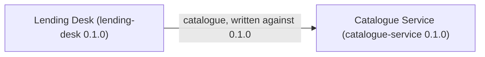

<!-- Generated by specarch document techspec from ../specarch-estate.yaml, version 0.1.0; estate format 0.1. Do not edit this file: change the YAML and generate again. -->

# Library Estate: module map

Version 0.1.0 of the estate: 2 modules. Each module is specified on its own; this map lists them, the version the estate holds each at, and what each names in another through its dependencies.

Two modules of a small library, each specified on its own: the
lending desk, which lends the books, and the catalogue service, whose
team keeps the book records the desk reads. The lending desk's
specification is the one in examples/lending-desk; nothing of it is
copied here.

## Modules

| Module | Held at | Specification | What it is |
|---|---|---|---|
| lending-desk | 0.1.0 | [../lending-desk/spec](../../lending-desk/spec/specarch.yaml) | Lending Desk. Lends books to members and takes them back. |
| catalogue-service | 0.1.0 | [catalogue](../catalogue/specarch.yaml) | Catalogue Service. Keeps the book records. |

## References between modules

| Module | Dependency | Specification it names | Written against |
|---|---|---|---|
| lending-desk | catalogue | catalogue-service | 0.1.0 |

