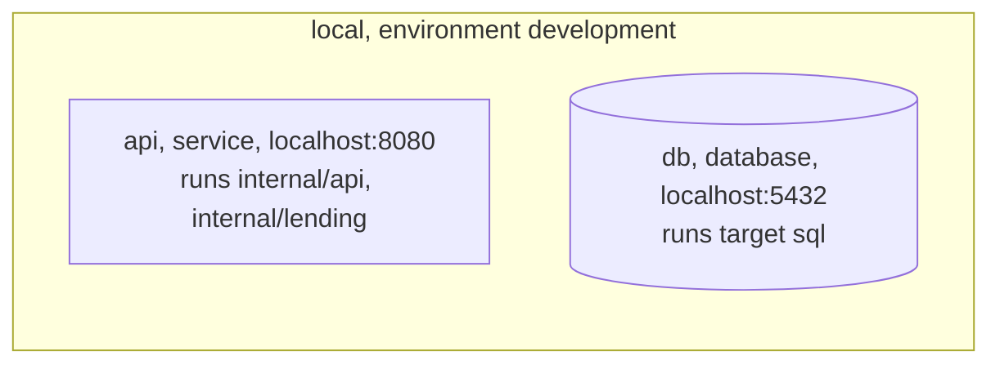
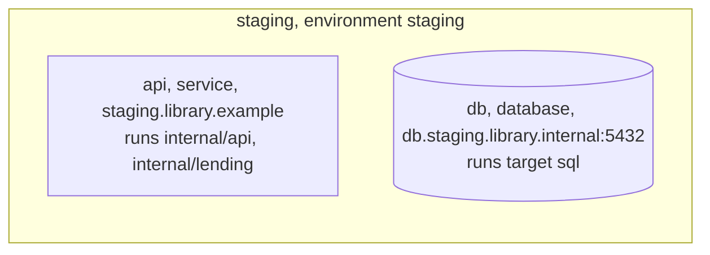
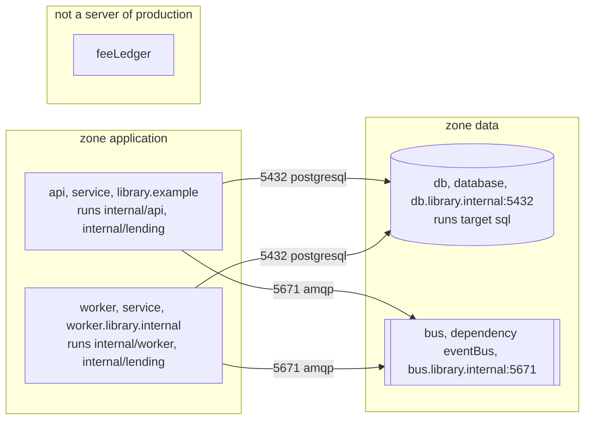

<!-- Generated by specarch document deployment from ../spec/specarch.yaml, version 0.1.0, and ../spec/implementation/go/library-lending.go.specarch-implementation.yaml, version 0.1.0, and ../spec/implementation/swift/library-lending.swift.specarch-implementation.yaml, version 0.1.0, and ../spec/implementation/typescript/library-lending-acme.typescript.specarch-implementation.yaml, version 0.1.0, and ../spec/implementation/typescript/library-lending.typescript.specarch-implementation.yaml, version 0.1.0; meta-model 0.3. Do not edit this file: change the YAML and generate again. -->

# Library Lending: deployment guide

Version 0.1.0 of the specification: 3 environments, 3 settings and 1 migration. Secrets are named here with where their value comes from, never with a value.

## 1. Environments

A release goes to development, then staging, then production.

| Environment | Purpose | Run by | Promotes to |
|---|---|---|---|
| development | A developer's machine, with a throwaway database. | vendor | staging |
| staging | A copy of production the librarians try a release on before it goes live. | vendor | production |
| production | The live system at the desk, on the library's own hosts. | customer |   |

**Insight on production:** The library's board keeps member data on hosts it controls, so its IT staff build each release from the source and run production themselves; the vendor runs development and staging.

The customer builds, installs and runs production from the source; what the customer receives is in the handover document.

## 2. Configuration

| Setting | Type | Secret | Description |
|---|---|---|---|
| dailyRate | decimal(10, 2) |   | The late fee per day, set by the board; read by the lateFee algorithm. |
| databaseUrl | string | yes | Where the database is; it carries the password, so it comes from the host's secret store and is never written here. |
| notificationChannelUrl | string |   | Where the notification service listens for loan events. |

## 3. Installations: Library Lending in Go and PostgreSQL

### local

A developer's machine. Environment: development.

| Server | Description |
|---|---|
| http://localhost:8080 | The API. |
| postgresql://localhost:5432 | A PostgreSQL 16 container the developer starts. |

The deployment declares no links between its servers, so the diagram draws none.

| Setting | Value |
|---|---|
| dailyRate | 0.50 |
| databaseUrl | a secret; its description says where the value comes from |
| notificationChannelUrl | http://localhost:8081/events |

### staging

The staging host the librarians try a release on. Environment: staging.

| Server | Description |
|---|---|
| https://staging.library.example | The API behind the staging screens. |
| postgresql://db.staging.library.internal:5432 | The staging loans database. |

The deployment declares no links between its servers, so the diagram draws none.

| Setting | Value |
|---|---|
| dailyRate | 0.50 |
| databaseUrl | a secret; its description says where the value comes from |
| notificationChannelUrl | https://notify-staging.library.example/events |

### production

The library's own hosts, which its IT staff build for and run. Environment: production. Run by the customer, who builds and installs it from the source; the handover document says what they receive.

| Server | Description |
|---|---|
| https://library.example | The API behind the desk screens. |
| http://worker.library.internal | The host that runs the nightly jobs. |
| postgresql://db.library.internal:5432 | The loans database. |
| amqps://bus.library.internal:5671 | The library's broker in this environment. |

The servers by zone, with the links allowed between them on their ports; a dependency no server of the deployment is stands apart, not reached.

The image is built from the tagged commit with the build task, on any machine with the pinned toolchain; the binary is built with -trimpath and the module cache verified against go.sum, so the image's layers do not depend on the machine.

Build command: `podman build --platform linux/amd64 -f Containerfile -t library-lending-api .` (the task build).

#### Base images

Every image the build starts from, pinned by its digest; a build from another digest is a different build.

| Image | Digest | Purpose |
|---|---|---|
| docker.io/library/golang:1.26-bookworm | sha256:7d0d0ab5bcb7b2e4b9c9c0f6a1b5a4e2d3c4b5a6978879a0b1c2d3e4f5a6b7c8 | Builds the binary. |
| gcr.io/distroless/static-debian12:nonroot | sha256:3f6a5d4c3b2a19087f6e5d4c3b2a1908f7e6d5c4b3a291807f6e5d4c3b2a1908 | Runs the binary, with no shell and no package manager. |

#### Comparing a build with the vendor's

The build is bit-for-bit reproducible, so the digest of the library's image equals the digest in the release notes when the same tag, toolchain and base images are used; a different digest means a different input, and the library compares the two software bills of materials to find it.

#### Software bill of materials

The software bill of materials of the build, and its scan for known vulnerabilities, are written by `syft dir:. -o syft-json=sbom.json && grype sbom:sbom.json` (the task sbom); the customer runs it on their build and compares the result with the vendor's.

Installed with podman-compose 1.4, from ../../../deploy/compose. The compose file runs the API image by digest beside a PostgreSQL 16 container; the image digest and the settings are the only lines that change between releases.

| Resource | What the hosts must provide |
|---|---|
| Processor | Two cores for the API host; four for the database host. |
| Memory | One gigabyte for the API host; four gigabytes for the database host. |
| Storage | Twenty gigabytes for the database at the start, growing by about one gigabyte a year, and ninety nights of dumps in the backup store. |
| Network | The desk's screens reach the API host over HTTPS; the API host reaches the database host and the notification service; nothing reaches the database host but the API host and the backup job. |
| Ports | The API host listens on 8080 behind the library's HTTPS proxy; the database host on 5432. |
| Services | PostgreSQL 16 and the library's notification service, which notificationChannelUrl names. |

| Setting | Value |
|---|---|
| dailyRate | 0.50 |
| databaseUrl | a secret; its description says where the value comes from |
| notificationChannelUrl | https://notify.library.example/events |

| Monitor | Tool | How | Alert |
|---|---|---|---|
| catalogue-latency | Prometheus | The service's request histogram for listBooks. | the desk's on-call channel |
| overdue-notices-sent | Prometheus | The count of loans marked overdue against the count of LoanOverdue messages published, per night. | the desk's on-call channel |

## 4. Release

A release goes to staging first, where a librarian tries the desk tasks, then to production outside opening hours.

| Step | Action | Check |
|---|---|---|
| 1. Build and test | Build the service from the tagged commit and run every suite. | The build and every suite pass. |
| 2. Apply migrations on staging | Apply the new migrations to the staging database. | Every migration applied, and the schema gate against the entities passes. |
| 3. Install on staging | Install the build on staging and run the commissioning checks there. | Every check passed. |
| 4. Install on production | Outside opening hours, apply the migrations to production and install the build. | The smoke check passes on production before the desk opens. |

## 5. Rollback

The previous build is kept installed beside the new one, so a rollback is a switch, and migrations are written to be reversible.

| Step | Action | Check |
|---|---|---|
| 1. Switch back | Point the service at the previous build and restart it. | The smoke check passes and the version shown is the previous one. |
| 2. Reverse the migrations | Run the rollback steps of every migration the release carried, newest first. | The schema gate against the previous entities passes. |

## 6. Backup

The database is the only state; a nightly dump of it, kept for ninety days, is the backup.

| Step | Action | Check |
|---|---|---|
| 1. Dump the database | Every night after closing, dump the whole database to the backup store with the date in the file name. | The dump of the night is in the store and restores on a scratch server without error. |
| 2. Keep ninety days | Remove dumps older than ninety days. | The store holds ninety dumps, the newest from last night. |

## 7. Restore

A restore puts one night's dump back in place of the live database; the loans since that night are re-entered from the desk's paper slips.

| Step | Action | Check |
|---|---|---|
| 1. Stop the service | Stop the service so that nothing writes while the database is replaced. | The desk screens show the service as down. |
| 2. Load the dump | Drop the live database and load the chosen night's dump into a new one of the same name. | The member and loan counts match the night's counts in the backup log. |
| 3. Start and check | Start the service and run the smoke check. | The catalogue answers and the loans list shows the restored loans. |

## 8. Handover

Each release is handed to the library's IT staff as source: they build
it, apply its migrations and install it on the library's hosts, and
the vendor never reaches production. The vendor runs development and
staging, where a librarian tries each release first.

Received by library-it: The library's IT staff, who build each release from the source and run production on the library's hosts.

The source: A tagged release of the repository, which the library imports into a repository of its own; the release notes name the tag and the commit it was built from.

The customer is responsible for:

- Building each release from the tag and comparing the build with the vendor's.
- The hosts, their operating system and patching, the PostgreSQL server and the network.
- Applying the migrations and installing the build, with the commissioning checks after each install.
- Backups, restore drills, monitoring and the on-call rota.

The vendor stays responsible for:

- The source of each release, tagged, with its software bill of materials and vulnerability scan.
- A fix for every defect the library reports, in the next release.
- Staging, where each release is tried before it is handed over.

**Insight:** The library's auditors ask who can reach member data; a production the vendor never touches is the shortest answer.

## 9. Monitors

What is watched on the live system, and the objective each must meet.

| Monitor | Environment | Measures | Objective | Verifies |
|---|---|---|---|---|
| catalogue-latency | production | How long listBooks takes to answer at the desk. | Nine calls in ten answer within 200 milliseconds over each opening day. | LIB-7 |
| overdue-notices-sent | production | Whether the nightly job published LoanOverdue for every loan that became overdue. | Every loan marked overdue in a night has its LoanOverdue message published the same night. | LIB-4 |

**Insight on catalogue-latency:** A slow catalogue is the first thing a librarian notices, and the commissioning check measured it only once.

## 10. Migrations

### add-membership-tier

Every member gets a tier; existing members are standard.

| Step | Action | Check |
|---|---|---|
| 1. Add the column | Add the tier column to members, allowing null. | The column exists. |
| 2. Fill it | Set tier to standard for every member whose tier is null. | No member has a null tier; the count equals the member count. |
| 3. Make it required | Make the tier column not null. | The schema gate against Member passes. |

Reversed by:

| Step | Action | Check |
|---|---|---|
| 1. Drop the column | Drop the tier column from members. | The schema gate against the previous Member passes. |

