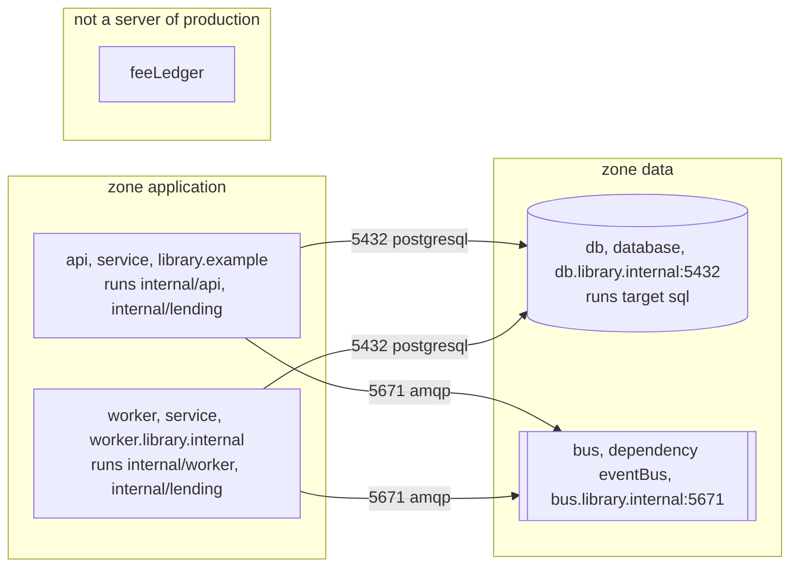

<!-- Generated by specarch document handover from ../spec/specarch.yaml, version 0.1.0, and ../spec/implementation/go/library-lending.go.specarch-implementation.yaml, version 0.1.0, and ../spec/implementation/swift/library-lending.swift.specarch-implementation.yaml, version 0.1.0, and ../spec/implementation/typescript/library-lending-acme.typescript.specarch-implementation.yaml, version 0.1.0, and ../spec/implementation/typescript/library-lending.typescript.specarch-implementation.yaml, version 0.1.0; meta-model 1.0.0. Do not edit this file: change the YAML and generate again. -->

# Library Lending: handover

Version 0.1.0 of Library Lending. The customer builds, installs and runs production from the source. This document says what the customer receives, what stays whose responsibility, how a release is built and installed, what the hosts must provide, and how the installed system is checked and accepted. It is written for the customer's engineers and needs nothing else to be read.

Each release is handed to the library's IT staff as source: they build
it, apply its migrations and install it on the library's hosts, and
the vendor never reaches production. The vendor runs development and
staging, where a librarian tries each release first.

**Insight:** The library's auditors ask who can reach member data; a production the vendor never touches is the shortest answer.

## 1. What the customer receives

The handover goes to library-it: The library's IT staff, who build each release from the source and run production on the library's hosts. It holds:

- The source of each release: A tagged release of the repository, which the library imports into a repository of its own; the release notes name the tag and the commit it was built from.
- How a release is built, with the exact toolchain, the base images and how a build is compared with the vendor's (Building a release).
- The software bill of materials of each release and its vulnerability scan (Building a release).
- Every dependency with its version and licence (Building a release).
- What the hosts must provide (What the hosts must provide).
- Every setting with its type, and where a secret's value comes from (Configuration).
- The data migrations, in the order they are applied (Data migrations).
- How a release is installed and rolled back (Installing a release, Rolling back).
- How the data is backed up and restored (Backing up, Restoring).
- What is watched on the live system (Monitoring).
- The checks to run after installing, and the acceptance tests (Checks after installing, Acceptance tests).
- The sign-off sheet (Sign-off sheet).

## 2. Responsibilities

The customer is responsible for:

- Building each release from the tag and comparing the build with the vendor's.
- The hosts, their operating system and patching, the PostgreSQL server and the network.
- Applying the migrations and installing the build, with the commissioning checks after each install.
- Backups, restore drills, monitoring and the on-call rota.

The vendor stays responsible for:

- The source of each release, tagged, with its software bill of materials and vulnerability scan.
- A fix for every defect the library reports, in the next release.
- Staging, where each release is tried before it is handed over.

## 3. Building a release: Library Lending in Go and PostgreSQL

Built with Go 1.26, the toolchain go 1.26.0. The versions are exact: a build with another version is a different build.

### Build

The image is built from the tagged commit with the build task, on any machine with the pinned toolchain; the binary is built with -trimpath and the module cache verified against go.sum, so the image's layers do not depend on the machine.

Build command: `podman build --platform linux/amd64 -f Containerfile -t library-lending-api .` (the task build).

### Base images

Every image the build starts from, pinned by its digest; a build from another digest is a different build.

| Image | Digest | Purpose |
|---|---|---|
| docker.io/library/golang:1.26-bookworm | sha256:7d0d0ab5bcb7b2e4b9c9c0f6a1b5a4e2d3c4b5a6978879a0b1c2d3e4f5a6b7c8 | Builds the binary. |
| gcr.io/distroless/static-debian12:nonroot | sha256:3f6a5d4c3b2a19087f6e5d4c3b2a1908f7e6d5c4b3a291807f6e5d4c3b2a1908 | Runs the binary, with no shell and no package manager. |

### Comparing a build with the vendor's

The build is bit-for-bit reproducible, so the digest of the library's image equals the digest in the release notes when the same tag, toolchain and base images are used; a different digest means a different input, and the library compares the two software bills of materials to find it.

### Software bill of materials

The software bill of materials of the build, and its scan for known vulnerabilities, are written by `syft dir:. -o syft-json=sbom.json && grype sbom:sbom.json` (the task sbom); the customer runs it on their build and compares the result with the vendor's.

### Dependencies and their licences

| Library | Version | Licence | Purpose |
|---|---|---|---|
| github.com/oapi-codegen/oapi-codegen/v2 | v2.8.0 | Apache-2.0 | Turns the generated OpenAPI document into a strict server interface and request and response types. (tool) |
| github.com/oapi-codegen/runtime | v1.7.0 | Apache-2.0 | Runtime helpers the generated server code calls. |
| github.com/go-chi/chi/v5 | v5.3.2 | MIT | HTTP router. |
| github.com/jackc/pgx/v5 | v5.11.0 | MIT | PostgreSQL driver. |

## 4. What the hosts must provide

### Library Lending in Go and PostgreSQL: production

The library's own hosts, which its IT staff build for and run. Environment: production.

The allowed connections, and no others: api reaches db on port 5432 over postgresql. api reaches bus on port 5671 over amqp. The loan events. worker reaches db on port 5432 over postgresql. worker reaches bus on port 5671 over amqp. LoanOverdue for each loan the job marks.

Ports listened on: api on 8080 (http); db on 5432 (postgresql); bus on 5671 (amqp).

| Resource | What the hosts must provide |
|---|---|
| Processor | Two cores for the API host; four for the database host. |
| Memory | One gigabyte for the API host; four gigabytes for the database host. |
| Storage | Twenty gigabytes for the database at the start, growing by about one gigabyte a year, and ninety nights of dumps in the backup store. |
| Network | The desk's screens reach the API host over HTTPS; the API host reaches the database host and the notification service; nothing reaches the database host but the API host and the backup job. |
| Ports | The API host listens on 8080 behind the library's HTTPS proxy; the database host on 5432. |
| Services | PostgreSQL 16 and the library's notification service, which notificationChannelUrl names. |

| Server | Description |
|---|---|
| https://library.example | The API behind the desk screens. |
| http://worker.library.internal | The host that runs the nightly jobs. |
| postgresql://db.library.internal:5432 | The loans database. |
| amqps://bus.library.internal:5671 | The library's broker in this environment. |

## 5. Configuration

Every setting the system reads at run time. A secret's value is never written here or in any document; its description says where the value comes from.

| Setting | Type | Secret | Description |
|---|---|---|---|
| dailyRate | decimal(10, 2) |   | The late fee per day, set by the board; read by the lateFee algorithm. |
| databaseUrl | string | yes | Where the database is; it carries the password, so it comes from the host's secret store and is never written here. |
| feeLedgerToken | string | yes | The token the finance team issued for the fee ledger; it comes from the host's secret store and is never written here. |
| notificationChannelUrl | string |   | Where the notification service listens for loan events. |

Values the vendor gives for production (Library Lending in Go and PostgreSQL):

| Setting | Value |
|---|---|
| dailyRate | 0.50 |
| notificationChannelUrl | https://notify.library.example/events |

## 6. Data migrations

Applied in this order, each before the release that carries it is installed.

### add-membership-tier

Every member gets a tier; existing members are standard.

| Step | Action | Check |
|---|---|---|
| 1. Add the column | Add the tier column to members, allowing null. | The column exists. |
| 2. Fill it | Set tier to standard for every member whose tier is null. | No member has a null tier; the count equals the member count. |
| 3. Make it required | Make the tier column not null. | The schema gate against Member passes. |

Reversed by:

| Step | Action | Check |
|---|---|---|
| 1. Drop the column | Drop the tier column from members. | The schema gate against the previous Member passes. |

## 7. Installing a release

A release goes to staging first, where a librarian tries the desk tasks, then to production outside opening hours.

| Step | Action | Check |
|---|---|---|
| 1. Build and test | Build the service from the tagged commit and run every suite. | The build and every suite pass. |
| 2. Apply migrations on staging | Apply the new migrations to the staging database. | Every migration applied, and the schema gate against the entities passes. |
| 3. Install on staging | Install the build on staging and run the commissioning checks there. | Every check passed. |
| 4. Install on production | Outside opening hours, apply the migrations to production and install the build. | The smoke check passes on production before the desk opens. |

How the vendor installs production (Library Lending in Go and PostgreSQL):

Installed with podman-compose 1.4, from ../../../deploy/compose. The compose file runs the API image by digest beside a PostgreSQL 16 container; the image digest and the settings are the only lines that change between releases.

## 8. Rolling back

The previous build is kept installed beside the new one, so a rollback is a switch, and migrations are written to be reversible.

| Step | Action | Check |
|---|---|---|
| 1. Switch back | Point the service at the previous build and restart it. | The smoke check passes and the version shown is the previous one. |
| 2. Reverse the migrations | Run the rollback steps of every migration the release carried, newest first. | The schema gate against the previous entities passes. |

## 9. Backing up

The database is the only state; a nightly dump of it, kept for ninety days, is the backup.

| Step | Action | Check |
|---|---|---|
| 1. Dump the database | Every night after closing, dump the whole database to the backup store with the date in the file name. | The dump of the night is in the store and restores on a scratch server without error. |
| 2. Keep ninety days | Remove dumps older than ninety days. | The store holds ninety dumps, the newest from last night. |

## 10. Restoring

A restore puts one night's dump back in place of the live database; the loans since that night are re-entered from the desk's paper slips.

| Step | Action | Check |
|---|---|---|
| 1. Stop the service | Stop the service so that nothing writes while the database is replaced. | The desk screens show the service as down. |
| 2. Load the dump | Drop the live database and load the chosen night's dump into a new one of the same name. | The member and loan counts match the night's counts in the backup log. |
| 3. Start and check | Start the service and run the smoke check. | The catalogue answers and the loans list shows the restored loans. |

## 11. Monitoring

What is watched on the live system, and the objective each must meet.

| Monitor | Environment | Measures | Objective | Verifies |
|---|---|---|---|---|
| catalogue-latency | production | How long listBooks takes to answer at the desk. | Nine calls in ten answer within 200 milliseconds over each opening day. | LIB-7 |
| overdue-notices-sent | production | Whether the nightly job published LoanOverdue for every loan that became overdue. | Every loan marked overdue in a night has its LoanOverdue message published the same night. | LIB-4 |

**Insight on catalogue-latency:** A slow catalogue is the first thing a librarian notices, and the commissioning check measured it only once.

How the vendor watches them in production (Library Lending in Go and PostgreSQL):

| Monitor | Tool | How | Alert |
|---|---|---|---|
| catalogue-latency | Prometheus | The service's request histogram for listBooks. | the desk's on-call channel |
| overdue-notices-sent | Prometheus | The count of loans marked overdue against the count of LoanOverdue messages published, per night. | the desk's on-call channel |

## 12. Checks after installing

Run on the installed system before it is accepted. Fill in the Result column as each step is run, and keep the filled-in run.

### service-answers (smoke, in production)

The installed service starts and answers the catalogue.

Verifies LIB-2.

| Step | Action | Expected | Result |
|---|---|---|---|
| 1. Open the catalogue | Call listBooks on the installed service without a card. | It answers 200 with the catalogue. |   |

### migrated-members (data, in production)

Every member migrated from the card index is present and has a tier.

Verifies LIB-1.

| Step | Action | Expected | Result |
|---|---|---|---|
| 1. Count | Compare the member count with the card index count. | The counts are equal and no member has a null tier. |   |

## 13. Acceptance tests

What the installed system must do for the people who use it, each as a scenario to run by hand or through the implementation's acceptance suite. A golden scenario succeeds; a red one is refused.

### fee-waiver

Scenario: golden; verifies LIB-8.

- Given: a librarian, a desk supervisor, and a loan with a late fee of 3.50
- When: the librarian asks for the fee to be waived and the desk supervisor approves the request
- Then: requestFeeWaiver answers 202, waiveFee is called once, the late fee is 0.00, and the request ends approved

### fee-waiver-approval-without-permission

Scenario: red; verifies LIB-8.

- Given: a request to waive a fee, and a second librarian, who does not hold fees.approve
- When: the second librarian approves it
- Then: it is refused as not allowed, and the request still waits for a desk supervisor

### fee-waiver-deadline-passes

Scenario: red; verifies LIB-8.

- Given: a request to waive a fee, waiting for a desk supervisor
- When: three days pass with no answer
- Then: the request ends refused, waiveFee is not called, and the fee still stands

**Origin:** inferred.

**Insight:** Drafted by specarch derive, since a deadline passing is a case nobody tries by hand, then completed by hand; a request must not wait for ever.

### fee-waiver-large-fee

Scenario: red; verifies LIB-8.

- Given: a request to waive a late fee of 2.50
- When: the request is made
- Then: the request waits for a desk supervisor at approve, and waiveFee is not called yet

**Origin:** inferred.

**Insight:** Drafted by specarch derive for the decision's otherwise, then completed by hand with an amount just over the limit.

### fee-waiver-refused

Scenario: red; verifies LIB-8.

- Given: a request to waive a fee of 3.50, waiting for a desk supervisor
- When: the desk supervisor refuses it
- Then: the request ends refused, waiveFee is not called, and the fee still stands

### fee-waiver-requester-approves-own-request

Scenario: red; verifies LIB-8.

- Given: a desk supervisor who also works the desk and holds fees.request, and a request to waive a fee they asked for themselves
- When: they approve their own request
- Then: it is refused, the request still waits for another desk supervisor, and waiveFee is not called

**Origin:** inferred.

**Insight:** Drafted by specarch derive, since the four-eyes rule holds on every approval, then completed by hand; it is the one case the workflow exists for.

### fee-waiver-small-fee

Scenario: red; verifies LIB-8.

- Given: a request to waive a late fee of 1.50
- When: the request is made
- Then: waiveFee is called at once, no desk supervisor is asked, and the request ends approved

**Origin:** inferred.

**Insight:** Drafted by specarch derive for the decision's first branch, then completed by hand with an amount under the limit.

### fee-waiver-waive-fails

Scenario: red; verifies LIB-8.

- Given: an approved request to waive a fee, while the loans database refuses every write
- When: waiveFee fails, and on each of its three retries
- Then: the request ends failed, and the fee still stands

**Origin:** inferred.

**Insight:** Drafted by specarch derive, since a failure of a called operation is a case nobody tries by hand, then completed by hand.

### fees-block-lending

Scenario: golden; verifies LIB-3.

- Given: a member who owes a late fee
- When: the librarian lends them a copy
- Then: A member with outstanding fees is refused a loan with 409.

### lend-a-copy-at-the-desk

Scenario: golden; verifies LIB-7.

- Given: a librarian at the desk, and a member with no loans and no fees
- When: the librarian selects the member in the members list, chooses Lend a book on their record, and submits the loan form for an available copy
- Then: the member's record opens again with the new loan and the message that the copy is lent

**Origin:** inferred.

**Insight:** Drafted from the flow's success path and completed by hand; the desk task of LIB-7 is this flow.

### lend-a-copy-limit-reached

Scenario: red; verifies LIB-7.

- Given: a librarian at the desk, and a member who has reached the loan limit of their tier
- When: the librarian goes through the flow and submits the loan form
- Then: the form stays open and says the loan is refused, and no loan is recorded

**Origin:** inferred.

**Insight:** The flow's last step calls createLoan, whose refusal lending-refused is the failure a librarian meets most at the desk.

### lending-limit-accepted

Scenario: golden; verifies LIB-3.

- Given: a standard-tier member with three open loans
- When: the librarian lends them a fourth copy
- Then: A standard-tier member with three open loans is refused a fourth with 409.

## 14. Sign-off sheet

| Run | Entry |
|---|---|
| Specification version | 0.1.0 |
| Build |   |
| Environment |   |
| Date |   |

The system is accepted when every criterion is met:

| Criterion | Met |
|---|---|
| Every check passed on staging and the smoke and data checks passed on production. |   |
| A librarian has done each desk task once on production. |   |
| The record of the run is filed under records/commissioning/. |   |

| Role | Description | Name | Signature | Date |
|---|---|---|---|---|
| head-librarian | Accepts for the desk. |   |   |   |
| library-board | Accepts for the board. |   |   |   |

