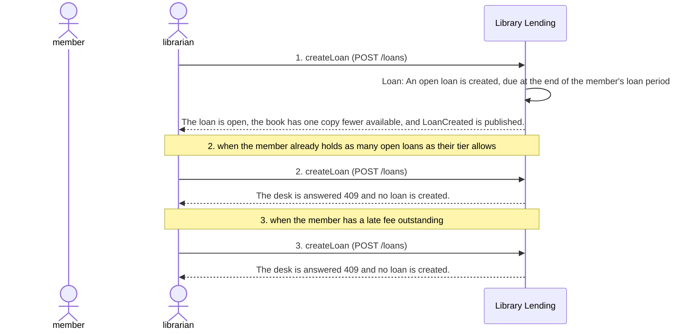
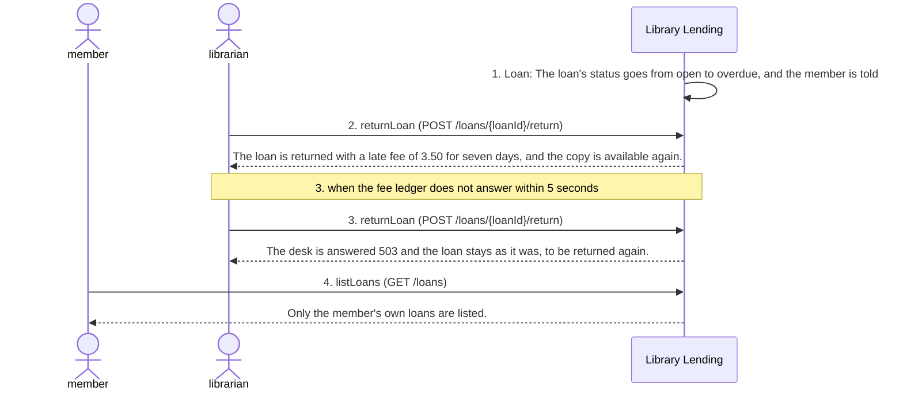

<!-- Generated by specarch document requirements from ../spec/specarch.yaml, version 0.1.0, and ../spec/implementation/go/library-lending.go.specarch-implementation.yaml, version 0.1.0, and ../spec/implementation/javascript/library-lending.javascript.specarch-implementation.yaml, version 0.1.0, and ../spec/implementation/swift/library-lending.swift.specarch-implementation.yaml, version 0.1.0, and ../spec/implementation/typescript/library-lending-acme.typescript.specarch-implementation.yaml, version 0.1.0, and ../spec/implementation/typescript/library-lending.typescript.specarch-implementation.yaml, version 0.1.0; meta-model 1.0.0. Do not edit this file: change the YAML and generate again. -->

# Library Lending: requirements specification

Version 0.1.0 of the specification: 4 stakeholders, 4 needs and 8 requirements. The order follows the requirements specification of ISO/IEC/IEEE 29148: who has a stake, what they need, then each requirement with its attributes.

**Problems:** 4 warnings concern this document; each is marked by a Problem paragraph at its element, or below when the document shows no element for it. The problems file lists every problem, and specarch validate prints them.

**Problem:** warning: problem_missing: the specification has requirements and no problem, so nothing says what the system is for, and no goal or requirement can be judged against it; add problem with statement, the problem the system solves in plain words, and, when they are known, the stakeholders it hurts, how things stand today and why [problem_missing@requirements/requirements/lending.yaml#/requirements]

## 1. Purpose and scope

A small public library lends books to its members. Members borrow a copy,
keep it for a fixed loan period, and pay a late fee when they return it
after the due date. This example exists to exercise every concept of the
meta-model in one place, across every stage of the life cycle; it is not
a real library's system.

Owners: example-maintainers.

## 2. Stakeholders

| Stakeholder | Who they are | Concerns |
|---|---|---|
| librarian | Staff at the desk who register members, lend copies and take returns. | Every desk task fits in one screen and takes under a minute; A fee is never wrong by a cent |
| member | A card holder who borrows books. | Only their own loans and fees are shown to them; They are told when a loan is overdue |
| library-board | The board that sets the lending policy and answers to the regulator. | The policy sheet and the system agree; Member data is kept as the rules allow and no longer |
| library-it | The library's IT staff, who build each release from the source and run production on the library's hosts. | A release can be built from the source alone, and the build compared with the vendor's; Every setting, port and host the system needs is written down before a release is installed |

## 3. Needs

What the stakeholders said they need, before it was shaped into requirements, and the requirements that refine each need.

| Need | Statement | Stakeholders | Status | Refined by |
|---|---|---|---|---|
| NEED-1 | We need to know who has which copy and when it is due, without a card index. | librarian | accepted | LIB-1, LIB-3, LIB-7 |
| NEED-2 | We need late fees to be charged the same way for every member, as the policy says. | librarian, library-board | accepted | LIB-5, LIB-8 |
| NEED-3 | Members need to browse the catalogue without logging in, and to see only their own records when they do. | member, library-board | accepted | LIB-2, LIB-6 |
| NEED-4 | Members need to be told when a loan becomes overdue. | member | accepted | LIB-4 |

**Note on NEED-1:** From Interview with the desk staff about lending and returns: The card index is searched by hand when a member asks what they have out, and it is often out of date.

**Note on NEED-2:** From Lending policy of the library, 2026, clause 4: A late return is charged a flat daily rate, capped at the book's replacement cost.

**Note on NEED-3:** From The data-protection rules the library is bound by, 2024: Personal data is shown only to the person it is about and to the staff who need it.

## 4. Requirements

| Requirement | Kind | Priority | Status | Statement |
|---|---|---|---|---|
| LIB-1 | functional | must | accepted | A member shall be identified by a unique card number and a unique email address. |
| LIB-2 | functional | must | accepted | Anyone shall be able to browse the catalogue without a card. |
| LIB-3 | functional | must | accepted | A member shall hold at most the number of open loans their tier allows, and shall not borrow while fees are outstanding. |
| LIB-4 | functional | must | accepted | A loan not returned by its due date shall become overdue the next day, and the member shall be told. |
| LIB-5 | functional | must | accepted | A late return shall be charged a flat daily rate, capped at the book's replacement cost. |
| LIB-6 | quality | must | accepted | A member shall see only their own loans and fees. |
| LIB-7 | quality | should | accepted | A desk task shall take a librarian under a minute, in one screen. |
| LIB-8 | functional | must | accepted | A late fee above the desk's limit shall be waived only after a second person, not the one who asked, approves it. |

### LIB-1

A member shall be identified by a unique card number and a unique email address.

Kind: functional; priority: must; status: accepted; verified by test; refines NEED-1.

Acceptance criteria:

- Registering a member with an email address already registered is refused with 409.
- Two members never share a card number.

**Problem:** warning: scenario_uncovered: requirement LIB-1 has priority must and no step of any scenario names it, so no case shows it in sequence with the operations it runs through; add LIB-1 to the requirements of the scenario step that exercises it, or write a scenario for it [scenario_uncovered@requirements/requirements/lending.yaml#/requirements/LIB-1]

**Note:** From Lending policy of the library, 2026, clause 1: Each member holds one card, and the card number identifies them at the desk.

### LIB-2

Anyone shall be able to browse the catalogue without a card.

Kind: functional; priority: must; status: accepted; verified by test; refines NEED-3.

Acceptance criteria:

- A visitor with no account lists books by title or author and gets the matching books.

**Problem:** warning: scenario_uncovered: requirement LIB-2 has priority must and no step of any scenario names it, so no case shows it in sequence with the operations it runs through; add LIB-2 to the requirements of the scenario step that exercises it, or write a scenario for it [scenario_uncovered@requirements/requirements/lending.yaml#/requirements/LIB-2]

### LIB-3

A member shall hold at most the number of open loans their tier allows, and shall not borrow while fees are outstanding.

Kind: functional; priority: must; status: accepted; verified by test; refines NEED-1; harm if not met: money.

Acceptance criteria:

- A standard-tier member with three open loans is refused a fourth with 409.
- A member with outstanding fees is refused a loan with 409.

**Note:** From Lending policy of the library, 2026, clause 2: Standard members may hold three loans at a time and extended members six; no loan is made while a fee is unpaid.

### LIB-4

A loan not returned by its due date shall become overdue the next day, and the member shall be told.

Kind: functional; priority: must; status: accepted; verified by test; refines NEED-4.

Acceptance criteria:

- The nightly job marks a loan due yesterday as overdue and publishes LoanOverdue.

**Open change request CR-1:** Let a member renew a loan once. Raised in production by member on 2026-10-09; approved; cause omitted.

### LIB-5

A late return shall be charged a flat daily rate, capped at the book's replacement cost.

Kind: functional; priority: must; status: accepted; verified by test; refines NEED-2.

Acceptance criteria:

- Seven days late at 0.50 a day on a 25.00 book charges 3.50.
- Ninety days late at 0.50 a day on a 25.00 book charges 25.00.

**Insight:** A flat rate can be checked by hand at the desk; the cap means a long-overdue book costs the same as a lost one, which is when the member should be told to treat it as lost.

**Note:** From Lending policy of the library, 2026, clause 4: The late fee is a daily rate set by the board, and never more than the cost of replacing the book.

### LIB-6

A member shall see only their own loans and fees.

Kind: quality; priority: must; status: accepted; verified by test; refines NEED-3.

Acceptance criteria:

- A member listing loans gets only loans whose memberId is their own.

**Note:** From The data-protection rules the library is bound by, 2024: Personal data is shown only to the person it is about and to the staff who need it.

### LIB-7

A desk task shall take a librarian under a minute, in one screen.

Kind: quality; priority: should; status: accepted; verified by demonstration; refines NEED-1.

Acceptance criteria:

- Registering a member and lending a book each take one form and one submit.

### LIB-8

A late fee above the desk's limit shall be waived only after a second person, not the one who asked, approves it.

Kind: functional; priority: must; status: accepted; verified by test; refines NEED-2.

Acceptance criteria:

- A waiver a librarian asks for is approved by a desk supervisor before the fee is waived.
- A waiver nobody answers within three days is refused.

**Problem:** warning: scenario_uncovered: requirement LIB-8 has priority must and no step of any scenario names it, so no case shows it in sequence with the operations it runs through; add LIB-8 to the requirements of the scenario step that exercises it, or write a scenario for it [scenario_uncovered@requirements/requirements/lending.yaml#/requirements/LIB-8]

**Insight:** A fee waived by the person who asked for it is money the library loses with nobody having looked; a second person is the control the board asks for.

## 5. Scenarios

Cases told as a sequence across the operations, requirements, entity changes and tests the design defines, grouped by topic (ADR-251); a step with a condition is an alternative or failure branch of the steps before it.

### Lending

#### SC-2: A librarian lends a copy to a member at the desk

A member asks for a book at the desk; the loan is opened unless the member is at their limit or owes a fee.

For member; 3 steps, 2 branches.

| Step | Actor | Before | What happens | Exercises | Result |
|---|---|---|---|---|---|
| 1 | librarian | The member holds fewer open loans than their tier allows and owes no fee. | The librarian lends the member a copy of the book. | operation createLoan; requirements LIB-3; entity Loan: An open loan is created, due at the end of the member's loan period; tests lend-a-copy | The loan is open, the book has one copy fewer available, and LoanCreated is published. |
| 2, when the member already holds as many open loans as their tier allows | librarian |   | The loan is refused because the member is at their limit. | operation createLoan; requirements LIB-3; tests lend-limit-reached | The desk is answered 409 and no loan is created. |
| 3, when the member has a late fee outstanding | librarian |   | The loan is refused because the member owes a fee. | operation createLoan; tests fees-block-lending | The desk is answered 409 and no loan is created. |

Proved by lend-a-copy, lend-limit-reached.

### Returns

#### SC-1: A member returns a book late and the late fee is charged

A member brings a book back a week after its due date; the desk records the return and the late fee, and the member sees the fee among their own loans.

For member; 4 steps, 1 branch.

| Step | Actor | Before | What happens | Exercises | Result |
|---|---|---|---|---|---|
| 1 | member | The loan is open and its due date was yesterday. | The member keeps the book past its due date, and the next night the loan is marked overdue. | requirements LIB-4; entity Loan: The loan's status goes from open to overdue, and the member is told; tests loan-becomes-overdue |   |
| 2 | librarian |   | The librarian takes the book back at the desk and records the return. | operation returnLoan; requirements LIB-5; tests return-late | The loan is returned with a late fee of 3.50 for seven days, and the copy is available again. |
| 3, when the fee ledger does not answer within 5 seconds | librarian |   | The fee ledger does not answer, so the return is not recorded and nothing is charged. | operation returnLoan; tests return-loan-dependency-times-out-fee-ledger | The desk is answered 503 and the loan stays as it was, to be returned again. |
| 4 | member |   | The member lists their loans and sees the returned loan with its fee. | operation listLoans; requirements LIB-6; tests list-loans-shows-only-the-rows-of-member | Only the member's own loans are listed. |

Proved by return-late.

## 6. Constraints

| Constraint | Kind | Statement |
|---|---|---|
| CON-1 | legal | Member data is kept only while the membership is open and for one year after, then deleted. |
| CON-2 | technical | Dates are the library's local calendar dates; timestamps are UTC. |

**Note on CON-1:** From The data-protection rules the library is bound by, 2024: Personal data is kept no longer than its purpose needs.

**Insight on CON-2:** A loan due on the 21st is overdue from the start of the 22nd, library time, whatever the server's clock.

## 7. Assumptions

| Assumption | Statement |
|---|---|
| ASSUME-1 | One library, one branch, one currency. |
| ASSUME-2 | The daily rate changes rarely and is a library setting, not a per-book value. |

**Note on ASSUME-2:** From Lending policy of the library, 2026, clause 4: The board sets the daily rate once a year.

## 8. Glossary

| Term | Meaning |
|---|---|
| copy | One physical book. The example counts copies per title and does not identify them. |
| tier | A membership level that sets the loan limit and the loan period. |
| loan period | The number of days a copy may be kept; 21 for the standard tier, 28 for the extended tier. |
| late fee | The amount charged when a copy comes back after its due date. |

## Sources

Every source a Note in this document cites.

| Source | Title | Edition | Author | Where to read it |
|---|---|---|---|---|
| data-protection-rules | The data-protection rules the library is bound by | 2024 | The regulator |   |
| desk-interview | Interview with the desk staff about lending and returns |   |   |   |
| lending-policy | Lending policy of the library | 2026 | The library board |   |

