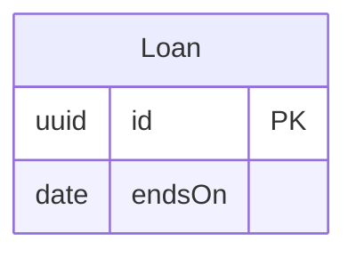

<!-- Generated by specarch document techspec from ../project/specarch.yaml, version 1.0.0, and ../project/desk.go.specarch-implementation.yaml, version 1.0.0; meta-model 0.1. Do not edit this file: change the YAML and generate again. -->

# Lending desk: technical specification

Version 1.0.0 of the specification: 2 requirements and 1 entity. The chapters follow arc42, and a chapter with nothing in the specification is left out.

**Audience:** everyone; 3 internal elements are left out (1 in needs, 1 in requirements, 1 in entities), with the problems and open questions that concern only them.

**Problems:** 1 warning concerns this document; it is marked by a Problem paragraph at its element, or below when the document shows no element for it. The problems file lists every problem, and specarch validate prints them.

**Problem:** warning: meta_model_version: the specification is written against meta-model 0.1, which is read until 1.0, and its missing tests are warnings; run specarch derive to write the tests 0.2 asks for, then change the line to specarch: "0.3" once nothing an expression can name is called caller [meta_model_version@specarch.yaml#/specarch]

## 1. Introduction and goals

Loans of books to members.

### Stakeholders

| Stakeholder | Who they are | Concerns |
|---|---|---|
| librarian | Staff at the desk. |   |
| card-issuer | The team that runs the card service. |   |

## 5. Building blocks

### Loan

**Insight:** A loan is what the desk records when a book leaves it.

| Field | Type | Required | Limits | Description |
|---|---|---|---|---|
| id | uuid | yes |   |   |
| endsOn | date | yes |   |   |

Primary key: id.

## 7. Deployment and implementation

### Implementation: Lending desk in Go

From the implementation file version 1.0.0.

Stack: language Go 1.26.

#### Mappings

| Design object | Implemented by | Notes |
|---|---|---|
| #/entities/Loan | table loans |   |

#### Idioms

How this implementation does each recurring concern: the idioms SpecArch ships apply unless the file excludes or overrides one, and an override replaces only the parts it names (docs/idioms.md).

| Idiom | Version | Applies as | Parts the project replaces |
|---|---|---|---|
| identifiers | 1.1.0 | shipped |   |
| migrations | 1.0.0 | shipped |   |
| type-rendering | 1.4.0 | shipped |   |

#### Implementation decisions

##### ADR-001: Keep the risk band beside the loan

Status: accepted, 2026-10-14.

Context: The risk band is read with the loan on every page that shows it.

Decision: The loans table holds the band.

Consequences: A change to the band rewrites the loan.

**Insight:** One read per page.

## 13. Requirements

### Needs

| Need | Statement | Stakeholders | Status |
|---|---|---|---|
| NEED-1 | Members must borrow books. | librarian | accepted |

### Requirements

| Requirement | Statement | Kind | Priority | Status | Verification | Acceptance | Needs |
|---|---|---|---|---|---|---|---|
| LD-1 | A member shall borrow a book for fourteen days. | functional | must | accepted |   | A loan ends fourteen days after it starts. | NEED-1 |
| LD-3 | A member shall pay a late fee by card. | functional | should | accepted |   | A card payment of a late fee is accepted or declined within five seconds. | NEED-1 |

**Open question Q-2 (could, decision) on LD-1:** Is fourteen days the same for every member? Decided by librarian.

### Traceability

What satisfies and what verifies each requirement. An empty cell is a gap.

| Requirement | Satisfied by | Verified by |
|---|---|---|
| LD-1 | entities Loan; implementation Lending desk in Go decisions ADR-001 |   |

Held elsewhere, fulfilled by another stakeholder's component and so no gap here: LD-3, owned by card-issuer.

