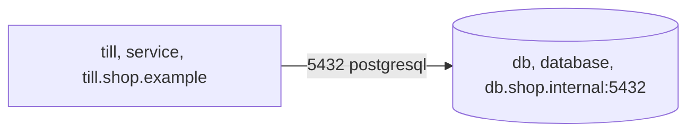

<!-- Generated by specarch document deployment from ../project/specarch.yaml, version 1.0.0, and ../project/shop.go.specarch-implementation.yaml, version 1.0.0; meta-model 0.1. Do not edit this file: change the YAML and generate again. -->

# Shop: deployment guide

Version 1.0.0 of the specification: 2 environments, 3 settings and 1 migration. Secrets are named here with where their value comes from, never with a value.

**Problems:** The specification has 1 error, so it is invalid, and this document shows what could be read of it. 1 error concerns this document; it is marked by a Problem paragraph at its element, or below when the document shows no element for it. The problems file lists every problem, and specarch validate prints them.

## 1. Environments

A release goes to staging, then production.

| Environment | Purpose | Run by | Promotes to |
|---|---|---|---|
| staging | Where a release is tried. | vendor | production |
| production | The till in the shop, on the shop's host. | customer |   |

The customer builds, installs and runs production from the source; what the customer receives is in the handover document.

## 2. Configuration

| Setting | Type | Secret | Description |
|---|---|---|---|
| taxRate | decimal(4, 2) |   | The sales tax rate. |
| databaseUrl | string | yes | Where the database is; it comes from the host's secret store. |
| auditNote | string |   | A note the vendor's own build writes into the audit log. |

**Audience on auditNote:** internal, left out of a document for everyone.

## 3. Installations: Shop in Go

### staging

The staging host. Environment: staging.

| Server | Description |
|---|---|
| https://staging.shop.example | The till's API. |

| Setting | Value |
|---|---|
| taxRate | 0.11 |
| databaseUrl | a secret; its description says where the value comes from |
| auditNote | not set |

### production

The shop's host. Environment: production. Run by the customer, who builds and installs it from the source; the handover document says what they receive.

| Server | Description |
|---|---|
| https://till.shop.example | The till's API behind the shop's proxy. |
| postgresql://db.shop.internal:5432 | The sales ledger. |

The servers by zone, with the links allowed between them on their ports; a dependency no server of the deployment is stands apart, not reached.

The image is built from the tagged commit.

Build command: `podman build -t till .` (the task build).

#### Base images

Every image the build starts from, pinned by its digest; a build from another digest is a different build.

| Image | Digest | Purpose |
|---|---|---|
| docker.io/library/golang:1.26-bookworm | sha256:7d0d0ab5bcb7b2e4b9c9c0f6a1b5a4e2d3c4b5a6978879a0b1c2d3e4f5a6b7c8 | Builds the binary. |

#### Comparing a build with the vendor's

The image digest equals the one in the release notes when the same tag and base image are used.

#### Software bill of materials

The software bill of materials of the build, and its scan for known vulnerabilities, are written by `syft dir:. -o syft-json=sbom.json && grype sbom:sbom.json` (the task sbom); the customer runs it on their build and compares the result with the vendor's.

Installed with podman-compose 1.4, from deploy/compose. The compose file runs the image by digest beside PostgreSQL.

| Setting | Value |
|---|---|
| taxRate | 0.11 |
| databaseUrl | a secret; its description says where the value comes from |
| auditNote | not set |

| Monitor | Tool | How | Alert |
|---|---|---|---|
| till-answers | an uptime checker | Calls the catalogue every minute. | the shop's phone |

**Problem:** error: handover: production is run by the customer, who builds and installs it from this file, and this deployment has no infrastructure saying what the hosts must provide; add infrastructure [handover@shop.go.specarch-implementation.yaml#/deployments/production]

## 4. Release

A release goes to staging first, then to production after closing time.

| Step | Action | Check |
|---|---|---|
| 1. Install on staging | Install the build on staging. | The till opens on staging. |
| 2. Install on production | After closing time, install the build on production. | The till opens in the shop. |

## 5. Rollback

The previous build stays installed beside the new one.

| Step | Action | Check |
|---|---|---|
| 1. Switch back | Start the previous build. | The till opens and shows the previous version. |

## 6. Backup

The sales ledger is dumped every night after closing.

| Step | Action | Check |
|---|---|---|
| 1. Dump the ledger | Dump the database to the backup store. | The dump restores on a scratch host. |

## 7. Restore

A restore loads one night's dump in place of the live ledger.

| Step | Action | Check |
|---|---|---|
| 1. Load the dump | Stop the till, load the chosen dump and start the till. | The till shows the sales up to that night. |

## 8. Handover

Each release is handed to the shop's IT staff as source; the vendor runs staging and never reaches the shop's host.

Received by shop-it: The shop's IT staff, who build each release from the source and run the till on the shop's host.

The source: A tagged release of the repository, which the shop imports into a repository of its own.

The customer is responsible for:

- The host, its patching and the PostgreSQL server.
- Backups and the restore drill each quarter.

The vendor stays responsible for:

- The source of each release, tagged, with its software bill of materials.
- A fix for every defect the shop reports, in the next release.

**Insight:** The shop's accountant asks who can reach the sales ledger.

**Note:** From The shop's operations manual, 3, clause 1.4: The till runs on the shop's own host.

## 9. Monitors

What is watched on the live system, and the objective each must meet.

| Monitor | Environment | Measures | Objective | Verifies |
|---|---|---|---|---|
| till-answers | production | Whether the till answers. | The till answers every minute of opening hours. |   |

## 10. Migrations

### add-tax

Every order gets a tax amount, zero for old orders.

| Step | Action | Check |
|---|---|---|
| 1. Add the column | Add tax to orders with a default of zero. | Every order has a tax amount. |

This migration cannot be reversed.

## Sources

Every source a Note in this document cites.

| Source | Title | Edition | Author | Where to read it |
|---|---|---|---|---|
| ops-manual | The shop's operations manual | 3 |   |   |

