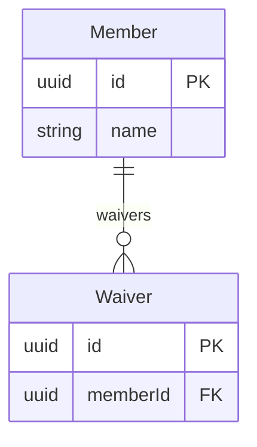
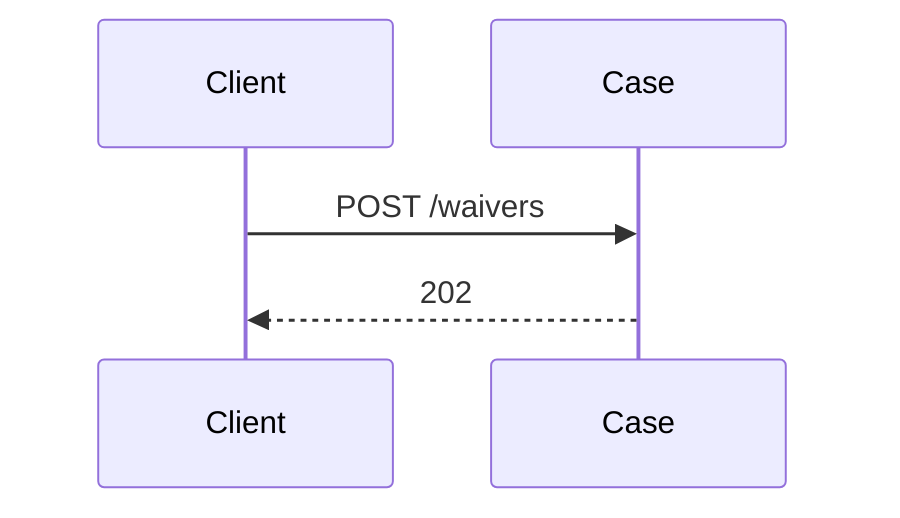
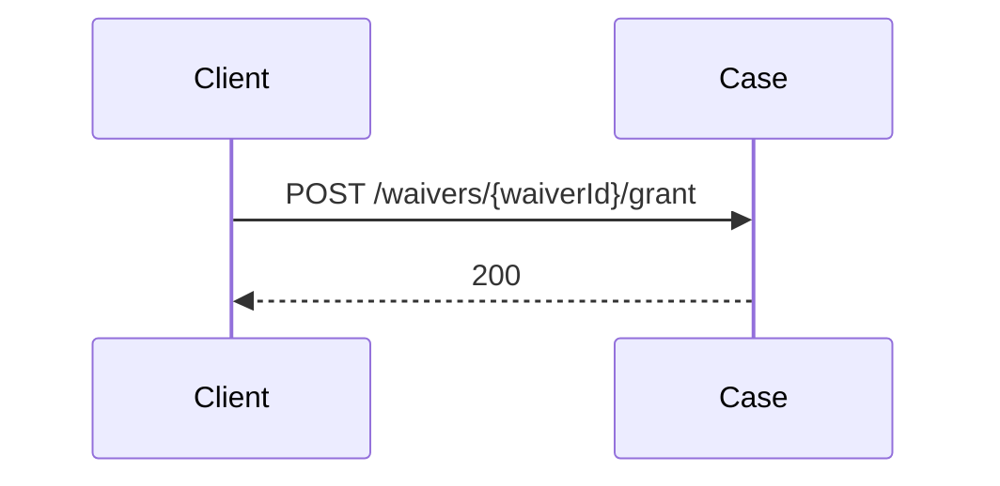
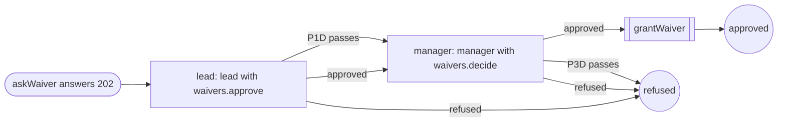

<!-- Generated by specarch document techspec from ../project/specarch.yaml, version 1.0.0; meta-model 0.1. Do not edit this file: change the YAML and generate again. -->

# Case: technical specification

Version 1.0.0 of the specification: 1 requirement, 2 entities, 2 HTTP operations, 1 workflow and 1 test. The chapters follow arc42, and a chapter with nothing in the specification is left out.

**Problems:** 14 warnings concern this document; each is marked by a Problem paragraph at its element, or below when the document shows no element for it. The problems file lists every problem, and specarch validate prints them.

**Problem:** warning: meta_model_version: the specification is written against meta-model 0.1, an earlier version read beside 1.0.0 with this warning, and its missing tests are warnings; run specarch derive to write the tests 0.2 and later ask for, then run specarch upgrade --dry-run on the specification to see what moving it to 1.0.0 changes, and specarch upgrade to move it [meta_model_version@specarch.yaml#/specarch]

## 1. Introduction and goals

### Stakeholders

| Stakeholder | Who they are | Concerns |
|---|---|---|
| manager | The manager who decides waivers above the desk. |   |

## 3. Context

The interfaces the system offers, as its clients see them.

### HTTP operations

| Method and path | Operation | Summary | Permission |
|---|---|---|---|
| POST /waivers | askWaiver | Ask for a waiver | waivers.ask |
| POST /waivers/{waiverId}/grant | grantWaiver | Grant a waiver | waivers.decide |

## 5. Building blocks

### Member

| Field | Type | Required | Limits | Description |
|---|---|---|---|---|
| id | uuid |   |   |   |
| name | string |   | at most 200 characters |   |

Primary key: id.

| Relation | Kind | Target | Via | On delete |
|---|---|---|---|---|
| waivers | one-to-many | Waiver | memberId | restrict |

### Waiver

| Field | Type | Required | Limits | Description |
|---|---|---|---|---|
| id | uuid |   |   |   |
| memberId | uuid |   |   |   |

Primary key: id.

| Relation | Kind | Target | Via | On delete |
|---|---|---|---|---|
| member | many-to-one | Member | memberId | restrict |

## 6. Runtime view

### askWaiver (POST /waivers)

**Problem:** warning: test_case_missing: operation askWaiver has no red scenario for "denied without waivers.ask"; add under tests ask-waiver-denied-without-waivers-ask: { operation: askWaiver, scenario: red, covers: [denied without waivers.ask], given: "a caller without waivers.ask", when: "askWaiver is called", then: "it is refused as not allowed" } [test_case_missing@specarch.yaml#/paths/~1waivers/post]

**Problem:** warning: test_golden_missing: operation askWaiver has no golden scenario; add one under tests, for example ask-waiver-succeeds: { operation: askWaiver, scenario: golden, given: "a caller with waivers.ask", when: "askWaiver is called", then: "it answers 202: The request waits for approval." } [test_golden_missing@specarch.yaml#/paths/~1waivers/post]

Takes no parameters and no request body.

Responses:

| Status | Meaning | Body |
|---|---|---|
| 202 | The request waits for approval. | none |

### grantWaiver (POST /waivers/{waiverId}/grant)

**Problem:** warning: test_case_missing: operation grantWaiver has no red scenario for "denied without waivers.decide"; add under tests grant-waiver-denied-without-waivers-decide: { operation: grantWaiver, scenario: red, covers: [denied without waivers.decide], given: "a caller without waivers.decide", when: "grantWaiver is called", then: "it is refused as not allowed" } [test_case_missing.d18a3a81@specarch.yaml#/paths/~1waivers~1{waiverId}~1grant/post]

**Problem:** warning: test_case_missing: operation grantWaiver has no red scenario for "not found waiverId"; add under tests grant-waiver-not-found-waiver-id: { operation: grantWaiver, scenario: red, covers: [not found waiverId], given: "no record has that waiverId", when: "grantWaiver is called with that waiverId", then: "it is refused as not found" } [test_case_missing.76f0f6d0@specarch.yaml#/paths/~1waivers~1{waiverId}~1grant/post]

**Problem:** warning: test_case_missing: operation grantWaiver has no red scenario for "waiverId not a valid uuid"; add under tests grant-waiver-waiver-id-not-a-valid-uuid: { operation: grantWaiver, scenario: red, covers: [waiverId not a valid uuid], given: "...", when: "grantWaiver is called with waiverId that is not a valid uuid", then: "it is refused" } [test_case_missing.72cdfbde@specarch.yaml#/paths/~1waivers~1{waiverId}~1grant/post]

**Problem:** warning: test_golden_missing: operation grantWaiver has no golden scenario; add one under tests, for example grant-waiver-succeeds: { operation: grantWaiver, scenario: golden, given: "a caller with waivers.decide", when: "grantWaiver is called with values inside every limit", then: "it answers 200: The waiver is granted." } [test_golden_missing@specarch.yaml#/paths/~1waivers~1{waiverId}~1grant/post]

Parameters:

| Parameter | In | Type | Required | Limits | Description |
|---|---|---|---|---|---|
| waiverId | path | uuid | yes |   |   |

Takes no request body.

Responses:

| Status | Meaning | Body |
|---|---|---|
| 200 | The waiver is granted. | none |

### Workflow waiver

A waiver is approved by the desk lead, or by the manager once a day has passed, before it is granted.

**Open question Q-1 (could, decision):** Is three days the manager's deadline once the lead has passed the request on? Decided by manager.

**Problem:** warning: test_case_missing: workflow waiver has no red scenario for "approval without waivers.approve"; add under tests waiver-approval-without-waivers-approve: { workflow: waiver, scenario: red, covers: [approval without waivers.approve], given: "a caller without waivers.approve", when: "they approve a request waiting at lead", then: "it is refused as not allowed, and the request still waits" } [test_case_missing.4951dfa1@specarch.yaml#/workflows/waiver]

**Problem:** warning: test_case_missing: workflow waiver has no red scenario for "approval without waivers.decide"; add under tests waiver-approval-without-waivers-decide: { workflow: waiver, scenario: red, covers: [approval without waivers.decide], given: "a caller without waivers.decide", when: "they approve a request waiting at manager", then: "it is refused as not allowed, and the request still waits" } [test_case_missing.78aaf7de@specarch.yaml#/workflows/waiver]

**Problem:** warning: test_case_missing: workflow waiver has no red scenario for "deadline passes at lead"; add under tests waiver-deadline-passes-at-lead: { workflow: waiver, scenario: red, covers: [deadline passes at lead], given: "a request waiting at lead", when: "P1D passes with no answer", then: "the request moves on to manager" } [test_case_missing.8e10b1fc@specarch.yaml#/workflows/waiver]

**Problem:** warning: test_case_missing: workflow waiver has no red scenario for "deadline passes at manager"; add under tests waiver-deadline-passes-at-manager: { workflow: waiver, scenario: red, covers: [deadline passes at manager], given: "a request waiting at manager", when: "P3D passes with no answer", then: "the request ends refused and grantWaiver is not called" } [test_case_missing.4826c9f6@specarch.yaml#/workflows/waiver]

**Problem:** warning: test_case_missing: workflow waiver has no red scenario for "refused at lead"; add under tests waiver-refused-at-lead: { workflow: waiver, scenario: red, covers: [refused at lead], given: "a request waiting at lead", when: "a caller with waivers.approve refuses it", then: "the request ends refused and grantWaiver is not called" } [test_case_missing.b8fbf887@specarch.yaml#/workflows/waiver]

**Problem:** warning: test_case_missing: workflow waiver has no red scenario for "refused at manager"; add under tests waiver-refused-at-manager: { workflow: waiver, scenario: red, covers: [refused at manager], given: "a request waiting at manager", when: "a caller with waivers.decide refuses it", then: "the request ends refused and grantWaiver is not called" } [test_case_missing.e4ac65f4@specarch.yaml#/workflows/waiver]

**Problem:** warning: test_golden_missing: workflow waiver has no golden scenario; add one under tests, for example waiver-succeeds: { workflow: waiver, scenario: golden, given: "a caller with waivers.ask", when: "a request is made through askWaiver and is approved at lead and manager", then: "it answers 202, then grantWaiver is called, and the request ends approved" } [test_golden_missing@specarch.yaml#/workflows/waiver]

Starts when askWaiver accepts a request and answers 202; the request waits as a Waiver. It is approved at lead (waivers.approve, within P1D) and manager (waivers.decide, within P3D), in that order, and a refusal ends it. The person who made the request never approves it.

## 8. Cross-cutting concepts

### Permissions

Access is fail-closed: every operation, command, page and route names the one permission it needs, and only the roles below grant one.

| Permission | desk | lead | manager |
|---|---|---|---|
| waivers.ask | yes | | |
| waivers.approve | | yes | yes |
| waivers.decide | | | yes |

## 10. Quality requirements

The design tests: what must hold on every implementation. Golden scenarios succeed; red scenarios are refused.

| Test | Subject | Level | Scenario | Given | When | Then |
|---|---|---|---|---|---|---|
| waiver-requester-approves-own-request | workflow waiver | system | red | a request made by a caller who also holds waivers.approve | the requester approves it at lead | it is refused, and the request still waits at lead |

## 13. Requirements

### Requirements

| Requirement | Statement | Kind | Priority | Status | Verification | Acceptance | Needs |
|---|---|---|---|---|---|---|---|
| CASE-1 | One. | functional | must | accepted |   | One. |   |

### Traceability

What satisfies and what verifies each requirement. An empty cell is a gap.

| Requirement | Satisfied by | Verified by |
|---|---|---|
| CASE-1 | entities Member; entities Waiver; paths /waivers post; paths /waivers/{waiverId}/grant post; workflows waiver | tests waiver-requester-approves-own-request |

