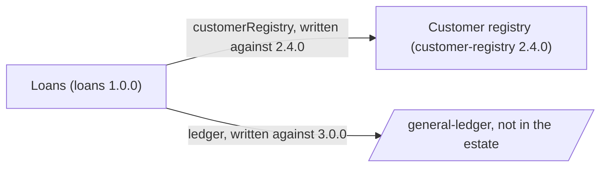

<!-- Generated by specarch document techspec from ../specarch-estate.yaml, version 1.0.0; estate format 0.1. Do not edit this file: change the YAML and generate again. -->

# Lending estate: module map

Version 1.0.0 of the estate: 2 modules. Each module is specified on its own; this map lists them, the version the estate holds each at, and what each names in another through its dependencies.

The modules of a lending business, each specified by its own team.

**Problems:** 1 problem concerns the estate; each is shown below the modules, at its entry, and specarch validate prints them.

## Modules

| Module | Held at | Specification | What it is |
|---|---|---|---|
| loans | 1.0.0 | [loans](../loans/specarch.yaml) | Loans. Lends to customers. |
| customer-registry | 2.4.0 | [customers](../customers/specarch.yaml) | Customer registry. Keeps the customers. |

**Problem** at /specarchEstate (../specarch-estate.yaml:1): the estate is written against version 0.1 of its format, an earlier version read beside 1.0.0 with this warning; run specarch upgrade --dry-run on the specification to see what moving it to 1.0.0 changes, and specarch upgrade to move it

## References between modules

| Module | Dependency | Specification it names | Written against |
|---|---|---|---|
| loans | customerRegistry | customer-registry | 2.4.0 |
| loans | ledger | general-ledger (not in the estate) | 3.0.0 |

