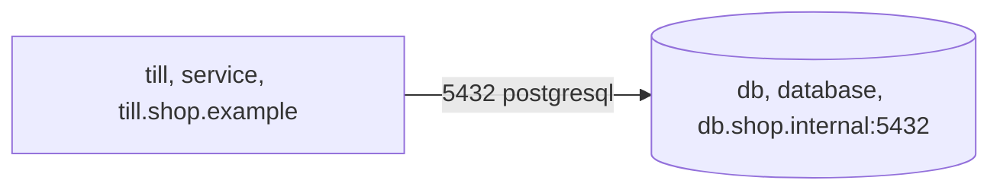

<!-- Generated by specarch document handover from ../project/specarch.yaml, version 1.0.0, and ../project/shop.go.specarch-implementation.yaml, version 1.0.0; meta-model 0.1. Do not edit this file: change the YAML and generate again. -->

# Shop: handover

Version 1.0.0 of Shop. The customer builds, installs and runs production from the source. This document says what the customer receives, what stays whose responsibility, how a release is built and installed, what the hosts must provide, and how the installed system is checked and accepted. It is written for the customer's engineers and needs nothing else to be read.

**Problems:** The specification has 1 error, so it is invalid, and this document shows what could be read of it. None of them is in what this document covers. The problems file lists every problem, and specarch validate prints them.

Each release is handed to the shop's IT staff as source; the vendor runs staging and never reaches the shop's host.

**Insight:** The shop's accountant asks who can reach the sales ledger.

**Note:** From The shop's operations manual, 3, clause 1.4: The till runs on the shop's own host.

## 1. What the customer receives

The handover goes to shop-it: The shop's IT staff, who build each release from the source and run the till on the shop's host. It holds:

- The source of each release: A tagged release of the repository, which the shop imports into a repository of its own.
- How a release is built, with the exact toolchain, the base images and how a build is compared with the vendor's (Building a release).
- The software bill of materials of each release and its vulnerability scan (Building a release).
- Every dependency with its version and licence (Building a release).
- What the hosts must provide (What the hosts must provide).
- Every setting with its type, and where a secret's value comes from (Configuration).
- The data migrations, in the order they are applied (Data migrations).
- How a release is installed and rolled back (Installing a release, Rolling back).
- How the data is backed up and restored (Backing up, Restoring).
- What is watched on the live system (Monitoring).
- The checks to run after installing, and the acceptance tests (Checks after installing, Acceptance tests).
- The sign-off sheet (Sign-off sheet).

## 2. Responsibilities

The customer is responsible for:

- The host, its patching and the PostgreSQL server.
- Backups and the restore drill each quarter.

The vendor stays responsible for:

- The source of each release, tagged, with its software bill of materials.
- A fix for every defect the shop reports, in the next release.

## 3. Building a release: Shop in Go

Built with Go 1.26, the toolchain go 1.26.0. The versions are exact: a build with another version is a different build.

### Build

The image is built from the tagged commit.

Build command: `podman build -t till .` (the task build).

### Base images

Every image the build starts from, pinned by its digest; a build from another digest is a different build.

| Image | Digest | Purpose |
|---|---|---|
| docker.io/library/golang:1.26-bookworm | sha256:7d0d0ab5bcb7b2e4b9c9c0f6a1b5a4e2d3c4b5a6978879a0b1c2d3e4f5a6b7c8 | Builds the binary. |

### Comparing a build with the vendor's

The image digest equals the one in the release notes when the same tag and base image are used.

### Software bill of materials

The software bill of materials of the build, and its scan for known vulnerabilities, are written by `syft dir:. -o syft-json=sbom.json && grype sbom:sbom.json` (the task sbom); the customer runs it on their build and compares the result with the vendor's.

### Dependencies and their licences

| Library | Version | Licence | Purpose |
|---|---|---|---|
| github.com/jackc/pgx/v5 | v5.11.0 | MIT | PostgreSQL driver. |

## 4. What the hosts must provide

### Shop in Go: production

The shop's host. Environment: production.

The allowed connections, and no others: till reaches db on port 5432 over postgresql. The sales the till records.

Ports listened on: till on 8080 (http); db on 5432 (postgresql).

| Server | Description |
|---|---|
| https://till.shop.example | The till's API behind the shop's proxy. |
| postgresql://db.shop.internal:5432 | The sales ledger. |

## 5. Configuration

Every setting the system reads at run time. A secret's value is never written here or in any document; its description says where the value comes from.

| Setting | Type | Secret | Description |
|---|---|---|---|
| taxRate | decimal(4, 2) |   | The sales tax rate. |
| databaseUrl | string | yes | Where the database is; it comes from the host's secret store. |
| auditNote | string |   | A note the vendor's own build writes into the audit log. |

**Audience on auditNote:** internal, left out of a document for everyone.

Values the vendor gives for production (Shop in Go):

| Setting | Value |
|---|---|
| taxRate | 0.11 |

## 6. Data migrations

Applied in this order, each before the release that carries it is installed.

### add-tax

Every order gets a tax amount, zero for old orders.

| Step | Action | Check |
|---|---|---|
| 1. Add the column | Add tax to orders with a default of zero. | Every order has a tax amount. |

This migration cannot be reversed.

## 7. Installing a release

A release goes to staging first, then to production after closing time.

| Step | Action | Check |
|---|---|---|
| 1. Install on staging | Install the build on staging. | The till opens on staging. |
| 2. Install on production | After closing time, install the build on production. | The till opens in the shop. |

How the vendor installs production (Shop in Go):

Installed with podman-compose 1.4, from deploy/compose. The compose file runs the image by digest beside PostgreSQL.

## 8. Rolling back

The previous build stays installed beside the new one.

| Step | Action | Check |
|---|---|---|
| 1. Switch back | Start the previous build. | The till opens and shows the previous version. |

## 9. Backing up

The sales ledger is dumped every night after closing.

| Step | Action | Check |
|---|---|---|
| 1. Dump the ledger | Dump the database to the backup store. | The dump restores on a scratch host. |

## 10. Restoring

A restore loads one night's dump in place of the live ledger.

| Step | Action | Check |
|---|---|---|
| 1. Load the dump | Stop the till, load the chosen dump and start the till. | The till shows the sales up to that night. |

## 11. Monitoring

What is watched on the live system, and the objective each must meet.

| Monitor | Environment | Measures | Objective | Verifies |
|---|---|---|---|---|
| till-answers | production | Whether the till answers. | The till answers every minute of opening hours. |   |

How the vendor watches them in production (Shop in Go):

| Monitor | Tool | How | Alert |
|---|---|---|---|
| till-answers | an uptime checker | Calls the catalogue every minute. | the shop's phone |

## 12. Checks after installing

Run on the installed system before it is accepted. Fill in the Result column as each step is run, and keep the filled-in run.

### till-opens (smoke, in production)

The installed till opens and shows the catalogue.

| Step | Action | Expected | Result |
|---|---|---|---|
| 1. Open the till | Open the till on the shop's host. | It shows the catalogue. |   |

## 13. Acceptance tests

What the installed system must do for the people who use it, each as a scenario to run by hand or through the implementation's acceptance suite. A golden scenario succeeds; a red one is refused.

### sell-an-item

Scenario: golden; verifies SHOP-1.

- Given: an item on the shelf
- When: the clerk sells it
- Then: the ledger shows the sale with its tax

## 14. Sign-off sheet

| Run | Entry |
|---|---|
| Specification version | 1.0.0 |
| Build |   |
| Environment |   |
| Date |   |

The system is accepted when every criterion is met:

| Criterion | Met |
|---|---|
| The smoke check passed on production. |   |

| Role | Description | Name | Signature | Date |
|---|---|---|---|---|
| shop-owner | Accepts for the shop. |   |   |   |

## Sources

Every source a Note in this document cites.

| Source | Title | Edition | Author | Where to read it |
|---|---|---|---|---|
| ops-manual | The shop's operations manual | 3 |   |   |

