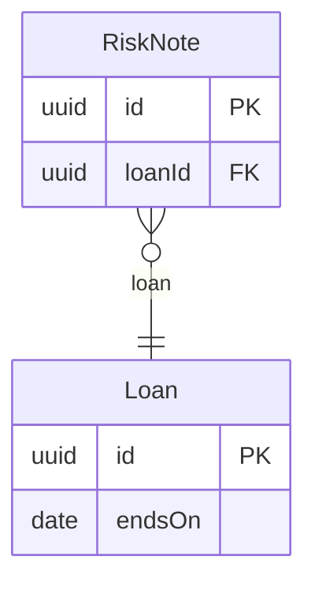

<!-- Generated by specarch document techspec from ../project/specarch.yaml, version 1.0.0, and ../project/desk.go.specarch-implementation.yaml, version 1.0.0; meta-model 0.1. Do not edit this file: change the YAML and generate again. -->

# Lending desk: spesifikasi teknis

Spesifikasi versi 1.0.0: 3 requirement dan 2 entity. Bab-babnya mengikuti arc42, dan bab yang isinya tidak ada di spesifikasi tidak dimuat.

**Masalah:** 4 warning menyangkut dokumen ini; masing-masing ditandai dengan paragraf Masalah di elemennya, atau di bawah bila dokumen ini tidak menampilkan elemennya. File masalah memuat semua masalah, dan specarch validate juga mencetaknya.

**Masalah:** warning: meta_model_version: the implementation file is written against version 0.1 of its format, an earlier version read beside 1.0.0 with this warning; run specarch upgrade --dry-run on the specification to see what moving it to 1.0.0 changes, and specarch upgrade to move it [meta_model_version@desk.go.specarch-implementation.yaml#/specarchImplementation]

**Masalah:** warning: meta_model_version: the specification is written against meta-model 0.1, an earlier version read beside 1.0.0 with this warning, and its missing tests are warnings; run specarch derive to write the tests 0.2 and later ask for, then run specarch upgrade --dry-run on the specification to see what moving it to 1.0.0 changes, and specarch upgrade to move it [meta_model_version@specarch.yaml#/specarch]

## 1. Pendahuluan dan tujuan

Loans of books to members.

### Stakeholder

| Stakeholder | Siapa mereka | Kepentingan |
|---|---|---|
| librarian | Staff at the desk. |   |
| card-issuer | The team that runs the card service. |   |

**Masalah pada librarian:** warning: unheard: librarian was never heard: no communication record names it, no session lists it present, no interview lists it and no decision is by it, while requirement LD-1 and requirement LD-3 rely on it; hear it before acceptance, and record what it said with specarch log; no communication, session or test session record is kept yet, so start by logging the first conversation [unheard@specarch.yaml#/stakeholders/librarian]

**Masalah pada card-issuer:** warning: unheard: card-issuer was never heard: no communication record names it, no session lists it present, no interview lists it and no decision is by it, while requirement LD-3 relies on it; hear it before acceptance, and record what it said with specarch log; no communication, session or test session record is kept yet, so start by logging the first conversation [unheard@specarch.yaml#/stakeholders/card-issuer]

## 5. Building block

### Loan

**Insight:** A loan is what the desk records when a book leaves it.

| Field | Tipe | Wajib | Batasan | Deskripsi |
|---|---|---|---|---|
| id | uuid | ya |   |   |
| endsOn | date | ya |   |   |

Primary key: id.

### RiskNote

**Audience:** internal, tidak dimuat di dokumen untuk semua orang.

**Pertanyaan terbuka Q-1 (could, decision):** Which loans count as risky? Diputuskan oleh librarian.

| Field | Tipe | Wajib | Batasan | Deskripsi |
|---|---|---|---|---|
| id | uuid |   |   |   |
| loanId | uuid |   |   |   |

Primary key: id.

| Relasi | Jenis | Target | Via | Saat dihapus |
|---|---|---|---|---|
| loan | many-to-one | Loan | loanId | restrict |

## 7. Deployment dan implementasi

### Implementasi: Lending desk in Go

Dari file implementasi versi 1.0.0.

Stack: bahasa Go 1.26.

#### Mapping

| Objek desain | Diimplementasikan oleh | Catatan |
|---|---|---|
| #/entities/Loan | table loans |   |
| #/entities/RiskNote | table risk_notes |   |

#### Idiom

Cara implementasi ini menangani tiap concern yang berulang: idiom bawaan SpecArch berlaku kecuali file ini mengecualikan atau meng-override salah satunya, dan override hanya mengganti bagian yang disebutnya (docs/idioms.md).

| Idiom | Versi | Berlaku sebagai | Bagian yang diganti proyek |
|---|---|---|---|
| identifiers | 1.1.0 | shipped |   |
| migrations | 1.0.0 | shipped |   |
| type-rendering | 1.4.1 | shipped |   |

#### Keputusan implementasi

##### ADR-001: Keep the risk band beside the loan

Status: accepted, 2026-10-14.

Context: The risk band is read with the loan on every page that shows it.

Decision: The loans table holds the band.

Consequences: A change to the band rewrites the loan.

**Insight:** One read per page.

## 13. Requirement

### Kebutuhan

| Kebutuhan | Pernyataan | Stakeholder | Status |
|---|---|---|---|
| NEED-1 | Members must borrow books. | librarian | accepted |
| NEED-2 | Staff must see which loans look risky. | librarian | proposed |

**Audience pada NEED-2:** internal, tidak dimuat di dokumen untuk semua orang.

### Requirement

| Requirement | Pernyataan | Jenis | Prioritas | Status | Verifikasi | Acceptance | Kebutuhan |
|---|---|---|---|---|---|---|---|
| LD-1 | A member shall borrow a book for fourteen days. | functional | must | accepted |   | A loan ends fourteen days after it starts. | NEED-1 |
| LD-2 | A loan shall carry a risk band that only staff see. | functional | could | proposed |   | A loan's risk band is low or high. | NEED-2 |
| LD-3 | A member shall pay a late fee by card. | functional | should | accepted |   | A card payment of a late fee is accepted or declined within five seconds. | NEED-1 |

**Pertanyaan terbuka Q-2 (could, decision) pada LD-1:** Is fourteen days the same for every member? Diputuskan oleh librarian.

**Audience pada LD-2:** internal, tidak dimuat di dokumen untuk semua orang.

### Traceability

Apa yang memenuhi dan memverifikasi tiap requirement. Sel kosong adalah gap.

| Requirement | Dipenuhi oleh | Diverifikasi oleh |
|---|---|---|
| LD-1 | entities Loan; implementasi Lending desk in Go decisions ADR-001 |   |
| LD-2 | entities Loan; entities RiskNote; implementasi Lending desk in Go decisions ADR-001 |   |

Dipegang di tempat lain, dipenuhi oleh komponen milik stakeholder lain sehingga di sini bukan gap: LD-3, dimiliki oleh card-issuer.

