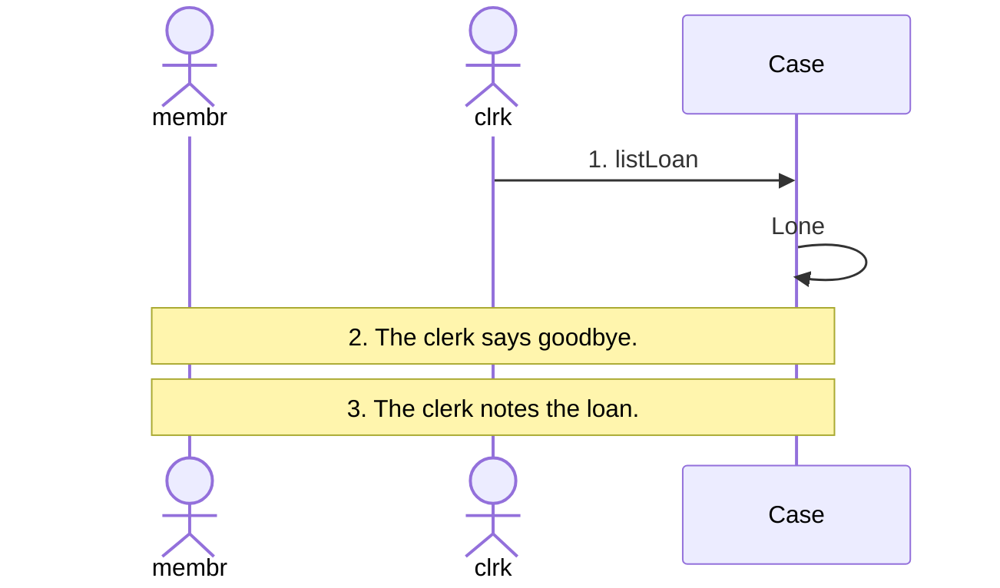

<!-- Generated by specarch document requirements from ../project/specarch.yaml, version 1.0.0; meta-model 1.0.0. Do not edit this file: change the YAML and generate again. -->

# Case: requirements specification

Version 1.0.0 of the specification: 2 stakeholders, 1 need and 2 requirements. The order follows the requirements specification of ISO/IEC/IEEE 29148: who has a stake, what they need, then each requirement with its attributes.

**Problems:** The specification has 11 errors, so it is invalid, and this document shows what could be read of it. 10 errors and 2 warnings concern this document; each is marked by a Problem paragraph at its element, or below when the document shows no element for it. The problems file lists every problem, and specarch validate prints them.

## 1. Purpose and scope

## 2. Stakeholders

| Stakeholder | Who they are | Concerns |
|---|---|---|
| member | A card holder. |   |
| clerk | Staff at the desk. |   |

**Problem on member:** warning: unheard: member was never heard: no communication record names it, no session lists it present, no interview lists it and no decision is by it, while requirement CASE-1 and requirement CASE-2 rely on it; hear it before acceptance, and record what it said with specarch log; no communication, session or test session record is kept yet, so start by logging the first conversation [unheard@specarch.yaml#/stakeholders/member]

**Problem on clerk:** warning: unheard: clerk was never heard: no communication record names it, no session lists it present, no interview lists it and no decision is by it, while requirement CASE-1 and requirement CASE-2 rely on it; hear it before acceptance, and record what it said with specarch log; no communication, session or test session record is kept yet, so start by logging the first conversation [unheard@specarch.yaml#/stakeholders/clerk]

## 3. Needs

What the stakeholders said they need, before it was shaped into requirements, and the requirements that refine each need.

| Need | Statement | Stakeholders | Status | Refined by |
|---|---|---|---|---|
| NEED-1 | Members want to see their loans. | member, clerk | accepted | CASE-1, CASE-2 |

## 4. Requirements

| Requirement | Kind | Priority | Status | Statement |
|---|---|---|---|---|
| CASE-1 | functional | must | accepted | A member shall see their loans. |
| CASE-2 | functional | must | accepted | A member without the permission shall be refused the list. |

### CASE-1

A member shall see their loans.

Kind: functional; priority: must; status: accepted; verified by test; refines NEED-1.

Acceptance criteria:

- Listing the loans answers 200 with the member's loans.

### CASE-2

A member without the permission shall be refused the list.

Kind: functional; priority: must; status: accepted; verified by test; refines NEED-1.

Acceptance criteria:

- Listing the loans without loans.read answers 403.

## 5. Scenarios

Cases told as a sequence across the operations, requirements, entity changes and tests the design defines, grouped by topic (ADR-251); a step with a condition is an alternative or failure branch of the steps before it.

### Loans

#### SC-1: A member lists their loans

For membr; 3 steps, 0 branches.

**Problem:** error: stakeholder: membr is not a stakeholder of the specification; did you mean member? [stakeholder@specarch.yaml#/scenarios/SC-1/stakeholder]

**Problem:** error: stakeholder: clrk is not a stakeholder of the specification; did you mean clerk? [stakeholder@specarch.yaml#/scenarios/SC-1/steps/0/actor]

**Problem:** error: operation: listLoan is not an operationId of the specification; did you mean listLoans? [operation@specarch.yaml#/scenarios/SC-1/steps/0/operation]

**Problem:** error: requirement: CASE-9 is not a requirement of the specification; did you mean CASE-1? [requirement@specarch.yaml#/scenarios/SC-1/steps/0/requirements/2]

**Problem:** error: scenario: Lone is not an entity of the specification; did you mean Loan? [scenario@specarch.yaml#/scenarios/SC-1/steps/0/entity]

**Problem:** error: scenario: list-loan is not a test of the specification; use one of list-loans-denied, list-loans-succeeds [scenario@specarch.yaml#/scenarios/SC-1/steps/0/tests/0]

**Problem:** error: scenario: step 2 of scenario SC-1 names no operation, requirements, entity or tests, so nothing ties it to the design; name what the step exercises [scenario@specarch.yaml#/scenarios/SC-1/steps/1]

**Problem:** error: schema: entity is missing; add it here [schema@specarch.yaml#/scenarios/SC-1/steps/2]

| Step | Actor | Before | What happens | Exercises | Result |
|---|---|---|---|---|---|
| 1 | clrk |   | The clerk lists the member's loans. | operation listLoan; requirements CASE-1, CASE-2, CASE-9; entity Lone; tests list-loan |   |
| 2 | membr |   | The clerk says goodbye. |   |   |
| 3 | membr |   | The clerk notes the loan. | requirements CASE-1 |   |

No test proves it yet: a golden or red test names it under proves.

#### SC-2: A member asks for nothing

For member; 0 steps, 0 branches.

**Problem:** error: scenario: scenario SC-2 has no step, so it shows no case; add steps, each naming the operation, requirements, entity or tests it exercises [scenario@specarch.yaml#/scenarios/SC-2]

No test proves it yet: a golden or red test names it under proves.

#### SC-3: A member has no steps yet

For member; 0 steps, 0 branches.

**Problem:** error: scenario: scenario SC-3 has no step, so it shows no case; add steps, each naming the operation, requirements, entity or tests it exercises [scenario@specarch.yaml#/scenarios/SC-3]

No test proves it yet: a golden or red test names it under proves.

