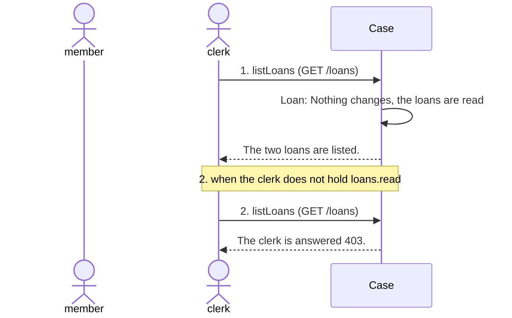

<!-- Generated by specarch document requirements from ../project/specarch.yaml, version 1.0.0; meta-model 1.0.0. Do not edit this file: change the YAML and generate again. -->

# Case: requirements specification

Version 1.0.0 of the specification: 2 stakeholders, 1 need and 2 requirements. The order follows the requirements specification of ISO/IEC/IEEE 29148: who has a stake, what they need, then each requirement with its attributes.

**Problems:** 2 warnings concern this document; each is marked by a Problem paragraph at its element, or below when the document shows no element for it. The problems file lists every problem, and specarch validate prints them.

## 1. Purpose and scope

## 2. Stakeholders

| Stakeholder | Who they are | Concerns |
|---|---|---|
| member | A card holder. |   |
| clerk | Staff at the desk. |   |

**Problem on member:** warning: unheard: member was never heard: no communication record names it, no session lists it present, no interview lists it and no decision is by it, while requirement CASE-1 and requirement CASE-2 rely on it; hear it before acceptance, and record what it said with specarch log; no communication, session or test session record is kept yet, so start by logging the first conversation [unheard@specarch.yaml#/stakeholders/member]

**Problem on clerk:** warning: unheard: clerk was never heard: no communication record names it, no session lists it present, no interview lists it and no decision is by it, while requirement CASE-1 and requirement CASE-2 rely on it; hear it before acceptance, and record what it said with specarch log; no communication, session or test session record is kept yet, so start by logging the first conversation [unheard@specarch.yaml#/stakeholders/clerk]

## 3. Needs

What the stakeholders said they need, before it was shaped into requirements, and the requirements that refine each need.

| Need | Statement | Stakeholders | Status | Refined by |
|---|---|---|---|---|
| NEED-1 | Members want to see their loans. | member, clerk | accepted | CASE-1, CASE-2 |

## 4. Requirements

| Requirement | Kind | Priority | Status | Statement |
|---|---|---|---|---|
| CASE-1 | functional | must | accepted | A member shall see their loans. |
| CASE-2 | functional | must | accepted | A member without the permission shall be refused the list. |

### CASE-1

A member shall see their loans.

Kind: functional; priority: must; status: accepted; verified by test; refines NEED-1.

Acceptance criteria:

- Listing the loans answers 200 with the member's loans.

### CASE-2

A member without the permission shall be refused the list.

Kind: functional; priority: must; status: accepted; verified by test; refines NEED-1.

Acceptance criteria:

- Listing the loans without loans.read answers 403.

## 5. Scenarios

Cases told as a sequence across the operations, requirements, entity changes and tests the design defines, grouped by topic (ADR-251); a step with a condition is an alternative or failure branch of the steps before it.

### Loans

#### SC-1: A member lists their loans

A member asks the desk which loans they hold.

For member; 2 steps, 1 branch.

| Step | Actor | Before | What happens | Exercises | Result |
|---|---|---|---|---|---|
| 1 | clerk | The member holds two loans. | The clerk lists the member's loans. | operation listLoans; requirements CASE-1; entity Loan: Nothing changes; the loans are read; tests list-loans-succeeds | The two loans are listed. |
| 2, when the clerk does not hold loans.read | clerk |   | The list is refused. | operation listLoans; requirements CASE-2; tests list-loans-denied | The clerk is answered 403. |

Proved by list-loans-succeeds, list-loans-denied.

