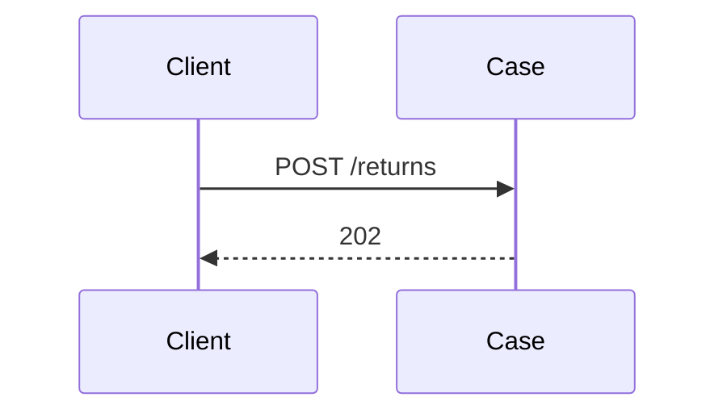
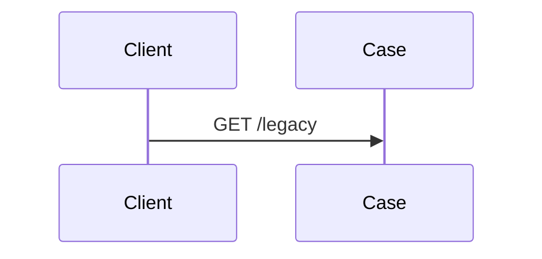
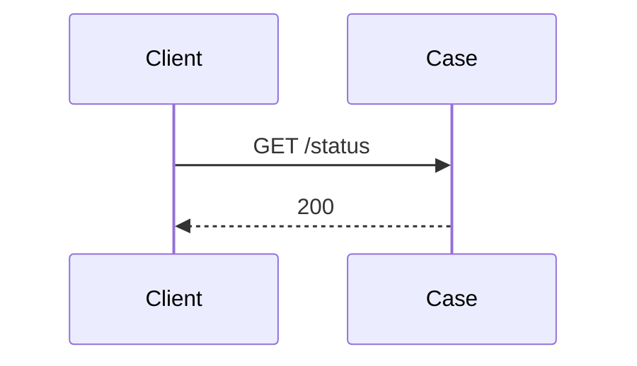

<!-- Generated by specarch document techspec from ../project/specarch.yaml, version 1.0.0; meta-model 0.3. Do not edit this file: change the YAML and generate again. -->

# Case: technical specification

Version 1.0.0 of the specification: 4 HTTP operations and 13 tests. The chapters follow arc42, and a chapter with nothing in the specification is left out.

## 1. Introduction and goals

## 3. Context

The interfaces the system offers, as its clients see them.

### HTTP operations

| Method and path | Operation | Summary | Permission |
|---|---|---|---|
| GET /loans | listLoans | List loans | loans.read |
| POST /returns | importReturns | Import the day's returns | returns.import |
| GET /legacy | legacyList | The old list, closed | nobody |
| GET /status | status | Whether the service is up | public |

## 6. Runtime view

### listLoans (GET /loans)

Takes no parameters and no request body.

Responses:

| Status | Meaning | Body |
|---|---|---|
| 200 | The loans. | none |

### importReturns (POST /returns)

Takes no parameters and no request body.

Responses:

| Status | Meaning | Body |
|---|---|---|
| 202 | Accepted. | none |

### legacyList (GET /legacy)

Takes no parameters and no request body.

Responses:

| Status | Meaning | Body |
|---|---|---|
| 403 | Closed. | none |

### status (GET /status)

Takes no parameters and no request body.

Responses:

| Status | Meaning | Body |
|---|---|---|
| 200 | Up. | none |

## 8. Cross-cutting concepts

### Permissions

Access is fail-closed: every operation, command and page names the one permission it needs, and only the roles below grant one.

| Permission | librarian | auditor | nightly-reconciliation (service) | gateway (service) | public |
|---|---|---|---|---|---|
| loans.read | yes | yes | yes | yes | |
| returns.import | | yes | yes | yes | |
| public | | | | | everyone |
| nobody | | | | | closed |

The permission nobody closes a route on purpose: it stays in the contract and refuses every caller with the problem the design declares, so that a client still calling it is told, not given a 404 that looks like a wrong path. No role grants it.

The clients: the programs that call the system, each by its software_id. An application is where a person signs in; a service calls on its own account with the roles it holds and a proof of its identity on each request, or carries a person's call. A client with roles is a column of the matrix above. A client is admitted only where an operation's callers lists it; a public client, one with no proof, has a name that is the issuer's word and no proof of origin.

| Client | Kind | Admitted versions | Roles | Proof |
|---|---|---|---|---|
| nightly-reconciliation | service | any | auditor | a signed request (RFC 9421), hmac-sha256 over @method, @path, content-digest, date |
| gateway | service | any | auditor | its client certificate (RFC 8705) |
| mobile | application | any | none | none: a public client, whose name in a token is the issuer's word |

Who may call: an operation or command that lists its callers admits exactly them, people (anyone signed in, whose roles decide the rest) and the clients named; one that lists none admits people and refuses every client; one closed with nobody refuses everyone.

| Operation or command | Callers |
|---|---|
| operation listLoans | people, nightly-reconciliation |
| operation importReturns | nightly-reconciliation, gateway |
| operation legacyList | closed: nobody |

## 10. Quality requirements

The design tests: what must hold on every implementation. Golden scenarios succeed; red scenarios are refused.

| Test | Subject | Level | Scenario | Given | When | Then |
|---|---|---|---|---|---|---|
| list-loans-succeeds | operation listLoans | system | golden | a caller with loans.read | listLoans is called | it answers 200 |
| list-loans-denied | operation listLoans | system | red | a caller without loans.read | listLoans is called | it is refused |
| list-loans-not-listed | operation listLoans | system | red | the gateway calling on its own account | listLoans is called | it is refused |
| list-loans-bad-signature | operation listLoans | system | red | the batch with a signature that does not verify | listLoans is called | it is refused |
| list-loans-service-token | operation listLoans | system | red | the gateway calling with its own certificate and no person | listLoans is called | it is refused |
| import-returns-succeeds | operation importReturns | system | golden | the batch with a good signature | importReturns is called | it answers 202 |
| import-returns-person | operation importReturns | system | red | a librarian signed in | importReturns is called | it is refused |
| import-returns-denied | operation importReturns | system | red | a client without returns.import | importReturns is called | it is refused |
| import-returns-not-listed | operation importReturns | system | red | a client not listed | importReturns is called | it is refused |
| import-returns-bad-signature | operation importReturns | system | red | the batch with a bad signature | importReturns is called | it is refused |
| legacy-list-closed | operation legacyList | system | red | any caller | legacyList is called | it is refused as closed |
| status-succeeds | operation status | system | golden | anyone | status is called | it answers 200 |
| status-service-token | operation status | system | red | a service with its own certificate | status is called | it is refused |

