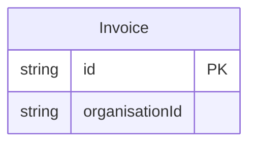
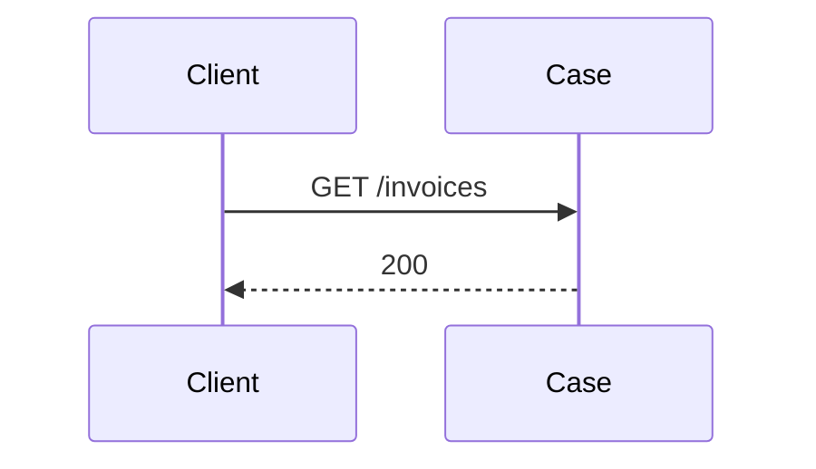
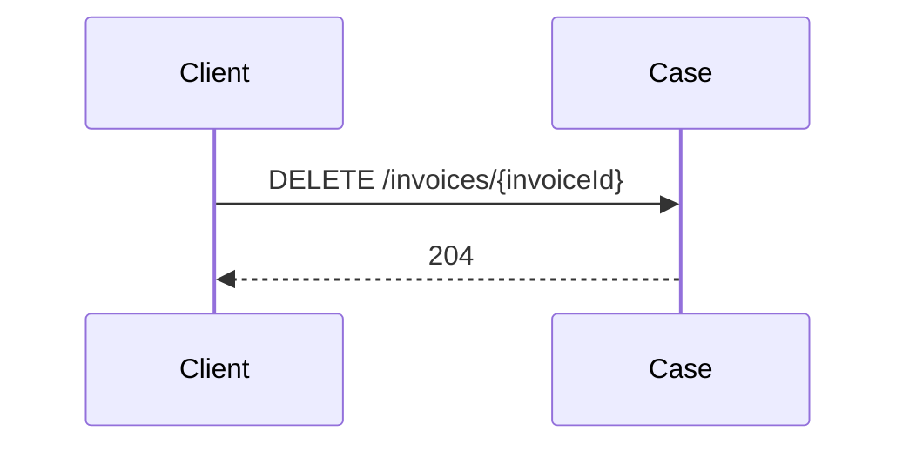
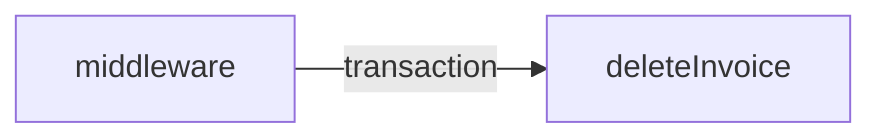

<!-- Generated by specarch document techspec from ../project/specarch.yaml, version 1.0.0; meta-model 1.0.0. Do not edit this file: change the YAML and generate again. -->

# Case: technical specification

Version 1.0.0 of the specification: 1 entity, 2 HTTP operations, 2 dependencies and 7 tests. The chapters follow arc42, and a chapter with nothing in the specification is left out.

## 1. Introduction and goals

## 3. Context

The interfaces the system offers, as its clients see them.

### HTTP operations

| Method and path | Operation | Summary | Permission |
|---|---|---|---|
| GET /invoices | listInvoices | List invoices | invoices.read |
| DELETE /invoices/{invoiceId} | deleteInvoice | Delete an invoice, called by the middleware on a person's behalf | invoices.delete |

### Dependencies

External systems the operations call. A call that fails, or that does not answer within its time limit, is given up, and the operation answers as its failure response says.

| Dependency | Time limit per call | Called by | Description |
|---|---|---|---|
| securityLog | PT2S |   | The append-only store of security events. |
| pager | PT2S |   | The alarm channel. |

## 5. Building blocks

### Invoice

| Field | Type | Required | Limits | Description |
|---|---|---|---|---|
| id | string | yes | at most 36 characters |   |
| organisationId | string | yes | at most 36 characters |   |

Primary key: id.

## 6. Runtime view

### listInvoices (GET /invoices)

Takes no parameters and no request body.

Responses:

| Status | Meaning | Body |
|---|---|---|
| 200 | The invoices. | none |

### deleteInvoice (DELETE /invoices/{invoiceId})

Parameters:

| Parameter | In | Type | Required | Limits | Description |
|---|---|---|---|---|---|
| invoiceId | path | string | yes | at most 36 characters |   |

Responses:

| Status | Meaning | Body |
|---|---|---|
| 204 | Deleted. | none |

## 8. Cross-cutting concepts

### Permissions

Access is fail-closed: every operation, command and page names the one permission it needs, and only the roles below grant one.

| Permission | invoice-manager |
|---|---|
| invoices.read | yes |
| invoices.delete | admin-web only |

The caller is who is making the call, as the service knows it once the session or token has been checked: one record with the properties below, which a role's rows rule names as caller.<property>. A property the caller may lack allows null, and a comparison with it is false then.

| Property | Type | Description |
|---|---|---|
| organisationId | string | The organisation the caller belongs to. |

The clients: the programs that call the system, each by its software_id. An application is where a person signs in; a service calls on its own account with the roles it holds and a proof of its identity on each request, or carries a person's call. A client with roles is a column of the matrix above. A client is admitted only where an operation's callers lists it; a public client, one with no proof, has a name that is the issuer's word and no proof of origin.

| Client | Kind | Admitted versions | Roles | Proof |
|---|---|---|---|---|
| admin-web | application | >=1.2.0 <2.0.0, a security check: the publisher's version, in its signed software statement | none | none: a public client, whose name in a token is the issuer's word |
| middleware | service | any | none | spiffe |

The tokens: the formats the service issues and accepts. An access token rides in the Authorization header as a bearer token and is accepted only for the audience it names; a transaction token rides in the Txn-Token header across the trust domain, minted once at the edge and passed on unmodified, and each hop accepts it only from the immediate callers its via names, each proving its workload identity. A claim fills the caller's property of the same name. The one default token is what every operation accepts unless it names another.

| Token | Kind | Header | Audience | Lifetime | Signature | Claims | Accepted by |
|---|---|---|---|---|---|---|---|
| access (default) | access token, jwt | Authorization: Bearer | https://invoices.example.org | PT15M | ES256 | sub, aud, client_id, softwareVersion, organisationId | listInvoices |
| transaction | transaction token, jwt | Txn-Token | the trust domain | PT5M | ES256 | txn, sub, scope, req_wl, tctx | deleteInvoice via middleware |

The delegation chain each operation accepts, hop by hop, with the token on each arrow: the services via names call the operation on the person's behalf, each presenting its workload identity.

### Security events

Every refusal of a caller writes a security event, a Security Event Token (RFC 8417) holding the rule, the severity, the operation, the client, the subject and the hash of the refused token, never the token itself, to securityLog, the append-only store; an event of severity high, or a repeat for one client within the window the deployment sets, goes to pager, the alarm channel, as well. The events, by the rule that refuses:

| Refusal | Rule | Severity |
|---|---|---|
| a token for another audience | token_audience | high |
| an immediate caller not listed in via | via | high |
| the confused deputy, each form | deputy | high |
| a caller not in callers, or a closed route | callers | medium |
| an application not in through | through | medium |
| a version outside the admitted range, with a software statement | software_version | medium |
| a version outside the admitted range, self-asserted | software_version | low |
| an expired token | token | low |

## 10. Quality requirements

The design tests: what must hold on every implementation. Golden scenarios succeed; red scenarios are refused.

| Test | Subject | Level | Scenario | Given | When | Then |
|---|---|---|---|---|---|---|
| list-invoices-succeeds | operation listInvoices | system | golden | a caller with invoices.read | listInvoices is called | it answers 200 |
| list-invoices-denied | operation listInvoices | system | red | a caller without invoices.read | listInvoices is called | it is refused |
| list-invoices-expired | operation listInvoices | system | red | an access token expired after 15 minutes | listInvoices is called | it is refused as not signed in, and the event token (low) is written |
| delete-invoice-succeeds | operation deleteInvoice | system | golden | the middleware with a transaction token for an invoice manager through admin-web | deleteInvoice is called | it answers 204 |
| delete-invoice-not-found | operation deleteInvoice | system | red | no invoice with that invoiceId | deleteInvoice is called | it is refused as not found |
| delete-invoice-denied | operation deleteInvoice | system | red | a caller without invoices.delete | deleteInvoice is called | it is refused |
| delete-invoice-expired | operation deleteInvoice | system | red | a transaction token expired after 5 minutes | deleteInvoice is called | it is refused as not signed in, and the event token (low) is written |

