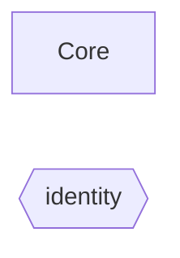
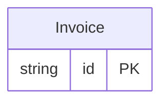
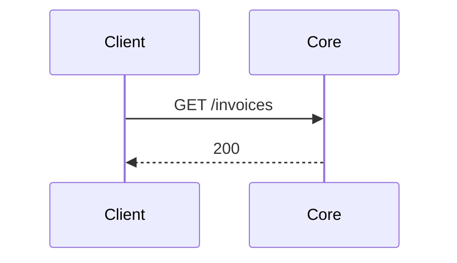
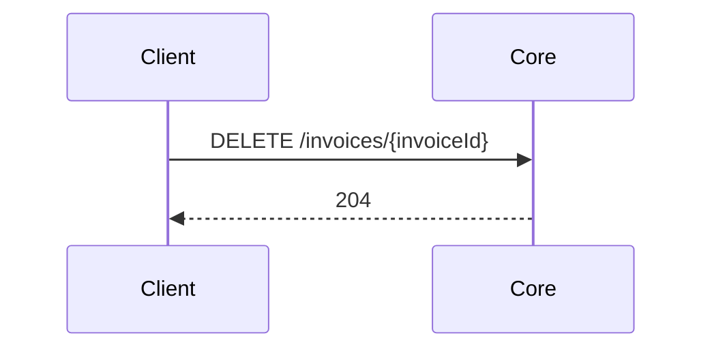
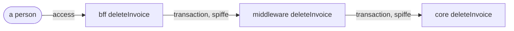

<!-- Generated by specarch document techspec from ../../core/specarch.yaml, version 1.0.0, and ../../core/core.go.specarch-implementation.yaml, version 1.0.0; meta-model 1.0.0. Do not edit this file: change the YAML and generate again. -->

# Core: technical specification

Version 1.0.0 of the specification: 1 entity, 2 HTTP operations, 1 dependency and 8 tests. The chapters follow arc42, and a chapter with nothing in the specification is left out.

## 1. Introduction and goals

## 3. Context

The interfaces the system offers, as its clients see them.

Who uses the system and what it reaches: a person per role, a system per calling service with the roles it holds, and the dependencies by kind with their protocol, each edge naming the operations and jobs that call it or the channel it carries.

### HTTP operations

| Method and path | Operation | Summary | Permission |
|---|---|---|---|
| GET /invoices | listInvoices | List invoices | invoices.read |
| DELETE /invoices/{invoiceId} | deleteInvoice | Delete an invoice, called by the middleware on a person's behalf | invoices.delete |

### Dependencies

External systems the operations call. A call that fails, or that does not answer within its time limit, is given up, and the operation answers as its failure response says.

| Dependency | Time limit per call | Called by | Description |
|---|---|---|---|
| identity | PT2S |   | Specified on its own as identity; the references were written against version 1.0.0. Issues the estate's tokens and holds its clients and roles. |

## 5. Building blocks

### Invoice

| Field | Type | Required | Limits | Description |
|---|---|---|---|---|
| id | string | yes | at most 36 characters |   |

Primary key: id.

## 6. Runtime view

### listInvoices (GET /invoices)

Takes no parameters and no request body.

Responses:

| Status | Meaning | Body |
|---|---|---|
| 200 | The invoices. | none |

### deleteInvoice (DELETE /invoices/{invoiceId})

Parameters:

| Parameter | In | Type | Required | Limits | Description |
|---|---|---|---|---|---|
| invoiceId | path | string | yes | at most 36 characters |   |

Responses:

| Status | Meaning | Body |
|---|---|---|
| 204 | Deleted. | none |

## 7. Deployment and implementation

### Implementation: core in Go

From the implementation file version 1.0.0.

Stack: language Go 1.26.

#### Targets

| Target | Output folder | Settings |
|---|---|---|
| techspec | ../docs/core |   |

#### Idioms

How this implementation does each recurring concern: the idioms SpecArch ships apply unless the file excludes or overrides one, and an override replaces only the parts it names (docs/idioms.md).

| Idiom | Version | Applies as | Parts the project replaces |
|---|---|---|---|
| authorization-check | 1.0.0 | shipped |   |
| health-endpoint | 1.0.0 | shipped |   |
| identifiers | 1.1.0 | shipped |   |
| migrations | 1.0.0 | shipped |   |
| request-validation | 1.1.0 | shipped |   |
| transactions | 1.0.0 | shipped |   |
| type-rendering | 1.4.1 | shipped |   |

## 8. Cross-cutting concepts

### Permissions

Access is fail-closed: every operation, command and page names the one permission it needs, and only the roles below grant one.

A column named with another module is a role or a client of the identity module, which grants this module's permissions by reference.

| Permission | identity invoice-manager | identity invoice-reader | identity reporting (service) |
|---|---|---|---|
| invoices.read | yes | yes | yes |
| invoices.delete | admin-web only |  |  |

Who may call: an operation or command that lists its callers admits exactly them, people (anyone signed in, whose roles decide the rest) and the clients named; one that lists none admits people and refuses every client; one closed with nobody refuses everyone.

| Operation or command | Callers |
|---|---|
| operation listInvoices | people, identity#/clients/reporting |

The tokens: the formats the service issues and accepts. An access token rides in the Authorization header as a bearer token and is accepted only for the audience it names; a transaction token rides in the Txn-Token header across the trust domain, minted once at the edge and passed on unmodified, and each hop accepts it only from the immediate callers its via names, each proving its workload identity. A claim fills the caller's property of the same name. The one default token is what every operation accepts unless it names another.

| Token | Kind | Header | Audience | Lifetime | Signature | Claims | Accepted by |
|---|---|---|---|---|---|---|---|
| access (default) | access token, jwt | Authorization: Bearer | https://core.estate.example.org | PT15M | ES256 | sub, aud, client_id | listInvoices |
| transaction | transaction token, jwt | Txn-Token | the trust domain | PT5M | ES256 | txn, sub, scope, req_wl, tctx | deleteInvoice via identity#/clients/middleware |

The delegation chains that reach the operations with a via, as the induction through calls finds them across the modules given with this one: from the person's application at the edge, hop by hop, with the token each hop accepts and the workload identity the caller presents on each arrow.

## 10. Quality requirements

The design tests: what must hold on every implementation. Golden scenarios succeed; red scenarios are refused.

| Test | Subject | Level | Scenario | Given | When | Then |
|---|---|---|---|---|---|---|
| list-invoices-succeeds | operation listInvoices | system | golden | an invoice reader | listInvoices is called | it answers 200 |
| list-invoices-denied | operation listInvoices | system | red | a caller without invoices.read | listInvoices is called | it is refused |
| list-invoices-expired | operation listInvoices | system | red | an access token expired after 15 minutes | listInvoices is called | it is refused as not signed in |
| delete-invoice-succeeds | operation deleteInvoice | system | golden | the middleware with a transaction token for an invoice manager through admin-web | deleteInvoice is called | it answers 204 |
| delete-invoice-not-found | operation deleteInvoice | system | red | no invoice with that invoiceId | deleteInvoice is called | it is refused as not found |
| delete-invoice-denied | operation deleteInvoice | system | red | a caller without invoices.delete | deleteInvoice is called | it is refused |
| delete-invoice-expired | operation deleteInvoice | system | red | a transaction token expired after 5 minutes | deleteInvoice is called | it is refused as not signed in |
| delete-invoice-other-scope | operation deleteInvoice | system | red | a transaction token whose scope is the permission of no edge whose chain reaches the core | deleteInvoice is called | it is refused as not allowed |

