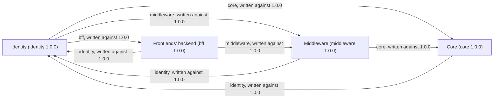

<!-- Generated by specarch document techspec from ../specarch-estate.yaml, version 1.0.0; estate format 1.0.0. Do not edit this file: change the YAML and generate again. -->

# Invoicing estate: module map

Version 1.0.0 of the estate: 4 modules. Each module is specified on its own; this map lists them, the version the estate holds each at, and what each names in another through its dependencies.

## Modules

| Module | Held at | Specification | What it is |
|---|---|---|---|
| identity | 1.0.0 | [identity](../identity/specarch.yaml) | Identity. Holds the estate's clients, roles and trust domain, and issues its tokens. |
| bff | 1.0.0 | [bff](../bff/specarch.yaml) | Front ends' backend. The backend behind the front ends, the edge of every call a person makes. |
| middleware | 1.0.0 | [middleware](../middleware/specarch.yaml) | Middleware. Sits between the front ends' backend and the core. |
| core | 1.0.0 | [core](../core/specarch.yaml) | Core. Keeps the invoices. |

## References between modules

| Module | Dependency | Specification it names | Written against |
|---|---|---|---|
| identity | core | core | 1.0.0 |
| identity | middleware | middleware | 1.0.0 |
| identity | bff | bff | 1.0.0 |
| bff | identity | identity | 1.0.0 |
| bff | middleware | middleware | 1.0.0 |
| middleware | identity | identity | 1.0.0 |
| middleware | core | core | 1.0.0 |
| core | identity | identity | 1.0.0 |

