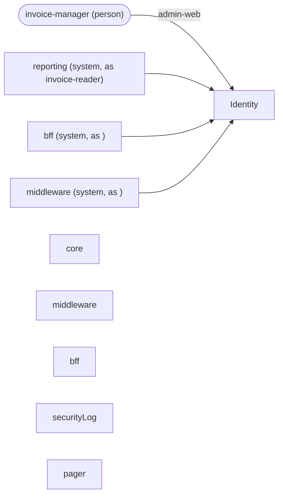

<!-- Generated by specarch document techspec from ../../identity/specarch.yaml, version 1.0.0, and ../../identity/identity.go.specarch-implementation.yaml, version 1.0.0; meta-model 1.0.0. Do not edit this file: change the YAML and generate again. -->

# Identity: technical specification

Version 1.0.0 of the specification: 5 dependencies. The chapters follow arc42, and a chapter with nothing in the specification is left out.

## 1. Introduction and goals

## 3. Context

The interfaces the system offers, as its clients see them.

Who uses the system and what it reaches: a person per role, a system per calling service with the roles it holds, and the dependencies by kind with their protocol, each edge naming the operations and jobs that call it or the channel it carries.

### Dependencies

External systems the operations call. A call that fails, or that does not answer within its time limit, is given up, and the operation answers as its failure response says.

| Dependency | Time limit per call | Called by | Description |
|---|---|---|---|
| core | PT2S |   | Specified on its own as core; the references were written against version 1.0.0. Keeps the invoices. |
| middleware | PT2S |   | Specified on its own as middleware; the references were written against version 1.0.0. Sits between the front ends' backend and the core. |
| bff | PT2S |   | Specified on its own as bff; the references were written against version 1.0.0. The backend behind the front ends. |
| securityLog | PT2S |   | The append-only store of security events. |
| pager | PT2S |   | The alarm channel. |

## 7. Deployment and implementation

### Implementation: identity in Go

From the implementation file version 1.0.0.

Stack: language Go 1.26.

#### Targets

| Target | Output folder | Settings |
|---|---|---|
| techspec | ../docs/identity |   |

#### Idioms

How this implementation does each recurring concern: the idioms SpecArch ships apply unless the file excludes or overrides one, and an override replaces only the parts it names (docs/idioms.md).

| Idiom | Version | Applies as | Parts the project replaces |
|---|---|---|---|
| authorization-check | 1.0.0 | shipped |   |

## 8. Cross-cutting concepts

### Permissions

Access is fail-closed: every operation, command and page names the one permission it needs, and only the roles below grant one.

The roles grant the permissions of the modules that enforce them, each named with its module: this is the estate's one matrix, and each module's technical specification shows the roles that reach its own permissions.

| Permission | invoice-manager | invoice-reader | reporting (service) |
|---|---|---|---|
| core invoices.read | yes | yes | yes |
| core invoices.delete | admin-web only | | |
| middleware invoices.delete | admin-web only | | |
| bff invoices.delete | admin-web only | | |

The trust domain is https://estate.example.org: the audience of every transaction token across the estate, and the base of every security event's identifier, https://estate.example.org/events/<rule>.

The clients: the programs that call the system, each by its software_id. An application is where a person signs in; a service calls on its own account with the roles it holds and a proof of its identity on each request, or carries a person's call. A client with roles is a column of the matrix above. A client is admitted only where an operation's callers lists it; a public client, one with no proof, has a name that is the issuer's word and no proof of origin.

| Client | Kind | Admitted versions | Roles | Proof |
|---|---|---|---|---|
| admin-web | application | >=1.2.0 <2.0.0, a security check: the publisher's version, in its signed software statement | none | none: a public client, whose name in a token is the issuer's word |
| reporting | service | any | invoice-reader | token |
| bff | service | any | none | spiffe |
| middleware | service | any | none | spiffe |

The tokens: the formats the service issues and accepts. An access token rides in the Authorization header as a bearer token and is accepted only for the audience it names; a transaction token rides in the Txn-Token header across the trust domain, minted once at the edge and passed on unmodified, and each hop accepts it only from the immediate callers its via names, each proving its workload identity. A claim fills the caller's property of the same name. The one default token is what every operation accepts unless it names another.

| Token | Kind | Header | Audience | Lifetime | Signature | Claims | Accepted by |
|---|---|---|---|---|---|---|---|
| access (default) | access token, jwt | Authorization: Bearer | none fixed | PT15M | ES256 | sub, aud, client_id, softwareVersion | no operation |
| machine | access token, jwt | Authorization: Bearer | none fixed | PT5M | ES256 | sub, aud, client_id | no operation |

### Security events

Every refusal of a caller writes a security event, a Security Event Token (RFC 8417) holding the rule, the severity, the operation, the client, the subject and the hash of the refused token, never the token itself, to securityLog, the append-only store; an event of severity high, or a repeat for one client within the window the deployment sets, goes to pager, the alarm channel, as well. The events, by the rule that refuses:

| Refusal | Rule | Severity |
|---|---|---|
| a token for another audience | token_audience | high |
| an immediate caller not listed in via | via | high |
| the confused deputy, each form | deputy | high |
| a caller not in callers, or a closed route | callers | medium |
| an application not in through | through | medium |
| a version outside the admitted range, with a software statement | software_version | medium |
| a version outside the admitted range, self-asserted | software_version | low |
| an expired token | token | low |

