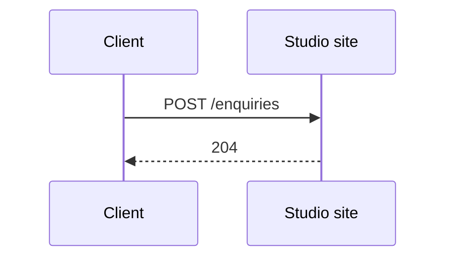
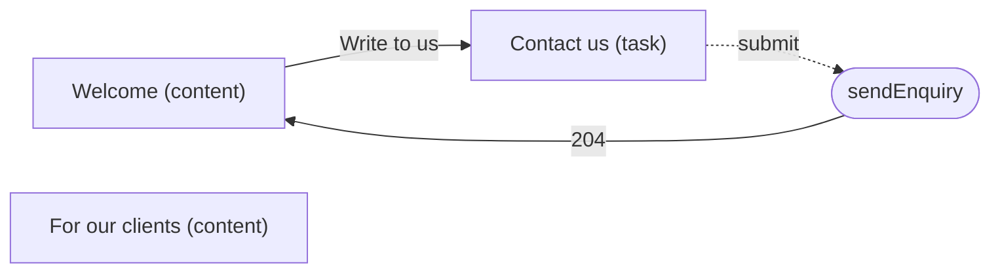
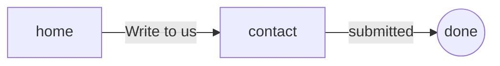

<!-- Generated by specarch document techspec from ../project/specarch.yaml, version 1.0.0; meta-model 0.3. Do not edit this file: change the YAML and generate again. -->

# Studio site: technical specification

Version 1.0.0 of the specification: 1 HTTP operation, 3 pages, 1 flow and 12 tests. The chapters follow arc42, and a chapter with nothing in the specification is left out.

**Problems:** 1 warning concerns this document; it is marked by a Problem paragraph at its element, or below when the document shows no element for it. The problems file lists every problem, and specarch validate prints them.

## 1. Introduction and goals

### Stakeholders

| Stakeholder | Who they are | Concerns |
|---|---|---|
| owner | The studio's owner. |   |

## 3. Context

The interfaces the system offers, as its clients see them.

### HTTP operations

| Method and path | Operation | Summary | Permission |
|---|---|---|---|
| POST /enquiries | sendEnquiry | Send an enquiry | public |

## 6. Runtime view

### sendEnquiry (POST /enquiries)

Takes no parameters.

Request body, application/json, optional:

| Field | Type | Required | Limits | Description |
|---|---|---|---|---|
| email | string | yes | at most 200 characters, a valid email | Your email |
| message | string | yes | at least 1 character, at most 2000 characters | Your message |

Responses:

| Status | Meaning | Body |
|---|---|---|
| 204 | The enquiry is sent. | none |

## 8. Cross-cutting concepts

### Permissions

Access is fail-closed: every operation, command and page names the one permission it needs, and only the roles below grant one.

| Permission | visitor | client | public |
|---|---|---|---|
| public | yes | yes | everyone |
| clients.read | | yes | |

### Sessions

A caller's session expires after PT30M without a request, and after PT12H from signing in, whatever the caller does. Every operation, command and page with a permission other than public refuses a caller whose session has expired.

### Pages

The menu, each entry shown to who may open its page:

- Studio
  - Home: page home, public
  - Clients: page clients, clients.read

| Page | Kind | Route | Entity | Permission | Shows |
|---|---|---|---|---|---|
| home | content | / | none; loads and sends nothing | public | heading 2 Who we are; a paragraph; image images/studio.jpg; heading 3 Where to find us; link Write to us to contact; link Our street on the map to https://example.org/map |
| clients | content | /clients | none; loads and sends nothing | clients.read | a paragraph |
| contact | task | /contact | none; submits to sendEnquiry | public | email, message |

**Problem on home:** warning: test_red_missing: page home has no red scenario; add one under tests, for example home-refused: { page: home, scenario: red, given: "...", when: "...", then: "it is refused" } [test_red_missing@specarch.yaml#/pages/home]

### Flow write-to-the-studio

A visitor follows the link on the home page and sends an enquiry. Done by visitor.

### Accessibility

The target is WCAG 2.2 at level AA. Of its criteria, these are settled in the design or left to the generator, as the table says; the validator checks those marked checked, and every other criterion of the level is a person's to check at commissioning.

| Criterion | Level | Met by | How |
|---|---|---|---|
| 1.1.1 Non-text content | A | a person | an image's text alternative is written where the image is chosen |
| 1.3.1 Info and relationships | A | the generator | a page's title, its labels and its order become the stack's headings and labelled controls |
| 1.4.1 Use of color | A | the generator | a state or a value is shown in text as well as in colour |
| 1.4.3 Contrast (minimum) | AA | the generator | the stack's own colours, which a person checks |
| 1.4.11 Non-text contrast | AA | the generator | the stack's own colours for the parts of controls, which a person checks |
| 2.1.1 Keyboard | A | the generator | every action and field is reachable without a pointer |
| 2.4.3 Focus order | A | the design | the order of a page's fields and columns is its focus order |
| 2.4.6 Headings and labels | AA | the design, checked | every page has a title, every field it shows or filters by a title, and every action a label of its own |
| 2.5.8 Target size (minimum) | AA | the generator | every control is at least 24 by 24 CSS pixels |
| 3.2.3 Consistent navigation | AA | the design | the menu is one tree, the same on every page |
| 3.3.1 Error identification | A | the design, checked | every failed state a page declares is a message in a full sentence, shown beside the field it names when it names one |
| 3.3.2 Labels or instructions | A | the design, checked | every field a page shows or filters by has a title |
| 4.1.2 Name, role, value | A | the design, checked, and the generator | every action has a label of its own; the generator gives each control its role |
| 4.1.3 Status messages | AA | the design and the generator | every event's message and every state is text, which the generator announces without moving focus |

## 10. Quality requirements

The design tests: what must hold on every implementation. Golden scenarios succeed; red scenarios are refused.

| Test | Subject | Level | Scenario | Given | When | Then |
|---|---|---|---|---|---|---|
| clients-denied-with-expired-session | page clients | system | red | a caller whose session has expired | the page clients is opened | it is refused as not signed in |
| clients-denied-without-clients-read | page clients | system | red | a caller without clients.read | the page clients is opened | it is refused as not allowed |
| clients-succeeds | page clients | system | golden | a caller with clients.read | the page clients is opened | it shows the page |
| contact-refused | page contact | system | red | any caller | the page contact is submitted without a message | it is refused beside the message, and nothing is sent |
| contact-succeeds | page contact | system | golden | any caller | the page contact is submitted with every field valid | it is answered 204 and leads to the page home, saying: Thank you, we will write back. |
| home-succeeds | page home | system | golden | any caller, signed in or not | the page home is opened | it shows the title Welcome, the heading Who we are, the paragraph, the image of the workshop with its text, the heading Where to find us and the links Write to us and Our street on the map, in that order |
| send-enquiry-email-not-a-valid-email | operation sendEnquiry | system | red | ... | sendEnquiry is called with email that is not a valid email | it is refused |
| send-enquiry-missing-email | operation sendEnquiry | system | red | ... | sendEnquiry is called without email | it is refused |
| send-enquiry-missing-message | operation sendEnquiry | system | red | ... | sendEnquiry is called without message | it is refused |
| send-enquiry-succeeds | operation sendEnquiry | system | golden | any caller | sendEnquiry is called with values inside every limit | it answers 204: The enquiry is sent. |
| write-to-the-studio-refused |   | system | red | a visitor | they follow Write to us and send the enquiry without an email | it is refused on the page contact, and they stay there |
| write-to-the-studio-succeeds |   | system | golden | a visitor | they go through home, contact | each step leads to the next, and the last completes |

**Origin on clients-denied-with-expired-session:** inferred.

**Insight on clients-denied-with-expired-session:** Written by specarch derive: users get this wrong often, so the case is written. A draft: complete the given, when and then, and remove what does not hold.

**Origin on clients-denied-without-clients-read:** inferred.

**Insight on clients-denied-without-clients-read:** Written by specarch derive: users get this wrong often, so the case is written. A draft: complete the given, when and then, and remove what does not hold.

**Origin on clients-succeeds:** inferred.

**Insight on clients-succeeds:** Written by specarch derive: every subject needs a golden path, and this is the success the design gives. A draft: complete the given, when and then, and remove what does not hold.

**Origin on contact-succeeds:** inferred.

**Insight on contact-succeeds:** Written by specarch derive: every subject needs a golden path, and this is the success the design gives. A draft: complete the given, when and then, and remove what does not hold.

**Origin on send-enquiry-email-not-a-valid-email:** inferred.

**Insight on send-enquiry-email-not-a-valid-email:** Written by specarch derive: users get this wrong often, so the case is written. A draft: complete the given, when and then, and remove what does not hold.

**Origin on send-enquiry-missing-email:** inferred.

**Insight on send-enquiry-missing-email:** Written by specarch derive: users get this wrong often, so the case is written. A draft: complete the given, when and then, and remove what does not hold.

**Origin on send-enquiry-missing-message:** inferred.

**Insight on send-enquiry-missing-message:** Written by specarch derive: users get this wrong often, so the case is written. A draft: complete the given, when and then, and remove what does not hold.

**Origin on send-enquiry-succeeds:** inferred.

**Insight on send-enquiry-succeeds:** Written by specarch derive: every subject needs a golden path, and this is the success the design gives. A draft: complete the given, when and then, and remove what does not hold.

**Origin on write-to-the-studio-succeeds:** inferred.

**Insight on write-to-the-studio-succeeds:** Written by specarch derive: every subject needs a golden path, and this is the success the design gives. A draft: complete the given, when and then, and remove what does not hold.

