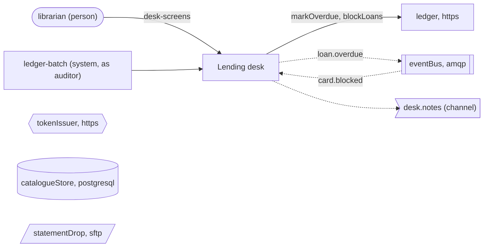

<!-- Generated by specarch document techspec from ../project/specarch.yaml, version 1.0.0; meta-model 0.3. Do not edit this file: change the YAML and generate again. -->

# Lending desk: technical specification

Version 1.0.0 of the specification: 3 channels, 5 dependencies and 8 tests. The chapters follow arc42, and a chapter with nothing in the specification is left out.

## 1. Introduction and goals

## 3. Context

The interfaces the system offers, as its clients see them.

Who uses the system and what it reaches: a person per role, a system per calling service with the roles it holds, and the dependencies by kind with their protocol, each edge naming the operations and jobs that call it or the channel it carries.

### Channels

| Channel | Message | Summary |
|---|---|---|
| loan.overdue | LoanOverdue | A loan became overdue. |
| card.blocked | CardBlocked | A card was blocked. |
| desk.notes | NoteAdded | A note was added. |

### Dependencies

External systems the operations call. A call that fails, or that does not answer within its time limit, is given up, and the operation answers as its failure response says.

| Dependency | Time limit per call | Called by | Description |
|---|---|---|---|
| ledger | PT5S |   | The finance system's ledger. |
| eventBus | PT1S |   | The library's message broker. |
| statementDrop | PT30S |   | The bank's drop for the monthly statements. |
| tokenIssuer | PT2S |   | The issuer of the staff's tokens. |
| catalogueStore | PT2S |   | The catalogue team's database, read directly. |

## 6. Runtime view

### Job markOverdue

Every night, marks the loans past their due date and says so.

Runs on the schedule `0 2 * * *` (UTC), as the role scheduler. Calls ledger (within PT5S). Publishes loan.overdue/LoanOverdue and desk.notes/NoteAdded. Running it twice over the same records changes nothing a second time.

### Job blockLoans

Stops lending on a card the card office blocked.

Runs for each card.blocked/CardBlocked it consumes, as the role scheduler. Calls ledger (within PT5S). Running it twice over the same records changes nothing a second time.

## 8. Cross-cutting concepts

### Permissions

Access is fail-closed: every operation, command and page names the one permission it needs, and only the roles below grant one.

| Permission | librarian | scheduler | auditor | ledger-batch (service) |
|---|---|---|---|---|
| loans.read | yes | yes | yes | yes |
| loans.return | yes | | | |

The clients: the programs that call the system, each by its software_id. An application is where a person signs in; a service calls on its own account with the roles it holds and a proof of its identity on each request, or carries a person's call. A client with roles is a column of the matrix above. A client is admitted only where an operation's callers lists it; a public client, one with no proof, has a name that is the issuer's word and no proof of origin.

| Client | Kind | Admitted versions | Roles | Proof |
|---|---|---|---|---|
| desk-screens | application | any | none | none: a public client, whose name in a token is the issuer's word |
| ledger-batch | service | any | auditor | a signed request (RFC 9421), hmac-sha256 over @method, @path, content-digest, date |

## 10. Quality requirements

The design tests: what must hold on every implementation. Golden scenarios succeed; red scenarios are refused.

| Test | Subject | Level | Scenario | Given | When | Then |
|---|---|---|---|---|---|---|
| mark-overdue-runs-twice | job markOverdue | system | golden | the job markOverdue has run | it runs again over the same records | nothing changes a second time |
| mark-overdue-dependency-fails-ledger | job markOverdue | system | red | ledger answers with an error | the job markOverdue runs | the run is retried |
| mark-overdue-dependency-times-out-ledger | job markOverdue | system | red | ledger does not answer within PT5S | the job markOverdue runs | the call is given up and the run is retried |
| mark-overdue-succeeds | job markOverdue | system | golden | open loans past their due date | the job markOverdue runs | it completes |
| block-loans-runs-twice | job blockLoans | system | golden | the job blockLoans has run | the same card.blocked/CardBlocked arrives again | nothing changes a second time |
| block-loans-dependency-fails-ledger | job blockLoans | system | red | ledger answers with an error | a card.blocked/CardBlocked arrives for the job blockLoans | the message is handled again |
| block-loans-dependency-times-out-ledger | job blockLoans | system | red | ledger does not answer within PT5S | a card.blocked/CardBlocked arrives for the job blockLoans | the call is given up and the run is retried |
| block-loans-succeeds | job blockLoans | system | golden | a card with open loans | a card.blocked/CardBlocked arrives for the job blockLoans | it completes |

