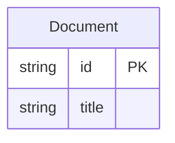
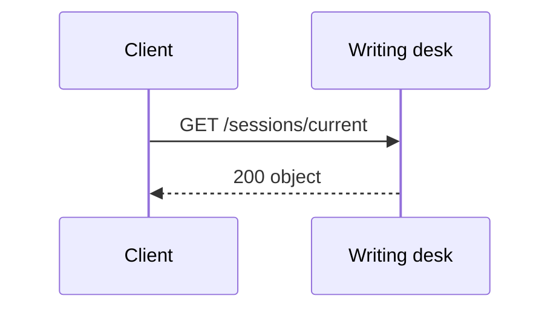
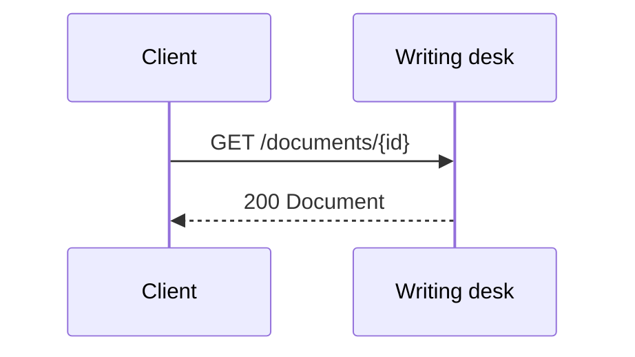
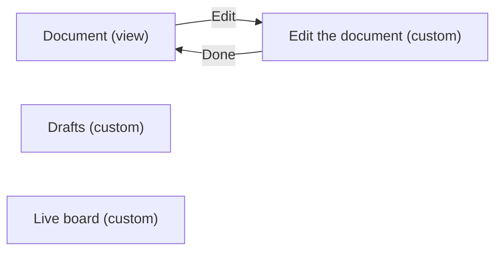
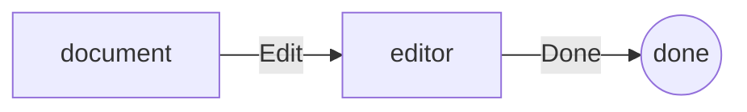

<!-- Generated by specarch document techspec from ../project/specarch.yaml, version 1.0.0; meta-model 1.0.0. Do not edit this file: change the YAML and generate again. -->

# Writing desk: technical specification

Version 1.0.0 of the specification: 1 entity, 2 HTTP operations, 4 pages, 1 flow and 17 tests. The chapters follow arc42, and a chapter with nothing in the specification is left out.

**Problems:** 3 warnings concern this document; each is marked by a Problem paragraph at its element, or below when the document shows no element for it. The problems file lists every problem, and specarch validate prints them.

## 1. Introduction and goals

### Stakeholders

| Stakeholder | Who they are | Concerns |
|---|---|---|
| owner | The desk's owner. |   |

## 3. Context

The interfaces the system offers, as its clients see them.

### HTTP operations

| Method and path | Operation | Summary | Permission |
|---|---|---|---|
| GET /sessions/current | getSession | Who is signed in | public |
| GET /documents/{id} | getDocument | Read a document | documents.edit |

## 5. Building blocks

### Document

| Field | Type | Required | Limits | Description |
|---|---|---|---|---|
| id | string | yes | at most 36 characters |   |
| title | string | yes | at most 200 characters |   |

Primary key: id.

## 6. Runtime view

### getSession (GET /sessions/current)

**Problem:** warning: test_red_missing: operation getSession has no red scenario; add one under tests, for example get-session-refused: { operation: getSession, scenario: red, given: "...", when: "...", then: "it is refused" } [test_red_missing@specarch.yaml#/paths/~1sessions~1current/get]

Takes no parameters and no request body.

Responses:

| Status | Meaning | Body |
|---|---|---|
| 200 | The session. | an object, fields below |

Body of the 200 response:

| Field | Type | Required | Limits | Description |
|---|---|---|---|---|
| open | bool | yes |   |   |
| granted | list of string | yes | at most 50 items |   |

### getDocument (GET /documents/{id})

Parameters:

| Parameter | In | Type | Required | Limits | Description |
|---|---|---|---|---|---|
| id | path | string | yes | at most 36 characters |   |

Responses:

| Status | Meaning | Body |
|---|---|---|
| 200 | The document. | [Document](#document) |

## 8. Cross-cutting concepts

### Permissions

Access is fail-closed: every operation, command and page names the one permission it needs, and only the roles below grant one.

| Permission | visitor | writer | public |
|---|---|---|---|
| public | yes | yes | everyone |
| documents.edit | | yes | |

### Sessions

A caller's session expires after PT30M without a request, and after PT12H from signing in, whatever the caller does. Every operation, command and page with a permission other than public refuses a caller whose session has expired.

### Pages

The menu, each entry shown to who may open its page:

- Desk
  - Board: page board, public
  - Drafts: page drafts, documents.edit

| Page | Kind | Route | Entity | Permission | Shows |
|---|---|---|---|---|---|
| document | view | /documents/{id} | Document | documents.edit | title |
| editor | custom | /documents/{id}/edit | Document | documents.edit | the project's own screen, built by hand: The document's text, edited by several writers at once, each change shown to the others as it is typed. |
| drafts | custom | /drafts | none | documents.edit | the project's own screen, built by hand: The drafts on a board, moved between columns by dragging. |
| board | custom | /board | none | public | the project's own screen, built by hand |

**Problem on board:** warning: test_red_missing: page board has no red scenario; add one under tests, for example board-refused: { page: board, scenario: red, given: "...", when: "...", then: "it is refused" } [test_red_missing@specarch.yaml#/pages/board]

### Flow edit-a-document

A writer opens a document, edits it and goes back to it. Done by writer.

**Problem:** warning: test_red_missing: flow edit-a-document has no red scenario; add one under tests, for example edit-a-document-refused: { flow: edit-a-document, scenario: red, given: "...", when: "...", then: "it is refused" } [test_red_missing@specarch.yaml#/flows/edit-a-document]

## 10. Quality requirements

The design tests: what must hold on every implementation. Golden scenarios succeed; red scenarios are refused.

| Test | Subject | Level | Scenario | Given | When | Then |
|---|---|---|---|---|---|---|
| board-succeeds | page board | system | golden | any caller | the page board is opened | it shows the page |
| document-denied-with-expired-session | page document | system | red | a caller whose session has expired | the page document is opened | it is refused as not signed in |
| document-denied-without-documents-edit | page document | system | red | a caller without documents.edit | the page document is opened | it is refused as not allowed |
| document-not-found-id | page document | system | red | no record has that id | the page document is opened for that id | it says the record was not found |
| document-succeeds | page document | system | golden | a caller with documents.edit | the page document is opened for a record that exists | it shows the page |
| drafts-denied-with-expired-session | page drafts | system | red | a caller whose session has expired | the page drafts is opened | it is refused as not signed in |
| drafts-denied-without-documents-edit | page drafts | system | red | a caller without documents.edit | the page drafts is opened | it is refused as not allowed |
| drafts-succeeds | page drafts | system | golden | a caller with documents.edit | the page drafts is opened | it shows the page |
| edit-a-document-succeeds |   | system | golden | a writer | they go through document, editor | each step leads to the next, and the last completes |
| editor-denied-with-expired-session | page editor | system | red | a caller whose session has expired | the page editor is opened | it is refused as not signed in |
| editor-denied-without-documents-edit | page editor | system | red | a caller without documents.edit | the page editor is opened | it is refused as not allowed |
| editor-succeeds | page editor | system | golden | a caller with documents.edit | the page editor is opened for a record that exists | it shows the page |
| get-document-denied-with-expired-session | operation getDocument | system | red | a caller whose session has expired | getDocument is called | it is refused as not signed in |
| get-document-denied-without-documents-edit | operation getDocument | system | red | a caller without documents.edit | getDocument is called | it is refused as not allowed |
| get-document-not-found-id | operation getDocument | system | red | no record has that id | getDocument is called with that id | it is refused as not found |
| get-document-succeeds | operation getDocument | system | golden | a caller with documents.edit | getDocument is called with values inside every limit | it answers 200: The document. |
| get-session-succeeds | operation getSession | system | golden | any caller | getSession is called | it answers 200: The session. |

**Origin on board-succeeds:** inferred.

**Insight on board-succeeds:** Written by specarch derive: every subject needs a golden path, and this is the success the design gives. A draft: complete the given, when and then, and remove what does not hold.

**Origin on document-denied-with-expired-session:** inferred.

**Insight on document-denied-with-expired-session:** Written by specarch derive: users get this wrong often, so the case is written. A draft: complete the given, when and then, and remove what does not hold.

**Origin on document-denied-without-documents-edit:** inferred.

**Insight on document-denied-without-documents-edit:** Written by specarch derive: users get this wrong often, so the case is written. A draft: complete the given, when and then, and remove what does not hold.

**Origin on document-not-found-id:** inferred.

**Insight on document-not-found-id:** Written by specarch derive: users get this wrong often, so the case is written. A draft: complete the given, when and then, and remove what does not hold.

**Origin on document-succeeds:** inferred.

**Insight on document-succeeds:** Written by specarch derive: every subject needs a golden path, and this is the success the design gives. A draft: complete the given, when and then, and remove what does not hold.

**Origin on drafts-denied-with-expired-session:** inferred.

**Insight on drafts-denied-with-expired-session:** Written by specarch derive: users get this wrong often, so the case is written. A draft: complete the given, when and then, and remove what does not hold.

**Origin on drafts-denied-without-documents-edit:** inferred.

**Insight on drafts-denied-without-documents-edit:** Written by specarch derive: users get this wrong often, so the case is written. A draft: complete the given, when and then, and remove what does not hold.

**Origin on drafts-succeeds:** inferred.

**Insight on drafts-succeeds:** Written by specarch derive: every subject needs a golden path, and this is the success the design gives. A draft: complete the given, when and then, and remove what does not hold.

**Origin on edit-a-document-succeeds:** inferred.

**Insight on edit-a-document-succeeds:** Written by specarch derive: every subject needs a golden path, and this is the success the design gives. A draft: complete the given, when and then, and remove what does not hold.

**Origin on editor-denied-with-expired-session:** inferred.

**Insight on editor-denied-with-expired-session:** Written by specarch derive: users get this wrong often, so the case is written. A draft: complete the given, when and then, and remove what does not hold.

**Origin on editor-denied-without-documents-edit:** inferred.

**Insight on editor-denied-without-documents-edit:** Written by specarch derive: users get this wrong often, so the case is written. A draft: complete the given, when and then, and remove what does not hold.

**Origin on editor-succeeds:** inferred.

**Insight on editor-succeeds:** Written by specarch derive: every subject needs a golden path, and this is the success the design gives. A draft: complete the given, when and then, and remove what does not hold.

**Origin on get-document-denied-with-expired-session:** inferred.

**Insight on get-document-denied-with-expired-session:** Written by specarch derive: users get this wrong often, so the case is written. A draft: complete the given, when and then, and remove what does not hold.

**Origin on get-document-denied-without-documents-edit:** inferred.

**Insight on get-document-denied-without-documents-edit:** Written by specarch derive: users get this wrong often, so the case is written. A draft: complete the given, when and then, and remove what does not hold.

**Origin on get-document-not-found-id:** inferred.

**Insight on get-document-not-found-id:** Written by specarch derive: users get this wrong often, so the case is written. A draft: complete the given, when and then, and remove what does not hold.

**Origin on get-document-succeeds:** inferred.

**Insight on get-document-succeeds:** Written by specarch derive: every subject needs a golden path, and this is the success the design gives. A draft: complete the given, when and then, and remove what does not hold.

**Origin on get-session-succeeds:** inferred.

**Insight on get-session-succeeds:** Written by specarch derive: every subject needs a golden path, and this is the success the design gives. A draft: complete the given, when and then, and remove what does not hold.

