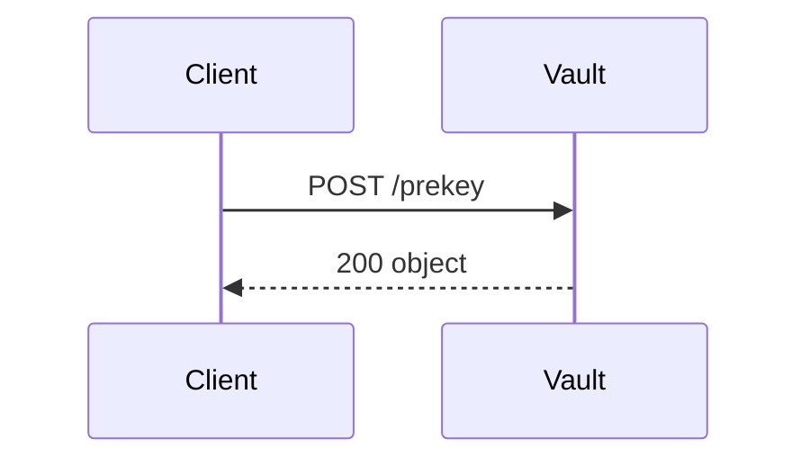
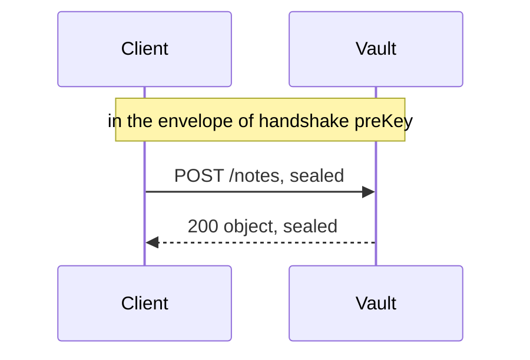
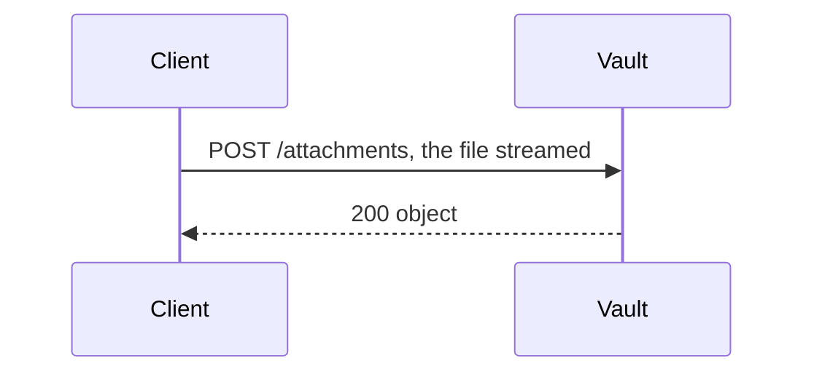
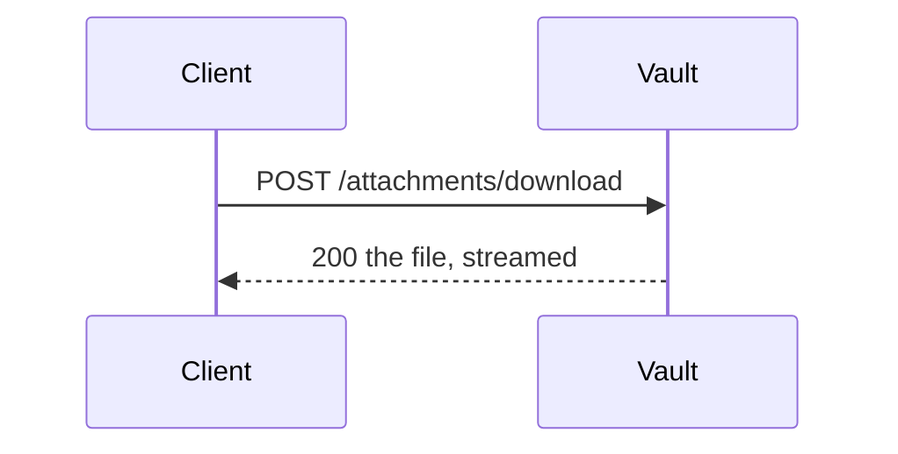
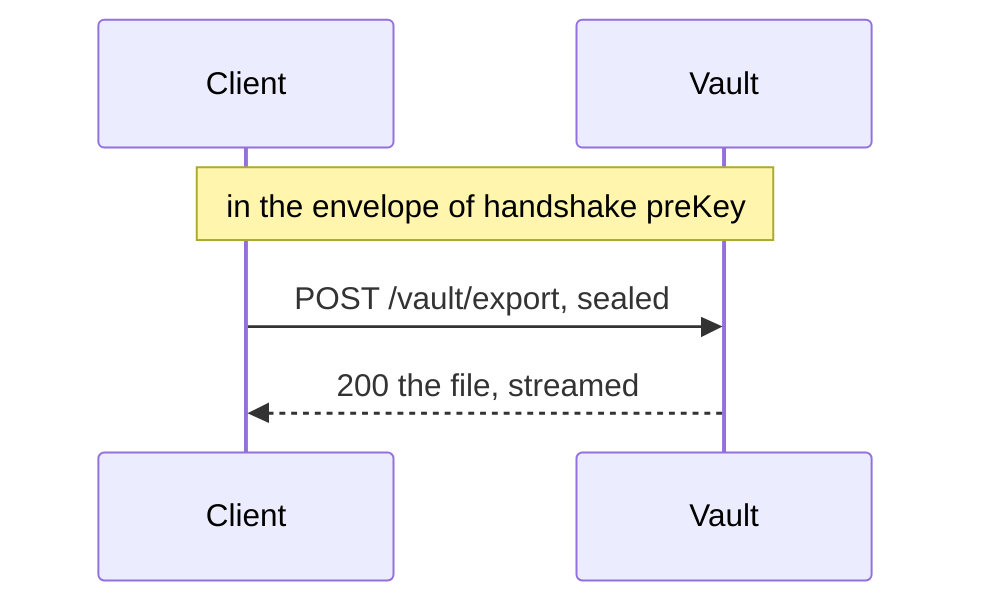

<!-- Generated by specarch document techspec from ../project/specarch.yaml, version 1.0.0; meta-model 0.1. Do not edit this file: change the YAML and generate again. -->

# Vault: technical specification

Version 1.0.0 of the specification: 5 HTTP operations. The chapters follow arc42, and a chapter with nothing in the specification is left out.

**Problems:** 20 warnings concern this document; each is marked by a Problem paragraph at its element, or below when the document shows no element for it. The problems file lists every problem, and specarch validate prints them.

**Problem:** warning: meta_model_version: the specification is written against meta-model 0.1, an earlier version read beside 1.0.0 with this warning, and its missing tests are warnings; run specarch derive to write the tests 0.2 and later ask for, then run specarch upgrade --dry-run on the specification to see what moving it to 1.0.0 changes, and specarch upgrade to move it [meta_model_version@specarch.yaml#/specarch]

## 1. Introduction and goals

### Stakeholders

| Stakeholder | Who they are | Concerns |
|---|---|---|
| owner | The product owner. |   |

## 3. Context

The interfaces the system offers, as its clients see them.

Every property goes on the wire in snake_case (info.wireNames): a field this specification names dueOn is due_on in a body, a parameter's schema and a message. A parameter's own name is written as it is on the wire.

### HTTP operations

| Method and path | Operation | Summary | Permission |
|---|---|---|---|
| POST /prekey | issuePreKey | Issue a pre-key | public |
| POST /notes | addNote | Add a note | notes.write |
| POST /attachments | uploadAttachment | Upload an attachment | notes.write |
| POST /attachments/download | downloadAttachment | Download an attachment | notes.read |
| POST /vault/export | exportVault | Export the vault | notes.read |

## 6. Runtime view

### Problem types

Every refusal is an RFC 9457 problem document of one of these types; each operation below names the ones it answers with.

| Problem type | Status | Title | When |
|---|---|---|---|
| attachment-not-found | 404 | No such attachment | No attachment has the id. |

### Handshakes

Before it calls an operation that names one, a client performs the handshake; its requests on that operation and the answers then travel in an envelope encrypted with the cipher under a key both sides derived and signed by the sender, so that nothing between them reads or alters a body. The bytes of the envelope are the implementation's.

| Handshake | Key agreement | Signature | Cipher | Established by | Lifetime | Envelopes per handshake |
|---|---|---|---|---|---|---|
| preKey | x25519 | ed25519 | aes-256-cbc | issuePreKey (POST /prekey) | PT5M | 1 |

The pre-key exchange every call but the exchange itself travels under; a pre-key carries one envelope.

What a client does for preKey:

1. It makes a signing key pair (ed25519) and two key-agreement pairs (x25519).
2. It calls issuePreKey (POST /prekey) with its three public keys and receives the service's three public keys and the handshake's index.
3. It derives two shared secrets by x25519, one from each agreement pair: the first seals its requests, the second opens the answers.
4. For each operation under the handshake it encrypts the request body with aes-256-cbc under the first secret, signs the result with its ed25519 key and sends it with the index; it opens each answer under the second secret and verifies the service's signature.
5. After PT5M, or after it has carried 1 envelope, the handshake is no longer accepted, and the client performs it again before its next call.

### issuePreKey (POST /prekey)

The client sends its signing key and two agreement keys and receives the vault's with the pre-key's index.

**Problem:** warning: test_case_missing: operation issuePreKey has no red scenario for "missing a0"; add under tests issue-pre-key-missing-a0: { operation: issuePreKey, scenario: red, covers: [missing a0], given: "...", when: "issuePreKey is called without a0", then: "it is refused" } [test_case_missing.2e12c6a2@specarch.yaml#/paths/~1prekey/post]

**Problem:** warning: test_case_missing: operation issuePreKey has no red scenario for "missing a1"; add under tests issue-pre-key-missing-a1: { operation: issuePreKey, scenario: red, covers: [missing a1], given: "...", when: "issuePreKey is called without a1", then: "it is refused" } [test_case_missing.c87eefbc@specarch.yaml#/paths/~1prekey/post]

**Problem:** warning: test_case_missing: operation issuePreKey has no red scenario for "missing a2"; add under tests issue-pre-key-missing-a2: { operation: issuePreKey, scenario: red, covers: [missing a2], given: "...", when: "issuePreKey is called without a2", then: "it is refused" } [test_case_missing.6be9592e@specarch.yaml#/paths/~1prekey/post]

**Problem:** warning: test_golden_missing: operation issuePreKey has no golden scenario; add one under tests, for example issue-pre-key-succeeds: { operation: issuePreKey, scenario: golden, given: "any caller", when: "issuePreKey is called with values inside every limit", then: "it answers 200: The vault's keys and the pre-key's index." } [test_golden_missing@specarch.yaml#/paths/~1prekey/post]

Takes no parameters.

Request body, application/json, required:

| Field | Type | Required | Limits | Description |
|---|---|---|---|---|
| a0 | string | yes |   | The client's Ed25519 public key, hex. |
| a1 | string | yes |   | The client's first X25519 public key, hex. |
| a2 | string | yes |   | The client's second X25519 public key, hex. |

Responses:

| Status | Meaning | Body |
|---|---|---|
| 200 | The vault's keys and the pre-key's index. | an object, fields below |

Body of the 200 response:

| Field | Type | Required | Limits | Description |
|---|---|---|---|---|
| i | string | yes |   |   |
| b0 | string | yes |   |   |
| b1 | string | yes |   |   |
| b2 | string | yes |   |   |

### addNote (POST /notes)

**Problem:** warning: test_case_missing: operation addNote has no red scenario for "denied without notes.write"; add under tests add-note-denied-without-notes-write: { operation: addNote, scenario: red, covers: [denied without notes.write], given: "a caller without notes.write", when: "addNote is called", then: "it is refused as not allowed" } [test_case_missing.ab142949@specarch.yaml#/paths/~1notes/post]

**Problem:** warning: test_case_missing: operation addNote has no red scenario for "expired handshake preKey"; add under tests add-note-expired-handshake-pre-key: { operation: addNote, scenario: red, covers: [expired handshake preKey], given: "a caller whose handshake preKey has expired or has carried its 1 envelope", when: "addNote is called through that handshake", then: "it is refused and the caller establishes a new handshake" } [test_case_missing.8f487554@specarch.yaml#/paths/~1notes/post]

**Problem:** warning: test_case_missing: operation addNote has no red scenario for "missing title"; add under tests add-note-missing-title: { operation: addNote, scenario: red, covers: [missing title], given: "...", when: "addNote is called without title", then: "it is refused" } [test_case_missing.a17ea15d@specarch.yaml#/paths/~1notes/post]

**Problem:** warning: test_golden_missing: operation addNote has no golden scenario; add one under tests, for example add-note-succeeds: { operation: addNote, scenario: golden, given: "a caller with notes.write", when: "addNote is called with values inside every limit", then: "it answers 200: The note is stored." } [test_golden_missing@specarch.yaml#/paths/~1notes/post]

Travels in the envelope of handshake preKey, established by issuePreKey (POST /prekey): the client seals and signs the request below and opens the answer (see Handshakes above).

Takes no parameters.

Request body, application/json, required:

| Field | Type | Required | Limits | Description |
|---|---|---|---|---|
| title | string | yes | at least 1 character, at most 120 characters |   |
| text | string |   |   |   |

Responses:

| Status | Meaning | Body |
|---|---|---|
| 200 | The note is stored. | an object, fields below |

Body of the 200 response:

| Field | Type | Required | Limits | Description |
|---|---|---|---|---|
| noteId | string | yes |   |   |

### uploadAttachment (POST /attachments)

**Problem:** warning: test_case_missing: operation uploadAttachment has no red scenario for "denied without notes.write"; add under tests upload-attachment-denied-without-notes-write: { operation: uploadAttachment, scenario: red, covers: [denied without notes.write], given: "a caller without notes.write", when: "uploadAttachment is called", then: "it is refused as not allowed" } [test_case_missing.d7b5e7bf@specarch.yaml#/paths/~1attachments/post]

**Problem:** warning: test_case_missing: operation uploadAttachment has no red scenario for "missing noteId"; add under tests upload-attachment-missing-note-id: { operation: uploadAttachment, scenario: red, covers: [missing noteId], given: "...", when: "uploadAttachment is called without noteId", then: "it is refused" } [test_case_missing.f405bd3c@specarch.yaml#/paths/~1attachments/post]

**Problem:** warning: test_golden_missing: operation uploadAttachment has no golden scenario; add one under tests, for example upload-attachment-succeeds: { operation: uploadAttachment, scenario: golden, given: "a caller with notes.write", when: "uploadAttachment is called with values inside every limit", then: "it answers 200: The attachment is stored." } [test_golden_missing@specarch.yaml#/paths/~1attachments/post]

Streams the request body in as a file, application/octet-stream, of at most 1073741824 bytes, read as it arrives and never held whole; the body is the file, and the parameters listed below travel beside it.

Takes no path or query parameters.

Parameters, sent beside the file as one JSON object in a header the stack names:

| Field | Type | Required | Limits | Description |
|---|---|---|---|---|
| noteId | string | yes | at least 1 character, at most 64 characters | The note the attachment belongs to. |
| tags | list of string |   | at most 10 items | Words to find the attachment by. |

Limits: a request body of at most 1073741824 bytes.

Responses:

| Status | Meaning | Body |
|---|---|---|
| 200 | The attachment is stored. | an object, fields below |

Body of the 200 response:

| Field | Type | Required | Limits | Description |
|---|---|---|---|---|
| attachmentId | string | yes |   |   |
| size | int64 | yes | at least 0, at most 9007199254740991 |   |

### downloadAttachment (POST /attachments/download)

**Problem:** warning: test_case_missing: operation downloadAttachment has no red scenario for "denied without notes.read"; add under tests download-attachment-denied-without-notes-read: { operation: downloadAttachment, scenario: red, covers: [denied without notes.read], given: "a caller without notes.read", when: "downloadAttachment is called", then: "it is refused as not allowed" } [test_case_missing.69bc97c3@specarch.yaml#/paths/~1attachments~1download/post]

**Problem:** warning: test_case_missing: operation downloadAttachment has no red scenario for "missing attachmentId"; add under tests download-attachment-missing-attachment-id: { operation: downloadAttachment, scenario: red, covers: [missing attachmentId], given: "...", when: "downloadAttachment is called without attachmentId", then: "it is refused" } [test_case_missing.5c76ba7e@specarch.yaml#/paths/~1attachments~1download/post]

**Problem:** warning: test_golden_missing: operation downloadAttachment has no golden scenario; add one under tests, for example download-attachment-succeeds: { operation: downloadAttachment, scenario: golden, given: "a caller with notes.read", when: "downloadAttachment is called with values inside every limit", then: "it answers 200: The attachment's bytes." } [test_golden_missing@specarch.yaml#/paths/~1attachments~1download/post]

Streams the response body out as a file, application/octet-stream, of at most 1073741824 bytes, written as it is read and never held whole; a refusal is answered as a problem document instead of the file.

Takes no parameters.

Request body, application/json, required:

| Field | Type | Required | Limits | Description |
|---|---|---|---|---|
| attachmentId | string | yes |   |   |

Limits: .

Responses:

| Status | Meaning | Body |
|---|---|---|
| 200 | The attachment's bytes. | the file, streamed, application/octet-stream, at most 1073741824 bytes |
| 404 | No such attachment. | the problem document attachment-not-found (RFC 9457) |

### exportVault (POST /vault/export)

Asked for in the envelope, answered as a plain stream.

**Problem:** warning: test_case_missing: operation exportVault has no red scenario for "denied without notes.read"; add under tests export-vault-denied-without-notes-read: { operation: exportVault, scenario: red, covers: [denied without notes.read], given: "a caller without notes.read", when: "exportVault is called", then: "it is refused as not allowed" } [test_case_missing.5c2e541b@specarch.yaml#/paths/~1vault~1export/post]

**Problem:** warning: test_case_missing: operation exportVault has no red scenario for "expired handshake preKey"; add under tests export-vault-expired-handshake-pre-key: { operation: exportVault, scenario: red, covers: [expired handshake preKey], given: "a caller whose handshake preKey has expired or has carried its 1 envelope", when: "exportVault is called through that handshake", then: "it is refused and the caller establishes a new handshake" } [test_case_missing.e77a0dac@specarch.yaml#/paths/~1vault~1export/post]

**Problem:** warning: test_case_missing: operation exportVault has no red scenario for "format not one of its values"; add under tests export-vault-format-not-one-of-its-values: { operation: exportVault, scenario: red, covers: [format not one of its values], given: "...", when: "exportVault is called with format set to a value it does not allow", then: "it is refused" } [test_case_missing.bdd56ca4@specarch.yaml#/paths/~1vault~1export/post]

**Problem:** warning: test_case_missing: operation exportVault has no red scenario for "missing format"; add under tests export-vault-missing-format: { operation: exportVault, scenario: red, covers: [missing format], given: "...", when: "exportVault is called without format", then: "it is refused" } [test_case_missing.602d7f8f@specarch.yaml#/paths/~1vault~1export/post]

**Problem:** warning: test_golden_missing: operation exportVault has no golden scenario; add one under tests, for example export-vault-succeeds: { operation: exportVault, scenario: golden, given: "a caller with notes.read", when: "exportVault is called with values inside every limit", then: "it answers 200: The archive." } [test_golden_missing@specarch.yaml#/paths/~1vault~1export/post]

Travels in the envelope of handshake preKey, established by issuePreKey (POST /prekey): the client seals and signs the request below and opens the answer; the file it answers comes back outside the envelope, as a stream (see Handshakes above).

Streams the response body out as a file, application/octet-stream, written as it is read and never held whole; a refusal is answered as a problem document instead of the file.

Takes no parameters.

Request body, application/json, required:

| Field | Type | Required | Limits | Description |
|---|---|---|---|---|
| format | string | yes | one of zip, tar |   |

Responses:

| Status | Meaning | Body |
|---|---|---|
| 200 | The archive. | the file, streamed, application/octet-stream |

## 8. Cross-cutting concepts

### Permissions

Access is fail-closed: every operation, command and page names the one permission it needs, and only the roles below grant one.

| Permission | member | public |
|---|---|---|
| notes.read | yes | |
| notes.write | yes | |
| public | | everyone |

