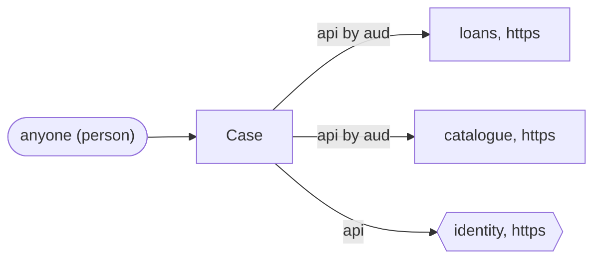
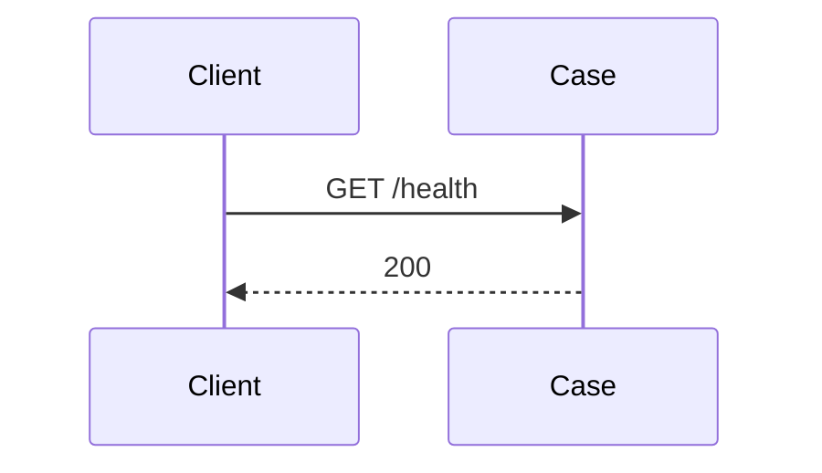
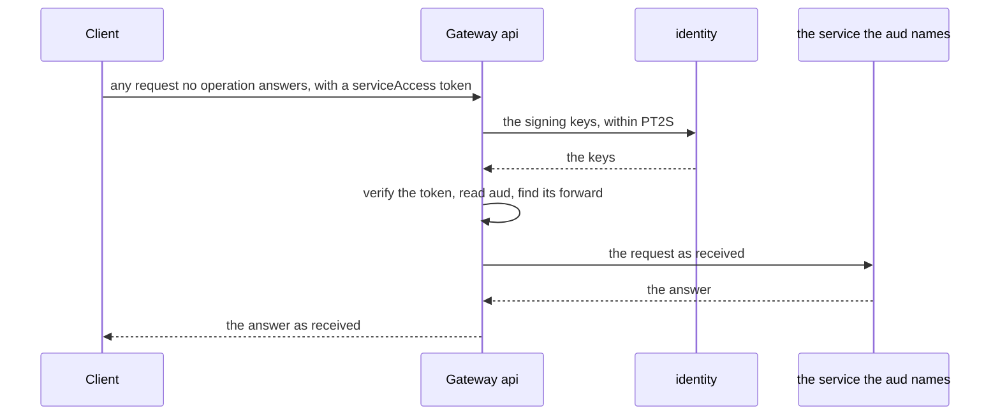

<!-- Generated by specarch document techspec from ../project/specarch.yaml, version 1.0.0; meta-model 1.0.0. Do not edit this file: change the YAML and generate again. -->

# Case: technical specification

Version 1.0.0 of the specification: 1 HTTP operation, 3 dependencies and 5 tests. The chapters follow arc42, and a chapter with nothing in the specification is left out.

## 1. Introduction and goals

## 3. Context

The interfaces the system offers, as its clients see them.

Who uses the system and what it reaches: a person per role, a system per calling service with the roles it holds, and the dependencies by kind with their protocol, each edge naming the operations and jobs that call it or the channel it carries.

### HTTP operations

| Method and path | Operation | Summary | Permission |
|---|---|---|---|
| GET /health | getHealth | The gateway's health | public |

### Dependencies

External systems the operations call. A call that fails, or that does not answer within its time limit, is given up, and the operation answers as its failure response says.

| Dependency | Time limit per call | Called by | Description |
|---|---|---|---|
| identity | PT2S | gateway api | The identity provider whose keys sign the tokens. |
| loans | PT10S | gateway api | The lending desk. |
| catalogue | PT10S | gateway api | The catalogue service. |

## 6. Runtime view

### Problem types

Every refusal is an RFC 9457 problem document of one of these types; each operation below names the ones it answers with.

| Problem type | Status | Title | When |
|---|---|---|---|
| token-invalid | 401 | The token is not valid | The token is missing, badly signed or expired. |
| service-unknown | 404 | No service has this audience | The audience names no forwarded service, or names two. |
| service-failed | 502 | The service did not answer | The forwarded service failed or did not answer in time. |

### getHealth (GET /health)

Takes no parameters and no request body.

Responses:

| Status | Meaning | Body |
|---|---|---|
| 200 | The gateway is up. | none |

### Gateway api

Forwards every request no path answers, as received, to the service the token's audience names.

Verifies the serviceAccess token (jwt, signed with RS256, issued by https://identity.library.example) before it reads anything else, reads its claim aud, and forwards every request no operation of this specification answers, as received, to the service the value names. It checks no permission: the service checks its own.

| Value of aud | Forwarded to | Specification |
|---|---|---|
| https://loans.library.example | loans |   |
| https://catalogue.library.example | catalogue |   |

Calls identity (within PT2S).

| Status | Problem type | When |
|---|---|---|
| 401 | token-invalid | The token is missing, is not signed by the issuer's key, or has expired. |
| 404 | service-unknown | The audience names no forwarded service, or names two. |
| 502 | service-failed | The forwarded service did not answer. |

Tested by api-forwards (forwarded to loans, forwarded to catalogue), api-refuses-tokens (refused with no token, refused with a bad signature, denied with expired serviceAccess) and api-dependencies-fail (dependency fails identity, dependency times out identity, dependency fails loans, dependency times out loans, dependency fails catalogue, dependency times out catalogue).

## 8. Cross-cutting concepts

### Permissions

Access is fail-closed: every operation, command and page names the one permission it needs, and only the roles below grant one.

| Permission | public |
|---|---|
| public | everyone |

The tokens: the formats the service issues and accepts. An access token rides in the Authorization header as a bearer token and is accepted only for the audience it names; a transaction token rides in the Txn-Token header across the trust domain, minted once at the edge and passed on unmodified, and each hop accepts it only from the immediate callers its via names, each proving its workload identity. A claim fills the caller's property of the same name. The one default token is what every operation accepts unless it names another.

| Token | Kind | Header | Audience | Lifetime | Signature | Claims | Accepted by |
|---|---|---|---|---|---|---|---|
| serviceAccess | access token, jwt | Authorization: Bearer | none fixed | PT15M | RS256 | iss, aud, sub | no operation |

## 10. Quality requirements

The design tests: what must hold on every implementation. Golden scenarios succeed; red scenarios are refused.

| Test | Subject | Level | Scenario | Given | When | Then |
|---|---|---|---|---|---|---|
| get-health-succeeds | operation getHealth | system | golden | any caller | getHealth is called | it answers 200 |
| get-health-unknown-path | operation getHealth | system | red | a request for a path below /health | getHealth is called | it is not answered by getHealth |
| api-forwards | gateway api | system | golden | a serviceAccess token whose aud is a value of the forwards | a request no operation answers reaches the gateway api | it reaches the service the value names as received |
| api-refuses-tokens | gateway api | system | red | no token, a badly signed one or an expired one | a request no operation answers reaches the gateway api | it answers 401 token-invalid |
| api-dependencies-fail | gateway api | system | red | a dependency fails or does not answer in time | a request no operation answers reaches the gateway api | it answers 502 service-failed |

