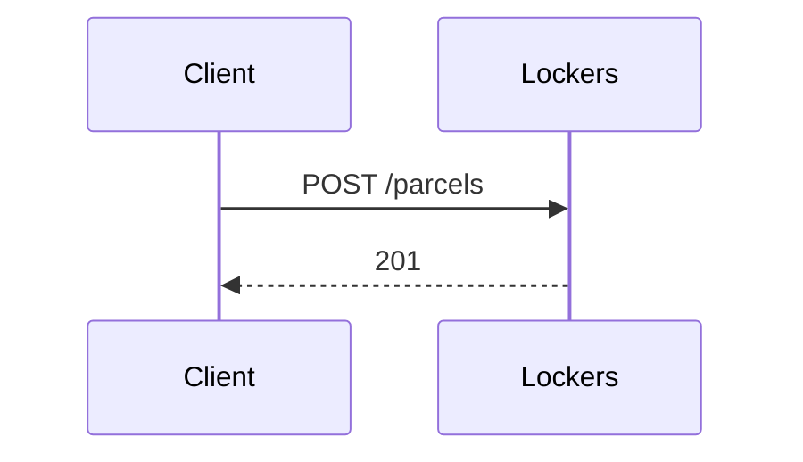
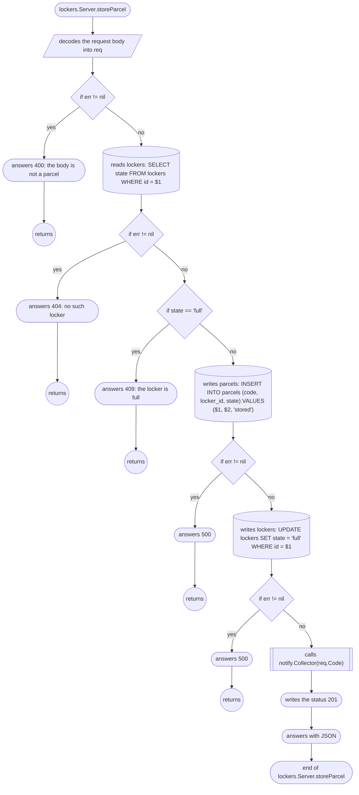
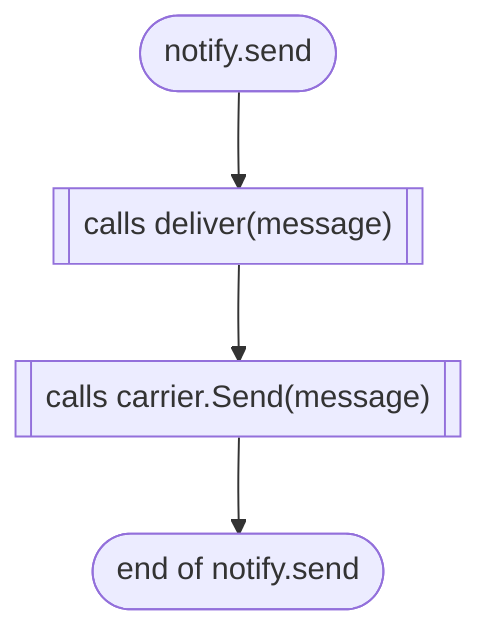
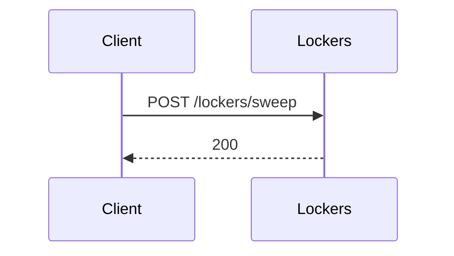
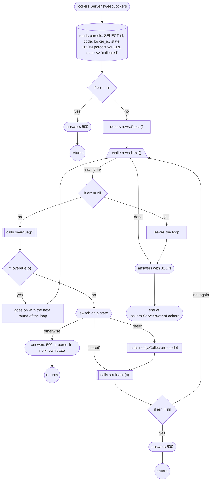
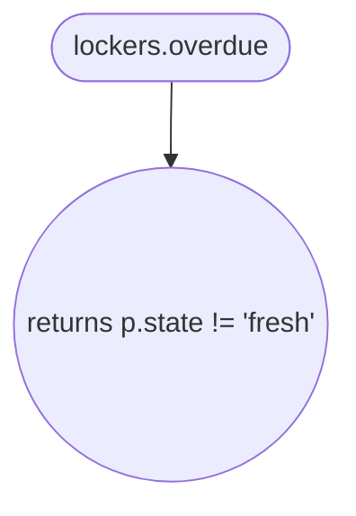
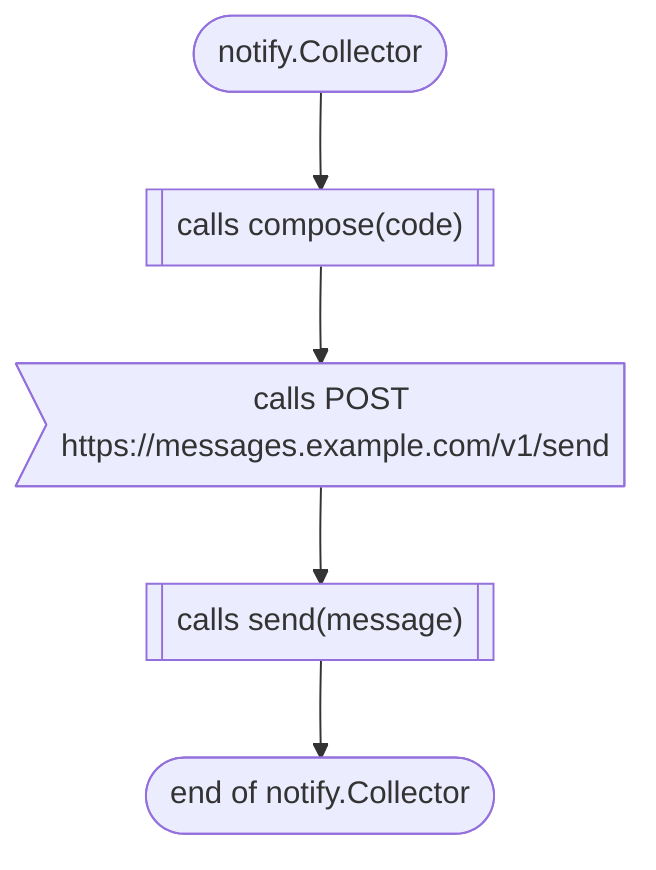
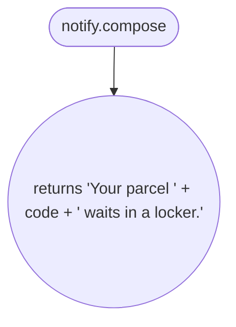
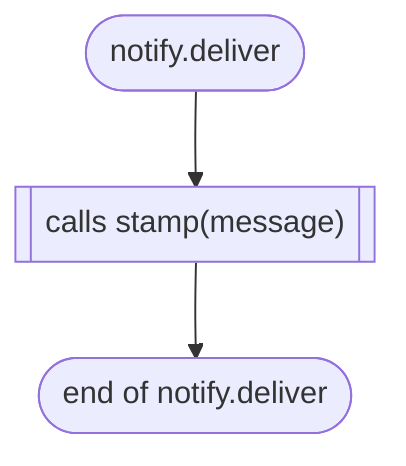
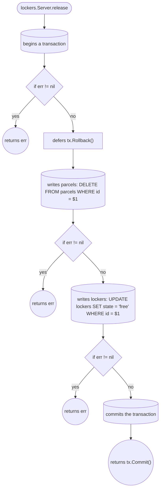

<!-- Generated by specarch document techspec from ../project/specarch.yaml, version 1.0.0, and ../project/lockers.go.specarch-implementation.yaml, version 1.0.0; meta-model 1.0.0. Do not edit this file: change the YAML and generate again. -->

# Lockers: technical specification

Version 1.0.0 of the specification: 2 HTTP operations and 6 tests. The chapters follow arc42, and a chapter with nothing in the specification is left out.

## 1. Introduction and goals

A parcel-locker service, whose handlers were followed into the code.

## 3. Context

The interfaces the system offers, as its clients see them.

### HTTP operations

| Method and path | Operation | Summary | Permission |
|---|---|---|---|
| POST /parcels | storeParcel | Store a parcel | parcels.store |
| POST /lockers/sweep | sweepLockers | Sweep the lockers | lockers.sweep |

## 6. Runtime view

### Problem types

Every refusal is an RFC 9457 problem document of one of these types; each operation below names the ones it answers with.

| Problem type | Status | Title | When |
|---|---|---|---|
| locker-not-found | 404 | No such locker | The locker id names no locker. |
| locker-taken | 409 | Locker taken | The locker is full. |

### storeParcel (POST /parcels)

Puts a parcel into a free locker and tells the collector.

Takes no parameters and no request body.

Responses:

| Status | Meaning | Body |
|---|---|---|
| 201 | The parcel is stored. | none |
| 404 | No such locker. | the problem document locker-not-found (RFC 9457) |
| 409 | The locker is full. | the problem document locker-taken (RFC 9457) |



#### What the handler does

The handler is lockers.Server.storeParcel. Read from the code at commit 1c42c4c by `specarch extract go`, which followed the calls of functions of the same code up to 3 deep from the handler: the handler and 4 functions it reaches. Each chart's node carries its step's id, and the source under the chart is the function as it was at that commit, so the chart can be checked against the code.

**lockers.Server.storeParcel**, lockers/handlers.go lines 20 to 50.



```go
// storeParcel puts a parcel into a locker and tells the collector.
func (s *Server) storeParcel(w http.ResponseWriter, r *http.Request) {
	var req storeRequest
	if err := json.NewDecoder(r.Body).Decode(&req); err != nil {
		http.Error(w, "the body is not a parcel", http.StatusBadRequest)
		return
	}
	var state string
	err := s.db.QueryRow("SELECT state FROM lockers WHERE id = $1", req.LockerID).Scan(&state)
	if err != nil {
		http.Error(w, "no such locker", http.StatusNotFound)
		return
	}
	if state == "full" {
		http.Error(w, "the locker is full", http.StatusConflict)
		return
	}
	_, err = s.db.Exec("INSERT INTO parcels (code, locker_id, state) VALUES ($1, $2, 'stored')", req.Code, req.LockerID)
	if err != nil {
		http.Error(w, err.Error(), http.StatusInternalServerError)
		return
	}
	_, err = s.db.Exec("UPDATE lockers SET state = 'full' WHERE id = $1", req.LockerID)
	if err != nil {
		http.Error(w, err.Error(), http.StatusInternalServerError)
		return
	}
	notify.Collector(req.Code)
	w.WriteHeader(http.StatusCreated)
	json.NewEncoder(w).Encode(map[string]string{"code": req.Code})
}
```

**notify.Collector**, notify/notify.go lines 13 to 19.


```go
// Collector tells a parcel's collector that it waits.
func Collector(code string) {
	message := compose(code)
	req, _ := http.NewRequest(http.MethodPost, "https://messages.example.com/v1/send", nil)
	_ = req
	send(message)
}
```

**notify.compose**, notify/notify.go lines 21 to 24.


```go
// compose is the text of the message.
func compose(code string) string {
	return "Your parcel " + code + " waits in a locker."
}
```

**notify.send**, notify/notify.go lines 26 to 30.



```go
// send hands the message to the carrier.
func send(message string) {
	deliver(message)
	carrier.Send(message)
}
```

**notify.deliver**, notify/notify.go lines 32 to 35.


```go
// deliver is the carrier's own step.
func deliver(message string) {
	stamp(message)
}
```

Not followed: calls carrier.Send(message) at notify/notify.go:29 (a method of the interface Carrier, whose implementation syntax does not pick); calls stamp(message) at notify/notify.go:34 (deeper than the 3 calls followed from the handler).

### sweepLockers (POST /lockers/sweep)

Removes every parcel left too long.

Takes no parameters and no request body.

Responses:

| Status | Meaning | Body |
|---|---|---|
| 200 | The count swept. | none |



#### What the handler does

The handler is lockers.Server.sweepLockers. Read from the code at commit 1c42c4c by `specarch extract go`, which followed the calls of functions of the same code up to 3 deep from the handler: the handler and 6 functions it reaches. Each chart's node carries its step's id, and the source under the chart is the function as it was at that commit, so the chart can be checked against the code.

**lockers.Server.sweepLockers**, lockers/handlers.go lines 65 to 97.



```go
// sweepLockers removes every parcel stored longer than the keep time.
func (s *Server) sweepLockers(w http.ResponseWriter, r *http.Request) {
	rows, err := s.db.Query("SELECT id, code, locker_id, state FROM parcels WHERE state <> 'collected'")
	if err != nil {
		http.Error(w, err.Error(), http.StatusInternalServerError)
		return
	}
	defer rows.Close()
	swept := 0
	for rows.Next() {
		var p parcel
		if err := rows.Scan(&p.id, &p.code, &p.lockerID, &p.state); err != nil {
			break
		}
		if !overdue(p) {
			continue
		}
		switch p.state {
		case "stored":
			swept++
		case "held":
			notify.Collector(p.code)
		default:
			http.Error(w, "a parcel in no known state", http.StatusInternalServerError)
			return
		}
		if err := s.release(p); err != nil {
			http.Error(w, err.Error(), http.StatusInternalServerError)
			return
		}
	}
	json.NewEncoder(w).Encode(map[string]int{"swept": swept})
}
```

**lockers.overdue**, lockers/handlers.go lines 105 to 108.



```go
// overdue says whether a parcel has waited too long.
func overdue(p parcel) bool {
	return p.state != "fresh"
}
```

**notify.Collector**, notify/notify.go lines 13 to 19.



```go
// Collector tells a parcel's collector that it waits.
func Collector(code string) {
	message := compose(code)
	req, _ := http.NewRequest(http.MethodPost, "https://messages.example.com/v1/send", nil)
	_ = req
	send(message)
}
```

**notify.compose**, notify/notify.go lines 21 to 24.



```go
// compose is the text of the message.
func compose(code string) string {
	return "Your parcel " + code + " waits in a locker."
}
```

**notify.send**, notify/notify.go lines 26 to 30.


```go
// send hands the message to the carrier.
func send(message string) {
	deliver(message)
	carrier.Send(message)
}
```

**notify.deliver**, notify/notify.go lines 32 to 35.



```go
// deliver is the carrier's own step.
func deliver(message string) {
	stamp(message)
}
```

**lockers.Server.release**, lockers/handlers.go lines 110 to 124.



```go
// release frees a parcel's locker and drops the parcel, in one transaction.
func (s *Server) release(p parcel) error {
	tx, err := s.db.Begin()
	if err != nil {
		return err
	}
	defer tx.Rollback()
	if _, err := tx.Exec("DELETE FROM parcels WHERE id = $1", p.id); err != nil {
		return err
	}
	if _, err := tx.Exec("UPDATE lockers SET state = 'free' WHERE id = $1", p.lockerID); err != nil {
		return err
	}
	return tx.Commit()
}
```

Not followed: calls carrier.Send(message) at notify/notify.go:29 (a method of the interface Carrier, whose implementation syntax does not pick); calls stamp(message) at notify/notify.go:34 (deeper than the 3 calls followed from the handler).

## 7. Deployment and implementation

### Implementation: Lockers in Go

From the implementation file version 1.0.0.

The locker service in Go on the standard library.

Stack: language Go 1.27.

#### Mappings

| Design object | Implemented by | Notes |
|---|---|---|
| #/paths/~1lockers~1sweep/post | lockers.Server.sweepLockers |   |
| #/paths/~1parcels/post | lockers.Server.storeParcel |   |

#### Targets

| Target | Output folder | Settings |
|---|---|---|
| techspec | ../docs |   |

#### Idioms

How this implementation does each recurring concern: the idioms SpecArch ships apply unless the file excludes or overrides one, and an override replaces only the parts it names (docs/idioms.md).

| Idiom | Version | Applies as | Parts the project replaces |
|---|---|---|---|
| authorization-check | 1.0.0 | shipped |   |
| error-response | 1.1.0 | shipped |   |
| health-endpoint | 1.0.0 | shipped |   |
| request-validation | 1.1.0 | shipped |   |
| transactions | 1.0.0 | shipped |   |

## 8. Cross-cutting concepts

### Permissions

Access is fail-closed: every operation, command and page names the one permission it needs, and only the roles below grant one.

| Permission | courier |
|---|---|
| parcels.store | yes |
| lockers.sweep | yes |

## 10. Quality requirements

The design tests: what must hold on every implementation. Golden scenarios succeed; red scenarios are refused.

| Test | Subject | Level | Scenario | Given | When | Then |
|---|---|---|---|---|---|---|
| store-parcel-succeeds | operation storeParcel | system | golden | a courier and a free locker | storeParcel is called | it answers 201: The parcel is stored. |
| store-parcel-denied-without-parcels-store | operation storeParcel | system | red | a caller without parcels.store | storeParcel is called | it is refused as not allowed |
| store-parcel-locker-not-found | operation storeParcel | system | red | a locker id that names no locker | storeParcel is called | it answers 404 locker-not-found |
| store-parcel-locker-taken | operation storeParcel | system | red | a full locker | storeParcel is called | it answers 409 locker-taken |
| sweep-lockers-succeeds | operation sweepLockers | system | golden | a courier | sweepLockers is called | it answers 200: The count swept. |
| sweep-lockers-denied-without-lockers-sweep | operation sweepLockers | system | red | a caller without lockers.sweep | sweepLockers is called | it is refused as not allowed |

