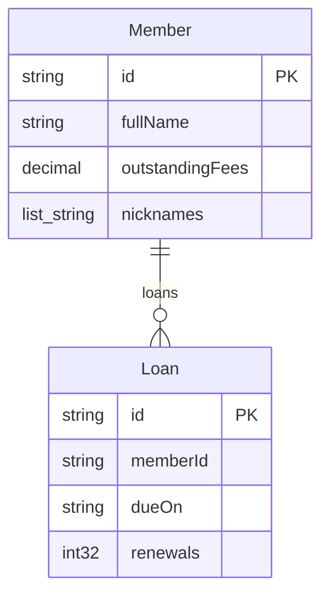
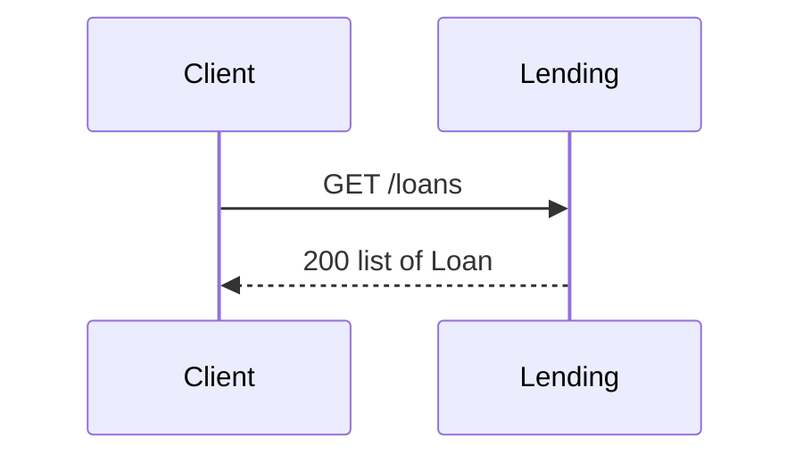
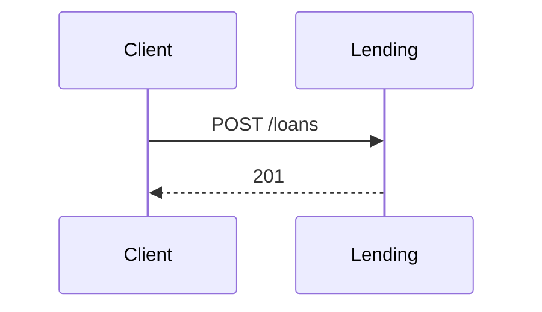
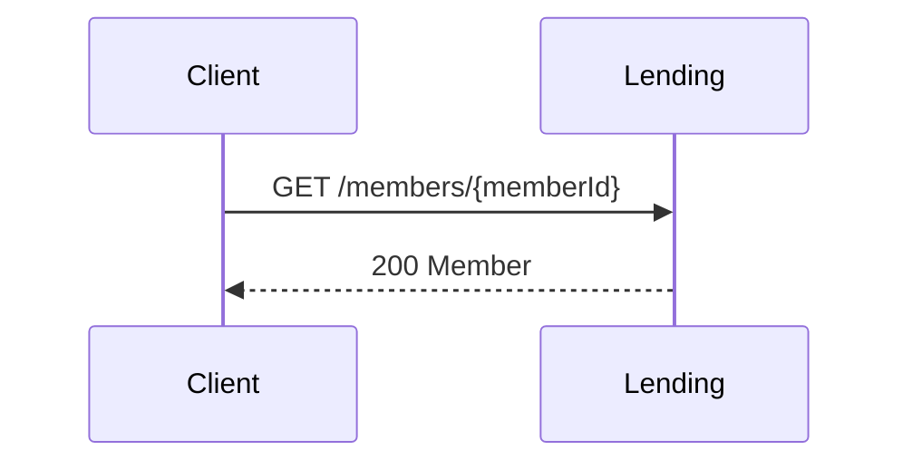
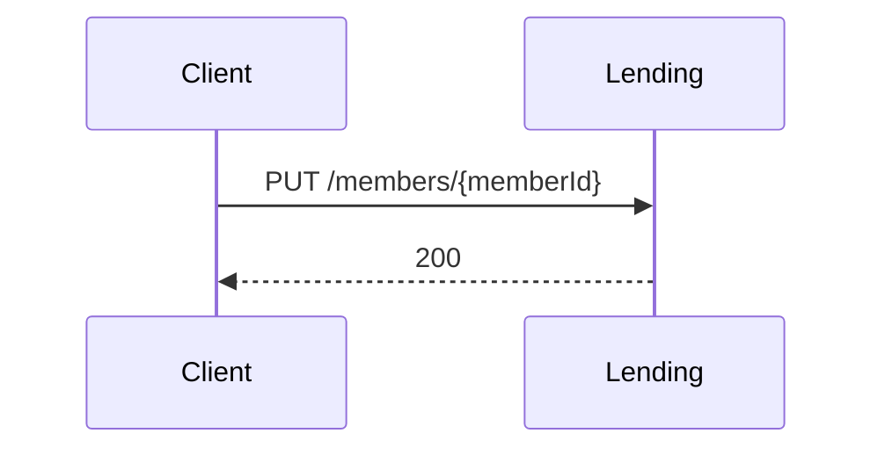
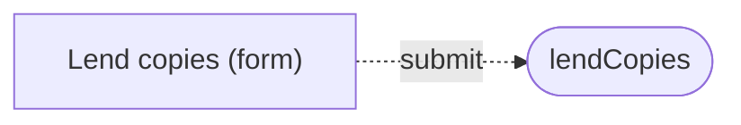

<!-- Generated by specarch document techspec from ../project/specarch.yaml, version 1.0.0; meta-model 1.0.0. Do not edit this file: change the YAML and generate again. -->

# Lending: technical specification

Version 1.0.0 of the specification: 2 entities, 4 HTTP operations, 1 page and 16 tests. The chapters follow arc42, and a chapter with nothing in the specification is left out.

## 1. Introduction and goals

## 3. Context

The interfaces the system offers, as its clients see them.

### HTTP operations

| Method and path | Operation | Summary | Permission |
|---|---|---|---|
| GET /loans | listLoans | List loans | loans.read |
| POST /loans | createLoan | Lend a copy | loans.write |
| GET /members/{memberId} | getMember | One member with their loans | loans.read |
| PUT /members/{memberId} | lendCopies | Lend copies to a member | loans.write |

## 5. Building blocks

### Member

| Field | Type | Required | Limits | Description |
|---|---|---|---|---|
| id | string | yes | at most 36 characters |   |
| fullName | string | yes | at least 1 character, at most 64 characters |   |
| outstandingFees | decimal(10, 2) | yes |   |   |
| nicknames | list of string |   | at least 1 item, at most 3 items |   |

Primary key: id.

| Relation | Kind | Target | Via | On delete |
|---|---|---|---|---|
| loans | one-to-many | Loan | memberId | restrict |

### Loan

| Field | Type | Required | Limits | Description |
|---|---|---|---|---|
| id | string | yes | at most 36 characters |   |
| memberId | string | yes | at most 36 characters |   |
| dueOn | string | yes | at most 10 characters |   |
| renewals | int32 |   | at least 0, at most 100 |   |

Primary key: id.

## 6. Runtime view

### listLoans (GET /loans)

Parameters:

| Parameter | In | Type | Required | Limits | Description |
|---|---|---|---|---|---|
| q | query | string |   | at most 200 characters |   |

Lists Loan a page at a time, 20 records by default, at most 100 a page. A request outside these is refused, not ignored (the paginated-list idiom).

Responses:

| Status | Meaning | Body |
|---|---|---|
| 200 | The loans. | list of [Loan](#loan) |

### createLoan (POST /loans)

Takes no parameters.

Request body, application/json, optional: [Loan](#loan).

Limits: a request body of at most 1024 bytes; 30 requests per PT1M, with bursts of up to 60.

Responses:

| Status | Meaning | Body |
|---|---|---|
| 201 | Lent. | none |

### getMember (GET /members/{memberId})

Parameters:

| Parameter | In | Type | Required | Limits | Description |
|---|---|---|---|---|---|
| memberId | path | string | yes | at most 36 characters |   |

Responses:

| Status | Meaning | Body |
|---|---|---|
| 200 | The member. | [Member](#member) |

### lendCopies (PUT /members/{memberId})

Parameters:

| Parameter | In | Type | Required | Limits | Description |
|---|---|---|---|---|---|
| memberId | path | string | yes | at most 36 characters |   |

Request body, application/json, optional: [Member](#member).

Responses:

| Status | Meaning | Body |
|---|---|---|
| 200 | Lent. | none |

## 8. Cross-cutting concepts

### Permissions

Access is fail-closed: every operation, command and page names the one permission it needs, and only the roles below grant one.

| Permission | reader | clerk | supervisor |
|---|---|---|---|
| loans.read | yes | | |
| loans.write | | yes | |
| loans.renew | | | yes |

### Separation of duties

No role grants as many of a set's permissions as its cardinality; the validator refuses one that does. Which person holds which roles is data the specification does not hold, so each set lists the combinations of roles that together reach it: roles never to be given to one person.

| Set | Permissions | Cardinality | Roles never given to one person |
|---|---|---|---|
| read-write-renew | loans.read, loans.write, loans.renew | 3 | reader with clerk with supervisor |

**Insight on read-write-renew:** Renewing a loan one has lent and can see hides an overdue copy.

### Pages

| Page | Kind | Route | Entity | Permission | Shows |
|---|---|---|---|---|---|
| member-loans | form | /members/{memberId}/loans | Member | loans.write | fullName, outstandingFees; Loans, rows of loans: dueOn, renewals, at most 6 |

## 10. Quality requirements

The design tests: what must hold on every implementation. Golden scenarios succeed; red scenarios are refused.

| Test | Subject | Level | Scenario | Given | When | Then |
|---|---|---|---|---|---|---|
| list-loans-succeeds | operation listLoans | system | golden | a caller with loans.read | listLoans is called | it answers 200 |
| list-loans-denied | operation listLoans | system | red | a caller without loans.read | listLoans is called | it is refused |
| create-loan-succeeds | operation createLoan | system | golden | a clerk | createLoan is called with every field | it answers 201 |
| create-loan-denied | operation createLoan | system | red | a caller without loans.write | createLoan is called | it is refused |
| create-loan-missing | operation createLoan | system | red | a clerk | createLoan is called without a required field | it is refused |
| get-member-succeeds | operation getMember | system | golden | a caller with loans.read and a member | getMember is called with its memberId | it answers 200 |
| get-member-denied | operation getMember | system | red | a caller without loans.read | getMember is called | it is refused |
| get-member-not-found | operation getMember | system | red | no member with that memberId | getMember is called | it is refused as not found |
| lend-copies-succeeds | operation lendCopies | system | golden | a clerk and a member | lendCopies is called with every field | it answers 200 |
| lend-copies-denied | operation lendCopies | system | red | a caller without loans.write | lendCopies is called | it is refused |
| lend-copies-missing | operation lendCopies | system | red | a clerk | lendCopies is called without a required field | it is refused |
| lend-copies-not-found | operation lendCopies | system | red | no member with that memberId | lendCopies is called | it is refused as not found |
| lend-copies-fees-not-decimal | operation lendCopies | system | red | a clerk | lendCopies is called with outstandingFees that is not a valid decimal | it is refused |
| member-loans-succeeds | page member-loans | system | golden | a clerk and a member | the page member-loans is opened for that member | it shows the page |
| member-loans-denied | page member-loans | system | red | a caller without loans.write | the page member-loans is opened | it is refused |
| member-loans-not-found | page member-loans | system | red | no member with that memberId | the page member-loans is opened for that memberId | it says the record was not found |

