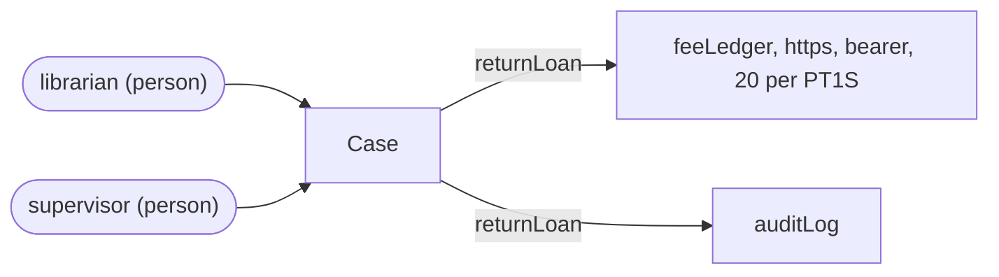
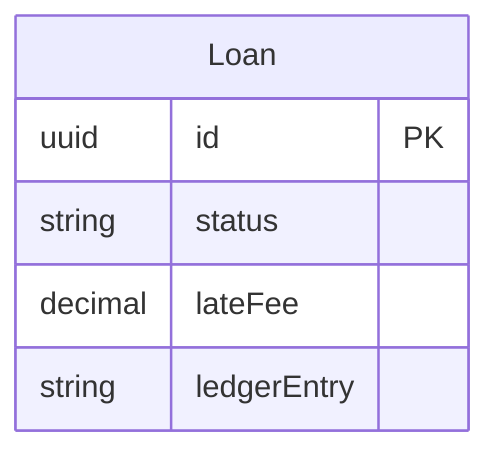
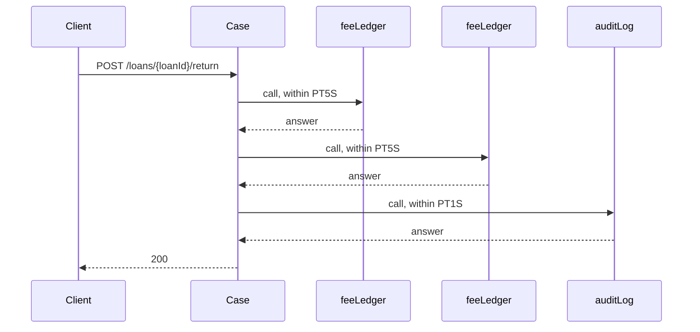
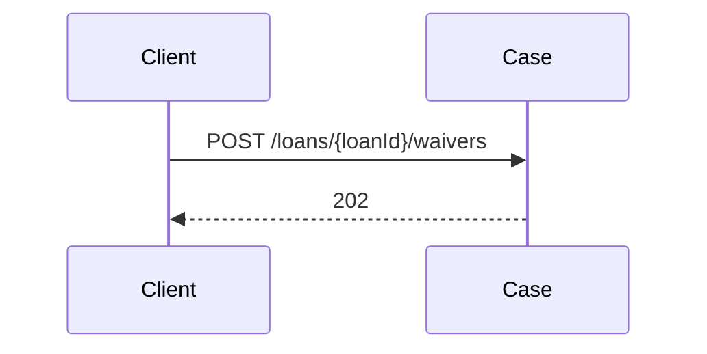
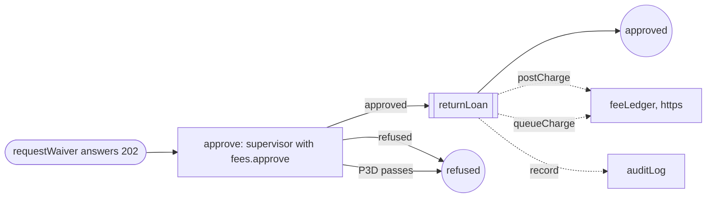

<!-- Generated by specarch document techspec from ../project/specarch.yaml, version 1.0.0; meta-model 1.0.0. Do not edit this file: change the YAML and generate again. -->

# Case: technical specification

Version 1.0.0 of the specification: 1 requirement, 1 entity, 2 HTTP operations, 1 channel, 2 dependencies, 1 workflow and 21 tests. The chapters follow arc42, and a chapter with nothing in the specification is left out.

## 1. Introduction and goals

## 3. Context

The interfaces the system offers, as its clients see them.

Who uses the system and what it reaches: a person per role, a system per calling service with the roles it holds, and the dependencies by kind with their protocol, each edge naming the operations and jobs that call it or the channel it carries.

### HTTP operations

| Method and path | Operation | Summary | Permission |
|---|---|---|---|
| POST /loans/{loanId}/return | returnLoan | Record a return | loans.return |
| POST /loans/{loanId}/waivers | requestWaiver | Ask for a waiver | fees.waive |

### Channels

| Channel | Message | Summary |
|---|---|---|
| ledger.answers | ChargePosted | A charge was posted. |

### Dependencies

External systems the operations call. A call that fails, or that does not answer within its time limit, is given up, and the operation answers as its failure response says.

| Dependency | Time limit per call | Called by | Description |
|---|---|---|---|
| feeLedger | PT5S | returnLoan | The finance system's ledger. Proves itself by a bearer token (RFC 6750), kept in the secret setting feeLedgerToken. At most 20 calls per PT1S, 5 at once above it. Its operations: postCharge (POST /charges), queueCharge (POST /charge-queue). |
| auditLog | PT1S | returnLoan | The library's audit log, which takes a line per change. Is sent no credential. Its operations: record (audit.lines/AuditLine). |

## 5. Building blocks

### Loan

| Field | Type | Required | Limits | Description |
|---|---|---|---|---|
| id | uuid | yes | set by the system |   |
| status | string | yes | one of open, returned |   |
| lateFee | decimal(10, 2) | yes |   |   |
| ledgerEntry | string or null | yes |   |   |

Primary key: id.

## 6. Runtime view

### returnLoan (POST /loans/{loanId}/return)

Parameters:

| Parameter | In | Type | Required | Limits | Description |
|---|---|---|---|---|---|
| loanId | path | uuid | yes |   |   |

Takes no request body.

Calls feeLedger#/operations/postCharge (POST /charges, within PT5S), feeLedger#/operations/queueCharge (POST /charge-queue, within PT5S), auditLog#/operations/record (audit.lines/AuditLine, within PT1S).

The call to feeLedger#/operations/postCharge: it sends `loan = loanId`, `amount = lateFee`, `reason = "late"`; keeps `ledgerEntry = entry` from the answer; sends Idempotency-Key as `loanId`, so a call made again is told from a new one; tries again 2 times, PT1S apart and twice that each time, on 503 or timeout; answers their 503 as 503, timeout as 503 and 409 as 502.

The call to feeLedger#/operations/queueCharge: it sends `loan = loanId`; does not wait, and hears back by ledger.answers/ChargePosted.

The call to auditLog#/operations/record: it sends `loan = loanId`; neither waits nor hears back.

Guard: the change writes 1 Loan record, and `status == "open"` must hold on each as it is at the moment of the change; a change that finds otherwise is refused and changes nothing, so a second writer on the same record is refused rather than overwriting the first.

Responses:

| Status | Meaning | Body |
|---|---|---|
| 200 | The loan, returned. | none |
| 409 | The loan is closed. | none |
| 502 | The ledger refused the charge, and the loan stays open. | none |
| 503 | The ledger is unavailable, and the loan stays open. | none |

### requestWaiver (POST /loans/{loanId}/waivers)

Parameters:

| Parameter | In | Type | Required | Limits | Description |
|---|---|---|---|---|---|
| loanId | path | uuid | yes |   |   |

Takes no request body.

Responses:

| Status | Meaning | Body |
|---|---|---|
| 202 | The request waits for approval. | none |

### Workflow waiver

A fee waiver is approved by a supervisor, then the loan is returned and its fee posted.

Starts when requestWaiver accepts a request and answers 202; the request waits as a Loan. It is approved at approve (fees.approve, within P3D) and a refusal ends it. The person who made the request never approves it.

## 7. Deployment and implementation

### Configuration

| Setting | Type | Secret | Description |
|---|---|---|---|
| feeLedgerToken | string | yes | The token the fee ledger issued to this system; from the host's secret store. |

## 8. Cross-cutting concepts

### Permissions

Access is fail-closed: every operation, command and page names the one permission it needs, and only the roles below grant one.

| Permission | librarian | supervisor |
|---|---|---|
| loans.return | yes | |
| fees.waive | yes | |
| fees.approve | | yes |

## 10. Quality requirements

The design tests: what must hold on every implementation. Golden scenarios succeed; red scenarios are refused.

| Test | Subject | Level | Scenario | Given | When | Then |
|---|---|---|---|---|---|---|
| request-waiver-denied-without-fees-waive | operation requestWaiver | system | red | a caller without fees.waive | requestWaiver is called | it is refused as not allowed |
| request-waiver-loan-id-not-a-valid-uuid | operation requestWaiver | system | red | ... | requestWaiver is called with loanId that is not a valid uuid | it is refused |
| request-waiver-not-found-loan-id | operation requestWaiver | system | red | no record has that loanId | requestWaiver is called with that loanId | it is refused as not found |
| request-waiver-succeeds | operation requestWaiver | system | golden | a caller with fees.waive | requestWaiver is called with values inside every limit | it answers 202: The request waits for approval. |
| return-loan-concurrent-write | operation returnLoan | system | red | another caller changed the Loan after this caller read it | returnLoan is called | it is refused and the other caller's change stands |
| return-loan-denied-without-loans-return | operation returnLoan | system | red | a caller without loans.return | returnLoan is called | it is refused as not allowed |
| return-loan-dependency-answers-unmapped-fee-ledger-post-charge | operation returnLoan | system | red | feeLedger answers with an error other than 503 or 409 | returnLoan is called | it answers 502: The ledger refused the charge, and the loan stays open. |
| return-loan-dependency-fails-audit-log | operation returnLoan | system | red | auditLog answers with an error | returnLoan is called | it succeeds all the same, since it does not wait for auditLog |
| return-loan-dependency-fails-fee-ledger | operation returnLoan | system | red | feeLedger answers with an error | returnLoan is called | it answers 502: The ledger refused the charge, and the loan stays open. |
| return-loan-dependency-rate-exceeded-fee-ledger | operation returnLoan | system | red | returnLoan's calls would pass feeLedger's rate of 20 calls per PT1S, 5 at once above it | returnLoan is called | the call is not sent above the rate, and it answers 503: The ledger is unavailable, and the loan stays open. |
| return-loan-dependency-retries-exhausted-fee-ledger-post-charge | operation returnLoan | system | red | feeLedger answers 503 or does not answer in time on every try | returnLoan is called | the call is tried 2 more times, PT1S apart and twice that each time, then it answers 503: The ledger is unavailable, and the loan stays open. |
| return-loan-dependency-times-out-audit-log | operation returnLoan | system | red | auditLog does not answer within PT1S | returnLoan is called | it succeeds all the same, since it does not wait for auditLog |
| return-loan-dependency-times-out-fee-ledger | operation returnLoan | system | red | feeLedger does not answer within PT5S | returnLoan is called | it answers 503: The ledger is unavailable, and the loan stays open. |
| return-loan-loan-id-not-a-valid-uuid | operation returnLoan | system | red | ... | returnLoan is called with loanId that is not a valid uuid | it is refused |
| return-loan-not-found-loan-id | operation returnLoan | system | red | no record has that loanId | returnLoan is called with that loanId | it is refused as not found |
| return-loan-succeeds | operation returnLoan | system | golden | a caller with loans.return | returnLoan is called with values inside every limit | it answers 200: The loan, returned. |
| waiver-approval-without-fees-approve | workflow waiver | system | red | a caller without fees.approve | they approve a request waiting at approve | it is refused as not allowed, and the request still waits |
| waiver-deadline-passes-at-approve | workflow waiver | system | red | a request waiting at approve | P3D passes with no answer | the request ends refused and returnLoan is not called |
| waiver-refused-at-approve | workflow waiver | system | red | a request waiting at approve | a caller with fees.approve refuses it | the request ends refused and returnLoan is not called |
| waiver-requester-approves-own-request | workflow waiver | system | red | a request made by a caller who also holds fees.approve | the requester approves it | it is refused, because the person who made a request never approves it, and the request still waits |
| waiver-succeeds | workflow waiver | system | golden | a caller with fees.waive | a request is made through requestWaiver and is approved at approve | it answers 202, then returnLoan is called, and the request ends approved |

**Origin on request-waiver-denied-without-fees-waive:** inferred.

**Insight on request-waiver-denied-without-fees-waive:** Written by specarch derive: users get this wrong often, so the case is written. A draft: complete the given, when and then, and remove what does not hold.

**Origin on request-waiver-loan-id-not-a-valid-uuid:** inferred.

**Insight on request-waiver-loan-id-not-a-valid-uuid:** Written by specarch derive: users get this wrong often, so the case is written. A draft: complete the given, when and then, and remove what does not hold.

**Origin on request-waiver-not-found-loan-id:** inferred.

**Insight on request-waiver-not-found-loan-id:** Written by specarch derive: users get this wrong often, so the case is written. A draft: complete the given, when and then, and remove what does not hold.

**Origin on request-waiver-succeeds:** inferred.

**Insight on request-waiver-succeeds:** Written by specarch derive: every subject needs a golden path, and this is the success the design gives. A draft: complete the given, when and then, and remove what does not hold.

**Origin on return-loan-concurrent-write:** inferred.

**Insight on return-loan-concurrent-write:** Written by specarch derive: two writers on one record is a case nobody exercises by hand, so it is always written. A draft: complete the given, when and then, and remove what does not hold.

**Origin on return-loan-denied-without-loans-return:** inferred.

**Insight on return-loan-denied-without-loans-return:** Written by specarch derive: users get this wrong often, so the case is written. A draft: complete the given, when and then, and remove what does not hold.

**Origin on return-loan-dependency-answers-unmapped-fee-ledger-post-charge:** inferred.

**Insight on return-loan-dependency-answers-unmapped-fee-ledger-post-charge:** Written by specarch derive: a failing dependency is always written. A draft: complete the given, when and then, and remove what does not hold.

**Origin on return-loan-dependency-fails-audit-log:** inferred.

**Insight on return-loan-dependency-fails-audit-log:** Written by specarch derive: a failing dependency is always written. A draft: complete the given, when and then, and remove what does not hold.

**Origin on return-loan-dependency-fails-fee-ledger:** inferred.

**Insight on return-loan-dependency-fails-fee-ledger:** Written by specarch derive: a failing dependency is always written. A draft: complete the given, when and then, and remove what does not hold.

**Origin on return-loan-dependency-rate-exceeded-fee-ledger:** inferred.

**Insight on return-loan-dependency-rate-exceeded-fee-ledger:** Written by specarch derive: a failing dependency is always written. A draft: complete the given, when and then, and remove what does not hold.

**Origin on return-loan-dependency-retries-exhausted-fee-ledger-post-charge:** inferred.

**Insight on return-loan-dependency-retries-exhausted-fee-ledger-post-charge:** Written by specarch derive: a failing dependency is always written. A draft: complete the given, when and then, and remove what does not hold.

**Origin on return-loan-dependency-times-out-audit-log:** inferred.

**Insight on return-loan-dependency-times-out-audit-log:** Written by specarch derive: a failing dependency is always written. A draft: complete the given, when and then, and remove what does not hold.

**Origin on return-loan-dependency-times-out-fee-ledger:** inferred.

**Insight on return-loan-dependency-times-out-fee-ledger:** Written by specarch derive: a failing dependency is always written. A draft: complete the given, when and then, and remove what does not hold.

**Origin on return-loan-loan-id-not-a-valid-uuid:** inferred.

**Insight on return-loan-loan-id-not-a-valid-uuid:** Written by specarch derive: users get this wrong often, so the case is written. A draft: complete the given, when and then, and remove what does not hold.

**Origin on return-loan-not-found-loan-id:** inferred.

**Insight on return-loan-not-found-loan-id:** Written by specarch derive: users get this wrong often, so the case is written. A draft: complete the given, when and then, and remove what does not hold.

**Origin on return-loan-succeeds:** inferred.

**Insight on return-loan-succeeds:** Written by specarch derive: every subject needs a golden path, and this is the success the design gives. A draft: complete the given, when and then, and remove what does not hold.

**Origin on waiver-approval-without-fees-approve:** inferred.

**Insight on waiver-approval-without-fees-approve:** Written by specarch derive: users get this wrong often, so the case is written. A draft: complete the given, when and then, and remove what does not hold.

**Origin on waiver-deadline-passes-at-approve:** inferred.

**Insight on waiver-deadline-passes-at-approve:** Written by specarch derive: a deadline passing is a case nobody exercises by hand, so it is always written. A draft: complete the given, when and then, and remove what does not hold.

**Origin on waiver-refused-at-approve:** inferred.

**Insight on waiver-refused-at-approve:** Written by specarch derive: users get this wrong often, so the case is written. A draft: complete the given, when and then, and remove what does not hold.

**Origin on waiver-requester-approves-own-request:** inferred.

**Insight on waiver-requester-approves-own-request:** Written by specarch derive: the four-eyes rule holds on every approval, so its case is always written. A draft: complete the given, when and then, and remove what does not hold.

**Origin on waiver-succeeds:** inferred.

**Insight on waiver-succeeds:** Written by specarch derive: every subject needs a golden path, and this is the success the design gives. A draft: complete the given, when and then, and remove what does not hold.

## 13. Requirements

### Requirements

| Requirement | Statement | Kind | Priority | Status | Verification | Acceptance | Needs |
|---|---|---|---|---|---|---|---|
| CASE-1 | One. | functional | must | accepted |   | One. |   |

### Traceability

What satisfies and what verifies each requirement. An empty cell is a gap.

| Requirement | Satisfied by | Verified by |
|---|---|---|
| CASE-1 | entities Loan; paths /loans/{loanId}/return post; paths /loans/{loanId}/waivers post; channels ledger.answers; dependencies feeLedger; dependencies auditLog; workflows waiver | tests request-waiver-denied-without-fees-waive; tests request-waiver-loan-id-not-a-valid-uuid; tests request-waiver-not-found-loan-id; tests request-waiver-succeeds; tests return-loan-concurrent-write; tests return-loan-denied-without-loans-return; tests return-loan-dependency-answers-unmapped-fee-ledger-post-charge; tests return-loan-dependency-fails-audit-log; tests return-loan-dependency-fails-fee-ledger; tests return-loan-dependency-rate-exceeded-fee-ledger; tests return-loan-dependency-retries-exhausted-fee-ledger-post-charge; tests return-loan-dependency-times-out-audit-log; tests return-loan-dependency-times-out-fee-ledger; tests return-loan-loan-id-not-a-valid-uuid; tests return-loan-not-found-loan-id; tests return-loan-succeeds; tests waiver-approval-without-fees-approve; tests waiver-deadline-passes-at-approve; tests waiver-refused-at-approve; tests waiver-requester-approves-own-request; tests waiver-succeeds |

