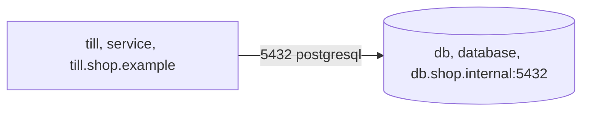

<!-- Generated by specarch document techspec from ../project/specarch.yaml, version 1.0.0, and ../project/shop.go.specarch-implementation.yaml, version 1.0.0; meta-model 0.1. Do not edit this file: change the YAML and generate again. -->

# Shop: technical specification

Version 1.0.0 of the specification: 1 requirement, 2 tests, 2 environments and 2 commissioning checks. The chapters follow arc42, and a chapter with nothing in the specification is left out.

**Problems:** The specification has 1 error, so it is invalid, and this document shows what could be read of it. 1 error and 2 warnings concern this document; each is marked by a Problem paragraph at its element, or below when the document shows no element for it. The problems file lists every problem, and specarch validate prints them.

**Problem:** warning: meta_model_version: the implementation file is written against version 0.1 of its format, an earlier version read beside 1.0.0 with this warning; run specarch upgrade --dry-run on the specification to see what moving it to 1.0.0 changes, and specarch upgrade to move it [meta_model_version@shop.go.specarch-implementation.yaml#/specarchImplementation]

**Problem:** warning: meta_model_version: the specification is written against meta-model 0.1, an earlier version read beside 1.0.0 with this warning, and its missing tests are warnings; run specarch derive to write the tests 0.2 and later ask for, then run specarch upgrade --dry-run on the specification to see what moving it to 1.0.0 changes, and specarch upgrade to move it [meta_model_version@specarch.yaml#/specarch]

## 1. Introduction and goals

### Stakeholders

| Stakeholder | Who they are | Concerns |
|---|---|---|
| shop-it | The shop's IT staff, who build each release from the source and run the till on the shop's host. |   |

## 7. Deployment and implementation

### Environments

| Environment | Purpose | Run by | Promotes to |
|---|---|---|---|
| staging | Where a release is tried. | vendor | production |
| production | The till in the shop, on the shop's host. | customer |   |

### Configuration

| Setting | Type | Secret | Description |
|---|---|---|---|
| taxRate | decimal(4, 2) |   | The sales tax rate. |
| databaseUrl | string | yes | Where the database is; it comes from the host's secret store. |
| auditNote | string |   | A note the vendor's own build writes into the audit log. |

**Audience on auditNote:** internal, left out of a document for everyone.

### Release

A release goes to staging first, then to production after closing time.

| Step | Action | Check |
|---|---|---|
| 1. Install on staging | Install the build on staging. | The till opens on staging. |
| 2. Install on production | After closing time, install the build on production. | The till opens in the shop. |

### Rollback

The previous build stays installed beside the new one.

| Step | Action | Check |
|---|---|---|
| 1. Switch back | Start the previous build. | The till opens and shows the previous version. |

### Backup

The sales ledger is dumped every night after closing.

| Step | Action | Check |
|---|---|---|
| 1. Dump the ledger | Dump the database to the backup store. | The dump restores on a scratch host. |

### Restore

A restore loads one night's dump in place of the live ledger.

| Step | Action | Check |
|---|---|---|
| 1. Load the dump | Stop the till, load the chosen dump and start the till. | The till shows the sales up to that night. |

### Handover

Each release is handed to the shop's IT staff as source; the vendor runs staging and never reaches the shop's host.

Received by shop-it: The shop's IT staff, who build each release from the source and run the till on the shop's host.

The source: A tagged release of the repository, which the shop imports into a repository of its own.

The customer is responsible for:

- The host, its patching and the PostgreSQL server.
- Backups and the restore drill each quarter.

The vendor stays responsible for:

- The source of each release, tagged, with its software bill of materials.
- A fix for every defect the shop reports, in the next release.

**Insight:** The shop's accountant asks who can reach the sales ledger.

**Note:** From The shop's operations manual, 3, clause 1.4: The till runs on the shop's own host.

### Migration add-tax

Every order gets a tax amount, zero for old orders.

| Step | Action | Check |
|---|---|---|
| 1. Add the column | Add tax to orders with a default of zero. | Every order has a tax amount. |

### Commissioning checks

Run on the installed system before it is handed over. The results of each run are records kept outside the specification.

#### till-opens (smoke, in production)

The installed till opens and shows the catalogue.

| Step | Action | Check |
|---|---|---|
| 1. Open the till | Open the till on the shop's host. | It shows the catalogue. |

#### till-tried (end-to-end, in staging)

A sale goes through on staging.

| Step | Action | Check |
|---|---|---|
| 1. Sell | Sell one item. | The ledger shows the sale. |

### Sign-off

The system is accepted when:

- The smoke check passed on production.

Signed by: shop-owner.

### Monitors

What is watched on the live system, and the objective each must meet.

| Monitor | Environment | Measures | Objective | Verifies |
|---|---|---|---|---|
| till-answers | production | Whether the till answers. | The till answers every minute of opening hours. |   |

### Implementation: Shop in Go

From the implementation file version 1.0.0.

Stack: language Go 1.26; toolchain go 1.26.0.

#### Libraries

| Library | Version | Licence | Purpose |
|---|---|---|---|
| github.com/jackc/pgx/v5 | v5.11.0 | MIT | PostgreSQL driver. |

#### Tasks

| Task | Command | In CI |
|---|---|---|
| build | `podman build -t till .` |   |
| sbom | `syft dir:. -o syft-json=sbom.json && grype sbom:sbom.json` |   |

#### Idioms

How this implementation does each recurring concern: the idioms SpecArch ships apply unless the file excludes or overrides one, and an override replaces only the parts it names (docs/idioms.md).

| Idiom | Version | Applies as | Parts the project replaces |
|---|---|---|---|
| configuration-and-secrets | 1.0.0 | shipped |   |

#### Deployments

staging: The staging host. Environment: staging. Servers: https://staging.shop.example. Settings: taxRate 0.11.

production: The shop's host. Environment: production. Servers: https://till.shop.example, postgresql://db.shop.internal:5432. Settings: taxRate 0.11. Built by the task build from 1 base image pinned by digest. Installed with podman-compose 1.4 from deploy/compose.

The servers by zone, with the links allowed between them on their ports; a dependency no server of the deployment is stands apart, not reached.

| Monitor | Tool | How | Alert |
|---|---|---|---|
| till-answers | an uptime checker | Calls the catalogue every minute. | the shop's phone |

**Problem on production:** error: handover: production is run by the customer, who builds and installs it from this file, and this deployment has no infrastructure saying what the hosts must provide; add infrastructure [handover@shop.go.specarch-implementation.yaml#/deployments/production]

## 10. Quality requirements

The design tests: what must hold on every implementation. Golden scenarios succeed; red scenarios are refused.

| Test | Subject | Level | Scenario | Given | When | Then |
|---|---|---|---|---|---|---|
| sell-an-item | requirement SHOP-1 | acceptance | golden | an item on the shelf | the clerk sells it | the ledger shows the sale with its tax |
| refuse-unknown-item | requirement SHOP-1 | system | red | an item not on the shelf | the clerk sells it | the till refuses the sale |

## 13. Requirements

### Requirements

| Requirement | Statement | Kind | Priority | Status | Verification | Acceptance | Needs |
|---|---|---|---|---|---|---|---|
| SHOP-1 | A sale shall be recorded in the ledger with its tax. | functional | must | accepted | test | Selling an item on the shelf records the sale with its tax. Selling an item not on the shelf is refused. |   |

### Traceability

What satisfies and what verifies each requirement. An empty cell is a gap.

| Requirement | Satisfied by | Verified by |
|---|---|---|
| SHOP-1 |   | tests sell-an-item; tests refuse-unknown-item |

## Sources

Every source a Note in this document cites.

| Source | Title | Edition | Author | Where to read it |
|---|---|---|---|---|
| ops-manual | The shop's operations manual | 3 |   |   |

