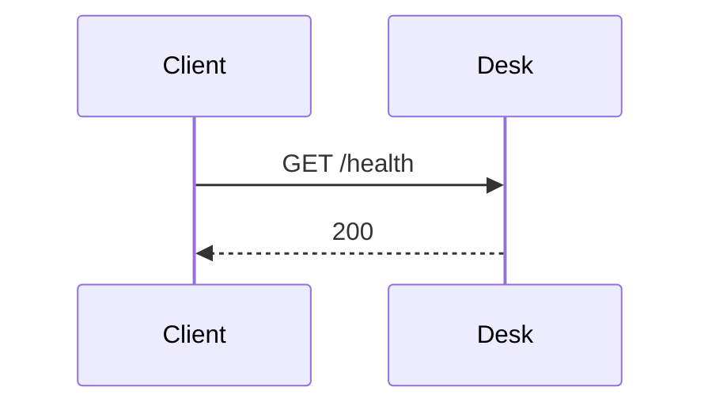

<!-- Generated by specarch document techspec from ../project/specarch.yaml, version 1.0.0; meta-model 1.0.0. Do not edit this file: change the YAML and generate again. -->

# Desk: technical specification

Version 1.0.0 of the specification: 2 HTTP operations and 4 tests. The chapters follow arc42, and a chapter with nothing in the specification is left out.

## 1. Introduction and goals

A lending desk whose operations pass a session check and a staff check before their handlers.

## 3. Context

The interfaces the system offers, as its clients see them.

### HTTP operations

| Method and path | Operation | Summary | Permission | Middlewares, in order |
|---|---|---|---|---|
| GET /desk | showDesk | The desk | desk.read | audit-log, then require-session, then require-staff, then audit-log |
| GET /health | health | Whether the desk is up | desk.read | none |

## 6. Runtime view

### Problem types

Every refusal is an RFC 9457 problem document of one of these types; each operation below names the ones it answers with.

| Problem type | Status | Title | When |
|---|---|---|---|
| session-missing | 401 | No session | The request carries no session. |
| not-staff | 403 | Not staff | The caller is not on the desk's staff. |

### showDesk (GET /desk)

Takes no parameters and no request body.

Runs before its handler, in this order: audit-log, then require-session (refuses with 401 session-missing), then require-staff (refuses with 403 not-staff), then audit-log.

Responses:

| Status | Meaning | Body |
|---|---|---|
| 200 | The desk. | none |

### health (GET /health)

Takes no parameters and no request body.

Runs no middleware before its handler.

Responses:

| Status | Meaning | Body |
|---|---|---|
| 200 | Up. | none |

## 8. Cross-cutting concepts

### Permissions

Access is fail-closed: every operation, command and page names the one permission it needs, and only the roles below grant one.

| Permission | desk-staff |
|---|---|
| desk.read | yes |

### Middlewares

The steps a request passes before an operation's handler runs, each declared once. Each operation names the ones it runs, in order, under HTTP operations; a refusal answers in place of the handler.

| Middleware | What it checks or does | Refusals | Run by |
|---|---|---|---|
| require-session | Refuses a request that carries no session. | 401 session-missing | showDesk |
| require-staff | Refuses a caller who is not on the desk's staff. | 403 not-staff: The caller's staff card is missing or expired. | showDesk |
| audit-log | Writes one audit line per request, with the caller and the outcome. | none | showDesk |

## 10. Quality requirements

The design tests: what must hold on every implementation. Golden scenarios succeed; red scenarios are refused.

| Test | Subject | Level | Scenario | Given | When | Then |
|---|---|---|---|---|---|---|
| show-desk-succeeds | operation showDesk | system | golden | a caller with desk.read | showDesk is called | it answers 200: The desk. |
| show-desk-denied-without-desk-read | operation showDesk | system | red | a caller without desk.read | showDesk is called | it is refused as not allowed |
| health-succeeds | operation health | system | golden | any caller | health is called | it answers 200: Up. |
| health-denied-without-desk-read | operation health | system | red | a caller without desk.read | health is called | it is refused as not allowed |

