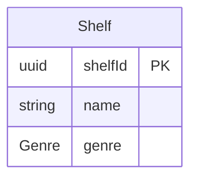
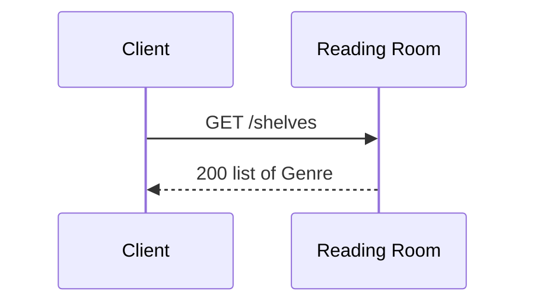
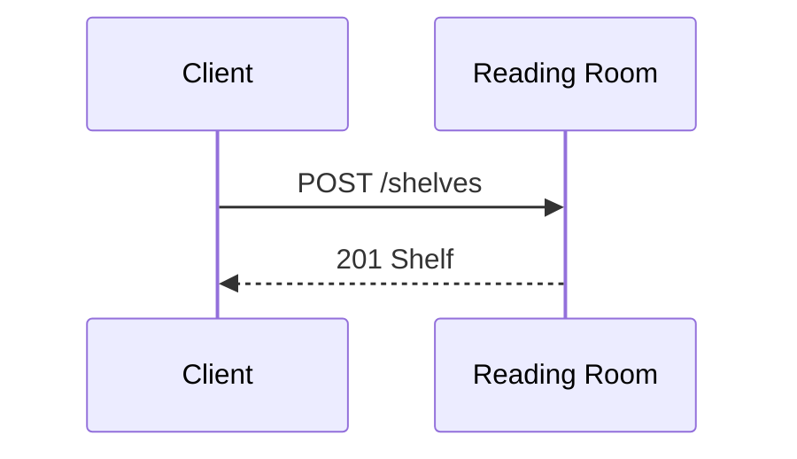
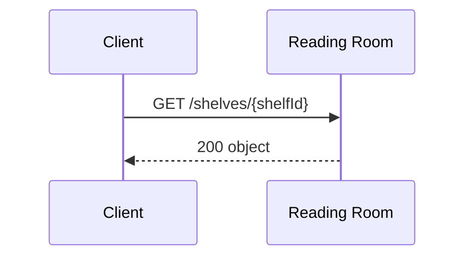
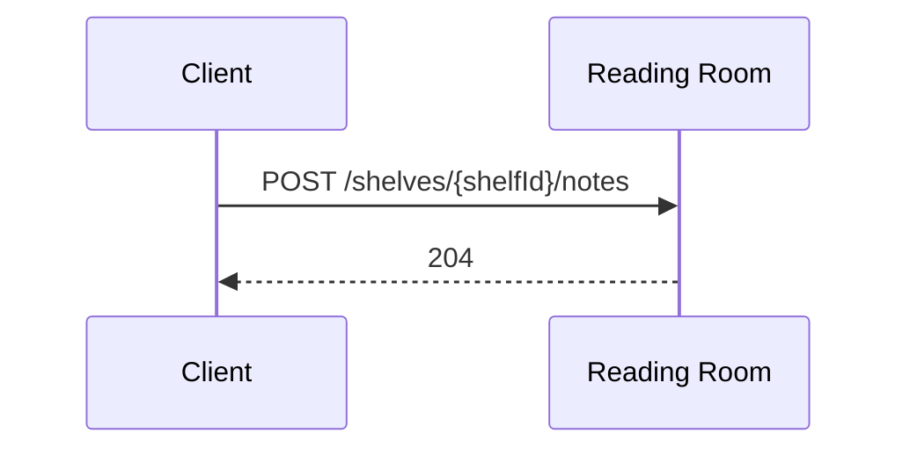
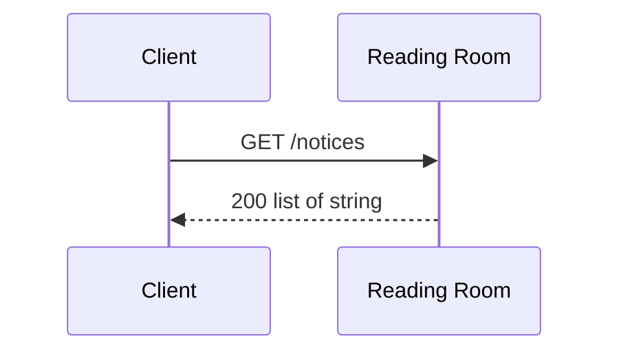

<!-- Generated by specarch document techspec from ../project/specarch.yaml, version 1.0.0; meta-model 0.2. Do not edit this file: change the YAML and generate again. -->

# Reading Room: technical specification

Version 1.0.0 of the specification: 1 entity, 1 schema, 5 HTTP operations and 22 tests. The chapters follow arc42, and a chapter with nothing in the specification is left out.

## 1. Introduction and goals

A reading room that lends shelves of books to readers and keeps their notes.

### Stakeholders

| Stakeholder | Who they are | Concerns |
|---|---|---|
| owner | Runs the reading room. | What readers may pin to a shelf |

## 3. Context

The interfaces the system offers, as its clients see them.

### HTTP operations

| Method and path | Operation | Summary | Permission |
|---|---|---|---|
| GET /shelves | listGenres | The genres the room shelves | shelves.read |
| POST /shelves | addShelf | Add a shelf | shelves.write |
| GET /shelves/{shelfId} | getShelf | One shelf with its counts | shelves.read |
| POST /shelves/{shelfId}/notes | addNote | Pin a note to a shelf | shelves.write |
| GET /notices | listNotices | The notices pinned in the room | shelves.read |

## 5. Building blocks

### Shelf

A shelf of books.

| Field | Type | Required | Limits | Description |
|---|---|---|---|---|
| shelfId | uuid | yes | set by the system |   |
| name | string | yes | at least 1 character, at most 100 characters |   |
| genre | Genre | yes |   |   |

Primary key: shelfId.

### Schemas

A schema is data passed around but not stored: it has no key and no table, and a request body, a response, a message or another schema carries it.

#### Label

The label on a shelf's edge.

| Field | Type | Required | Limits | Description |
|---|---|---|---|---|
| text | string | yes | at least 1 character, at most 40 characters |   |
| colour | string |   | one of red, green, blue |   |

### Enums

| Enum | Value | Meaning |
|---|---|---|
| Genre | fiction |   |
| Genre | history |   |
| Genre | science |   |

## 6. Runtime view

### Problem types

Every refusal is an RFC 9457 problem document of one of these types; each operation below names the ones it answers with.

| Problem type | Status | Title | When |
|---|---|---|---|
| shelf-not-found | 404 | No such shelf | No shelf has the identifier asked for. |
| shelf-full | 409 | Shelf full | The shelf holds as many books as it may. |

### listGenres (GET /shelves)

Takes no parameters and no request body.

Responses:

| Status | Meaning | Body |
|---|---|---|
| 200 | Every genre. | list of [Genre](#enums), no item twice |

### addShelf (POST /shelves)

Takes no parameters; what it takes is open in Q-3.

**Open question Q-3 (could, decision) on what it takes:** May a reader name the room a new shelf goes in? Decided by owner.

Request body, application/json, required:

| Field | Type | Required | Limits | Description |
|---|---|---|---|---|
| name | string | yes | at least 1 character, at most 100 characters | What readers call the shelf. |
| genre | [Genre](#enums) | yes |   |   |
| label | [Label](#label) |   |   |   |
| books | list of object |   | at most 50 items |   |
| books[].isbn | string | yes | matches `^[0-9]{13}$` |   |
| books[].copies | int32 |   | at least 1, at most 5 |   |

Responses:

| Status | Meaning | Body |
|---|---|---|
| 201 | The new shelf. | [Shelf](#shelf) |
| 409 | The room has no space for another shelf. | the problem document shelf-full (RFC 9457) |

### getShelf (GET /shelves/{shelfId})

Parameters:

| Parameter | In | Type | Required | Limits | Description |
|---|---|---|---|---|---|
| shelfId | path | uuid | yes |   |   |
| view | query | string | yes | one of full | How much of the shelf to answer; the counts need full. |

Responses:

| Status | Meaning | Body |
|---|---|---|
| 200 | The shelf and how many books it holds. | an object, fields below |
| 404 | No such shelf. | the problem document shelf-not-found (RFC 9457) |

Body of the 200 response:

| Field | Type | Required | Limits | Description |
|---|---|---|---|---|
| shelf | [Shelf](#shelf) | yes |   |   |
| counts | object | yes |   |   |
| counts.books | int32 | yes | at least 0 |   |
| counts.lent | int32 | yes | at least 0 |   |

**Open question Q-5 (could, decision) on the path:** Is a shelf read by its identifier or by its name? Decided by owner.

### addNote (POST /shelves/{shelfId}/notes)

Parameters:

| Parameter | In | Type | Required | Limits | Description |
|---|---|---|---|---|---|
| shelfId | path | uuid | yes |   |   |

Takes no request body; the request body is open in Q-1.

**Open question Q-1 (could, decision) on the request body:** What does a note hold, and how long may it be? Decided by owner.

Responses:

| Status | Meaning | Body |
|---|---|---|
| 204 | The note is pinned. | none |
| 404 | No such shelf. | the problem document shelf-not-found (RFC 9457) |

### listNotices (GET /notices)

Takes no parameters and no request body; the operation is open in Q-4; what it takes is open in Q-2.

**Open question Q-4 (could, decision) on the operation:** Should notices be listed at all, or only shown on the shelves they concern? Decided by owner.

**Open question Q-2 (could, decision) on what it takes:** Which notices may a reader filter by, and on what? Decided by owner.

Responses:

| Status | Meaning | Body |
|---|---|---|
| 200 | Every notice. | list of string |

## 8. Cross-cutting concepts

### Permissions

Access is fail-closed: every operation, command and page names the one permission it needs, and only the roles below grant one.

| Permission | reader |
|---|---|
| shelves.read | yes |
| shelves.write | yes |

## 10. Quality requirements

The design tests: what must hold on every implementation. Golden scenarios succeed; red scenarios are refused.

| Test | Subject | Level | Scenario | Given | When | Then |
|---|---|---|---|---|---|---|
| list-genres-succeeds | operation listGenres | system | golden | a caller with shelves.read | listGenres is called | it answers 200: Every genre. |
| list-genres-denied-without-shelves-read | operation listGenres | system | red | a caller without shelves.read | listGenres is called | it is refused as not allowed |
| add-shelf-succeeds | operation addShelf | system | golden | a caller with shelves.write | addShelf is called with a name and a genre | it answers 201: The new shelf. |
| add-shelf-refused-when-full | operation addShelf | system | red | a room with no space | addShelf is called | it is refused with 409 shelf-full |
| get-shelf-succeeds | operation getShelf | system | golden | a shelf | getShelf is called with view full | it answers 200: The shelf and how many books it holds. |
| get-shelf-refused-when-missing | operation getShelf | system | red | no shelf of that identifier | getShelf is called | it is refused with 404 shelf-not-found |
| add-note-succeeds | operation addNote | system | golden | a shelf | addNote is called | it answers 204: The note is pinned. |
| add-note-refused-when-missing | operation addNote | system | red | no shelf of that identifier | addNote is called | it is refused with 404 shelf-not-found |
| add-shelf-denied-without-shelves-write | operation addShelf | system | red | a caller without shelves.write | addShelf is called | it is refused as not allowed |
| add-shelf-genre-not-one-of-its-values | operation addShelf | system | red | a caller with shelves.write | addShelf is called with genre set to a value it does not allow | it is refused |
| add-shelf-missing-genre | operation addShelf | system | red | a caller with shelves.write | addShelf is called without genre | it is refused |
| add-shelf-missing-label-text | operation addShelf | system | red | a caller with shelves.write | addShelf is called with label without its text | it is refused |
| add-shelf-missing-name | operation addShelf | system | red | a caller with shelves.write | addShelf is called without name | it is refused |
| get-shelf-denied-without-shelves-read | operation getShelf | system | red | a caller without shelves.read | getShelf is called | it is refused as not allowed |
| get-shelf-not-found-shelf-id | operation getShelf | system | red | no record has that shelfId | getShelf is called with that shelfId | it is refused as not found |
| get-shelf-shelf-id-not-a-valid-uuid | operation getShelf | system | red | a caller with shelves.read | getShelf is called with shelfId that is not a valid uuid | it is refused |
| get-shelf-view-not-one-of-its-values | operation getShelf | system | red | a caller with shelves.read | getShelf is called with view set to a value it does not allow | it is refused |
| add-note-denied-without-shelves-write | operation addNote | system | red | a caller without shelves.write | addNote is called | it is refused as not allowed |
| add-note-not-found-shelf-id | operation addNote | system | red | no record has that shelfId | addNote is called with that shelfId | it is refused as not found |
| add-note-shelf-id-not-a-valid-uuid | operation addNote | system | red | a caller with shelves.write | addNote is called with shelfId that is not a valid uuid | it is refused |
| list-notices-succeeds | operation listNotices | system | golden | a caller with shelves.read | listNotices is called | it answers 200: Every notice. |
| list-notices-denied-without-shelves-read | operation listNotices | system | red | a caller without shelves.read | listNotices is called | it is refused as not allowed |

