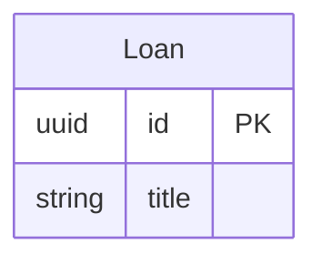
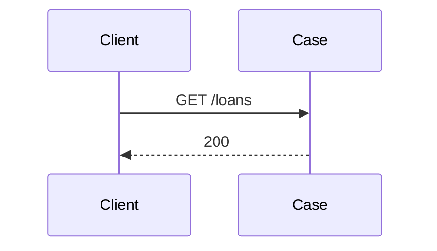
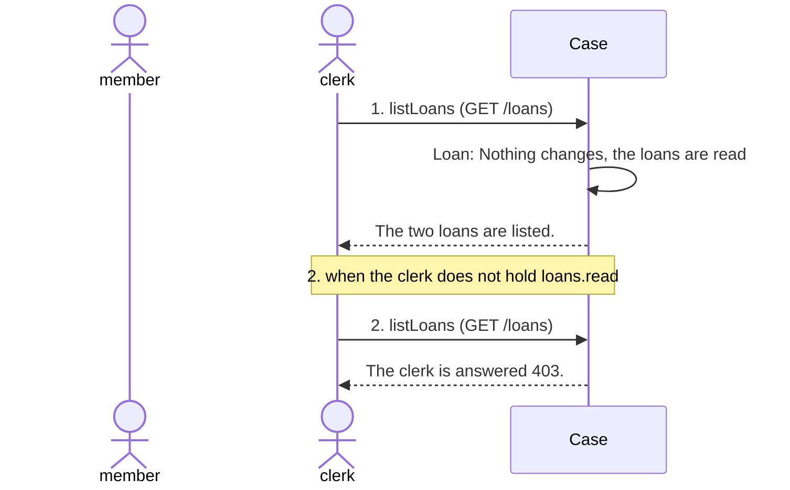

<!-- Generated by specarch document techspec from ../project/specarch.yaml, version 1.0.0; meta-model 1.0.0. Do not edit this file: change the YAML and generate again. -->

# Case: technical specification

Version 1.0.0 of the specification: 2 requirements, 1 entity, 1 HTTP operation and 2 tests. The chapters follow arc42, and a chapter with nothing in the specification is left out.

**Problems:** 2 warnings concern this document; each is marked by a Problem paragraph at its element, or below when the document shows no element for it. The problems file lists every problem, and specarch validate prints them.

## 1. Introduction and goals

### Problem

Members cannot tell which loans they hold.

### Stakeholders

| Stakeholder | Who they are | Concerns |
|---|---|---|
| member | A card holder. |   |
| clerk | Staff at the desk. |   |

**Problem on member:** warning: unheard: member was never heard: no communication record names it, no session lists it present, no interview lists it and no decision is by it, while requirement CASE-1 and requirement CASE-2 rely on it; hear it before acceptance, and record what it said with specarch log; no communication, session or test session record is kept yet, so start by logging the first conversation [unheard@specarch.yaml#/stakeholders/member]

**Problem on clerk:** warning: unheard: clerk was never heard: no communication record names it, no session lists it present, no interview lists it and no decision is by it, while requirement CASE-1 and requirement CASE-2 rely on it; hear it before acceptance, and record what it said with specarch log; no communication, session or test session record is kept yet, so start by logging the first conversation [unheard@specarch.yaml#/stakeholders/clerk]

## 3. Context

The interfaces the system offers, as its clients see them.

### HTTP operations

| Method and path | Operation | Summary | Permission |
|---|---|---|---|
| GET /loans | listLoans | List loans | loans.read |

## 5. Building blocks

### Loan

| Field | Type | Required | Limits | Description |
|---|---|---|---|---|
| id | uuid |   |   |   |
| title | string |   | at most 200 characters |   |

Primary key: id.

## 6. Runtime view

### listLoans (GET /loans)

Takes no parameters and no request body.

Responses:

| Status | Meaning | Body |
|---|---|---|
| 200 | The loans. | none |

### Scenarios

The runtime scenarios: each case as a sequence across the operations above, the requirements and the entity changes, grouped by topic (ADR-251); a step with a condition is an alternative or failure branch.

#### Loans

##### SC-1: A member lists their loans

A member asks the desk which loans they hold.

For member; 2 steps, 1 branch.

| Step | Actor | Before | What happens | Exercises | Result |
|---|---|---|---|---|---|
| 1 | clerk | The member holds two loans. | The clerk lists the member's loans. | operation listLoans; requirements CASE-1; entity Loan: Nothing changes; the loans are read; tests list-loans-succeeds | The two loans are listed. |
| 2, when the clerk does not hold loans.read | clerk |   | The list is refused. | operation listLoans; requirements CASE-2; tests list-loans-denied | The clerk is answered 403. |

Proved by list-loans-succeeds, list-loans-denied.

## 8. Cross-cutting concepts

### Permissions

Access is fail-closed: every operation, command, page and route names the one permission it needs, and only the roles below grant one.

| Permission | member |
|---|---|
| loans.read | yes |

## 10. Quality requirements

The design tests: what must hold on every implementation. Golden scenarios succeed; red scenarios are refused.

| Test | Subject | Level | Scenario | Given | When | Then |
|---|---|---|---|---|---|---|
| list-loans-succeeds | operation listLoans | system | golden | a caller with loans.read | listLoans is called | it answers 200 |
| list-loans-denied | operation listLoans | system | red | a caller without loans.read | listLoans is called | it is refused |

## 13. Requirements

### Needs

| Need | Statement | Stakeholders | Status |
|---|---|---|---|
| NEED-1 | Members want to see their loans. | member, clerk | accepted |

### Requirements

| Requirement | Statement | Kind | Priority | Status | Verification | Acceptance | Needs |
|---|---|---|---|---|---|---|---|
| CASE-1 | A member shall see their loans. | functional | must | accepted | test | Listing the loans answers 200 with the member's loans. | NEED-1 |
| CASE-2 | A member without the permission shall be refused the list. | functional | must | accepted | test | Listing the loans without loans.read answers 403. | NEED-1 |

### Traceability

What satisfies and what verifies each requirement. An empty cell is a gap.

| Requirement | Satisfied by | Verified by |
|---|---|---|
| CASE-1 | paths /loans get | tests list-loans-succeeds |
| CASE-2 | paths /loans get | tests list-loans-denied |

