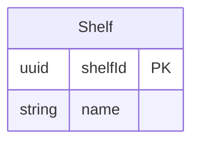
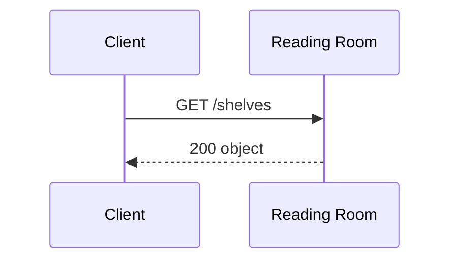

<!-- Generated by specarch document techspec from ../project/specarch.yaml, version 1.0.0; meta-model 0.2. Do not edit this file: change the YAML and generate again. -->

# Reading Room: technical specification

Version 1.0.0 of the specification: 1 entity, 1 schema, 1 HTTP operation and 2 tests. The chapters follow arc42, and a chapter with nothing in the specification is left out.

**Problems:** The specification has 1 error, so it is invalid, and this document shows what could be read of it. 1 error concerns this document; it is marked by a Problem paragraph at its element, or below when the document shows no element for it. The problems file lists every problem, and specarch validate prints them.

## 1. Introduction and goals

A reading room that keeps shelves of books.

### Stakeholders

| Stakeholder | Who they are | Concerns |
|---|---|---|
| owner | Runs the reading room. | What a shelf holds |

## 3. Context

The interfaces the system offers, as its clients see them.

### HTTP operations

| Method and path | Operation | Summary | Permission |
|---|---|---|---|
| GET /shelves | listShelves | Every shelf as a reader is shown it | shelves.read |

## 5. Building blocks

### Shelf

A shelf of books.

| Field | Type | Required | Limits | Description |
|---|---|---|---|---|
| shelfId | uuid | yes | set by the system |   |
| name | string | yes | at least 1 character, at most 100 characters |   |

Primary key: shelfId.

### Schemas

A schema is data passed around but not stored: it has no key and no table, and a request body, a response, a message or another schema carries it.

#### Shelf

A shelf as a reader is shown it.

**Problem:** error: value_object: Shelf is the name of an entity too; a schema, an entity and a view are one namespace, since each becomes a schema of its own in the interface; rename the schema [value_object@specarch.yaml#/schemas/Shelf]

| Field | Type | Required | Limits | Description |
|---|---|---|---|---|
| name | string | yes | at least 1 character, at most 100 characters |   |

## 6. Runtime view

### listShelves (GET /shelves)

Takes no parameters and no request body.

Responses:

| Status | Meaning | Body |
|---|---|---|
| 200 | Every shelf. | an object, fields below |

Body of the 200 response:

| Field | Type | Required | Limits | Description |
|---|---|---|---|---|
| shown | list of [Shelf](#shelf-1) |   |   |   |
| stored | list of [Shelf](#shelf) |   |   |   |

## 8. Cross-cutting concepts

### Permissions

Access is fail-closed: every operation, command and page names the one permission it needs, and only the roles below grant one.

| Permission | reader |
|---|---|
| shelves.read | yes |

## 10. Quality requirements

The design tests: what must hold on every implementation. Golden scenarios succeed; red scenarios are refused.

| Test | Subject | Level | Scenario | Given | When | Then |
|---|---|---|---|---|---|---|
| list-shelves-succeeds | operation listShelves | system | golden | a caller with shelves.read | listShelves is called | it answers 200: Every shelf. |
| list-shelves-denied-without-shelves-read | operation listShelves | system | red | a caller without shelves.read | listShelves is called | it is refused as not allowed |

