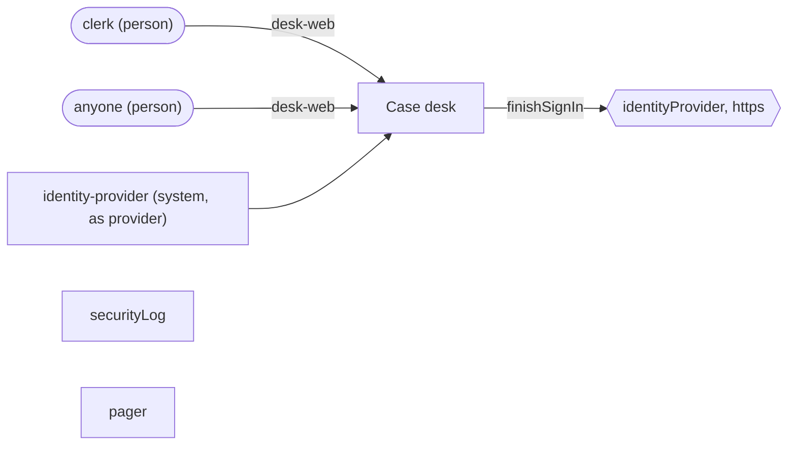
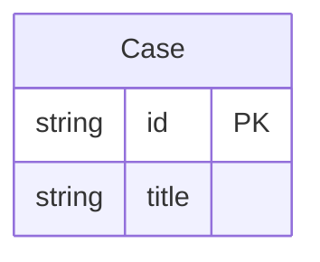
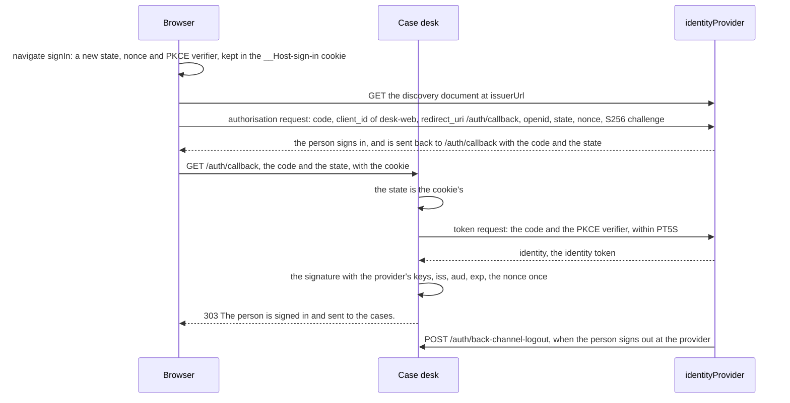
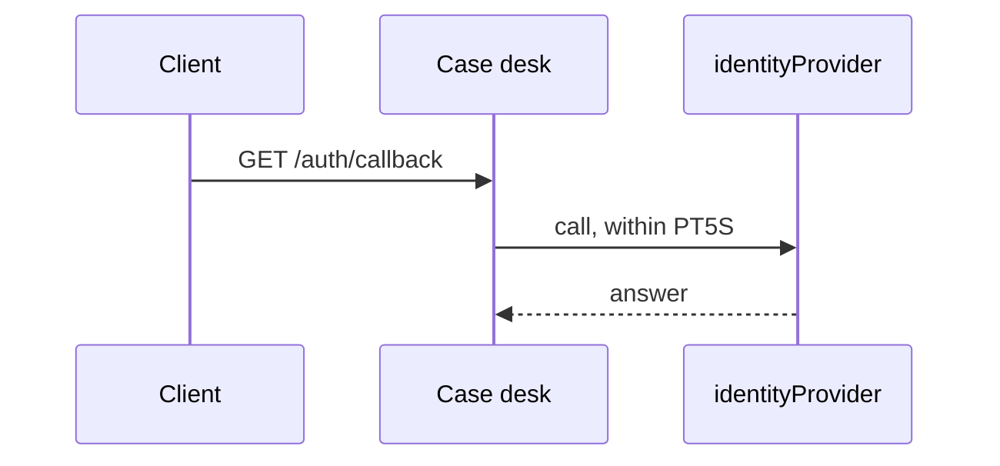
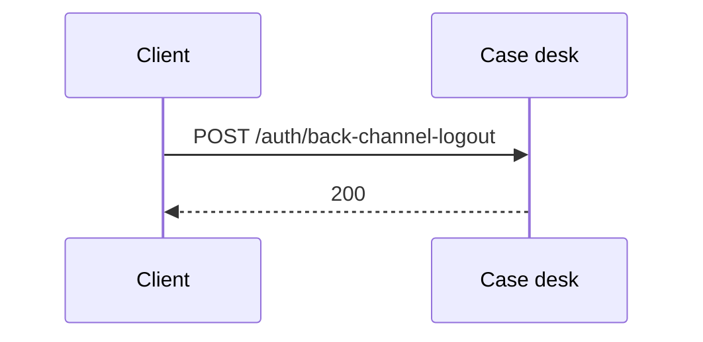
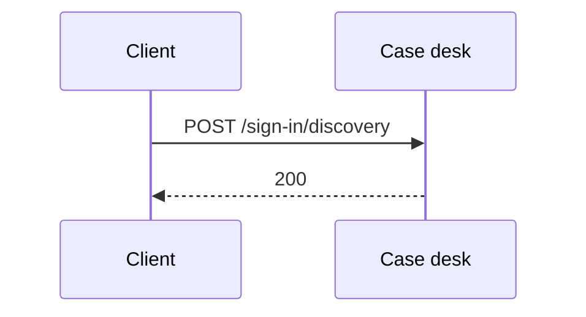
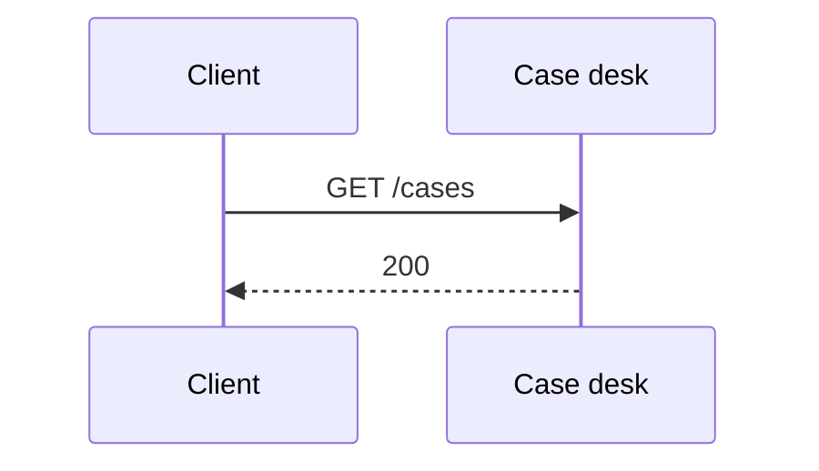
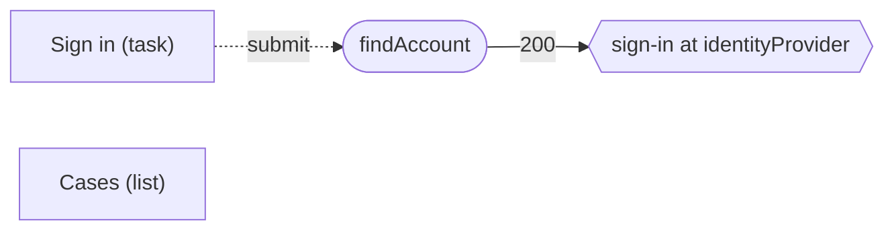

<!-- Generated by specarch document techspec from ../project/specarch.yaml, version 1.0.0; meta-model 1.0.0. Do not edit this file: change the YAML and generate again. -->

# Case desk: technical specification

Version 1.0.0 of the specification: 1 entity, 4 HTTP operations, 3 dependencies, 2 pages and 26 tests. The chapters follow arc42, and a chapter with nothing in the specification is left out.

## 1. Introduction and goals

## 3. Context

The interfaces the system offers, as its clients see them.

Who uses the system and what it reaches: a person per role, a system per calling service with the roles it holds, and the dependencies by kind with their protocol, each edge naming the operations and jobs that call it or the channel it carries.

### HTTP operations

| Method and path | Operation | Summary | Permission |
|---|---|---|---|
| GET /auth/callback | finishSignIn | Take the provider's answer, exchange the code and start the session | public |
| POST /auth/back-channel-logout | endProviderSession | End the sessions of a person the provider signed out | sessions.end |
| POST /sign-in/discovery | findAccount | Find where the person signs in from their e-mail address | public |
| GET /cases | listCases | List cases | cases.read |

### Dependencies

External systems the operations call. A call that fails, or that does not answer within its time limit, is given up, and the operation answers as its failure response says.

| Dependency | Time limit per call | Called by | Description |
|---|---|---|---|
| identityProvider | PT5S | finishSignIn | The organisation's identity provider, which signs people in and issues the identity token. |
| securityLog | PT2S |   | The append-only store of security events. |
| pager | PT2S |   | The alarm channel. |

## 5. Building blocks

### Case

| Field | Type | Required | Limits | Description |
|---|---|---|---|---|
| id | string | yes | at most 36 characters |   |
| title | string | yes | at most 200 characters |   |

Primary key: id.

## 6. Runtime view

### Sign-in through identityProvider

Staff sign in at the organisation's identity provider with the authorisation code flow and PKCE.

A person signs in through desk-web at identityProvider, the identity provider, with OpenID Connect's authorisation code flow and PKCE's S256 method (RFC 6749, 4.1; RFC 7636). Page sign-in leaves the application for the provider's authorisation endpoint, which its discovery document names; the provider sends the person back to finishSignIn (GET /auth/callback) with the code and the state, and the callback exchanges the code at the provider for identity, the identity token. The provider's issuer and its keys, and the client_id of desk-web, are the deployment's: deployments.<environment>.signIn.issuerUrl and jwksUri, and clients.desk-web.clientId, in the implementation file.

The callback refuses the sign-in, and starts no session, on each of these, each a derived case of finishSignIn:

| Check | Derived case | Security event | Severity | Asked for by |
|---|---|---|---|---|
| the state is the one the sign-in request set in this browser | state does not match | sign_in_state | medium | RFC 6749, 10.12; RFC 9700, 4.7 |
| the code has not been exchanged before | code used twice | sign_in_code | high | RFC 6749, 4.1.2; RFC 9700, 4.5 |
| the identity token's signature verifies with the provider's keys | signature invalid | sign_in_signature | high | OpenID Connect Core, 3.1.3.7, step 6 |
| iss is the deployment's issuerUrl | issuer differs | sign_in_issuer | high | OpenID Connect Core, 3.1.3.7, step 2; RFC 9700, 4.4 |
| exp has not passed | identity token expired | sign_in_expired | low | OpenID Connect Core, 3.1.3.7, step 9 |
| nonce is the one this sign-in sent, used once | nonce replayed | sign_in_nonce | high | OpenID Connect Core, 3.1.3.7, step 11 |

When the person signs out at the provider, the provider calls endProviderSession on the back channel (OpenID Connect Back-Channel Logout 1.0), which only the service clients its callers list may call.

### finishSignIn (GET /auth/callback)

Parameters:

| Parameter | In | Type | Required | Limits | Description |
|---|---|---|---|---|---|
| code | query | string | yes | at most 512 characters |   |
| state | query | string | yes | at most 128 characters |   |

Calls identityProvider (within PT5S).

Responses:

| Status | Meaning | Body |
|---|---|---|
| 303 | The person is signed in and sent to the cases. | none |
| 502 | The provider refused the exchange. | none |
| 504 | The provider did not answer in time. | none |

### endProviderSession (POST /auth/back-channel-logout)

Takes no parameters.

Request body, application/x-www-form-urlencoded, optional:

| Field | Type | Required | Limits | Description |
|---|---|---|---|---|
| logoutToken | string | yes | at most 4096 characters |   |

Responses:

| Status | Meaning | Body |
|---|---|---|
| 200 | The sessions are ended. | none |

### findAccount (POST /sign-in/discovery)

Takes no parameters.

Request body, application/json, optional:

| Field | Type | Required | Limits | Description |
|---|---|---|---|---|
| email | string | yes | at most 254 characters, a valid email |   |

Responses:

| Status | Meaning | Body |
|---|---|---|
| 200 | The person signs in at the organisation's provider. | none |

### listCases (GET /cases)

Takes no parameters and no request body.

Responses:

| Status | Meaning | Body |
|---|---|---|
| 200 | The cases. | none |

## 8. Cross-cutting concepts

### Permissions

Access is fail-closed: every operation, command and page names the one permission it needs, and only the roles below grant one.

| Permission | clerk | provider | identity-provider (service) | public |
|---|---|---|---|---|
| public | | | | everyone |
| cases.read | yes | | | |
| sessions.end | | yes | yes | |

The clients: the programs that call the system, each by its software_id. An application is where a person signs in; a service calls on its own account with the roles it holds and a proof of its identity on each request, or carries a person's call. A client with roles is a column of the matrix above. A client is admitted only where an operation's callers lists it; a public client, one with no proof, has a name that is the issuer's word and no proof of origin.

| Client | Kind | Admitted versions | Roles | Proof |
|---|---|---|---|---|
| desk-web | application | any | none | none: a public client, whose name in a token is the issuer's word |
| identity-provider | service | any | provider | its client certificate (RFC 8705) |

Who may call: an operation or command that lists its callers admits exactly them, people (anyone signed in, whose roles decide the rest) and the clients named; one that lists none admits people and refuses every client; one closed with nobody refuses everyone.

| Operation or command | Callers |
|---|---|
| operation endProviderSession | identity-provider |

The tokens: the formats the service issues and accepts. An access token rides in the Authorization header as a bearer token and is accepted only for the audience it names; a transaction token rides in the Txn-Token header across the trust domain, minted once at the edge and passed on unmodified, and each hop accepts it only from the immediate callers its via names, each proving its workload identity. A claim fills the caller's property of the same name. The one default token is what every operation accepts unless it names another.

| Token | Kind | Header | Audience | Lifetime | Signature | Claims | Accepted by |
|---|---|---|---|---|---|---|---|
| access (default) | access token, jwt | Authorization: Bearer | https://desk.example.org | PT15M | ES256 | sub, aud, client_id | finishSignIn; findAccount; listCases |
| identity | access token, jwt | Authorization: Bearer | none fixed | PT5M | RS256 | iss, sub, aud, nonce | no operation |

### Security events

Every refusal of a caller writes a security event, a Security Event Token (RFC 8417) holding the rule, the severity, the operation, the client, the subject and the hash of the refused token, never the token itself, to securityLog, the append-only store; an event of severity high, or a repeat for one client within the window the deployment sets, goes to pager, the alarm channel, as well. The events, by the rule that refuses:

| Refusal | Rule | Severity |
|---|---|---|
| a token for another audience | token_audience | high |
| an immediate caller not listed in via | via | high |
| the confused deputy, each form | deputy | high |
| a caller not in callers, or a closed route | callers | medium |
| an application not in through | through | medium |
| a version outside the admitted range, with a software statement | software_version | medium |
| a version outside the admitted range, self-asserted | software_version | low |
| an expired token | token | low |
| at the sign-in callback, state does not match | sign_in_state | medium |
| at the sign-in callback, code used twice | sign_in_code | high |
| at the sign-in callback, signature invalid | sign_in_signature | high |
| at the sign-in callback, issuer differs | sign_in_issuer | high |
| at the sign-in callback, identity token expired | sign_in_expired | low |
| at the sign-in callback, nonce replayed | sign_in_nonce | high |

### Sessions

The session the callback starts once the identity token is checked.

A caller's session expires after PT30M without a request, and after PT12H from signing in, whatever the caller does. Every operation, command and page with a permission other than public refuses a caller whose session has expired.

### Pages

| Page | Kind | Route | Entity | Permission | Shows |
|---|---|---|---|---|---|
| sign-in | task | /sign-in | none; submits to findAccount | public | email |
| cases-list | list | /cases | Case | cases.read | title |

## 10. Quality requirements

The design tests: what must hold on every implementation. Golden scenarios succeed; red scenarios are refused.

| Test | Subject | Level | Scenario | Given | When | Then |
|---|---|---|---|---|---|---|
| cases-list-denied-with-expired-session | page cases-list | system | red | a caller whose session has expired | the page cases-list is opened | it is refused as not signed in |
| cases-list-denied-without-cases-read | page cases-list | system | red | a caller without cases.read | the page cases-list is opened | it is refused as not allowed |
| cases-list-succeeds | page cases-list | system | golden | a caller with cases.read | the page cases-list is opened | it shows the page |
| end-provider-session-denied-with-expired-session | operation endProviderSession | system | red | a caller whose session has expired | endProviderSession is called | it is refused as not signed in |
| end-provider-session-denied-without-sessions-end | operation endProviderSession | system | red | a caller without sessions.end | endProviderSession is called | it is refused as not allowed |
| end-provider-session-missing-logout-token | operation endProviderSession | system | red | ... | endProviderSession is called without logoutToken | it is refused |
| end-provider-session-refused-for-a-signed-in-person | operation endProviderSession | system | red | a person signed in, whatever roles they hold | endProviderSession is called | it is refused: only the clients listed may call it, and the security event callers (medium) is written |
| end-provider-session-succeeds | operation endProviderSession | system | golden | a caller with sessions.end | endProviderSession is called with values inside every limit | it answers 200: The sessions are ended. |
| find-account-email-not-a-valid-email | operation findAccount | system | red | ... | findAccount is called with email that is not a valid email | it is refused |
| find-account-missing-email | operation findAccount | system | red | ... | findAccount is called without email | it is refused |
| find-account-succeeds | operation findAccount | system | golden | any caller | findAccount is called with values inside every limit | it answers 200: The person signs in at the organisation's provider. |
| finish-sign-in-code-used-twice | operation finishSignIn | system | red | a code the callback has exchanged already | finishSignIn is called | it is refused and no session starts, and the provider refuses the second exchange, and the security event sign_in_code (high) is written |
| finish-sign-in-dependency-fails-identity-provider | operation finishSignIn | system | red | identityProvider answers with an error | finishSignIn is called | it answers 502: The provider refused the exchange. |
| finish-sign-in-dependency-times-out-identity-provider | operation finishSignIn | system | red | identityProvider does not answer within PT5S | finishSignIn is called | it answers 504: The provider did not answer in time. |
| finish-sign-in-identity-token-expired | operation finishSignIn | system | red | an identity token whose exp has passed | finishSignIn is called | it is refused and no session starts, and the security event sign_in_expired (low) is written |
| finish-sign-in-issuer-differs | operation finishSignIn | system | red | an identity token whose iss is not the deployment's issuerUrl, an answer of another provider | finishSignIn is called | it is refused and no session starts, and the security event sign_in_issuer (high) is written |
| finish-sign-in-nonce-replayed | operation finishSignIn | system | red | an identity token whose nonce is not the one this sign-in sent, or one a sign-in has used already | finishSignIn is called | it is refused and no session starts, and the security event sign_in_nonce (high) is written |
| finish-sign-in-signature-invalid | operation finishSignIn | system | red | an identity token whose signature does not verify with the provider's keys | finishSignIn is called | it is refused and no session starts, and the security event sign_in_signature (high) is written |
| finish-sign-in-state-does-not-match | operation finishSignIn | system | red | a callback whose state is not the one the sign-in request set in this browser, a forged or replayed redirect | finishSignIn is called | it is refused and no session starts, and the security event sign_in_state (medium) is written |
| finish-sign-in-succeeds | operation finishSignIn | system | golden | any caller | finishSignIn is called with values inside every limit | it succeeds |
| list-cases-denied-with-expired-access | operation listCases | system | red | a caller whose access token has expired after PT15M | listCases is called | it is refused as not signed in, and the security event token (low) is written |
| list-cases-denied-with-expired-session | operation listCases | system | red | a caller whose session has expired | listCases is called | it is refused as not signed in |
| list-cases-denied-without-cases-read | operation listCases | system | red | a caller without cases.read | listCases is called | it is refused as not allowed |
| list-cases-succeeds | operation listCases | system | golden | a caller with cases.read | listCases is called | it answers 200: The cases. |
| sign-in-refused | page sign-in | system | red | an e-mail address of no organisation | the page sign-in is submitted | it is refused |
| sign-in-succeeds | page sign-in | system | golden | any caller | the page sign-in is submitted with every field valid | it is answered 200 and leaves for the identity provider's sign-in |

**Origin on cases-list-denied-with-expired-session:** inferred.

**Insight on cases-list-denied-with-expired-session:** Written by specarch derive: users get this wrong often, so the case is written. A draft: complete the given, when and then, and remove what does not hold.

**Origin on cases-list-denied-without-cases-read:** inferred.

**Insight on cases-list-denied-without-cases-read:** Written by specarch derive: users get this wrong often, so the case is written. A draft: complete the given, when and then, and remove what does not hold.

**Origin on cases-list-succeeds:** inferred.

**Insight on cases-list-succeeds:** Written by specarch derive: every subject needs a golden path, and this is the success the design gives. A draft: complete the given, when and then, and remove what does not hold.

**Origin on end-provider-session-denied-with-expired-session:** inferred.

**Insight on end-provider-session-denied-with-expired-session:** Written by specarch derive: users get this wrong often, so the case is written. A draft: complete the given, when and then, and remove what does not hold.

**Origin on end-provider-session-denied-without-sessions-end:** inferred.

**Insight on end-provider-session-denied-without-sessions-end:** Written by specarch derive: users get this wrong often, so the case is written. A draft: complete the given, when and then, and remove what does not hold.

**Origin on end-provider-session-missing-logout-token:** inferred.

**Insight on end-provider-session-missing-logout-token:** Written by specarch derive: users get this wrong often, so the case is written. A draft: complete the given, when and then, and remove what does not hold.

**Origin on end-provider-session-refused-for-a-signed-in-person:** inferred.

**Insight on end-provider-session-refused-for-a-signed-in-person:** Written by specarch derive: users get this wrong often, so the case is written. A draft: complete the given, when and then, and remove what does not hold.

**Origin on end-provider-session-succeeds:** inferred.

**Insight on end-provider-session-succeeds:** Written by specarch derive: every subject needs a golden path, and this is the success the design gives. A draft: complete the given, when and then, and remove what does not hold.

**Origin on find-account-email-not-a-valid-email:** inferred.

**Insight on find-account-email-not-a-valid-email:** Written by specarch derive: users get this wrong often, so the case is written. A draft: complete the given, when and then, and remove what does not hold.

**Origin on find-account-missing-email:** inferred.

**Insight on find-account-missing-email:** Written by specarch derive: users get this wrong often, so the case is written. A draft: complete the given, when and then, and remove what does not hold.

**Origin on find-account-succeeds:** inferred.

**Insight on find-account-succeeds:** Written by specarch derive: every subject needs a golden path, and this is the success the design gives. A draft: complete the given, when and then, and remove what does not hold.

**Origin on finish-sign-in-code-used-twice:** inferred.

**Insight on finish-sign-in-code-used-twice:** Written by specarch derive: operation finishSignIn is at stake in a requirement that names a harm, so its cases are written. A draft: complete the given, when and then, and remove what does not hold.

**Origin on finish-sign-in-dependency-fails-identity-provider:** inferred.

**Insight on finish-sign-in-dependency-fails-identity-provider:** Written by specarch derive: a failing dependency is always written. A draft: complete the given, when and then, and remove what does not hold.

**Origin on finish-sign-in-dependency-times-out-identity-provider:** inferred.

**Insight on finish-sign-in-dependency-times-out-identity-provider:** Written by specarch derive: a failing dependency is always written. A draft: complete the given, when and then, and remove what does not hold.

**Origin on finish-sign-in-identity-token-expired:** inferred.

**Insight on finish-sign-in-identity-token-expired:** Written by specarch derive: operation finishSignIn is at stake in a requirement that names a harm, so its cases are written. A draft: complete the given, when and then, and remove what does not hold.

**Origin on finish-sign-in-issuer-differs:** inferred.

**Insight on finish-sign-in-issuer-differs:** Written by specarch derive: operation finishSignIn is at stake in a requirement that names a harm, so its cases are written. A draft: complete the given, when and then, and remove what does not hold.

**Origin on finish-sign-in-nonce-replayed:** inferred.

**Insight on finish-sign-in-nonce-replayed:** Written by specarch derive: operation finishSignIn is at stake in a requirement that names a harm, so its cases are written. A draft: complete the given, when and then, and remove what does not hold.

**Origin on finish-sign-in-signature-invalid:** inferred.

**Insight on finish-sign-in-signature-invalid:** Written by specarch derive: operation finishSignIn is at stake in a requirement that names a harm, so its cases are written. A draft: complete the given, when and then, and remove what does not hold.

**Origin on finish-sign-in-state-does-not-match:** inferred.

**Insight on finish-sign-in-state-does-not-match:** Written by specarch derive: operation finishSignIn is at stake in a requirement that names a harm, so its cases are written. A draft: complete the given, when and then, and remove what does not hold.

**Origin on finish-sign-in-succeeds:** inferred.

**Insight on finish-sign-in-succeeds:** Written by specarch derive: every subject needs a golden path, and this is the success the design gives. A draft: complete the given, when and then, and remove what does not hold.

**Origin on list-cases-denied-with-expired-access:** inferred.

**Insight on list-cases-denied-with-expired-access:** Written by specarch derive: users get this wrong often, so the case is written. A draft: complete the given, when and then, and remove what does not hold.

**Origin on list-cases-denied-with-expired-session:** inferred.

**Insight on list-cases-denied-with-expired-session:** Written by specarch derive: users get this wrong often, so the case is written. A draft: complete the given, when and then, and remove what does not hold.

**Origin on list-cases-denied-without-cases-read:** inferred.

**Insight on list-cases-denied-without-cases-read:** Written by specarch derive: users get this wrong often, so the case is written. A draft: complete the given, when and then, and remove what does not hold.

**Origin on list-cases-succeeds:** inferred.

**Insight on list-cases-succeeds:** Written by specarch derive: every subject needs a golden path, and this is the success the design gives. A draft: complete the given, when and then, and remove what does not hold.

**Origin on sign-in-succeeds:** inferred.

**Insight on sign-in-succeeds:** Written by specarch derive: every subject needs a golden path, and this is the success the design gives. A draft: complete the given, when and then, and remove what does not hold.

