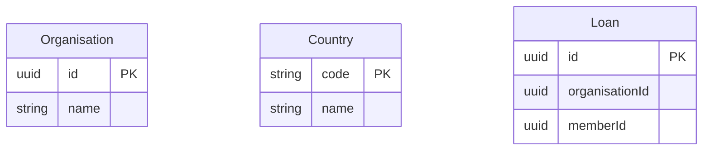

<!-- Generated by specarch document techspec from ../project/specarch.yaml, version 1.0.0; meta-model 1.0.0. Do not edit this file: change the YAML and generate again. -->

# Case: technical specification

Version 1.0.0 of the specification: 3 entities. The chapters follow arc42, and a chapter with nothing in the specification is left out.

## 1. Introduction and goals

## 5. Building blocks

### Organisation

| Field | Type | Required | Limits | Description |
|---|---|---|---|---|
| id | uuid | yes |   |   |
| name | string | yes | at most 100 characters |   |

Primary key: id.

### Country

| Field | Type | Required | Limits | Description |
|---|---|---|---|---|
| code | string | yes | at most 2 characters |   |
| name | string | yes | at most 100 characters |   |

Primary key: code.

### Loan

| Field | Type | Required | Limits | Description |
|---|---|---|---|---|
| id | uuid | yes |   |   |
| organisationId | uuid | yes |   |   |
| memberId | uuid | yes |   |   |

Primary key: id.

## 8. Cross-cutting concepts

### Permissions

Access is fail-closed: every operation, command and page names the one permission it needs, and only the roles below grant one.

| Permission | member | staff |
|---|---|---|
| loans.read | yes | yes |

The caller is who is making the call, as the service knows it once the session or token has been checked: one record with the properties below, which a role's rows rule names as caller.<property>. A property the caller may lack allows null, and a comparison with it is false then.

| Property | Type | Description |
|---|---|---|
| organisationId | uuid | The organisation every caller belongs to. |
| memberId | uuid or null | The member signed in; null for staff. |

The tenant scope: every role reaches only the records of an entity that carries organisationId whose organisationId is the caller's organisationId, and the table below holds that rule for each such entity, unless the role writes its own rule for it. Every tenant reads Country whole.

A role with a rows rule reaches only the records of the entity the rule holds for, through every operation, page and job; an entity not listed is reached whole, and a caller holding several roles reaches the union of their rows. A list shows only the rows, a read by key outside them answers not found, and a change that would leave them is refused.

| Role | Entity | Rows |
|---|---|---|
| member | Organisation | `id == caller.organisationId` |
| member | Loan | `organisationId == caller.organisationId && memberId == caller.memberId` |
| staff | Organisation | `id == caller.organisationId` |
| staff | Loan | `organisationId == caller.organisationId` |

